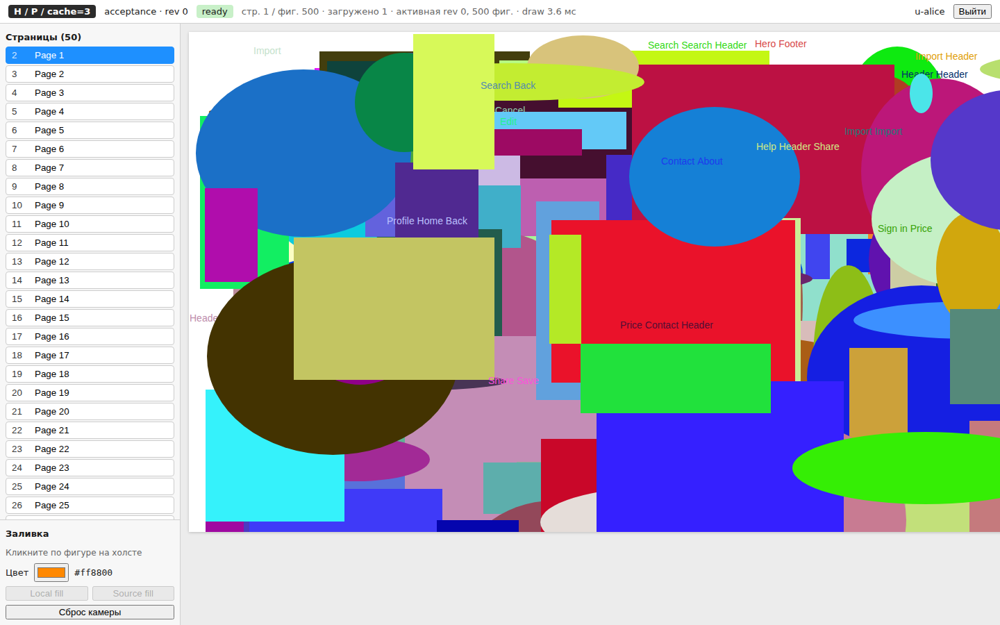
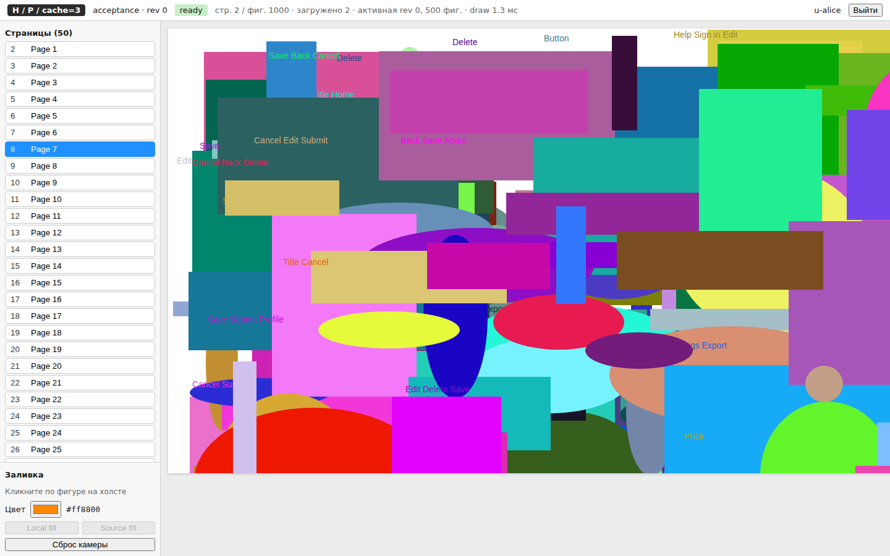
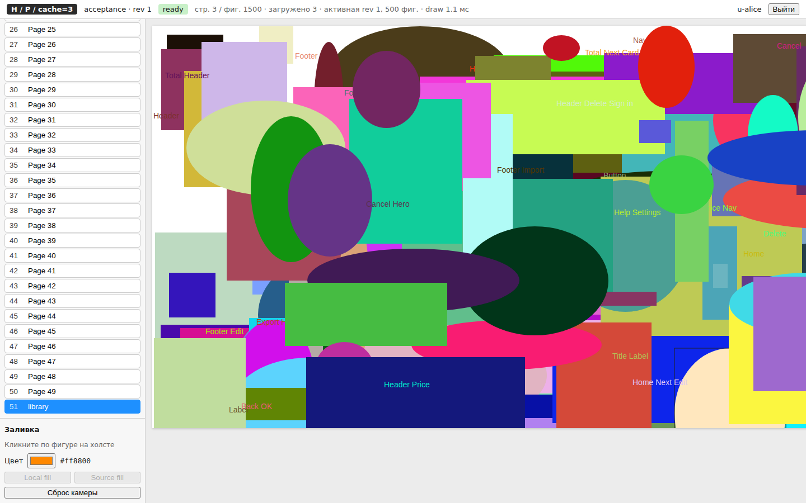

# Imago — экспериментальный стенд: управление клиентским состоянием веб‑редактора макетов при частичной загрузке

> **Отчёт по работе:** [`report/REPORT.md`](report/REPORT.md) · [`.docx`](report/) · [`.pdf`](report/) — 11 000 слов,
> методика, результаты 1 014 прогонов, проверка гипотез, условия применимости, план внедрения и границы работы.
> **Числа:** [`docs/results/`](docs/results/) (SUMMARY, FINDINGS, отчёты и графики по каждой серии) и сырые
> `results/<серия>/runs.csv` + `passport.json`. **Прототип на экране:** [`docs/screenshots/`](docs/screenshots/).



*Страница 7 с экземплярами общего компонента — до и после команды «заливка источника»; переопределённые
экземпляры сохраняют свой цвет, а страница 50, не загруженная в момент команды, приходит уже с новым:*

| до команды | после команды | незагруженная страница 50 |
|---|---|---|
|  |  |  |

---

Стенд к главе 1 диссертации (Орлов А. В.). Требования — [`SPEC.md`](SPEC.md). Один и тот же веб‑редактор
(Vite + React 19, Canvas 2D) с тремя взаимозаменяемыми адаптерами данных — **H** (`fetch` + `Map`),
**Q** (TanStack Query 5), **Z** (`@rocicorp/zero` 1.9.0 + zero‑cache) — в двух режимах загрузки: **F** (все страницы
при открытии) и **P** (активная страница + LRU‑окно `cache`). Сервер общий: Fastify 5 + PostgreSQL (явный SQL),
команды `setSourceFill` / `setLocalFill` с ревизиями и идемпотентностью; для Z — тот же предметный модуль внутри
push‑endpoint мутаторов. Измерительная оболочка (Playwright + `/proc` + CDP) прогоняет приёмочный сценарий §7.2
(а в остальных сериях — маршрут любой длины и любую из четырёх форм команды) через
сетевой шейпер и сверяет результат с независимым эталоном на Python; анализ — медианы, бутстреп, интервалы Уилсона,
изменение P−F внутри адаптера и сопоставление между адаптерами (§1.8).

Что уже сделано и с какими оговорками: [`docs/DEVIATIONS.md`](docs/DEVIATIONS.md) (отклонения от главы 1),
[`docs/PASSPORT.md`](docs/PASSPORT.md) (паспорт среды и серий), [`docs/INTEGRATION.md`](docs/INTEGRATION.md)
(сборка стенда и дымовые прогоны), [`docs/FUNCTIONAL_FINDINGS.md`](docs/FUNCTIONAL_FINDINGS.md) (функциональный допуск
всех измеряемых конфигураций — H, Q, Z × F, P/1, P/3, P/10 — на тех документах, которые их измеряют), [`docs/ZERO_SPIKE.md`](docs/ZERO_SPIKE.md) (Zero 1.9.0: что реально есть и как встроено).

**Состояние измерений (2026‑09‑14): программа 2 выполнена целиком** — **одиннадцать серий,
1 014 прогонов**, **все `outcome=ok` и `reference_ok=true`**, снятые **одним прогоном оркестратора**
2026‑09‑13/14 за **366 минут**. Вся программа — на одной сборке и одной измерительной оболочке:
`code.codeId = 4bb9e446…`, `client.buildId = e8d6c0b2…`, `serverDistSha256 = 4e890fb5…`,
`passport.harness.benchId = 8e1bdf1d09f201b6` — совпадают во всех одиннадцати паспортах.

| Серия | Конфигурации × повторений | Прогонов | Что закрывает |
|---|---|---|---|
| `main` | 6 × 30 | **180** | приёмочный сценарий §7.2 на 50×500, RTT 50 мс |
| `size-fraction-25x500`, `-50x500`, `-100x500` | 6 × 15 каждая | **270** | **контролируемая ось размера**: 12 500 / 25 000 / 50 000 фигур при ФИКСИРОВАННОЙ доле посещения 12 % и странице в 500 фигур; новые пресеты `frac-25x500`, `frac-100x500` |
| `route-repeat` | 12 × 10 | **120** | окно кеша 1/3/10 **с армом F** на маршруте, где окно связывает: 18 переходов, **13 разных страниц**, 6 возвратов |
| `command-shape` | 24 × 6 | **144** | форма команды на `doc-cmd-50x500`: 81 фигура/10 стр., 81/2, 51/50, 2 001/50 |
| `route-full` | 6 × 10 | **60** | документ просматривается целиком: 49 переходов, все 50 страниц |
| `rtt150` | 6 × 10 | **60** | RTT 150 мс против 50 |
| `doc50x1000`, `doc5x100` | 6 × 10 каждая | **120** | крайние точки **неконтролируемой** оси размера (размер и доля меняются вместе) |
| `cache3` | 6 × 10 | **60** | окно 3 **с армом F** на маршруте §7.2, где окно почти не связывает |

Серии программы 1 `cache10`, `doc10x200`, `doc100x500` **не переснимались**: `cache10` измеряла не
политику окна, а её отсутствие (на маршруте §7.2 окно 10 не вытесняет ни разу) и заменена ячейкой
`cache = 10` внутри `route-repeat`; `doc10x200` и `doc100x500` стояли на оси, где размер и доля
менялись вместе, и заменены осью `size-fraction-*`. Данные программы 1 целиком лежат в
**`results/archive/programme-1`** (834 прогона, схема из 100 колонок) и в выводах не участвуют;
отчётов по снятым сериям в `docs/results/` больше нет.

Что именно измерено и чем это ограничено — [`docs/PASSPORT.md`](docs/PASSPORT.md) §7; что исправлено
между программами — [`docs/DEVIATIONS.md`](docs/DEVIATIONS.md) §0; отчёты анализа — `docs/results/`
(`FINDINGS.md`, `RESULTS_cross.md`, `SUMMARY.md`, `RESULTS_<серия>.md`).

## Структура

```
SPEC.md                  требования (единый источник)
packages/shared/         типы, протокол, константы (@stand/shared)
packages/server/         Fastify 5 + postgres.js: routes/, domain/ (предметный модуль с малым интерфейсом транзакции), zero/ (schema, query, push)
packages/client/         Vite + React 19 + TS strict: adapters/{h,q,z}, canvas/, stand.ts (window.__stand)
packages/generator/      детерминированные документы (seed) → data/*.json + загрузка в PostgreSQL (+ shapes_baseline для reset)
packages/netshaper/      TCP/HTTP‑шейпер и маршрутизатор (задержка, token bucket, счётчики байт, /stats /config)
packages/bench/          Playwright: functional/ (таблица 1 + безопасность), scenario/ (§7.2), series/ (раннер, паспорт, CSV), sampling/ (/proc, CDP)
packages/reference/      Python‑эталон (без общих модулей с сервером): ожидаемое состояние, сверка с БД и снимками клиента
packages/analysis/       Python‑анализ: report.md + PNG, валидатор схемы runs.csv (COLUMNS.md)
infra/                   docker-compose.yml (профили h/q/z), Caddyfile, Dockerfile.api — не проверялись (нет демона)
scripts/                 запуск стенда процессами: start-db, migrate, gen-all, start-api, start-zero, start-shaper,
                         reset, run-functional, reference-check, run-all-series, stop-*
data/                    сгенерированные документы (json + sha256)
results/                 сырые измерения программы 2: <series>/{runs.csv, runs/*.json, reference/, passport.json, pre-series-checks.txt}, logs/, progress.json;
                         archive/programme-1/ — программа 1 целиком (834 прогона, 100 колонок), с текущими данными не смешивается
docs/                    DEVIATIONS, PASSPORT, INTEGRATION, FUNCTIONAL_FINDINGS, ZERO_SPIKE; docs/results/ — отчёты по сериям
```

Язык кода — английский; README, отчёты и комментарии к решениям — русский.

## Предварительные требования (песочница)

| Компонент | Что нужно |
|---|---|
| Node.js **24** | `/opt/node24/bin/node` (v24.21.0): `export PATH=/opt/node24/bin:$PATH`; системный node 22 не использовать |
| PostgreSQL **16** | кластер `16/main` на 5432, `postgres`/`postgres`, `wal_level=logical` (ставит `scripts/start-db.sh`); глава просит 17 — DEVIATIONS 1.1 |
| Playwright 1.56.0 + Chromium 141 | предустановлен в `/opt/pw-browsers`: `export PLAYWRIGHT_BROWSERS_PATH=/opt/pw-browsers`; **`playwright install` не запускать** |
| Python 3.11 | `pip install -r packages/reference/requirements.txt -r packages/analysis/requirements.txt` (psycopg 3, numpy, pandas, matplotlib, pytest) |
| CPU/RAM | 2 vCPU / 8 ГиБ — клиент и сервер на одной машине (DEVIATIONS 1.3); серии не запускать параллельно с другой нагрузкой |
| `tc/netem` | недоступен → `packages/netshaper` (DEVIATIONS 1.4) |

## Воспроизведение с нуля (песочница, процессы)

Все команды из корня репозитория.

```bash
export PATH=/opt/node24/bin:$PATH PLAYWRIGHT_BROWSERS_PATH=/opt/pw-browsers

# 0. зависимости (версии закреплены в package-lock.json; между сериями не обновлять — SPEC §10)
npm ci                                  # или npm install
pip install -r packages/reference/requirements.txt -r packages/analysis/requirements.txt

# 1. база данных → схема → документы
scripts/start-db.sh                     # PostgreSQL 16, wal_level=logical, БД editor
scripts/migrate.sh                      # схема + пользователи alice/alice-pass, bob/bob-pass (идемпотентно)
scripts/gen-all.sh                      # data/*.json (+sha256) и загрузка в БД: doc-acc-50x500, doc-small-5x100, doc-small-10x200,
                                        # doc-large-100x500, doc-dense-50x1000 (alice), doc-bob-5x50 (bob); снимок shapes_baseline для reset

# 2. сборка (shared → server → client; клиент — production-сборка в packages/client/dist, её отдаёт API с корня /)
npm run build

# 3. серверная сторона (порядок важен: API раньше zero-cache; API читает dist при старте — после пересборки клиента перезапустить)
STAND_LOG_LEVEL=warn scripts/start-api.sh --build    # :3000, STAND_TEST_HOOKS=1; results/logs/api.{log,pid}; warn — для серий (DEVIATIONS 4.1)
scripts/start-zero.sh                                # zero-cache 1.9.0 :4848 (публикация stand_zero, реплика results/zero-replica/); ≈10 с
scripts/start-shaper.sh                              # :8080 (клиент) / :8081 (stats): /api→3000, /zero→4848, /→3000; 25 мс, 20 Мбит/с, ведро 20 мс
curl -s localhost:3000/api/health; curl -s localhost:8081/config; curl -s localhost:4848/     # → ok / параметры / OK

# 4. функциональный допуск (SPEC §6, таблица 1 + безопасность) — все измеряемые конфигурации
scripts/run-functional.sh --adapters H,Q --port 3005                          # свой API :3005 (info-логи), ≈1 мин
scripts/run-functional.sh --adapters Z --base http://127.0.0.1:8080 --caches 1   # Z через общий стек, ≈1 мин
#   → results/functional/<timestamp>/summary.{json,md}; код 1 при провалах — конфигурация к серии не допускается (§1.7).
#   run-all-series.sh делает этот допуск сам (в нескольких заходах: свой документ каждой серии + полный набор на малом)
#   и проверяет его воротами admission-gate перед запуском измерений.

# 5. дымовая серия конвейера (6 конфигураций × 2, ≈3.5 мин) и один прогон для отладки
node packages/bench/src/series/run.mjs --config packages/bench/series/smoke.json --repetitions 2 --progress results/progress.json
scripts/reset.sh doc-acc-50x500
node packages/bench/src/scenario/cli.mjs --base http://127.0.0.1:8080 --adapter Z --mode P --cache 1 \
     --doc doc-acc-50x500 --source doc-acc-50x500-src-1 --fill '#1e90ff' --out /tmp/run.json

# 6. серии измерений (§7.4). ВСЯ ПРОГРАММА ЗАПУСКАЕТСЯ ОДНИМ ВЫЗОВОМ — иначе серии могут разойтись
#    по версии измерительной оболочки (так распалась программа 1: 100 против 115 колонок).
node packages/bench/src/series/harness-check.mjs packages/bench/series/*.json   # код 1 → рядом лежит каталог, снятый ДРУГОЙ оболочкой: перенести в results/archive/
scripts/run-all-series.sh --estimate            # оценка времени (фактически программа 2 заняла 366 мин)
scripts/run-all-series.sh                       # ПРОГРАММА 2 ЦЕЛИКОМ: 11 серий, 1 014 прогонов; возобновляемо; прогресс — results/progress.json, лог — results/logs/run-all-series.log
#   порядок SERIES_ORDER: main → size-fraction-25x500 → -50x500 → -100x500 → route-repeat → command-shape → route-full → rtt150 → doc50x1000 → doc5x100 → cache3
#   ВНИМАНИЕ: --with-optional ДОБАВЛЯЕТ снятые с программы серии cache10, doc10x200, doc100x500 (SERIES_OPTIONAL) — для воспроизведения программы 2 флаг НЕ НУЖЕН.
#   Их конфигурации оставлены в репозитории (запускаются явным --only), данные — results/archive/programme-1, в отчёты программы 2 они не входят.
#   route-full, route-repeat и command-shape — часть программы 2 и идут БЕЗ всяких флагов (в программе 1 они были «необязательной группой»).
#   отдельная серия: node packages/bench/src/series/run.mjs --config packages/bench/series/main.json [--only Z:P:1] [--repetitions N] [--dry-run]

# 7. анализ
cd packages/analysis
python3 -m analysis.report --series ../../results/main --validate-only
python3 -m analysis.report --series ../../results/main --out ../../docs/results/RESULTS_main.md --figs ../../docs/results/figs/main \
        --compare ../../results/size-fraction-25x500,../../results/size-fraction-50x500,../../results/size-fraction-100x500,../../results/route-repeat,../../results/cache3,../../results/route-full,../../results/rtt150,../../results/doc50x1000,../../results/doc5x100
python3 -m analysis.cross --series main=../../results/main,size-fraction-25x500=../../results/size-fraction-25x500,size-fraction-50x500=../../results/size-fraction-50x500,size-fraction-100x500=../../results/size-fraction-100x500,route-repeat=../../results/route-repeat,command-shape=../../results/command-shape,route-full=../../results/route-full,rtt150=../../results/rtt150,doc50x1000=../../results/doc50x1000,doc5x100=../../results/doc5x100,cache3=../../results/cache3 \
        --out ../../docs/results/RESULTS_cross.md --figs ../../docs/results/figs/cross   # все 11 серий программы 2
#   готовые отчёты программы: docs/results/RESULTS_<серия>.md, RESULTS_cross.md, SUMMARY.md, FINDINGS.md, figs/

# остановка (PostgreSQL не трогает)
scripts/stop-all.sh
```

Проверки: `npm test --workspaces --if-present` (server: unit + интеграция с реальной БД; client: Playwright против мока,
включая разделение bundle; bench: сэмплеры и раннер на фейках; netshaper: RTT/полоса/WS/счётчики), `npm run test:z -w packages/client`
(адаптер Z против реального стека: `STAND_Z_API=http://127.0.0.1:3000 STAND_Z_SHAPER=http://127.0.0.1:8080 STAND_Z_SHAPER_STATS=http://127.0.0.1:8081`),
`cd packages/reference && python3 -m pytest`, `cd packages/analysis && python3 -m pytest`. Тесты не запускать во время серии.

Открыть клиент вручную: `http://127.0.0.1:8080/?adapter=H|Q|Z&mode=F|P&cache=1|3|10&doc=doc-acc-50x500&autologin=alice&pass=alice-pass`
(пароль обязателен: production-сборка клиента паролей тестовых учёток не содержит — `docs/DEVIATIONS.md` 5.2)
(контракт `window.__stand` — `packages/client/README.md`).

## Воспроизведение в Docker (compose, профили) — не проверялось в песочнице

```bash
cp infra/.env.example infra/.env && $EDITOR infra/.env       # STAND_JWT_SECRET и ZERO_ADMIN_PASSWORD обязательны
cd infra && docker compose --profile z config >/dev/null      # валидность (см. примечание ниже)
docker compose --profile h up -d        # postgres:17 + api + caddy      → адаптеры H и Q (http://127.0.0.1:8080)
docker compose --profile z up -d        # + zero-cache 1.9.0             → адаптер Z
# схема и документы — из хоста в контейнерный PostgreSQL (порт по compose), затем те же шаги 4–7;
# шейпер запускается на хосте перед Caddy: STAND_SHAPER_ROUTES='/=127.0.0.1:8080' STAND_SHAPER_PORT=8090 scripts/start-shaper.sh,
# а сериям передаётся baseUrl http://127.0.0.1:8090 (series/*.json → baseUrl) и api.url — адрес API для хуков.
```

Образы закреплены по digest'ам манифестов (§1.9), полученным из реестра **без docker-демона** — команда
получения и дата фиксации записаны в шапке `infra/docker-compose.yml`. Лимиты ресурсов распределяют
серверный бюджет §1.2 (4 vCPU / 8 ГиБ на всю конфигурацию, включая zero-cache) и одинаковы во всех
профилях, чтобы сравнение адаптеров не измеряло разницу лимитов. У zero-cache есть healthcheck: §1.9
требует проверок готовности, «запуск процесса ещё не означает готовности реплики обслуживать чтение».
`ZERO_ADMIN_PASSWORD` не имеет значения по умолчанию — compose остановится, пока он не задан.
Caddyfile маршрутизирует `/api/*` → api, `/zero/*` → zero-cache (WebSocket), остальное → статика api —
так же, как шейпер в песочнице, и дополнительно отдаёт 403 на административные пути zero-cache.
**Путь Docker в песочнице не запускался** (нет демона) — проверена только валидность конфигурации.

> `docker compose --profile z config` **намеренно падает без заполненного `infra/.env`**:
> `STAND_JWT_SECRET` и `ZERO_ADMIN_PASSWORD` не имеют значений по умолчанию (§1.6, DEVIATIONS §5.1),
> и compose останавливается с «required variable … is missing a value». Это не дефект конфигурации,
> а её свойство: проверять валидность нужно с заполненными секретами. Проверено 2026‑09‑13 —
> `docker compose --env-file <env> --profile {h,q,z} config` даёт код 0 для всех трёх профилей и
> разворачивает образы по закреплённым digest'ам (`postgres:17-alpine@sha256:18cfe3ef…`,
> `rocicorp/zero:1.9.0@sha256:f80683bf…`, `caddy:2@sha256:13ba145c…`, `stand/api:local`).

## Где что лежит после измерений

```
results/<series>/runs.csv                 одна строка на прогон (схема packages/analysis/COLUMNS.md; проверка --validate-only)
results/<series>/runs/<run_id>.json       шаги (retained через getRetainedAsync), снимки, журнал событий, сэмплы сервера/Chromium, CDP, шейпер
results/<series>/reference/<run_id>/      commands.json, snapshots/, report-snapshots.json, report-db.json, reference.log
results/<series>/passport.json            паспорт серии (хост, версии, шейпер effective, seed, план, harness, preSeriesChecks)
results/<series>/pre-series-checks.txt    дословный вывод предсерийных проверок §1.7 для этой серии
results/<series>/report.md, figs/         отчёт анализа по серии (если строился в каталог серии)
results/functional/<timestamp>/           summary.{json,md} функциональных проверок
results/progress.json                     прогресс оркестратора/раннера (серия, N/всего, ETA, последний исход)
results/logs/                             api.log, zero-cache.log, shaper.log, run-all-series.log, *.pid
results/archive/programme-1/              программа 1 целиком (834 прогона, 100 колонок) — снята с производства, не смешивать
results/archive/                          прочие прогоны прежних состояний стенда (не смешивать с текущими сериями)
docs/results/                             отчёты анализа: RESULTS_<серия>.md, RESULTS_cross.md, SUMMARY.md, FINDINGS.md, figs/ (§7.5)
```

Сброс состояния между прогонами делает сама оболочка (`POST /api/test/reset` + новый Chromium); вручную — `scripts/reset.sh [docId]`.
После пересоздания БД или перезаливки документов — `scripts/zero-reset-replication.sh` (реплика zero‑cache).

## Ключевые решения и ограничения (кратко; полностью — `docs/DEVIATIONS.md`)

* Клиент и сервер на одной 2‑vCPU машине → результаты — отдельная серия по §1.2; сравнения только внутри среды.
* Нет netem → собственный шейпер (без потерь), ведро 20 мс ≈ 50 КБ; задержка TCP‑рукопожатия
  **включена по умолчанию** (`--handshake-rtt`, 2·`delayMs` на каждое новое соединение) и записана
  в паспорт (`shaper.effective.handshakeRtt = true` во всех одиннадцати сериях). Цена рукопожатия у
  адаптеров разная — 8 новых соединений за прогон у H/Q в F против 5 у Z (`docs/DEVIATIONS.md` 1.4).
* Z: права при трансформации synced query (join‑условие делало IVM в 15 раз дороже), `command-acked` = `.server` + `GET /api/operations`,
  `getRetained()` — асинхронный кеш → оболочка использует `getRetainedAsync()` у всех адаптеров.
* Моменты команды независимы: `command-drawn` — фактическая отрисовка (ревизия ≥ `expectedRevision+1`),
  `command-acked` — подтверждение сервера. У Z отрисовка обычно **опережает** подтверждение
  (DEVIATIONS 2.2); отчёт показывает обе величины и их разность внутри прогона.
* Bundle разделён по адаптерам (динамический `import`): H ≈ 255 КБ, Q ≈ 286 КБ, Z ≈ 559 КБ вместо 594 КБ для всех
  (измеряемая сборка `client.buildId = e8d6c0b2…`, одна и та же во всех одиннадцати сериях).
* **Обмен в отчётах считается по данным, а не по общему счётчику**: `bytes_in_data = bytes_in_api +
  bytes_in_zero`, без статики сборки — она поадаптерная константа (H 260 394 Б, Q 291 406,
  Z 572 524) и одинакова в F и в P. Разложение `api + zero + статика + прочее = итог` сошлось
  **побайтно во всех 1 014 прогонах** (`docs/DEVIATIONS.md` §0, 3.1).
* **Пики памяти публикуются без окон измерительной пробы** (`chromium_private_peak_excl_probe_mib`,
  `server_*_mem_peak_excl_probe_mib`): сэмплер не останавливается на время точного скана хранилища,
  а у Z/F скан стоит секунды — сырой пик Z/F в `main` 261.7 МиБ против 236.2 без окон пробы.
  Число окон проб одинаково у всех конфигураций внутри серии (`docs/DEVIATIONS.md` §0, 2.4).
* **Идентичность оболочки закреплена**: `passport.harness.benchId` (sha256 по `packages/bench/src/**`)
  одинаков у всех серий одной программы, `harness_id` дублируется в каждую строку CSV, а
  `harness.comparableBy` перечисляет поля, по которым серии сравнимы (`benchId`, `benchSrcSha256`,
  `netshaperSrcSha256`, `columnsSha256`, `referenceSha256`). Предстартовая сверка —
  `harness-check.mjs` (`docs/PASSPORT.md` §7.2).
* Серии идут при `STAND_LOG_LEVEL=warn`; zero‑cache остаётся запущенным и в прогонах H/Q, и его расход
  **измеряется в каждом прогоне** (`server_zero_*` + признак `server_zero_applicable`): в H/Q это
  ≈ 40 мс CPU и ≈ 755 МиБ частной памяти (≈ 948 МиБ RSS) — фон, который в бюджет H/Q не входит, но
  ту же машину занимает; у Z — 665 мс (P) и 2 130 мс (F) CPU. Плюс ≤ 5–10 мс CPU PostgreSQL на прогон
  от backend'ов zero‑cache внутри группы `pg` (`docs/DEVIATIONS.md` 4.2).
* API и zero‑cache слушают `127.0.0.1` (`STAND_HOST`, `scripts/zero-ipv4-shim.mjs`), Caddy публикуется
  на `127.0.0.1`, `ZERO_ADMIN_PASSWORD` без значения по умолчанию, хуки `/api/test/*` требуют заголовок
  `x-stand-test-secret`. Секрет подписи и пароли тестовых учёток в клиентскую сборку не попадают;
  токен живёт 15 мин и хранится только в памяти. Подробности — `docs/DEVIATIONS.md` §5.
* Все ответы `/api/**` несут `Cache-Control: no-store` и не несут `ETag`/`Last-Modified`: каждое
  чтение страницы — реальное сетевое чтение, а не попадание в HTTP‑кеш браузера (`docs/DEVIATIONS.md` 4.3).
  Проверено по данным: число запросов API у клиента и на шейпере совпало в 180 прогонах из 180
  серии `main` (15/15 в P, 63/63 в F, 3/3 у Z).
* Оптимистичная (клиентская) часть мутатора Zero в измеряемом пути **отключена**
  (`Z_SETTINGS.optimistic = false`; возврат — `?zopt=1`): все времена команды у Z относятся к
  подтверждённому сервером состоянию, воспринимаемая отзывчивость Zero не измеряется
  (`docs/DEVIATIONS.md` 2.5).
* **Паритет измерения** между адаптерами: расписание проб удержания одинаково у всех
  (`retained_probe_mode = cached-steps+exact-after-cmd-and-end` во всех 1 014 прогонах), число
  принудительных сборок мусора одинаково внутри серии у всех конфигураций и равно `2·(длина
  маршрута + 1) + 4` (`js_heap_gc_count` = 26 на маршруте §7.2; 16 / 28 / 52 на оси
  `size-fraction-*`; 42 в `route-repeat`, 104 в `route-full`), число окон измерительных проб —
  константа внутри серии, группа `zero` сэмплируется в каждом прогоне
  (`docs/DEVIATIONS.md` §0, 2.4, 4.2).
* **Эталон проверяет каждое посещение**, а не только последнюю страницу: `compare-snapshots
  --require-visits` — во всех 1 014 прогонах `visits = visitsCovered` (11 на маршруте §7.2;
  6 / 12 / 24 на оси `size-fraction-*`; 19 в `route-repeat`, 50 в `route-full`) при нуле
  расхождений, плюс `compare-db` по всем фигурам документа и журналу `operations` каждый прогон.
* **Строгие ворота допуска** (`packages/bench/src/functional/admission-gate.mjs`): каждая измеряемая
  конфигурация обязана иметь допуск на **своём** документе плюс полный набор проверок хотя бы на одном;
  «допуск с оговоркой» по умолчанию считается провалом (ослабление — только явным
  `STAND_ADMISSION_ALLOW_CAVEAT=1`). Ворота программы 2 пройдены с первого захода: **72 строки
  «серия × конфигурация», все «допущена», `problems` и `caveats` пусты**
  (`results/functional/admission-2026-09-13_19-33-22-gate.md`) — допуск снимался на семи документах,
  включая `doc-frac-25x500`, `doc-frac-100x500` и `doc-cmd-50x500`.
* Идемпотентность команды: ключ — `opId`, параметры — `docId/type/targetId/fill`. `expectedRevision`
  в ключ **не входит**, поэтому повтор той же команды после сдвига ревизии возвращает сохранённый
  результат, а не `op_conflict` (`docs/DEVIATIONS.md` 4a).

## Границы выполненной работы

Что глава 1 требует, но этот этап **не реализует**, — и границы переноса выводов, которые
обнаружились уже по данным. Полные формулировки с разбором «влияет ли на выводы» —
`docs/DEVIATIONS.md` §6 (обязательства главы 1) и §4.7–§4.12 (границы, найденные анализом); здесь —
перечень, чтобы ни один пункт не остался умолчанием. Таблица ниже содержит **только открытые**
пункты; закрытые перечислены отдельным списком после неё со свидетельством (объявлять несделанным
то, что уже сделано, — такая же ошибка, как умолчание).

| Обязательство главы 1 / граница | Что вместо этого | Влияет на выводы |
|---|---|---|
| Импорт Pencil (§1.9) | детерминированный генератор с seed и контрольной суммой | нет — на сравнение адаптеров; да — на заявление о переносе существующих макетов |
| Контрольное обновление зависимости и повторное развёртывание (§1.3, §1.7) | не выполнялось; версии закреплены (SPEC §10 запрещает обновления между сериями) | нет — на измерения; да — на оценку сопровождаемости |
| **Журнал работ и трудоёмкость (§1.3, §1.8)** | не ведётся; плановый бюджет 160 ч ни с чем не сопоставлен | **да, прямо:** критерий §1.8 «трудоёмкость по журналу» к выбору адаптера не применяется, и выводы обязаны это сказать |
| Остановка серии при 80 % диска (§1.7) — **частично** | предсерийная проверка автоматизирована (`scripts/replication-check.sh`, порог 32 ГиБ); занятое место пишется в каждый прогон (`server_disk_used_bytes`, `zero_replica_bytes`), но остановки посреди идущей серии нет | нет: по 1 014 прогонам реплика 89.9–90.1 МБ, занято 4.18–5.38 ГиБ из 32; риск остаётся для будущих серий масштаба `size-fraction-100x500` / `doc50x1000` |
| Серия с предварительной загрузкой (§1.6) | не реализована (§1.6 требует её только при отдельном включении) | нет; граница применимости |
| Сжатие в измеряемом пути (§1.9 против §7.1) | Caddy сжимает HTTP, измеряемый путь — нет; ни HTTP, ни WebSocket | **да для одного вывода:** абсолютные объёмы обмена на контур с Caddy не переносятся |
| Вклад synced query `docMeta` в обмен и CPU Z (§1.2, таблица 2) | HTTP‑часть измерена (`docs/DEVIATIONS.md` 4.4: 2 839 Б, 53.2 мс, 83 % HTTP‑трафика Z); синхронизируемая часть отдельной колонкой не выводится | да — на разбор Z: часть кадров WebSocket относится к стендовому артефакту готовности, и отчёт её не вычитает |
| Серии команд подряд и длинные сеансы | каждый прогон выполняет **ровно одну** команду и длится 8–65 с; накопление состояния за десятки минут не измерялось (`docs/PASSPORT.md` §7.1) | да, граница применимости: выводы о памяти и удержании относятся к одному сеансу до одной команды |
| Воспринимаемая отзывчивость Z | оптимистичная часть мутатора Zero в измеряемом пути **отключена** (`Z_SETTINGS.optimistic = false`; возврат — `?zopt=1`); все времена команды у Z относятся к подтверждённому сервером состоянию (`docs/DEVIATIONS.md` 2.5) | да, прямо: главное заявленное преимущество Zero этим стендом **не измеряется** — сравнение идёт по подтверждённому состоянию, одинаково для всех трёх адаптеров |
| Ось размера — три точки при ОДНОЙ доле посещения | `size-fraction-*`: 12 500 / 25 000 / 50 000 фигур при доле 12 % и странице 500 фигур; поведение при другой доле и другом размере страницы этой осью не задано, `doc50x1000` и `doc5x100` стоят на неконтролируемой оси | да, граница применимости: «порога окупаемости по размеру» по обмену нет, но утверждение проверено только на этих трёх точках |
| Команда на оси `size-fraction-*` подаётся после **первого** перехода, а не пятого | иначе её область и положение в маршруте зависели бы от размера документа | да, локально: `t_cmd_*` этих серий с `main` несопоставимы и эффектом размера не являются (`docs/results/FINDINGS.md` §10, аномалия 6) |
| Пик JS‑кучи у Z/F систематически занижен | сэмплер кучи останавливается на время точного скана хранилища; покрытие у Z/F падает до **0.565** (`doc50x1000`) при 1.000 у H/Q (`js_heap_sampler_coverage`, `docs/DEVIATIONS.md` §4.14) | да, для выводов о куче у Z: величина занижения не измерена |
| p95 серверного CPU искажён фоновыми всплесками кластера | пять прогонов программы дают ×3.5…×18.1 от медианы своей ячейки (`route-full-0003-HP1` 10 230 CPU‑мс, `main-0159-QF1` 6 130); ни один не отброшен (`docs/DEVIATIONS.md` §4.10) | да, только для p95 серверного CPU; медианы не двигаются |
| Доля «сценарий в бюджете ≥ 95 %» формально недостижима | при нуле отказов нижняя граница Уилсона — 88.7 % (n = 30) и 72.2 % (n = 10); фактическая доля 100 % (`docs/DEVIATIONS.md` §4.15) | да, формально: бюджет помечен «не решено», для подтверждения нужен n ≥ 73 |
| Абсолютные времена команды между сериями несравнимы | медианы `t_cmd_drawn` Z/F на **одной и той же** команде: `cache3` 219.8, `route-full` 280.5, `main` 289.3, `command-shape` 321.2, `route-repeat` 342.5 мс — при одном документе, маршруте и канале (`docs/DEVIATIONS.md` §4.8) | да, для межсерийных сопоставлений: сравнимой величиной остаётся изменение **внутри** серии; парные сравнения вариантов внутри `command-shape` этим не затронуты |

**Закрыто по ходу работы** (было в этой таблице, подробности — `docs/DEVIATIONS.md` §6; что
исправлено между программой 1 и программой 2 — `docs/DEVIATIONS.md` §0). У каждого пункта названо
свидетельство, по которому закрытие проверяется:

* **проверка восстановления резервной копии** — `scripts/backup-restore-check.sh`, выполнена перед
  программой 2: девять документов, 215 250 фигур, все контрольные суммы состава совпали
  (`docs/PASSPORT.md` §8.4);
* **наблюдение за репликацией и задержкой доставки** — `scripts/replication-check.sh`, выполнено
  (§8.2; первый же запуск в своё время нашёл брошенный слот на 4.44 ГиБ WAL);
* обе проверки прошли перед программой 2 (2026‑09‑13T19:33:22Z), их дословный вывод лежит и в
  `results/logs/pre-series-checks-2026-09-13_19-33-22.txt`, и **рядом с каждой из одиннадцати серий**
  (`results/<серия>/pre-series-checks.txt`), поэтому во всех одиннадцати паспортах
  `preSeriesChecks.manual.status = "performed"` — расхождение программы 1 («выполнены, а паспорт
  пишет `not-performed`») закрыто (`docs/PASSPORT.md` §8, §8.4);
* **идентификатор сборки и настройки адаптеров в паспорте** — `client.buildId`, `client.dist`,
  `adapters.*`; все одиннадцать серий на одной сборке `e8d6c0b2…`;
* **идентичность измерительной оболочки** — `passport.harness.benchId = 8e1bdf1d09f201b6` и все поля
  `comparableBy` совпадают у одиннадцати серий, `harness_id` каждой строки CSV совпал с паспортом во
  всех 1 014 прогонах, набор колонок один (**136**) — так закрыт дефект программы 1, где серии
  разошлись по версиям оболочки (100 против 115 колонок);
* **секреты не попадают в паспорт** — `redactSecrets()` по имени ключа; пароль тестовой учётки,
  лежавший во всех одиннадцати паспортах программы 1, из паспортов программы 2 исключён;
* **перемер после исправления моментов команды** — вся программа снята на новой семантике
  (1 014 прогонов, `cmd_drawn_before_ack` в **338/338** прогонах Z, совпадений `drawn ≈ ack` —
  **0 из 1 014**);
* **сверка снимков ВСЕХ загруженных страниц в режиме P** (`compare-snapshots --require-visits` +
  журнал посещений от сценария) — `visits = visitsCovered` в каждом из 1 014 прогонов при нуле
  расхождений, `compare-db` — 0 расхождений по всему документу каждый прогон;
* **обмен читается «только данные»** — разложение по маршрутам шейпера сошлось побайтно во всех
  1 014 прогонах, остатки нулевые;
* **пики памяти без окон измерительной пробы** — `*_excl_probe_*`, паритет числа окон внутри серии;
* **последовательное обращение ко всему содержимому документа** (введение §1.4) — серия
  **`route-full`**: выигрыш P сохраняется у H и Q, но **у Z инвертируется** (`docs/DEVIATIONS.md`
  §6, п. 15);
* **доля изменённых объектов и их размещение** (введение §1.4) — серия **`command-shape`**,
  4 варианта команды на одном маршруте и документе (§6, п. 16; §4.12);
* **порог окупаемости по размеру документа** (введение §1.4) — ось **`size-fraction-*`** при
  фиксированной доле 12 %: по обмену порога **нет**, по памяти есть (§6, п. 17; §4.13);
* **ось окна кеша прошла по §1.8 целиком** — в `cache3` и `route-repeat` появился арм F, поэтому
  P−F вычисляется внутри серии, а не переносится из `main` (§4.7);
* **задержка TCP‑рукопожатия** включена по умолчанию и её цена измерена (DEVIATIONS 1.4);
* **закрытые служебные порты и секрет тестовых хуков** в песочнице (`STAND_HOST=127.0.0.1`,
  `x-stand-test-secret`), в Compose тестовые хуки выключены по умолчанию и закрыты `403` в Caddy;
  пароль автологина в измеряемом пути не идёт в URL (`credentialsVia = "page-context"` в каждом
  прогоне);
* **освоение разработчика за две недели** (`docs/ZERO_SPIKE.md`, README, функциональные проверки).
