# Результаты серии «cache3»

Сформировано 2026-09-14 02:49 UTC из `../../results/cache3/runs.csv` (60 прогонов, 6 конфигураций). Бутстреп: 2000 ресемплов, seed=42, перцентильные 95 % интервалы. Времена и ресурсы считаются по прогонам с `outcome=ok`; доли — по всем начатым прогонам.

**Определения статистик** (одинаковы во всех таблицах): медиана — обычная выборочная; p95 — перцентиль по линейной интерполяции порядковых статистик (`numpy.percentile`, тип 7), при n = 30 это интерполяция между 29‑м и 30‑м значением, поэтому p95 не превышает максимум выборки и при малых n смещён вниз; интервалы медианы и p95 — перцентильный бутстреп по одной матрице ресемплов (согласованы между собой); доли — интервал Уилсона 95 % без поправки на непрерывность; при n < 8 интервалы помечены † как ненадёжные, при n < 2 не строятся.

Проверка схемы: OK — rows=60

## 1. Паспорт серии

| Параметр | Значение |
|---|---|
| `series` | cache3 |
| `startedAt` | 2026-09-14T01:36:35.448Z |
| `finishedAt` | 2026-09-14T01:53:08.962Z |
| `host` | {"hostname": "vm", "os": "Linux 6.18.44-fc-v24", "platform": "linux", "arch": "x64", "kernel": "6.18.44-fc-v24", "distro": "Ubuntu 24.04.4 LTS", "cpuModel": "Intel(R) Xeon(R) Processor @ 2.80GHz", "cp |
| `versions` | {"node": "v24.21.0", "npm": "11.19.0", "postgres": "psql (PostgreSQL) 16.13 (Ubuntu 16.13-0ubuntu0.24.04.1)", "chromium": "141.0.7390.37", "playwright": "1.56.0", "zero": "1.9.0", "reactQuery": "5.102 |
| `packages` | {"playwright": "1.56.0", "@types/node": "24.13.4", "typescript": "5.9.3", "ws": "8.21.3", "@rocicorp/zero": "1.9.0", "@tanstack/react-query": "5.102.8", "react": "19.3.0", "react-dom": "19.3.0", "@typ |
| `packagesHoistedDifferent` | {"postgres": "3.4.7", "@fastify/cors": "10.1.0"} |
| `workspacePackages` | {"packages/bench": {"playwright": "1.56.0", "@types/node": "24.13.4", "typescript": "5.9.3", "ws": "8.21.3"}, "packages/client": {"@rocicorp/zero": "1.9.0", "@tanstack/react-query": "5.102.8", "react" |
| `lockfileVersion` | 3 |
| `shaper` | {"delayMs": 25, "bandwidthMbit": 20, "handshakeRtt": true, "statsUrl": "http://127.0.0.1:8081", "effective": {"delayMs": 25, "bandwidthMbit": 20, "bucketMs": 20, "segmentBytes": 4096, "bucketBytes": 5 |
| `seed` | 20260911 |
| `repetitions` | 10 |
| `configs` | [{"adapter": "H", "mode": "F", "cache": 1}, {"adapter": "Q", "mode": "F", "cache": 1}, {"adapter": "Z", "mode": "F", "cache": 1}, {"adapter": "H", "mode": "P", "cache": 3}, {"adapter": "Q", "mode": "P |
| `seriesConfig` | {"name": "cache3", "doc": "doc-acc-50x500", "sourceId": "doc-acc-50x500-src-1", "fill": "#1e90ff", "docJson": "data/acceptance.json", "configs": [{"adapter": "H", "mode": "F", "cache": 1}, {"adapter": |
| `procGroups` | [{"name": "api", "pidFile": "/home/claude/stand/results/logs/api.pid", "exclude": ["netshaper", "zero-cache"]}, {"name": "pg", "patterns": ["(^\|/)postgres .*16/main", "^postgres: 16/main"], "exclude": |
| `browser` | {"channel": "chromium", "args": ["--disable-extensions"], "headless": true, "viewport": {"width": 1280, "height": 800}} |
| `scenario` | {"route": [2, 3, 1, 4, 2, 5, 1, 6, 3, 50], "pauseMs": 1000, "budgets": {"firstReadyMs": 2000, "navMs": 1000, "cmdDrawnMs": 2000, "scenarioMs": 30000}} |
| `plan` | [{"run_id": "cache3-0000-HP3", "order_index": 0, "repetition": 0, "adapter": "H", "mode": "P", "cache": 3}, {"run_id": "cache3-0001-ZP3", "order_index": 1, "repetition": 0, "adapter": "Z", "mode": "P" |
| `client` | {"dist": [{"path": "adapter-settings.json", "bytes": 1004, "mtime": "2026-09-13T19:30:30.755Z", "sha256": "5d7d9af8420141ebb66ea6894d26792039f489306b9ba46bfea9900ef01071b1"}, {"path": "assets/h-BRsLg0 |
| `adapters` | {"available": true, "source": "packages/client/dist/adapter-settings.json", "generatedFrom": ["packages/client/src/adapters/types.ts → ADAPTER_SETTINGS", "packages/client/src/adapters/settings.ts → Z_ |
| `api` | {"url": "http://127.0.0.1:3000", "available": true, "logLevel": "warn", "health": {"status": "ok", "db": "ok", "uptimeSec": 61998, "testHooks": true, "logLevel": "warn", "now": "2026-09-14T01:36:35.68 |
| `zero` | {"config": {"pid": 1025, "env": {"ZERO_QUERY_URL": "http://127.0.0.1:3000/api/zero/query", "NODE_OPTIONS": "--max-old-space-size=8192 --import=/home/claude/stand/scripts/zero-ipv4-shim.mjs", "ZERO_ENA |
| `commit` | None |
| `code` | {"commit": null, "isGitRepo": false, "dirty": null, "codeId": "4bb9e4465904a250bc72d8338d19363855cfe7f827b12662d8600f4f90ee5917", "clientBuildId": "e8d6c0b226b1ac5d27bc8bd39b66d2b5bc2aab491b4d5f8e554c |
| `harness` | {"harnessId": "9d40786fb6332f0e1d903d4375a7ef7295cce095bb8668558e7aa26800f7331d", "harnessIdShort": "9d40786fb6332f0e", "benchId": "8e1bdf1d09f201b6d42ff58f62fccfc4be22cd53ac554a5dd2aeb14ed5a99ccf", " |
| `preSeriesChecks` | {"at": "2026-09-14T01:36:35.724Z", "samplers": {"ok": true, "groups": [{"group": "api", "needed": true, "processes": 1, "pids": [984], "verdict": "ok", "spec": "pidFile=/home/claude/stand/results/logs |
| `runsExecutedNow` | 60 |
| `runsExecutedTotal` | 60 |
| `runsOk` | 60 |
| `runsTotalPlanned` | 60 |

## 2. Состав серии и доля успеха

Успех прогона = `outcome=ok` ∧ `t_scenario ≤ 30 с` ∧ все проверки эталона прошли (SPEC §7.3).

Доли считаются по **всем** начатым прогонам конфигурации (ошибка и таймаут = неуспех); сводки времени и ресурсов ниже — только по прогонам `outcome=ok`.

| Конфигурация | Прогонов | ok | error | timeout | эталон ✓ | ok, но эталон ✗ | успех | Доля успеха [Уилсон 95 %] |
|---|---|---|---|---|---|---|---|---|
| H/F | 10 | 10 | 0 | 0 | 10 | 0 | 10 | 100.0 % [72.2 %; 100.0 %] |
| H/P (cache=3) | 10 | 10 | 0 | 0 | 10 | 0 | 10 | 100.0 % [72.2 %; 100.0 %] |
| Q/F | 10 | 10 | 0 | 0 | 10 | 0 | 10 | 100.0 % [72.2 %; 100.0 %] |
| Q/P (cache=3) | 10 | 10 | 0 | 0 | 10 | 0 | 10 | 100.0 % [72.2 %; 100.0 %] |
| Z/F | 10 | 10 | 0 | 0 | 10 | 0 | 10 | 100.0 % [72.2 %; 100.0 %] |
| Z/P (cache=3) | 10 | 10 | 0 | 0 | 10 | 0 | 10 | 100.0 % [72.2 %; 100.0 %] |

## 3. Сводные показатели по конфигурациям

Для каждого показателя приводятся n, медиана с 95 % перцентильным бутстреп‑интервалом, p95 (линейная интерполяция порядковых статистик) с таким же интервалом, min и max. Знак † — интервал построен по n < 8 наблюдениям и ненадёжен; «—» вместо интервала — n < 2, интервал не определён.

### 3.1 Время

**Первая готовность (стр. 1), мс**

| Конфигурация | n | Медиана | 95 % ИД медианы | p95 | 95 % ИД p95 | min | max |
|---|---|---|---|---|---|---|---|
| H/F | 10 | 682 | [668; 702] | 708 | [685; 711] | 657 | 711 |
| H/P (cache=3) | 10 | 659 | [644; 676] | 685 | [671; 688] | 635 | 688 |
| Q/F | 10 | 680 | [664; 693] | 704 | [687; 712] | 657 | 712 |
| Q/P (cache=3) | 10 | 667 | [653; 685] | 700 | [674; 712] | 641 | 712 |
| Z/F | 10 | 1 195 | [1 154; 1 256] | 1 260 | [1 230; 1 260] | 1 127 | 1 260 |
| Z/P (cache=3) | 10 | 879 | [874; 918] | 949 | [895; 962] | 868 | 962 |

**Переход на новую страницу (медиана по прогону, набор переходов зависит от маршрута серии), мс**

| Конфигурация | n | Медиана | 95 % ИД медианы | p95 | 95 % ИД p95 | min | max |
|---|---|---|---|---|---|---|---|
| H/F | 10 | 32 | [31; 37] | 39 | [34; 39] | 30 | 39 |
| H/P (cache=3) | 10 | 123 | [122; 127] | 130 | [125; 130] | 118 | 130 |
| Q/F | 10 | 33 | [32; 38] | 43 | [34; 44] | 31 | 44 |
| Q/P (cache=3) | 10 | 123 | [122; 130] | 131 | [126; 132] | 120 | 132 |
| Z/F | 10 | 34 | [32; 36] | 40 | [35; 44] | 30 | 44 |
| Z/P (cache=3) | 10 | 208 | [201; 228] | 233 | [218; 233] | 197 | 233 |

**Возврат на посещённую страницу (медиана по прогону, набор переходов зависит от маршрута серии), мс**

| Конфигурация | n | Медиана | 95 % ИД медианы | p95 | 95 % ИД p95 | min | max |
|---|---|---|---|---|---|---|---|
| H/F | 10 | 16 | [15; 16] | 16 | [16; 16] | 13 | 16 |
| H/P (cache=3) | 10 | 18 | [15; 20] | 24 | [18; 25] | 12 | 25 |
| Q/F | 10 | 17 | [16; 18] | 19 | [18; 20] | 12 | 20 |
| Q/P (cache=3) | 10 | 14 | [13; 16] | 18 | [14; 18] | 13 | 18 |
| Z/F | 10 | 18 | [15; 19] | 22 | [19; 25] | 14 | 25 |
| Z/P (cache=3) | 10 | 18 | [15; 19] | 21 | [19; 23] | 13 | 23 |

**Команда: подтверждение транспорта (Z — .server, H/Q — ответ POST), мс**

| Конфигурация | n | Медиана | 95 % ИД медианы | p95 | 95 % ИД p95 | min | max |
|---|---|---|---|---|---|---|---|
| H/F | 10 | 71 | [66; 79] | 82 | [76; 83] | 65 | 83 |
| H/P (cache=3) | 10 | 65 | [64; 68] | 72 | [66; 73] | 63 | 73 |
| Q/F | 10 | 72 | [70; 76] | 77 | [73; 77] | 69 | 77 |
| Q/P (cache=3) | 10 | 66 | [66; 68] | 68 | [67; 69] | 65 | 69 |
| Z/F | 10 | 209 | [184; 359] | 406 | [281; 444] | 167 | 444 |
| Z/P (cache=3) | 10 | 129 | [122; 160] | 168 | [140; 170] | 107 | 170 |

**Команда: подтверждение сервера (результат операции), мс**

| Конфигурация | n | Медиана | 95 % ИД медианы | p95 | 95 % ИД p95 | min | max |
|---|---|---|---|---|---|---|---|
| H/F | 10 | 71 | [66; 79] | 82 | [76; 84] | 65 | 84 |
| H/P (cache=3) | 10 | 65 | [64; 68] | 72 | [66; 73] | 63 | 73 |
| Q/F | 10 | 72 | [70; 77] | 77 | [73; 78] | 69 | 78 |
| Q/P (cache=3) | 10 | 67 | [66; 68] | 68 | [67; 69] | 65 | 69 |
| Z/F | 10 | 280 | [253; 418] | 473 | [356; 511] | 238 | 511 |
| Z/P (cache=3) | 10 | 188 | [182; 224] | 226 | [199; 228] | 168 | 228 |

**Команда: цена протокола подтверждения (ack − транспорт), мс**

| Конфигурация | n | Медиана | 95 % ИД медианы | p95 | 95 % ИД p95 | min | max |
|---|---|---|---|---|---|---|---|
| H/F | 10 | 0 | [0; 0] | 0 | [0; 0] | 0 | 0 |
| H/P (cache=3) | 10 | 0 | [0; 0] | 0 | [0; 0] | 0 | 0 |
| Q/F | 10 | 0 | [0; 0] | 1 | [0; 1] | 0 | 1 |
| Q/P (cache=3) | 10 | 0 | [0; 0] | 0 | [0; 0] | 0 | 0 |
| Z/F | 10 | 63 | [61; 68] | 87 | [65; 100] | 59 | 100 |
| Z/P (cache=3) | 10 | 59 | [58; 61] | 63 | [60; 64] | 58 | 64 |

**Команда: данные в хранилище активной страницы, мс**

| Конфигурация | n | Медиана | 95 % ИД медианы | p95 | 95 % ИД p95 | min | max |
|---|---|---|---|---|---|---|---|
| H/F | 10 | 242 | [171; 277] | 286 | [271; 290] | 164 | 290 |
| H/P (cache=3) | 10 | 157 | [156; 164] | 167 | [161; 168] | 154 | 168 |
| Q/F | 10 | 172 | [170; 177] | 180 | [175; 182] | 167 | 182 |
| Q/P (cache=3) | 10 | 163 | [158; 166] | 170 | [164; 171] | 157 | 171 |
| Z/F | 10 | 208 | [184; 358] | 406 | [281; 444] | 167 | 444 |
| Z/P (cache=3) | 10 | 129 | [123; 160] | 168 | [140; 170] | 107 | 170 |

**Команда: актуальный холст, мс**

| Конфигурация | n | Медиана | 95 % ИД медианы | p95 | 95 % ИД p95 | min | max |
|---|---|---|---|---|---|---|---|
| H/F | 10 | 254 | [183; 290] | 298 | [281; 300] | 178 | 300 |
| H/P (cache=3) | 10 | 169 | [166; 180] | 181 | [173; 182] | 163 | 182 |
| Q/F | 10 | 183 | [182; 187] | 191 | [185; 193] | 181 | 193 |
| Q/P (cache=3) | 10 | 174 | [168; 178] | 180 | [175; 182] | 166 | 182 |
| Z/F | 10 | 220 | [196; 370] | 422 | [290; 457] | 188 | 457 |
| Z/P (cache=3) | 10 | 148 | [137; 177] | 182 | [154; 184] | 130 | 184 |

**Переход, медиана всех переходов прогона (маршрут любой длины), мс**

| Конфигурация | n | Медиана | 95 % ИД медианы | p95 | 95 % ИД p95 | min | max |
|---|---|---|---|---|---|---|---|
| H/F | 10 | 30 | [28; 31] | 31 | [30; 32] | 27 | 32 |
| H/P (cache=3) | 10 | 119 | [118; 123] | 125 | [120; 125] | 116 | 125 |
| Q/F | 10 | 29 | [28; 31] | 35 | [30; 39] | 27 | 39 |
| Q/P (cache=3) | 10 | 122 | [119; 124] | 125 | [123; 125] | 116 | 125 |
| Z/F | 10 | 29 | [28; 32] | 34 | [31; 36] | 28 | 36 |
| Z/P (cache=3) | 10 | 190 | [181; 201] | 210 | [191; 214] | 178 | 214 |

**Сценарий целиком (с паузами, без проб оболочки), мс**

| Конфигурация | n | Медиана | 95 % ИД медианы | p95 | 95 % ИД p95 | min | max |
|---|---|---|---|---|---|---|---|
| H/F | 10 | 12 220 | [12 141; 12 260] | 12 298 | [12 246; 12 318] | 12 091 | 12 318 |
| H/P (cache=3) | 10 | 12 752 | [12 716; 12 778] | 12 793 | [12 769; 12 800] | 12 698 | 12 800 |
| Q/F | 10 | 12 157 | [12 113; 12 197] | 12 215 | [12 179; 12 220] | 12 108 | 12 220 |
| Q/P (cache=3) | 10 | 12 756 | [12 740; 12 789] | 12 810 | [12 779; 12 821] | 12 722 | 12 821 |
| Z/F | 10 | 12 841 | [12 745; 12 888] | 12 989 | [12 885; 13 072] | 12 729 | 13 072 |
| Z/P (cache=3) | 10 | 13 686 | [13 575; 13 791] | 13 859 | [13 733; 13 867] | 13 542 | 13 867 |

**Сценарий целиком, сырое время (с пробами оболочки), мс**

| Конфигурация | n | Медиана | 95 % ИД медианы | p95 | 95 % ИД p95 | min | max |
|---|---|---|---|---|---|---|---|
| H/F | 10 | 12 241 | [12 165; 12 283] | 12 322 | [12 268; 12 342] | 12 109 | 12 342 |
| H/P (cache=3) | 10 | 12 781 | [12 733; 12 799] | 12 812 | [12 793; 12 822] | 12 723 | 12 822 |
| Q/F | 10 | 12 185 | [12 138; 12 225] | 12 236 | [12 193; 12 244] | 12 119 | 12 244 |
| Q/P (cache=3) | 10 | 12 773 | [12 757; 12 806] | 12 823 | [12 791; 12 834] | 12 740 | 12 834 |
| Z/F | 10 | 13 022 | [12 816; 13 169] | 13 255 | [13 078; 13 320] | 12 792 | 13 320 |
| Z/P (cache=3) | 10 | 13 713 | [13 596; 13 799] | 13 877 | [13 743; 13 879] | 13 559 | 13 879 |

**Пробы оболочки сверх объявленных пауз, мс**

| Конфигурация | n | Медиана | 95 % ИД медианы | p95 | 95 % ИД p95 | min | max |
|---|---|---|---|---|---|---|---|
| H/F | 10 | 21 | [16; 24] | 30 | [23; 32] | 13 | 32 |
| H/P (cache=3) | 10 | 23 | [19; 27] | 29 | [25; 30] | 14 | 30 |
| Q/F | 10 | 23 | [16; 27] | 30 | [25; 32] | 10 | 32 |
| Q/P (cache=3) | 10 | 18 | [15; 20] | 21 | [19; 21] | 13 | 21 |
| Z/F | 10 | 207 | [86; 253] | 289 | [225; 296] | 34 | 296 |
| Z/P (cache=3) | 10 | 19 | [13; 24] | 27 | [23; 28] | 10 | 28 |

### 3.2 Объём обмена

**Головная величина обмена — «только данные»** (`bytes_in_data`: API + кадры синхронизации Zero). Полный `bytes_in` включает статику сборки — поадаптерную константу, одинаковую в F и в P, поэтому в отношениях P/F она искажает сравнение (`docs/DEVIATIONS.md` §3.1). Оба числа приводятся рядом, разложение — ниже.

**Входящий трафик: ДАННЫЕ (API + WebSocket Zero, без статики сборки), байт**

| Конфигурация | n | Медиана | 95 % ИД медианы | p95 | 95 % ИД p95 | min | max |
|---|---|---|---|---|---|---|---|
| H/F | 10 | 7 066 121 | [7 066 121; 7 066 121] | 7 066 121 | [7 066 121; 7 066 121] | 7 066 121 | 7 066 121 |
| H/P (cache=3) | 10 | 1 057 414 | [1 057 414; 1 057 414] | 1 057 414 | [1 057 414; 1 057 414] | 1 057 414 | 1 057 414 |
| Q/F | 10 | 7 066 121 | [7 066 121; 7 066 121] | 7 066 121 | [7 066 121; 7 066 121] | 7 066 121 | 7 066 121 |
| Q/P (cache=3) | 10 | 1 057 414 | [1 057 414; 1 057 414] | 1 057 414 | [1 057 414; 1 057 414] | 1 057 414 | 1 057 414 |
| Z/F | 10 | 7 098 034 | [7 098 034; 7 098 034] | 7 098 034 | [7 098 034; 7 098 034] | 7 098 034 | 7 098 034 |
| Z/P (cache=3) | 10 | 1 279 882 | [1 279 882; 1 279 882] | 1 279 882 | [1 279 882; 1 279 882] | 1 279 882 | 1 279 882 |

**Входящий трафик, всего (данные + статика сборки), байт**

| Конфигурация | n | Медиана | 95 % ИД медианы | p95 | 95 % ИД p95 | min | max |
|---|---|---|---|---|---|---|---|
| H/F | 10 | 7 326 515 | [7 326 515; 7 326 515] | 7 326 515 | [7 326 515; 7 326 515] | 7 326 515 | 7 326 515 |
| H/P (cache=3) | 10 | 1 317 808 | [1 317 808; 1 317 808] | 1 317 808 | [1 317 808; 1 317 808] | 1 317 808 | 1 317 808 |
| Q/F | 10 | 7 357 527 | [7 357 527; 7 357 527] | 7 357 527 | [7 357 527; 7 357 527] | 7 357 527 | 7 357 527 |
| Q/P (cache=3) | 10 | 1 348 820 | [1 348 820; 1 348 820] | 1 348 820 | [1 348 820; 1 348 820] | 1 348 820 | 1 348 820 |
| Z/F | 10 | 7 670 558 | [7 670 558; 7 670 558] | 7 670 558 | [7 670 558; 7 670 558] | 7 670 558 | 7 670 558 |
| Z/P (cache=3) | 10 | 1 852 406 | [1 852 406; 1 852 406] | 1 852 406 | [1 852 406; 1 852 406] | 1 852 406 | 1 852 406 |

**Статика сборки за прогон (поадаптерная константа), байт**

| Конфигурация | n | Медиана | 95 % ИД медианы | p95 | 95 % ИД p95 | min | max |
|---|---|---|---|---|---|---|---|
| H/F | 10 | 260 394 | [260 394; 260 394] | 260 394 | [260 394; 260 394] | 260 394 | 260 394 |
| H/P (cache=3) | 10 | 260 394 | [260 394; 260 394] | 260 394 | [260 394; 260 394] | 260 394 | 260 394 |
| Q/F | 10 | 291 406 | [291 406; 291 406] | 291 406 | [291 406; 291 406] | 291 406 | 291 406 |
| Q/P (cache=3) | 10 | 291 406 | [291 406; 291 406] | 291 406 | [291 406; 291 406] | 291 406 | 291 406 |
| Z/F | 10 | 572 524 | [572 524; 572 524] | 572 524 | [572 524; 572 524] | 572 524 | 572 524 |
| Z/P (cache=3) | 10 | 572 524 | [572 524; 572 524] | 572 524 | [572 524; 572 524] | 572 524 | 572 524 |

**Исходящий трафик: данные (без статики), байт**

| Конфигурация | n | Медиана | 95 % ИД медианы | p95 | 95 % ИД p95 | min | max |
|---|---|---|---|---|---|---|---|
| H/F | 10 | 51 285 | [51 285; 51 285] | 51 285 | [51 285; 51 285] | 51 285 | 51 285 |
| H/P (cache=3) | 10 | 9 825 | [9 825; 9 825] | 9 825 | [9 825; 9 825] | 9 825 | 9 825 |
| Q/F | 10 | 51 285 | [51 285; 51 285] | 51 285 | [51 285; 51 285] | 51 285 | 51 285 |
| Q/P (cache=3) | 10 | 9 825 | [9 825; 9 825] | 9 825 | [9 825; 9 825] | 9 825 | 9 825 |
| Z/F | 10 | 12 678 | [12 678; 12 678] | 12 678 | [12 678; 12 678] | 12 677 | 12 678 |
| Z/P (cache=3) | 10 | 6 633 | [6 632; 6 633] | 6 633 | [6 633; 6 633] | 6 632 | 6 633 |

**Исходящий трафик, всего (шейпер), байт**

| Конфигурация | n | Медиана | 95 % ИД медианы | p95 | 95 % ИД p95 | min | max |
|---|---|---|---|---|---|---|---|
| H/F | 10 | 55 370 | [55 370; 55 370] | 55 370 | [55 370; 55 370] | 55 370 | 55 370 |
| H/P (cache=3) | 10 | 13 910 | [13 910; 13 910] | 13 910 | [13 910; 13 910] | 13 910 | 13 910 |
| Q/F | 10 | 55 370 | [55 370; 55 370] | 55 370 | [55 370; 55 370] | 55 370 | 55 370 |
| Q/P (cache=3) | 10 | 13 910 | [13 910; 13 910] | 13 910 | [13 910; 13 910] | 13 910 | 13 910 |
| Z/F | 10 | 16 821 | [16 820; 16 821] | 16 821 | [16 821; 16 821] | 16 820 | 16 821 |
| Z/P (cache=3) | 10 | 10 776 | [10 776; 10 776] | 10 776 | [10 776; 10 776] | 10 775 | 10 776 |

**Входящий трафик (CDP, перекрёстная проверка), байт**

| Конфигурация | n | Медиана | 95 % ИД медианы | p95 | 95 % ИД p95 | min | max |
|---|---|---|---|---|---|---|---|
| H/F | 10 | 7 326 515 | [7 326 515; 7 326 515] | 7 326 515 | [7 326 515; 7 326 515] | 7 326 515 | 7 326 515 |
| H/P (cache=3) | 10 | 1 317 808 | [1 317 808; 1 317 808] | 1 317 808 | [1 317 808; 1 317 808] | 1 317 808 | 1 317 808 |
| Q/F | 10 | 7 357 527 | [7 357 527; 7 357 527] | 7 357 527 | [7 357 527; 7 357 527] | 7 357 527 | 7 357 527 |
| Q/P (cache=3) | 10 | 1 348 820 | [1 348 820; 1 348 820] | 1 348 820 | [1 348 820; 1 348 820] | 1 348 820 | 1 348 820 |
| Z/F | 10 | 576 646 | [576 646; 576 646] | 576 646 | [576 646; 576 646] | 576 646 | 576 646 |
| Z/P (cache=3) | 10 | 576 646 | [576 646; 576 646] | 576 646 | [576 646; 576 646] | 576 646 | 576 646 |

**Обмен данными против полного объёма**

Источник разложения: колонки оболочки `bytes_in_api` / `bytes_in_zero` / `bytes_in_static`.

Разброс статики внутри конфигурации обязан быть нулевым — это константа сборки, а не измеряемая величина; ненулевой разброс означал бы, что в статику попало что‑то ещё, и его надо разбирать.

| Конфигурация | n | **Данные (API + WS), байт** | Статика сборки, байт | Всего, байт | Доля статики | Разброс статики |
|---|---|---|---|---|---|---|
| H/F | 10‡ | 7 066 121 | 260 394 | 7 326 515 | 3.6 % | 0 |
| H/P (cache=3) | 10‡ | 1 057 414 | 260 394 | 1 317 808 | 19.8 % | 0 |
| Q/F | 10‡ | 7 066 121 | 291 406 | 7 357 527 | 4.0 % | 0 |
| Q/P (cache=3) | 10‡ | 1 057 414 | 291 406 | 1 348 820 | 21.6 % | 0 |
| Z/F | 10‡ | 7 098 034 | 572 524 | 7 670 558 | 7.5 % | 0 |
| Z/P (cache=3) | 10‡ | 1 279 882 | 572 524 | 1 852 406 | 30.9 % | 0 |

**P/F обмена: по полному трафику и по данным** (парная оценка, блок = повторение)

| Адаптер | Пар | Статика, байт | P/F полный (как публиковалось) | **P/F данные (головное)** | Изменилось |
|---|---|---|---|---|---|
| H (cache=3) | 10‡ | 260 394 | 0.180 [0.180; 0.180] | **0.150** [0.150; 0.150] | да, -0.030 |
| Q (cache=3) | 10‡ | 291 406 | 0.183 [0.183; 0.183] | **0.150** [0.150; 0.150] | да, -0.034 |
| Z (cache=3) | 10‡ | 572 524 | 0.241 [0.241; 0.241] | **0.180** [0.180; 0.180] | да, -0.061 |

Последний столбец отвечает на вопрос «какие опубликованные числа двигает вычитание статики»: величина сдвига = P/F(данные) − P/F(полный).

**Полнота разложения: сумма по маршрутам против итога**

Головное число обмена — `bytes_in_data = bytes_in_api + bytes_in_zero`. Оно осмысленно ровно настолько, насколько разложение полное, поэтому проверка идёт **по каждому прогону**, а не по медианам: столбцы «расхождение» — максимум по прогонам конфигурации от |(api + zero + статика + прочее) − итог|, столбцы «остаток» — максимум собственной контрольной колонки оболочки `bytes_*_route_residual`. Ожидаемое значение всех четырёх — ноль.

| Конфигурация | n | Расхождение вход, Б | Расхождение исход, Б | Остаток вход, Б | Остаток исход, Б | Прочее (вход), Б | Сошлось |
|---|---|---|---|---|---|---|---|
| H/F | 10‡ | 0 | 0 | 0 | 0 | 0 | ✓ |
| H/P (cache=3) | 10‡ | 0 | 0 | 0 | 0 | 0 | ✓ |
| Q/F | 10‡ | 0 | 0 | 0 | 0 | 0 | ✓ |
| Q/P (cache=3) | 10‡ | 0 | 0 | 0 | 0 | 0 | ✓ |
| Z/F | 10‡ | 0 | 0 | 0 | 0 | 0 | ✓ |
| Z/P (cache=3) | 10‡ | 0 | 0 | 0 | 0 | 0 | ✓ |

Все конфигурации сошлись побайтно: «данные + статика + прочее» исчерпывают весь наблюдаемый обмен, и головная величина `bytes_in_data` ничего не теряет.

**Перекрёстная проверка трафика (шейпер vs CDP)**

Шейпер считает байты TCP‑полезной нагрузки всех соединений клиента; CDP даёт их двумя счётчиками — `cdp_bytes_in` (`encodedDataLength` HTTP‑ответов) и `cdp_ws_bytes_in` (кадры WebSocket). У H/Q второй счётчик нулевой, у Z по WebSocket идёт почти весь обмен, поэтому сверять нужно **сумму**: сравнение только с `cdp_bytes_in` давало ложный провал у Z (в прежнем `results/smoke/report.md` — Z/F 92.5 %, Z/P 76.6 %).

| Конфигурация | bytes_in (шейпер) | CDP: HTTP | CDP: WebSocket | CDP: сумма | Расхождение | ≤ 10 % |
|---|---|---|---|---|---|---|
| H/F | 7 326 515 | 7 326 515 | 0 | 7 326 515 | 0.0 % | ✓ |
| H/P (cache=3) | 1 317 808 | 1 317 808 | 0 | 1 317 808 | 0.0 % | ✓ |
| Q/F | 7 357 527 | 7 357 527 | 0 | 7 357 527 | 0.0 % | ✓ |
| Q/P (cache=3) | 1 348 820 | 1 348 820 | 0 | 1 348 820 | 0.0 % | ✓ |
| Z/F | 7 670 558 | 576 646 | 7 090 963 | 7 667 609 | 0.0 % | ✓ |
| Z/P (cache=3) | 1 852 406 | 576 646 | 1 273 763 | 1 850 409 | 0.1 % | ✓ |

**Исходящее направление — справочно.** `cdp_bytes_out` не измеряется, а оценивается по `Network.requestWillBeSent` (стартовая строка + известные CDP заголовки + тело) и систематически занижен на заголовки, которые добавляет сетевой стек браузера, и на рукопожатие WebSocket. Расхождение 20–40 % здесь — свойство оценки, а не признак ошибки измерения; в вердикт конфигурации это направление не входит.

| Конфигурация | bytes_out (шейпер) | CDP: сумма (оценка) | Расхождение | ≤ 50 % |
|---|---|---|---|---|
| H/F | 55 370 | 42 794 | 22.7 % | ✓ |
| H/P (cache=3) | 13 910 | 10 208 | 26.6 % | ✓ |
| Q/F | 55 370 | 42 794 | 22.7 % | ✓ |
| Q/P (cache=3) | 13 910 | 10 208 | 26.6 % | ✓ |
| Z/F | 16 821 | 11 745 | 30.2 % | ✓ |
| Z/P (cache=3) | 10 776 | 6 256 | 41.9 % | ✓ |

### 3.3 Память клиента

**Chromium, частная память, пик без окон пробы, МиБ**

| Конфигурация | n | Медиана | 95 % ИД медианы | p95 | 95 % ИД p95 | min | max |
|---|---|---|---|---|---|---|---|
| H/F | 10 | 193.3 | [192.5; 195.2] | 195.2 | [194.1; 195.2] | 189.3 | 195.2 |
| H/P (cache=3) | 10 | 174.1 | [173.2; 175.1] | 176.4 | [174.6; 177.2] | 172.7 | 177.2 |
| Q/F | 10 | 195.6 | [194.9; 198.0] | 199.8 | [196.8; 200.3] | 192.4 | 200.3 |
| Q/P (cache=3) | 10 | 174.6 | [173.8; 175.8] | 176.6 | [174.8; 177.2] | 172.6 | 177.2 |
| Z/F | 10 | 226.3 | [220.8; 238.3] | 246.9 | [226.4; 250.4] | 217.8 | 250.4 |
| Z/P (cache=3) | 10 | 193.7 | [190.9; 194.9] | 195.3 | [194.7; 195.5] | 189.1 | 195.5 |

**Chromium, частная память, пик (сырой, с окнами пробы), МиБ**

| Конфигурация | n | Медиана | 95 % ИД медианы | p95 | 95 % ИД p95 | min | max |
|---|---|---|---|---|---|---|---|
| H/F | 10 | 194.5 | [193.2; 195.3] | 195.8 | [195.1; 195.8] | 190.6 | 195.8 |
| H/P (cache=3) | 10 | 174.5 | [173.7; 175.4] | 177.1 | [174.9; 178.2] | 173.0 | 178.2 |
| Q/F | 10 | 196.0 | [195.6; 199.2] | 199.8 | [196.1; 200.3] | 193.5 | 200.3 |
| Q/P (cache=3) | 10 | 174.9 | [174.2; 176.5] | 177.9 | [175.6; 179.0] | 172.6 | 179.0 |
| Z/F | 10 | 254.0 | [250.3; 269.1] | 273.4 | [256.0; 274.6] | 244.6 | 274.6 |
| Z/P (cache=3) | 10 | 193.7 | [190.9; 194.9] | 195.3 | [194.7; 195.5] | 189.1 | 195.5 |

**Chromium, частная память, конец, МиБ**

| Конфигурация | n | Медиана | 95 % ИД медианы | p95 | 95 % ИД p95 | min | max |
|---|---|---|---|---|---|---|---|
| H/F | 10 | 192.8 | [192.1; 193.8] | 194.2 | [193.5; 194.5] | 189.3 | 194.5 |
| H/P (cache=3) | 10 | 174.1 | [173.2; 174.9] | 176.4 | [174.6; 177.2] | 172.7 | 177.2 |
| Q/F | 10 | 194.9 | [193.5; 196.1] | 196.6 | [195.5; 197.0] | 192.4 | 197.0 |
| Q/P (cache=3) | 10 | 174.6 | [173.8; 175.8] | 176.6 | [174.8; 177.2] | 172.6 | 177.2 |
| Z/F | 10 | 198.8 | [198.6; 199.9] | 200.4 | [199.2; 200.7] | 198.4 | 200.7 |
| Z/P (cache=3) | 10 | 181.5 | [180.8; 182.1] | 183.5 | [181.7; 184.2] | 179.8 | 184.2 |

**JS‑куча, пик, МБ**

| Конфигурация | n | Медиана | 95 % ИД медианы | p95 | 95 % ИД p95 | min | max |
|---|---|---|---|---|---|---|---|
| H/F | 10 | 8.7 | [8.7; 8.8] | 8.8 | [8.8; 8.8] | 8.6 | 8.8 |
| H/P (cache=3) | 10 | 3.3 | [3.3; 3.7] | 3.9 | [3.3; 4.0] | 3.3 | 4.0 |
| Q/F | 10 | 8.7 | [8.6; 8.7] | 8.7 | [8.7; 8.7] | 8.6 | 8.7 |
| Q/P (cache=3) | 10 | 3.5 | [3.5; 3.5] | 3.5 | [3.5; 3.5] | 3.5 | 3.5 |
| Z/F | 10 | 28.3 | [27.3; 31.1] | 33.6 | [29.4; 33.9] | 26.9 | 33.9 |
| Z/P (cache=3) | 10 | 12.0 | [11.2; 12.6] | 13.1 | [12.3; 13.1] | 10.2 | 13.1 |

**JS‑куча, конец, МБ**

| Конфигурация | n | Медиана | 95 % ИД медианы | p95 | 95 % ИД p95 | min | max |
|---|---|---|---|---|---|---|---|
| H/F | 10 | 7.9 | [7.9; 7.9] | 7.9 | [7.9; 7.9] | 7.9 | 7.9 |
| H/P (cache=3) | 10 | 3.1 | [3.1; 3.1] | 3.1 | [3.1; 3.1] | 3.0 | 3.1 |
| Q/F | 10 | 7.7 | [7.7; 7.7] | 7.7 | [7.7; 7.7] | 7.7 | 7.7 |
| Q/P (cache=3) | 10 | 3.2 | [3.2; 3.2] | 3.2 | [3.2; 3.2] | 3.2 | 3.2 |
| Z/F | 10 | 16.2 | [16.1; 16.2] | 16.2 | [16.2; 16.2] | 16.1 | 16.2 |
| Z/P (cache=3) | 10 | 7.0 | [6.7; 7.2] | 7.3 | [7.2; 7.4] | 6.7 | 7.4 |

**JS‑куча после принудительной сборки (остановка часов), МБ**

| Конфигурация | n | Медиана | 95 % ИД медианы | p95 | 95 % ИД p95 | min | max |
|---|---|---|---|---|---|---|---|
| H/F | 10 | 7.9 | [7.9; 7.9] | 7.9 | [7.9; 7.9] | 7.9 | 7.9 |
| H/P (cache=3) | 10 | 3.1 | [3.1; 3.1] | 3.1 | [3.1; 3.1] | 3.0 | 3.1 |
| Q/F | 10 | 7.7 | [7.7; 7.7] | 7.7 | [7.7; 7.7] | 7.7 | 7.7 |
| Q/P (cache=3) | 10 | 3.2 | [3.2; 3.2] | 3.2 | [3.2; 3.2] | 3.2 | 3.2 |
| Z/F | 10 | 16.2 | [16.1; 16.2] | 16.2 | [16.2; 16.2] | 16.1 | 16.2 |
| Z/P (cache=3) | 10 | 7.0 | [6.7; 7.4] | 7.6 | [7.2; 7.8] | 6.7 | 7.8 |

**Принудительных сборок мусора за прогон, шт.**

| Конфигурация | n | Медиана | 95 % ИД медианы | p95 | 95 % ИД p95 | min | max |
|---|---|---|---|---|---|---|---|
| H/F | 10 | 26 | [26; 26] | 26 | [26; 26] | 26 | 26 |
| H/P (cache=3) | 10 | 26 | [26; 26] | 26 | [26; 26] | 26 | 26 |
| Q/F | 10 | 26 | [26; 26] | 26 | [26; 26] | 26 | 26 |
| Q/P (cache=3) | 10 | 26 | [26; 26] | 26 | [26; 26] | 26 | 26 |
| Z/F | 10 | 26 | [26; 26] | 26 | [26; 26] | 26 | 26 |
| Z/P (cache=3) | 10 | 26 | [26; 26] | 26 | [26; 26] | 26 | 26 |

**Постоянное хранилище клиента, байт**

| Конфигурация | n | Медиана | 95 % ИД медианы | p95 | 95 % ИД p95 | min | max |
|---|---|---|---|---|---|---|---|
| H/F | 10 | 0 | [0; 0] | 0 | [0; 0] | 0 | 0 |
| H/P (cache=3) | 10 | 0 | [0; 0] | 0 | [0; 0] | 0 | 0 |
| Q/F | 10 | 0 | [0; 0] | 0 | [0; 0] | 0 | 0 |
| Q/P (cache=3) | 10 | 0 | [0; 0] | 0 | [0; 0] | 0 | 0 |
| Z/F | 10 | 1 788 332 | [1 783 846; 1 790 149] | 1 791 530 | [1 788 769; 1 792 182] | 1 778 427 | 1 792 182 |
| Z/P (cache=3) | 10 | 164 224 | [162 032; 231 216] | 231 621 | [201 832; 231 792] | 161 722 | 231 792 |

**Окна измерительных проб: паритет политики и цена их исключения**

Число окон проб одинаково во всех конфигурациях серии (14) — политика проб к адаптерам не привязана, и пики памяти между ними сравнимы. Историческая колонка `chromium_private_peak_mib` во всех прогонах совпадает с `chromium_private_peak_raw_mib` — сырой пик доступен под обоими именами, и старые таблицы читаются как «пик с окнами пробы».

Длительность окон у адаптеров различается законно: это измеренное свойство адаптера (точный скан хранилища у Z/F дороже), а не нарушение паритета. «Доля выборок в окнах» показывает, какая часть наблюдений исключена из пика без пробы; «покрытие кучи» — доля времени прогона, покрытая опросом JS‑кучи (сэмплер кучи на время скана приостанавливается, поэтому пик кучи читается только вместе с ним).

| Конфигурация | n | Окон проб | Разброс окон | В окнах, мс | Пик сырой, МиБ | **Пик без проб, МиБ** | Разница, МиБ | Доля выборок в окнах | Покрытие кучи |
|---|---|---|---|---|---|---|---|---|---|
| H/F | 10‡ | 14 | 0 | 1 223 | 194.5 | 193.3 | 1.2 | 9.6 % | 1.000 |
| H/P (cache=3) | 10‡ | 14 | 0 | 802 | 174.5 | 174.1 | 0.4 | 5.7 % | 1.000 |
| Q/F | 10‡ | 14 | 0 | 1 133 | 196.0 | 195.6 | 0.4 | 5.8 % | 1.000 |
| Q/P (cache=3) | 10‡ | 14 | 0 | 854 | 174.9 | 174.6 | 0.3 | 5.7 % | 1.000 |
| Z/F | 10‡ | 14 | 0 | 3 715 | 254.0 | 226.3 | 27.6 | 26.8 % | 0.949 |
| Z/P (cache=3) | 10‡ | 14 | 0 | 1 360 | 193.7 | 193.7 | 0.0 | 10.3 % | 1.000 |

**Паритет давления сборщика мусора**

**Расписание принудительных сборок мусора одинаково у всех конфигураций: 26 вызовов `HeapProfiler.collectGarbage` на прогон.** Точки вызова заданы оболочкой и не зависят ни от адаптера, ни от режима, ни от вида пробы, поэтому `js_heap_peak_mb` и `chromium_private_peak_mib` измерены при одинаковом давлении сборщика и сравнимы между адаптерами (раньше было ≈13 у H/Q против 2–3 у Z/F — дефект N2).

`js_heap_post_gc_mb` — куча сразу после принудительной сборки в фиксированной точке «остановка часов сценария»: величина, не зависящая от момента самопроизвольной сборки, и потому более устойчивая мера удерживаемой памяти, чем пик. `js_heap_suspended_ms` — сколько опрос кучи был приостановлен (два точных скана хранилища и выгрузка снимков); у Z/F больше просто потому, что дороже сам скан.

| Конфигурация | n | `js_heap_gc_count` | `js_heap_peak_mb`, медиана | `js_heap_post_gc_mb`, медиана | `js_heap_suspended_ms`, медиана |
|---|---|---|---|---|---|
| H/F | 10 | 26 | 8.7 | 7.9 | 1 182 |
| H/P (cache=3) | 10 | 26 | 3.3 | 3.1 | 760 |
| Q/F | 10 | 26 | 8.7 | 7.7 | 1 110 |
| Q/P (cache=3) | 10 | 26 | 3.5 | 3.2 | 812 |
| Z/F | 10 | 26 | 28.3 | 16.2 | 3 229 |
| Z/P (cache=3) | 10 | 26 | 12.0 | 7.0 | 1 290 |

### 3.4 Удерживаемые записи

**Удерживаемые фигуры, максимум (дешёвые пробы шагов), шт.**

| Конфигурация | n | Медиана | 95 % ИД медианы | p95 | 95 % ИД p95 | min | max |
|---|---|---|---|---|---|---|---|
| H/F | 10 | 25 000 | [25 000; 25 000] | 25 000 | [25 000; 25 000] | 25 000 | 25 000 |
| H/P (cache=3) | 10 | 2 000 | [2 000; 2 000] | 2 000 | [2 000; 2 000] | 2 000 | 2 000 |
| Q/F | 10 | 25 000 | [25 000; 25 000] | 25 000 | [25 000; 25 000] | 25 000 | 25 000 |
| Q/P (cache=3) | 10 | 2 000 | [2 000; 2 000] | 2 000 | [2 000; 2 000] | 2 000 | 2 000 |
| Z/F | 10 | 25 000 | [25 000; 25 000] | 25 000 | [25 000; 25 000] | 25 000 | 25 000 |
| Z/P (cache=3) | 10 | 2 000 | [2 000; 2 000] | 2 000 | [2 000; 2 000] | 2 000 | 2 000 |

**Удерживаемые фигуры, конец — точный скан, шт.**

| Конфигурация | n | Медиана | 95 % ИД медианы | p95 | 95 % ИД p95 | min | max |
|---|---|---|---|---|---|---|---|
| H/F | 10 | 25 000 | [25 000; 25 000] | 25 000 | [25 000; 25 000] | 25 000 | 25 000 |
| H/P (cache=3) | 10 | 2 000 | [2 000; 2 000] | 2 000 | [2 000; 2 000] | 2 000 | 2 000 |
| Q/F | 10 | 25 000 | [25 000; 25 000] | 25 000 | [25 000; 25 000] | 25 000 | 25 000 |
| Q/P (cache=3) | 10 | 2 000 | [2 000; 2 000] | 2 000 | [2 000; 2 000] | 2 000 | 2 000 |
| Z/F | 10 | 25 000 | [25 000; 25 000] | 25 000 | [25 000; 25 000] | 25 000 | 25 000 |
| Z/P (cache=3) | 10 | 2 000 | [2 000; 2 000] | 2 000 | [2 000; 2 000] | 2 000 | 2 000 |

**Удерживаемые фигуры, конец, шт.**

| Конфигурация | n | Медиана | 95 % ИД медианы | p95 | 95 % ИД p95 | min | max |
|---|---|---|---|---|---|---|---|
| H/F | 10 | 25 000 | [25 000; 25 000] | 25 000 | [25 000; 25 000] | 25 000 | 25 000 |
| H/P (cache=3) | 10 | 2 000 | [2 000; 2 000] | 2 000 | [2 000; 2 000] | 2 000 | 2 000 |
| Q/F | 10 | 25 000 | [25 000; 25 000] | 25 000 | [25 000; 25 000] | 25 000 | 25 000 |
| Q/P (cache=3) | 10 | 2 000 | [2 000; 2 000] | 2 000 | [2 000; 2 000] | 2 000 | 2 000 |
| Z/F | 10 | 25 000 | [25 000; 25 000] | 25 000 | [25 000; 25 000] | 25 000 | 25 000 |
| Z/P (cache=3) | 10 | 2 000 | [2 000; 2 000] | 2 000 | [2 000; 2 000] | 2 000 | 2 000 |

**Удерживаемые страницы, максимум (дешёвые пробы шагов), шт.**

| Конфигурация | n | Медиана | 95 % ИД медианы | p95 | 95 % ИД p95 | min | max |
|---|---|---|---|---|---|---|---|
| H/F | 10 | 50 | [50; 50] | 50 | [50; 50] | 50 | 50 |
| H/P (cache=3) | 10 | 4 | [4; 4] | 4 | [4; 4] | 4 | 4 |
| Q/F | 10 | 50 | [50; 50] | 50 | [50; 50] | 50 | 50 |
| Q/P (cache=3) | 10 | 4 | [4; 4] | 4 | [4; 4] | 4 | 4 |
| Z/F | 10 | 50 | [50; 50] | 50 | [50; 50] | 50 | 50 |
| Z/P (cache=3) | 10 | 4 | [4; 4] | 4 | [4; 4] | 4 | 4 |

**Удерживаемые страницы, конец — точный скан, шт.**

| Конфигурация | n | Медиана | 95 % ИД медианы | p95 | 95 % ИД p95 | min | max |
|---|---|---|---|---|---|---|---|
| H/F | 10 | 50 | [50; 50] | 50 | [50; 50] | 50 | 50 |
| H/P (cache=3) | 10 | 4 | [4; 4] | 4 | [4; 4] | 4 | 4 |
| Q/F | 10 | 50 | [50; 50] | 50 | [50; 50] | 50 | 50 |
| Q/P (cache=3) | 10 | 4 | [4; 4] | 4 | [4; 4] | 4 | 4 |
| Z/F | 10 | 50 | [50; 50] | 50 | [50; 50] | 50 | 50 |
| Z/P (cache=3) | 10 | 4 | [4; 4] | 4 | [4; 4] | 4 | 4 |

**Удерживаемые страницы, конец, шт.**

| Конфигурация | n | Медиана | 95 % ИД медианы | p95 | 95 % ИД p95 | min | max |
|---|---|---|---|---|---|---|---|
| H/F | 10 | 50 | [50; 50] | 50 | [50; 50] | 50 | 50 |
| H/P (cache=3) | 10 | 4 | [4; 4] | 4 | [4; 4] | 4 | 4 |
| Q/F | 10 | 50 | [50; 50] | 50 | [50; 50] | 50 | 50 |
| Q/P (cache=3) | 10 | 4 | [4; 4] | 4 | [4; 4] | 4 | 4 |
| Z/F | 10 | 50 | [50; 50] | 50 | [50; 50] | 50 | 50 |
| Z/P (cache=3) | 10 | 4 | [4; 4] | 4 | [4; 4] | 4 | 4 |

**Загруженные страницы, конец, шт.**

| Конфигурация | n | Медиана | 95 % ИД медианы | p95 | 95 % ИД p95 | min | max |
|---|---|---|---|---|---|---|---|
| H/F | 10 | 50 | [50; 50] | 50 | [50; 50] | 50 | 50 |
| H/P (cache=3) | 10 | 4 | [4; 4] | 4 | [4; 4] | 4 | 4 |
| Q/F | 10 | 50 | [50; 50] | 50 | [50; 50] | 50 | 50 |
| Q/P (cache=3) | 10 | 4 | [4; 4] | 4 | [4; 4] | 4 | 4 |
| Z/F | 10 | 50 | [50; 50] | 50 | [50; 50] | 50 | 50 |
| Z/P (cache=3) | 10 | 4 | [4; 4] | 4 | [4; 4] | 4 | 4 |

### 3.4.1 Маршрут и повторные чтения

`nav_cache_misses` — переходы, при которых страница уже не удерживалась и её пришлось загружать; считается одинаково у H, Q и Z и потому сравним между всеми тремя адаптерами. `api_page_reads` — прямой счётчик HTTP‑чтений страниц; **у Z он равен нулю по устройству адаптера** (страницы приходят синхронизацией), и это измерение, а не пропуск.

**Переходы с промахом окна (страница требовала загрузки), шт.**

| Конфигурация | n | Медиана | 95 % ИД медианы | p95 | 95 % ИД p95 | min | max |
|---|---|---|---|---|---|---|---|
| H/F | 10 | 1 | [0; 1] | 1 | [1; 1] | 0 | 1 |
| H/P (cache=3) | 10 | 7 | [7; 7] | 7 | [7; 7] | 7 | 7 |
| Q/F | 10 | 0 | [0; 0] | 1 | [0; 1] | 0 | 1 |
| Q/P (cache=3) | 10 | 7 | [7; 7] | 7 | [7; 7] | 7 | 7 |
| Z/F | 10 | 0 | [0; 0] | 0 | [0; 0] | 0 | 0 |
| Z/P (cache=3) | 10 | 7 | [7; 7] | 7 | [7; 7] | 7 | 7 |

**Переходы с попаданием в окно (страница удерживалась), шт.**

| Конфигурация | n | Медиана | 95 % ИД медианы | p95 | 95 % ИД p95 | min | max |
|---|---|---|---|---|---|---|---|
| H/F | 10 | 9 | [9; 10] | 10 | [10; 10] | 9 | 10 |
| H/P (cache=3) | 10 | 3 | [3; 3] | 3 | [3; 3] | 3 | 3 |
| Q/F | 10 | 10 | [10; 10] | 10 | [10; 10] | 9 | 10 |
| Q/P (cache=3) | 10 | 3 | [3; 3] | 3 | [3; 3] | 3 | 3 |
| Z/F | 10 | 10 | [10; 10] | 10 | [10; 10] | 10 | 10 |
| Z/P (cache=3) | 10 | 3 | [3; 3] | 3 | [3; 3] | 3 | 3 |

**Загрузок страниц за прогон (промахи + открытие), шт.**

| Конфигурация | n | Медиана | 95 % ИД медианы | p95 | 95 % ИД p95 | min | max |
|---|---|---|---|---|---|---|---|
| H/F | 10 | 2 | [1; 2] | 2 | [2; 2] | 1 | 2 |
| H/P (cache=3) | 10 | 8 | [8; 8] | 8 | [8; 8] | 8 | 8 |
| Q/F | 10 | 1 | [1; 2] | 2 | [1; 2] | 1 | 2 |
| Q/P (cache=3) | 10 | 8 | [8; 8] | 8 | [8; 8] | 8 | 8 |
| Z/F | 10 | 1 | [1; 1] | 1 | [1; 1] | 1 | 1 |
| Z/P (cache=3) | 10 | 8 | [8; 8] | 8 | [8; 8] | 8 | 8 |

**HTTP‑чтений страниц `GET /api/…/pages/*` (у Z — 0 по устройству), шт.**

| Конфигурация | n | Медиана | 95 % ИД медианы | p95 | 95 % ИД p95 | min | max |
|---|---|---|---|---|---|---|---|
| H/F | 10 | 60 | [60; 60] | 60 | [60; 60] | 60 | 60 |
| H/P (cache=3) | 10 | 9 | [9; 9] | 9 | [9; 9] | 9 | 9 |
| Q/F | 10 | 60 | [60; 60] | 60 | [60; 60] | 60 | 60 |
| Q/P (cache=3) | 10 | 9 | [9; 9] | 9 | [9; 9] | 9 | 9 |
| Z/F | 10 | 0 | [0; 0] | 0 | [0; 0] | 0 | 0 |
| Z/P (cache=3) | 10 | 0 | [0; 0] | 0 | [0; 0] | 0 | 0 |

**Разных страниц среди HTTP‑чтений, шт.**

| Конфигурация | n | Медиана | 95 % ИД медианы | p95 | 95 % ИД p95 | min | max |
|---|---|---|---|---|---|---|---|
| H/F | 10 | 50 | [50; 50] | 50 | [50; 50] | 50 | 50 |
| H/P (cache=3) | 10 | 7 | [7; 7] | 7 | [7; 7] | 7 | 7 |
| Q/F | 10 | 50 | [50; 50] | 50 | [50; 50] | 50 | 50 |
| Q/P (cache=3) | 10 | 7 | [7; 7] | 7 | [7; 7] | 7 | 7 |
| Z/F | 10 | 0 | [0; 0] | 0 | [0; 0] | 0 | 0 |
| Z/P (cache=3) | 10 | 0 | [0; 0] | 0 | [0; 0] | 0 | 0 |

**Байт в ответах на HTTP‑чтения страниц, байт**

| Конфигурация | n | Медиана | 95 % ИД медианы | p95 | 95 % ИД p95 | min | max |
|---|---|---|---|---|---|---|---|
| H/F | 10 | 7 062 020 | [7 062 020; 7 062 020] | 7 062 020 | [7 062 020; 7 062 020] | 7 062 020 | 7 062 020 |
| H/P (cache=3) | 10 | 1 053 313 | [1 053 313; 1 053 313] | 1 053 313 | [1 053 313; 1 053 313] | 1 053 313 | 1 053 313 |
| Q/F | 10 | 7 062 020 | [7 062 020; 7 062 020] | 7 062 020 | [7 062 020; 7 062 020] | 7 062 020 | 7 062 020 |
| Q/P (cache=3) | 10 | 1 053 313 | [1 053 313; 1 053 313] | 1 053 313 | [1 053 313; 1 053 313] | 1 053 313 | 1 053 313 |
| Z/F | 10 | 0 | [0; 0] | 0 | [0; 0] | 0 | 0 |
| Z/P (cache=3) | 10 | 0 | [0; 0] | 0 | [0; 0] | 0 | 0 |

### 3.5 Сервер

**Сервер: CPU бюджета конфигурации (API+PG, +zero у Z), мс**

| Конфигурация | n | Медиана | 95 % ИД медианы | p95 | 95 % ИД p95 | min | max |
|---|---|---|---|---|---|---|---|
| H/F | 10 | 520 | [495; 580] | 638 | [550; 670] | 440 | 670 |
| H/P (cache=3) | 10 | 140 | [130; 150] | 171 | [140; 180] | 110 | 180 |
| Q/F | 10 | 550 | [490; 570] | 601 | [560; 610] | 450 | 610 |
| Q/P (cache=3) | 10 | 175 | [150; 220] | 236 | [202; 240] | 130 | 240 |
| Z/F | 10 | 3 370 | [3 190; 3 480] | 3 562 | [3 448; 3 630] | 2 940 | 3 630 |
| Z/P (cache=3) | 10 | 865 | [740; 940] | 1 003 | [910; 1 030] | 690 | 1 030 |

**Сервер: CPU API, мс**

| Конфигурация | n | Медиана | 95 % ИД медианы | p95 | 95 % ИД p95 | min | max |
|---|---|---|---|---|---|---|---|
| H/F | 10 | 400 | [370; 460] | 498 | [424; 530] | 310 | 530 |
| H/P (cache=3) | 10 | 100 | [90; 110] | 126 | [105; 140] | 80 | 140 |
| Q/F | 10 | 415 | [380; 440] | 461 | [436; 470] | 350 | 470 |
| Q/P (cache=3) | 10 | 125 | [95; 170] | 176 | [156; 180] | 90 | 180 |
| Z/F | 10 | 80 | [70; 80] | 85 | [80; 90] | 60 | 90 |
| Z/P (cache=3) | 10 | 70 | [65; 70] | 108 | [70; 140] | 60 | 140 |

**Сервер: CPU PostgreSQL, мс**

| Конфигурация | n | Медиана | 95 % ИД медианы | p95 | 95 % ИД p95 | min | max |
|---|---|---|---|---|---|---|---|
| H/F | 10 | 135 | [120; 140] | 146 | [140; 150] | 110 | 150 |
| H/P (cache=3) | 10 | 40 | [30; 45] | 50 | [40; 50] | 20 | 50 |
| Q/F | 10 | 130 | [110; 145] | 156 | [140; 160] | 100 | 160 |
| Q/P (cache=3) | 10 | 55 | [40; 60] | 60 | [60; 60] | 30 | 60 |
| Z/F | 10 | 1 155 | [1 105; 1 180] | 1 180 | [1 170; 1 180] | 1 060 | 1 180 |
| Z/P (cache=3) | 10 | 265 | [250; 290] | 306 | [280; 310] | 240 | 310 |

**Сервер: CPU zero‑cache (у H/Q — измеренный фон, не их бюджет), мс**

| Конфигурация | n | Медиана | 95 % ИД медианы | p95 | 95 % ИД p95 | min | max |
|---|---|---|---|---|---|---|---|
| H/F | 10 | 40 | [30; 50] | 55 | [45; 60] | 20 | 60 |
| H/P (cache=3) | 10 | 30 | [30; 40] | 55 | [40; 60] | 20 | 60 |
| Q/F | 10 | 40 | [30; 55] | 70 | [40; 70] | 30 | 70 |
| Q/P (cache=3) | 10 | 40 | [40; 50] | 55 | [40; 60] | 30 | 60 |
| Z/F | 10 | 2 165 | [1 990; 2 250] | 2 320 | [2 230; 2 370] | 1 740 | 2 370 |
| Z/P (cache=3) | 10 | 530 | [440; 555] | 635 | [530; 680] | 370 | 680 |

**Сервер: частная память, пик (сумма бюджета конфигурации), МиБ**

| Конфигурация | n | Медиана | 95 % ИД медианы | p95 | 95 % ИД p95 | min | max |
|---|---|---|---|---|---|---|---|
| H/F | 10 | 273.7 | [272.1; 279.0] | 283.4 | [277.5; 283.8] | 264.6 | 283.8 |
| H/P (cache=3) | 10 | 281.8 | [271.8; 290.2] | 295.4 | [286.0; 299.6] | 260.7 | 299.6 |
| Q/F | 10 | 277.8 | [273.9; 283.8] | 287.4 | [282.4; 290.2] | 259.5 | 290.2 |
| Q/P (cache=3) | 10 | 281.7 | [268.2; 286.0] | 289.3 | [282.9; 290.2] | 257.9 | 290.2 |
| Z/F | 10 | 1 044.4 | [1 040.8; 1 056.5] | 1 057.7 | [1 046.4; 1 058.5] | 1 036.0 | 1 058.5 |
| Z/P (cache=3) | 10 | 1 034.6 | [1 030.5; 1 047.9] | 1 048.7 | [1 039.8; 1 048.7] | 1 021.4 | 1 048.7 |

**Сервер: интеграл частной памяти (сумма бюджета конфигурации), МиБ·с**

| Конфигурация | n | Медиана | 95 % ИД медианы | p95 | 95 % ИД p95 | min | max |
|---|---|---|---|---|---|---|---|
| H/F | 10 | 3 514 | [3 464; 3 583] | 3 643 | [3 546; 3 647] | 3 370 | 3 647 |
| H/P (cache=3) | 10 | 3 639 | [3 549; 3 765] | 3 808 | [3 715; 3 812] | 3 394 | 3 812 |
| Q/F | 10 | 3 538 | [3 472; 3 621] | 3 682 | [3 579; 3 727] | 3 282 | 3 727 |
| Q/P (cache=3) | 10 | 3 652 | [3 523; 3 758] | 3 820 | [3 689; 3 837] | 3 396 | 3 837 |
| Z/F | 10 | 14 786 | [14 575; 14 829] | 14 930 | [14 788; 14 979] | 14 401 | 14 979 |
| Z/P (cache=3) | 10 | 14 795 | [14 719; 14 889] | 15 068 | [14 819; 15 149] | 14 688 | 15 149 |

**Диск реплики zero‑cache, байт**

| Конфигурация | n | Медиана | 95 % ИД медианы | p95 | 95 % ИД p95 | min | max |
|---|---|---|---|---|---|---|---|
| H/F | 10 | 90 063 864 | [90 063 864; 90 063 864] | 90 063 864 | [90 063 864; 90 063 864] | 90 063 864 | 90 063 864 |
| H/P (cache=3) | 10 | 90 063 864 | [90 063 864; 90 063 864] | 90 063 864 | [90 063 864; 90 063 864] | 90 059 768 | 90 063 864 |
| Q/F | 10 | 90 063 864 | [90 063 864; 90 063 864] | 90 063 864 | [90 063 864; 90 063 864] | 90 063 864 | 90 063 864 |
| Q/P (cache=3) | 10 | 90 063 864 | [90 063 864; 90 063 864] | 90 063 864 | [90 063 864; 90 063 864] | 90 063 864 | 90 063 864 |
| Z/F | 10 | 90 063 864 | [90 063 864; 90 063 864] | 90 063 864 | [90 063 864; 90 063 864] | 90 063 864 | 90 063 864 |
| Z/P (cache=3) | 10 | 90 063 864 | [90 063 864; 90 063 864] | 90 063 864 | [90 063 864; 90 063 864] | 90 059 768 | 90 063 864 |

**zero‑cache: бюджет профиля Z и измеренный фон у H/Q**

zero‑cache работает на стенде постоянно и с 2026-09-13 сэмплируется в **каждом** прогоне, а не только в прогонах Z (§1.2, дефект A8: раньше `server_zero_*` были нулями «по построению», и оценка фона ничем не проверялась). Поэтому у H/Q здесь не ноль, а измеренная величина — **фон простоя компонента, который нужен только профилю Z**. Прибавлять его к серверному бюджету H/Q нельзя (они этот компонент не используют), скрывать тоже нельзя (это измеренная цена того, что стенд держит zero‑cache постоянно): различие несёт колонка `server_zero_applicable`.

Суммы `server_cpu_ms_total` / `server_mem_peak_mib_total` выше и бюджеты §7.4 ниже считаются как **бюджет конфигурации**: слагаемое zero‑cache входит в них только там, где `server_zero_applicable = true`. Пустая ячейка `server_zero_*` означала бы, что сэмплер не нашёл процесса, то есть измерения не было (`sampling_incomplete`), — нуля вместо неизмеренной величины не бывает.

| Конфигурация | n | CPU zero‑cache, мс | Память zero‑cache, МиБ | Реплика, байт | `server_zero_applicable` |
|---|---|---|---|---|---|
| H/F | 10 | 40 | 760.2 | 90 063 864 | фон (не в бюджете) |
| H/P (cache=3) | 10 | 30 | 760.1 | 90 063 864 | фон (не в бюджете) |
| Q/F | 10 | 40 | 760.3 | 90 063 864 | фон (не в бюджете) |
| Q/P (cache=3) | 10 | 40 | 759.4 | 90 063 864 | фон (не в бюджете) |
| Z/F | 10 | 2 165 | 761.8 | 90 063 864 | бюджет конфигурации |
| Z/P (cache=3) | 10 | 530 | 760.4 | 90 063 864 | бюджет конфигурации |

## 4. Моменты команды: подтверждение сервера и актуальный холст

§1.8 требует отсчитывать время **до фактического обновления холста**, а подтверждение сервера регистрировать отдельно. Поэтому `t_cmd_ack` (событие `command-acked`) и `t_cmd_drawn` (`command-drawn`) приводятся как две независимые величины, а их разность считается **внутри одного прогона** (настоящая пара) и может быть любого знака: у HTTP‑адаптеров холст обновляется после ответа сервера и перечитывания страницы (разность > 0), у Z данные приходят синхронизацией и могут опередить подтверждение (разность < 0). Бюджет §1.2 «команда до актуального холста ≤ 2 с» проверяется по `t_cmd_drawn`.

> Разность, равная нулю с точностью до 0.1 мс, — не результат, а признак того, что одно событие выпускается из обработчика другого; доля таких прогонов вынесена в отдельную колонку, её ненулевое значение требует объяснения.

| Конфигурация | n | `t_cmd_ack`: медиана [95 %] / p95, мс | `t_cmd_drawn`: медиана [95 %] / p95, мс | drawn − ack: медиана [95 %], мс | Доля прогонов drawn < ack | Доля drawn = ack (±0.5 мс) |
|---|---|---|---|---|---|---|
| H/F | 10 | 71.0 [66.4; 79.2] / 82.0 | 253.5 [182.6; 289.5] / 298.2 | 184.6 [116.0; 213.6] | 0.0 % | 0.0 % |
| H/P (cache=3) | 10 | 64.9 [63.8; 67.7] / 72.1 | 169.1 [166.2; 179.6] / 181.2 | 103.4 [99.5; 109.4] | 0.0 % | 0.0 % |
| Q/F | 10 | 71.9 [70.4; 76.6] / 77.3 | 183.1 [181.7; 187.4] / 191.2 | 111.6 [110.0; 113.6] | 0.0 % | 0.0 % |
| Q/P (cache=3) | 10 | 66.8 [65.8; 67.8] / 68.5 | 173.6 [168.5; 178.3] / 180.4 | 106.2 [102.6; 110.7] | 0.0 % | 0.0 % |
| Z/F | 10 | 279.9 [253.2; 418.2] / 472.6 | 219.8 [196.2; 370.2] / 422.5 | -52.2 [-54.4; -49.5] | 100.0 % | 0.0 % |
| Z/P (cache=3) | 10 | 188.3 [182.3; 223.8] / 226.4 | 148.5 [136.6; 177.2] / 182.0 | -44.3 [-46.6; -40.1] | 100.0 % | 0.0 % |

**Разложение времени команды у Z** (колонки пишутся оболочкой, если доступны): `t_cmd_server_ms` — момент разрешения серверной части мутатора (`.server`), `t_cmd_synced_ms` — момент, когда клиент увидел синхронизированную ревизию, `t_cmd_opget_ms` — стоимость дополнительного `GET /api/operations/:opId`, который нужен только для получения `revision`/`affectedPages` (DEVIATIONS 2.2).

**Команда: подтверждение транспорта (Z — .server, H/Q — ответ POST), мс**

| Конфигурация | n | Медиана | 95 % ИД медианы | p95 | 95 % ИД p95 | min | max |
|---|---|---|---|---|---|---|---|
| H/F | 10 | 71 | [66; 79] | 82 | [76; 83] | 65 | 83 |
| H/P (cache=3) | 10 | 65 | [64; 68] | 72 | [66; 73] | 63 | 73 |
| Q/F | 10 | 72 | [70; 76] | 77 | [73; 77] | 69 | 77 |
| Q/P (cache=3) | 10 | 66 | [66; 68] | 68 | [67; 69] | 65 | 69 |
| Z/F | 10 | 209 | [184; 359] | 406 | [281; 444] | 167 | 444 |
| Z/P (cache=3) | 10 | 129 | [122; 160] | 168 | [140; 170] | 107 | 170 |

**Команда: данные в хранилище активной страницы, мс**

| Конфигурация | n | Медиана | 95 % ИД медианы | p95 | 95 % ИД p95 | min | max |
|---|---|---|---|---|---|---|---|
| H/F | 10 | 242 | [171; 277] | 286 | [271; 290] | 164 | 290 |
| H/P (cache=3) | 10 | 157 | [156; 164] | 167 | [161; 168] | 154 | 168 |
| Q/F | 10 | 172 | [170; 177] | 180 | [175; 182] | 167 | 182 |
| Q/P (cache=3) | 10 | 163 | [158; 166] | 170 | [164; 171] | 157 | 171 |
| Z/F | 10 | 208 | [184; 358] | 406 | [281; 444] | 167 | 444 |
| Z/P (cache=3) | 10 | 129 | [123; 160] | 168 | [140; 170] | 107 | 170 |

**Команда: цена протокола подтверждения (ack − транспорт), мс**

| Конфигурация | n | Медиана | 95 % ИД медианы | p95 | 95 % ИД p95 | min | max |
|---|---|---|---|---|---|---|---|
| H/F | 10 | 0 | [0; 0] | 0 | [0; 0] | 0 | 0 |
| H/P (cache=3) | 10 | 0 | [0; 0] | 0 | [0; 0] | 0 | 0 |
| Q/F | 10 | 0 | [0; 0] | 1 | [0; 1] | 0 | 1 |
| Q/P (cache=3) | 10 | 0 | [0; 0] | 0 | [0; 0] | 0 | 0 |
| Z/F | 10 | 63 | [61; 68] | 87 | [65; 100] | 59 | 100 |
| Z/P (cache=3) | 10 | 59 | [58; 61] | 63 | [60; 64] | 58 | 64 |

## 5. Бюджеты (§1.2 / SPEC §7.4)

Бюджеты §1.2: первая готовность ≤ 2 с, переход ≤ 1 с, команда до **актуального холста** ≤ 2 с (всё — медианы); сценарий с объявленными паузами ≤ 30 с не менее чем в 95 % **начатых** прогонов (с интервалом Уилсона); пиковая суммарная частная память выделенного Chromium ≤ 768 МиБ; серверная конфигурация целиком (API + PostgreSQL + zero‑cache) ≤ 4 vCPU, ≤ 8 ГиБ памяти, ≤ 40 ГиБ диска.

Как считается: времена — медианы по прогонам `outcome=ok`; доля сценариев ≤ 30 с — по всем прогонам (ошибка/таймаут = не уложился), в скобках интервал Уилсона 95 %; Chromium — медиана и максимум пика; сервер — медиана загрузки (сумма CPU‑мс групп api+pg+zero / мс сценария) и медиана пика суммарной памяти; диск — максимум по прогонам; эталон — доля прогонов с `reference_ok=true` среди проверенных.

Объём выборки и интервалы для каждой медианы этой матрицы — в разделе 3 (там же p95 и его интервал); n для медиан равен числу прогонов `ok` из раздела 2, n для долей — числу начатых прогонов. 

**Как читать отметки.** `✓`/`✗` относятся к ТОЧЕЧНОЙ оценке (медиане, доле). Рядом стоит знак вердикта по интервалу: пусто — интервал целиком по нужную сторону порога (выполнение или нарушение подтверждено), `≈` — интервал порог накрывает и данные вопрос не решают, `!` — интервал порог исключает, то есть **нарушение подтверждено**. Утверждать «бюджет §1.2 нарушен» допустимо только при `!`: медиана 2 007 мс при пороге 2 000 с интервалом [1 962; 2 058] — это «точечная оценка вне бюджета», а не нарушение. Для доли сценариев интервал — Уилсона, и выполнение подтверждено только при нижней границе не ниже 95 %.

**К какой серии §1.2 применим.** Глава 1 говорит: «Приёмочные требования проверяются на контрольном сценарии, а дополнительные нагрузки выявляют границы применимости». Формальный вердикт §1.2 поэтому относится к приёмочной серии (`main`: документ 50×500, маршрут §7.2, команда на 81 фигуру, RTT 50 мс); в сериях другого документа, маршрута, команды или канала те же пороги — **ориентир**, и превышение называется превышением ориентира при нагрузке вне приёмочного сценария, а не нарушением требования.

Столбец «Худший переход» — справочный: §1.2 задаёт бюджет перехода **медианой**, поэтому отдельный длинный переход нарушением не считается; но если в конфигурации есть прогоны, где хотя бы один переход вышел за секунду (`within_budget_nav=false`), их число печатается тут же — умолчание о них противоречило бы §1.7.

> Оговорки к бюджетам, которые нельзя опускать при чтении отметок: (1) бюджет команды проверяется по `t_cmd_drawn_ms`, поэтому он зависит от того, как оболочка определяет момент отрисовки — см. раздел о моментах команды; (2) бюджет диска проверяется по реплике zero‑cache, а полная занятость серверного диска (PostgreSQL + WAL + реплика + журналы) попадает в отметку `Диск сервера` только если оболочка пишет соответствующую колонку, иначе там «—»; (3) «сервер ≤ 4 vCPU» на машине с 2 vCPU означает загрузку не более 2 фактически доступных ядер (`docs/DEVIATIONS.md` 1.3).

| Конфигурация | Первая готовность, мс (≤ 2 000) | Переход, мс (≤ 1 000) | Команда до холста, мс (≤ 2 000) | Сценарий ≤ 30 с (≥ 95 %) | Худший переход, мс (справочно) | Chromium, МиБ, медиана (≤ 768) | Chromium, МиБ, максимум | Сервер, vCPU (≤ 4) | Сервер, МиБ (≤ 8 192) | Реплика, байт (≤ 40 ГиБ) | Диск сервера, байт (≤ 40 ГиБ) | Эталон (100 %) |
|---|---|---|---|---|---|---|---|---|---|---|---|---|
| H/F | 682 [668; 702] (n=10) ✓ | 29 [28; 31] (n=100) ✓ | 254 [183; 291] (n=10) ✓ | 100.0 % [72.2 %; 100.0 %] (n=10) ✓≈ | 60 (n=100) | 193.3 [192.5; 195.2] (n=10) ✓ | 195.2 (n=10) ✓ | 0.04 [0.04; 0.05] (n=10) ✓ | 273.7 [272.1; 280.2] (n=10) ✓ | 90 063 864 ✓ | 5 778 249 423 ✓ | 100.0 % (n=10) ✓ |
| H/P (cache=3) | 659 [644; 676] (n=10) ✓ | 120 [116; 122] (n=100) ✓ | 169 [166; 180] (n=10) ✓ | 100.0 % [72.2 %; 100.0 %] (n=10) ✓≈ | 149 (n=100) | 174.1 [173.2; 174.9] (n=10) ✓ | 177.2 (n=10) ✓ | 0.01 [0.01; 0.01] (n=10) ✓ | 281.8 [271.7; 290.2] (n=10) ✓ | 90 063 864 ✓ | 5 775 415 571 ✓ | 100.0 % (n=10) ✓ |
| Q/F | 680 [664; 693] (n=10) ✓ | 29 [26; 33] (n=100) ✓ | 183 [182; 187] (n=10) ✓ | 100.0 % [72.2 %; 100.0 %] (n=10) ✓≈ | 59 (n=100) | 195.6 [194.9; 198.0] (n=10) ✓ | 200.3 (n=10) ✓ | 0.05 [0.04; 0.05] (n=10) ✓ | 277.8 [273.9; 283.8] (n=10) ✓ | 90 063 864 ✓ | 5 775 415 423 ✓ | 100.0 % (n=10) ✓ |
| Q/P (cache=3) | 667 [653; 683] (n=10) ✓ | 121 [117; 123] (n=100) ✓ | 174 [168; 178] (n=10) ✓ | 100.0 % [72.2 %; 100.0 %] (n=10) ✓≈ | 155 (n=100) | 174.6 [173.9; 175.8] (n=10) ✓ | 177.2 (n=10) ✓ | 0.01 [0.01; 0.02] (n=10) ✓ | 281.7 [268.2; 286.0] (n=10) ✓ | 90 063 864 ✓ | 5 768 262 651 ✓ | 100.0 % (n=10) ✓ |
| Z/F | 1 195 [1 154; 1 256] (n=10) ✓ | 29 [28; 32] (n=100) ✓ | 220 [196; 370] (n=10) ✓ | 100.0 % [72.2 %; 100.0 %] (n=10) ✓≈ | 99 (n=100) | 226.3 [220.8; 238.3] (n=10) ✓ | 250.4 (n=10) ✓ | 0.26 [0.25; 0.27] (n=10) ✓ | 1 044.4 [1 040.6; 1 056.5] (n=10) ✓ | 90 063 864 ✓ | 5 778 249 279 ✓ | 100.0 % (n=10) ✓ |
| Z/P (cache=3) | 879 [874; 918] (n=10) ✓ | 191 [176; 208] (n=100) ✓ | 148 [137; 177] (n=10) ✓ | 100.0 % [72.2 %; 100.0 %] (n=10) ✓≈ | 329 (n=100) | 193.7 [190.9; 194.9] (n=10) ✓ | 195.5 (n=10) ✓ | 0.06 [0.05; 0.07] (n=10) ✓ | 1 034.6 [1 030.5; 1 047.9] (n=10) ✓ | 90 063 864 ✓ | 5 769 983 259 ✓ | 100.0 % (n=10) ✓ |

**Итог по конфигурациям**

| Конфигурация | Все бюджеты выполнены (точечно) | Точечная оценка вне бюджета | **Нарушение подтверждено интервалом** | Интервал накрывает порог (не решено) |
|---|---|---|---|---|
| H/F | ✓ | — | — | Сценарий в бюджете серии, доля ≥ 95 % |
| H/P (cache=3) | ✓ | — | — | Сценарий в бюджете серии, доля ≥ 95 % |
| Q/F | ✓ | — | — | Сценарий в бюджете серии, доля ≥ 95 % |
| Q/P (cache=3) | ✓ | — | — | Сценарий в бюджете серии, доля ≥ 95 % |
| Z/F | ✓ | — | — | Сценарий в бюджете серии, доля ≥ 95 % |
| Z/P (cache=3) | ✓ | — | — | Сценарий в бюджете серии, доля ≥ 95 % |

## 6. Изменение внутри адаптера: P − F и P / F

### 6.1 Парный (блочный) анализ — основной

Парность возможна: блок = `repetition` (в одном повторении по одному прогону каждой конфигурации), пар до 10. Раннер выполняет каждое повторение как блок — по одному прогону каждой конфигурации, порядок внутри блока перемешан, перед каждым прогоном сброс документа и новый процесс Chromium. Поэтому разность P − F берётся внутри блока: медленный дрейф машины между блоками (прогрев, фоновая нагрузка, рост реплики) сокращается. Точечная оценка — **медиана поблочных разностей** (и поблочных отношений), а не разность медиан; интервал — перцентильный бутстреп по блокам.

Чего парность не делает: прогоны блока разнесены во времени и идут в разном порядке, поэтому это блок, а не одновременное измерение; эффект позиции внутри блока не снимается. Пара, в которой хотя бы один прогон не `ok`, отбрасывается целиком (колонка «Отброшено прогонов»), поэтому при несимметричных отказах парная и непарная оценки считаются по разным подмножествам — расхождение между ними и есть мера этой чувствительности.

Пометки объёма выборки: `†` — n < 8, перцентильный интервал ненадёжен; `‡` — n < 30, то есть меньше, чем требует §1.8 («первоначально планируется не менее 30 повторений»); объём выборки указан при каждом числе.

Столбец «знаковый критерий» — точный двусторонний критерий знаков по поблочным разностям: он не зависит ни от формы распределения, ни от величины выбросов, и именно он держит выводы на тонких ячейках (при 6 парах одного знака p = 0.031 — меньше, чем может дать бутстреп по шести точкам).

**Первая готовность (стр. 1), мс**

| Адаптер | Пар (блоков) | Отброшено прогонов | med(P − F) [95 %] | med(P / F) [95 %] | Знаковый критерий |
|---|---|---|---|---|---|
| H (cache=3) | 10‡ | 0 | -16 [-50; 3] | 0.98 [0.92; 1.00] | 7/10 −, p = 0.344 |
| Q (cache=3) | 10‡ | 0 | -17 [-26; 16] | 0.97 [0.96; 1.02] | 7/10 −, p = 0.344 |
| Z (cache=3) | 10‡ | 0 | -304 [-355; -257] | 0.75 [0.71; 0.78] | 10/10 −, p = 0.002 |

**Переход на новую страницу (медиана по прогону, набор переходов зависит от маршрута серии), мс**

| Адаптер | Пар (блоков) | Отброшено прогонов | med(P − F) [95 %] | med(P / F) [95 %] | Знаковый критерий |
|---|---|---|---|---|---|
| H (cache=3) | 10‡ | 0 | 90 [86; 94] | 3.77 [3.43; 4.02] | 10/10 +, p = 0.002 |
| Q (cache=3) | 10‡ | 0 | 89 [85; 96] | 3.70 [3.30; 3.92] | 10/10 +, p = 0.002 |
| Z (cache=3) | 10‡ | 0 | 175 [170; 197] | 6.30 [6.03; 6.70] | 10/10 +, p = 0.002 |

**Возврат на посещённую страницу (медиана по прогону, набор переходов зависит от маршрута серии), мс**

| Адаптер | Пар (блоков) | Отброшено прогонов | med(P − F) [95 %] | med(P / F) [95 %] | Знаковый критерий |
|---|---|---|---|---|---|
| H (cache=3) | 10‡ | 0 | 2 [-1; 6] | 1.14 [0.96; 1.36] | 8/10 +, p = 0.109 |
| Q (cache=3) | 10‡ | 0 | -3 [-5; -1] | 0.84 [0.75; 0.97] | 8/10 −, p = 0.109 |
| Z (cache=3) | 10‡ | 0 | -2 [-3; 4] | 0.91 [0.79; 1.25] | 6/10 −, p = 0.754 |

**Команда: актуальный холст, мс**

| Адаптер | Пар (блоков) | Отброшено прогонов | med(P − F) [95 %] | med(P / F) [95 %] | Знаковый критерий |
|---|---|---|---|---|---|
| H (cache=3) | 10‡ | 0 | -89 [-126; -2] | 0.65 [0.57; 0.99] | 8/10 −, p = 0.109 |
| Q (cache=3) | 10‡ | 0 | -11 [-15; -8] | 0.94 [0.92; 0.96] | 10/10 −, p = 0.002 |
| Z (cache=3) | 10‡ | 0 | -75 [-192; -56] | 0.66 [0.50; 0.73] | 10/10 −, p = 0.002 |

**Сценарий целиком (с паузами, без проб оболочки), мс**

| Адаптер | Пар (блоков) | Отброшено прогонов | med(P − F) [95 %] | med(P / F) [95 %] | Знаковый критерий |
|---|---|---|---|---|---|
| H (cache=3) | 10‡ | 0 | 566 [471; 607] | 1.05 [1.04; 1.05] | 10/10 +, p = 0.002 |
| Q (cache=3) | 10‡ | 0 | 617 [567; 636] | 1.05 [1.05; 1.05] | 10/10 +, p = 0.002 |
| Z (cache=3) | 10‡ | 0 | 819 [723; 981] | 1.06 [1.06; 1.08] | 10/10 +, p = 0.002 |

**Входящий трафик: ДАННЫЕ (API + WebSocket Zero, без статики сборки), байт**

| Адаптер | Пар (блоков) | Отброшено прогонов | med(P − F) [95 %] | med(P / F) [95 %] | Знаковый критерий |
|---|---|---|---|---|---|
| H (cache=3) | 10‡ | 0 | -6 008 707 [-6 008 707; -6 008 707] | 0.15 [0.15; 0.15] | 10/10 −, p = 0.002 |
| Q (cache=3) | 10‡ | 0 | -6 008 707 [-6 008 707; -6 008 707] | 0.15 [0.15; 0.15] | 10/10 −, p = 0.002 |
| Z (cache=3) | 10‡ | 0 | -5 818 152 [-5 818 152; -5 818 152] | 0.18 [0.18; 0.18] | 10/10 −, p = 0.002 |

**Входящий трафик, всего (данные + статика сборки), байт**

| Адаптер | Пар (блоков) | Отброшено прогонов | med(P − F) [95 %] | med(P / F) [95 %] | Знаковый критерий |
|---|---|---|---|---|---|
| H (cache=3) | 10‡ | 0 | -6 008 707 [-6 008 707; -6 008 707] | 0.18 [0.18; 0.18] | 10/10 −, p = 0.002 |
| Q (cache=3) | 10‡ | 0 | -6 008 707 [-6 008 707; -6 008 707] | 0.18 [0.18; 0.18] | 10/10 −, p = 0.002 |
| Z (cache=3) | 10‡ | 0 | -5 818 152 [-5 818 152; -5 818 152] | 0.24 [0.24; 0.24] | 10/10 −, p = 0.002 |

**Chromium, частная память, пик без окон пробы, МиБ**

| Адаптер | Пар (блоков) | Отброшено прогонов | med(P − F) [95 %] | med(P / F) [95 %] | Знаковый критерий |
|---|---|---|---|---|---|
| H (cache=3) | 10‡ | 0 | -20.1 [-20.8; -17.5] | 0.90 [0.89; 0.91] | 10/10 −, p = 0.002 |
| Q (cache=3) | 10‡ | 0 | -20.6 [-23.2; -20.0] | 0.89 [0.88; 0.90] | 10/10 −, p = 0.002 |
| Z (cache=3) | 10‡ | 0 | -33.9 [-43.7; -27.9] | 0.85 [0.82; 0.87] | 10/10 −, p = 0.002 |

**Chromium, частная память, пик (сырой, с окнами пробы), МиБ**

| Адаптер | Пар (блоков) | Отброшено прогонов | med(P − F) [95 %] | med(P / F) [95 %] | Знаковый критерий |
|---|---|---|---|---|---|
| H (cache=3) | 10‡ | 0 | -20.4 [-21.0; -18.5] | 0.90 [0.89; 0.90] | 10/10 −, p = 0.002 |
| Q (cache=3) | 10‡ | 0 | -20.9 [-23.2; -19.4] | 0.89 [0.88; 0.90] | 10/10 −, p = 0.002 |
| Z (cache=3) | 10‡ | 0 | -61.1 [-78.1; -56.8] | 0.76 [0.72; 0.77] | 10/10 −, p = 0.002 |

**JS‑куча, пик, МБ**

| Адаптер | Пар (блоков) | Отброшено прогонов | med(P − F) [95 %] | med(P / F) [95 %] | Знаковый критерий |
|---|---|---|---|---|---|
| H (cache=3) | 10‡ | 0 | -5.4 [-5.4; -5.1] | 0.38 [0.38; 0.43] | 10/10 −, p = 0.002 |
| Q (cache=3) | 10‡ | 0 | -5.2 [-5.2; -5.2] | 0.40 [0.40; 0.40] | 10/10 −, p = 0.002 |
| Z (cache=3) | 10‡ | 0 | -16.4 [-19.2; -15.2] | 0.41 [0.38; 0.44] | 10/10 −, p = 0.002 |

**Удерживаемые фигуры, максимум (дешёвые пробы шагов), шт.**

| Адаптер | Пар (блоков) | Отброшено прогонов | med(P − F) [95 %] | med(P / F) [95 %] | Знаковый критерий |
|---|---|---|---|---|---|
| H (cache=3) | 10‡ | 0 | -23 000 [-23 000; -23 000] | 0.08 [0.08; 0.08] | 10/10 −, p = 0.002 |
| Q (cache=3) | 10‡ | 0 | -23 000 [-23 000; -23 000] | 0.08 [0.08; 0.08] | 10/10 −, p = 0.002 |
| Z (cache=3) | 10‡ | 0 | -23 000 [-23 000; -23 000] | 0.08 [0.08; 0.08] | 10/10 −, p = 0.002 |

**Сервер: CPU бюджета конфигурации (API+PG, +zero у Z), мс**

| Адаптер | Пар (блоков) | Отброшено прогонов | med(P − F) [95 %] | med(P / F) [95 %] | Знаковый критерий |
|---|---|---|---|---|---|
| H (cache=3) | 10‡ | 0 | -405 [-425; -350] | 0.26 [0.23; 0.30] | 10/10 −, p = 0.002 |
| Q (cache=3) | 10‡ | 0 | -350 [-400; -325] | 0.32 [0.27; 0.39] | 10/10 −, p = 0.002 |
| Z (cache=3) | 10‡ | 0 | -2 475 [-2 550; -2 385] | 0.27 [0.23; 0.27] | 10/10 −, p = 0.002 |

**Сервер: частная память, пик (сумма бюджета конфигурации), МиБ**

| Адаптер | Пар (блоков) | Отброшено прогонов | med(P − F) [95 %] | med(P / F) [95 %] | Знаковый критерий |
|---|---|---|---|---|---|
| H (cache=3) | 10‡ | 0 | 3.4 [-0.1; 10.0] | 1.01 [1.00; 1.04] | 6/9 +, p = 0.508 |
| Q (cache=3) | 10‡ | 0 | 0.0 [-4.2; 3.5] | 1.00 [0.99; 1.01] | 4/7 −, p = 1.000 |
| Z (cache=3) | 10‡ | 0 | -9.5 [-14.6; -7.8] | 0.99 [0.99; 0.99] | 9/10 −, p = 0.021 |

### 6.2 Непарная оценка (независимый ресемплинг F и P)

Разность и отношение **медиан** при независимом ресемплинге двух выборок. Не использует блоки повторений, поэтому включает все прогоны `outcome=ok`, но не снимает дрейф между блоками.

**Первая готовность (стр. 1), мс**

| Адаптер | n (F/P) | Медиана F | Медиана P | P − F [95 %] | P / F [95 %] |
|---|---|---|---|---|---|
| H (cache=3) | 10/10 | 682 | 659 | -23 [-47; 2] | 0.97 [0.94; 1.00] |
| Q (cache=3) | 10/10 | 680 | 667 | -13 [-34; 9] | 0.98 [0.95; 1.01] |
| Z (cache=3) | 10/10 | 1 195 | 879 | -316 [-377; -262] | 0.74 [0.70; 0.77] |

**Переход на новую страницу (медиана по прогону, набор переходов зависит от маршрута серии), мс**

| Адаптер | n (F/P) | Медиана F | Медиана P | P − F [95 %] | P / F [95 %] |
|---|---|---|---|---|---|
| H (cache=3) | 10/10 | 32 | 123 | 91 [86; 95] | 3.83 [3.27; 4.01] |
| Q (cache=3) | 10/10 | 33 | 123 | 90 [85; 96] | 3.68 [3.32; 3.92] |
| Z (cache=3) | 10/10 | 34 | 208 | 174 [166; 194] | 6.08 [5.72; 6.83] |

**Возврат на посещённую страницу (медиана по прогону, набор переходов зависит от маршрута серии), мс**

| Адаптер | n (F/P) | Медиана F | Медиана P | P − F [95 %] | P / F [95 %] |
|---|---|---|---|---|---|
| H (cache=3) | 10/10 | 16 | 18 | 2 [-0; 5] | 1.12 [0.99; 1.30] |
| Q (cache=3) | 10/10 | 17 | 14 | -4 [-5; -1] | 0.79 [0.74; 0.96] |
| Z (cache=3) | 10/10 | 18 | 18 | -0 [-4; 3] | 0.99 [0.80; 1.17] |

**Команда: актуальный холст, мс**

| Адаптер | n (F/P) | Медиана F | Медиана P | P − F [95 %] | P / F [95 %] |
|---|---|---|---|---|---|
| H (cache=3) | 10/10 | 254 | 169 | -84 [-122; -12] | 0.67 [0.58; 0.94] |
| Q (cache=3) | 10/10 | 183 | 174 | -9 [-16; -5] | 0.95 [0.91; 0.97] |
| Z (cache=3) | 10/10 | 220 | 148 | -71 [-225; -38] | 0.68 [0.41; 0.84] |

**Сценарий целиком (с паузами, без проб оболочки), мс**

| Адаптер | n (F/P) | Медиана F | Медиана P | P − F [95 %] | P / F [95 %] |
|---|---|---|---|---|---|
| H (cache=3) | 10/10 | 12 220 | 12 752 | 532 [474; 613] | 1.04 [1.04; 1.05] |
| Q (cache=3) | 10/10 | 12 157 | 12 756 | 599 [561; 658] | 1.05 [1.05; 1.05] |
| Z (cache=3) | 10/10 | 12 841 | 13 686 | 845 [728; 989] | 1.07 [1.06; 1.08] |

**Входящий трафик: ДАННЫЕ (API + WebSocket Zero, без статики сборки), байт**

| Адаптер | n (F/P) | Медиана F | Медиана P | P − F [95 %] | P / F [95 %] |
|---|---|---|---|---|---|
| H (cache=3) | 10/10 | 7 066 121 | 1 057 414 | -6 008 707 [-6 008 707; -6 008 707] | 0.15 [0.15; 0.15] |
| Q (cache=3) | 10/10 | 7 066 121 | 1 057 414 | -6 008 707 [-6 008 707; -6 008 707] | 0.15 [0.15; 0.15] |
| Z (cache=3) | 10/10 | 7 098 034 | 1 279 882 | -5 818 152 [-5 818 152; -5 818 152] | 0.18 [0.18; 0.18] |

**Входящий трафик, всего (данные + статика сборки), байт**

| Адаптер | n (F/P) | Медиана F | Медиана P | P − F [95 %] | P / F [95 %] |
|---|---|---|---|---|---|
| H (cache=3) | 10/10 | 7 326 515 | 1 317 808 | -6 008 707 [-6 008 707; -6 008 707] | 0.18 [0.18; 0.18] |
| Q (cache=3) | 10/10 | 7 357 527 | 1 348 820 | -6 008 707 [-6 008 707; -6 008 707] | 0.18 [0.18; 0.18] |
| Z (cache=3) | 10/10 | 7 670 558 | 1 852 406 | -5 818 152 [-5 818 152; -5 818 152] | 0.24 [0.24; 0.24] |

**Chromium, частная память, пик без окон пробы, МиБ**

| Адаптер | n (F/P) | Медиана F | Медиана P | P − F [95 %] | P / F [95 %] |
|---|---|---|---|---|---|
| H (cache=3) | 10/10 | 193.3 | 174.1 | -19.3 [-21.3; -17.9] | 0.90 [0.89; 0.91] |
| Q (cache=3) | 10/10 | 195.6 | 174.6 | -21.0 [-23.6; -19.6] | 0.89 [0.88; 0.90] |
| Z (cache=3) | 10/10 | 226.3 | 193.7 | -32.7 [-45.7; -27.2] | 0.86 [0.81; 0.87] |

**Chromium, частная память, пик (сырой, с окнами пробы), МиБ**

| Адаптер | n (F/P) | Медиана F | Медиана P | P − F [95 %] | P / F [95 %] |
|---|---|---|---|---|---|
| H (cache=3) | 10/10 | 194.5 | 174.5 | -20.0 [-21.4; -18.7] | 0.90 [0.89; 0.90] |
| Q (cache=3) | 10/10 | 196.0 | 174.9 | -21.0 [-24.0; -19.5] | 0.89 [0.88; 0.90] |
| Z (cache=3) | 10/10 | 254.0 | 193.7 | -60.3 [-76.4; -56.5] | 0.76 [0.72; 0.78] |

**JS‑куча, пик, МБ**

| Адаптер | n (F/P) | Медиана F | Медиана P | P − F [95 %] | P / F [95 %] |
|---|---|---|---|---|---|
| H (cache=3) | 10/10 | 8.7 | 3.3 | -5.4 [-5.5; -5.0] | 0.38 [0.38; 0.42] |
| Q (cache=3) | 10/10 | 8.7 | 3.5 | -5.2 [-5.2; -5.2] | 0.40 [0.40; 0.40] |
| Z (cache=3) | 10/10 | 28.3 | 12.0 | -16.3 [-19.6; -15.0] | 0.42 [0.37; 0.45] |

**Удерживаемые фигуры, максимум (дешёвые пробы шагов), шт.**

| Адаптер | n (F/P) | Медиана F | Медиана P | P − F [95 %] | P / F [95 %] |
|---|---|---|---|---|---|
| H (cache=3) | 10/10 | 25 000 | 2 000 | -23 000 [-23 000; -23 000] | 0.08 [0.08; 0.08] |
| Q (cache=3) | 10/10 | 25 000 | 2 000 | -23 000 [-23 000; -23 000] | 0.08 [0.08; 0.08] |
| Z (cache=3) | 10/10 | 25 000 | 2 000 | -23 000 [-23 000; -23 000] | 0.08 [0.08; 0.08] |

**Сервер: CPU бюджета конфигурации (API+PG, +zero у Z), мс**

| Адаптер | n (F/P) | Медиана F | Медиана P | P − F [95 %] | P / F [95 %] |
|---|---|---|---|---|---|
| H (cache=3) | 10/10 | 520 | 140 | -380 [-445; -355] | 0.27 [0.23; 0.29] |
| Q (cache=3) | 10/10 | 550 | 175 | -375 [-415; -300] | 0.32 [0.27; 0.41] |
| Z (cache=3) | 10/10 | 3 370 | 865 | -2 505 [-2 680; -2 315] | 0.26 [0.22; 0.28] |

**Сервер: частная память, пик (сумма бюджета конфигурации), МиБ**

| Адаптер | n (F/P) | Медиана F | Медиана P | P − F [95 %] | P / F [95 %] |
|---|---|---|---|---|---|
| H (cache=3) | 10/10 | 273.7 | 281.8 | 8.1 [-4.2; 16.4] | 1.03 [0.99; 1.06] |
| Q (cache=3) | 10/10 | 277.8 | 281.7 | 3.8 [-11.9; 9.4] | 1.01 [0.96; 1.03] |
| Z (cache=3) | 10/10 | 1 044.4 | 1 034.6 | -9.8 [-22.0; 3.6] | 0.99 [0.98; 1.00] |

## 7. Сопоставление изменения между адаптерами (§1.8)

### 7.1 Парное сопоставление на общих блоках — основное

Для каждого блока считаются d_A = P_A − F_A и d_B = P_B − F_B, затем сравниваются на **одних и тех же** блоках: общий для обоих адаптеров дрейф машины сокращается. Интервал, не содержащий 0 (для отношения отношений — 1), означает, что частичная загрузка влияет на адаптеры по‑разному.

**Первая готовность (стр. 1), мс**

| Пара адаптеров | Блоков | med Δ_A | med Δ_B | med(Δ_A − Δ_B) [95 %] | med((P/F)_A / (P/F)_B) [95 %] | Знаковый критерий |
|---|---|---|---|---|---|---|
| H vs Q (cache=3) | 10‡ | -16 | -17 | -9 [-24; 6] | 0.99 [0.96; 1.01] | 7/10 −, p = 0.344 |
| H vs Z (cache=3) | 10‡ | -16 | -304 | 264 [246; 332] | 1.27 [1.24; 1.35] | 10/10 +, p = 0.002 |
| Q vs Z (cache=3) | 10‡ | -17 | -304 | 301 [243; 330] | 1.32 [1.27; 1.36] | 10/10 +, p = 0.002 |

**Переход на новую страницу (медиана по прогону, набор переходов зависит от маршрута серии), мс**

| Пара адаптеров | Блоков | med Δ_A | med Δ_B | med(Δ_A − Δ_B) [95 %] | med((P/F)_A / (P/F)_B) [95 %] | Знаковый критерий |
|---|---|---|---|---|---|---|
| H vs Q (cache=3) | 10‡ | 90 | 89 | 1 [-8; 8] | 1.02 [0.85; 1.23] | 5/10 +, p = 1.000 |
| H vs Z (cache=3) | 10‡ | 90 | 175 | -86 [-106; -79] | 0.59 [0.52; 0.67] | 10/10 −, p = 0.002 |
| Q vs Z (cache=3) | 10‡ | 89 | 175 | -92 [-98; -78] | 0.62 [0.50; 0.63] | 10/10 −, p = 0.002 |

**Возврат на посещённую страницу (медиана по прогону, набор переходов зависит от маршрута серии), мс**

| Пара адаптеров | Блоков | med Δ_A | med Δ_B | med(Δ_A − Δ_B) [95 %] | med((P/F)_A / (P/F)_B) [95 %] | Знаковый критерий |
|---|---|---|---|---|---|---|
| H vs Q (cache=3) | 10‡ | 2 | -3 | 6 [1; 9] | 1.44 [1.06; 1.69] | 8/10 +, p = 0.109 |
| H vs Z (cache=3) | 10‡ | 2 | -2 | 4 [1; 6] | 1.26 [1.06; 1.36] | 8/10 +, p = 0.109 |
| Q vs Z (cache=3) | 10‡ | -3 | -2 | -3 [-6; 1] | 0.85 [0.72; 1.10] | 6/10 −, p = 0.754 |

**Команда: актуальный холст, мс**

| Пара адаптеров | Блоков | med Δ_A | med Δ_B | med(Δ_A − Δ_B) [95 %] | med((P/F)_A / (P/F)_B) [95 %] | Знаковый критерий |
|---|---|---|---|---|---|---|
| H vs Q (cache=3) | 10‡ | -89 | -11 | -72 [-114; 11] | 0.72 [0.61; 1.06] | 7/10 −, p = 0.344 |
| H vs Z (cache=3) | 10‡ | -89 | -75 | 45 [-51; 93] | 1.26 [0.89; 1.46] | 7/10 +, p = 0.344 |
| Q vs Z (cache=3) | 10‡ | -11 | -75 | 64 [46; 179] | 1.45 [1.29; 2.13] | 10/10 +, p = 0.002 |

**Сценарий целиком (с паузами, без проб оболочки), мс**

| Пара адаптеров | Блоков | med Δ_A | med Δ_B | med(Δ_A − Δ_B) [95 %] | med((P/F)_A / (P/F)_B) [95 %] | Знаковый критерий |
|---|---|---|---|---|---|---|
| H vs Q (cache=3) | 10‡ | 566 | 617 | -49 [-137; 36] | 1.00 [0.99; 1.00] | 7/10 −, p = 0.344 |
| H vs Z (cache=3) | 10‡ | 566 | 819 | -381 [-434; -184] | 0.97 [0.97; 0.99] | 9/10 −, p = 0.021 |
| Q vs Z (cache=3) | 10‡ | 617 | 819 | -252 [-358; -118] | 0.98 [0.98; 0.99] | 10/10 −, p = 0.002 |

**Входящий трафик: ДАННЫЕ (API + WebSocket Zero, без статики сборки), байт**

| Пара адаптеров | Блоков | med Δ_A | med Δ_B | med(Δ_A − Δ_B) [95 %] | med((P/F)_A / (P/F)_B) [95 %] | Знаковый критерий |
|---|---|---|---|---|---|---|
| H vs Q (cache=3) | 10‡ | -6 008 707 | -6 008 707 | 0 [0; 0] | 1.00 [1.00; 1.00] | — |
| H vs Z (cache=3) | 10‡ | -6 008 707 | -5 818 152 | -190 555 [-190 555; -190 555] | 0.83 [0.83; 0.83] | 10/10 −, p = 0.002 |
| Q vs Z (cache=3) | 10‡ | -6 008 707 | -5 818 152 | -190 555 [-190 555; -190 555] | 0.83 [0.83; 0.83] | 10/10 −, p = 0.002 |

**Входящий трафик, всего (данные + статика сборки), байт**

| Пара адаптеров | Блоков | med Δ_A | med Δ_B | med(Δ_A − Δ_B) [95 %] | med((P/F)_A / (P/F)_B) [95 %] | Знаковый критерий |
|---|---|---|---|---|---|---|
| H vs Q (cache=3) | 10‡ | -6 008 707 | -6 008 707 | 0 [0; 0] | 0.98 [0.98; 0.98] | — |
| H vs Z (cache=3) | 10‡ | -6 008 707 | -5 818 152 | -190 555 [-190 555; -190 555] | 0.74 [0.74; 0.74] | 10/10 −, p = 0.002 |
| Q vs Z (cache=3) | 10‡ | -6 008 707 | -5 818 152 | -190 555 [-190 555; -190 555] | 0.76 [0.76; 0.76] | 10/10 −, p = 0.002 |

**Chromium, частная память, пик без окон пробы, МиБ**

| Пара адаптеров | Блоков | med Δ_A | med Δ_B | med(Δ_A − Δ_B) [95 %] | med((P/F)_A / (P/F)_B) [95 %] | Знаковый критерий |
|---|---|---|---|---|---|---|
| H vs Q (cache=3) | 10‡ | -20.1 | -20.6 | 2.5 [-0.6; 5.8] | 1.01 [1.00; 1.03] | 7/10 +, p = 0.344 |
| H vs Z (cache=3) | 10‡ | -20.1 | -33.9 | 16.2 [10.3; 25.8] | 1.07 [1.04; 1.11] | 10/10 +, p = 0.002 |
| Q vs Z (cache=3) | 10‡ | -20.6 | -33.9 | 13.7 [6.4; 23.2] | 1.05 [1.01; 1.10] | 10/10 +, p = 0.002 |

**Chromium, частная память, пик (сырой, с окнами пробы), МиБ**

| Пара адаптеров | Блоков | med Δ_A | med Δ_B | med(Δ_A − Δ_B) [95 %] | med((P/F)_A / (P/F)_B) [95 %] | Знаковый критерий |
|---|---|---|---|---|---|---|
| H vs Q (cache=3) | 10‡ | -20.4 | -20.9 | 1.5 [-1.2; 5.4] | 1.01 [0.99; 1.03] | 6/10 +, p = 0.754 |
| H vs Z (cache=3) | 10‡ | -20.4 | -61.1 | 42.6 [38.5; 55.7] | 1.19 [1.17; 1.25] | 10/10 +, p = 0.002 |
| Q vs Z (cache=3) | 10‡ | -20.9 | -61.1 | 39.6 [35.6; 52.9] | 1.18 [1.15; 1.24] | 10/10 +, p = 0.002 |

**JS‑куча, пик, МБ**

| Пара адаптеров | Блоков | med Δ_A | med Δ_B | med(Δ_A − Δ_B) [95 %] | med((P/F)_A / (P/F)_B) [95 %] | Знаковый критерий |
|---|---|---|---|---|---|---|
| H vs Q (cache=3) | 10‡ | -5.4 | -5.2 | -0.2 [-0.3; 0.1] | 0.95 [0.95; 1.06] | 7/10 −, p = 0.344 |
| H vs Z (cache=3) | 10‡ | -5.4 | -16.4 | 11.0 [9.8; 14.5] | 0.94 [0.86; 1.10] | 10/10 +, p = 0.002 |
| Q vs Z (cache=3) | 10‡ | -5.2 | -16.4 | 11.3 [10.1; 14.0] | 0.97 [0.91; 1.06] | 10/10 +, p = 0.002 |

**Удерживаемые фигуры, максимум (дешёвые пробы шагов), шт.**

| Пара адаптеров | Блоков | med Δ_A | med Δ_B | med(Δ_A − Δ_B) [95 %] | med((P/F)_A / (P/F)_B) [95 %] | Знаковый критерий |
|---|---|---|---|---|---|---|
| H vs Q (cache=3) | 10‡ | -23 000 | -23 000 | 0 [0; 0] | 1.00 [1.00; 1.00] | — |
| H vs Z (cache=3) | 10‡ | -23 000 | -23 000 | 0 [0; 0] | 1.00 [1.00; 1.00] | — |
| Q vs Z (cache=3) | 10‡ | -23 000 | -23 000 | 0 [0; 0] | 1.00 [1.00; 1.00] | — |

**Сервер: CPU бюджета конфигурации (API+PG, +zero у Z), мс**

| Пара адаптеров | Блоков | med Δ_A | med Δ_B | med(Δ_A − Δ_B) [95 %] | med((P/F)_A / (P/F)_B) [95 %] | Знаковый критерий |
|---|---|---|---|---|---|---|
| H vs Q (cache=3) | 10‡ | -405 | -350 | -30 [-90; 10] | 0.78 [0.67; 0.86] | 6/8 −, p = 0.289 |
| H vs Z (cache=3) | 10‡ | -405 | -2 475 | 2 045 [1 985; 2 170] | 0.99 [0.90; 1.22] | 10/10 +, p = 0.002 |
| Q vs Z (cache=3) | 10‡ | -350 | -2 475 | 2 110 [2 040; 2 235] | 1.26 [1.02; 1.71] | 10/10 +, p = 0.002 |

**Сервер: частная память, пик (сумма бюджета конфигурации), МиБ**

| Пара адаптеров | Блоков | med Δ_A | med Δ_B | med(Δ_A − Δ_B) [95 %] | med((P/F)_A / (P/F)_B) [95 %] | Знаковый критерий |
|---|---|---|---|---|---|---|
| H vs Q (cache=3) | 10‡ | 3.4 | 0.0 | 3.5 [-0.9; 12.6] | 1.01 [1.00; 1.05] | 7/10 +, p = 0.344 |
| H vs Z (cache=3) | 10‡ | 3.4 | -9.5 | 14.4 [7.9; 25.3] | 1.02 [1.01; 1.05] | 9/10 +, p = 0.021 |
| Q vs Z (cache=3) | 10‡ | 0.0 | -9.5 | 9.3 [4.1; 14.7] | 1.01 [1.00; 1.02] | 9/10 +, p = 0.021 |

### 7.2 Непарное сопоставление

Δ_A − Δ_B — разность изменений P−F двух адаптеров; отношение отношений — (P/F)_A / (P/F)_B, при независимом ресемплинге четырёх групп.

**Первая готовность (стр. 1), мс**

| Пара адаптеров | Δ_A = P−F (A) | Δ_B = P−F (B) | Δ_A − Δ_B [95 %] | (P/F)_A / (P/F)_B [95 %] |
|---|---|---|---|---|
| H vs Q (cache=3) | -23 | -13 | -10 [-39; 23] | 0.99 [0.94; 1.03] |
| H vs Z (cache=3) | -23 | -316 | 293 [237; 359] | 1.31 [1.24; 1.40] |
| Q vs Z (cache=3) | -13 | -316 | 303 [246; 363] | 1.33 [1.25; 1.41] |

**Переход на новую страницу (медиана по прогону, набор переходов зависит от маршрута серии), мс**

| Пара адаптеров | Δ_A = P−F (A) | Δ_B = P−F (B) | Δ_A − Δ_B [95 %] | (P/F)_A / (P/F)_B [95 %] |
|---|---|---|---|---|
| H vs Q (cache=3) | 91 | 90 | 1 [-6; 7] | 1.04 [0.89; 1.16] |
| H vs Z (cache=3) | 91 | 174 | -83 [-104; -74] | 0.63 [0.52; 0.68] |
| Q vs Z (cache=3) | 90 | 174 | -84 [-105; -74] | 0.60 [0.51; 0.66] |

**Возврат на посещённую страницу (медиана по прогону, набор переходов зависит от маршрута серии), мс**

| Пара адаптеров | Δ_A = P−F (A) | Δ_B = P−F (B) | Δ_A − Δ_B [95 %] | (P/F)_A / (P/F)_B [95 %] |
|---|---|---|---|---|
| H vs Q (cache=3) | 2 | -4 | 6 [2; 8] | 1.43 [1.15; 1.67] |
| H vs Z (cache=3) | 2 | -0 | 2 [-1; 6] | 1.13 [0.94; 1.45] |
| Q vs Z (cache=3) | -4 | -0 | -4 [-7; 1] | 0.79 [0.66; 1.04] |

**Команда: актуальный холст, мс**

| Пара адаптеров | Δ_A = P−F (A) | Δ_B = P−F (B) | Δ_A − Δ_B [95 %] | (P/F)_A / (P/F)_B [95 %] |
|---|---|---|---|---|
| H vs Q (cache=3) | -84 | -9 | -75 [-113; -2] | 0.70 [0.61; 0.99] |
| H vs Z (cache=3) | -84 | -71 | -13 [-72; 155] | 0.99 [0.75; 1.89] |
| Q vs Z (cache=3) | -9 | -71 | 62 [21; 213] | 1.40 [1.12; 2.37] |

**Сценарий целиком (с паузами, без проб оболочки), мс**

| Пара адаптеров | Δ_A = P−F (A) | Δ_B = P−F (B) | Δ_A − Δ_B [95 %] | (P/F)_A / (P/F)_B [95 %] |
|---|---|---|---|---|
| H vs Q (cache=3) | 532 | 599 | -68 [-149; 24] | 0.99 [0.99; 1.00] |
| H vs Z (cache=3) | 532 | 845 | -314 [-464; -158] | 0.98 [0.97; 0.99] |
| Q vs Z (cache=3) | 599 | 845 | -246 [-406; -115] | 0.98 [0.97; 0.99] |

**Входящий трафик: ДАННЫЕ (API + WebSocket Zero, без статики сборки), байт**

| Пара адаптеров | Δ_A = P−F (A) | Δ_B = P−F (B) | Δ_A − Δ_B [95 %] | (P/F)_A / (P/F)_B [95 %] |
|---|---|---|---|---|
| H vs Q (cache=3) | -6 008 707 | -6 008 707 | 0 [0; 0] | 1.00 [1.00; 1.00] |
| H vs Z (cache=3) | -6 008 707 | -5 818 152 | -190 555 [-190 555; -190 555] | 0.83 [0.83; 0.83] |
| Q vs Z (cache=3) | -6 008 707 | -5 818 152 | -190 555 [-190 555; -190 555] | 0.83 [0.83; 0.83] |

**Входящий трафик, всего (данные + статика сборки), байт**

| Пара адаптеров | Δ_A = P−F (A) | Δ_B = P−F (B) | Δ_A − Δ_B [95 %] | (P/F)_A / (P/F)_B [95 %] |
|---|---|---|---|---|
| H vs Q (cache=3) | -6 008 707 | -6 008 707 | 0 [0; 0] | 0.98 [0.98; 0.98] |
| H vs Z (cache=3) | -6 008 707 | -5 818 152 | -190 555 [-190 555; -190 555] | 0.74 [0.74; 0.74] |
| Q vs Z (cache=3) | -6 008 707 | -5 818 152 | -190 555 [-190 555; -190 555] | 0.76 [0.76; 0.76] |

**Chromium, частная память, пик без окон пробы, МиБ**

| Пара адаптеров | Δ_A = P−F (A) | Δ_B = P−F (B) | Δ_A − Δ_B [95 %] | (P/F)_A / (P/F)_B [95 %] |
|---|---|---|---|---|
| H vs Q (cache=3) | -19.3 | -21.0 | 1.7 [-0.5; 4.7] | 1.01 [1.00; 1.02] |
| H vs Z (cache=3) | -19.3 | -32.7 | 13.4 [8.4; 26.0] | 1.05 [1.03; 1.11] |
| Q vs Z (cache=3) | -21.0 | -32.7 | 11.7 [6.1; 24.3] | 1.04 [1.02; 1.10] |

**Chromium, частная память, пик (сырой, с окнами пробы), МиБ**

| Пара адаптеров | Δ_A = P−F (A) | Δ_B = P−F (B) | Δ_A − Δ_B [95 %] | (P/F)_A / (P/F)_B [95 %] |
|---|---|---|---|---|
| H vs Q (cache=3) | -20.0 | -21.0 | 1.1 [-0.9; 4.2] | 1.01 [0.99; 1.02] |
| H vs Z (cache=3) | -20.0 | -60.3 | 40.3 [36.1; 55.5] | 1.18 [1.15; 1.25] |
| Q vs Z (cache=3) | -21.0 | -60.3 | 39.2 [34.6; 54.7] | 1.17 [1.15; 1.24] |

**JS‑куча, пик, МБ**

| Пара адаптеров | Δ_A = P−F (A) | Δ_B = P−F (B) | Δ_A − Δ_B [95 %] | (P/F)_A / (P/F)_B [95 %] |
|---|---|---|---|---|
| H vs Q (cache=3) | -5.4 | -5.2 | -0.2 [-0.3; 0.2] | 0.95 [0.95; 1.06] |
| H vs Z (cache=3) | -5.4 | -16.3 | 10.9 [9.6; 14.3] | 0.90 [0.84; 1.05] |
| Q vs Z (cache=3) | -5.2 | -16.3 | 11.2 [9.9; 14.4] | 0.95 [0.89; 1.07] |

**Удерживаемые фигуры, максимум (дешёвые пробы шагов), шт.**

| Пара адаптеров | Δ_A = P−F (A) | Δ_B = P−F (B) | Δ_A − Δ_B [95 %] | (P/F)_A / (P/F)_B [95 %] |
|---|---|---|---|---|
| H vs Q (cache=3) | -23 000 | -23 000 | 0 [0; 0] | 1.00 [1.00; 1.00] |
| H vs Z (cache=3) | -23 000 | -23 000 | 0 [0; 0] | 1.00 [1.00; 1.00] |
| Q vs Z (cache=3) | -23 000 | -23 000 | 0 [0; 0] | 1.00 [1.00; 1.00] |

**Сервер: CPU бюджета конфигурации (API+PG, +zero у Z), мс**

| Пара адаптеров | Δ_A = P−F (A) | Δ_B = P−F (B) | Δ_A − Δ_B [95 %] | (P/F)_A / (P/F)_B [95 %] |
|---|---|---|---|---|
| H vs Q (cache=3) | -380 | -375 | -5 [-105; 35] | 0.85 [0.61; 1.02] |
| H vs Z (cache=3) | -380 | -2 505 | 2 125 [1 925; 2 300] | 1.05 [0.87; 1.25] |
| Q vs Z (cache=3) | -375 | -2 505 | 2 130 [1 935; 2 320] | 1.24 [0.99; 1.70] |

**Сервер: частная память, пик (сумма бюджета конфигурации), МиБ**

| Пара адаптеров | Δ_A = P−F (A) | Δ_B = P−F (B) | Δ_A − Δ_B [95 %] | (P/F)_A / (P/F)_B [95 %] |
|---|---|---|---|---|
| H vs Q (cache=3) | 8.1 | 3.8 | 4.3 [-8.2; 20.1] | 1.02 [0.97; 1.07] |
| H vs Z (cache=3) | 8.1 | -9.8 | 17.9 [1.1; 30.5] | 1.04 [1.00; 1.07] |
| Q vs Z (cache=3) | 3.8 | -9.8 | 13.6 [-5.8; 26.4] | 1.02 [0.97; 1.05] |

## 8. Удерживаемые записи и объявленное окно кеша

В режиме P допустимо не более `cache + 1` страниц (активная + окно); в F ожидается удержание всех страниц документа (если `doc_pages` известно).

**Конец прогона — точный скан хранилища** (`retained_pages_end_exact` / `retained_shapes_end_exact`): один и тот же скан в одной и той же точке у всех адаптеров, поэтому именно он сравним между ними и именно по нему делается вывод об окне кеша (§3.2 `packages/bench/README.md`).

Колонки `retained_*_max` — максимум по ДЕШЁВЫМ шаговым пробам, то есть по собственному значению адаптера (у H/Q — точный размер `Map`/`queryCache`, у Z — кеш, обновляемый асинхронно после `complete`/вытеснения). Расписание проб одинаково у всех конфигураций (`retained_probe_mode = cached-steps+exact-after-cmd-and-end`), но сами величины отвечают на другой вопрос — «что адаптер сам считает удержанным», — и приводятся как диагностика.

| Конфигурация | n | Объявленное окно (страниц, вкл. активную) | Конец, страниц (точный скан) | Конец, фигур (точный скан) | Предел фигур | retained_pages_max, медиана | retained_pages_max, максимум | retained_shapes_max, медиана | Доля прогонов в окне | Соответствие |
|---|---|---|---|---|---|---|---|---|---|---|
| H/F | 10 | 50 | 50 | 25 000 | — | 50 | 50 | 25 000 | 100.0 % | ✓ |
| H/P (cache=3) | 10 | 4 | 4 | 2 000 | 2 000 | 4 | 4 | 2 000 | 100.0 % | ✓ |
| Q/F | 10 | 50 | 50 | 25 000 | — | 50 | 50 | 25 000 | 100.0 % | ✓ |
| Q/P (cache=3) | 10 | 4 | 4 | 2 000 | 2 000 | 4 | 4 | 2 000 | 100.0 % | ✓ |
| Z/F | 10 | 50 | 50 | 25 000 | — | 50 | 50 | 25 000 | 100.0 % | ✓ |
| Z/P (cache=3) | 10 | 4 | 4 | 2 000 | 2 000 | 4 | 4 | 2 000 | 100.0 % | ✓ |

## 9. Ошибки, прерывания и выбросы

Ошибок и прерываний не зафиксировано.

**Выбросы и их вклад**

Прогонов‑выбросов (за границей 3·IQR от квартилей конфигурации) не обнаружено.

## 10. Полнота данных: необязательные и новые колонки

Анализ рассчитан на то, что оболочка может добавлять колонки (новая семантика моментов команды, учёт накладных расходов пробы) и может какие‑то ещё не писать. Отсутствующие необязательные колонки пропускаются, присутствующие попадают в соответствующие разделы; и те и другие перечислены здесь.

| Колонка | Смысл | Есть в серии | Значений |
|---|---|---|---|
| `t_cmd_server_ms` | Команда: разрешение мутатора на сервере (Z, `.server`) | ✓ | 60 |
| `t_cmd_synced_ms` | Команда: синхронизированная ревизия у клиента (Z) | ✓ | 60 |
| `t_cmd_opget_ms` | Команда: чтение результата операции `GET /api/operations` (Z) | ✓ | 60 |
| `t_scenario_wall_ms` | Сценарий: настенное время оболочки (с пробами) | ✓ | 60 |
| `t_scenario_model_ms` | Сценарий: независимая модель по журналу событий страницы | ✓ | 60 |
| `probe_overrun_ms` | Превышение объявленной паузы измерительной пробой | ✓ | 60 |
| `probe_total_ms` | Суммарное время измерительных проб за прогон | ✓ | 60 |
| `js_heap_samples` | Число проб JS‑кучи за прогон | ✓ | 60 |
| `js_heap_sample_interval_ms` | Интервал опроса JS‑кучи | ✓ | 60 |
| `t_scenario_model_residual_ms` | Сценарий: остаток модели (`t_scenario` − модель по журналу) | ✓ | 60 |
| `retained_pages_end_exact` | Удерживаемые страницы, конец — точный скан | ✓ | 60 |
| `retained_shapes_end_exact` | Удерживаемые фигуры, конец — точный скан | ✓ | 60 |
| `js_heap_gc_count` | Принудительных сборок мусора за прогон | ✓ | 60 |
| `js_heap_post_gc_mb` | JS‑куча после принудительной сборки (остановка часов) | ✓ | 60 |
| `js_heap_suspended_ms` | Опрос JS‑кучи приостановлен (сканы + выгрузка снимков) | ✓ | 60 |
| `chromium_private_peak_raw_mib` | Chromium, пик частной памяти, сырой (все выборки) | ✓ | 60 |
| `chromium_samples` | Выборок `procfs` Chromium за прогон | ✓ | 60 |
| `chromium_probe_ticks` | Из них попавших в окна измерительных проб | ✓ | 60 |
| `probe_window_count` | Окон измерительных проб за прогон (паритет политики проб) | ✓ | 60 |
| `probe_window_ms` | Время в окнах измерительных проб | ✓ | 60 |
| `js_heap_sampler_coverage` | Покрытие сэмплера JS‑кучи (доля времени прогона) | ✓ | 60 |
| `server_api_mem_peak_excl_probe_mib` | Сервер api: пик памяти без окон проб | ✓ | 60 |
| `server_pg_mem_peak_excl_probe_mib` | Сервер postgres: пик памяти без окон проб | ✓ | 60 |
| `server_zero_mem_peak_excl_probe_mib` | Сервер zero‑cache: пик памяти без окон проб | ✓ | 60 |

Колонки, которых нет ни в обязательной, ни в необязательной части схемы (`packages/analysis/analysis/schema.py`). Анализ их не использует, но и не отбрасывает молча: если это новая метрика оболочки, её нужно описать в схеме и `COLUMNS.md`.

| Колонка | Значений |
|---|---|
| `traffic_split_source` | 60 |

## 11. Графики

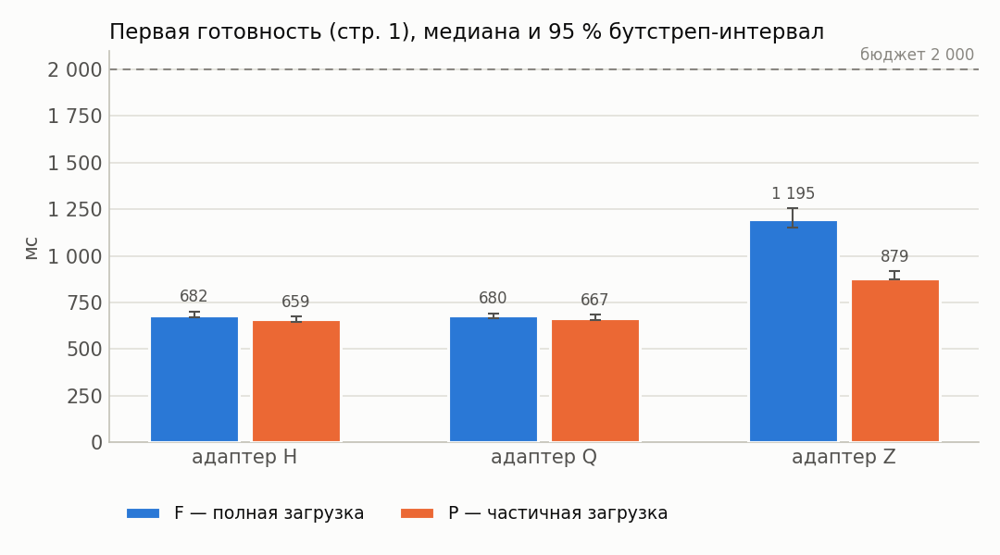

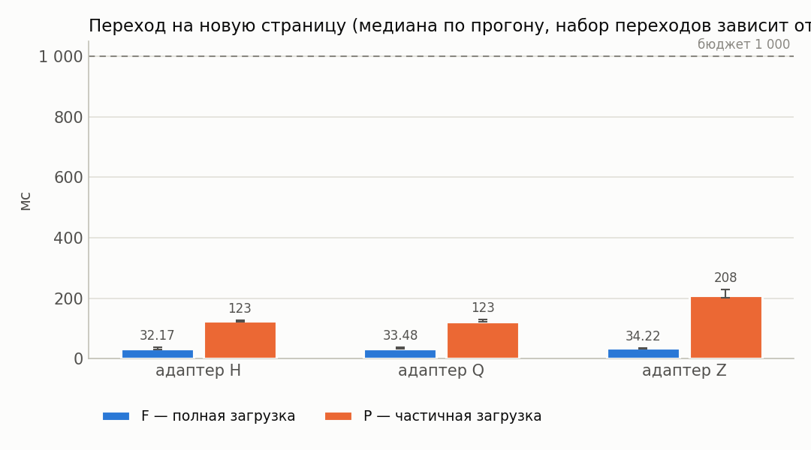

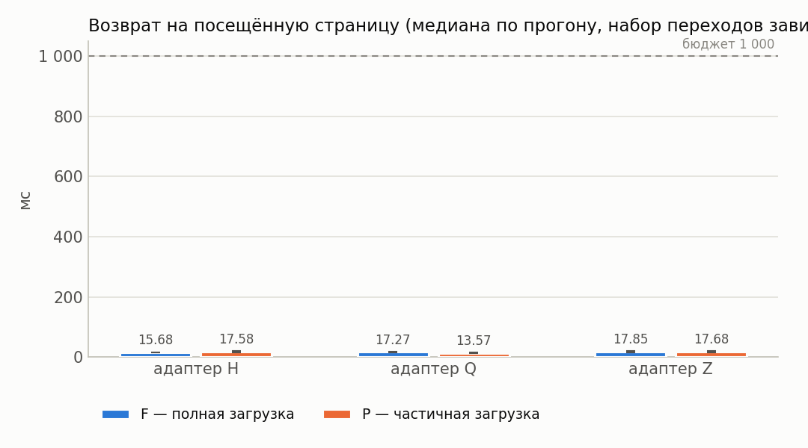

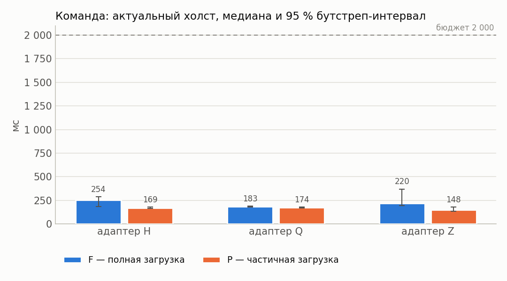

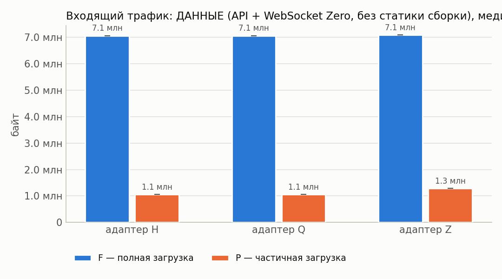

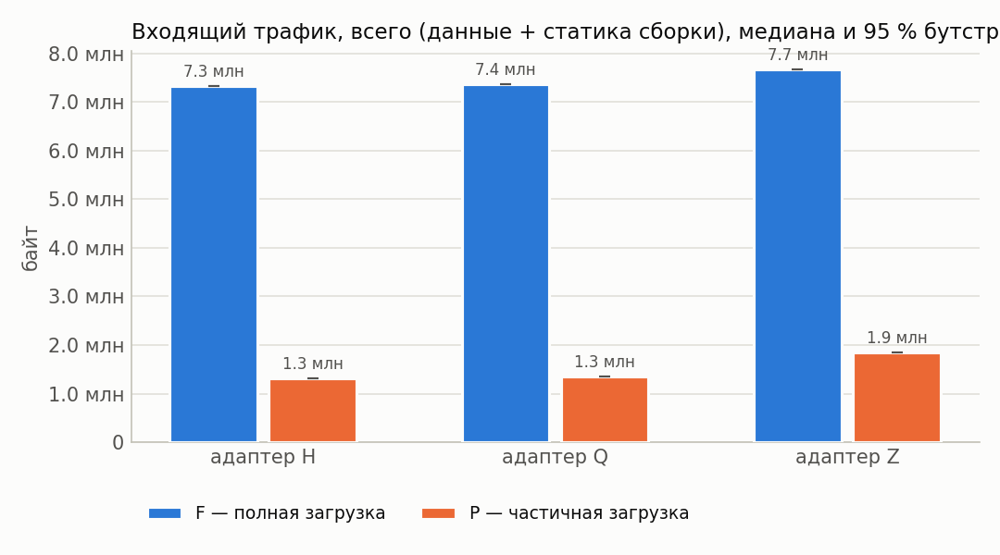

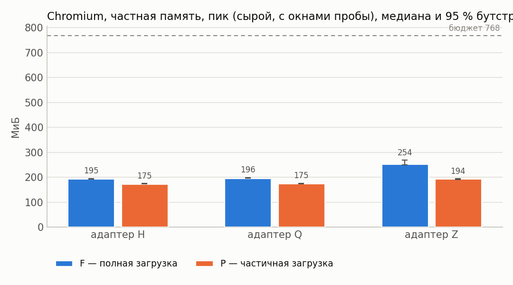

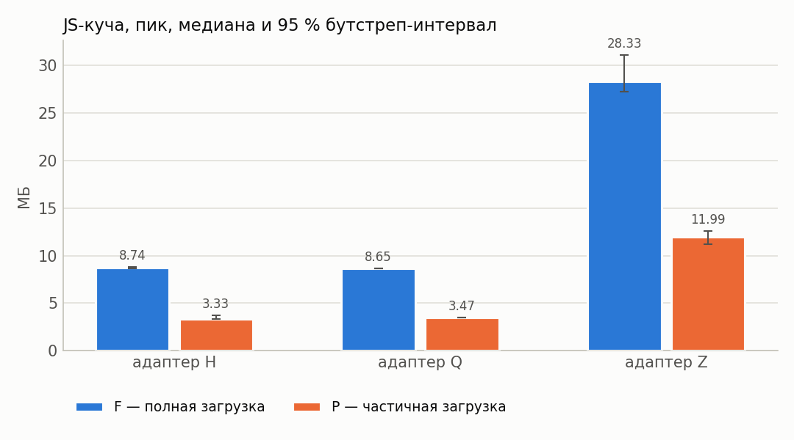

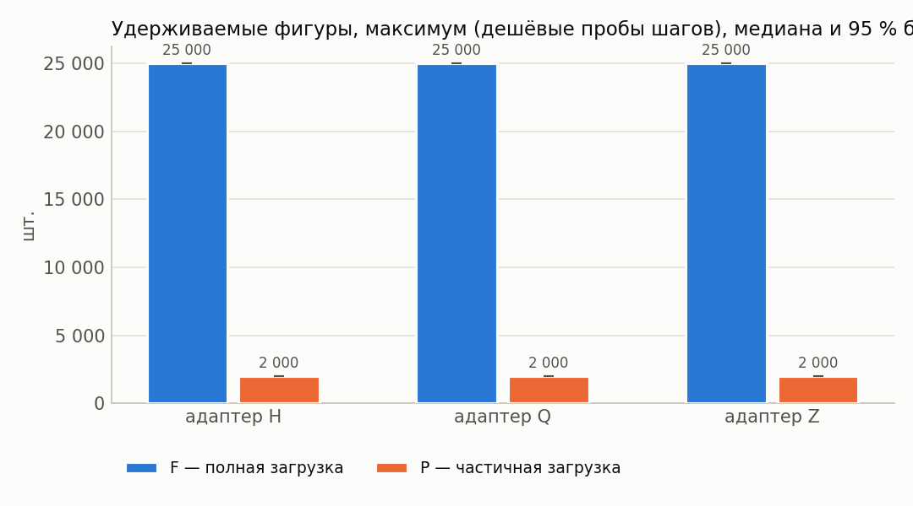

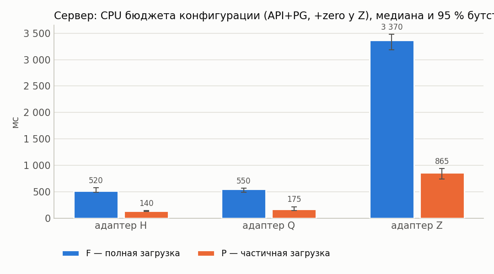

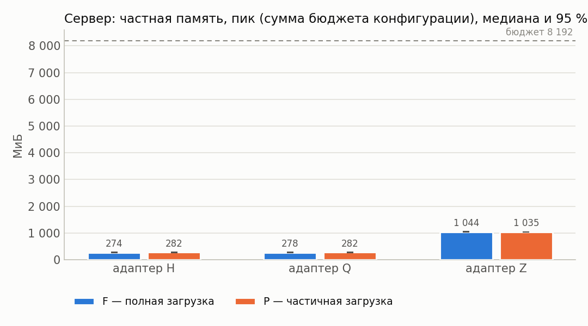

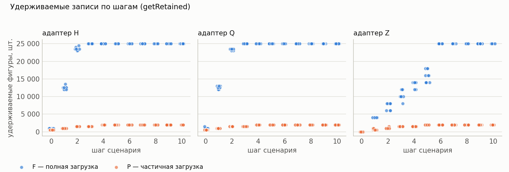

## 12. Выводы

* Оценки изменения P−F ниже — **парные** (медиана поблочных разностей, блок = повторение).
* Все бюджеты §7.4 выполнены для конфигураций: H/F, H/P (cache=3), Q/F, Q/P (cache=3), Z/F, Z/P (cache=3).
* H, cache=3: в режиме P первая готовность на 2 % меньше, чем в F (P/F = 0.98, 95 % интервал [0.92; 1.00]; интервал Δ содержит 0 — различие не подтверждено).
* Q, cache=3: в режиме P первая готовность на 3 % меньше, чем в F (P/F = 0.97, 95 % интервал [0.96; 1.02]; интервал Δ содержит 0 — различие не подтверждено).
* Z, cache=3: в режиме P первая готовность на 25 % меньше, чем в F (P/F = 0.75, 95 % интервал [0.71; 0.78]; интервал Δ не содержит 0).
* H, cache=3: в режиме P пик частной памяти Chromium на 10 % меньше, чем в F (P/F = 0.90, 95 % интервал [0.89; 0.90]; интервал Δ не содержит 0).
* Q, cache=3: в режиме P пик частной памяти Chromium на 11 % меньше, чем в F (P/F = 0.89, 95 % интервал [0.88; 0.90]; интервал Δ не содержит 0).
* Z, cache=3: в режиме P пик частной памяти Chromium на 24 % меньше, чем в F (P/F = 0.76, 95 % интервал [0.72; 0.77]; интервал Δ не содержит 0).
* H, cache=3: в режиме P входящий трафик на 82 % меньше, чем в F (P/F = 0.18, 95 % интервал [0.18; 0.18]; интервал Δ не содержит 0).
* Q, cache=3: в режиме P входящий трафик на 82 % меньше, чем в F (P/F = 0.18, 95 % интервал [0.18; 0.18]; интервал Δ не содержит 0).
* Z, cache=3: в режиме P входящий трафик на 76 % меньше, чем в F (P/F = 0.24, 95 % интервал [0.24; 0.24]; интервал Δ не содержит 0).
* H, cache=3: в режиме P максимум удерживаемых фигур на 92 % меньше, чем в F (P/F = 0.08, 95 % интервал [0.08; 0.08]; интервал Δ не содержит 0).
* Q, cache=3: в режиме P максимум удерживаемых фигур на 92 % меньше, чем в F (P/F = 0.08, 95 % интервал [0.08; 0.08]; интервал Δ не содержит 0).
* Z, cache=3: в режиме P максимум удерживаемых фигур на 92 % меньше, чем в F (P/F = 0.08, 95 % интервал [0.08; 0.08]; интервал Δ не содержит 0).
* H, cache=3: в режиме P переход на новую страницу на 277 % больше, чем в F (P/F = 3.77, 95 % интервал [3.43; 4.02]; интервал Δ не содержит 0).
* Q, cache=3: в режиме P переход на новую страницу на 270 % больше, чем в F (P/F = 3.70, 95 % интервал [3.30; 3.92]; интервал Δ не содержит 0).
* Z, cache=3: в режиме P переход на новую страницу на 530 % больше, чем в F (P/F = 6.30, 95 % интервал [6.03; 6.70]; интервал Δ не содержит 0).
* Перекрёстная проверка обмена сошлась во всех конфигурациях (наибольшее расхождение шейпера и суммы CDP HTTP+WebSocket — 0.1 %).
* У конфигураций Z/F, Z/P (cache=3) холст успевает обновиться раньше подтверждения сервера — доставка синхронизацией опережает ответ по HTTP; обе величины приведены отдельно в разделе 4.
* Точечная доля успеха ≥ 95 %: H/F, H/P (cache=3), Q/F, Q/P (cache=3), Z/F, Z/P (cache=3).
* Нижняя граница интервала Уилсона ниже 95 % для: H/F, H/P (cache=3), Q/F, Q/P (cache=3), Z/F, Z/P (cache=3). При n < 73 прогонов она не достигает 95 % даже без единого отказа, поэтому здесь это ограничение объёма серии, а не свидетельство ненадёжности; при наличии отказов — см. раздел «Ошибки».
* Условия применимости частичной загрузки: режим P оправдан, когда его выигрыш по первой готовности/памяти/трафику подтверждён интервалом (не содержащим 0) и при этом переходы на новые страницы и команда до холста остаются в бюджете, а удерживаемые записи не выходят за объявленное окно.
