# Результаты серии «command-shape»

Сформировано 2026-09-14 02:48 UTC из `../../results/command-shape/runs.csv` (144 прогонов, 24 конфигураций). Бутстреп: 2000 ресемплов, seed=42, перцентильные 95 % интервалы. Времена и ресурсы считаются по прогонам с `outcome=ok`; доли — по всем начатым прогонам.

**Определения статистик** (одинаковы во всех таблицах): медиана — обычная выборочная; p95 — перцентиль по линейной интерполяции порядковых статистик (`numpy.percentile`, тип 7), при n = 30 это интерполяция между 29‑м и 30‑м значением, поэтому p95 не превышает максимум выборки и при малых n смещён вниз; интервалы медианы и p95 — перцентильный бутстреп по одной матрице ресемплов (согласованы между собой); доли — интервал Уилсона 95 % без поправки на непрерывность; при n < 8 интервалы помечены † как ненадёжные, при n < 2 не строятся.

Проверка схемы: OK — rows=144

## 1. Паспорт серии

| Параметр | Значение |
|---|---|
| `series` | command-shape |
| `startedAt` | 2026-09-13T23:01:38.659Z |
| `finishedAt` | 2026-09-13T23:42:29.936Z |
| `host` | {"hostname": "vm", "os": "Linux 6.18.44-fc-v24", "platform": "linux", "arch": "x64", "kernel": "6.18.44-fc-v24", "distro": "Ubuntu 24.04.4 LTS", "cpuModel": "Intel(R) Xeon(R) Processor @ 2.80GHz", "cp |
| `versions` | {"node": "v24.21.0", "npm": "11.19.0", "postgres": "psql (PostgreSQL) 16.13 (Ubuntu 16.13-0ubuntu0.24.04.1)", "chromium": "141.0.7390.37", "playwright": "1.56.0", "zero": "1.9.0", "reactQuery": "5.102 |
| `packages` | {"playwright": "1.56.0", "@types/node": "24.13.4", "typescript": "5.9.3", "ws": "8.21.3", "@rocicorp/zero": "1.9.0", "@tanstack/react-query": "5.102.8", "react": "19.3.0", "react-dom": "19.3.0", "@typ |
| `packagesHoistedDifferent` | {"postgres": "3.4.7", "@fastify/cors": "10.1.0"} |
| `workspacePackages` | {"packages/bench": {"playwright": "1.56.0", "@types/node": "24.13.4", "typescript": "5.9.3", "ws": "8.21.3"}, "packages/client": {"@rocicorp/zero": "1.9.0", "@tanstack/react-query": "5.102.8", "react" |
| `lockfileVersion` | 3 |
| `shaper` | {"delayMs": 25, "bandwidthMbit": 20, "handshakeRtt": true, "statsUrl": "http://127.0.0.1:8081", "effective": {"delayMs": 25, "bandwidthMbit": 20, "bucketMs": 20, "segmentBytes": 4096, "bucketBytes": 5 |
| `seed` | 20260911 |
| `repetitions` | 6 |
| `configs` | [{"adapter": "H", "mode": "F", "cache": 1}, {"adapter": "H", "mode": "P", "cache": 1}, {"adapter": "Q", "mode": "F", "cache": 1}, {"adapter": "Q", "mode": "P", "cache": 1}, {"adapter": "Z", "mode": "F |
| `seriesConfig` | {"name": "command-shape", "doc": "doc-cmd-50x500", "sourceId": "doc-cmd-50x500-src-1", "fill": "#1e90ff", "docJson": "data/cmd-50x500.json", "configs": [{"adapter": "H", "mode": "F", "cache": 1}, {"ad |
| `procGroups` | [{"name": "api", "pidFile": "/home/claude/stand/results/logs/api.pid", "exclude": ["netshaper", "zero-cache"]}, {"name": "pg", "patterns": ["(^\|/)postgres .*16/main", "^postgres: 16/main"], "exclude": |
| `browser` | {"channel": "chromium", "args": ["--disable-extensions"], "headless": true, "viewport": {"width": 1280, "height": 800}} |
| `scenario` | {"route": [2, 3, 1, 4, 2, 5, 1, 6, 3, 50], "pauseMs": 1000, "budgets": {"firstReadyMs": 2000, "navMs": 1000, "cmdDrawnMs": 2000, "scenarioMs": 30000}} |
| `plan` | [{"run_id": "command-shape-0000-QF1-largesha", "order_index": 0, "repetition": 0, "adapter": "Q", "mode": "F", "cache": 1, "variant": "large-share", "sourceId": "doc-cmd-50x500-src-23", "fill": "#1e90 |
| `client` | {"dist": [{"path": "adapter-settings.json", "bytes": 1004, "mtime": "2026-09-13T19:30:30.755Z", "sha256": "5d7d9af8420141ebb66ea6894d26792039f489306b9ba46bfea9900ef01071b1"}, {"path": "assets/h-BRsLg0 |
| `adapters` | {"available": true, "source": "packages/client/dist/adapter-settings.json", "generatedFrom": ["packages/client/src/adapters/types.ts → ADAPTER_SETTINGS", "packages/client/src/adapters/settings.ts → Z_ |
| `api` | {"url": "http://127.0.0.1:3000", "available": true, "logLevel": "warn", "health": {"status": "ok", "db": "ok", "uptimeSec": 52701, "testHooks": true, "logLevel": "warn", "now": "2026-09-13T23:01:38.93 |
| `zero` | {"config": {"pid": 1025, "env": {"ZERO_QUERY_URL": "http://127.0.0.1:3000/api/zero/query", "NODE_OPTIONS": "--max-old-space-size=8192 --import=/home/claude/stand/scripts/zero-ipv4-shim.mjs", "ZERO_ENA |
| `commit` | None |
| `code` | {"commit": null, "isGitRepo": false, "dirty": null, "codeId": "4bb9e4465904a250bc72d8338d19363855cfe7f827b12662d8600f4f90ee5917", "clientBuildId": "e8d6c0b226b1ac5d27bc8bd39b66d2b5bc2aab491b4d5f8e554c |
| `harness` | {"harnessId": "a43218ea4a71e186045d50a597781fdc909727af3c7f47625ea111704a2f7df0", "harnessIdShort": "a43218ea4a71e186", "benchId": "8e1bdf1d09f201b6d42ff58f62fccfc4be22cd53ac554a5dd2aeb14ed5a99ccf", " |
| `preSeriesChecks` | {"at": "2026-09-13T23:01:38.967Z", "samplers": {"ok": true, "groups": [{"group": "api", "needed": true, "processes": 1, "pids": [984], "verdict": "ok", "spec": "pidFile=/home/claude/stand/results/logs |
| `runsExecutedNow` | 144 |
| `runsExecutedTotal` | 144 |
| `runsOk` | 144 |
| `runsTotalPlanned` | 144 |

## 2. Состав серии и доля успеха

Успех прогона = `outcome=ok` ∧ `t_scenario ≤ 30 с` ∧ все проверки эталона прошли (SPEC §7.3).

Доли считаются по **всем** начатым прогонам конфигурации (ошибка и таймаут = неуспех); сводки времени и ресурсов ниже — только по прогонам `outcome=ok`.

| Конфигурация | Прогонов | ok | error | timeout | эталон ✓ | ok, но эталон ✗ | успех | Доля успеха [Уилсон 95 %] |
|---|---|---|---|---|---|---|---|---|
| H/F [baseline] | 6 | 6 | 0 | 0 | 6 | 0 | 6 | 100.0 % [61.0 %; 100.0 %] |
| H/F [concentrated] | 6 | 6 | 0 | 0 | 6 | 0 | 6 | 100.0 % [61.0 %; 100.0 %] |
| H/F [large-share] | 6 | 6 | 0 | 0 | 6 | 0 | 6 | 100.0 % [61.0 %; 100.0 %] |
| H/F [spread] | 6 | 6 | 0 | 0 | 6 | 0 | 6 | 100.0 % [61.0 %; 100.0 %] |
| H/P (cache=1) [baseline] | 6 | 6 | 0 | 0 | 6 | 0 | 6 | 100.0 % [61.0 %; 100.0 %] |
| H/P (cache=1) [concentrated] | 6 | 6 | 0 | 0 | 6 | 0 | 6 | 100.0 % [61.0 %; 100.0 %] |
| H/P (cache=1) [large-share] | 6 | 6 | 0 | 0 | 6 | 0 | 6 | 100.0 % [61.0 %; 100.0 %] |
| H/P (cache=1) [spread] | 6 | 6 | 0 | 0 | 6 | 0 | 6 | 100.0 % [61.0 %; 100.0 %] |
| Q/F [baseline] | 6 | 6 | 0 | 0 | 6 | 0 | 6 | 100.0 % [61.0 %; 100.0 %] |
| Q/F [concentrated] | 6 | 6 | 0 | 0 | 6 | 0 | 6 | 100.0 % [61.0 %; 100.0 %] |
| Q/F [large-share] | 6 | 6 | 0 | 0 | 6 | 0 | 6 | 100.0 % [61.0 %; 100.0 %] |
| Q/F [spread] | 6 | 6 | 0 | 0 | 6 | 0 | 6 | 100.0 % [61.0 %; 100.0 %] |
| Q/P (cache=1) [baseline] | 6 | 6 | 0 | 0 | 6 | 0 | 6 | 100.0 % [61.0 %; 100.0 %] |
| Q/P (cache=1) [concentrated] | 6 | 6 | 0 | 0 | 6 | 0 | 6 | 100.0 % [61.0 %; 100.0 %] |
| Q/P (cache=1) [large-share] | 6 | 6 | 0 | 0 | 6 | 0 | 6 | 100.0 % [61.0 %; 100.0 %] |
| Q/P (cache=1) [spread] | 6 | 6 | 0 | 0 | 6 | 0 | 6 | 100.0 % [61.0 %; 100.0 %] |
| Z/F [baseline] | 6 | 6 | 0 | 0 | 6 | 0 | 6 | 100.0 % [61.0 %; 100.0 %] |
| Z/F [concentrated] | 6 | 6 | 0 | 0 | 6 | 0 | 6 | 100.0 % [61.0 %; 100.0 %] |
| Z/F [large-share] | 6 | 6 | 0 | 0 | 6 | 0 | 6 | 100.0 % [61.0 %; 100.0 %] |
| Z/F [spread] | 6 | 6 | 0 | 0 | 6 | 0 | 6 | 100.0 % [61.0 %; 100.0 %] |
| Z/P (cache=1) [baseline] | 6 | 6 | 0 | 0 | 6 | 0 | 6 | 100.0 % [61.0 %; 100.0 %] |
| Z/P (cache=1) [concentrated] | 6 | 6 | 0 | 0 | 6 | 0 | 6 | 100.0 % [61.0 %; 100.0 %] |
| Z/P (cache=1) [large-share] | 6 | 6 | 0 | 0 | 6 | 0 | 6 | 100.0 % [61.0 %; 100.0 %] |
| Z/P (cache=1) [spread] | 6 | 6 | 0 | 0 | 6 | 0 | 6 | 100.0 % [61.0 %; 100.0 %] |

## 3. Сводные показатели по конфигурациям

Для каждого показателя приводятся n, медиана с 95 % перцентильным бутстреп‑интервалом, p95 (линейная интерполяция порядковых статистик) с таким же интервалом, min и max. Знак † — интервал построен по n < 8 наблюдениям и ненадёжен; «—» вместо интервала — n < 2, интервал не определён.

### 3.1 Время

**Первая готовность (стр. 1), мс**

| Конфигурация | n | Медиана | 95 % ИД медианы | p95 | 95 % ИД p95 | min | max |
|---|---|---|---|---|---|---|---|
| H/F [baseline] | 6 | 681 | [650; 748] † | 772 | [689; 796] † | 647 | 796 |
| H/F [concentrated] | 6 | 660 | [651; 703] † | 719 | [662; 734] † | 650 | 734 |
| H/F [large-share] | 6 | 663 | [655; 676] † | 677 | [664; 677] † | 654 | 677 |
| H/F [spread] | 6 | 688 | [655; 695] † | 697 | [689; 700] † | 655 | 700 |
| H/P (cache=1) [baseline] | 6 | 658 | [646; 676] † | 680 | [659; 685] † | 638 | 685 |
| H/P (cache=1) [concentrated] | 6 | 682 | [660; 693] † | 695 | [683; 697] † | 650 | 697 |
| H/P (cache=1) [large-share] | 6 | 670 | [649; 686] † | 688 | [674; 691] † | 642 | 691 |
| H/P (cache=1) [spread] | 6 | 684 | [653; 705] † | 713 | [685; 722] † | 637 | 722 |
| Q/F [baseline] | 6 | 667 | [656; 686] † | 693 | [667; 700] † | 648 | 700 |
| Q/F [concentrated] | 6 | 668 | [655; 709] † | 724 | [669; 740] † | 654 | 740 |
| Q/F [large-share] | 6 | 668 | [654; 684] † | 691 | [668; 698] † | 650 | 698 |
| Q/F [spread] | 6 | 686 | [662; 781] † | 786 | [696; 790] † | 660 | 790 |
| Q/P (cache=1) [baseline] | 6 | 660 | [648; 686] † | 688 | [660; 688] † | 648 | 688 |
| Q/P (cache=1) [concentrated] | 6 | 667 | [644; 681] † | 686 | [668; 692] † | 643 | 692 |
| Q/P (cache=1) [large-share] | 6 | 678 | [664; 735] † | 748 | [681; 761] † | 656 | 761 |
| Q/P (cache=1) [spread] | 6 | 687 | [659; 761] † | 770 | [691; 779] † | 652 | 779 |
| Z/F [baseline] | 6 | 1 182 | [1 151; 1 263] † | 1 299 | [1 181; 1 336] † | 1 148 | 1 336 |
| Z/F [concentrated] | 6 | 1 164 | [1 148; 1 189] † | 1 199 | [1 164; 1 208] † | 1 145 | 1 208 |
| Z/F [large-share] | 6 | 1 169 | [1 142; 1 215] † | 1 225 | [1 171; 1 235] † | 1 138 | 1 235 |
| Z/F [spread] | 6 | 1 181 | [1 154; 1 236] † | 1 244 | [1 181; 1 251] † | 1 134 | 1 251 |
| Z/P (cache=1) [baseline] | 6 | 927 | [881; 957] † | 973 | [931; 979] † | 877 | 979 |
| Z/P (cache=1) [concentrated] | 6 | 931 | [859; 942] † | 943 | [922; 943] † | 857 | 943 |
| Z/P (cache=1) [large-share] | 6 | 909 | [884; 919] † | 919 | [911; 920] † | 882 | 920 |
| Z/P (cache=1) [spread] | 6 | 908 | [853; 986] † | 998 | [926; 1 010] † | 843 | 1 010 |

**Переход на новую страницу (медиана по прогону, набор переходов зависит от маршрута серии), мс**

| Конфигурация | n | Медиана | 95 % ИД медианы | p95 | 95 % ИД p95 | min | max |
|---|---|---|---|---|---|---|---|
| H/F [baseline] | 6 | 31 | [30; 35] † | 35 | [31; 36] † | 30 | 36 |
| H/F [concentrated] | 6 | 31 | [29; 34] † | 34 | [31; 35] † | 28 | 35 |
| H/F [large-share] | 6 | 31 | [29; 33] † | 34 | [31; 34] † | 28 | 34 |
| H/F [spread] | 6 | 35 | [31; 39] † | 40 | [36; 40] † | 31 | 40 |
| H/P (cache=1) [baseline] | 6 | 123 | [121; 127] † | 127 | [123; 128] † | 120 | 128 |
| H/P (cache=1) [concentrated] | 6 | 125 | [120; 131] † | 133 | [126; 134] † | 119 | 134 |
| H/P (cache=1) [large-share] | 6 | 127 | [125; 133] † | 134 | [127; 136] † | 125 | 136 |
| H/P (cache=1) [spread] | 6 | 125 | [123; 133] † | 134 | [125; 135] † | 123 | 135 |
| Q/F [baseline] | 6 | 31 | [29; 35] † | 35 | [31; 35] † | 28 | 35 |
| Q/F [concentrated] | 6 | 31 | [30; 36] † | 36 | [31; 37] † | 30 | 37 |
| Q/F [large-share] | 6 | 36 | [31; 39] † | 40 | [36; 40] † | 30 | 40 |
| Q/F [spread] | 6 | 34 | [32; 37] † | 37 | [35; 37] † | 31 | 37 |
| Q/P (cache=1) [baseline] | 6 | 127 | [123; 134] † | 135 | [127; 137] † | 122 | 137 |
| Q/P (cache=1) [concentrated] | 6 | 125 | [123; 128] † | 128 | [125; 129] † | 122 | 129 |
| Q/P (cache=1) [large-share] | 6 | 126 | [123; 128] † | 128 | [127; 128] † | 122 | 128 |
| Q/P (cache=1) [spread] | 6 | 122 | [121; 124] † | 125 | [122; 126] † | 121 | 126 |
| Z/F [baseline] | 6 | 34 | [30; 36] † | 37 | [34; 38] † | 30 | 38 |
| Z/F [concentrated] | 6 | 31 | [29; 36] † | 37 | [31; 38] † | 29 | 38 |
| Z/F [large-share] | 6 | 32 | [30; 36] † | 36 | [32; 36] † | 28 | 36 |
| Z/F [spread] | 6 | 31 | [30; 32] † | 32 | [31; 32] † | 30 | 32 |
| Z/P (cache=1) [baseline] | 6 | 224 | [214; 250] † | 255 | [224; 259] † | 210 | 259 |
| Z/P (cache=1) [concentrated] | 6 | 221 | [213; 230] † | 233 | [221; 237] † | 212 | 237 |
| Z/P (cache=1) [large-share] | 6 | 224 | [216; 241] † | 244 | [225; 247] † | 211 | 247 |
| Z/P (cache=1) [spread] | 6 | 231 | [214; 245] † | 251 | [231; 256] † | 206 | 256 |

**Возврат на посещённую страницу (медиана по прогону, набор переходов зависит от маршрута серии), мс**

| Конфигурация | n | Медиана | 95 % ИД медианы | p95 | 95 % ИД p95 | min | max |
|---|---|---|---|---|---|---|---|
| H/F [baseline] | 6 | 16 | [14; 18] † | 19 | [16; 19] † | 14 | 19 |
| H/F [concentrated] | 6 | 15 | [14; 17] † | 17 | [15; 17] † | 14 | 17 |
| H/F [large-share] | 6 | 15 | [14; 16] † | 16 | [15; 16] † | 13 | 16 |
| H/F [spread] | 6 | 16 | [13; 18] † | 18 | [16; 18] † | 12 | 18 |
| H/P (cache=1) [baseline] | 6 | 113 | [108; 115] † | 116 | [113; 117] † | 104 | 117 |
| H/P (cache=1) [concentrated] | 6 | 111 | [110; 113] † | 114 | [111; 114] † | 109 | 114 |
| H/P (cache=1) [large-share] | 6 | 112 | [107; 115] † | 116 | [113; 116] † | 106 | 116 |
| H/P (cache=1) [spread] | 6 | 113 | [112; 115] † | 115 | [113; 115] † | 111 | 115 |
| Q/F [baseline] | 6 | 18 | [15; 22] † | 23 | [19; 24] † | 15 | 24 |
| Q/F [concentrated] | 6 | 15 | [14; 16] † | 16 | [15; 16] † | 14 | 16 |
| Q/F [large-share] | 6 | 17 | [14; 20] † | 21 | [17; 23] † | 14 | 23 |
| Q/F [spread] | 6 | 15 | [14; 19] † | 20 | [16; 21] † | 14 | 21 |
| Q/P (cache=1) [baseline] | 6 | 110 | [108; 112] † | 112 | [111; 112] † | 108 | 112 |
| Q/P (cache=1) [concentrated] | 6 | 108 | [106; 110] † | 110 | [109; 110] † | 106 | 110 |
| Q/P (cache=1) [large-share] | 6 | 109 | [107; 114] † | 115 | [109; 116] † | 106 | 116 |
| Q/P (cache=1) [spread] | 6 | 113 | [109; 121] † | 124 | [114; 126] † | 109 | 126 |
| Z/F [baseline] | 6 | 19 | [14; 21] † | 21 | [19; 21] † | 14 | 21 |
| Z/F [concentrated] | 6 | 19 | [16; 23] † | 23 | [19; 24] † | 15 | 24 |
| Z/F [large-share] | 6 | 19 | [14; 19] † | 19 | [19; 20] † | 14 | 20 |
| Z/F [spread] | 6 | 19 | [18; 21] † | 21 | [20; 21] † | 18 | 21 |
| Z/P (cache=1) [baseline] | 6 | 211 | [201; 232] † | 236 | [213; 239] † | 196 | 239 |
| Z/P (cache=1) [concentrated] | 6 | 208 | [196; 219] † | 220 | [209; 222] † | 193 | 222 |
| Z/P (cache=1) [large-share] | 6 | 219 | [202; 249] † | 259 | [223; 269] † | 200 | 269 |
| Z/P (cache=1) [spread] | 6 | 204 | [201; 211] † | 211 | [204; 212] † | 198 | 212 |

**Команда: подтверждение транспорта (Z — .server, H/Q — ответ POST), мс**

| Конфигурация | n | Медиана | 95 % ИД медианы | p95 | 95 % ИД p95 | min | max |
|---|---|---|---|---|---|---|---|
| H/F [baseline] | 6 | 73 | [68; 86] † | 86 | [74; 87] † | 66 | 87 |
| H/F [concentrated] | 6 | 71 | [66; 80] † | 83 | [71; 86] † | 66 | 86 |
| H/F [large-share] | 6 | 95 | [90; 111] † | 114 | [96; 117] † | 87 | 117 |
| H/F [spread] | 6 | 68 | [66; 72] † | 72 | [69; 72] † | 66 | 72 |
| H/P (cache=1) [baseline] | 6 | 67 | [64; 71] † | 72 | [67; 73] † | 63 | 73 |
| H/P (cache=1) [concentrated] | 6 | 70 | [67; 75] † | 75 | [71; 76] † | 67 | 76 |
| H/P (cache=1) [large-share] | 6 | 90 | [80; 101] † | 102 | [92; 104] † | 77 | 104 |
| H/P (cache=1) [spread] | 6 | 66 | [63; 82] † | 83 | [66; 85] † | 62 | 85 |
| Q/F [baseline] | 6 | 75 | [68; 83] † | 84 | [76; 86] † | 66 | 86 |
| Q/F [concentrated] | 6 | 68 | [66; 72] † | 72 | [68; 72] † | 66 | 72 |
| Q/F [large-share] | 6 | 86 | [78; 107] † | 113 | [88; 119] † | 77 | 119 |
| Q/F [spread] | 6 | 70 | [66; 75] † | 77 | [70; 80] † | 66 | 80 |
| Q/P (cache=1) [baseline] | 6 | 72 | [66; 79] † | 81 | [72; 83] † | 65 | 83 |
| Q/P (cache=1) [concentrated] | 6 | 66 | [64; 73] † | 75 | [67; 77] † | 63 | 77 |
| Q/P (cache=1) [large-share] | 6 | 89 | [85; 100] † | 103 | [89; 105] † | 84 | 105 |
| Q/P (cache=1) [spread] | 6 | 68 | [63; 75] † | 75 | [68; 76] † | 62 | 76 |
| Z/F [baseline] | 6 | 302 | [225; 416] † | 437 | [309; 457] † | 224 | 457 |
| Z/F [concentrated] | 6 | 432 | [194; 665] † | 683 | [473; 702] † | 176 | 702 |
| Z/F [large-share] | 6 | 2 323 | [2 199; 2 901] † | 3 083 | [2 350; 3 264] † | 2 167 | 3 264 |
| Z/F [spread] | 6 | 382 | [339; 470] † | 474 | [392; 477] † | 330 | 477 |
| Z/P (cache=1) [baseline] | 6 | 123 | [118; 139] † | 142 | [124; 145] † | 114 | 145 |
| Z/P (cache=1) [concentrated] | 6 | 134 | [119; 149] † | 152 | [134; 154] † | 115 | 154 |
| Z/P (cache=1) [large-share] | 6 | 717 | [673; 780] † | 791 | [723; 802] † | 651 | 802 |
| Z/P (cache=1) [spread] | 6 | 113 | [103; 129] † | 130 | [114; 130] † | 99 | 130 |

**Команда: подтверждение сервера (результат операции), мс**

| Конфигурация | n | Медиана | 95 % ИД медианы | p95 | 95 % ИД p95 | min | max |
|---|---|---|---|---|---|---|---|
| H/F [baseline] | 6 | 74 | [68; 86] † | 87 | [74; 87] † | 66 | 87 |
| H/F [concentrated] | 6 | 71 | [66; 80] † | 83 | [71; 86] † | 66 | 86 |
| H/F [large-share] | 6 | 95 | [90; 112] † | 114 | [96; 117] † | 87 | 117 |
| H/F [spread] | 6 | 69 | [66; 72] † | 73 | [70; 73] † | 66 | 73 |
| H/P (cache=1) [baseline] | 6 | 67 | [65; 71] † | 72 | [67; 73] † | 64 | 73 |
| H/P (cache=1) [concentrated] | 6 | 70 | [67; 75] † | 76 | [71; 76] † | 67 | 76 |
| H/P (cache=1) [large-share] | 6 | 90 | [80; 101] † | 102 | [92; 104] † | 78 | 104 |
| H/P (cache=1) [spread] | 6 | 66 | [63; 82] † | 84 | [66; 85] † | 62 | 85 |
| Q/F [baseline] | 6 | 75 | [68; 84] † | 85 | [77; 86] † | 66 | 86 |
| Q/F [concentrated] | 6 | 68 | [66; 72] † | 72 | [68; 72] † | 66 | 72 |
| Q/F [large-share] | 6 | 86 | [79; 107] † | 113 | [89; 119] † | 78 | 119 |
| Q/F [spread] | 6 | 70 | [66; 75] † | 77 | [70; 80] † | 66 | 80 |
| Q/P (cache=1) [baseline] | 6 | 72 | [66; 79] † | 81 | [72; 83] † | 65 | 83 |
| Q/P (cache=1) [concentrated] | 6 | 66 | [64; 73] † | 75 | [67; 77] † | 63 | 77 |
| Q/P (cache=1) [large-share] | 6 | 89 | [85; 100] † | 103 | [90; 106] † | 84 | 106 |
| Q/P (cache=1) [spread] | 6 | 68 | [64; 75] † | 75 | [68; 76] † | 63 | 76 |
| Z/F [baseline] | 6 | 384 | [302; 515] † | 524 | [403; 534] † | 288 | 534 |
| Z/F [concentrated] | 6 | 513 | [288; 750] † | 757 | [544; 764] † | 275 | 764 |
| Z/F [large-share] | 6 | 2 438 | [2 278; 2 974] † | 3 159 | [2 478; 3 345] † | 2 259 | 3 345 |
| Z/F [spread] | 6 | 447 | [401; 621] † | 622 | [455; 623] † | 393 | 623 |
| Z/P (cache=1) [baseline] | 6 | 184 | [180; 203] † | 208 | [186; 213] † | 180 | 213 |
| Z/P (cache=1) [concentrated] | 6 | 193 | [177; 209] † | 213 | [194; 216] † | 174 | 216 |
| Z/P (cache=1) [large-share] | 6 | 776 | [746; 851] † | 857 | [783; 863] † | 729 | 863 |
| Z/P (cache=1) [spread] | 6 | 174 | [165; 194] † | 197 | [174; 200] † | 157 | 200 |

**Команда: цена протокола подтверждения (ack − транспорт), мс**

| Конфигурация | n | Медиана | 95 % ИД медианы | p95 | 95 % ИД p95 | min | max |
|---|---|---|---|---|---|---|---|
| H/F [baseline] | 6 | 0 | [0; 0] † | 0 | [0; 0] † | 0 | 0 |
| H/F [concentrated] | 6 | 0 | [0; 0] † | 0 | [0; 0] † | 0 | 0 |
| H/F [large-share] | 6 | 0 | [0; 0] † | 1 | [0; 1] † | 0 | 1 |
| H/F [spread] | 6 | 0 | [0; 1] † | 1 | [0; 1] † | 0 | 1 |
| H/P (cache=1) [baseline] | 6 | 0 | [0; 0] † | 0 | [0; 0] † | 0 | 0 |
| H/P (cache=1) [concentrated] | 6 | 0 | [0; 0] † | 0 | [0; 0] † | 0 | 0 |
| H/P (cache=1) [large-share] | 6 | 0 | [0; 0] † | 0 | [0; 0] † | 0 | 0 |
| H/P (cache=1) [spread] | 6 | 0 | [0; 0] † | 0 | [0; 0] † | 0 | 0 |
| Q/F [baseline] | 6 | 0 | [0; 1] † | 1 | [0; 1] † | 0 | 1 |
| Q/F [concentrated] | 6 | 0 | [0; 0] † | 0 | [0; 0] † | 0 | 0 |
| Q/F [large-share] | 6 | 0 | [0; 0] † | 0 | [0; 0] † | 0 | 0 |
| Q/F [spread] | 6 | 0 | [0; 0] † | 0 | [0; 0] † | 0 | 0 |
| Q/P (cache=1) [baseline] | 6 | 0 | [0; 0] † | 0 | [0; 0] † | 0 | 0 |
| Q/P (cache=1) [concentrated] | 6 | 0 | [0; 0] † | 0 | [0; 0] † | 0 | 0 |
| Q/P (cache=1) [large-share] | 6 | 0 | [0; 0] † | 0 | [0; 0] † | 0 | 0 |
| Q/P (cache=1) [spread] | 6 | 0 | [0; 0] † | 0 | [0; 0] † | 0 | 0 |
| Z/F [baseline] | 6 | 85 | [61; 113] † | 116 | [88; 120] † | 58 | 120 |
| Z/F [concentrated] | 6 | 82 | [62; 118] † | 122 | [91; 126] † | 61 | 126 |
| Z/F [large-share] | 6 | 85 | [65; 116] † | 128 | [87; 141] † | 64 | 141 |
| Z/F [spread] | 6 | 65 | [61; 151] † | 156 | [66; 160] † | 61 | 160 |
| Z/P (cache=1) [baseline] | 6 | 61 | [60; 67] † | 68 | [61; 68] † | 59 | 68 |
| Z/P (cache=1) [concentrated] | 6 | 59 | [58; 61] † | 62 | [59; 62] † | 58 | 62 |
| Z/P (cache=1) [large-share] | 6 | 65 | [59; 80] † | 80 | [67; 81] † | 58 | 81 |
| Z/P (cache=1) [spread] | 6 | 61 | [59; 67] † | 68 | [62; 70] † | 58 | 70 |

**Команда: данные в хранилище активной страницы, мс**

| Конфигурация | n | Медиана | 95 % ИД медианы | p95 | 95 % ИД p95 | min | max |
|---|---|---|---|---|---|---|---|
| H/F [baseline] | 6 | 286 | [256; 334] † | 340 | [288; 346] † | 231 | 346 |
| H/F [concentrated] | 6 | 214 | [171; 226] † | 230 | [214; 234] † | 166 | 234 |
| H/F [large-share] | 6 | 277 | [223; 354] † | 360 | [288; 366] † | 192 | 366 |
| H/F [spread] | 6 | 223 | [175; 307] † | 309 | [228; 311] † | 165 | 311 |
| H/P (cache=1) [baseline] | 6 | 163 | [159; 172] † | 174 | [164; 176] † | 156 | 176 |
| H/P (cache=1) [concentrated] | 6 | 171 | [165; 173] † | 174 | [171; 174] † | 165 | 174 |
| H/P (cache=1) [large-share] | 6 | 203 | [188; 216] † | 222 | [204; 228] † | 182 | 228 |
| H/P (cache=1) [spread] | 6 | 164 | [158; 186] † | 190 | [165; 194] † | 158 | 194 |
| Q/F [baseline] | 6 | 177 | [168; 185] † | 187 | [177; 189] † | 167 | 189 |
| Q/F [concentrated] | 6 | 168 | [160; 171] † | 172 | [168; 172] † | 159 | 172 |
| Q/F [large-share] | 6 | 201 | [192; 228] † | 230 | [201; 231] † | 184 | 231 |
| Q/F [spread] | 6 | 170 | [167; 179] † | 179 | [170; 180] † | 167 | 180 |
| Q/P (cache=1) [baseline] | 6 | 174 | [162; 185] † | 185 | [175; 185] † | 161 | 185 |
| Q/P (cache=1) [concentrated] | 6 | 167 | [160; 173] † | 175 | [167; 177] † | 157 | 177 |
| Q/P (cache=1) [large-share] | 6 | 195 | [192; 232] † | 242 | [195; 252] † | 192 | 252 |
| Q/P (cache=1) [spread] | 6 | 168 | [160; 180] † | 185 | [169; 189] † | 157 | 189 |
| Z/F [baseline] | 6 | 302 | [224; 416] † | 436 | [309; 457] † | 224 | 457 |
| Z/F [concentrated] | 6 | 432 | [193; 664] † | 683 | [472; 701] † | 176 | 701 |
| Z/F [large-share] | 6 | 2 323 | [2 199; 2 901] † | 3 082 | [2 350; 3 264] † | 2 167 | 3 264 |
| Z/F [spread] | 6 | 382 | [339; 470] † | 473 | [391; 477] † | 329 | 477 |
| Z/P (cache=1) [baseline] | 6 | 123 | [117; 139] † | 142 | [124; 145] † | 114 | 145 |
| Z/P (cache=1) [concentrated] | 6 | 134 | [118; 149] † | 151 | [134; 154] † | 115 | 154 |
| Z/P (cache=1) [large-share] | 6 | 717 | [672; 780] † | 791 | [721; 802] † | 651 | 802 |
| Z/P (cache=1) [spread] | 6 | 113 | [103; 129] † | 129 | [114; 130] † | 99 | 130 |

**Команда: актуальный холст, мс**

| Конфигурация | n | Медиана | 95 % ИД медианы | p95 | 95 % ИД p95 | min | max |
|---|---|---|---|---|---|---|---|
| H/F [baseline] | 6 | 303 | [268; 346] † | 352 | [304; 359] † | 242 | 359 |
| H/F [concentrated] | 6 | 227 | [183; 236] † | 240 | [225; 243] † | 177 | 243 |
| H/F [large-share] | 6 | 291 | [237; 368] † | 373 | [302; 378] † | 206 | 378 |
| H/F [spread] | 6 | 237 | [186; 320] † | 322 | [242; 325] † | 175 | 325 |
| H/P (cache=1) [baseline] | 6 | 173 | [168; 185] † | 189 | [174; 192] † | 166 | 192 |
| H/P (cache=1) [concentrated] | 6 | 180 | [175; 186] † | 188 | [180; 190] † | 174 | 190 |
| H/P (cache=1) [large-share] | 6 | 214 | [198; 242] † | 244 | [216; 245] † | 192 | 245 |
| H/P (cache=1) [spread] | 6 | 174 | [167; 196] † | 201 | [175; 206] † | 166 | 206 |
| Q/F [baseline] | 6 | 190 | [178; 197] † | 198 | [192; 199] † | 177 | 199 |
| Q/F [concentrated] | 6 | 179 | [172; 181] † | 181 | [179; 181] † | 167 | 181 |
| Q/F [large-share] | 6 | 213 | [208; 244] † | 246 | [213; 249] † | 204 | 249 |
| Q/F [spread] | 6 | 182 | [177; 190] † | 191 | [182; 193] † | 176 | 193 |
| Q/P (cache=1) [baseline] | 6 | 183 | [175; 199] † | 199 | [184; 200] † | 173 | 200 |
| Q/P (cache=1) [concentrated] | 6 | 178 | [169; 183] † | 184 | [178; 186] † | 166 | 186 |
| Q/P (cache=1) [large-share] | 6 | 208 | [202; 242] † | 253 | [209; 264] † | 202 | 264 |
| Q/P (cache=1) [spread] | 6 | 179 | [171; 191] † | 195 | [179; 198] † | 167 | 198 |
| Z/F [baseline] | 6 | 321 | [243; 432] † | 454 | [331; 476] † | 237 | 476 |
| Z/F [concentrated] | 6 | 459 | [205; 678] † | 695 | [496; 712] † | 188 | 712 |
| Z/F [large-share] | 6 | 2 344 | [2 218; 2 921] † | 3 099 | [2 366; 3 278] † | 2 192 | 3 278 |
| Z/F [spread] | 6 | 397 | [352; 488] † | 492 | [407; 495] † | 342 | 495 |
| Z/P (cache=1) [baseline] | 6 | 137 | [131; 158] † | 163 | [139; 168] † | 130 | 168 |
| Z/P (cache=1) [concentrated] | 6 | 145 | [130; 164] † | 168 | [145; 171] † | 128 | 171 |
| Z/P (cache=1) [large-share] | 6 | 730 | [689; 795] † | 805 | [736; 815] † | 664 | 815 |
| Z/P (cache=1) [spread] | 6 | 126 | [118; 142] † | 142 | [126; 143] † | 111 | 143 |

**Переход, медиана всех переходов прогона (маршрут любой длины), мс**

| Конфигурация | n | Медиана | 95 % ИД медианы | p95 | 95 % ИД p95 | min | max |
|---|---|---|---|---|---|---|---|
| H/F [baseline] | 6 | 27 | [26; 30] † | 30 | [27; 30] † | 25 | 30 |
| H/F [concentrated] | 6 | 27 | [26; 31] † | 31 | [27; 32] † | 26 | 32 |
| H/F [large-share] | 6 | 28 | [25; 30] † | 30 | [28; 30] † | 24 | 30 |
| H/F [spread] | 6 | 28 | [26; 33] † | 34 | [28; 35] † | 26 | 35 |
| H/P (cache=1) [baseline] | 6 | 119 | [117; 122] † | 122 | [119; 123] † | 117 | 123 |
| H/P (cache=1) [concentrated] | 6 | 121 | [118; 123] † | 123 | [122; 123] † | 118 | 123 |
| H/P (cache=1) [large-share] | 6 | 122 | [119; 125] † | 127 | [122; 128] † | 118 | 128 |
| H/P (cache=1) [spread] | 6 | 121 | [119; 123] † | 123 | [121; 124] † | 118 | 124 |
| Q/F [baseline] | 6 | 27 | [26; 28] † | 28 | [27; 28] † | 25 | 28 |
| Q/F [concentrated] | 6 | 27 | [26; 29] † | 30 | [27; 30] † | 26 | 30 |
| Q/F [large-share] | 6 | 32 | [28; 34] † | 34 | [32; 34] † | 27 | 34 |
| Q/F [spread] | 6 | 30 | [25; 33] † | 33 | [30; 34] † | 25 | 34 |
| Q/P (cache=1) [baseline] | 6 | 121 | [120; 125] † | 126 | [121; 126] † | 120 | 126 |
| Q/P (cache=1) [concentrated] | 6 | 121 | [120; 125] † | 126 | [121; 127] † | 120 | 127 |
| Q/P (cache=1) [large-share] | 6 | 120 | [117; 123] † | 123 | [121; 123] † | 115 | 123 |
| Q/P (cache=1) [spread] | 6 | 120 | [119; 123] † | 123 | [120; 123] † | 119 | 123 |
| Z/F [baseline] | 6 | 28 | [25; 31] † | 31 | [28; 32] † | 25 | 32 |
| Z/F [concentrated] | 6 | 27 | [26; 28] † | 28 | [27; 29] † | 26 | 29 |
| Z/F [large-share] | 6 | 28 | [26; 29] † | 29 | [28; 29] † | 25 | 29 |
| Z/F [spread] | 6 | 28 | [26; 30] † | 30 | [28; 31] † | 25 | 31 |
| Z/P (cache=1) [baseline] | 6 | 222 | [216; 238] † | 246 | [221; 253] † | 216 | 253 |
| Z/P (cache=1) [concentrated] | 6 | 214 | [212; 228] † | 230 | [215; 232] † | 212 | 232 |
| Z/P (cache=1) [large-share] | 6 | 227 | [211; 238] † | 239 | [230; 240] † | 206 | 240 |
| Z/P (cache=1) [spread] | 6 | 219 | [211; 231] † | 236 | [220; 240] † | 206 | 240 |

**Сценарий целиком (с паузами, без проб оболочки), мс**

| Конфигурация | n | Медиана | 95 % ИД медианы | p95 | 95 % ИД p95 | min | max |
|---|---|---|---|---|---|---|---|
| H/F [baseline] | 6 | 12 267 | [12 208; 12 343] † | 12 379 | [12 268; 12 415] † | 12 195 | 12 415 |
| H/F [concentrated] | 6 | 12 149 | [12 109; 12 199] † | 12 221 | [12 150; 12 243] † | 12 083 | 12 243 |
| H/F [large-share] | 6 | 12 218 | [12 166; 12 283] † | 12 291 | [12 234; 12 299] † | 12 148 | 12 299 |
| H/F [spread] | 6 | 12 214 | [12 156; 12 259] † | 12 267 | [12 225; 12 274] † | 12 132 | 12 274 |
| H/P (cache=1) [baseline] | 6 | 13 024 | [12 994; 13 068] † | 13 085 | [13 025; 13 101] † | 12 987 | 13 101 |
| H/P (cache=1) [concentrated] | 6 | 13 072 | [13 027; 13 099] † | 13 109 | [13 075; 13 119] † | 13 023 | 13 119 |
| H/P (cache=1) [large-share] | 6 | 13 106 | [13 051; 13 202] † | 13 215 | [13 115; 13 228] † | 13 033 | 13 228 |
| H/P (cache=1) [spread] | 6 | 13 062 | [13 041; 13 131] † | 13 132 | [13 068; 13 134] † | 13 033 | 13 134 |
| Q/F [baseline] | 6 | 12 129 | [12 126; 12 137] † | 12 139 | [12 130; 12 140] † | 12 123 | 12 140 |
| Q/F [concentrated] | 6 | 12 107 | [12 090; 12 171] † | 12 191 | [12 107; 12 210] † | 12 082 | 12 210 |
| Q/F [large-share] | 6 | 12 174 | [12 167; 12 232] † | 12 238 | [12 175; 12 244] † | 12 164 | 12 244 |
| Q/F [spread] | 6 | 12 181 | [12 138; 12 216] † | 12 223 | [12 184; 12 229] † | 12 132 | 12 229 |
| Q/P (cache=1) [baseline] | 6 | 13 059 | [13 043; 13 097] † | 13 109 | [13 064; 13 120] † | 13 040 | 13 120 |
| Q/P (cache=1) [concentrated] | 6 | 13 047 | [13 022; 13 084] † | 13 088 | [13 047; 13 093] † | 13 005 | 13 093 |
| Q/P (cache=1) [large-share] | 6 | 13 106 | [13 078; 13 155] † | 13 175 | [13 106; 13 195] † | 13 054 | 13 195 |
| Q/P (cache=1) [spread] | 6 | 13 057 | [13 031; 13 149] † | 13 166 | [13 062; 13 183] † | 13 027 | 13 183 |
| Z/F [baseline] | 6 | 12 868 | [12 812; 12 995] † | 12 997 | [12 871; 13 000] † | 12 767 | 13 000 |
| Z/F [concentrated] | 6 | 12 954 | [12 769; 13 202] † | 13 206 | [13 006; 13 211] † | 12 693 | 13 211 |
| Z/F [large-share] | 6 | 14 881 | [14 770; 15 434] † | 15 635 | [14 924; 15 836] † | 14 760 | 15 836 |
| Z/F [spread] | 6 | 12 964 | [12 854; 13 077] † | 13 079 | [12 975; 13 081] † | 12 837 | 13 081 |
| Z/P (cache=1) [baseline] | 6 | 14 383 | [14 334; 14 403] † | 14 404 | [14 381; 14 404] † | 14 331 | 14 404 |
| Z/P (cache=1) [concentrated] | 6 | 14 302 | [14 246; 14 414] † | 14 465 | [14 306; 14 516] † | 14 217 | 14 516 |
| Z/P (cache=1) [large-share] | 6 | 14 938 | [14 870; 15 063] † | 15 111 | [14 941; 15 159] † | 14 823 | 15 159 |
| Z/P (cache=1) [spread] | 6 | 14 346 | [14 207; 14 572] † | 14 600 | [14 355; 14 629] † | 14 171 | 14 629 |

**Сценарий целиком, сырое время (с пробами оболочки), мс**

| Конфигурация | n | Медиана | 95 % ИД медианы | p95 | 95 % ИД p95 | min | max |
|---|---|---|---|---|---|---|---|
| H/F [baseline] | 6 | 12 283 | [12 231; 12 366] † | 12 403 | [12 279; 12 440] † | 12 219 | 12 440 |
| H/F [concentrated] | 6 | 12 167 | [12 126; 12 219] † | 12 240 | [12 169; 12 260] † | 12 102 | 12 260 |
| H/F [large-share] | 6 | 12 244 | [12 186; 12 307] † | 12 315 | [12 259; 12 323] † | 12 167 | 12 323 |
| H/F [spread] | 6 | 12 238 | [12 176; 12 284] † | 12 294 | [12 248; 12 303] † | 12 153 | 12 303 |
| H/P (cache=1) [baseline] | 6 | 13 047 | [13 021; 13 087] † | 13 103 | [13 047; 13 119] † | 13 018 | 13 119 |
| H/P (cache=1) [concentrated] | 6 | 13 094 | [13 044; 13 127] † | 13 140 | [13 094; 13 153] † | 13 037 | 13 153 |
| H/P (cache=1) [large-share] | 6 | 13 117 | [13 068; 13 226] † | 13 239 | [13 126; 13 252] † | 13 045 | 13 252 |
| H/P (cache=1) [spread] | 6 | 13 084 | [13 062; 13 150] † | 13 150 | [13 092; 13 151] † | 13 058 | 13 151 |
| Q/F [baseline] | 6 | 12 149 | [12 140; 12 153] † | 12 154 | [12 150; 12 156] † | 12 138 | 12 156 |
| Q/F [concentrated] | 6 | 12 130 | [12 106; 12 193] † | 12 215 | [12 132; 12 238] † | 12 099 | 12 238 |
| Q/F [large-share] | 6 | 12 199 | [12 183; 12 255] † | 12 261 | [12 201; 12 267] † | 12 179 | 12 267 |
| Q/F [spread] | 6 | 12 201 | [12 159; 12 243] † | 12 251 | [12 207; 12 258] † | 12 143 | 12 258 |
| Q/P (cache=1) [baseline] | 6 | 13 073 | [13 058; 13 122] † | 13 133 | [13 079; 13 144] † | 13 057 | 13 144 |
| Q/P (cache=1) [concentrated] | 6 | 13 066 | [13 037; 13 098] † | 13 103 | [13 067; 13 109] † | 13 026 | 13 109 |
| Q/P (cache=1) [large-share] | 6 | 13 125 | [13 094; 13 175] † | 13 196 | [13 126; 13 218] † | 13 075 | 13 218 |
| Q/P (cache=1) [spread] | 6 | 13 076 | [13 054; 13 174] † | 13 191 | [13 080; 13 208] † | 13 052 | 13 208 |
| Z/F [baseline] | 6 | 13 249 | [13 069; 13 529] † | 13 560 | [13 261; 13 591] † | 12 982 | 13 591 |
| Z/F [concentrated] | 6 | 13 288 | [12 992; 14 024] † | 14 089 | [13 295; 14 153] † | 12 945 | 14 153 |
| Z/F [large-share] | 6 | 15 120 | [15 031; 15 891] † | 16 011 | [15 125; 16 131] † | 14 968 | 16 131 |
| Z/F [spread] | 6 | 13 444 | [13 139; 13 525] † | 13 532 | [13 453; 13 539] † | 13 062 | 13 539 |
| Z/P (cache=1) [baseline] | 6 | 14 413 | [14 347; 14 425] † | 14 427 | [14 410; 14 429] † | 14 345 | 14 429 |
| Z/P (cache=1) [concentrated] | 6 | 14 315 | [14 260; 14 441] † | 14 485 | [14 319; 14 529] † | 14 230 | 14 529 |
| Z/P (cache=1) [large-share] | 6 | 14 963 | [14 891; 15 080] † | 15 123 | [14 964; 15 166] † | 14 840 | 15 166 |
| Z/P (cache=1) [spread] | 6 | 14 355 | [14 236; 14 592] † | 14 625 | [14 363; 14 657] † | 14 204 | 14 657 |

**Пробы оболочки сверх объявленных пауз, мс**

| Конфигурация | n | Медиана | 95 % ИД медианы | p95 | 95 % ИД p95 | min | max |
|---|---|---|---|---|---|---|---|
| H/F [baseline] | 6 | 22 | [15; 24] † | 25 | [23; 25] † | 8 | 25 |
| H/F [concentrated] | 6 | 18 | [14; 23] † | 24 | [19; 24] † | 13 | 24 |
| H/F [large-share] | 6 | 24 | [20; 26] † | 27 | [24; 28] † | 19 | 28 |
| H/F [spread] | 6 | 22 | [20; 27] † | 28 | [22; 29] † | 19 | 29 |
| H/P (cache=1) [baseline] | 6 | 22 | [18; 30] † | 30 | [23; 31] † | 18 | 31 |
| H/P (cache=1) [concentrated] | 6 | 22 | [15; 29] † | 32 | [23; 34] † | 14 | 34 |
| H/P (cache=1) [large-share] | 6 | 17 | [10; 24] † | 25 | [19; 25] † | 8 | 25 |
| H/P (cache=1) [spread] | 6 | 20 | [17; 25] † | 25 | [20; 25] † | 17 | 25 |
| Q/F [baseline] | 6 | 18 | [13; 20] † | 20 | [18; 20] † | 10 | 20 |
| Q/F [concentrated] | 6 | 19 | [17; 27] † | 27 | [20; 27] † | 17 | 27 |
| Q/F [large-share] | 6 | 22 | [17; 26] † | 27 | [22; 29] † | 15 | 29 |
| Q/F [spread] | 6 | 26 | [12; 30] † | 31 | [26; 32] † | 11 | 32 |
| Q/P (cache=1) [baseline] | 6 | 15 | [10; 28] † | 30 | [16; 32] † | 10 | 32 |
| Q/P (cache=1) [concentrated] | 6 | 16 | [11; 21] † | 21 | [17; 21] † | 9 | 21 |
| Q/P (cache=1) [large-share] | 6 | 20 | [13; 22] † | 23 | [20; 23] † | 10 | 23 |
| Q/P (cache=1) [spread] | 6 | 23 | [19; 25] † | 25 | [23; 25] † | 18 | 25 |
| Z/F [baseline] | 6 | 278 | [224; 671] † | 703 | [280; 735] † | 215 | 735 |
| Z/F [concentrated] | 6 | 219 | [79; 1 081] † | 1 141 | [232; 1 201] † | 62 | 1 201 |
| Z/F [large-share] | 6 | 242 | [103; 613] † | 735 | [268; 857] † | 78 | 857 |
| Z/F [spread] | 6 | 424 | [210; 580] † | 627 | [441; 674] † | 191 | 674 |
| Z/P (cache=1) [baseline] | 6 | 20 | [13; 32] † | 34 | [22; 36] † | 12 | 36 |
| Z/P (cache=1) [concentrated] | 6 | 13 | [13; 28] † | 34 | [14; 40] † | 12 | 40 |
| Z/P (cache=1) [large-share] | 6 | 23 | [12; 27] † | 28 | [23; 28] † | 8 | 28 |
| Z/P (cache=1) [spread] | 6 | 19 | [9; 30] † | 31 | [22; 32] † | 6 | 32 |

### 3.2 Объём обмена

**Головная величина обмена — «только данные»** (`bytes_in_data`: API + кадры синхронизации Zero). Полный `bytes_in` включает статику сборки — поадаптерную константу, одинаковую в F и в P, поэтому в отношениях P/F она искажает сравнение (`docs/DEVIATIONS.md` §3.1). Оба числа приводятся рядом, разложение — ниже.

**Входящий трафик: ДАННЫЕ (API + WebSocket Zero, без статики сборки), байт**

| Конфигурация | n | Медиана | 95 % ИД медианы | p95 | 95 % ИД p95 | min | max |
|---|---|---|---|---|---|---|---|
| H/F [baseline] | 6 | 7 162 892 | [7 162 892; 7 162 892] † | 7 162 892 | [7 162 892; 7 162 892] † | 7 162 892 | 7 162 892 |
| H/F [concentrated] | 6 | 6 207 507 | [6 207 507; 6 207 507] † | 6 207 507 | [6 207 507; 6 207 507] † | 6 207 507 | 6 207 507 |
| H/F [large-share] | 6 | 11 931 245 | [11 931 245; 11 931 245] † | 11 931 245 | [11 931 245; 11 931 245] † | 11 931 245 | 11 931 245 |
| H/F [spread] | 6 | 11 931 243 | [11 931 243; 11 931 243] † | 11 931 243 | [11 931 243; 11 931 243] † | 11 931 243 | 11 931 243 |
| H/P (cache=1) [baseline] | 6 | 1 433 064 | [1 433 064; 1 433 064] † | 1 433 064 | [1 433 064; 1 433 064] † | 1 433 064 | 1 433 064 |
| H/P (cache=1) [concentrated] | 6 | 1 432 897 | [1 432 897; 1 432 897] † | 1 432 897 | [1 432 897; 1 432 897] † | 1 432 897 | 1 432 897 |
| H/P (cache=1) [large-share] | 6 | 1 433 900 | [1 433 900; 1 433 900] † | 1 433 900 | [1 433 900; 1 433 900] † | 1 433 900 | 1 433 900 |
| H/P (cache=1) [spread] | 6 | 1 433 898 | [1 433 898; 1 433 898] † | 1 433 898 | [1 433 898; 1 433 898] † | 1 433 898 | 1 433 898 |
| Q/F [baseline] | 6 | 7 162 892 | [7 162 892; 7 162 892] † | 7 162 892 | [7 162 892; 7 162 892] † | 7 162 892 | 7 162 892 |
| Q/F [concentrated] | 6 | 6 207 507 | [6 207 507; 6 207 507] † | 6 207 507 | [6 207 507; 6 207 507] † | 6 207 507 | 6 207 507 |
| Q/F [large-share] | 6 | 11 931 245 | [11 931 245; 11 931 245] † | 11 931 245 | [11 931 245; 11 931 245] † | 11 931 245 | 11 931 245 |
| Q/F [spread] | 6 | 11 931 243 | [11 931 243; 11 931 243] † | 11 931 243 | [11 931 243; 11 931 243] † | 11 931 243 | 11 931 243 |
| Q/P (cache=1) [baseline] | 6 | 1 433 064 | [1 433 064; 1 433 064] † | 1 433 064 | [1 433 064; 1 433 064] † | 1 433 064 | 1 433 064 |
| Q/P (cache=1) [concentrated] | 6 | 1 432 897 | [1 432 897; 1 432 897] † | 1 432 897 | [1 432 897; 1 432 897] † | 1 432 897 | 1 432 897 |
| Q/P (cache=1) [large-share] | 6 | 1 433 900 | [1 433 900; 1 433 900] † | 1 433 900 | [1 433 900; 1 433 900] † | 1 433 900 | 1 433 900 |
| Q/P (cache=1) [spread] | 6 | 1 433 898 | [1 433 898; 1 433 898] † | 1 433 898 | [1 433 898; 1 433 898] † | 1 433 898 | 1 433 898 |
| Z/F [baseline] | 6 | 7 175 949 | [7 174 608; 7 177 290] † | 7 177 290 | [7 176 620; 7 177 290] † | 7 174 608 | 7 177 290 |
| Z/F [concentrated] | 6 | 7 177 316 | [7 177 035; 7 177 316] † | 7 177 316 | [7 177 316; 7 177 316] † | 7 177 035 | 7 177 316 |
| Z/F [large-share] | 6 | 7 780 212 | [7 780 212; 7 780 212] † | 7 780 212 | [7 780 212; 7 780 212] † | 7 780 212 | 7 780 212 |
| Z/F [spread] | 6 | 7 169 142 | [7 168 264; 7 169 142] † | 7 169 142 | [7 169 142; 7 169 142] † | 7 168 264 | 7 169 142 |
| Z/P (cache=1) [baseline] | 6 | 1 904 793 | [1 904 793; 1 904 793] † | 1 904 793 | [1 904 793; 1 904 793] † | 1 904 793 | 1 904 793 |
| Z/P (cache=1) [concentrated] | 6 | 1 926 409 | [1 926 409; 1 926 409] † | 1 926 409 | [1 926 409; 1 926 409] † | 1 926 409 | 1 926 409 |
| Z/P (cache=1) [large-share] | 6 | 1 928 103 | [1 928 103; 1 928 103] † | 1 928 103 | [1 928 103; 1 928 103] † | 1 928 103 | 1 928 103 |
| Z/P (cache=1) [spread] | 6 | 1 903 838 | [1 903 838; 1 903 838] † | 1 903 838 | [1 903 838; 1 903 838] † | 1 903 838 | 1 903 838 |

**Входящий трафик, всего (данные + статика сборки), байт**

| Конфигурация | n | Медиана | 95 % ИД медианы | p95 | 95 % ИД p95 | min | max |
|---|---|---|---|---|---|---|---|
| H/F [baseline] | 6 | 7 423 286 | [7 423 286; 7 423 286] † | 7 423 286 | [7 423 286; 7 423 286] † | 7 423 286 | 7 423 286 |
| H/F [concentrated] | 6 | 6 467 901 | [6 467 901; 6 467 901] † | 6 467 901 | [6 467 901; 6 467 901] † | 6 467 901 | 6 467 901 |
| H/F [large-share] | 6 | 12 191 639 | [12 191 639; 12 191 639] † | 12 191 639 | [12 191 639; 12 191 639] † | 12 191 639 | 12 191 639 |
| H/F [spread] | 6 | 12 191 637 | [12 191 637; 12 191 637] † | 12 191 637 | [12 191 637; 12 191 637] † | 12 191 637 | 12 191 637 |
| H/P (cache=1) [baseline] | 6 | 1 693 458 | [1 693 458; 1 693 458] † | 1 693 458 | [1 693 458; 1 693 458] † | 1 693 458 | 1 693 458 |
| H/P (cache=1) [concentrated] | 6 | 1 693 291 | [1 693 291; 1 693 291] † | 1 693 291 | [1 693 291; 1 693 291] † | 1 693 291 | 1 693 291 |
| H/P (cache=1) [large-share] | 6 | 1 694 294 | [1 694 294; 1 694 294] † | 1 694 294 | [1 694 294; 1 694 294] † | 1 694 294 | 1 694 294 |
| H/P (cache=1) [spread] | 6 | 1 694 292 | [1 694 292; 1 694 292] † | 1 694 292 | [1 694 292; 1 694 292] † | 1 694 292 | 1 694 292 |
| Q/F [baseline] | 6 | 7 454 298 | [7 454 298; 7 454 298] † | 7 454 298 | [7 454 298; 7 454 298] † | 7 454 298 | 7 454 298 |
| Q/F [concentrated] | 6 | 6 498 913 | [6 498 913; 6 498 913] † | 6 498 913 | [6 498 913; 6 498 913] † | 6 498 913 | 6 498 913 |
| Q/F [large-share] | 6 | 12 222 651 | [12 222 651; 12 222 651] † | 12 222 651 | [12 222 651; 12 222 651] † | 12 222 651 | 12 222 651 |
| Q/F [spread] | 6 | 12 222 649 | [12 222 649; 12 222 649] † | 12 222 649 | [12 222 649; 12 222 649] † | 12 222 649 | 12 222 649 |
| Q/P (cache=1) [baseline] | 6 | 1 724 470 | [1 724 470; 1 724 470] † | 1 724 470 | [1 724 470; 1 724 470] † | 1 724 470 | 1 724 470 |
| Q/P (cache=1) [concentrated] | 6 | 1 724 303 | [1 724 303; 1 724 303] † | 1 724 303 | [1 724 303; 1 724 303] † | 1 724 303 | 1 724 303 |
| Q/P (cache=1) [large-share] | 6 | 1 725 306 | [1 725 306; 1 725 306] † | 1 725 306 | [1 725 306; 1 725 306] † | 1 725 306 | 1 725 306 |
| Q/P (cache=1) [spread] | 6 | 1 725 304 | [1 725 304; 1 725 304] † | 1 725 304 | [1 725 304; 1 725 304] † | 1 725 304 | 1 725 304 |
| Z/F [baseline] | 6 | 7 748 473 | [7 747 132; 7 749 814] † | 7 749 814 | [7 749 144; 7 749 814] † | 7 747 132 | 7 749 814 |
| Z/F [concentrated] | 6 | 7 749 840 | [7 749 559; 7 749 840] † | 7 749 840 | [7 749 840; 7 749 840] † | 7 749 559 | 7 749 840 |
| Z/F [large-share] | 6 | 8 352 736 | [8 352 736; 8 352 736] † | 8 352 736 | [8 352 736; 8 352 736] † | 8 352 736 | 8 352 736 |
| Z/F [spread] | 6 | 7 741 666 | [7 740 788; 7 741 666] † | 7 741 666 | [7 741 666; 7 741 666] † | 7 740 788 | 7 741 666 |
| Z/P (cache=1) [baseline] | 6 | 2 477 317 | [2 477 317; 2 477 317] † | 2 477 317 | [2 477 317; 2 477 317] † | 2 477 317 | 2 477 317 |
| Z/P (cache=1) [concentrated] | 6 | 2 498 933 | [2 498 933; 2 498 933] † | 2 498 933 | [2 498 933; 2 498 933] † | 2 498 933 | 2 498 933 |
| Z/P (cache=1) [large-share] | 6 | 2 500 627 | [2 500 627; 2 500 627] † | 2 500 627 | [2 500 627; 2 500 627] † | 2 500 627 | 2 500 627 |
| Z/P (cache=1) [spread] | 6 | 2 476 362 | [2 476 362; 2 476 362] † | 2 476 362 | [2 476 362; 2 476 362] † | 2 476 362 | 2 476 362 |

**Статика сборки за прогон (поадаптерная константа), байт**

| Конфигурация | n | Медиана | 95 % ИД медианы | p95 | 95 % ИД p95 | min | max |
|---|---|---|---|---|---|---|---|
| H/F [baseline] | 6 | 260 394 | [260 394; 260 394] † | 260 394 | [260 394; 260 394] † | 260 394 | 260 394 |
| H/F [concentrated] | 6 | 260 394 | [260 394; 260 394] † | 260 394 | [260 394; 260 394] † | 260 394 | 260 394 |
| H/F [large-share] | 6 | 260 394 | [260 394; 260 394] † | 260 394 | [260 394; 260 394] † | 260 394 | 260 394 |
| H/F [spread] | 6 | 260 394 | [260 394; 260 394] † | 260 394 | [260 394; 260 394] † | 260 394 | 260 394 |
| H/P (cache=1) [baseline] | 6 | 260 394 | [260 394; 260 394] † | 260 394 | [260 394; 260 394] † | 260 394 | 260 394 |
| H/P (cache=1) [concentrated] | 6 | 260 394 | [260 394; 260 394] † | 260 394 | [260 394; 260 394] † | 260 394 | 260 394 |
| H/P (cache=1) [large-share] | 6 | 260 394 | [260 394; 260 394] † | 260 394 | [260 394; 260 394] † | 260 394 | 260 394 |
| H/P (cache=1) [spread] | 6 | 260 394 | [260 394; 260 394] † | 260 394 | [260 394; 260 394] † | 260 394 | 260 394 |
| Q/F [baseline] | 6 | 291 406 | [291 406; 291 406] † | 291 406 | [291 406; 291 406] † | 291 406 | 291 406 |
| Q/F [concentrated] | 6 | 291 406 | [291 406; 291 406] † | 291 406 | [291 406; 291 406] † | 291 406 | 291 406 |
| Q/F [large-share] | 6 | 291 406 | [291 406; 291 406] † | 291 406 | [291 406; 291 406] † | 291 406 | 291 406 |
| Q/F [spread] | 6 | 291 406 | [291 406; 291 406] † | 291 406 | [291 406; 291 406] † | 291 406 | 291 406 |
| Q/P (cache=1) [baseline] | 6 | 291 406 | [291 406; 291 406] † | 291 406 | [291 406; 291 406] † | 291 406 | 291 406 |
| Q/P (cache=1) [concentrated] | 6 | 291 406 | [291 406; 291 406] † | 291 406 | [291 406; 291 406] † | 291 406 | 291 406 |
| Q/P (cache=1) [large-share] | 6 | 291 406 | [291 406; 291 406] † | 291 406 | [291 406; 291 406] † | 291 406 | 291 406 |
| Q/P (cache=1) [spread] | 6 | 291 406 | [291 406; 291 406] † | 291 406 | [291 406; 291 406] † | 291 406 | 291 406 |
| Z/F [baseline] | 6 | 572 524 | [572 524; 572 524] † | 572 524 | [572 524; 572 524] † | 572 524 | 572 524 |
| Z/F [concentrated] | 6 | 572 524 | [572 524; 572 524] † | 572 524 | [572 524; 572 524] † | 572 524 | 572 524 |
| Z/F [large-share] | 6 | 572 524 | [572 524; 572 524] † | 572 524 | [572 524; 572 524] † | 572 524 | 572 524 |
| Z/F [spread] | 6 | 572 524 | [572 524; 572 524] † | 572 524 | [572 524; 572 524] † | 572 524 | 572 524 |
| Z/P (cache=1) [baseline] | 6 | 572 524 | [572 524; 572 524] † | 572 524 | [572 524; 572 524] † | 572 524 | 572 524 |
| Z/P (cache=1) [concentrated] | 6 | 572 524 | [572 524; 572 524] † | 572 524 | [572 524; 572 524] † | 572 524 | 572 524 |
| Z/P (cache=1) [large-share] | 6 | 572 524 | [572 524; 572 524] † | 572 524 | [572 524; 572 524] † | 572 524 | 572 524 |
| Z/P (cache=1) [spread] | 6 | 572 524 | [572 524; 572 524] † | 572 524 | [572 524; 572 524] † | 572 524 | 572 524 |

**Исходящий трафик: данные (без статики), байт**

| Конфигурация | n | Медиана | 95 % ИД медианы | p95 | 95 % ИД p95 | min | max |
|---|---|---|---|---|---|---|---|
| H/F [baseline] | 6 | 51 285 | [51 285; 51 285] † | 51 285 | [51 285; 51 285] † | 51 285 | 51 285 |
| H/F [concentrated] | 6 | 44 783 | [44 783; 44 783] † | 44 783 | [44 783; 44 783] † | 44 783 | 44 783 |
| H/F [large-share] | 6 | 83 799 | [83 799; 83 799] † | 83 799 | [83 799; 83 799] † | 83 799 | 83 799 |
| H/F [spread] | 6 | 83 799 | [83 799; 83 799] † | 83 799 | [83 799; 83 799] † | 83 799 | 83 799 |
| H/P (cache=1) [baseline] | 6 | 12 261 | [12 261; 12 261] † | 12 261 | [12 261; 12 261] † | 12 261 | 12 261 |
| H/P (cache=1) [concentrated] | 6 | 12 262 | [12 262; 12 262] † | 12 262 | [12 262; 12 262] † | 12 262 | 12 262 |
| H/P (cache=1) [large-share] | 6 | 12 262 | [12 262; 12 262] † | 12 262 | [12 262; 12 262] † | 12 262 | 12 262 |
| H/P (cache=1) [spread] | 6 | 12 262 | [12 262; 12 262] † | 12 262 | [12 262; 12 262] † | 12 262 | 12 262 |
| Q/F [baseline] | 6 | 51 285 | [51 285; 51 285] † | 51 285 | [51 285; 51 285] † | 51 285 | 51 285 |
| Q/F [concentrated] | 6 | 44 783 | [44 783; 44 783] † | 44 783 | [44 783; 44 783] † | 44 783 | 44 783 |
| Q/F [large-share] | 6 | 83 799 | [83 799; 83 799] † | 83 799 | [83 799; 83 799] † | 83 799 | 83 799 |
| Q/F [spread] | 6 | 83 799 | [83 799; 83 799] † | 83 799 | [83 799; 83 799] † | 83 799 | 83 799 |
| Q/P (cache=1) [baseline] | 6 | 12 261 | [12 261; 12 261] † | 12 261 | [12 261; 12 261] † | 12 261 | 12 261 |
| Q/P (cache=1) [concentrated] | 6 | 12 262 | [12 262; 12 262] † | 12 262 | [12 262; 12 262] † | 12 262 | 12 262 |
| Q/P (cache=1) [large-share] | 6 | 12 262 | [12 262; 12 262] † | 12 262 | [12 262; 12 262] † | 12 262 | 12 262 |
| Q/P (cache=1) [spread] | 6 | 12 262 | [12 262; 12 262] † | 12 262 | [12 262; 12 262] † | 12 262 | 12 262 |
| Z/F [baseline] | 6 | 12 678 | [12 670; 12 678] † | 12 678 | [12 678; 12 678] † | 12 663 | 12 678 |
| Z/F [concentrated] | 6 | 12 673 | [12 666; 12 679] † | 12 679 | [12 676; 12 679] † | 12 664 | 12 679 |
| Z/F [large-share] | 6 | 12 679 | [12 678; 12 679] † | 12 679 | [12 679; 12 679] † | 12 677 | 12 679 |
| Z/F [spread] | 6 | 12 678 | [12 672; 12 679] † | 12 679 | [12 679; 12 679] † | 12 667 | 12 679 |
| Z/P (cache=1) [baseline] | 6 | 7 391 | [7 390; 7 391] † | 7 391 | [7 391; 7 391] † | 7 390 | 7 391 |
| Z/P (cache=1) [concentrated] | 6 | 7 386 | [7 380; 7 392] † | 7 392 | [7 389; 7 392] † | 7 379 | 7 392 |
| Z/P (cache=1) [large-share] | 6 | 7 392 | [7 378; 7 392] † | 7 392 | [7 392; 7 392] † | 7 378 | 7 392 |
| Z/P (cache=1) [spread] | 6 | 7 384 | [7 378; 7 392] † | 7 392 | [7 388; 7 392] † | 7 377 | 7 392 |

**Исходящий трафик, всего (шейпер), байт**

| Конфигурация | n | Медиана | 95 % ИД медианы | p95 | 95 % ИД p95 | min | max |
|---|---|---|---|---|---|---|---|
| H/F [baseline] | 6 | 55 370 | [55 370; 55 370] † | 55 370 | [55 370; 55 370] † | 55 370 | 55 370 |
| H/F [concentrated] | 6 | 48 868 | [48 868; 48 868] † | 48 868 | [48 868; 48 868] † | 48 868 | 48 868 |
| H/F [large-share] | 6 | 87 884 | [87 884; 87 884] † | 87 884 | [87 884; 87 884] † | 87 884 | 87 884 |
| H/F [spread] | 6 | 87 884 | [87 884; 87 884] † | 87 884 | [87 884; 87 884] † | 87 884 | 87 884 |
| H/P (cache=1) [baseline] | 6 | 16 346 | [16 346; 16 346] † | 16 346 | [16 346; 16 346] † | 16 346 | 16 346 |
| H/P (cache=1) [concentrated] | 6 | 16 347 | [16 347; 16 347] † | 16 347 | [16 347; 16 347] † | 16 347 | 16 347 |
| H/P (cache=1) [large-share] | 6 | 16 347 | [16 347; 16 347] † | 16 347 | [16 347; 16 347] † | 16 347 | 16 347 |
| H/P (cache=1) [spread] | 6 | 16 347 | [16 347; 16 347] † | 16 347 | [16 347; 16 347] † | 16 347 | 16 347 |
| Q/F [baseline] | 6 | 55 370 | [55 370; 55 370] † | 55 370 | [55 370; 55 370] † | 55 370 | 55 370 |
| Q/F [concentrated] | 6 | 48 868 | [48 868; 48 868] † | 48 868 | [48 868; 48 868] † | 48 868 | 48 868 |
| Q/F [large-share] | 6 | 87 884 | [87 884; 87 884] † | 87 884 | [87 884; 87 884] † | 87 884 | 87 884 |
| Q/F [spread] | 6 | 87 884 | [87 884; 87 884] † | 87 884 | [87 884; 87 884] † | 87 884 | 87 884 |
| Q/P (cache=1) [baseline] | 6 | 16 346 | [16 346; 16 346] † | 16 346 | [16 346; 16 346] † | 16 346 | 16 346 |
| Q/P (cache=1) [concentrated] | 6 | 16 347 | [16 347; 16 347] † | 16 347 | [16 347; 16 347] † | 16 347 | 16 347 |
| Q/P (cache=1) [large-share] | 6 | 16 347 | [16 347; 16 347] † | 16 347 | [16 347; 16 347] † | 16 347 | 16 347 |
| Q/P (cache=1) [spread] | 6 | 16 347 | [16 347; 16 347] † | 16 347 | [16 347; 16 347] † | 16 347 | 16 347 |
| Z/F [baseline] | 6 | 16 820 | [16 812; 16 821] † | 16 821 | [16 820; 16 821] † | 16 806 | 16 821 |
| Z/F [concentrated] | 6 | 16 816 | [16 808; 16 822] † | 16 822 | [16 819; 16 822] † | 16 807 | 16 822 |
| Z/F [large-share] | 6 | 16 822 | [16 820; 16 822] † | 16 822 | [16 822; 16 822] † | 16 820 | 16 822 |
| Z/F [spread] | 6 | 16 822 | [16 816; 16 822] † | 16 822 | [16 822; 16 822] † | 16 810 | 16 822 |
| Z/P (cache=1) [baseline] | 6 | 11 534 | [11 534; 11 534] † | 11 534 | [11 534; 11 534] † | 11 533 | 11 534 |
| Z/P (cache=1) [concentrated] | 6 | 11 529 | [11 522; 11 535] † | 11 535 | [11 532; 11 535] † | 11 522 | 11 535 |
| Z/P (cache=1) [large-share] | 6 | 11 534 | [11 521; 11 535] † | 11 535 | [11 535; 11 535] † | 11 521 | 11 535 |
| Z/P (cache=1) [spread] | 6 | 11 528 | [11 520; 11 535] † | 11 535 | [11 531; 11 535] † | 11 520 | 11 535 |

**Входящий трафик (CDP, перекрёстная проверка), байт**

| Конфигурация | n | Медиана | 95 % ИД медианы | p95 | 95 % ИД p95 | min | max |
|---|---|---|---|---|---|---|---|
| H/F [baseline] | 6 | 7 423 286 | [7 423 286; 7 423 286] † | 7 423 286 | [7 423 286; 7 423 286] † | 7 423 286 | 7 423 286 |
| H/F [concentrated] | 6 | 6 467 901 | [6 467 901; 6 467 901] † | 6 467 901 | [6 467 901; 6 467 901] † | 6 467 901 | 6 467 901 |
| H/F [large-share] | 6 | 12 191 639 | [12 191 639; 12 191 639] † | 12 191 639 | [12 191 639; 12 191 639] † | 12 191 639 | 12 191 639 |
| H/F [spread] | 6 | 12 191 637 | [12 191 637; 12 191 637] † | 12 191 637 | [12 191 637; 12 191 637] † | 12 191 637 | 12 191 637 |
| H/P (cache=1) [baseline] | 6 | 1 693 458 | [1 693 458; 1 693 458] † | 1 693 458 | [1 693 458; 1 693 458] † | 1 693 458 | 1 693 458 |
| H/P (cache=1) [concentrated] | 6 | 1 693 291 | [1 693 291; 1 693 291] † | 1 693 291 | [1 693 291; 1 693 291] † | 1 693 291 | 1 693 291 |
| H/P (cache=1) [large-share] | 6 | 1 694 294 | [1 694 294; 1 694 294] † | 1 694 294 | [1 694 294; 1 694 294] † | 1 694 294 | 1 694 294 |
| H/P (cache=1) [spread] | 6 | 1 694 292 | [1 694 292; 1 694 292] † | 1 694 292 | [1 694 292; 1 694 292] † | 1 694 292 | 1 694 292 |
| Q/F [baseline] | 6 | 7 454 298 | [7 454 298; 7 454 298] † | 7 454 298 | [7 454 298; 7 454 298] † | 7 454 298 | 7 454 298 |
| Q/F [concentrated] | 6 | 6 498 913 | [6 498 913; 6 498 913] † | 6 498 913 | [6 498 913; 6 498 913] † | 6 498 913 | 6 498 913 |
| Q/F [large-share] | 6 | 12 222 651 | [12 222 651; 12 222 651] † | 12 222 651 | [12 222 651; 12 222 651] † | 12 222 651 | 12 222 651 |
| Q/F [spread] | 6 | 12 222 649 | [12 222 649; 12 222 649] † | 12 222 649 | [12 222 649; 12 222 649] † | 12 222 649 | 12 222 649 |
| Q/P (cache=1) [baseline] | 6 | 1 724 470 | [1 724 470; 1 724 470] † | 1 724 470 | [1 724 470; 1 724 470] † | 1 724 470 | 1 724 470 |
| Q/P (cache=1) [concentrated] | 6 | 1 724 303 | [1 724 303; 1 724 303] † | 1 724 303 | [1 724 303; 1 724 303] † | 1 724 303 | 1 724 303 |
| Q/P (cache=1) [large-share] | 6 | 1 725 306 | [1 725 306; 1 725 306] † | 1 725 306 | [1 725 306; 1 725 306] † | 1 725 306 | 1 725 306 |
| Q/P (cache=1) [spread] | 6 | 1 725 304 | [1 725 304; 1 725 304] † | 1 725 304 | [1 725 304; 1 725 304] † | 1 725 304 | 1 725 304 |
| Z/F [baseline] | 6 | 576 646 | [576 646; 576 646] † | 576 646 | [576 646; 576 646] † | 576 646 | 576 646 |
| Z/F [concentrated] | 6 | 576 479 | [576 479; 576 479] † | 576 479 | [576 479; 576 479] † | 576 479 | 576 479 |
| Z/F [large-share] | 6 | 577 482 | [577 482; 577 482] † | 577 482 | [577 482; 577 482] † | 577 482 | 577 482 |
| Z/F [spread] | 6 | 577 480 | [577 480; 577 480] † | 577 480 | [577 480; 577 480] † | 577 480 | 577 480 |
| Z/P (cache=1) [baseline] | 6 | 576 646 | [576 646; 576 646] † | 576 646 | [576 646; 576 646] † | 576 646 | 576 646 |
| Z/P (cache=1) [concentrated] | 6 | 576 479 | [576 479; 576 479] † | 576 479 | [576 479; 576 479] † | 576 479 | 576 479 |
| Z/P (cache=1) [large-share] | 6 | 577 482 | [577 482; 577 482] † | 577 482 | [577 482; 577 482] † | 577 482 | 577 482 |
| Z/P (cache=1) [spread] | 6 | 577 480 | [577 480; 577 480] † | 577 480 | [577 480; 577 480] † | 577 480 | 577 480 |

**Обмен данными против полного объёма**

Источник разложения: колонки оболочки `bytes_in_api` / `bytes_in_zero` / `bytes_in_static`.

Разброс статики внутри конфигурации обязан быть нулевым — это константа сборки, а не измеряемая величина; ненулевой разброс означал бы, что в статику попало что‑то ещё, и его надо разбирать.

| Конфигурация | n | **Данные (API + WS), байт** | Статика сборки, байт | Всего, байт | Доля статики | Разброс статики |
|---|---|---|---|---|---|---|
| H/F [baseline] | 6† | 7 162 892 | 260 394 | 7 423 286 | 3.5 % | 0 |
| H/F [concentrated] | 6† | 6 207 507 | 260 394 | 6 467 901 | 4.0 % | 0 |
| H/F [large-share] | 6† | 11 931 245 | 260 394 | 12 191 639 | 2.1 % | 0 |
| H/F [spread] | 6† | 11 931 243 | 260 394 | 12 191 637 | 2.1 % | 0 |
| H/P (cache=1) [baseline] | 6† | 1 433 064 | 260 394 | 1 693 458 | 15.4 % | 0 |
| H/P (cache=1) [concentrated] | 6† | 1 432 897 | 260 394 | 1 693 291 | 15.4 % | 0 |
| H/P (cache=1) [large-share] | 6† | 1 433 900 | 260 394 | 1 694 294 | 15.4 % | 0 |
| H/P (cache=1) [spread] | 6† | 1 433 898 | 260 394 | 1 694 292 | 15.4 % | 0 |
| Q/F [baseline] | 6† | 7 162 892 | 291 406 | 7 454 298 | 3.9 % | 0 |
| Q/F [concentrated] | 6† | 6 207 507 | 291 406 | 6 498 913 | 4.5 % | 0 |
| Q/F [large-share] | 6† | 11 931 245 | 291 406 | 12 222 651 | 2.4 % | 0 |
| Q/F [spread] | 6† | 11 931 243 | 291 406 | 12 222 649 | 2.4 % | 0 |
| Q/P (cache=1) [baseline] | 6† | 1 433 064 | 291 406 | 1 724 470 | 16.9 % | 0 |
| Q/P (cache=1) [concentrated] | 6† | 1 432 897 | 291 406 | 1 724 303 | 16.9 % | 0 |
| Q/P (cache=1) [large-share] | 6† | 1 433 900 | 291 406 | 1 725 306 | 16.9 % | 0 |
| Q/P (cache=1) [spread] | 6† | 1 433 898 | 291 406 | 1 725 304 | 16.9 % | 0 |
| Z/F [baseline] | 6† | 7 175 949 | 572 524 | 7 748 473 | 7.4 % | 0 |
| Z/F [concentrated] | 6† | 7 177 316 | 572 524 | 7 749 840 | 7.4 % | 0 |
| Z/F [large-share] | 6† | 7 780 212 | 572 524 | 8 352 736 | 6.9 % | 0 |
| Z/F [spread] | 6† | 7 169 142 | 572 524 | 7 741 666 | 7.4 % | 0 |
| Z/P (cache=1) [baseline] | 6† | 1 904 793 | 572 524 | 2 477 317 | 23.1 % | 0 |
| Z/P (cache=1) [concentrated] | 6† | 1 926 409 | 572 524 | 2 498 933 | 22.9 % | 0 |
| Z/P (cache=1) [large-share] | 6† | 1 928 103 | 572 524 | 2 500 627 | 22.9 % | 0 |
| Z/P (cache=1) [spread] | 6† | 1 903 838 | 572 524 | 2 476 362 | 23.1 % | 0 |

**P/F обмена: по полному трафику и по данным** (парная оценка, блок = повторение)

| Адаптер | Пар | Статика, байт | P/F полный (как публиковалось) | **P/F данные (головное)** | Изменилось |
|---|---|---|---|---|---|
| H (cache=1) [baseline] | 6† | 260 394 | 0.228 [0.228; 0.228] | **0.200** [0.200; 0.200] | да, -0.028 |
| Q (cache=1) [baseline] | 6† | 291 406 | 0.231 [0.231; 0.231] | **0.200** [0.200; 0.200] | да, -0.031 |
| Z (cache=1) [baseline] | 6† | 572 524 | 0.320 [0.320; 0.320] | **0.265** [0.265; 0.265] | да, -0.054 |
| H (cache=1) [concentrated] | 6† | 260 394 | 0.262 [0.262; 0.262] | **0.231** [0.231; 0.231] | да, -0.031 |
| Q (cache=1) [concentrated] | 6† | 291 406 | 0.265 [0.265; 0.265] | **0.231** [0.231; 0.231] | да, -0.034 |
| Z (cache=1) [concentrated] | 6† | 572 524 | 0.322 [0.322; 0.322] | **0.268** [0.268; 0.268] | да, -0.054 |
| H (cache=1) [large-share] | 6† | 260 394 | 0.139 [0.139; 0.139] | **0.120** [0.120; 0.120] | да, -0.019 |
| Q (cache=1) [large-share] | 6† | 291 406 | 0.141 [0.141; 0.141] | **0.120** [0.120; 0.120] | да, -0.021 |
| Z (cache=1) [large-share] | 6† | 572 524 | 0.299 [0.299; 0.299] | **0.248** [0.248; 0.248] | да, -0.052 |
| H (cache=1) [spread] | 6† | 260 394 | 0.139 [0.139; 0.139] | **0.120** [0.120; 0.120] | да, -0.019 |
| Q (cache=1) [spread] | 6† | 291 406 | 0.141 [0.141; 0.141] | **0.120** [0.120; 0.120] | да, -0.021 |
| Z (cache=1) [spread] | 6† | 572 524 | 0.320 [0.320; 0.320] | **0.266** [0.266; 0.266] | да, -0.054 |

Последний столбец отвечает на вопрос «какие опубликованные числа двигает вычитание статики»: величина сдвига = P/F(данные) − P/F(полный).

**Полнота разложения: сумма по маршрутам против итога**

Головное число обмена — `bytes_in_data = bytes_in_api + bytes_in_zero`. Оно осмысленно ровно настолько, насколько разложение полное, поэтому проверка идёт **по каждому прогону**, а не по медианам: столбцы «расхождение» — максимум по прогонам конфигурации от |(api + zero + статика + прочее) − итог|, столбцы «остаток» — максимум собственной контрольной колонки оболочки `bytes_*_route_residual`. Ожидаемое значение всех четырёх — ноль.

| Конфигурация | n | Расхождение вход, Б | Расхождение исход, Б | Остаток вход, Б | Остаток исход, Б | Прочее (вход), Б | Сошлось |
|---|---|---|---|---|---|---|---|
| H/F [baseline] | 6† | 0 | 0 | 0 | 0 | 0 | ✓ |
| H/F [concentrated] | 6† | 0 | 0 | 0 | 0 | 0 | ✓ |
| H/F [large-share] | 6† | 0 | 0 | 0 | 0 | 0 | ✓ |
| H/F [spread] | 6† | 0 | 0 | 0 | 0 | 0 | ✓ |
| H/P (cache=1) [baseline] | 6† | 0 | 0 | 0 | 0 | 0 | ✓ |
| H/P (cache=1) [concentrated] | 6† | 0 | 0 | 0 | 0 | 0 | ✓ |
| H/P (cache=1) [large-share] | 6† | 0 | 0 | 0 | 0 | 0 | ✓ |
| H/P (cache=1) [spread] | 6† | 0 | 0 | 0 | 0 | 0 | ✓ |
| Q/F [baseline] | 6† | 0 | 0 | 0 | 0 | 0 | ✓ |
| Q/F [concentrated] | 6† | 0 | 0 | 0 | 0 | 0 | ✓ |
| Q/F [large-share] | 6† | 0 | 0 | 0 | 0 | 0 | ✓ |
| Q/F [spread] | 6† | 0 | 0 | 0 | 0 | 0 | ✓ |
| Q/P (cache=1) [baseline] | 6† | 0 | 0 | 0 | 0 | 0 | ✓ |
| Q/P (cache=1) [concentrated] | 6† | 0 | 0 | 0 | 0 | 0 | ✓ |
| Q/P (cache=1) [large-share] | 6† | 0 | 0 | 0 | 0 | 0 | ✓ |
| Q/P (cache=1) [spread] | 6† | 0 | 0 | 0 | 0 | 0 | ✓ |
| Z/F [baseline] | 6† | 0 | 0 | 0 | 0 | 0 | ✓ |
| Z/F [concentrated] | 6† | 0 | 0 | 0 | 0 | 0 | ✓ |
| Z/F [large-share] | 6† | 0 | 0 | 0 | 0 | 0 | ✓ |
| Z/F [spread] | 6† | 0 | 0 | 0 | 0 | 0 | ✓ |
| Z/P (cache=1) [baseline] | 6† | 0 | 0 | 0 | 0 | 0 | ✓ |
| Z/P (cache=1) [concentrated] | 6† | 0 | 0 | 0 | 0 | 0 | ✓ |
| Z/P (cache=1) [large-share] | 6† | 0 | 0 | 0 | 0 | 0 | ✓ |
| Z/P (cache=1) [spread] | 6† | 0 | 0 | 0 | 0 | 0 | ✓ |

Все конфигурации сошлись побайтно: «данные + статика + прочее» исчерпывают весь наблюдаемый обмен, и головная величина `bytes_in_data` ничего не теряет.

**Перекрёстная проверка трафика (шейпер vs CDP)**

Шейпер считает байты TCP‑полезной нагрузки всех соединений клиента; CDP даёт их двумя счётчиками — `cdp_bytes_in` (`encodedDataLength` HTTP‑ответов) и `cdp_ws_bytes_in` (кадры WebSocket). У H/Q второй счётчик нулевой, у Z по WebSocket идёт почти весь обмен, поэтому сверять нужно **сумму**: сравнение только с `cdp_bytes_in` давало ложный провал у Z (в прежнем `results/smoke/report.md` — Z/F 92.5 %, Z/P 76.6 %).

| Конфигурация | bytes_in (шейпер) | CDP: HTTP | CDP: WebSocket | CDP: сумма | Расхождение | ≤ 10 % |
|---|---|---|---|---|---|---|
| H/F [baseline] | 7 423 286 | 7 423 286 | 0 | 7 423 286 | 0.0 % | ✓ |
| H/F [concentrated] | 6 467 901 | 6 467 901 | 0 | 6 467 901 | 0.0 % | ✓ |
| H/F [large-share] | 12 191 639 | 12 191 639 | 0 | 12 191 639 | 0.0 % | ✓ |
| H/F [spread] | 12 191 637 | 12 191 637 | 0 | 12 191 637 | 0.0 % | ✓ |
| H/P (cache=1) [baseline] | 1 693 458 | 1 693 458 | 0 | 1 693 458 | 0.0 % | ✓ |
| H/P (cache=1) [concentrated] | 1 693 291 | 1 693 291 | 0 | 1 693 291 | 0.0 % | ✓ |
| H/P (cache=1) [large-share] | 1 694 294 | 1 694 294 | 0 | 1 694 294 | 0.0 % | ✓ |
| H/P (cache=1) [spread] | 1 694 292 | 1 694 292 | 0 | 1 694 292 | 0.0 % | ✓ |
| Q/F [baseline] | 7 454 298 | 7 454 298 | 0 | 7 454 298 | 0.0 % | ✓ |
| Q/F [concentrated] | 6 498 913 | 6 498 913 | 0 | 6 498 913 | 0.0 % | ✓ |
| Q/F [large-share] | 12 222 651 | 12 222 651 | 0 | 12 222 651 | 0.0 % | ✓ |
| Q/F [spread] | 12 222 649 | 12 222 649 | 0 | 12 222 649 | 0.0 % | ✓ |
| Q/P (cache=1) [baseline] | 1 724 470 | 1 724 470 | 0 | 1 724 470 | 0.0 % | ✓ |
| Q/P (cache=1) [concentrated] | 1 724 303 | 1 724 303 | 0 | 1 724 303 | 0.0 % | ✓ |
| Q/P (cache=1) [large-share] | 1 725 306 | 1 725 306 | 0 | 1 725 306 | 0.0 % | ✓ |
| Q/P (cache=1) [spread] | 1 725 304 | 1 725 304 | 0 | 1 725 304 | 0.0 % | ✓ |
| Z/F [baseline] | 7 748 473 | 576 646 | 7 168 878 | 7 745 524 | 0.0 % | ✓ |
| Z/F [concentrated] | 7 749 840 | 576 479 | 7 170 412 | 7 746 891 | 0.0 % | ✓ |
| Z/F [large-share] | 8 352 736 | 577 482 | 7 772 265 | 8 349 747 | 0.0 % | ✓ |
| Z/F [spread] | 7 741 666 | 577 480 | 7 161 237 | 7 738 717 | 0.0 % | ✓ |
| Z/P (cache=1) [baseline] | 2 477 317 | 576 646 | 1 898 578 | 2 475 224 | 0.1 % | ✓ |
| Z/P (cache=1) [concentrated] | 2 498 933 | 576 479 | 1 920 361 | 2 496 840 | 0.1 % | ✓ |
| Z/P (cache=1) [large-share] | 2 500 627 | 577 482 | 1 921 052 | 2 498 534 | 0.1 % | ✓ |
| Z/P (cache=1) [spread] | 2 476 362 | 577 480 | 1 896 789 | 2 474 269 | 0.1 % | ✓ |

**Исходящее направление — справочно.** `cdp_bytes_out` не измеряется, а оценивается по `Network.requestWillBeSent` (стартовая строка + известные CDP заголовки + тело) и систематически занижен на заголовки, которые добавляет сетевой стек браузера, и на рукопожатие WebSocket. Расхождение 20–40 % здесь — свойство оценки, а не признак ошибки измерения; в вердикт конфигурации это направление не входит.

| Конфигурация | bytes_out (шейпер) | CDP: сумма (оценка) | Расхождение | ≤ 50 % |
|---|---|---|---|---|
| H/F [baseline] | 55 370 | 42 794 | 22.7 % | ✓ |
| H/F [concentrated] | 48 868 | 37 684 | 22.9 % | ✓ |
| H/F [large-share] | 87 884 | 68 348 | 22.2 % | ✓ |
| H/F [spread] | 87 884 | 68 348 | 22.2 % | ✓ |
| H/P (cache=1) [baseline] | 16 346 | 12 122 | 25.8 % | ✓ |
| H/P (cache=1) [concentrated] | 16 347 | 12 123 | 25.8 % | ✓ |
| H/P (cache=1) [large-share] | 16 347 | 12 123 | 25.8 % | ✓ |
| H/P (cache=1) [spread] | 16 347 | 12 123 | 25.8 % | ✓ |
| Q/F [baseline] | 55 370 | 42 794 | 22.7 % | ✓ |
| Q/F [concentrated] | 48 868 | 37 684 | 22.9 % | ✓ |
| Q/F [large-share] | 87 884 | 68 348 | 22.2 % | ✓ |
| Q/F [spread] | 87 884 | 68 348 | 22.2 % | ✓ |
| Q/P (cache=1) [baseline] | 16 346 | 12 122 | 25.8 % | ✓ |
| Q/P (cache=1) [concentrated] | 16 347 | 12 123 | 25.8 % | ✓ |
| Q/P (cache=1) [large-share] | 16 347 | 12 123 | 25.8 % | ✓ |
| Q/P (cache=1) [spread] | 16 347 | 12 123 | 25.8 % | ✓ |
| Z/F [baseline] | 16 820 | 11 744 | 30.2 % | ✓ |
| Z/F [concentrated] | 16 816 | 11 746 | 30.1 % | ✓ |
| Z/F [large-share] | 16 822 | 11 746 | 30.2 % | ✓ |
| Z/F [spread] | 16 822 | 11 746 | 30.2 % | ✓ |
| Z/P (cache=1) [baseline] | 11 534 | 7 008 | 39.2 % | ✓ |
| Z/P (cache=1) [concentrated] | 11 529 | 7 009 | 39.2 % | ✓ |
| Z/P (cache=1) [large-share] | 11 534 | 7 009 | 39.2 % | ✓ |
| Z/P (cache=1) [spread] | 11 528 | 7 009 | 39.2 % | ✓ |

### 3.3 Память клиента

**Chromium, частная память, пик без окон пробы, МиБ**

| Конфигурация | n | Медиана | 95 % ИД медианы | p95 | 95 % ИД p95 | min | max |
|---|---|---|---|---|---|---|---|
| H/F [baseline] | 6 | 193.2 | [191.5; 195.0] † | 195.1 | [193.5; 195.2] † | 190.4 | 195.2 |
| H/F [concentrated] | 6 | 192.0 | [190.9; 195.0] † | 195.4 | [192.2; 195.8] † | 190.8 | 195.8 |
| H/F [large-share] | 6 | 208.2 | [204.1; 210.1] † | 210.5 | [208.1; 210.9] † | 203.8 | 210.9 |
| H/F [spread] | 6 | 206.5 | [204.1; 212.0] † | 212.4 | [206.6; 212.9] † | 203.9 | 212.9 |
| H/P (cache=1) [baseline] | 6 | 175.7 | [174.6; 176.9] † | 177.2 | [175.9; 177.5] † | 174.5 | 177.5 |
| H/P (cache=1) [concentrated] | 6 | 175.0 | [173.1; 178.3] † | 178.8 | [175.0; 179.3] † | 171.6 | 179.3 |
| H/P (cache=1) [large-share] | 6 | 175.3 | [174.0; 176.8] † | 176.9 | [175.3; 177.0] † | 174.0 | 177.0 |
| H/P (cache=1) [spread] | 6 | 174.7 | [173.9; 176.9] † | 177.7 | [175.0; 178.6] † | 173.9 | 178.6 |
| Q/F [baseline] | 6 | 194.5 | [191.6; 196.9] † | 197.5 | [195.0; 198.0] † | 189.8 | 198.0 |
| Q/F [concentrated] | 6 | 191.3 | [190.1; 193.4] † | 194.1 | [191.5; 194.8] † | 189.9 | 194.8 |
| Q/F [large-share] | 6 | 206.5 | [206.0; 210.6] † | 210.8 | [206.6; 210.9] † | 205.9 | 210.9 |
| Q/F [spread] | 6 | 205.9 | [204.3; 208.5] † | 209.4 | [206.0; 210.3] † | 203.3 | 210.3 |
| Q/P (cache=1) [baseline] | 6 | 174.9 | [173.2; 177.0] † | 177.7 | [175.3; 178.3] † | 172.7 | 178.3 |
| Q/P (cache=1) [concentrated] | 6 | 175.4 | [172.9; 178.0] † | 178.2 | [175.7; 178.4] † | 171.9 | 178.4 |
| Q/P (cache=1) [large-share] | 6 | 176.6 | [174.1; 178.0] † | 178.5 | [176.8; 178.9] † | 172.1 | 178.9 |
| Q/P (cache=1) [spread] | 6 | 174.3 | [172.4; 175.2] † | 175.5 | [174.5; 175.8] † | 171.2 | 175.8 |
| Z/F [baseline] | 6 | 229.4 | [217.3; 244.4] † | 247.2 | [233.5; 250.1] † | 216.3 | 250.1 |
| Z/F [concentrated] | 6 | 226.4 | [220.9; 245.9] † | 246.2 | [226.9; 246.5] † | 219.6 | 246.5 |
| Z/F [large-share] | 6 | 305.2 | [282.2; 312.9] † | 313.7 | [307.6; 314.5] † | 270.4 | 314.5 |
| Z/F [spread] | 6 | 236.9 | [227.5; 246.9] † | 251.0 | [237.5; 255.0] † | 220.9 | 255.0 |
| Z/P (cache=1) [baseline] | 6 | 189.2 | [186.9; 191.4] † | 191.5 | [189.3; 191.5] † | 186.4 | 191.5 |
| Z/P (cache=1) [concentrated] | 6 | 188.6 | [185.8; 191.3] † | 192.0 | [188.7; 192.6] † | 185.3 | 192.6 |
| Z/P (cache=1) [large-share] | 6 | 191.7 | [190.1; 193.0] † | 193.1 | [191.8; 193.1] † | 189.2 | 193.1 |
| Z/P (cache=1) [spread] | 6 | 190.3 | [186.9; 195.7] † | 195.8 | [191.1; 195.9] † | 186.0 | 195.9 |

**Chromium, частная память, пик (сырой, с окнами пробы), МиБ**

| Конфигурация | n | Медиана | 95 % ИД медианы | p95 | 95 % ИД p95 | min | max |
|---|---|---|---|---|---|---|---|
| H/F [baseline] | 6 | 194.8 | [193.0; 195.4] † | 195.7 | [194.8; 196.0] † | 191.4 | 196.0 |
| H/F [concentrated] | 6 | 192.9 | [191.8; 196.7] † | 197.7 | [193.0; 198.8] † | 191.8 | 198.8 |
| H/F [large-share] | 6 | 208.2 | [205.8; 210.1] † | 210.5 | [208.3; 210.9] † | 205.5 | 210.9 |
| H/F [spread] | 6 | 206.5 | [204.4; 212.0] † | 212.4 | [206.6; 212.9] † | 204.4 | 212.9 |
| H/P (cache=1) [baseline] | 6 | 175.9 | [175.2; 178.1] † | 178.6 | [176.1; 179.2] † | 175.1 | 179.2 |
| H/P (cache=1) [concentrated] | 6 | 175.6 | [173.3; 178.3] † | 178.8 | [175.7; 179.3] † | 171.6 | 179.3 |
| H/P (cache=1) [large-share] | 6 | 175.9 | [174.1; 176.8] † | 176.9 | [176.1; 177.0] † | 174.0 | 177.0 |
| H/P (cache=1) [spread] | 6 | 175.1 | [174.4; 177.2] † | 178.2 | [175.2; 179.2] † | 174.1 | 179.2 |
| Q/F [baseline] | 6 | 195.0 | [191.8; 197.1] † | 197.6 | [195.4; 198.0] † | 189.8 | 198.0 |
| Q/F [concentrated] | 6 | 192.2 | [191.1; 195.5] † | 196.2 | [192.3; 196.9] † | 190.8 | 196.9 |
| Q/F [large-share] | 6 | 206.8 | [206.1; 210.6] † | 210.8 | [206.8; 210.9] † | 205.9 | 210.9 |
| Q/F [spread] | 6 | 205.9 | [204.3; 208.5] † | 209.4 | [206.0; 210.3] † | 203.3 | 210.3 |
| Q/P (cache=1) [baseline] | 6 | 175.3 | [173.6; 177.0] † | 177.7 | [175.2; 178.3] † | 173.4 | 178.3 |
| Q/P (cache=1) [concentrated] | 6 | 175.8 | [172.9; 178.0] † | 178.2 | [175.9; 178.4] † | 171.9 | 178.4 |
| Q/P (cache=1) [large-share] | 6 | 176.9 | [174.2; 178.3] † | 178.6 | [176.9; 178.9] † | 172.1 | 178.9 |
| Q/P (cache=1) [spread] | 6 | 174.3 | [172.4; 175.7] † | 176.2 | [174.5; 176.6] † | 171.2 | 176.6 |
| Z/F [baseline] | 6 | 254.7 | [247.3; 265.3] † | 267.7 | [256.9; 270.1] † | 246.2 | 270.1 |
| Z/F [concentrated] | 6 | 259.3 | [244.5; 270.1] † | 270.6 | [263.8; 271.2] † | 244.1 | 271.2 |
| Z/F [large-share] | 6 | 310.7 | [303.5; 316.2] † | 317.1 | [311.0; 318.0] † | 301.2 | 318.0 |
| Z/F [spread] | 6 | 261.0 | [247.1; 270.5] † | 270.9 | [261.5; 271.3] † | 246.8 | 271.3 |
| Z/P (cache=1) [baseline] | 6 | 189.2 | [186.9; 191.4] † | 191.5 | [189.3; 191.5] † | 186.4 | 191.5 |
| Z/P (cache=1) [concentrated] | 6 | 189.2 | [185.8; 191.3] † | 192.0 | [189.5; 192.6] † | 185.3 | 192.6 |
| Z/P (cache=1) [large-share] | 6 | 191.7 | [190.1; 193.0] † | 193.1 | [191.8; 193.1] † | 189.2 | 193.1 |
| Z/P (cache=1) [spread] | 6 | 190.3 | [186.9; 195.7] † | 195.8 | [191.1; 195.9] † | 186.0 | 195.9 |

**Chromium, частная память, конец, МиБ**

| Конфигурация | n | Медиана | 95 % ИД медианы | p95 | 95 % ИД p95 | min | max |
|---|---|---|---|---|---|---|---|
| H/F [baseline] | 6 | 193.2 | [191.5; 195.0] † | 195.1 | [193.5; 195.2] † | 190.4 | 195.2 |
| H/F [concentrated] | 6 | 191.9 | [190.9; 195.0] † | 195.4 | [192.0; 195.8] † | 190.8 | 195.8 |
| H/F [large-share] | 6 | 203.8 | [203.1; 206.2] † | 206.7 | [203.8; 207.3] † | 203.1 | 207.3 |
| H/F [spread] | 6 | 203.5 | [200.8; 207.9] † | 208.1 | [203.4; 208.4] † | 199.2 | 208.4 |
| H/P (cache=1) [baseline] | 6 | 175.7 | [174.6; 176.9] † | 177.2 | [175.9; 177.5] † | 174.5 | 177.5 |
| H/P (cache=1) [concentrated] | 6 | 175.0 | [173.1; 178.3] † | 178.8 | [175.0; 179.3] † | 171.6 | 179.3 |
| H/P (cache=1) [large-share] | 6 | 175.3 | [173.9; 176.8] † | 176.9 | [175.3; 177.0] † | 173.8 | 177.0 |
| H/P (cache=1) [spread] | 6 | 174.7 | [173.9; 176.9] † | 177.7 | [175.0; 178.6] † | 173.8 | 178.6 |
| Q/F [baseline] | 6 | 193.9 | [191.2; 196.1] † | 196.5 | [194.2; 197.0] † | 189.5 | 197.0 |
| Q/F [concentrated] | 6 | 191.3 | [190.1; 193.4] † | 194.1 | [191.5; 194.8] † | 189.9 | 194.8 |
| Q/F [large-share] | 6 | 204.2 | [203.1; 206.6] † | 206.6 | [204.2; 206.7] † | 202.9 | 206.7 |
| Q/F [spread] | 6 | 203.0 | [200.7; 206.0] † | 207.2 | [203.1; 208.5] † | 199.9 | 208.5 |
| Q/P (cache=1) [baseline] | 6 | 174.9 | [173.2; 177.0] † | 177.7 | [175.3; 178.3] † | 172.7 | 178.3 |
| Q/P (cache=1) [concentrated] | 6 | 175.4 | [172.9; 178.0] † | 178.2 | [175.7; 178.4] † | 171.9 | 178.4 |
| Q/P (cache=1) [large-share] | 6 | 176.6 | [174.1; 178.0] † | 178.5 | [176.7; 178.9] † | 172.1 | 178.9 |
| Q/P (cache=1) [spread] | 6 | 174.2 | [172.4; 175.2] † | 175.5 | [174.3; 175.8] † | 171.2 | 175.8 |
| Z/F [baseline] | 6 | 199.9 | [199.4; 200.9] † | 201.2 | [200.0; 201.5] † | 199.2 | 201.5 |
| Z/F [concentrated] | 6 | 200.0 | [198.2; 201.6] † | 201.8 | [200.3; 202.0] † | 198.0 | 202.0 |
| Z/F [large-share] | 6 | 200.8 | [199.0; 201.4] † | 201.6 | [200.8; 201.8] † | 198.2 | 201.8 |
| Z/F [spread] | 6 | 199.5 | [198.7; 201.1] † | 201.2 | [199.5; 201.3] † | 198.1 | 201.3 |
| Z/P (cache=1) [baseline] | 6 | 180.9 | [180.0; 181.6] † | 181.8 | [180.9; 182.0] † | 179.8 | 182.0 |
| Z/P (cache=1) [concentrated] | 6 | 180.6 | [179.1; 181.9] † | 181.9 | [181.0; 182.0] † | 178.7 | 182.0 |
| Z/P (cache=1) [large-share] | 6 | 181.4 | [180.7; 182.9] † | 183.0 | [181.5; 183.1] † | 180.6 | 183.1 |
| Z/P (cache=1) [spread] | 6 | 182.5 | [180.9; 184.2] † | 184.2 | [182.7; 184.2] † | 180.1 | 184.2 |

**JS‑куча, пик, МБ**

| Конфигурация | n | Медиана | 95 % ИД медианы | p95 | 95 % ИД p95 | min | max |
|---|---|---|---|---|---|---|---|
| H/F [baseline] | 6 | 8.8 | [8.8; 8.8] † | 8.8 | [8.8; 8.8] † | 8.8 | 8.8 |
| H/F [concentrated] | 6 | 8.5 | [8.4; 8.5] † | 8.5 | [8.5; 8.5] † | 8.3 | 8.5 |
| H/F [large-share] | 6 | 11.1 | [10.6; 11.2] † | 11.2 | [11.1; 11.2] † | 10.5 | 11.2 |
| H/F [spread] | 6 | 11.2 | [10.8; 11.3] † | 11.3 | [11.2; 11.3] † | 10.7 | 11.3 |
| H/P (cache=1) [baseline] | 6 | 3.3 | [3.2; 3.7] † | 3.8 | [3.3; 3.8] † | 3.2 | 3.8 |
| H/P (cache=1) [concentrated] | 6 | 3.2 | [3.2; 3.2] † | 3.3 | [3.2; 3.3] † | 3.2 | 3.3 |
| H/P (cache=1) [large-share] | 6 | 3.2 | [3.2; 3.8] † | 3.8 | [3.2; 3.9] † | 3.2 | 3.9 |
| H/P (cache=1) [spread] | 6 | 3.3 | [3.2; 3.3] † | 3.3 | [3.3; 3.3] † | 3.2 | 3.3 |
| Q/F [baseline] | 6 | 8.9 | [8.8; 8.9] † | 8.9 | [8.9; 8.9] † | 8.8 | 8.9 |
| Q/F [concentrated] | 6 | 8.2 | [8.2; 8.3] † | 8.3 | [8.2; 8.3] † | 8.2 | 8.3 |
| Q/F [large-share] | 6 | 9.9 | [9.8; 10.1] † | 10.2 | [10.0; 10.2] † | 9.8 | 10.2 |
| Q/F [spread] | 6 | 10.1 | [10.1; 10.1] † | 10.1 | [10.1; 10.1] † | 10.1 | 10.1 |
| Q/P (cache=1) [baseline] | 6 | 3.3 | [3.3; 3.4] † | 3.4 | [3.3; 3.4] † | 3.3 | 3.4 |
| Q/P (cache=1) [concentrated] | 6 | 3.3 | [3.3; 3.4] † | 3.5 | [3.3; 3.5] † | 3.3 | 3.5 |
| Q/P (cache=1) [large-share] | 6 | 3.3 | [3.3; 3.6] † | 3.7 | [3.3; 3.8] † | 3.3 | 3.8 |
| Q/P (cache=1) [spread] | 6 | 3.3 | [3.3; 3.5] † | 3.5 | [3.3; 3.5] † | 3.3 | 3.5 |
| Z/F [baseline] | 6 | 29.6 | [25.9; 38.1] † | 38.3 | [29.8; 38.5] † | 24.7 | 38.5 |
| Z/F [concentrated] | 6 | 32.0 | [28.7; 36.8] † | 37.4 | [33.0; 38.0] † | 27.7 | 38.0 |
| Z/F [large-share] | 6 | 65.0 | [54.0; 68.9] † | 69.7 | [65.3; 70.5] † | 53.8 | 70.5 |
| Z/F [spread] | 6 | 32.4 | [29.2; 38.7] † | 39.0 | [33.6; 39.3] † | 28.3 | 39.3 |
| Z/P (cache=1) [baseline] | 6 | 10.3 | [9.7; 11.6] † | 11.9 | [10.4; 12.3] † | 9.3 | 12.3 |
| Z/P (cache=1) [concentrated] | 6 | 11.4 | [10.7; 11.7] † | 11.7 | [11.4; 11.8] † | 10.2 | 11.8 |
| Z/P (cache=1) [large-share] | 6 | 10.7 | [10.4; 11.5] † | 11.7 | [10.9; 11.8] † | 10.4 | 11.8 |
| Z/P (cache=1) [spread] | 6 | 10.4 | [9.6; 11.2] † | 11.3 | [10.6; 11.4] † | 9.6 | 11.4 |

**JS‑куча, конец, МБ**

| Конфигурация | n | Медиана | 95 % ИД медианы | p95 | 95 % ИД p95 | min | max |
|---|---|---|---|---|---|---|---|
| H/F [baseline] | 6 | 8.0 | [8.0; 8.0] † | 8.0 | [8.0; 8.0] † | 8.0 | 8.0 |
| H/F [concentrated] | 6 | 8.0 | [8.0; 8.0] † | 8.0 | [8.0; 8.0] † | 8.0 | 8.0 |
| H/F [large-share] | 6 | 8.5 | [8.5; 8.5] † | 8.5 | [8.5; 8.5] † | 8.5 | 8.5 |
| H/F [spread] | 6 | 8.5 | [8.5; 8.5] † | 8.5 | [8.5; 8.5] † | 8.5 | 8.5 |
| H/P (cache=1) [baseline] | 6 | 2.8 | [2.8; 2.8] † | 2.8 | [2.8; 2.8] † | 2.8 | 2.8 |
| H/P (cache=1) [concentrated] | 6 | 2.8 | [2.8; 2.8] † | 2.8 | [2.8; 2.8] † | 2.8 | 2.8 |
| H/P (cache=1) [large-share] | 6 | 2.8 | [2.8; 2.8] † | 2.8 | [2.8; 2.8] † | 2.8 | 2.8 |
| H/P (cache=1) [spread] | 6 | 2.8 | [2.8; 2.8] † | 2.8 | [2.8; 2.8] † | 2.8 | 2.8 |
| Q/F [baseline] | 6 | 7.8 | [7.8; 7.8] † | 7.8 | [7.8; 7.8] † | 7.8 | 7.8 |
| Q/F [concentrated] | 6 | 7.8 | [7.8; 7.8] † | 7.8 | [7.8; 7.8] † | 7.8 | 7.8 |
| Q/F [large-share] | 6 | 7.8 | [7.8; 7.8] † | 7.8 | [7.8; 7.8] † | 7.8 | 7.8 |
| Q/F [spread] | 6 | 7.8 | [7.8; 7.8] † | 7.8 | [7.8; 7.8] † | 7.8 | 7.8 |
| Q/P (cache=1) [baseline] | 6 | 3.0 | [3.0; 3.0] † | 3.0 | [3.0; 3.0] † | 3.0 | 3.0 |
| Q/P (cache=1) [concentrated] | 6 | 3.0 | [3.0; 3.0] † | 3.0 | [3.0; 3.0] † | 3.0 | 3.0 |
| Q/P (cache=1) [large-share] | 6 | 3.0 | [3.0; 3.0] † | 3.0 | [3.0; 3.0] † | 3.0 | 3.0 |
| Q/P (cache=1) [spread] | 6 | 3.0 | [3.0; 3.0] † | 3.0 | [3.0; 3.0] † | 3.0 | 3.0 |
| Z/F [baseline] | 6 | 16.3 | [16.3; 16.4] † | 16.4 | [16.3; 16.4] † | 16.3 | 16.4 |
| Z/F [concentrated] | 6 | 16.3 | [16.2; 16.3] † | 16.3 | [16.3; 16.3] † | 16.2 | 16.3 |
| Z/F [large-share] | 6 | 16.4 | [16.4; 16.5] † | 16.5 | [16.4; 16.5] † | 16.4 | 16.5 |
| Z/F [spread] | 6 | 16.3 | [16.3; 16.3] † | 16.3 | [16.3; 16.4] † | 16.3 | 16.4 |
| Z/P (cache=1) [baseline] | 6 | 7.0 | [7.0; 7.2] † | 7.3 | [7.0; 7.3] † | 7.0 | 7.3 |
| Z/P (cache=1) [concentrated] | 6 | 7.1 | [7.0; 7.5] † | 7.7 | [7.2; 7.9] † | 7.0 | 7.9 |
| Z/P (cache=1) [large-share] | 6 | 7.4 | [7.0; 7.5] † | 7.6 | [7.4; 7.6] † | 7.0 | 7.6 |
| Z/P (cache=1) [spread] | 6 | 7.0 | [7.0; 7.3] † | 7.5 | [7.0; 7.6] † | 7.0 | 7.6 |

**JS‑куча после принудительной сборки (остановка часов), МБ**

| Конфигурация | n | Медиана | 95 % ИД медианы | p95 | 95 % ИД p95 | min | max |
|---|---|---|---|---|---|---|---|
| H/F [baseline] | 6 | 8.0 | [8.0; 8.0] † | 8.0 | [8.0; 8.0] † | 8.0 | 8.0 |
| H/F [concentrated] | 6 | 8.0 | [8.0; 8.0] † | 8.0 | [8.0; 8.0] † | 8.0 | 8.0 |
| H/F [large-share] | 6 | 8.5 | [8.5; 8.5] † | 8.5 | [8.5; 8.5] † | 8.5 | 8.5 |
| H/F [spread] | 6 | 8.5 | [8.5; 8.5] † | 8.5 | [8.5; 8.5] † | 8.5 | 8.5 |
| H/P (cache=1) [baseline] | 6 | 2.8 | [2.8; 2.8] † | 2.8 | [2.8; 2.8] † | 2.8 | 2.8 |
| H/P (cache=1) [concentrated] | 6 | 2.8 | [2.8; 2.8] † | 2.8 | [2.8; 2.8] † | 2.8 | 2.8 |
| H/P (cache=1) [large-share] | 6 | 2.8 | [2.8; 2.8] † | 2.8 | [2.8; 2.8] † | 2.8 | 2.8 |
| H/P (cache=1) [spread] | 6 | 2.8 | [2.8; 2.8] † | 2.8 | [2.8; 2.8] † | 2.8 | 2.8 |
| Q/F [baseline] | 6 | 7.8 | [7.8; 7.8] † | 7.8 | [7.8; 7.8] † | 7.8 | 7.8 |
| Q/F [concentrated] | 6 | 7.8 | [7.8; 7.8] † | 7.8 | [7.8; 7.8] † | 7.8 | 7.8 |
| Q/F [large-share] | 6 | 7.8 | [7.8; 7.8] † | 7.8 | [7.8; 7.8] † | 7.8 | 7.8 |
| Q/F [spread] | 6 | 7.8 | [7.8; 7.8] † | 7.8 | [7.8; 7.8] † | 7.8 | 7.8 |
| Q/P (cache=1) [baseline] | 6 | 3.0 | [3.0; 3.0] † | 3.0 | [3.0; 3.0] † | 3.0 | 3.0 |
| Q/P (cache=1) [concentrated] | 6 | 3.0 | [3.0; 3.0] † | 3.0 | [3.0; 3.0] † | 3.0 | 3.0 |
| Q/P (cache=1) [large-share] | 6 | 3.0 | [3.0; 3.0] † | 3.0 | [3.0; 3.0] † | 3.0 | 3.0 |
| Q/P (cache=1) [spread] | 6 | 3.0 | [3.0; 3.0] † | 3.0 | [3.0; 3.0] † | 3.0 | 3.0 |
| Z/F [baseline] | 6 | 16.3 | [16.3; 16.4] † | 16.4 | [16.3; 16.4] † | 16.3 | 16.4 |
| Z/F [concentrated] | 6 | 16.3 | [16.2; 16.3] † | 16.3 | [16.3; 16.3] † | 16.2 | 16.3 |
| Z/F [large-share] | 6 | 16.4 | [16.4; 16.5] † | 16.5 | [16.4; 16.5] † | 16.4 | 16.5 |
| Z/F [spread] | 6 | 16.3 | [16.3; 16.3] † | 16.3 | [16.3; 16.4] † | 16.3 | 16.4 |
| Z/P (cache=1) [baseline] | 6 | 7.0 | [7.0; 7.7] † | 7.7 | [7.0; 7.7] † | 7.0 | 7.7 |
| Z/P (cache=1) [concentrated] | 6 | 7.2 | [7.0; 7.6] † | 7.6 | [7.2; 7.7] † | 7.0 | 7.7 |
| Z/P (cache=1) [large-share] | 6 | 7.0 | [7.0; 7.5] † | 7.5 | [7.0; 7.5] † | 7.0 | 7.5 |
| Z/P (cache=1) [spread] | 6 | 7.0 | [7.0; 7.0] † | 7.0 | [7.0; 7.0] † | 7.0 | 7.0 |

**Принудительных сборок мусора за прогон, шт.**

| Конфигурация | n | Медиана | 95 % ИД медианы | p95 | 95 % ИД p95 | min | max |
|---|---|---|---|---|---|---|---|
| H/F [baseline] | 6 | 26 | [26; 26] † | 26 | [26; 26] † | 26 | 26 |
| H/F [concentrated] | 6 | 26 | [26; 26] † | 26 | [26; 26] † | 26 | 26 |
| H/F [large-share] | 6 | 26 | [26; 26] † | 26 | [26; 26] † | 26 | 26 |
| H/F [spread] | 6 | 26 | [26; 26] † | 26 | [26; 26] † | 26 | 26 |
| H/P (cache=1) [baseline] | 6 | 26 | [26; 26] † | 26 | [26; 26] † | 26 | 26 |
| H/P (cache=1) [concentrated] | 6 | 26 | [26; 26] † | 26 | [26; 26] † | 26 | 26 |
| H/P (cache=1) [large-share] | 6 | 26 | [26; 26] † | 26 | [26; 26] † | 26 | 26 |
| H/P (cache=1) [spread] | 6 | 26 | [26; 26] † | 26 | [26; 26] † | 26 | 26 |
| Q/F [baseline] | 6 | 26 | [26; 26] † | 26 | [26; 26] † | 26 | 26 |
| Q/F [concentrated] | 6 | 26 | [26; 26] † | 26 | [26; 26] † | 26 | 26 |
| Q/F [large-share] | 6 | 26 | [26; 26] † | 26 | [26; 26] † | 26 | 26 |
| Q/F [spread] | 6 | 26 | [26; 26] † | 26 | [26; 26] † | 26 | 26 |
| Q/P (cache=1) [baseline] | 6 | 26 | [26; 26] † | 26 | [26; 26] † | 26 | 26 |
| Q/P (cache=1) [concentrated] | 6 | 26 | [26; 26] † | 26 | [26; 26] † | 26 | 26 |
| Q/P (cache=1) [large-share] | 6 | 26 | [26; 26] † | 26 | [26; 26] † | 26 | 26 |
| Q/P (cache=1) [spread] | 6 | 26 | [26; 26] † | 26 | [26; 26] † | 26 | 26 |
| Z/F [baseline] | 6 | 26 | [26; 26] † | 26 | [26; 26] † | 26 | 26 |
| Z/F [concentrated] | 6 | 26 | [26; 26] † | 26 | [26; 26] † | 26 | 26 |
| Z/F [large-share] | 6 | 26 | [26; 26] † | 26 | [26; 26] † | 26 | 26 |
| Z/F [spread] | 6 | 26 | [26; 26] † | 26 | [26; 26] † | 26 | 26 |
| Z/P (cache=1) [baseline] | 6 | 26 | [26; 26] † | 26 | [26; 26] † | 26 | 26 |
| Z/P (cache=1) [concentrated] | 6 | 26 | [26; 26] † | 26 | [26; 26] † | 26 | 26 |
| Z/P (cache=1) [large-share] | 6 | 26 | [26; 26] † | 26 | [26; 26] † | 26 | 26 |
| Z/P (cache=1) [spread] | 6 | 26 | [26; 26] † | 26 | [26; 26] † | 26 | 26 |

**Постоянное хранилище клиента, байт**

| Конфигурация | n | Медиана | 95 % ИД медианы | p95 | 95 % ИД p95 | min | max |
|---|---|---|---|---|---|---|---|
| H/F [baseline] | 6 | 0 | [0; 0] † | 0 | [0; 0] † | 0 | 0 |
| H/F [concentrated] | 6 | 0 | [0; 0] † | 0 | [0; 0] † | 0 | 0 |
| H/F [large-share] | 6 | 0 | [0; 0] † | 0 | [0; 0] † | 0 | 0 |
| H/F [spread] | 6 | 0 | [0; 0] † | 0 | [0; 0] † | 0 | 0 |
| H/P (cache=1) [baseline] | 6 | 0 | [0; 0] † | 0 | [0; 0] † | 0 | 0 |
| H/P (cache=1) [concentrated] | 6 | 0 | [0; 0] † | 0 | [0; 0] † | 0 | 0 |
| H/P (cache=1) [large-share] | 6 | 0 | [0; 0] † | 0 | [0; 0] † | 0 | 0 |
| H/P (cache=1) [spread] | 6 | 0 | [0; 0] † | 0 | [0; 0] † | 0 | 0 |
| Q/F [baseline] | 6 | 0 | [0; 0] † | 0 | [0; 0] † | 0 | 0 |
| Q/F [concentrated] | 6 | 0 | [0; 0] † | 0 | [0; 0] † | 0 | 0 |
| Q/F [large-share] | 6 | 0 | [0; 0] † | 0 | [0; 0] † | 0 | 0 |
| Q/F [spread] | 6 | 0 | [0; 0] † | 0 | [0; 0] † | 0 | 0 |
| Q/P (cache=1) [baseline] | 6 | 0 | [0; 0] † | 0 | [0; 0] † | 0 | 0 |
| Q/P (cache=1) [concentrated] | 6 | 0 | [0; 0] † | 0 | [0; 0] † | 0 | 0 |
| Q/P (cache=1) [large-share] | 6 | 0 | [0; 0] † | 0 | [0; 0] † | 0 | 0 |
| Q/P (cache=1) [spread] | 6 | 0 | [0; 0] † | 0 | [0; 0] † | 0 | 0 |
| Z/F [baseline] | 6 | 1 734 880 | [1 729 307; 1 763 588] † | 1 764 340 | [1 736 196; 1 765 091] † | 1 728 579 | 1 765 091 |
| Z/F [concentrated] | 6 | 1 739 286 | [1 734 982; 1 763 114] † | 1 764 802 | [1 740 235; 1 766 489] † | 1 733 345 | 1 766 489 |
| Z/F [large-share] | 6 | 1 737 394 | [1 721 744; 1 754 821] † | 1 758 392 | [1 738 270; 1 761 962] † | 1 714 695 | 1 761 962 |
| Z/F [spread] | 6 | 1 734 815 | [1 730 586; 1 763 250] † | 1 764 446 | [1 734 880; 1 765 643] † | 1 729 634 | 1 765 643 |
| Z/P (cache=1) [baseline] | 6 | 166 914 | [155 179; 174 510] † | 176 166 | [166 946; 177 822] † | 146 687 | 177 822 |
| Z/P (cache=1) [concentrated] | 6 | 169 763 | [167 552; 173 184] † | 173 876 | [170 732; 174 567] † | 167 517 | 174 567 |
| Z/P (cache=1) [large-share] | 6 | 174 450 | [158 436; 184 086] † | 184 243 | [174 548; 184 296] † | 145 070 | 184 296 |
| Z/P (cache=1) [spread] | 6 | 165 216 | [154 280; 174 426] † | 174 472 | [166 162; 174 518] † | 145 706 | 174 518 |

**Окна измерительных проб: паритет политики и цена их исключения**

Число окон проб одинаково во всех конфигурациях серии (14) — политика проб к адаптерам не привязана, и пики памяти между ними сравнимы. Историческая колонка `chromium_private_peak_mib` во всех прогонах совпадает с `chromium_private_peak_raw_mib` — сырой пик доступен под обоими именами, и старые таблицы читаются как «пик с окнами пробы».

Длительность окон у адаптеров различается законно: это измеренное свойство адаптера (точный скан хранилища у Z/F дороже), а не нарушение паритета. «Доля выборок в окнах» показывает, какая часть наблюдений исключена из пика без пробы; «покрытие кучи» — доля времени прогона, покрытая опросом JS‑кучи (сэмплер кучи на время скана приостанавливается, поэтому пик кучи читается только вместе с ним).

| Конфигурация | n | Окон проб | Разброс окон | В окнах, мс | Пик сырой, МиБ | **Пик без проб, МиБ** | Разница, МиБ | Доля выборок в окнах | Покрытие кучи |
|---|---|---|---|---|---|---|---|---|---|
| H/F [baseline] | 6† | 14 | 0 | 1 210 | 194.8 | 193.2 | 1.6 | 10.6 % | 1.000 |
| H/F [concentrated] | 6† | 14 | 0 | 1 285 | 192.9 | 192.0 | 0.8 | 11.5 % | 1.000 |
| H/F [large-share] | 6† | 14 | 0 | 1 304 | 208.2 | 208.2 | 0.0 | 8.7 % | 1.000 |
| H/F [spread] | 6† | 14 | 0 | 1 120 | 206.5 | 206.5 | 0.0 | 6.7 % | 1.000 |
| H/P (cache=1) [baseline] | 6† | 14 | 0 | 732 | 175.9 | 175.7 | 0.1 | 5.6 % | 1.000 |
| H/P (cache=1) [concentrated] | 6† | 14 | 0 | 745 | 175.6 | 175.0 | 0.7 | 6.5 % | 1.000 |
| H/P (cache=1) [large-share] | 6† | 14 | 0 | 808 | 175.9 | 175.3 | 0.6 | 5.6 % | 1.000 |
| H/P (cache=1) [spread] | 6† | 14 | 0 | 797 | 175.1 | 174.7 | 0.5 | 3.7 % | 1.000 |
| Q/F [baseline] | 6† | 14 | 0 | 1 188 | 195.0 | 194.5 | 0.5 | 11.7 % | 1.000 |
| Q/F [concentrated] | 6† | 14 | 0 | 1 195 | 192.2 | 191.3 | 0.9 | 6.8 % | 1.000 |
| Q/F [large-share] | 6† | 14 | 0 | 1 419 | 206.8 | 206.5 | 0.3 | 11.5 % | 1.000 |
| Q/F [spread] | 6† | 14 | 0 | 1 365 | 205.9 | 205.9 | 0.0 | 7.8 % | 1.000 |
| Q/P (cache=1) [baseline] | 6† | 14 | 0 | 760 | 175.3 | 174.9 | 0.4 | 3.7 % | 1.000 |
| Q/P (cache=1) [concentrated] | 6† | 14 | 0 | 734 | 175.8 | 175.4 | 0.4 | 2.8 % | 1.000 |
| Q/P (cache=1) [large-share] | 6† | 14 | 0 | 775 | 176.9 | 176.6 | 0.3 | 5.5 % | 1.000 |
| Q/P (cache=1) [spread] | 6† | 14 | 0 | 823 | 174.3 | 174.3 | 0.0 | 3.7 % | 1.000 |
| Z/F [baseline] | 6† | 14 | 0 | 3 907 | 254.7 | 229.4 | 25.3 | 27.2 % | 0.889 |
| Z/F [concentrated] | 6† | 14 | 0 | 4 144 | 259.3 | 226.4 | 32.9 | 24.8 % | 0.893 |
| Z/F [large-share] | 6† | 14 | 0 | 4 023 | 310.7 | 305.2 | 5.5 | 25.0 % | 0.869 |
| Z/F [spread] | 6† | 14 | 0 | 4 010 | 261.0 | 236.9 | 24.1 | 26.1 % | 0.858 |
| Z/P (cache=1) [baseline] | 6† | 14 | 0 | 1 378 | 189.2 | 189.2 | 0.0 | 8.3 % | 1.000 |
| Z/P (cache=1) [concentrated] | 6† | 14 | 0 | 1 390 | 189.2 | 188.6 | 0.6 | 6.7 % | 1.000 |
| Z/P (cache=1) [large-share] | 6† | 14 | 0 | 1 346 | 191.7 | 191.7 | 0.0 | 6.5 % | 1.000 |
| Z/P (cache=1) [spread] | 6† | 14 | 0 | 1 329 | 190.3 | 190.3 | 0.0 | 8.3 % | 1.000 |

**Паритет давления сборщика мусора**

**Расписание принудительных сборок мусора одинаково у всех конфигураций: 26 вызовов `HeapProfiler.collectGarbage` на прогон.** Точки вызова заданы оболочкой и не зависят ни от адаптера, ни от режима, ни от вида пробы, поэтому `js_heap_peak_mb` и `chromium_private_peak_mib` измерены при одинаковом давлении сборщика и сравнимы между адаптерами (раньше было ≈13 у H/Q против 2–3 у Z/F — дефект N2).

`js_heap_post_gc_mb` — куча сразу после принудительной сборки в фиксированной точке «остановка часов сценария»: величина, не зависящая от момента самопроизвольной сборки, и потому более устойчивая мера удерживаемой памяти, чем пик. `js_heap_suspended_ms` — сколько опрос кучи был приостановлен (два точных скана хранилища и выгрузка снимков); у Z/F больше просто потому, что дороже сам скан.

| Конфигурация | n | `js_heap_gc_count` | `js_heap_peak_mb`, медиана | `js_heap_post_gc_mb`, медиана | `js_heap_suspended_ms`, медиана |
|---|---|---|---|---|---|
| H/F [baseline] | 6 | 26 | 8.8 | 8.0 | 1 167 |
| H/F [concentrated] | 6 | 26 | 8.5 | 8.0 | 1 240 |
| H/F [large-share] | 6 | 26 | 11.1 | 8.5 | 1 278 |
| H/F [spread] | 6 | 26 | 11.2 | 8.5 | 1 069 |
| H/P (cache=1) [baseline] | 6 | 26 | 3.3 | 2.8 | 720 |
| H/P (cache=1) [concentrated] | 6 | 26 | 3.2 | 2.8 | 724 |
| H/P (cache=1) [large-share] | 6 | 26 | 3.2 | 2.8 | 796 |
| H/P (cache=1) [spread] | 6 | 26 | 3.3 | 2.8 | 766 |
| Q/F [baseline] | 6 | 26 | 8.9 | 7.8 | 1 157 |
| Q/F [concentrated] | 6 | 26 | 8.2 | 7.8 | 1 136 |
| Q/F [large-share] | 6 | 26 | 9.9 | 7.8 | 1 360 |
| Q/F [spread] | 6 | 26 | 10.1 | 7.8 | 1 326 |
| Q/P (cache=1) [baseline] | 6 | 26 | 3.3 | 3.0 | 716 |
| Q/P (cache=1) [concentrated] | 6 | 26 | 3.3 | 3.0 | 678 |
| Q/P (cache=1) [large-share] | 6 | 26 | 3.3 | 3.0 | 752 |
| Q/P (cache=1) [spread] | 6 | 26 | 3.3 | 3.0 | 799 |
| Z/F [baseline] | 6 | 26 | 29.6 | 16.3 | 3 415 |
| Z/F [concentrated] | 6 | 26 | 32.0 | 16.3 | 3 602 |
| Z/F [large-share] | 6 | 26 | 65.0 | 16.4 | 3 487 |
| Z/F [spread] | 6 | 26 | 32.4 | 16.3 | 3 532 |
| Z/P (cache=1) [baseline] | 6 | 26 | 10.3 | 7.0 | 1 308 |
| Z/P (cache=1) [concentrated] | 6 | 26 | 11.4 | 7.2 | 1 332 |
| Z/P (cache=1) [large-share] | 6 | 26 | 10.7 | 7.0 | 1 286 |
| Z/P (cache=1) [spread] | 6 | 26 | 10.4 | 7.0 | 1 236 |

### 3.4 Удерживаемые записи

**Удерживаемые фигуры, максимум (дешёвые пробы шагов), шт.**

| Конфигурация | n | Медиана | 95 % ИД медианы | p95 | 95 % ИД p95 | min | max |
|---|---|---|---|---|---|---|---|
| H/F [baseline] | 6 | 25 000 | [25 000; 25 000] † | 25 000 | [25 000; 25 000] † | 25 000 | 25 000 |
| H/F [concentrated] | 6 | 25 000 | [25 000; 25 000] † | 25 000 | [25 000; 25 000] † | 25 000 | 25 000 |
| H/F [large-share] | 6 | 25 000 | [25 000; 25 000] † | 25 000 | [25 000; 25 000] † | 25 000 | 25 000 |
| H/F [spread] | 6 | 25 000 | [25 000; 25 000] † | 25 000 | [25 000; 25 000] † | 25 000 | 25 000 |
| H/P (cache=1) [baseline] | 6 | 1 000 | [1 000; 1 000] † | 1 000 | [1 000; 1 000] † | 1 000 | 1 000 |
| H/P (cache=1) [concentrated] | 6 | 1 000 | [1 000; 1 000] † | 1 000 | [1 000; 1 000] † | 1 000 | 1 000 |
| H/P (cache=1) [large-share] | 6 | 1 000 | [1 000; 1 000] † | 1 000 | [1 000; 1 000] † | 1 000 | 1 000 |
| H/P (cache=1) [spread] | 6 | 1 000 | [1 000; 1 000] † | 1 000 | [1 000; 1 000] † | 1 000 | 1 000 |
| Q/F [baseline] | 6 | 25 000 | [25 000; 25 000] † | 25 000 | [25 000; 25 000] † | 25 000 | 25 000 |
| Q/F [concentrated] | 6 | 25 000 | [25 000; 25 000] † | 25 000 | [25 000; 25 000] † | 25 000 | 25 000 |
| Q/F [large-share] | 6 | 25 000 | [25 000; 25 000] † | 25 000 | [25 000; 25 000] † | 25 000 | 25 000 |
| Q/F [spread] | 6 | 25 000 | [25 000; 25 000] † | 25 000 | [25 000; 25 000] † | 25 000 | 25 000 |
| Q/P (cache=1) [baseline] | 6 | 1 000 | [1 000; 1 000] † | 1 000 | [1 000; 1 000] † | 1 000 | 1 000 |
| Q/P (cache=1) [concentrated] | 6 | 1 000 | [1 000; 1 000] † | 1 000 | [1 000; 1 000] † | 1 000 | 1 000 |
| Q/P (cache=1) [large-share] | 6 | 1 000 | [1 000; 1 000] † | 1 000 | [1 000; 1 000] † | 1 000 | 1 000 |
| Q/P (cache=1) [spread] | 6 | 1 000 | [1 000; 1 000] † | 1 000 | [1 000; 1 000] † | 1 000 | 1 000 |
| Z/F [baseline] | 6 | 25 000 | [25 000; 25 000] † | 25 000 | [25 000; 25 000] † | 25 000 | 25 000 |
| Z/F [concentrated] | 6 | 25 000 | [25 000; 25 000] † | 25 000 | [25 000; 25 000] † | 25 000 | 25 000 |
| Z/F [large-share] | 6 | 25 000 | [25 000; 25 000] † | 25 000 | [25 000; 25 000] † | 25 000 | 25 000 |
| Z/F [spread] | 6 | 25 000 | [25 000; 25 000] † | 25 000 | [25 000; 25 000] † | 25 000 | 25 000 |
| Z/P (cache=1) [baseline] | 6 | 1 000 | [1 000; 1 000] † | 1 000 | [1 000; 1 000] † | 1 000 | 1 000 |
| Z/P (cache=1) [concentrated] | 6 | 1 000 | [1 000; 1 000] † | 1 000 | [1 000; 1 000] † | 1 000 | 1 000 |
| Z/P (cache=1) [large-share] | 6 | 1 000 | [1 000; 1 000] † | 1 000 | [1 000; 1 000] † | 1 000 | 1 000 |
| Z/P (cache=1) [spread] | 6 | 1 000 | [1 000; 1 000] † | 1 000 | [1 000; 1 000] † | 1 000 | 1 000 |

**Удерживаемые фигуры, конец — точный скан, шт.**

| Конфигурация | n | Медиана | 95 % ИД медианы | p95 | 95 % ИД p95 | min | max |
|---|---|---|---|---|---|---|---|
| H/F [baseline] | 6 | 25 000 | [25 000; 25 000] † | 25 000 | [25 000; 25 000] † | 25 000 | 25 000 |
| H/F [concentrated] | 6 | 25 000 | [25 000; 25 000] † | 25 000 | [25 000; 25 000] † | 25 000 | 25 000 |
| H/F [large-share] | 6 | 25 000 | [25 000; 25 000] † | 25 000 | [25 000; 25 000] † | 25 000 | 25 000 |
| H/F [spread] | 6 | 25 000 | [25 000; 25 000] † | 25 000 | [25 000; 25 000] † | 25 000 | 25 000 |
| H/P (cache=1) [baseline] | 6 | 1 000 | [1 000; 1 000] † | 1 000 | [1 000; 1 000] † | 1 000 | 1 000 |
| H/P (cache=1) [concentrated] | 6 | 1 000 | [1 000; 1 000] † | 1 000 | [1 000; 1 000] † | 1 000 | 1 000 |
| H/P (cache=1) [large-share] | 6 | 1 000 | [1 000; 1 000] † | 1 000 | [1 000; 1 000] † | 1 000 | 1 000 |
| H/P (cache=1) [spread] | 6 | 1 000 | [1 000; 1 000] † | 1 000 | [1 000; 1 000] † | 1 000 | 1 000 |
| Q/F [baseline] | 6 | 25 000 | [25 000; 25 000] † | 25 000 | [25 000; 25 000] † | 25 000 | 25 000 |
| Q/F [concentrated] | 6 | 25 000 | [25 000; 25 000] † | 25 000 | [25 000; 25 000] † | 25 000 | 25 000 |
| Q/F [large-share] | 6 | 25 000 | [25 000; 25 000] † | 25 000 | [25 000; 25 000] † | 25 000 | 25 000 |
| Q/F [spread] | 6 | 25 000 | [25 000; 25 000] † | 25 000 | [25 000; 25 000] † | 25 000 | 25 000 |
| Q/P (cache=1) [baseline] | 6 | 1 000 | [1 000; 1 000] † | 1 000 | [1 000; 1 000] † | 1 000 | 1 000 |
| Q/P (cache=1) [concentrated] | 6 | 1 000 | [1 000; 1 000] † | 1 000 | [1 000; 1 000] † | 1 000 | 1 000 |
| Q/P (cache=1) [large-share] | 6 | 1 000 | [1 000; 1 000] † | 1 000 | [1 000; 1 000] † | 1 000 | 1 000 |
| Q/P (cache=1) [spread] | 6 | 1 000 | [1 000; 1 000] † | 1 000 | [1 000; 1 000] † | 1 000 | 1 000 |
| Z/F [baseline] | 6 | 25 000 | [25 000; 25 000] † | 25 000 | [25 000; 25 000] † | 25 000 | 25 000 |
| Z/F [concentrated] | 6 | 25 000 | [25 000; 25 000] † | 25 000 | [25 000; 25 000] † | 25 000 | 25 000 |
| Z/F [large-share] | 6 | 25 000 | [25 000; 25 000] † | 25 000 | [25 000; 25 000] † | 25 000 | 25 000 |
| Z/F [spread] | 6 | 25 000 | [25 000; 25 000] † | 25 000 | [25 000; 25 000] † | 25 000 | 25 000 |
| Z/P (cache=1) [baseline] | 6 | 1 000 | [1 000; 1 000] † | 1 000 | [1 000; 1 000] † | 1 000 | 1 000 |
| Z/P (cache=1) [concentrated] | 6 | 1 000 | [1 000; 1 000] † | 1 000 | [1 000; 1 000] † | 1 000 | 1 000 |
| Z/P (cache=1) [large-share] | 6 | 1 000 | [1 000; 1 000] † | 1 000 | [1 000; 1 000] † | 1 000 | 1 000 |
| Z/P (cache=1) [spread] | 6 | 1 000 | [1 000; 1 000] † | 1 000 | [1 000; 1 000] † | 1 000 | 1 000 |

**Удерживаемые фигуры, конец, шт.**

| Конфигурация | n | Медиана | 95 % ИД медианы | p95 | 95 % ИД p95 | min | max |
|---|---|---|---|---|---|---|---|
| H/F [baseline] | 6 | 25 000 | [25 000; 25 000] † | 25 000 | [25 000; 25 000] † | 25 000 | 25 000 |
| H/F [concentrated] | 6 | 25 000 | [25 000; 25 000] † | 25 000 | [25 000; 25 000] † | 25 000 | 25 000 |
| H/F [large-share] | 6 | 25 000 | [25 000; 25 000] † | 25 000 | [25 000; 25 000] † | 25 000 | 25 000 |
| H/F [spread] | 6 | 25 000 | [25 000; 25 000] † | 25 000 | [25 000; 25 000] † | 25 000 | 25 000 |
| H/P (cache=1) [baseline] | 6 | 1 000 | [1 000; 1 000] † | 1 000 | [1 000; 1 000] † | 1 000 | 1 000 |
| H/P (cache=1) [concentrated] | 6 | 1 000 | [1 000; 1 000] † | 1 000 | [1 000; 1 000] † | 1 000 | 1 000 |
| H/P (cache=1) [large-share] | 6 | 1 000 | [1 000; 1 000] † | 1 000 | [1 000; 1 000] † | 1 000 | 1 000 |
| H/P (cache=1) [spread] | 6 | 1 000 | [1 000; 1 000] † | 1 000 | [1 000; 1 000] † | 1 000 | 1 000 |
| Q/F [baseline] | 6 | 25 000 | [25 000; 25 000] † | 25 000 | [25 000; 25 000] † | 25 000 | 25 000 |
| Q/F [concentrated] | 6 | 25 000 | [25 000; 25 000] † | 25 000 | [25 000; 25 000] † | 25 000 | 25 000 |
| Q/F [large-share] | 6 | 25 000 | [25 000; 25 000] † | 25 000 | [25 000; 25 000] † | 25 000 | 25 000 |
| Q/F [spread] | 6 | 25 000 | [25 000; 25 000] † | 25 000 | [25 000; 25 000] † | 25 000 | 25 000 |
| Q/P (cache=1) [baseline] | 6 | 1 000 | [1 000; 1 000] † | 1 000 | [1 000; 1 000] † | 1 000 | 1 000 |
| Q/P (cache=1) [concentrated] | 6 | 1 000 | [1 000; 1 000] † | 1 000 | [1 000; 1 000] † | 1 000 | 1 000 |
| Q/P (cache=1) [large-share] | 6 | 1 000 | [1 000; 1 000] † | 1 000 | [1 000; 1 000] † | 1 000 | 1 000 |
| Q/P (cache=1) [spread] | 6 | 1 000 | [1 000; 1 000] † | 1 000 | [1 000; 1 000] † | 1 000 | 1 000 |
| Z/F [baseline] | 6 | 25 000 | [25 000; 25 000] † | 25 000 | [25 000; 25 000] † | 25 000 | 25 000 |
| Z/F [concentrated] | 6 | 25 000 | [25 000; 25 000] † | 25 000 | [25 000; 25 000] † | 25 000 | 25 000 |
| Z/F [large-share] | 6 | 25 000 | [25 000; 25 000] † | 25 000 | [25 000; 25 000] † | 25 000 | 25 000 |
| Z/F [spread] | 6 | 25 000 | [25 000; 25 000] † | 25 000 | [25 000; 25 000] † | 25 000 | 25 000 |
| Z/P (cache=1) [baseline] | 6 | 1 000 | [1 000; 1 000] † | 1 000 | [1 000; 1 000] † | 1 000 | 1 000 |
| Z/P (cache=1) [concentrated] | 6 | 1 000 | [1 000; 1 000] † | 1 000 | [1 000; 1 000] † | 1 000 | 1 000 |
| Z/P (cache=1) [large-share] | 6 | 1 000 | [1 000; 1 000] † | 1 000 | [1 000; 1 000] † | 1 000 | 1 000 |
| Z/P (cache=1) [spread] | 6 | 1 000 | [1 000; 1 000] † | 1 000 | [1 000; 1 000] † | 1 000 | 1 000 |

**Удерживаемые страницы, максимум (дешёвые пробы шагов), шт.**

| Конфигурация | n | Медиана | 95 % ИД медианы | p95 | 95 % ИД p95 | min | max |
|---|---|---|---|---|---|---|---|
| H/F [baseline] | 6 | 50 | [50; 50] † | 50 | [50; 50] † | 50 | 50 |
| H/F [concentrated] | 6 | 50 | [50; 50] † | 50 | [50; 50] † | 50 | 50 |
| H/F [large-share] | 6 | 50 | [50; 50] † | 50 | [50; 50] † | 50 | 50 |
| H/F [spread] | 6 | 50 | [50; 50] † | 50 | [50; 50] † | 50 | 50 |
| H/P (cache=1) [baseline] | 6 | 2 | [2; 2] † | 2 | [2; 2] † | 2 | 2 |
| H/P (cache=1) [concentrated] | 6 | 2 | [2; 2] † | 2 | [2; 2] † | 2 | 2 |
| H/P (cache=1) [large-share] | 6 | 2 | [2; 2] † | 2 | [2; 2] † | 2 | 2 |
| H/P (cache=1) [spread] | 6 | 2 | [2; 2] † | 2 | [2; 2] † | 2 | 2 |
| Q/F [baseline] | 6 | 50 | [50; 50] † | 50 | [50; 50] † | 50 | 50 |
| Q/F [concentrated] | 6 | 50 | [50; 50] † | 50 | [50; 50] † | 50 | 50 |
| Q/F [large-share] | 6 | 50 | [50; 50] † | 50 | [50; 50] † | 50 | 50 |
| Q/F [spread] | 6 | 50 | [50; 50] † | 50 | [50; 50] † | 50 | 50 |
| Q/P (cache=1) [baseline] | 6 | 2 | [2; 2] † | 2 | [2; 2] † | 2 | 2 |
| Q/P (cache=1) [concentrated] | 6 | 2 | [2; 2] † | 2 | [2; 2] † | 2 | 2 |
| Q/P (cache=1) [large-share] | 6 | 2 | [2; 2] † | 2 | [2; 2] † | 2 | 2 |
| Q/P (cache=1) [spread] | 6 | 2 | [2; 2] † | 2 | [2; 2] † | 2 | 2 |
| Z/F [baseline] | 6 | 50 | [50; 50] † | 50 | [50; 50] † | 50 | 50 |
| Z/F [concentrated] | 6 | 50 | [50; 50] † | 50 | [50; 50] † | 50 | 50 |
| Z/F [large-share] | 6 | 50 | [50; 50] † | 50 | [50; 50] † | 50 | 50 |
| Z/F [spread] | 6 | 50 | [50; 50] † | 50 | [50; 50] † | 50 | 50 |
| Z/P (cache=1) [baseline] | 6 | 2 | [2; 2] † | 2 | [2; 2] † | 2 | 2 |
| Z/P (cache=1) [concentrated] | 6 | 2 | [2; 2] † | 2 | [2; 2] † | 2 | 2 |
| Z/P (cache=1) [large-share] | 6 | 2 | [2; 2] † | 2 | [2; 2] † | 2 | 2 |
| Z/P (cache=1) [spread] | 6 | 2 | [2; 2] † | 2 | [2; 2] † | 2 | 2 |

**Удерживаемые страницы, конец — точный скан, шт.**

| Конфигурация | n | Медиана | 95 % ИД медианы | p95 | 95 % ИД p95 | min | max |
|---|---|---|---|---|---|---|---|
| H/F [baseline] | 6 | 50 | [50; 50] † | 50 | [50; 50] † | 50 | 50 |
| H/F [concentrated] | 6 | 50 | [50; 50] † | 50 | [50; 50] † | 50 | 50 |
| H/F [large-share] | 6 | 50 | [50; 50] † | 50 | [50; 50] † | 50 | 50 |
| H/F [spread] | 6 | 50 | [50; 50] † | 50 | [50; 50] † | 50 | 50 |
| H/P (cache=1) [baseline] | 6 | 2 | [2; 2] † | 2 | [2; 2] † | 2 | 2 |
| H/P (cache=1) [concentrated] | 6 | 2 | [2; 2] † | 2 | [2; 2] † | 2 | 2 |
| H/P (cache=1) [large-share] | 6 | 2 | [2; 2] † | 2 | [2; 2] † | 2 | 2 |
| H/P (cache=1) [spread] | 6 | 2 | [2; 2] † | 2 | [2; 2] † | 2 | 2 |
| Q/F [baseline] | 6 | 50 | [50; 50] † | 50 | [50; 50] † | 50 | 50 |
| Q/F [concentrated] | 6 | 50 | [50; 50] † | 50 | [50; 50] † | 50 | 50 |
| Q/F [large-share] | 6 | 50 | [50; 50] † | 50 | [50; 50] † | 50 | 50 |
| Q/F [spread] | 6 | 50 | [50; 50] † | 50 | [50; 50] † | 50 | 50 |
| Q/P (cache=1) [baseline] | 6 | 2 | [2; 2] † | 2 | [2; 2] † | 2 | 2 |
| Q/P (cache=1) [concentrated] | 6 | 2 | [2; 2] † | 2 | [2; 2] † | 2 | 2 |
| Q/P (cache=1) [large-share] | 6 | 2 | [2; 2] † | 2 | [2; 2] † | 2 | 2 |
| Q/P (cache=1) [spread] | 6 | 2 | [2; 2] † | 2 | [2; 2] † | 2 | 2 |
| Z/F [baseline] | 6 | 50 | [50; 50] † | 50 | [50; 50] † | 50 | 50 |
| Z/F [concentrated] | 6 | 50 | [50; 50] † | 50 | [50; 50] † | 50 | 50 |
| Z/F [large-share] | 6 | 50 | [50; 50] † | 50 | [50; 50] † | 50 | 50 |
| Z/F [spread] | 6 | 50 | [50; 50] † | 50 | [50; 50] † | 50 | 50 |
| Z/P (cache=1) [baseline] | 6 | 2 | [2; 2] † | 2 | [2; 2] † | 2 | 2 |
| Z/P (cache=1) [concentrated] | 6 | 2 | [2; 2] † | 2 | [2; 2] † | 2 | 2 |
| Z/P (cache=1) [large-share] | 6 | 2 | [2; 2] † | 2 | [2; 2] † | 2 | 2 |
| Z/P (cache=1) [spread] | 6 | 2 | [2; 2] † | 2 | [2; 2] † | 2 | 2 |

**Удерживаемые страницы, конец, шт.**

| Конфигурация | n | Медиана | 95 % ИД медианы | p95 | 95 % ИД p95 | min | max |
|---|---|---|---|---|---|---|---|
| H/F [baseline] | 6 | 50 | [50; 50] † | 50 | [50; 50] † | 50 | 50 |
| H/F [concentrated] | 6 | 50 | [50; 50] † | 50 | [50; 50] † | 50 | 50 |
| H/F [large-share] | 6 | 50 | [50; 50] † | 50 | [50; 50] † | 50 | 50 |
| H/F [spread] | 6 | 50 | [50; 50] † | 50 | [50; 50] † | 50 | 50 |
| H/P (cache=1) [baseline] | 6 | 2 | [2; 2] † | 2 | [2; 2] † | 2 | 2 |
| H/P (cache=1) [concentrated] | 6 | 2 | [2; 2] † | 2 | [2; 2] † | 2 | 2 |
| H/P (cache=1) [large-share] | 6 | 2 | [2; 2] † | 2 | [2; 2] † | 2 | 2 |
| H/P (cache=1) [spread] | 6 | 2 | [2; 2] † | 2 | [2; 2] † | 2 | 2 |
| Q/F [baseline] | 6 | 50 | [50; 50] † | 50 | [50; 50] † | 50 | 50 |
| Q/F [concentrated] | 6 | 50 | [50; 50] † | 50 | [50; 50] † | 50 | 50 |
| Q/F [large-share] | 6 | 50 | [50; 50] † | 50 | [50; 50] † | 50 | 50 |
| Q/F [spread] | 6 | 50 | [50; 50] † | 50 | [50; 50] † | 50 | 50 |
| Q/P (cache=1) [baseline] | 6 | 2 | [2; 2] † | 2 | [2; 2] † | 2 | 2 |
| Q/P (cache=1) [concentrated] | 6 | 2 | [2; 2] † | 2 | [2; 2] † | 2 | 2 |
| Q/P (cache=1) [large-share] | 6 | 2 | [2; 2] † | 2 | [2; 2] † | 2 | 2 |
| Q/P (cache=1) [spread] | 6 | 2 | [2; 2] † | 2 | [2; 2] † | 2 | 2 |
| Z/F [baseline] | 6 | 50 | [50; 50] † | 50 | [50; 50] † | 50 | 50 |
| Z/F [concentrated] | 6 | 50 | [50; 50] † | 50 | [50; 50] † | 50 | 50 |
| Z/F [large-share] | 6 | 50 | [50; 50] † | 50 | [50; 50] † | 50 | 50 |
| Z/F [spread] | 6 | 50 | [50; 50] † | 50 | [50; 50] † | 50 | 50 |
| Z/P (cache=1) [baseline] | 6 | 2 | [2; 2] † | 2 | [2; 2] † | 2 | 2 |
| Z/P (cache=1) [concentrated] | 6 | 2 | [2; 2] † | 2 | [2; 2] † | 2 | 2 |
| Z/P (cache=1) [large-share] | 6 | 2 | [2; 2] † | 2 | [2; 2] † | 2 | 2 |
| Z/P (cache=1) [spread] | 6 | 2 | [2; 2] † | 2 | [2; 2] † | 2 | 2 |

**Загруженные страницы, конец, шт.**

| Конфигурация | n | Медиана | 95 % ИД медианы | p95 | 95 % ИД p95 | min | max |
|---|---|---|---|---|---|---|---|
| H/F [baseline] | 6 | 50 | [50; 50] † | 50 | [50; 50] † | 50 | 50 |
| H/F [concentrated] | 6 | 50 | [50; 50] † | 50 | [50; 50] † | 50 | 50 |
| H/F [large-share] | 6 | 50 | [50; 50] † | 50 | [50; 50] † | 50 | 50 |
| H/F [spread] | 6 | 50 | [50; 50] † | 50 | [50; 50] † | 50 | 50 |
| H/P (cache=1) [baseline] | 6 | 2 | [2; 2] † | 2 | [2; 2] † | 2 | 2 |
| H/P (cache=1) [concentrated] | 6 | 2 | [2; 2] † | 2 | [2; 2] † | 2 | 2 |
| H/P (cache=1) [large-share] | 6 | 2 | [2; 2] † | 2 | [2; 2] † | 2 | 2 |
| H/P (cache=1) [spread] | 6 | 2 | [2; 2] † | 2 | [2; 2] † | 2 | 2 |
| Q/F [baseline] | 6 | 50 | [50; 50] † | 50 | [50; 50] † | 50 | 50 |
| Q/F [concentrated] | 6 | 50 | [50; 50] † | 50 | [50; 50] † | 50 | 50 |
| Q/F [large-share] | 6 | 50 | [50; 50] † | 50 | [50; 50] † | 50 | 50 |
| Q/F [spread] | 6 | 50 | [50; 50] † | 50 | [50; 50] † | 50 | 50 |
| Q/P (cache=1) [baseline] | 6 | 2 | [2; 2] † | 2 | [2; 2] † | 2 | 2 |
| Q/P (cache=1) [concentrated] | 6 | 2 | [2; 2] † | 2 | [2; 2] † | 2 | 2 |
| Q/P (cache=1) [large-share] | 6 | 2 | [2; 2] † | 2 | [2; 2] † | 2 | 2 |
| Q/P (cache=1) [spread] | 6 | 2 | [2; 2] † | 2 | [2; 2] † | 2 | 2 |
| Z/F [baseline] | 6 | 50 | [50; 50] † | 50 | [50; 50] † | 50 | 50 |
| Z/F [concentrated] | 6 | 50 | [50; 50] † | 50 | [50; 50] † | 50 | 50 |
| Z/F [large-share] | 6 | 50 | [50; 50] † | 50 | [50; 50] † | 50 | 50 |
| Z/F [spread] | 6 | 50 | [50; 50] † | 50 | [50; 50] † | 50 | 50 |
| Z/P (cache=1) [baseline] | 6 | 2 | [2; 2] † | 2 | [2; 2] † | 2 | 2 |
| Z/P (cache=1) [concentrated] | 6 | 2 | [2; 2] † | 2 | [2; 2] † | 2 | 2 |
| Z/P (cache=1) [large-share] | 6 | 2 | [2; 2] † | 2 | [2; 2] † | 2 | 2 |
| Z/P (cache=1) [spread] | 6 | 2 | [2; 2] † | 2 | [2; 2] † | 2 | 2 |

### 3.4.1 Маршрут и повторные чтения

`nav_cache_misses` — переходы, при которых страница уже не удерживалась и её пришлось загружать; считается одинаково у H, Q и Z и потому сравним между всеми тремя адаптерами. `api_page_reads` — прямой счётчик HTTP‑чтений страниц; **у Z он равен нулю по устройству адаптера** (страницы приходят синхронизацией), и это измерение, а не пропуск.

**Переходы с промахом окна (страница требовала загрузки), шт.**

| Конфигурация | n | Медиана | 95 % ИД медианы | p95 | 95 % ИД p95 | min | max |
|---|---|---|---|---|---|---|---|
| H/F [baseline] | 6 | 1 | [0; 1] † | 1 | [1; 1] † | 0 | 1 |
| H/F [concentrated] | 6 | 1 | [0; 1] † | 1 | [1; 1] † | 0 | 1 |
| H/F [large-share] | 6 | 1 | [0; 1] † | 1 | [1; 1] † | 0 | 1 |
| H/F [spread] | 6 | 0 | [0; 1] † | 1 | [1; 1] † | 0 | 1 |
| H/P (cache=1) [baseline] | 6 | 10 | [10; 10] † | 10 | [10; 10] † | 10 | 10 |
| H/P (cache=1) [concentrated] | 6 | 10 | [10; 10] † | 10 | [10; 10] † | 10 | 10 |
| H/P (cache=1) [large-share] | 6 | 10 | [10; 10] † | 10 | [10; 10] † | 10 | 10 |
| H/P (cache=1) [spread] | 6 | 10 | [10; 10] † | 10 | [10; 10] † | 10 | 10 |
| Q/F [baseline] | 6 | 1 | [0; 1] † | 1 | [1; 1] † | 0 | 1 |
| Q/F [concentrated] | 6 | 1 | [1; 1] † | 1 | [1; 1] † | 1 | 1 |
| Q/F [large-share] | 6 | 1 | [0; 1] † | 1 | [1; 1] † | 0 | 1 |
| Q/F [spread] | 6 | 0 | [0; 1] † | 1 | [1; 1] † | 0 | 1 |
| Q/P (cache=1) [baseline] | 6 | 10 | [10; 10] † | 10 | [10; 10] † | 10 | 10 |
| Q/P (cache=1) [concentrated] | 6 | 10 | [10; 10] † | 10 | [10; 10] † | 10 | 10 |
| Q/P (cache=1) [large-share] | 6 | 10 | [10; 10] † | 10 | [10; 10] † | 10 | 10 |
| Q/P (cache=1) [spread] | 6 | 10 | [10; 10] † | 10 | [10; 10] † | 10 | 10 |
| Z/F [baseline] | 6 | 0 | [0; 0] † | 0 | [0; 0] † | 0 | 0 |
| Z/F [concentrated] | 6 | 0 | [0; 0] † | 0 | [0; 0] † | 0 | 0 |
| Z/F [large-share] | 6 | 0 | [0; 0] † | 0 | [0; 0] † | 0 | 0 |
| Z/F [spread] | 6 | 0 | [0; 0] † | 0 | [0; 0] † | 0 | 0 |
| Z/P (cache=1) [baseline] | 6 | 10 | [10; 10] † | 10 | [10; 10] † | 10 | 10 |
| Z/P (cache=1) [concentrated] | 6 | 10 | [10; 10] † | 10 | [10; 10] † | 10 | 10 |
| Z/P (cache=1) [large-share] | 6 | 10 | [10; 10] † | 10 | [10; 10] † | 10 | 10 |
| Z/P (cache=1) [spread] | 6 | 10 | [10; 10] † | 10 | [10; 10] † | 10 | 10 |

**Переходы с попаданием в окно (страница удерживалась), шт.**

| Конфигурация | n | Медиана | 95 % ИД медианы | p95 | 95 % ИД p95 | min | max |
|---|---|---|---|---|---|---|---|
| H/F [baseline] | 6 | 9 | [9; 10] † | 10 | [9; 10] † | 9 | 10 |
| H/F [concentrated] | 6 | 9 | [9; 10] † | 10 | [9; 10] † | 9 | 10 |
| H/F [large-share] | 6 | 9 | [9; 10] † | 10 | [9; 10] † | 9 | 10 |
| H/F [spread] | 6 | 10 | [9; 10] † | 10 | [10; 10] † | 9 | 10 |
| H/P (cache=1) [baseline] | 6 | 0 | [0; 0] † | 0 | [0; 0] † | 0 | 0 |
| H/P (cache=1) [concentrated] | 6 | 0 | [0; 0] † | 0 | [0; 0] † | 0 | 0 |
| H/P (cache=1) [large-share] | 6 | 0 | [0; 0] † | 0 | [0; 0] † | 0 | 0 |
| H/P (cache=1) [spread] | 6 | 0 | [0; 0] † | 0 | [0; 0] † | 0 | 0 |
| Q/F [baseline] | 6 | 9 | [9; 10] † | 10 | [9; 10] † | 9 | 10 |
| Q/F [concentrated] | 6 | 9 | [9; 9] † | 9 | [9; 9] † | 9 | 9 |
| Q/F [large-share] | 6 | 9 | [9; 10] † | 10 | [9; 10] † | 9 | 10 |
| Q/F [spread] | 6 | 10 | [9; 10] † | 10 | [10; 10] † | 9 | 10 |
| Q/P (cache=1) [baseline] | 6 | 0 | [0; 0] † | 0 | [0; 0] † | 0 | 0 |
| Q/P (cache=1) [concentrated] | 6 | 0 | [0; 0] † | 0 | [0; 0] † | 0 | 0 |
| Q/P (cache=1) [large-share] | 6 | 0 | [0; 0] † | 0 | [0; 0] † | 0 | 0 |
| Q/P (cache=1) [spread] | 6 | 0 | [0; 0] † | 0 | [0; 0] † | 0 | 0 |
| Z/F [baseline] | 6 | 10 | [10; 10] † | 10 | [10; 10] † | 10 | 10 |
| Z/F [concentrated] | 6 | 10 | [10; 10] † | 10 | [10; 10] † | 10 | 10 |
| Z/F [large-share] | 6 | 10 | [10; 10] † | 10 | [10; 10] † | 10 | 10 |
| Z/F [spread] | 6 | 10 | [10; 10] † | 10 | [10; 10] † | 10 | 10 |
| Z/P (cache=1) [baseline] | 6 | 0 | [0; 0] † | 0 | [0; 0] † | 0 | 0 |
| Z/P (cache=1) [concentrated] | 6 | 0 | [0; 0] † | 0 | [0; 0] † | 0 | 0 |
| Z/P (cache=1) [large-share] | 6 | 0 | [0; 0] † | 0 | [0; 0] † | 0 | 0 |
| Z/P (cache=1) [spread] | 6 | 0 | [0; 0] † | 0 | [0; 0] † | 0 | 0 |

**Загрузок страниц за прогон (промахи + открытие), шт.**

| Конфигурация | n | Медиана | 95 % ИД медианы | p95 | 95 % ИД p95 | min | max |
|---|---|---|---|---|---|---|---|
| H/F [baseline] | 6 | 2 | [2; 2] † | 2 | [2; 2] † | 1 | 2 |
| H/F [concentrated] | 6 | 2 | [2; 2] † | 2 | [2; 2] † | 1 | 2 |
| H/F [large-share] | 6 | 2 | [1; 2] † | 2 | [2; 2] † | 1 | 2 |
| H/F [spread] | 6 | 2 | [1; 2] † | 2 | [2; 2] † | 1 | 2 |
| H/P (cache=1) [baseline] | 6 | 11 | [11; 11] † | 11 | [11; 11] † | 11 | 11 |
| H/P (cache=1) [concentrated] | 6 | 11 | [11; 11] † | 11 | [11; 11] † | 11 | 11 |
| H/P (cache=1) [large-share] | 6 | 11 | [11; 11] † | 11 | [11; 11] † | 11 | 11 |
| H/P (cache=1) [spread] | 6 | 11 | [11; 11] † | 11 | [11; 11] † | 11 | 11 |
| Q/F [baseline] | 6 | 2 | [1; 2] † | 2 | [2; 2] † | 1 | 2 |
| Q/F [concentrated] | 6 | 2 | [2; 2] † | 2 | [2; 2] † | 2 | 2 |
| Q/F [large-share] | 6 | 2 | [2; 2] † | 2 | [2; 2] † | 1 | 2 |
| Q/F [spread] | 6 | 2 | [1; 2] † | 2 | [2; 2] † | 1 | 2 |
| Q/P (cache=1) [baseline] | 6 | 11 | [11; 11] † | 11 | [11; 11] † | 11 | 11 |
| Q/P (cache=1) [concentrated] | 6 | 11 | [11; 11] † | 11 | [11; 11] † | 11 | 11 |
| Q/P (cache=1) [large-share] | 6 | 11 | [11; 11] † | 11 | [11; 11] † | 11 | 11 |
| Q/P (cache=1) [spread] | 6 | 11 | [11; 11] † | 11 | [11; 11] † | 11 | 11 |
| Z/F [baseline] | 6 | 1 | [1; 1] † | 1 | [1; 1] † | 1 | 1 |
| Z/F [concentrated] | 6 | 1 | [1; 1] † | 1 | [1; 1] † | 1 | 1 |
| Z/F [large-share] | 6 | 1 | [1; 1] † | 1 | [1; 1] † | 1 | 1 |
| Z/F [spread] | 6 | 1 | [1; 1] † | 1 | [1; 1] † | 1 | 1 |
| Z/P (cache=1) [baseline] | 6 | 11 | [11; 11] † | 11 | [11; 11] † | 11 | 11 |
| Z/P (cache=1) [concentrated] | 6 | 11 | [11; 11] † | 11 | [11; 11] † | 11 | 11 |
| Z/P (cache=1) [large-share] | 6 | 11 | [11; 11] † | 11 | [11; 11] † | 11 | 11 |
| Z/P (cache=1) [spread] | 6 | 11 | [11; 11] † | 11 | [11; 11] † | 11 | 11 |

**HTTP‑чтений страниц `GET /api/…/pages/*` (у Z — 0 по устройству), шт.**

| Конфигурация | n | Медиана | 95 % ИД медианы | p95 | 95 % ИД p95 | min | max |
|---|---|---|---|---|---|---|---|
| H/F [baseline] | 6 | 60 | [60; 60] † | 60 | [60; 60] † | 60 | 60 |
| H/F [concentrated] | 6 | 52 | [52; 52] † | 52 | [52; 52] † | 52 | 52 |
| H/F [large-share] | 6 | 100 | [100; 100] † | 100 | [100; 100] † | 100 | 100 |
| H/F [spread] | 6 | 100 | [100; 100] † | 100 | [100; 100] † | 100 | 100 |
| H/P (cache=1) [baseline] | 6 | 12 | [12; 12] † | 12 | [12; 12] † | 12 | 12 |
| H/P (cache=1) [concentrated] | 6 | 12 | [12; 12] † | 12 | [12; 12] † | 12 | 12 |
| H/P (cache=1) [large-share] | 6 | 12 | [12; 12] † | 12 | [12; 12] † | 12 | 12 |
| H/P (cache=1) [spread] | 6 | 12 | [12; 12] † | 12 | [12; 12] † | 12 | 12 |
| Q/F [baseline] | 6 | 60 | [60; 60] † | 60 | [60; 60] † | 60 | 60 |
| Q/F [concentrated] | 6 | 52 | [52; 52] † | 52 | [52; 52] † | 52 | 52 |
| Q/F [large-share] | 6 | 100 | [100; 100] † | 100 | [100; 100] † | 100 | 100 |
| Q/F [spread] | 6 | 100 | [100; 100] † | 100 | [100; 100] † | 100 | 100 |
| Q/P (cache=1) [baseline] | 6 | 12 | [12; 12] † | 12 | [12; 12] † | 12 | 12 |
| Q/P (cache=1) [concentrated] | 6 | 12 | [12; 12] † | 12 | [12; 12] † | 12 | 12 |
| Q/P (cache=1) [large-share] | 6 | 12 | [12; 12] † | 12 | [12; 12] † | 12 | 12 |
| Q/P (cache=1) [spread] | 6 | 12 | [12; 12] † | 12 | [12; 12] † | 12 | 12 |
| Z/F [baseline] | 6 | 0 | [0; 0] † | 0 | [0; 0] † | 0 | 0 |
| Z/F [concentrated] | 6 | 0 | [0; 0] † | 0 | [0; 0] † | 0 | 0 |
| Z/F [large-share] | 6 | 0 | [0; 0] † | 0 | [0; 0] † | 0 | 0 |
| Z/F [spread] | 6 | 0 | [0; 0] † | 0 | [0; 0] † | 0 | 0 |
| Z/P (cache=1) [baseline] | 6 | 0 | [0; 0] † | 0 | [0; 0] † | 0 | 0 |
| Z/P (cache=1) [concentrated] | 6 | 0 | [0; 0] † | 0 | [0; 0] † | 0 | 0 |
| Z/P (cache=1) [large-share] | 6 | 0 | [0; 0] † | 0 | [0; 0] † | 0 | 0 |
| Z/P (cache=1) [spread] | 6 | 0 | [0; 0] † | 0 | [0; 0] † | 0 | 0 |

**Разных страниц среди HTTP‑чтений, шт.**

| Конфигурация | n | Медиана | 95 % ИД медианы | p95 | 95 % ИД p95 | min | max |
|---|---|---|---|---|---|---|---|
| H/F [baseline] | 6 | 50 | [50; 50] † | 50 | [50; 50] † | 50 | 50 |
| H/F [concentrated] | 6 | 50 | [50; 50] † | 50 | [50; 50] † | 50 | 50 |
| H/F [large-share] | 6 | 50 | [50; 50] † | 50 | [50; 50] † | 50 | 50 |
| H/F [spread] | 6 | 50 | [50; 50] † | 50 | [50; 50] † | 50 | 50 |
| H/P (cache=1) [baseline] | 6 | 7 | [7; 7] † | 7 | [7; 7] † | 7 | 7 |
| H/P (cache=1) [concentrated] | 6 | 7 | [7; 7] † | 7 | [7; 7] † | 7 | 7 |
| H/P (cache=1) [large-share] | 6 | 7 | [7; 7] † | 7 | [7; 7] † | 7 | 7 |
| H/P (cache=1) [spread] | 6 | 7 | [7; 7] † | 7 | [7; 7] † | 7 | 7 |
| Q/F [baseline] | 6 | 50 | [50; 50] † | 50 | [50; 50] † | 50 | 50 |
| Q/F [concentrated] | 6 | 50 | [50; 50] † | 50 | [50; 50] † | 50 | 50 |
| Q/F [large-share] | 6 | 50 | [50; 50] † | 50 | [50; 50] † | 50 | 50 |
| Q/F [spread] | 6 | 50 | [50; 50] † | 50 | [50; 50] † | 50 | 50 |
| Q/P (cache=1) [baseline] | 6 | 7 | [7; 7] † | 7 | [7; 7] † | 7 | 7 |
| Q/P (cache=1) [concentrated] | 6 | 7 | [7; 7] † | 7 | [7; 7] † | 7 | 7 |
| Q/P (cache=1) [large-share] | 6 | 7 | [7; 7] † | 7 | [7; 7] † | 7 | 7 |
| Q/P (cache=1) [spread] | 6 | 7 | [7; 7] † | 7 | [7; 7] † | 7 | 7 |
| Z/F [baseline] | 6 | 0 | [0; 0] † | 0 | [0; 0] † | 0 | 0 |
| Z/F [concentrated] | 6 | 0 | [0; 0] † | 0 | [0; 0] † | 0 | 0 |
| Z/F [large-share] | 6 | 0 | [0; 0] † | 0 | [0; 0] † | 0 | 0 |
| Z/F [spread] | 6 | 0 | [0; 0] † | 0 | [0; 0] † | 0 | 0 |
| Z/P (cache=1) [baseline] | 6 | 0 | [0; 0] † | 0 | [0; 0] † | 0 | 0 |
| Z/P (cache=1) [concentrated] | 6 | 0 | [0; 0] † | 0 | [0; 0] † | 0 | 0 |
| Z/P (cache=1) [large-share] | 6 | 0 | [0; 0] † | 0 | [0; 0] † | 0 | 0 |
| Z/P (cache=1) [spread] | 6 | 0 | [0; 0] † | 0 | [0; 0] † | 0 | 0 |

**Байт в ответах на HTTP‑чтения страниц, байт**

| Конфигурация | n | Медиана | 95 % ИД медианы | p95 | 95 % ИД p95 | min | max |
|---|---|---|---|---|---|---|---|
| H/F [baseline] | 6 | 7 158 791 | [7 158 791; 7 158 791] † | 7 158 791 | [7 158 791; 7 158 791] † | 7 158 791 | 7 158 791 |
| H/F [concentrated] | 6 | 6 203 573 | [6 203 573; 6 203 573] † | 6 203 573 | [6 203 573; 6 203 573] † | 6 203 573 | 6 203 573 |
| H/F [large-share] | 6 | 11 926 308 | [11 926 308; 11 926 308] † | 11 926 308 | [11 926 308; 11 926 308] † | 11 926 308 | 11 926 308 |
| H/F [spread] | 6 | 11 926 308 | [11 926 308; 11 926 308] † | 11 926 308 | [11 926 308; 11 926 308] † | 11 926 308 | 11 926 308 |
| H/P (cache=1) [baseline] | 6 | 1 428 963 | [1 428 963; 1 428 963] † | 1 428 963 | [1 428 963; 1 428 963] † | 1 428 963 | 1 428 963 |
| H/P (cache=1) [concentrated] | 6 | 1 428 963 | [1 428 963; 1 428 963] † | 1 428 963 | [1 428 963; 1 428 963] † | 1 428 963 | 1 428 963 |
| H/P (cache=1) [large-share] | 6 | 1 428 963 | [1 428 963; 1 428 963] † | 1 428 963 | [1 428 963; 1 428 963] † | 1 428 963 | 1 428 963 |
| H/P (cache=1) [spread] | 6 | 1 428 963 | [1 428 963; 1 428 963] † | 1 428 963 | [1 428 963; 1 428 963] † | 1 428 963 | 1 428 963 |
| Q/F [baseline] | 6 | 7 158 791 | [7 158 791; 7 158 791] † | 7 158 791 | [7 158 791; 7 158 791] † | 7 158 791 | 7 158 791 |
| Q/F [concentrated] | 6 | 6 203 573 | [6 203 573; 6 203 573] † | 6 203 573 | [6 203 573; 6 203 573] † | 6 203 573 | 6 203 573 |
| Q/F [large-share] | 6 | 11 926 308 | [11 926 308; 11 926 308] † | 11 926 308 | [11 926 308; 11 926 308] † | 11 926 308 | 11 926 308 |
| Q/F [spread] | 6 | 11 926 308 | [11 926 308; 11 926 308] † | 11 926 308 | [11 926 308; 11 926 308] † | 11 926 308 | 11 926 308 |
| Q/P (cache=1) [baseline] | 6 | 1 428 963 | [1 428 963; 1 428 963] † | 1 428 963 | [1 428 963; 1 428 963] † | 1 428 963 | 1 428 963 |
| Q/P (cache=1) [concentrated] | 6 | 1 428 963 | [1 428 963; 1 428 963] † | 1 428 963 | [1 428 963; 1 428 963] † | 1 428 963 | 1 428 963 |
| Q/P (cache=1) [large-share] | 6 | 1 428 963 | [1 428 963; 1 428 963] † | 1 428 963 | [1 428 963; 1 428 963] † | 1 428 963 | 1 428 963 |
| Q/P (cache=1) [spread] | 6 | 1 428 963 | [1 428 963; 1 428 963] † | 1 428 963 | [1 428 963; 1 428 963] † | 1 428 963 | 1 428 963 |
| Z/F [baseline] | 6 | 0 | [0; 0] † | 0 | [0; 0] † | 0 | 0 |
| Z/F [concentrated] | 6 | 0 | [0; 0] † | 0 | [0; 0] † | 0 | 0 |
| Z/F [large-share] | 6 | 0 | [0; 0] † | 0 | [0; 0] † | 0 | 0 |
| Z/F [spread] | 6 | 0 | [0; 0] † | 0 | [0; 0] † | 0 | 0 |
| Z/P (cache=1) [baseline] | 6 | 0 | [0; 0] † | 0 | [0; 0] † | 0 | 0 |
| Z/P (cache=1) [concentrated] | 6 | 0 | [0; 0] † | 0 | [0; 0] † | 0 | 0 |
| Z/P (cache=1) [large-share] | 6 | 0 | [0; 0] † | 0 | [0; 0] † | 0 | 0 |
| Z/P (cache=1) [spread] | 6 | 0 | [0; 0] † | 0 | [0; 0] † | 0 | 0 |

### 3.5 Сервер

**Сервер: CPU бюджета конфигурации (API+PG, +zero у Z), мс**

| Конфигурация | n | Медиана | 95 % ИД медианы | p95 | 95 % ИД p95 | min | max |
|---|---|---|---|---|---|---|---|
| H/F [baseline] | 6 | 630 | [520; 680] † | 690 | [640; 700] † | 500 | 700 |
| H/F [concentrated] | 6 | 500 | [460; 565] † | 582 | [515; 600] † | 450 | 600 |
| H/F [large-share] | 6 | 925 | [875; 945] † | 948 | [928; 950] † | 870 | 950 |
| H/F [spread] | 6 | 940 | [790; 960] † | 965 | [940; 970] † | 770 | 970 |
| H/P (cache=1) [baseline] | 6 | 155 | [120; 215] † | 218 | [158; 220] † | 120 | 220 |
| H/P (cache=1) [concentrated] | 6 | 190 | [150; 250] † | 260 | [190; 270] † | 140 | 270 |
| H/P (cache=1) [large-share] | 6 | 265 | [225; 390] † | 430 | [272; 470] † | 210 | 470 |
| H/P (cache=1) [spread] | 6 | 185 | [165; 205] † | 212 | [188; 220] † | 160 | 220 |
| Q/F [baseline] | 6 | 595 | [545; 630] † | 630 | [598; 630] † | 520 | 630 |
| Q/F [concentrated] | 6 | 510 | [455; 535] † | 542 | [508; 550] † | 440 | 550 |
| Q/F [large-share] | 6 | 955 | [895; 1 055] † | 1 082 | [962; 1 110] † | 860 | 1 110 |
| Q/F [spread] | 6 | 865 | [815; 975] † | 998 | [868; 1 020] † | 770 | 1 020 |
| Q/P (cache=1) [baseline] | 6 | 165 | [160; 215] † | 222 | [168; 230] † | 160 | 230 |
| Q/P (cache=1) [concentrated] | 6 | 195 | [135; 210] † | 210 | [195; 210] † | 120 | 210 |
| Q/P (cache=1) [large-share] | 6 | 250 | [220; 270] † | 275 | [255; 280] † | 220 | 280 |
| Q/P (cache=1) [spread] | 6 | 200 | [170; 270] † | 275 | [205; 280] † | 170 | 280 |
| Z/F [baseline] | 6 | 3 470 | [3 270; 3 575] † | 3 602 | [3 490; 3 630] † | 3 260 | 3 630 |
| Z/F [concentrated] | 6 | 3 530 | [3 195; 3 855] † | 3 938 | [3 590; 4 020] † | 3 090 | 4 020 |
| Z/F [large-share] | 6 | 4 880 | [4 625; 5 475] † | 5 702 | [4 890; 5 930] † | 4 440 | 5 930 |
| Z/F [spread] | 6 | 3 470 | [3 340; 3 720] † | 3 740 | [3 485; 3 760] † | 3 260 | 3 760 |
| Z/P (cache=1) [baseline] | 6 | 1 260 | [1 225; 1 430] † | 1 440 | [1 275; 1 450] † | 1 220 | 1 450 |
| Z/P (cache=1) [concentrated] | 6 | 1 290 | [1 145; 1 630] † | 1 770 | [1 305; 1 910] † | 1 090 | 1 910 |
| Z/P (cache=1) [large-share] | 6 | 1 925 | [1 830; 2 125] † | 2 168 | [1 932; 2 210] † | 1 810 | 2 210 |
| Z/P (cache=1) [spread] | 6 | 1 305 | [1 160; 1 455] † | 1 472 | [1 328; 1 490] † | 1 140 | 1 490 |

**Сервер: CPU API, мс**

| Конфигурация | n | Медиана | 95 % ИД медианы | p95 | 95 % ИД p95 | min | max |
|---|---|---|---|---|---|---|---|
| H/F [baseline] | 6 | 455 | [350; 475] † | 478 | [450; 480] † | 340 | 480 |
| H/F [concentrated] | 6 | 345 | [295; 395] † | 398 | [348; 400] † | 290 | 400 |
| H/F [large-share] | 6 | 595 | [540; 615] † | 618 | [598; 620] † | 540 | 620 |
| H/F [spread] | 6 | 640 | [535; 680] † | 685 | [645; 690] † | 500 | 690 |
| H/P (cache=1) [baseline] | 6 | 100 | [100; 145] † | 162 | [100; 180] † | 100 | 180 |
| H/P (cache=1) [concentrated] | 6 | 120 | [105; 160] † | 175 | [125; 190] † | 100 | 190 |
| H/P (cache=1) [large-share] | 6 | 120 | [100; 155] † | 172 | [120; 190] † | 100 | 190 |
| H/P (cache=1) [spread] | 6 | 105 | [100; 120] † | 120 | [108; 120] † | 100 | 120 |
| Q/F [baseline] | 6 | 410 | [370; 430] † | 438 | [415; 440] † | 360 | 440 |
| Q/F [concentrated] | 6 | 345 | [265; 385] † | 398 | [348; 410] † | 260 | 410 |
| Q/F [large-share] | 6 | 620 | [560; 670] † | 685 | [625; 700] † | 520 | 700 |
| Q/F [spread] | 6 | 580 | [520; 670] † | 695 | [595; 720] † | 510 | 720 |
| Q/P (cache=1) [baseline] | 6 | 110 | [100; 140] † | 155 | [110; 170] † | 100 | 170 |
| Q/P (cache=1) [concentrated] | 6 | 115 | [105; 180] † | 185 | [118; 190] † | 100 | 190 |
| Q/P (cache=1) [large-share] | 6 | 120 | [105; 175] † | 178 | [120; 180] † | 100 | 180 |
| Q/P (cache=1) [spread] | 6 | 115 | [105; 155] † | 172 | [118; 190] † | 100 | 190 |
| Z/F [baseline] | 6 | 75 | [70; 90] † | 90 | [78; 90] † | 70 | 90 |
| Z/F [concentrated] | 6 | 80 | [70; 80] † | 80 | [80; 80] † | 70 | 80 |
| Z/F [large-share] | 6 | 90 | [75; 95] † | 98 | [90; 100] † | 70 | 100 |
| Z/F [spread] | 6 | 80 | [75; 125] † | 142 | [80; 160] † | 70 | 160 |
| Z/P (cache=1) [baseline] | 6 | 75 | [65; 155] † | 162 | [78; 170] † | 60 | 170 |
| Z/P (cache=1) [concentrated] | 6 | 70 | [60; 75] † | 78 | [70; 80] † | 60 | 80 |
| Z/P (cache=1) [large-share] | 6 | 80 | [70; 110] † | 125 | [80; 140] † | 70 | 140 |
| Z/P (cache=1) [spread] | 6 | 70 | [70; 75] † | 78 | [70; 80] † | 70 | 80 |

**Сервер: CPU PostgreSQL, мс**

| Конфигурация | n | Медиана | 95 % ИД медианы | p95 | 95 % ИД p95 | min | max |
|---|---|---|---|---|---|---|---|
| H/F [baseline] | 6 | 195 | [145; 210] † | 215 | [198; 220] † | 140 | 220 |
| H/F [concentrated] | 6 | 145 | [130; 215] † | 232 | [148; 250] † | 130 | 250 |
| H/F [large-share] | 6 | 330 | [330; 335] † | 338 | [330; 340] † | 330 | 340 |
| H/F [spread] | 6 | 275 | [245; 315] † | 318 | [278; 320] † | 240 | 320 |
| H/P (cache=1) [baseline] | 6 | 45 | [20; 80] † | 95 | [42; 110] † | 20 | 110 |
| H/P (cache=1) [concentrated] | 6 | 70 | [45; 90] † | 95 | [70; 100] † | 40 | 100 |
| H/P (cache=1) [large-share] | 6 | 135 | [115; 255] † | 302 | [142; 350] † | 110 | 350 |
| H/P (cache=1) [spread] | 6 | 75 | [60; 95] † | 98 | [78; 100] † | 50 | 100 |
| Q/F [baseline] | 6 | 190 | [170; 195] † | 198 | [190; 200] † | 160 | 200 |
| Q/F [concentrated] | 6 | 165 | [145; 195] † | 202 | [168; 210] † | 140 | 210 |
| Q/F [large-share] | 6 | 350 | [315; 390] † | 400 | [355; 410] † | 300 | 410 |
| Q/F [spread] | 6 | 305 | [255; 325] † | 328 | [305; 330] † | 250 | 330 |
| Q/P (cache=1) [baseline] | 6 | 60 | [55; 75] † | 82 | [60; 90] † | 50 | 90 |
| Q/P (cache=1) [concentrated] | 6 | 35 | [20; 85] † | 92 | [38; 100] † | 20 | 100 |
| Q/P (cache=1) [large-share] | 6 | 115 | [90; 135] † | 138 | [118; 140] † | 80 | 140 |
| Q/P (cache=1) [spread] | 6 | 80 | [65; 120] † | 130 | [85; 140] † | 60 | 140 |
| Z/F [baseline] | 6 | 1 135 | [1 075; 1 205] † | 1 218 | [1 142; 1 230] † | 1 070 | 1 230 |
| Z/F [concentrated] | 6 | 1 130 | [1 090; 1 250] † | 1 290 | [1 135; 1 330] † | 1 090 | 1 330 |
| Z/F [large-share] | 6 | 1 280 | [1 215; 1 310] † | 1 315 | [1 280; 1 320] † | 1 180 | 1 320 |
| Z/F [spread] | 6 | 1 150 | [1 080; 1 190] † | 1 190 | [1 155; 1 190] † | 1 040 | 1 190 |
| Z/P (cache=1) [baseline] | 6 | 455 | [430; 545] † | 582 | [458; 620] † | 430 | 620 |
| Z/P (cache=1) [concentrated] | 6 | 455 | [425; 810] † | 980 | [458; 1 150] † | 410 | 1 150 |
| Z/P (cache=1) [large-share] | 6 | 480 | [475; 510] † | 515 | [480; 520] † | 470 | 520 |
| Z/P (cache=1) [spread] | 6 | 465 | [415; 480] † | 485 | [460; 490] † | 400 | 490 |

**Сервер: CPU zero‑cache (у H/Q — измеренный фон, не их бюджет), мс**

| Конфигурация | n | Медиана | 95 % ИД медианы | p95 | 95 % ИД p95 | min | max |
|---|---|---|---|---|---|---|---|
| H/F [baseline] | 6 | 40 | [40; 340] † | 360 | [40; 380] † | 40 | 380 |
| H/F [concentrated] | 6 | 40 | [30; 335] † | 412 | [40; 490] † | 30 | 490 |
| H/F [large-share] | 6 | 785 | [770; 870] † | 880 | [788; 890] † | 760 | 890 |
| H/F [spread] | 6 | 30 | [20; 60] † | 65 | [30; 70] † | 20 | 70 |
| H/P (cache=1) [baseline] | 6 | 40 | [35; 205] † | 282 | [40; 360] † | 30 | 360 |
| H/P (cache=1) [concentrated] | 6 | 60 | [50; 80] † | 85 | [60; 90] † | 50 | 90 |
| H/P (cache=1) [large-share] | 6 | 800 | [680; 855] † | 872 | [800; 890] † | 650 | 890 |
| H/P (cache=1) [spread] | 6 | 40 | [25; 290] † | 310 | [40; 330] † | 20 | 330 |
| Q/F [baseline] | 6 | 40 | [30; 55] † | 58 | [40; 60] † | 20 | 60 |
| Q/F [concentrated] | 6 | 50 | [30; 195] † | 262 | [50; 330] † | 20 | 330 |
| Q/F [large-share] | 6 | 905 | [820; 965] † | 978 | [912; 990] † | 800 | 990 |
| Q/F [spread] | 6 | 35 | [30; 280] † | 290 | [38; 300] † | 30 | 300 |
| Q/P (cache=1) [baseline] | 6 | 45 | [25; 50] † | 50 | [45; 50] † | 20 | 50 |
| Q/P (cache=1) [concentrated] | 6 | 50 | [40; 155] † | 208 | [50; 260] † | 40 | 260 |
| Q/P (cache=1) [large-share] | 6 | 780 | [685; 890] † | 915 | [790; 940] † | 680 | 940 |
| Q/P (cache=1) [spread] | 6 | 160 | [30; 375] † | 398 | [225; 420] † | 30 | 420 |
| Z/F [baseline] | 6 | 2 250 | [1 995; 2 420] † | 2 450 | [2 278; 2 480] † | 1 960 | 2 480 |
| Z/F [concentrated] | 6 | 2 340 | [2 010; 2 530] † | 2 575 | [2 348; 2 620] † | 1 920 | 2 620 |
| Z/F [large-share] | 6 | 3 515 | [3 320; 4 080] † | 4 315 | [3 510; 4 550] † | 3 190 | 4 550 |
| Z/F [spread] | 6 | 2 230 | [2 105; 2 495] † | 2 518 | [2 260; 2 540] † | 2 060 | 2 540 |
| Z/P (cache=1) [baseline] | 6 | 715 | [620; 855] † | 888 | [718; 920] † | 590 | 920 |
| Z/P (cache=1) [concentrated] | 6 | 705 | [650; 815] † | 818 | [718; 820] † | 620 | 820 |
| Z/P (cache=1) [large-share] | 6 | 1 375 | [1 265; 1 515] † | 1 552 | [1 388; 1 590] † | 1 260 | 1 590 |
| Z/P (cache=1) [spread] | 6 | 755 | [675; 915] † | 938 | [772; 960] † | 670 | 960 |

**Сервер: частная память, пик (сумма бюджета конфигурации), МиБ**

| Конфигурация | n | Медиана | 95 % ИД медианы | p95 | 95 % ИД p95 | min | max |
|---|---|---|---|---|---|---|---|
| H/F [baseline] | 6 | 285.1 | [273.9; 295.9] † | 296.7 | [288.4; 297.5] † | 272.9 | 297.5 |
| H/F [concentrated] | 6 | 280.4 | [270.1; 306.0] † | 309.5 | [281.4; 313.0] † | 263.8 | 313.0 |
| H/F [large-share] | 6 | 277.6 | [264.6; 305.0] † | 306.5 | [280.0; 308.1] † | 263.5 | 308.1 |
| H/F [spread] | 6 | 280.0 | [263.4; 301.0] † | 305.2 | [283.6; 309.5] † | 258.9 | 309.5 |
| H/P (cache=1) [baseline] | 6 | 282.0 | [264.8; 303.2] † | 309.0 | [285.4; 314.7] † | 262.9 | 314.7 |
| H/P (cache=1) [concentrated] | 6 | 284.8 | [273.3; 301.1] † | 305.2 | [288.0; 309.2] † | 270.6 | 309.2 |
| H/P (cache=1) [large-share] | 6 | 286.4 | [276.9; 301.0] † | 303.4 | [289.1; 305.7] † | 276.1 | 305.7 |
| H/P (cache=1) [spread] | 6 | 284.8 | [272.5; 308.5] † | 308.8 | [286.0; 309.2] † | 266.6 | 309.2 |
| Q/F [baseline] | 6 | 276.8 | [266.3; 288.0] † | 288.3 | [278.8; 288.7] † | 265.7 | 288.7 |
| Q/F [concentrated] | 6 | 280.9 | [269.8; 287.2] † | 289.0 | [282.1; 290.9] † | 263.6 | 290.9 |
| Q/F [large-share] | 6 | 286.5 | [267.8; 291.6] † | 293.1 | [286.9; 294.6] † | 265.7 | 294.6 |
| Q/F [spread] | 6 | 277.8 | [263.3; 298.6] † | 302.4 | [282.9; 306.3] † | 262.9 | 306.3 |
| Q/P (cache=1) [baseline] | 6 | 286.0 | [264.7; 295.9] † | 296.1 | [287.4; 296.3] † | 263.8 | 296.3 |
| Q/P (cache=1) [concentrated] | 6 | 276.2 | [265.3; 300.1] † | 304.6 | [278.9; 309.2] † | 262.9 | 309.2 |
| Q/P (cache=1) [large-share] | 6 | 289.3 | [275.7; 297.5] † | 298.1 | [290.5; 298.7] † | 267.6 | 298.7 |
| Q/P (cache=1) [spread] | 6 | 283.4 | [269.3; 294.9] † | 296.7 | [284.7; 298.5] † | 263.8 | 298.5 |
| Z/F [baseline] | 6 | 1 058.0 | [1 050.2; 1 071.2] † | 1 075.6 | [1 058.0; 1 080.0] † | 1 049.0 | 1 080.0 |
| Z/F [concentrated] | 6 | 1 059.7 | [1 045.1; 1 071.9] † | 1 074.8 | [1 060.7; 1 077.7] † | 1 042.8 | 1 077.7 |
| Z/F [large-share] | 6 | 1 056.9 | [1 044.7; 1 069.2] † | 1 071.8 | [1 057.5; 1 074.4] † | 1 043.3 | 1 074.4 |
| Z/F [spread] | 6 | 1 050.0 | [1 043.7; 1 065.0] † | 1 067.5 | [1 051.3; 1 070.0] † | 1 041.1 | 1 070.0 |
| Z/P (cache=1) [baseline] | 6 | 1 057.9 | [1 037.1; 1 070.5] † | 1 072.0 | [1 058.8; 1 073.4] † | 1 033.7 | 1 073.4 |
| Z/P (cache=1) [concentrated] | 6 | 1 042.8 | [1 038.2; 1 069.6] † | 1 078.8 | [1 043.2; 1 088.0] † | 1 034.8 | 1 088.0 |
| Z/P (cache=1) [large-share] | 6 | 1 054.6 | [1 041.9; 1 074.9] † | 1 075.7 | [1 056.3; 1 076.5] † | 1 038.4 | 1 076.5 |
| Z/P (cache=1) [spread] | 6 | 1 045.0 | [1 027.3; 1 059.5] † | 1 059.6 | [1 049.0; 1 059.7] † | 1 020.6 | 1 059.7 |

**Сервер: интеграл частной памяти (сумма бюджета конфигурации), МиБ·с**

| Конфигурация | n | Медиана | 95 % ИД медианы | p95 | 95 % ИД p95 | min | max |
|---|---|---|---|---|---|---|---|
| H/F [baseline] | 6 | 3 584 | [3 510; 3 803] † | 3 803 | [3 593; 3 804] † | 3 500 | 3 804 |
| H/F [concentrated] | 6 | 3 579 | [3 438; 3 932] † | 3 993 | [3 588; 4 054] † | 3 376 | 4 054 |
| H/F [large-share] | 6 | 3 527 | [3 391; 3 945] † | 3 962 | [3 565; 3 979] † | 3 377 | 3 979 |
| H/F [spread] | 6 | 3 593 | [3 379; 3 833] † | 3 885 | [3 628; 3 937] † | 3 316 | 3 937 |
| H/P (cache=1) [baseline] | 6 | 3 764 | [3 542; 4 044] † | 4 125 | [3 808; 4 206] † | 3 497 | 4 206 |
| H/P (cache=1) [concentrated] | 6 | 3 806 | [3 582; 4 050] † | 4 106 | [3 859; 4 162] † | 3 544 | 4 162 |
| H/P (cache=1) [large-share] | 6 | 3 855 | [3 699; 3 974] † | 3 977 | [3 904; 3 980] † | 3 687 | 3 980 |
| H/P (cache=1) [spread] | 6 | 3 836 | [3 597; 4 186] † | 4 197 | [3 849; 4 208] † | 3 558 | 4 208 |
| Q/F [baseline] | 6 | 3 528 | [3 385; 3 693] † | 3 708 | [3 554; 3 724] † | 3 368 | 3 724 |
| Q/F [concentrated] | 6 | 3 547 | [3 416; 3 717] † | 3 748 | [3 560; 3 779] † | 3 334 | 3 779 |
| Q/F [large-share] | 6 | 3 633 | [3 409; 3 758] † | 3 778 | [3 651; 3 797] † | 3 379 | 3 797 |
| Q/F [spread] | 6 | 3 497 | [3 355; 3 799] † | 3 833 | [3 543; 3 867] † | 3 340 | 3 867 |
| Q/P (cache=1) [baseline] | 6 | 3 839 | [3 539; 4 003] † | 4 005 | [3 858; 4 007] † | 3 535 | 4 007 |
| Q/P (cache=1) [concentrated] | 6 | 3 710 | [3 538; 4 040] † | 4 103 | [3 746; 4 166] † | 3 474 | 4 166 |
| Q/P (cache=1) [large-share] | 6 | 3 871 | [3 666; 3 959] † | 3 962 | [3 898; 3 965] † | 3 603 | 3 965 |
| Q/P (cache=1) [spread] | 6 | 3 776 | [3 577; 3 965] † | 3 988 | [3 829; 4 010] † | 3 517 | 4 010 |
| Z/F [baseline] | 6 | 15 123 | [14 823; 15 790] † | 15 795 | [15 171; 15 800] † | 14 651 | 15 800 |
| Z/F [concentrated] | 6 | 15 129 | [14 784; 16 368] † | 16 522 | [15 143; 16 677] † | 14 755 | 16 677 |
| Z/F [large-share] | 6 | 17 344 | [16 907; 17 909] † | 17 941 | [17 381; 17 973] † | 16 792 | 17 973 |
| Z/F [spread] | 6 | 15 314 | [15 058; 15 782] † | 15 786 | [15 348; 15 790] † | 15 057 | 15 790 |
| Z/P (cache=1) [baseline] | 6 | 15 654 | [15 312; 15 990] † | 16 124 | [15 631; 16 258] † | 15 266 | 16 258 |
| Z/P (cache=1) [concentrated] | 6 | 15 539 | [15 285; 15 920] † | 15 986 | [15 574; 16 051] † | 15 251 | 16 051 |
| Z/P (cache=1) [large-share] | 6 | 16 379 | [16 187; 16 607] † | 16 631 | [16 397; 16 656] † | 16 177 | 16 656 |
| Z/P (cache=1) [spread] | 6 | 15 464 | [15 269; 15 923] † | 15 956 | [15 537; 15 989] † | 15 246 | 15 989 |

**Диск реплики zero‑cache, байт**

| Конфигурация | n | Медиана | 95 % ИД медианы | p95 | 95 % ИД p95 | min | max |
|---|---|---|---|---|---|---|---|
| H/F [baseline] | 6 | 90 031 096 | [90 024 952; 90 031 096] † | 90 031 096 | [90 031 096; 90 031 096] † | 90 018 808 | 90 031 096 |
| H/F [concentrated] | 6 | 90 031 096 | [90 031 096; 90 031 096] † | 90 031 096 | [90 031 096; 90 031 096] † | 90 031 096 | 90 031 096 |
| H/F [large-share] | 6 | 90 031 096 | [90 031 096; 90 031 096] † | 90 031 096 | [90 031 096; 90 031 096] † | 90 031 096 | 90 031 096 |
| H/F [spread] | 6 | 90 031 096 | [90 024 952; 90 031 096] † | 90 031 096 | [90 031 096; 90 031 096] † | 90 018 808 | 90 031 096 |
| H/P (cache=1) [baseline] | 6 | 90 031 096 | [90 024 952; 90 031 096] † | 90 031 096 | [90 031 096; 90 031 096] † | 90 018 808 | 90 031 096 |
| H/P (cache=1) [concentrated] | 6 | 90 031 096 | [90 031 096; 90 031 096] † | 90 031 096 | [90 031 096; 90 031 096] † | 90 031 096 | 90 031 096 |
| H/P (cache=1) [large-share] | 6 | 90 031 096 | [90 031 096; 90 031 096] † | 90 031 096 | [90 031 096; 90 031 096] † | 90 031 096 | 90 031 096 |
| H/P (cache=1) [spread] | 6 | 90 031 096 | [90 031 096; 90 031 096] † | 90 031 096 | [90 031 096; 90 031 096] † | 90 031 096 | 90 031 096 |
| Q/F [baseline] | 6 | 90 031 096 | [90 031 096; 90 031 096] † | 90 031 096 | [90 031 096; 90 031 096] † | 90 031 096 | 90 031 096 |
| Q/F [concentrated] | 6 | 90 031 096 | [90 031 096; 90 031 096] † | 90 031 096 | [90 031 096; 90 031 096] † | 90 031 096 | 90 031 096 |
| Q/F [large-share] | 6 | 90 031 096 | [90 020 856; 90 031 096] † | 90 031 096 | [90 031 096; 90 031 096] † | 90 010 616 | 90 031 096 |
| Q/F [spread] | 6 | 90 031 096 | [90 024 952; 90 031 096] † | 90 031 096 | [90 031 096; 90 031 096] † | 90 018 808 | 90 031 096 |
| Q/P (cache=1) [baseline] | 6 | 90 031 096 | [90 031 096; 90 031 096] † | 90 031 096 | [90 031 096; 90 031 096] † | 90 031 096 | 90 031 096 |
| Q/P (cache=1) [concentrated] | 6 | 90 031 096 | [90 031 096; 90 031 096] † | 90 031 096 | [90 031 096; 90 031 096] † | 90 031 096 | 90 031 096 |
| Q/P (cache=1) [large-share] | 6 | 90 031 096 | [90 031 096; 90 031 096] † | 90 031 096 | [90 031 096; 90 031 096] † | 90 031 096 | 90 031 096 |
| Q/P (cache=1) [spread] | 6 | 90 031 096 | [90 031 096; 90 031 096] † | 90 031 096 | [90 031 096; 90 031 096] † | 90 031 096 | 90 031 096 |
| Z/F [baseline] | 6 | 90 031 096 | [90 024 952; 90 031 096] † | 90 031 096 | [90 031 096; 90 031 096] † | 90 018 808 | 90 031 096 |
| Z/F [concentrated] | 6 | 90 031 096 | [90 024 952; 90 031 096] † | 90 031 096 | [90 031 096; 90 031 096] † | 90 018 808 | 90 031 096 |
| Z/F [large-share] | 6 | 90 031 096 | [90 031 096; 90 031 096] † | 90 031 096 | [90 031 096; 90 031 096] † | 90 031 096 | 90 031 096 |
| Z/F [spread] | 6 | 90 031 096 | [90 031 096; 90 031 096] † | 90 031 096 | [90 031 096; 90 031 096] † | 90 031 096 | 90 031 096 |
| Z/P (cache=1) [baseline] | 6 | 90 031 096 | [90 031 096; 90 031 096] † | 90 031 096 | [90 031 096; 90 031 096] † | 90 031 096 | 90 031 096 |
| Z/P (cache=1) [concentrated] | 6 | 90 031 096 | [90 031 096; 90 031 096] † | 90 031 096 | [90 031 096; 90 031 096] † | 90 031 096 | 90 031 096 |
| Z/P (cache=1) [large-share] | 6 | 90 031 096 | [90 024 952; 90 031 096] † | 90 031 096 | [90 031 096; 90 031 096] † | 90 018 808 | 90 031 096 |
| Z/P (cache=1) [spread] | 6 | 90 031 096 | [90 024 952; 90 031 096] † | 90 031 096 | [90 031 096; 90 031 096] † | 90 018 808 | 90 031 096 |

**zero‑cache: бюджет профиля Z и измеренный фон у H/Q**

zero‑cache работает на стенде постоянно и с 2026-09-13 сэмплируется в **каждом** прогоне, а не только в прогонах Z (§1.2, дефект A8: раньше `server_zero_*` были нулями «по построению», и оценка фона ничем не проверялась). Поэтому у H/Q здесь не ноль, а измеренная величина — **фон простоя компонента, который нужен только профилю Z**. Прибавлять его к серверному бюджету H/Q нельзя (они этот компонент не используют), скрывать тоже нельзя (это измеренная цена того, что стенд держит zero‑cache постоянно): различие несёт колонка `server_zero_applicable`.

Суммы `server_cpu_ms_total` / `server_mem_peak_mib_total` выше и бюджеты §7.4 ниже считаются как **бюджет конфигурации**: слагаемое zero‑cache входит в них только там, где `server_zero_applicable = true`. Пустая ячейка `server_zero_*` означала бы, что сэмплер не нашёл процесса, то есть измерения не было (`sampling_incomplete`), — нуля вместо неизмеренной величины не бывает.

| Конфигурация | n | CPU zero‑cache, мс | Память zero‑cache, МиБ | Реплика, байт | `server_zero_applicable` |
|---|---|---|---|---|---|
| H/F [baseline] | 6 | 40 | 763.3 | 90 031 096 | фон (не в бюджете) |
| H/F [concentrated] | 6 | 40 | 762.8 | 90 031 096 | фон (не в бюджете) |
| H/F [large-share] | 6 | 785 | 763.0 | 90 031 096 | фон (не в бюджете) |
| H/F [spread] | 6 | 30 | 761.6 | 90 031 096 | фон (не в бюджете) |
| H/P (cache=1) [baseline] | 6 | 40 | 762.4 | 90 031 096 | фон (не в бюджете) |
| H/P (cache=1) [concentrated] | 6 | 60 | 762.5 | 90 031 096 | фон (не в бюджете) |
| H/P (cache=1) [large-share] | 6 | 800 | 763.3 | 90 031 096 | фон (не в бюджете) |
| H/P (cache=1) [spread] | 6 | 40 | 762.9 | 90 031 096 | фон (не в бюджете) |
| Q/F [baseline] | 6 | 40 | 762.0 | 90 031 096 | фон (не в бюджете) |
| Q/F [concentrated] | 6 | 50 | 762.1 | 90 031 096 | фон (не в бюджете) |
| Q/F [large-share] | 6 | 905 | 761.5 | 90 031 096 | фон (не в бюджете) |
| Q/F [spread] | 6 | 35 | 762.3 | 90 031 096 | фон (не в бюджете) |
| Q/P (cache=1) [baseline] | 6 | 45 | 762.8 | 90 031 096 | фон (не в бюджете) |
| Q/P (cache=1) [concentrated] | 6 | 50 | 762.5 | 90 031 096 | фон (не в бюджете) |
| Q/P (cache=1) [large-share] | 6 | 780 | 763.3 | 90 031 096 | фон (не в бюджете) |
| Q/P (cache=1) [spread] | 6 | 160 | 763.0 | 90 031 096 | фон (не в бюджете) |
| Z/F [baseline] | 6 | 2 250 | 764.7 | 90 031 096 | бюджет конфигурации |
| Z/F [concentrated] | 6 | 2 340 | 763.6 | 90 031 096 | бюджет конфигурации |
| Z/F [large-share] | 6 | 3 515 | 764.3 | 90 031 096 | бюджет конфигурации |
| Z/F [spread] | 6 | 2 230 | 764.1 | 90 031 096 | бюджет конфигурации |
| Z/P (cache=1) [baseline] | 6 | 715 | 764.1 | 90 031 096 | бюджет конфигурации |
| Z/P (cache=1) [concentrated] | 6 | 705 | 763.8 | 90 031 096 | бюджет конфигурации |
| Z/P (cache=1) [large-share] | 6 | 1 375 | 763.5 | 90 031 096 | бюджет конфигурации |
| Z/P (cache=1) [spread] | 6 | 755 | 763.0 | 90 031 096 | бюджет конфигурации |

## 4. Моменты команды: подтверждение сервера и актуальный холст

§1.8 требует отсчитывать время **до фактического обновления холста**, а подтверждение сервера регистрировать отдельно. Поэтому `t_cmd_ack` (событие `command-acked`) и `t_cmd_drawn` (`command-drawn`) приводятся как две независимые величины, а их разность считается **внутри одного прогона** (настоящая пара) и может быть любого знака: у HTTP‑адаптеров холст обновляется после ответа сервера и перечитывания страницы (разность > 0), у Z данные приходят синхронизацией и могут опередить подтверждение (разность < 0). Бюджет §1.2 «команда до актуального холста ≤ 2 с» проверяется по `t_cmd_drawn`.

> Разность, равная нулю с точностью до 0.1 мс, — не результат, а признак того, что одно событие выпускается из обработчика другого; доля таких прогонов вынесена в отдельную колонку, её ненулевое значение требует объяснения.

| Конфигурация | n | `t_cmd_ack`: медиана [95 %] / p95, мс | `t_cmd_drawn`: медиана [95 %] / p95, мс | drawn − ack: медиана [95 %], мс | Доля прогонов drawn < ack | Доля drawn = ack (±0.5 мс) |
|---|---|---|---|---|---|---|
| H/F [baseline] | 6 | 73.7 [67.8; 85.8] / 86.6 | 302.9 [267.9; 345.9] / 352.4 | 229.6 [192.6; 267.2] | 0.0 % | 0.0 % |
| H/F [concentrated] | 6 | 70.7 [66.4; 80.4] / 83.3 | 226.6 [182.6; 236.3] / 239.7 | 155.6 [111.9; 160.4] | 0.0 % | 0.0 % |
| H/F [large-share] | 6 | 94.9 [89.8; 111.6] / 114.2 | 290.9 [236.8; 368.0] / 373.1 | 195.2 [140.9; 263.2] | 0.0 % | 0.0 % |
| H/F [spread] | 6 | 68.6 [66.5; 72.5] / 72.6 | 237.3 [186.1; 319.7] / 322.2 | 167.8 [114.4; 253.3] | 0.0 % | 0.0 % |
| H/P (cache=1) [baseline] | 6 | 66.8 [64.6; 70.8] / 71.8 | 172.6 [167.9; 184.9] / 188.6 | 103.7 [102.3; 117.5] | 0.0 % | 0.0 % |
| H/P (cache=1) [concentrated] | 6 | 70.0 [66.9; 75.0] / 75.6 | 179.9 [175.4; 186.1] / 188.2 | 108.2 [105.3; 116.1] | 0.0 % | 0.0 % |
| H/P (cache=1) [large-share] | 6 | 90.3 [80.5; 100.9] / 102.5 | 214.4 [197.6; 242.5] / 243.6 | 117.0 [111.1; 154.8] | 0.0 % | 0.0 % |
| H/P (cache=1) [spread] | 6 | 65.8 [62.8; 82.4] / 83.6 | 174.1 [166.9; 195.9] / 200.9 | 106.9 [103.5; 115.6] | 0.0 % | 0.0 % |
| Q/F [baseline] | 6 | 75.3 [67.8; 83.7] / 84.7 | 190.5 [177.8; 196.8] / 198.0 | 113.1 [108.2; 116.9] | 0.0 % | 0.0 % |
| Q/F [concentrated] | 6 | 67.7 [66.1; 71.7] / 71.9 | 178.7 [171.9; 180.8] / 181.0 | 109.7 [104.8; 111.5] | 0.0 % | 0.0 % |
| Q/F [large-share] | 6 | 85.9 [78.5; 107.2] / 113.0 | 213.1 [208.4; 243.6] / 246.1 | 128.7 [118.3; 146.4] | 0.0 % | 0.0 % |
| Q/F [spread] | 6 | 69.7 [66.2; 75.0] / 77.4 | 181.7 [176.7; 190.1] / 191.3 | 111.2 [107.1; 119.2] | 0.0 % | 0.0 % |
| Q/P (cache=1) [baseline] | 6 | 72.0 [66.5; 78.8] / 80.9 | 182.9 [174.8; 198.6] / 199.1 | 110.9 [107.0; 121.1] | 0.0 % | 0.0 % |
| Q/P (cache=1) [concentrated] | 6 | 66.5 [64.2; 73.1] / 75.2 | 177.6 [168.6; 182.9] / 184.3 | 108.8 [104.0; 112.4] | 0.0 % | 0.0 % |
| Q/P (cache=1) [large-share] | 6 | 89.2 [85.5; 99.8] / 102.7 | 207.9 [202.1; 242.3] / 252.9 | 121.0 [110.7; 146.1] | 0.0 % | 0.0 % |
| Q/P (cache=1) [spread] | 6 | 68.0 [63.6; 75.0] / 75.3 | 178.9 [170.6; 190.9] / 194.7 | 110.9 [104.9; 118.0] | 0.0 % | 0.0 % |
| Z/F [baseline] | 6 | 384.4 [302.3; 514.8] / 524.4 | 321.2 [242.8; 431.8] / 454.0 | -63.2 [-94.0; -48.3] | 100.0 % | 0.0 % |
| Z/F [concentrated] | 6 | 512.9 [288.1; 750.5] / 757.1 | 459.0 [205.2; 678.1] / 695.2 | -59.4 [-103.5; -46.4] | 100.0 % | 0.0 % |
| Z/F [large-share] | 6 | 2 437.8 [2 278.5; 2 973.9] / 3 159.5 | 2 343.7 [2 217.6; 2 920.6] / 3 099.4 | -62.8 [-98.0; -47.5] | 100.0 % | 0.0 % |
| Z/F [spread] | 6 | 446.9 [400.8; 621.5] / 622.3 | 397.3 [352.4; 488.4] / 491.9 | -51.7 [-133.0; -46.2] | 100.0 % | 0.0 % |
| Z/P (cache=1) [baseline] | 6 | 183.9 [180.0; 203.4] / 208.4 | 137.2 [130.9; 157.8] / 162.7 | -46.7 [-49.1; -45.7] | 100.0 % | 0.0 % |
| Z/P (cache=1) [concentrated] | 6 | 193.1 [176.9; 209.3] / 212.9 | 145.4 [129.8; 164.5] / 167.8 | -46.6 [-48.1; -44.8] | 100.0 % | 0.0 % |
| Z/P (cache=1) [large-share] | 6 | 776.5 [745.7; 850.9] / 856.8 | 730.5 [689.3; 795.0] / 804.8 | -48.4 [-64.1; -45.8] | 100.0 % | 0.0 % |
| Z/P (cache=1) [spread] | 6 | 173.9 [165.0; 193.9] / 196.7 | 125.8 [118.0; 141.6] / 142.5 | -48.1 [-52.3; -47.0] | 100.0 % | 0.0 % |

**Разложение времени команды у Z** (колонки пишутся оболочкой, если доступны): `t_cmd_server_ms` — момент разрешения серверной части мутатора (`.server`), `t_cmd_synced_ms` — момент, когда клиент увидел синхронизированную ревизию, `t_cmd_opget_ms` — стоимость дополнительного `GET /api/operations/:opId`, который нужен только для получения `revision`/`affectedPages` (DEVIATIONS 2.2).

**Команда: подтверждение транспорта (Z — .server, H/Q — ответ POST), мс**

| Конфигурация | n | Медиана | 95 % ИД медианы | p95 | 95 % ИД p95 | min | max |
|---|---|---|---|---|---|---|---|
| H/F [baseline] | 6 | 73 | [68; 86] † | 86 | [74; 87] † | 66 | 87 |
| H/F [concentrated] | 6 | 71 | [66; 80] † | 83 | [71; 86] † | 66 | 86 |
| H/F [large-share] | 6 | 95 | [90; 111] † | 114 | [96; 117] † | 87 | 117 |
| H/F [spread] | 6 | 68 | [66; 72] † | 72 | [69; 72] † | 66 | 72 |
| H/P (cache=1) [baseline] | 6 | 67 | [64; 71] † | 72 | [67; 73] † | 63 | 73 |
| H/P (cache=1) [concentrated] | 6 | 70 | [67; 75] † | 75 | [71; 76] † | 67 | 76 |
| H/P (cache=1) [large-share] | 6 | 90 | [80; 101] † | 102 | [92; 104] † | 77 | 104 |
| H/P (cache=1) [spread] | 6 | 66 | [63; 82] † | 83 | [66; 85] † | 62 | 85 |
| Q/F [baseline] | 6 | 75 | [68; 83] † | 84 | [76; 86] † | 66 | 86 |
| Q/F [concentrated] | 6 | 68 | [66; 72] † | 72 | [68; 72] † | 66 | 72 |
| Q/F [large-share] | 6 | 86 | [78; 107] † | 113 | [88; 119] † | 77 | 119 |
| Q/F [spread] | 6 | 70 | [66; 75] † | 77 | [70; 80] † | 66 | 80 |
| Q/P (cache=1) [baseline] | 6 | 72 | [66; 79] † | 81 | [72; 83] † | 65 | 83 |
| Q/P (cache=1) [concentrated] | 6 | 66 | [64; 73] † | 75 | [67; 77] † | 63 | 77 |
| Q/P (cache=1) [large-share] | 6 | 89 | [85; 100] † | 103 | [89; 105] † | 84 | 105 |
| Q/P (cache=1) [spread] | 6 | 68 | [63; 75] † | 75 | [68; 76] † | 62 | 76 |
| Z/F [baseline] | 6 | 302 | [225; 416] † | 437 | [309; 457] † | 224 | 457 |
| Z/F [concentrated] | 6 | 432 | [194; 665] † | 683 | [473; 702] † | 176 | 702 |
| Z/F [large-share] | 6 | 2 323 | [2 199; 2 901] † | 3 083 | [2 350; 3 264] † | 2 167 | 3 264 |
| Z/F [spread] | 6 | 382 | [339; 470] † | 474 | [392; 477] † | 330 | 477 |
| Z/P (cache=1) [baseline] | 6 | 123 | [118; 139] † | 142 | [124; 145] † | 114 | 145 |
| Z/P (cache=1) [concentrated] | 6 | 134 | [119; 149] † | 152 | [134; 154] † | 115 | 154 |
| Z/P (cache=1) [large-share] | 6 | 717 | [673; 780] † | 791 | [723; 802] † | 651 | 802 |
| Z/P (cache=1) [spread] | 6 | 113 | [103; 129] † | 130 | [114; 130] † | 99 | 130 |

**Команда: данные в хранилище активной страницы, мс**

| Конфигурация | n | Медиана | 95 % ИД медианы | p95 | 95 % ИД p95 | min | max |
|---|---|---|---|---|---|---|---|
| H/F [baseline] | 6 | 286 | [256; 334] † | 340 | [288; 346] † | 231 | 346 |
| H/F [concentrated] | 6 | 214 | [171; 226] † | 230 | [214; 234] † | 166 | 234 |
| H/F [large-share] | 6 | 277 | [223; 354] † | 360 | [288; 366] † | 192 | 366 |
| H/F [spread] | 6 | 223 | [175; 307] † | 309 | [228; 311] † | 165 | 311 |
| H/P (cache=1) [baseline] | 6 | 163 | [159; 172] † | 174 | [164; 176] † | 156 | 176 |
| H/P (cache=1) [concentrated] | 6 | 171 | [165; 173] † | 174 | [171; 174] † | 165 | 174 |
| H/P (cache=1) [large-share] | 6 | 203 | [188; 216] † | 222 | [204; 228] † | 182 | 228 |
| H/P (cache=1) [spread] | 6 | 164 | [158; 186] † | 190 | [165; 194] † | 158 | 194 |
| Q/F [baseline] | 6 | 177 | [168; 185] † | 187 | [177; 189] † | 167 | 189 |
| Q/F [concentrated] | 6 | 168 | [160; 171] † | 172 | [168; 172] † | 159 | 172 |
| Q/F [large-share] | 6 | 201 | [192; 228] † | 230 | [201; 231] † | 184 | 231 |
| Q/F [spread] | 6 | 170 | [167; 179] † | 179 | [170; 180] † | 167 | 180 |
| Q/P (cache=1) [baseline] | 6 | 174 | [162; 185] † | 185 | [175; 185] † | 161 | 185 |
| Q/P (cache=1) [concentrated] | 6 | 167 | [160; 173] † | 175 | [167; 177] † | 157 | 177 |
| Q/P (cache=1) [large-share] | 6 | 195 | [192; 232] † | 242 | [195; 252] † | 192 | 252 |
| Q/P (cache=1) [spread] | 6 | 168 | [160; 180] † | 185 | [169; 189] † | 157 | 189 |
| Z/F [baseline] | 6 | 302 | [224; 416] † | 436 | [309; 457] † | 224 | 457 |
| Z/F [concentrated] | 6 | 432 | [193; 664] † | 683 | [472; 701] † | 176 | 701 |
| Z/F [large-share] | 6 | 2 323 | [2 199; 2 901] † | 3 082 | [2 350; 3 264] † | 2 167 | 3 264 |
| Z/F [spread] | 6 | 382 | [339; 470] † | 473 | [391; 477] † | 329 | 477 |
| Z/P (cache=1) [baseline] | 6 | 123 | [117; 139] † | 142 | [124; 145] † | 114 | 145 |
| Z/P (cache=1) [concentrated] | 6 | 134 | [118; 149] † | 151 | [134; 154] † | 115 | 154 |
| Z/P (cache=1) [large-share] | 6 | 717 | [672; 780] † | 791 | [721; 802] † | 651 | 802 |
| Z/P (cache=1) [spread] | 6 | 113 | [103; 129] † | 129 | [114; 130] † | 99 | 130 |

**Команда: цена протокола подтверждения (ack − транспорт), мс**

| Конфигурация | n | Медиана | 95 % ИД медианы | p95 | 95 % ИД p95 | min | max |
|---|---|---|---|---|---|---|---|
| H/F [baseline] | 6 | 0 | [0; 0] † | 0 | [0; 0] † | 0 | 0 |
| H/F [concentrated] | 6 | 0 | [0; 0] † | 0 | [0; 0] † | 0 | 0 |
| H/F [large-share] | 6 | 0 | [0; 0] † | 1 | [0; 1] † | 0 | 1 |
| H/F [spread] | 6 | 0 | [0; 1] † | 1 | [0; 1] † | 0 | 1 |
| H/P (cache=1) [baseline] | 6 | 0 | [0; 0] † | 0 | [0; 0] † | 0 | 0 |
| H/P (cache=1) [concentrated] | 6 | 0 | [0; 0] † | 0 | [0; 0] † | 0 | 0 |
| H/P (cache=1) [large-share] | 6 | 0 | [0; 0] † | 0 | [0; 0] † | 0 | 0 |
| H/P (cache=1) [spread] | 6 | 0 | [0; 0] † | 0 | [0; 0] † | 0 | 0 |
| Q/F [baseline] | 6 | 0 | [0; 1] † | 1 | [0; 1] † | 0 | 1 |
| Q/F [concentrated] | 6 | 0 | [0; 0] † | 0 | [0; 0] † | 0 | 0 |
| Q/F [large-share] | 6 | 0 | [0; 0] † | 0 | [0; 0] † | 0 | 0 |
| Q/F [spread] | 6 | 0 | [0; 0] † | 0 | [0; 0] † | 0 | 0 |
| Q/P (cache=1) [baseline] | 6 | 0 | [0; 0] † | 0 | [0; 0] † | 0 | 0 |
| Q/P (cache=1) [concentrated] | 6 | 0 | [0; 0] † | 0 | [0; 0] † | 0 | 0 |
| Q/P (cache=1) [large-share] | 6 | 0 | [0; 0] † | 0 | [0; 0] † | 0 | 0 |
| Q/P (cache=1) [spread] | 6 | 0 | [0; 0] † | 0 | [0; 0] † | 0 | 0 |
| Z/F [baseline] | 6 | 85 | [61; 113] † | 116 | [88; 120] † | 58 | 120 |
| Z/F [concentrated] | 6 | 82 | [62; 118] † | 122 | [91; 126] † | 61 | 126 |
| Z/F [large-share] | 6 | 85 | [65; 116] † | 128 | [87; 141] † | 64 | 141 |
| Z/F [spread] | 6 | 65 | [61; 151] † | 156 | [66; 160] † | 61 | 160 |
| Z/P (cache=1) [baseline] | 6 | 61 | [60; 67] † | 68 | [61; 68] † | 59 | 68 |
| Z/P (cache=1) [concentrated] | 6 | 59 | [58; 61] † | 62 | [59; 62] † | 58 | 62 |
| Z/P (cache=1) [large-share] | 6 | 65 | [59; 80] † | 80 | [67; 81] † | 58 | 81 |
| Z/P (cache=1) [spread] | 6 | 61 | [59; 67] † | 68 | [62; 70] † | 58 | 70 |

## 5. Бюджеты (§1.2 / SPEC §7.4)

Бюджеты §1.2: первая готовность ≤ 2 с, переход ≤ 1 с, команда до **актуального холста** ≤ 2 с (всё — медианы); сценарий с объявленными паузами ≤ 30 с не менее чем в 95 % **начатых** прогонов (с интервалом Уилсона); пиковая суммарная частная память выделенного Chromium ≤ 768 МиБ; серверная конфигурация целиком (API + PostgreSQL + zero‑cache) ≤ 4 vCPU, ≤ 8 ГиБ памяти, ≤ 40 ГиБ диска.

Как считается: времена — медианы по прогонам `outcome=ok`; доля сценариев ≤ 30 с — по всем прогонам (ошибка/таймаут = не уложился), в скобках интервал Уилсона 95 %; Chromium — медиана и максимум пика; сервер — медиана загрузки (сумма CPU‑мс групп api+pg+zero / мс сценария) и медиана пика суммарной памяти; диск — максимум по прогонам; эталон — доля прогонов с `reference_ok=true` среди проверенных.

Объём выборки и интервалы для каждой медианы этой матрицы — в разделе 3 (там же p95 и его интервал); n для медиан равен числу прогонов `ok` из раздела 2, n для долей — числу начатых прогонов. 

**Как читать отметки.** `✓`/`✗` относятся к ТОЧЕЧНОЙ оценке (медиане, доле). Рядом стоит знак вердикта по интервалу: пусто — интервал целиком по нужную сторону порога (выполнение или нарушение подтверждено), `≈` — интервал порог накрывает и данные вопрос не решают, `!` — интервал порог исключает, то есть **нарушение подтверждено**. Утверждать «бюджет §1.2 нарушен» допустимо только при `!`: медиана 2 007 мс при пороге 2 000 с интервалом [1 962; 2 058] — это «точечная оценка вне бюджета», а не нарушение. Для доли сценариев интервал — Уилсона, и выполнение подтверждено только при нижней границе не ниже 95 %.

**К какой серии §1.2 применим.** Глава 1 говорит: «Приёмочные требования проверяются на контрольном сценарии, а дополнительные нагрузки выявляют границы применимости». Формальный вердикт §1.2 поэтому относится к приёмочной серии (`main`: документ 50×500, маршрут §7.2, команда на 81 фигуру, RTT 50 мс); в сериях другого документа, маршрута, команды или канала те же пороги — **ориентир**, и превышение называется превышением ориентира при нагрузке вне приёмочного сценария, а не нарушением требования.

Столбец «Худший переход» — справочный: §1.2 задаёт бюджет перехода **медианой**, поэтому отдельный длинный переход нарушением не считается; но если в конфигурации есть прогоны, где хотя бы один переход вышел за секунду (`within_budget_nav=false`), их число печатается тут же — умолчание о них противоречило бы §1.7.

> Оговорки к бюджетам, которые нельзя опускать при чтении отметок: (1) бюджет команды проверяется по `t_cmd_drawn_ms`, поэтому он зависит от того, как оболочка определяет момент отрисовки — см. раздел о моментах команды; (2) бюджет диска проверяется по реплике zero‑cache, а полная занятость серверного диска (PostgreSQL + WAL + реплика + журналы) попадает в отметку `Диск сервера` только если оболочка пишет соответствующую колонку, иначе там «—»; (3) «сервер ≤ 4 vCPU» на машине с 2 vCPU означает загрузку не более 2 фактически доступных ядер (`docs/DEVIATIONS.md` 1.3).

| Конфигурация | Первая готовность, мс (≤ 2 000) | Переход, мс (≤ 1 000) | Команда до холста, мс (≤ 2 000) | Сценарий ≤ 30 с (≥ 95 %) | Худший переход, мс (справочно) | Chromium, МиБ, медиана (≤ 768) | Chromium, МиБ, максимум | Сервер, vCPU (≤ 4) | Сервер, МиБ (≤ 8 192) | Реплика, байт (≤ 40 ГиБ) | Диск сервера, байт (≤ 40 ГиБ) | Эталон (100 %) |
|---|---|---|---|---|---|---|---|---|---|---|---|---|
| H/F [baseline] | 681 [650; 748] (n=6) ✓ | 27 [25; 31] (n=60) ✓ | 303 [268; 346] (n=6) ✓ | 100.0 % [61.0 %; 100.0 %] (n=6) ✓≈ | 61 (n=60) | 193.2 [191.5; 195.0] (n=6) ✓ | 195.2 (n=6) ✓ | 0.05 [0.04; 0.06] (n=6) ✓ | 285.1 [273.9; 295.9] (n=6) ✓ | 90 031 096 ✓ | 5 221 119 403 ✓ | 100.0 % (n=6) ✓ |
| H/F [concentrated] | 660 [651; 703] (n=6) ✓ | 28 [25; 30] (n=60) ✓ | 227 [183; 236] (n=6) ✓ | 100.0 % [61.0 %; 100.0 %] (n=6) ✓≈ | 53 (n=60) | 192.0 [190.9; 195.0] (n=6) ✓ | 195.8 (n=6) ✓ | 0.04 [0.04; 0.05] (n=6) ✓ | 280.4 [270.1; 306.0] (n=6) ✓ | 90 031 096 ✓ | 5 205 220 187 ✓ | 100.0 % (n=6) ✓ |
| H/F [large-share] | 663 [655; 676] (n=6) ✓ | 27 [24; 30] (n=60) ✓ | 291 [237; 368] (n=6) ✓ | 100.0 % [61.0 %; 100.0 %] (n=6) ✓≈ | 53 (n=60) | 208.2 [204.1; 210.1] (n=6) ✓ | 210.9 (n=6) ✓ | 0.08 [0.07; 0.08] (n=6) ✓ | 277.6 [264.6; 305.0] (n=6) ✓ | 90 031 096 ✓ | 5 206 440 939 ✓ | 100.0 % (n=6) ✓ |
| H/F [spread] | 688 [655; 695] (n=6) ✓ | 29 [23; 32] (n=60) ✓ | 237 [186; 320] (n=6) ✓ | 100.0 % [61.0 %; 100.0 %] (n=6) ✓≈ | 52 (n=60) | 206.5 [204.1; 212.0] (n=6) ✓ | 212.9 (n=6) ✓ | 0.08 [0.06; 0.08] (n=6) ✓ | 280.0 [263.4; 301.0] (n=6) ✓ | 90 031 096 ✓ | 5 188 237 003 ✓ | 100.0 % (n=6) ✓ |
| H/P (cache=1) [baseline] | 658 [646; 676] (n=6) ✓ | 120 [117; 122] (n=60) ✓ | 173 [168; 185] (n=6) ✓ | 100.0 % [61.0 %; 100.0 %] (n=6) ✓≈ | 152 (n=60) | 175.7 [174.6; 176.9] (n=6) ✓ | 177.5 (n=6) ✓ | 0.01 [0.01; 0.02] (n=6) ✓ | 282.0 [264.8; 303.2] (n=6) ✓ | 90 031 096 ✓ | 5 221 119 115 ✓ | 100.0 % (n=6) ✓ |
| H/P (cache=1) [concentrated] | 682 [660; 693] (n=6) ✓ | 120 [117; 122] (n=60) ✓ | 180 [175; 186] (n=6) ✓ | 100.0 % [61.0 %; 100.0 %] (n=6) ✓≈ | 151 (n=60) | 175.0 [173.1; 178.3] (n=6) ✓ | 179.3 (n=6) ✓ | 0.01 [0.01; 0.02] (n=6) ✓ | 284.8 [273.3; 301.1] (n=6) ✓ | 90 031 096 ✓ | 5 183 632 663 ✓ | 100.0 % (n=6) ✓ |
| H/P (cache=1) [large-share] | 670 [649; 686] (n=6) ✓ | 122 [119; 125] (n=60) ✓ | 214 [198; 242] (n=6) ✓ | 100.0 % [61.0 %; 100.0 %] (n=6) ✓≈ | 177 (n=60) | 175.3 [174.0; 176.8] (n=6) ✓ | 177.0 (n=6) ✓ | 0.02 [0.02; 0.03] (n=6) ✓ | 286.4 [276.9; 301.0] (n=6) ✓ | 90 031 096 ✓ | 5 221 119 259 ✓ | 100.0 % (n=6) ✓ |
| H/P (cache=1) [spread] | 684 [660; 705] (n=6) ✓ | 120 [119; 123] (n=60) ✓ | 174 [167; 196] (n=6) ✓ | 100.0 % [61.0 %; 100.0 %] (n=6) ✓≈ | 143 (n=60) | 174.7 [173.9; 176.9] (n=6) ✓ | 178.6 (n=6) ✓ | 0.01 [0.01; 0.02] (n=6) ✓ | 284.8 [272.5; 308.5] (n=6) ✓ | 90 031 096 ✓ | 5 215 834 827 ✓ | 100.0 % (n=6) ✓ |
| Q/F [baseline] | 667 [656; 686] (n=6) ✓ | 27 [25; 29] (n=60) ✓ | 190 [178; 197] (n=6) ✓ | 100.0 % [61.0 %; 100.0 %] (n=6) ✓≈ | 56 (n=60) | 194.5 [191.6; 196.9] (n=6) ✓ | 198.0 (n=6) ✓ | 0.05 [0.04; 0.05] (n=6) ✓ | 276.8 [266.3; 288.0] (n=6) ✓ | 90 031 096 ✓ | 5 188 237 147 ✓ | 100.0 % (n=6) ✓ |
| Q/F [concentrated] | 668 [655; 709] (n=6) ✓ | 27 [24; 30] (n=60) ✓ | 179 [172; 181] (n=6) ✓ | 100.0 % [61.0 %; 100.0 %] (n=6) ✓≈ | 68 (n=60) | 191.3 [190.1; 193.4] (n=6) ✓ | 194.8 (n=6) ✓ | 0.04 [0.04; 0.04] (n=6) ✓ | 280.9 [269.8; 287.2] (n=6) ✓ | 90 031 096 ✓ | 5 198 747 923 ✓ | 100.0 % (n=6) ✓ |
| Q/F [large-share] | 668 [654; 684] (n=6) ✓ | 30 [26; 34] (n=60) ✓ | 213 [208; 244] (n=6) ✓ | 100.0 % [61.0 %; 100.0 %] (n=6) ✓≈ | 64 (n=60) | 206.5 [206.0; 210.6] (n=6) ✓ | 210.9 (n=6) ✓ | 0.08 [0.07; 0.09] (n=6) ✓ | 286.5 [267.8; 291.6] (n=6) ✓ | 90 031 096 ✓ | 5 189 343 067 ✓ | 100.0 % (n=6) ✓ |
| Q/F [spread] | 686 [662; 781] (n=6) ✓ | 29 [25; 33] (n=60) ✓ | 182 [177; 190] (n=6) ✓ | 100.0 % [61.0 %; 100.0 %] (n=6) ✓≈ | 57 (n=60) | 205.9 [204.3; 208.5] (n=6) ✓ | 210.3 (n=6) ✓ | 0.07 [0.07; 0.08] (n=6) ✓ | 277.8 [263.3; 298.6] (n=6) ✓ | 90 031 096 ✓ | 5 194 193 315 ✓ | 100.0 % (n=6) ✓ |
| Q/P (cache=1) [baseline] | 660 [648; 687] (n=6) ✓ | 121 [118; 124] (n=60) ✓ | 183 [175; 199] (n=6) ✓ | 100.0 % [61.0 %; 100.0 %] (n=6) ✓≈ | 149 (n=60) | 174.9 [173.2; 177.0] (n=6) ✓ | 178.3 (n=6) ✓ | 0.01 [0.01; 0.02] (n=6) ✓ | 286.0 [264.7; 295.9] (n=6) ✓ | 90 031 096 ✓ | 5 181 207 387 ✓ | 100.0 % (n=6) ✓ |
| Q/P (cache=1) [concentrated] | 667 [644; 681] (n=6) ✓ | 122 [119; 124] (n=60) ✓ | 178 [169; 183] (n=6) ✓ | 100.0 % [61.0 %; 100.0 %] (n=6) ✓≈ | 159 (n=60) | 175.4 [172.9; 178.0] (n=6) ✓ | 178.4 (n=6) ✓ | 0.01 [0.01; 0.02] (n=6) ✓ | 276.2 [265.3; 300.1] (n=6) ✓ | 90 031 096 ✓ | 5 198 747 779 ✓ | 100.0 % (n=6) ✓ |
| Q/P (cache=1) [large-share] | 678 [664; 735] (n=6) ✓ | 120 [118; 124] (n=60) ✓ | 208 [202; 242] (n=6) ✓ | 100.0 % [61.0 %; 100.0 %] (n=6) ✓≈ | 144 (n=60) | 176.6 [174.1; 178.0] (n=6) ✓ | 178.9 (n=6) ✓ | 0.02 [0.02; 0.02] (n=6) ✓ | 289.3 [275.7; 297.5] (n=6) ✓ | 90 031 096 ✓ | 5 184 845 223 ✓ | 100.0 % (n=6) ✓ |
| Q/P (cache=1) [spread] | 687 [659; 761] (n=6) ✓ | 120 [119; 122] (n=60) ✓ | 179 [171; 191] (n=6) ✓ | 100.0 % [61.0 %; 100.0 %] (n=6) ✓≈ | 135 (n=60) | 174.3 [172.4; 175.2] (n=6) ✓ | 175.8 (n=6) ✓ | 0.02 [0.01; 0.02] (n=6) ✓ | 283.4 [269.3; 294.9] (n=6) ✓ | 90 031 096 ✓ | 5 183 558 791 ✓ | 100.0 % (n=6) ✓ |
| Z/F [baseline] | 1 182 [1 151; 1 263] (n=6) ✓ | 28 [26; 32] (n=60) ✓ | 321 [243; 432] (n=6) ✓ | 100.0 % [61.0 %; 100.0 %] (n=6) ✓≈ | 101 (n=60) | 229.4 [217.3; 244.4] (n=6) ✓ | 250.1 (n=6) ✓ | 0.27 [0.26; 0.28] (n=6) ✓ | 1 058.0 [1 050.2; 1 071.2] (n=6) ✓ | 90 031 096 ✓ | 5 189 456 875 ✓ | 100.0 % (n=6) ✓ |
| Z/F [concentrated] | 1 164 [1 148; 1 189] (n=6) ✓ | 27 [25; 30] (n=60) ✓ | 459 [205; 678] (n=6) ✓ | 100.0 % [61.0 %; 100.0 %] (n=6) ✓≈ | 69 (n=60) | 226.4 [220.9; 245.9] (n=6) ✓ | 246.5 (n=6) ✓ | 0.27 [0.25; 0.29] (n=6) ✓ | 1 059.7 [1 045.1; 1 071.9] (n=6) ✓ | 90 031 096 ✓ | 5 215 834 683 ✓ | 100.0 % (n=6) ✓ |
| Z/F [large-share] | 1 169 [1 142; 1 215] (n=6) ✓ | 27 [23; 31] (n=60) ✓ | 2 344 [2 218; 2 921] (n=6) ✗! | 100.0 % [61.0 %; 100.0 %] (n=6) ✓≈ | 95 (n=60) | 305.2 [282.2; 312.9] (n=6) ✓ | 314.5 (n=6) ✓ | 0.33 [0.31; 0.36] (n=6) ✓ | 1 056.9 [1 044.7; 1 069.2] (n=6) ✓ | 90 031 096 ✓ | 5 204 007 483 ✓ | 100.0 % (n=6) ✓ |
| Z/F [spread] | 1 181 [1 154; 1 236] (n=6) ✓ | 30 [26; 31] (n=60) ✓ | 397 [352; 488] (n=6) ✓ | 100.0 % [61.0 %; 100.0 %] (n=6) ✓≈ | 56 (n=60) | 236.9 [227.5; 246.9] (n=6) ✓ | 255.0 (n=6) ✓ | 0.27 [0.26; 0.29] (n=6) ✓ | 1 050.0 [1 043.7; 1 065.0] (n=6) ✓ | 90 031 096 ✓ | 5 198 747 627 ✓ | 100.0 % (n=6) ✓ |
| Z/P (cache=1) [baseline] | 927 [881; 967] (n=6) ✓ | 220 [209; 230] (n=60) ✓ | 137 [131; 158] (n=6) ✓ | 100.0 % [61.0 %; 100.0 %] (n=6) ✓≈ | 348 (n=60) | 189.2 [186.9; 191.4] (n=6) ✓ | 191.5 (n=6) ✓ | 0.09 [0.09; 0.10] (n=6) ✓ | 1 057.9 [1 037.1; 1 070.5] (n=6) ✓ | 90 031 096 ✓ | 5 221 119 115 ✓ | 100.0 % (n=6) ✓ |
| Z/P (cache=1) [concentrated] | 931 [859; 942] (n=6) ✓ | 216 [210; 229] (n=60) ✓ | 145 [130; 164] (n=6) ✓ | 100.0 % [61.0 %; 100.0 %] (n=6) ✓≈ | 302 (n=60) | 188.6 [185.8; 191.3] (n=6) ✓ | 192.6 (n=6) ✓ | 0.09 [0.08; 0.11] (n=6) ✓ | 1 042.8 [1 038.2; 1 069.6] (n=6) ✓ | 90 031 096 ✓ | 5 188 236 855 ✓ | 100.0 % (n=6) ✓ |
| Z/P (cache=1) [large-share] | 909 [884; 919] (n=6) ✓ | 224 [215; 232] (n=60) ✓ | 730 [689; 795] (n=6) ✓ | 100.0 % [61.0 %; 100.0 %] (n=6) ✓≈ | 299 (n=60) | 191.7 [190.1; 193.0] (n=6) ✓ | 193.1 (n=6) ✓ | 0.13 [0.12; 0.14] (n=6) ✓ | 1 054.6 [1 041.9; 1 074.9] (n=6) ✓ | 90 031 096 ✓ | 5 217 997 659 ✓ | 100.0 % (n=6) ✓ |
| Z/P (cache=1) [spread] | 908 [853; 986] (n=6) ✓ | 220 [213; 234] (n=60) ✓ | 126 [118; 142] (n=6) ✓ | 100.0 % [61.0 %; 100.0 %] (n=6) ✓≈ | 407 (n=60) | 190.3 [186.9; 195.7] (n=6) ✓ | 195.9 (n=6) ✓ | 0.09 [0.08; 0.10] (n=6) ✓ | 1 045.0 [1 027.3; 1 059.5] (n=6) ✓ | 90 031 096 ✓ | 5 181 207 243 ✓ | 100.0 % (n=6) ✓ |

**Итог по конфигурациям**

| Конфигурация | Все бюджеты выполнены (точечно) | Точечная оценка вне бюджета | **Нарушение подтверждено интервалом** | Интервал накрывает порог (не решено) |
|---|---|---|---|---|
| H/F [baseline] | ✓ | — | — | Сценарий в бюджете серии, доля ≥ 95 % |
| H/F [concentrated] | ✓ | — | — | Сценарий в бюджете серии, доля ≥ 95 % |
| H/F [large-share] | ✓ | — | — | Сценарий в бюджете серии, доля ≥ 95 % |
| H/F [spread] | ✓ | — | — | Сценарий в бюджете серии, доля ≥ 95 % |
| H/P (cache=1) [baseline] | ✓ | — | — | Сценарий в бюджете серии, доля ≥ 95 % |
| H/P (cache=1) [concentrated] | ✓ | — | — | Сценарий в бюджете серии, доля ≥ 95 % |
| H/P (cache=1) [large-share] | ✓ | — | — | Сценарий в бюджете серии, доля ≥ 95 % |
| H/P (cache=1) [spread] | ✓ | — | — | Сценарий в бюджете серии, доля ≥ 95 % |
| Q/F [baseline] | ✓ | — | — | Сценарий в бюджете серии, доля ≥ 95 % |
| Q/F [concentrated] | ✓ | — | — | Сценарий в бюджете серии, доля ≥ 95 % |
| Q/F [large-share] | ✓ | — | — | Сценарий в бюджете серии, доля ≥ 95 % |
| Q/F [spread] | ✓ | — | — | Сценарий в бюджете серии, доля ≥ 95 % |
| Q/P (cache=1) [baseline] | ✓ | — | — | Сценарий в бюджете серии, доля ≥ 95 % |
| Q/P (cache=1) [concentrated] | ✓ | — | — | Сценарий в бюджете серии, доля ≥ 95 % |
| Q/P (cache=1) [large-share] | ✓ | — | — | Сценарий в бюджете серии, доля ≥ 95 % |
| Q/P (cache=1) [spread] | ✓ | — | — | Сценарий в бюджете серии, доля ≥ 95 % |
| Z/F [baseline] | ✓ | — | — | Сценарий в бюджете серии, доля ≥ 95 % |
| Z/F [concentrated] | ✓ | — | — | Сценарий в бюджете серии, доля ≥ 95 % |
| Z/F [large-share] | ✗ | Команда до холста, медиана ≤ 2 000 мс | Команда до холста, медиана ≤ 2 000 мс | Сценарий в бюджете серии, доля ≥ 95 % |
| Z/F [spread] | ✓ | — | — | Сценарий в бюджете серии, доля ≥ 95 % |
| Z/P (cache=1) [baseline] | ✓ | — | — | Сценарий в бюджете серии, доля ≥ 95 % |
| Z/P (cache=1) [concentrated] | ✓ | — | — | Сценарий в бюджете серии, доля ≥ 95 % |
| Z/P (cache=1) [large-share] | ✓ | — | — | Сценарий в бюджете серии, доля ≥ 95 % |
| Z/P (cache=1) [spread] | ✓ | — | — | Сценарий в бюджете серии, доля ≥ 95 % |

## 6. Изменение внутри адаптера: P − F и P / F

### 6.1 Парный (блочный) анализ — основной

Парность возможна: блок = `repetition` (в одном повторении по одному прогону каждой конфигурации), пар до 6. Раннер выполняет каждое повторение как блок — по одному прогону каждой конфигурации, порядок внутри блока перемешан, перед каждым прогоном сброс документа и новый процесс Chromium. Поэтому разность P − F берётся внутри блока: медленный дрейф машины между блоками (прогрев, фоновая нагрузка, рост реплики) сокращается. Точечная оценка — **медиана поблочных разностей** (и поблочных отношений), а не разность медиан; интервал — перцентильный бутстреп по блокам.

Чего парность не делает: прогоны блока разнесены во времени и идут в разном порядке, поэтому это блок, а не одновременное измерение; эффект позиции внутри блока не снимается. Пара, в которой хотя бы один прогон не `ok`, отбрасывается целиком (колонка «Отброшено прогонов»), поэтому при несимметричных отказах парная и непарная оценки считаются по разным подмножествам — расхождение между ними и есть мера этой чувствительности.

Пометки объёма выборки: `†` — n < 8, перцентильный интервал ненадёжен; `‡` — n < 30, то есть меньше, чем требует §1.8 («первоначально планируется не менее 30 повторений»); объём выборки указан при каждом числе.

Столбец «знаковый критерий» — точный двусторонний критерий знаков по поблочным разностям: он не зависит ни от формы распределения, ни от величины выбросов, и именно он держит выводы на тонких ячейках (при 6 парах одного знака p = 0.031 — меньше, чем может дать бутстреп по шести точкам).

**Первая готовность (стр. 1), мс**

| Адаптер | Пар (блоков) | Отброшено прогонов | med(P − F) [95 %] | med(P / F) [95 %] | Знаковый критерий |
|---|---|---|---|---|---|
| H (cache=1) [baseline] | 6† | 0 | -19 [-101; 22] | 0.97 [0.87; 1.03] | 4/6 −, p = 0.688 |
| Q (cache=1) [baseline] | 6† | 0 | -13 [-18; 17] | 0.98 [0.97; 1.03] | 4/6 −, p = 0.688 |
| Z (cache=1) [baseline] | 6† | 0 | -231 [-382; -209] | 0.80 [0.70; 0.82] | 6/6 −, p = 0.031 |
| H (cache=1) [concentrated] | 6† | 0 | 11 [-22; 32] | 1.02 [0.97; 1.05] | 4/6 +, p = 0.688 |
| Q (cache=1) [concentrated] | 6† | 0 | -6 [-52; 18] | 0.99 [0.93; 1.03] | 4/6 −, p = 0.688 |
| Z (cache=1) [concentrated] | 6† | 0 | -230 [-327; -212] | 0.80 [0.72; 0.82] | 6/6 −, p = 0.031 |
| H (cache=1) [large-share] | 6† | 0 | 9 [-17; 19] | 1.01 [0.97; 1.03] | 4/6 +, p = 0.688 |
| Q (cache=1) [large-share] | 6† | 0 | 19 [-21; 72] | 1.03 [0.97; 1.11] | 4/6 +, p = 0.688 |
| Z (cache=1) [large-share] | 6† | 0 | -255 [-313; -247] | 0.78 [0.74; 0.79] | 6/6 −, p = 0.031 |
| H (cache=1) [spread] | 6† | 0 | 11 [-42; 34] | 1.02 [0.94; 1.05] | 3/6 +, p = 1.000 |
| Q (cache=1) [spread] | 6† | 0 | -11 [-21; 9] | 0.99 [0.97; 1.01] | 4/6 −, p = 0.688 |
| Z (cache=1) [spread] | 6† | 0 | -275 [-345; -204] | 0.77 [0.71; 0.82] | 6/6 −, p = 0.031 |

**Переход на новую страницу (медиана по прогону, набор переходов зависит от маршрута серии), мс**

| Адаптер | Пар (блоков) | Отброшено прогонов | med(P − F) [95 %] | med(P / F) [95 %] | Знаковый критерий |
|---|---|---|---|---|---|
| H (cache=1) [baseline] | 6† | 0 | 92 [87; 96] | 3.97 [3.47; 4.15] | 6/6 +, p = 0.031 |
| Q (cache=1) [baseline] | 6† | 0 | 95 [92; 102] | 3.98 [3.79; 4.42] | 6/6 +, p = 0.031 |
| Z (cache=1) [baseline] | 6† | 0 | 188 [180; 220] | 6.45 [6.05; 8.29] | 6/6 +, p = 0.031 |
| H (cache=1) [concentrated] | 6† | 0 | 94 [88; 102] | 4.12 [3.65; 4.48] | 6/6 +, p = 0.031 |
| Q (cache=1) [concentrated] | 6† | 0 | 92 [91; 96] | 4.01 [3.55; 4.11] | 6/6 +, p = 0.031 |
| Z (cache=1) [concentrated] | 6† | 0 | 191 [177; 200] | 7.19 [5.90; 7.80] | 6/6 +, p = 0.031 |
| H (cache=1) [large-share] | 6† | 0 | 97 [94; 101] | 4.08 [3.94; 4.38] | 6/6 +, p = 0.031 |
| Q (cache=1) [large-share] | 6† | 0 | 89 [85; 97] | 3.50 [3.17; 4.15] | 6/6 +, p = 0.031 |
| Z (cache=1) [large-share] | 6† | 0 | 192 [184; 207] | 6.93 [6.38; 7.59] | 6/6 +, p = 0.031 |
| H (cache=1) [spread] | 6† | 0 | 89 [85; 101] | 3.61 [3.17; 4.17] | 6/6 +, p = 0.031 |
| Q (cache=1) [spread] | 6† | 0 | 87 [84; 92] | 3.54 [3.29; 3.90] | 6/6 +, p = 0.031 |
| Z (cache=1) [spread] | 6† | 0 | 201 [183; 213] | 7.32 [6.94; 7.86] | 6/6 +, p = 0.031 |

**Возврат на посещённую страницу (медиана по прогону, набор переходов зависит от маршрута серии), мс**

| Адаптер | Пар (блоков) | Отброшено прогонов | med(P − F) [95 %] | med(P / F) [95 %] | Знаковый критерий |
|---|---|---|---|---|---|
| H (cache=1) [baseline] | 6† | 0 | 95 [91; 101] | 6.77 [6.08; 8.07] | 6/6 +, p = 0.031 |
| Q (cache=1) [baseline] | 6† | 0 | 93 [88; 95] | 6.07 [5.03; 7.35] | 6/6 +, p = 0.031 |
| Z (cache=1) [baseline] | 6† | 0 | 193 [181; 216] | 11.65 [9.62; 15.79] | 6/6 +, p = 0.031 |
| H (cache=1) [concentrated] | 6† | 0 | 96 [94; 98] | 7.27 [6.64; 8.02] | 6/6 +, p = 0.031 |
| Q (cache=1) [concentrated] | 6† | 0 | 93 [92; 95] | 7.24 [6.76; 7.61] | 6/6 +, p = 0.031 |
| Z (cache=1) [concentrated] | 6† | 0 | 185 [180; 201] | 10.99 [9.23; 13.56] | 6/6 +, p = 0.031 |
| H (cache=1) [large-share] | 6† | 0 | 97 [92; 100] | 7.18 [7.11; 8.14] | 6/6 +, p = 0.031 |
| Q (cache=1) [large-share] | 6† | 0 | 93 [89; 96] | 6.52 [5.64; 7.62] | 6/6 +, p = 0.031 |
| Z (cache=1) [large-share] | 6† | 0 | 203 [183; 232] | 12.60 [10.63; 16.05] | 6/6 +, p = 0.031 |
| H (cache=1) [spread] | 6† | 0 | 97 [94; 102] | 6.97 [6.37; 9.13] | 6/6 +, p = 0.031 |
| Q (cache=1) [spread] | 6† | 0 | 97 [92; 107] | 7.41 [5.91; 8.83] | 6/6 +, p = 0.031 |
| Z (cache=1) [spread] | 6† | 0 | 185 [182; 191] | 10.77 [9.84; 11.27] | 6/6 +, p = 0.031 |

**Команда: актуальный холст, мс**

| Адаптер | Пар (блоков) | Отброшено прогонов | med(P − F) [95 %] | med(P / F) [95 %] | Знаковый критерий |
|---|---|---|---|---|---|
| H (cache=1) [baseline] | 6† | 0 | -129 [-165; -97] | 0.57 [0.52; 0.64] | 6/6 −, p = 0.031 |
| Q (cache=1) [baseline] | 6† | 0 | -1 [-18; 10] | 1.00 [0.91; 1.05] | 3/6 +, p = 1.000 |
| Z (cache=1) [baseline] | 6† | 0 | -189 [-278; -103] | 0.43 [0.34; 0.58] | 6/6 −, p = 0.031 |
| H (cache=1) [concentrated] | 6† | 0 | -43 [-56; -5] | 0.81 [0.76; 0.97] | 6/6 −, p = 0.031 |
| Q (cache=1) [concentrated] | 6† | 0 | -3 [-11; 11] | 0.99 [0.94; 1.05] | 4/6 −, p = 0.688 |
| Z (cache=1) [concentrated] | 6† | 0 | -322 [-512; -54] | 0.31 [0.22; 0.75] | 6/6 −, p = 0.031 |
| H (cache=1) [large-share] | 6† | 0 | -90 [-129; -22] | 0.72 [0.63; 0.92] | 5/6 −, p = 0.219 |
| Q (cache=1) [large-share] | 6† | 0 | -6 [-32; 26] | 0.97 [0.87; 1.12] | 4/6 −, p = 0.688 |
| Z (cache=1) [large-share] | 6† | 0 | -1 597 [-2 156; -1 514] | 0.31 [0.26; 0.33] | 6/6 −, p = 0.031 |
| H (cache=1) [spread] | 6† | 0 | -61 [-128; -16] | 0.74 [0.60; 0.91] | 6/6 −, p = 0.031 |
| Q (cache=1) [spread] | 6† | 0 | -3 [-17; 12] | 0.99 [0.91; 1.07] | 3/6 +, p = 1.000 |
| Z (cache=1) [spread] | 6† | 0 | -272 [-356; -225] | 0.30 [0.27; 0.38] | 6/6 −, p = 0.031 |

**Сценарий целиком (с паузами, без проб оболочки), мс**

| Адаптер | Пар (блоков) | Отброшено прогонов | med(P − F) [95 %] | med(P / F) [95 %] | Знаковый критерий |
|---|---|---|---|---|---|
| H (cache=1) [baseline] | 6† | 0 | 784 [654; 828] | 1.06 [1.05; 1.07] | 6/6 +, p = 0.031 |
| Q (cache=1) [baseline] | 6† | 0 | 925 [914; 969] | 1.08 [1.08; 1.08] | 6/6 +, p = 0.031 |
| Z (cache=1) [baseline] | 6† | 0 | 1 501 [1 363; 1 580] | 1.12 [1.10; 1.12] | 6/6 +, p = 0.031 |
| H (cache=1) [concentrated] | 6† | 0 | 912 [854; 975] | 1.08 [1.07; 1.08] | 6/6 +, p = 0.031 |
| Q (cache=1) [concentrated] | 6† | 0 | 936 [879; 970] | 1.08 [1.07; 1.08] | 6/6 +, p = 0.031 |
| Z (cache=1) [concentrated] | 6† | 0 | 1 336 [1 186; 1 514] | 1.10 [1.09; 1.12] | 6/6 +, p = 0.031 |
| H (cache=1) [large-share] | 6† | 0 | 889 [845; 959] | 1.07 [1.07; 1.08] | 6/6 +, p = 0.031 |
| Q (cache=1) [large-share] | 6† | 0 | 935 [845; 985] | 1.08 [1.07; 1.08] | 6/6 +, p = 0.031 |
| Z (cache=1) [large-share] | 6† | 0 | -11 [-382; 180] | 1.00 [0.98; 1.01] | 3/6 +, p = 1.000 |
| H (cache=1) [spread] | 6† | 0 | 859 [813; 933] | 1.07 [1.07; 1.08] | 6/6 +, p = 0.031 |
| Q (cache=1) [spread] | 6† | 0 | 901 [866; 934] | 1.07 [1.07; 1.08] | 6/6 +, p = 0.031 |
| Z (cache=1) [spread] | 6† | 0 | 1 340 [1 172; 1 717] | 1.10 [1.09; 1.13] | 6/6 +, p = 0.031 |

**Входящий трафик: ДАННЫЕ (API + WebSocket Zero, без статики сборки), байт**

| Адаптер | Пар (блоков) | Отброшено прогонов | med(P − F) [95 %] | med(P / F) [95 %] | Знаковый критерий |
|---|---|---|---|---|---|
| H (cache=1) [baseline] | 6† | 0 | -5 729 828 [-5 729 828; -5 729 828] | 0.20 [0.20; 0.20] | 6/6 −, p = 0.031 |
| Q (cache=1) [baseline] | 6† | 0 | -5 729 828 [-5 729 828; -5 729 828] | 0.20 [0.20; 0.20] | 6/6 −, p = 0.031 |
| Z (cache=1) [baseline] | 6† | 0 | -5 271 156 [-5 272 497; -5 269 815] | 0.27 [0.27; 0.27] | 6/6 −, p = 0.031 |
| H (cache=1) [concentrated] | 6† | 0 | -4 774 610 [-4 774 610; -4 774 610] | 0.23 [0.23; 0.23] | 6/6 −, p = 0.031 |
| Q (cache=1) [concentrated] | 6† | 0 | -4 774 610 [-4 774 610; -4 774 610] | 0.23 [0.23; 0.23] | 6/6 −, p = 0.031 |
| Z (cache=1) [concentrated] | 6† | 0 | -5 250 907 [-5 250 907; -5 250 626] | 0.27 [0.27; 0.27] | 6/6 −, p = 0.031 |
| H (cache=1) [large-share] | 6† | 0 | -10 497 345 [-10 497 345; -10 497 345] | 0.12 [0.12; 0.12] | 6/6 −, p = 0.031 |
| Q (cache=1) [large-share] | 6† | 0 | -10 497 345 [-10 497 345; -10 497 345] | 0.12 [0.12; 0.12] | 6/6 −, p = 0.031 |
| Z (cache=1) [large-share] | 6† | 0 | -5 852 109 [-5 852 109; -5 852 109] | 0.25 [0.25; 0.25] | 6/6 −, p = 0.031 |
| H (cache=1) [spread] | 6† | 0 | -10 497 345 [-10 497 345; -10 497 345] | 0.12 [0.12; 0.12] | 6/6 −, p = 0.031 |
| Q (cache=1) [spread] | 6† | 0 | -10 497 345 [-10 497 345; -10 497 345] | 0.12 [0.12; 0.12] | 6/6 −, p = 0.031 |
| Z (cache=1) [spread] | 6† | 0 | -5 265 304 [-5 265 304; -5 264 426] | 0.27 [0.27; 0.27] | 6/6 −, p = 0.031 |

**Входящий трафик, всего (данные + статика сборки), байт**

| Адаптер | Пар (блоков) | Отброшено прогонов | med(P − F) [95 %] | med(P / F) [95 %] | Знаковый критерий |
|---|---|---|---|---|---|
| H (cache=1) [baseline] | 6† | 0 | -5 729 828 [-5 729 828; -5 729 828] | 0.23 [0.23; 0.23] | 6/6 −, p = 0.031 |
| Q (cache=1) [baseline] | 6† | 0 | -5 729 828 [-5 729 828; -5 729 828] | 0.23 [0.23; 0.23] | 6/6 −, p = 0.031 |
| Z (cache=1) [baseline] | 6† | 0 | -5 271 156 [-5 272 497; -5 269 815] | 0.32 [0.32; 0.32] | 6/6 −, p = 0.031 |
| H (cache=1) [concentrated] | 6† | 0 | -4 774 610 [-4 774 610; -4 774 610] | 0.26 [0.26; 0.26] | 6/6 −, p = 0.031 |
| Q (cache=1) [concentrated] | 6† | 0 | -4 774 610 [-4 774 610; -4 774 610] | 0.27 [0.27; 0.27] | 6/6 −, p = 0.031 |
| Z (cache=1) [concentrated] | 6† | 0 | -5 250 907 [-5 250 907; -5 250 626] | 0.32 [0.32; 0.32] | 6/6 −, p = 0.031 |
| H (cache=1) [large-share] | 6† | 0 | -10 497 345 [-10 497 345; -10 497 345] | 0.14 [0.14; 0.14] | 6/6 −, p = 0.031 |
| Q (cache=1) [large-share] | 6† | 0 | -10 497 345 [-10 497 345; -10 497 345] | 0.14 [0.14; 0.14] | 6/6 −, p = 0.031 |
| Z (cache=1) [large-share] | 6† | 0 | -5 852 109 [-5 852 109; -5 852 109] | 0.30 [0.30; 0.30] | 6/6 −, p = 0.031 |
| H (cache=1) [spread] | 6† | 0 | -10 497 345 [-10 497 345; -10 497 345] | 0.14 [0.14; 0.14] | 6/6 −, p = 0.031 |
| Q (cache=1) [spread] | 6† | 0 | -10 497 345 [-10 497 345; -10 497 345] | 0.14 [0.14; 0.14] | 6/6 −, p = 0.031 |
| Z (cache=1) [spread] | 6† | 0 | -5 265 304 [-5 265 304; -5 264 426] | 0.32 [0.32; 0.32] | 6/6 −, p = 0.031 |

**Chromium, частная память, пик без окон пробы, МиБ**

| Адаптер | Пар (блоков) | Отброшено прогонов | med(P − F) [95 %] | med(P / F) [95 %] | Знаковый критерий |
|---|---|---|---|---|---|
| H (cache=1) [baseline] | 6† | 0 | -17.4 [-18.5; -16.6] | 0.91 [0.90; 0.91] | 6/6 −, p = 0.031 |
| Q (cache=1) [baseline] | 6† | 0 | -19.5 [-23.7; -14.7] | 0.90 [0.88; 0.92] | 6/6 −, p = 0.031 |
| Z (cache=1) [baseline] | 6† | 0 | -41.5 [-54.1; -27.8] | 0.82 [0.78; 0.87] | 6/6 −, p = 0.031 |
| H (cache=1) [concentrated] | 6† | 0 | -16.9 [-20.9; -13.8] | 0.91 [0.89; 0.93] | 6/6 −, p = 0.031 |
| Q (cache=1) [concentrated] | 6† | 0 | -15.4 [-20.0; -13.0] | 0.92 [0.90; 0.93] | 6/6 −, p = 0.031 |
| Z (cache=1) [concentrated] | 6† | 0 | -39.4 [-56.5; -31.5] | 0.83 [0.77; 0.86] | 6/6 −, p = 0.031 |
| H (cache=1) [large-share] | 6† | 0 | -31.9 [-35.0; -29.5] | 0.85 [0.83; 0.86] | 6/6 −, p = 0.031 |
| Q (cache=1) [large-share] | 6† | 0 | -31.9 [-33.9; -28.5] | 0.85 [0.84; 0.86] | 6/6 −, p = 0.031 |
| Z (cache=1) [large-share] | 6† | 0 | -112.8 [-120.5; -92.1] | 0.63 [0.61; 0.67] | 6/6 −, p = 0.031 |
| H (cache=1) [spread] | 6† | 0 | -32.5 [-37.4; -27.2] | 0.84 [0.82; 0.87] | 6/6 −, p = 0.031 |
| Q (cache=1) [spread] | 6† | 0 | -32.1 [-35.6; -29.1] | 0.84 [0.83; 0.86] | 6/6 −, p = 0.031 |
| Z (cache=1) [spread] | 6† | 0 | -44.9 [-59.7; -33.8] | 0.81 [0.76; 0.85] | 6/6 −, p = 0.031 |

**Chromium, частная память, пик (сырой, с окнами пробы), МиБ**

| Адаптер | Пар (блоков) | Отброшено прогонов | med(P − F) [95 %] | med(P / F) [95 %] | Знаковый критерий |
|---|---|---|---|---|---|
| H (cache=1) [baseline] | 6† | 0 | -18.7 [-19.7; -15.8] | 0.90 [0.90; 0.92] | 6/6 −, p = 0.031 |
| Q (cache=1) [baseline] | 6† | 0 | -19.8 [-23.3; -14.8] | 0.90 [0.88; 0.92] | 6/6 −, p = 0.031 |
| Z (cache=1) [baseline] | 6† | 0 | -66.8 [-75.9; -57.0] | 0.74 [0.71; 0.77] | 6/6 −, p = 0.031 |
| H (cache=1) [concentrated] | 6† | 0 | -17.1 [-22.0; -15.1] | 0.91 [0.89; 0.92] | 6/6 −, p = 0.031 |
| Q (cache=1) [concentrated] | 6† | 0 | -16.5 [-21.7; -13.8] | 0.91 [0.89; 0.93] | 6/6 −, p = 0.031 |
| Z (cache=1) [concentrated] | 6† | 0 | -71.4 [-80.6; -55.5] | 0.73 [0.70; 0.77] | 6/6 −, p = 0.031 |
| H (cache=1) [large-share] | 6† | 0 | -32.1 [-34.7; -30.5] | 0.85 [0.83; 0.85] | 6/6 −, p = 0.031 |
| Q (cache=1) [large-share] | 6† | 0 | -31.9 [-33.9; -28.2] | 0.85 [0.84; 0.86] | 6/6 −, p = 0.031 |
| Z (cache=1) [large-share] | 6† | 0 | -118.5 [-123.7; -113.4] | 0.62 [0.61; 0.63] | 6/6 −, p = 0.031 |
| H (cache=1) [spread] | 6† | 0 | -32.2 [-36.8; -27.2] | 0.84 [0.83; 0.87] | 6/6 −, p = 0.031 |
| Q (cache=1) [spread] | 6† | 0 | -32.1 [-35.6; -28.6] | 0.84 [0.83; 0.86] | 6/6 −, p = 0.031 |
| Z (cache=1) [spread] | 6† | 0 | -69.9 [-79.0; -56.8] | 0.74 [0.70; 0.77] | 6/6 −, p = 0.031 |

**JS‑куча, пик, МБ**

| Адаптер | Пар (блоков) | Отброшено прогонов | med(P − F) [95 %] | med(P / F) [95 %] | Знаковый критерий |
|---|---|---|---|---|---|
| H (cache=1) [baseline] | 6† | 0 | -5.5 [-5.6; -5.0] | 0.37 [0.37; 0.43] | 6/6 −, p = 0.031 |
| Q (cache=1) [baseline] | 6† | 0 | -5.6 [-5.6; -5.5] | 0.37 [0.37; 0.38] | 6/6 −, p = 0.031 |
| Z (cache=1) [baseline] | 6† | 0 | -18.3 [-28.0; -15.9] | 0.37 [0.27; 0.41] | 6/6 −, p = 0.031 |
| H (cache=1) [concentrated] | 6† | 0 | -5.2 [-5.2; -5.2] | 0.38 [0.38; 0.39] | 6/6 −, p = 0.031 |
| Q (cache=1) [concentrated] | 6† | 0 | -4.9 [-5.0; -4.8] | 0.40 [0.40; 0.42] | 6/6 −, p = 0.031 |
| Z (cache=1) [concentrated] | 6† | 0 | -21.1 [-25.5; -17.1] | 0.34 [0.31; 0.41] | 6/6 −, p = 0.031 |
| H (cache=1) [large-share] | 6† | 0 | -7.4 [-7.9; -7.3] | 0.30 [0.29; 0.34] | 6/6 −, p = 0.031 |
| Q (cache=1) [large-share] | 6† | 0 | -6.6 [-6.8; -6.2] | 0.33 [0.32; 0.37] | 6/6 −, p = 0.031 |
| Z (cache=1) [large-share] | 6† | 0 | -53.9 [-57.8; -43.5] | 0.17 [0.16; 0.19] | 6/6 −, p = 0.031 |
| H (cache=1) [spread] | 6† | 0 | -8.0 [-8.0; -7.5] | 0.29 [0.29; 0.30] | 6/6 −, p = 0.031 |
| Q (cache=1) [spread] | 6† | 0 | -6.8 [-6.8; -6.6] | 0.33 [0.33; 0.35] | 6/6 −, p = 0.031 |
| Z (cache=1) [spread] | 6† | 0 | -22.8 [-28.3; -18.1] | 0.30 [0.27; 0.38] | 6/6 −, p = 0.031 |

**Удерживаемые фигуры, максимум (дешёвые пробы шагов), шт.**

| Адаптер | Пар (блоков) | Отброшено прогонов | med(P − F) [95 %] | med(P / F) [95 %] | Знаковый критерий |
|---|---|---|---|---|---|
| H (cache=1) [baseline] | 6† | 0 | -24 000 [-24 000; -24 000] | 0.04 [0.04; 0.04] | 6/6 −, p = 0.031 |
| Q (cache=1) [baseline] | 6† | 0 | -24 000 [-24 000; -24 000] | 0.04 [0.04; 0.04] | 6/6 −, p = 0.031 |
| Z (cache=1) [baseline] | 6† | 0 | -24 000 [-24 000; -24 000] | 0.04 [0.04; 0.04] | 6/6 −, p = 0.031 |
| H (cache=1) [concentrated] | 6† | 0 | -24 000 [-24 000; -24 000] | 0.04 [0.04; 0.04] | 6/6 −, p = 0.031 |
| Q (cache=1) [concentrated] | 6† | 0 | -24 000 [-24 000; -24 000] | 0.04 [0.04; 0.04] | 6/6 −, p = 0.031 |
| Z (cache=1) [concentrated] | 6† | 0 | -24 000 [-24 000; -24 000] | 0.04 [0.04; 0.04] | 6/6 −, p = 0.031 |
| H (cache=1) [large-share] | 6† | 0 | -24 000 [-24 000; -24 000] | 0.04 [0.04; 0.04] | 6/6 −, p = 0.031 |
| Q (cache=1) [large-share] | 6† | 0 | -24 000 [-24 000; -24 000] | 0.04 [0.04; 0.04] | 6/6 −, p = 0.031 |
| Z (cache=1) [large-share] | 6† | 0 | -24 000 [-24 000; -24 000] | 0.04 [0.04; 0.04] | 6/6 −, p = 0.031 |
| H (cache=1) [spread] | 6† | 0 | -24 000 [-24 000; -24 000] | 0.04 [0.04; 0.04] | 6/6 −, p = 0.031 |
| Q (cache=1) [spread] | 6† | 0 | -24 000 [-24 000; -24 000] | 0.04 [0.04; 0.04] | 6/6 −, p = 0.031 |
| Z (cache=1) [spread] | 6† | 0 | -24 000 [-24 000; -24 000] | 0.04 [0.04; 0.04] | 6/6 −, p = 0.031 |

**Сервер: CPU бюджета конфигурации (API+PG, +zero у Z), мс**

| Адаптер | Пар (блоков) | Отброшено прогонов | med(P − F) [95 %] | med(P / F) [95 %] | Знаковый критерий |
|---|---|---|---|---|---|
| H (cache=1) [baseline] | 6† | 0 | -460 [-545; -335] | 0.27 [0.18; 0.36] | 6/6 −, p = 0.031 |
| Q (cache=1) [baseline] | 6† | 0 | -420 [-455; -355] | 0.30 [0.26; 0.36] | 6/6 −, p = 0.031 |
| Z (cache=1) [baseline] | 6† | 0 | -2 135 [-2 315; -1 950] | 0.37 [0.35; 0.42] | 6/6 −, p = 0.031 |
| H (cache=1) [concentrated] | 6† | 0 | -340 [-370; -225] | 0.36 [0.30; 0.51] | 6/6 −, p = 0.031 |
| Q (cache=1) [concentrated] | 6† | 0 | -335 [-350; -275] | 0.37 [0.28; 0.43] | 6/6 −, p = 0.031 |
| Z (cache=1) [concentrated] | 6† | 0 | -2 150 [-2 580; -1 785] | 0.36 [0.33; 0.47] | 6/6 −, p = 0.031 |
| H (cache=1) [large-share] | 6† | 0 | -640 [-710; -515] | 0.29 [0.24; 0.43] | 6/6 −, p = 0.031 |
| Q (cache=1) [large-share] | 6† | 0 | -720 [-790; -655] | 0.24 [0.23; 0.29] | 6/6 −, p = 0.031 |
| Z (cache=1) [large-share] | 6† | 0 | -2 955 [-3 465; -2 680] | 0.39 [0.37; 0.43] | 6/6 −, p = 0.031 |
| H (cache=1) [spread] | 6† | 0 | -765 [-785; -585] | 0.19 [0.17; 0.26] | 6/6 −, p = 0.031 |
| Q (cache=1) [spread] | 6† | 0 | -675 [-750; -590] | 0.25 [0.19; 0.29] | 6/6 −, p = 0.031 |
| Z (cache=1) [spread] | 6† | 0 | -2 170 [-2 520; -1 920] | 0.37 [0.32; 0.43] | 6/6 −, p = 0.031 |

**Сервер: частная память, пик (сумма бюджета конфигурации), МиБ**

| Адаптер | Пар (блоков) | Отброшено прогонов | med(P − F) [95 %] | med(P / F) [95 %] | Знаковый критерий |
|---|---|---|---|---|---|
| H (cache=1) [baseline] | 6† | 0 | -0.0 [-18.8; 14.0] | 1.00 [0.93; 1.05] | 4/6 −, p = 0.688 |
| Q (cache=1) [baseline] | 6† | 0 | 4.1 [-1.6; 13.0] | 1.01 [0.99; 1.05] | 3/5 +, p = 1.000 |
| Z (cache=1) [baseline] | 6† | 0 | -4.1 [-16.4; 6.7] | 1.00 [0.98; 1.01] | 4/6 −, p = 0.688 |
| H (cache=1) [concentrated] | 6† | 0 | -4.8 [-7.0; 14.6] | 0.98 [0.98; 1.06] | 4/5 −, p = 0.375 |
| Q (cache=1) [concentrated] | 6† | 0 | -2.7 [-15.7; 22.0] | 0.99 [0.94; 1.07] | 3/6 +, p = 1.000 |
| Z (cache=1) [concentrated] | 6† | 0 | -14.1 [-24.7; 12.8] | 0.99 [0.98; 1.01] | 5/6 −, p = 0.219 |
| H (cache=1) [large-share] | 6† | 0 | 1.8 [-10.9; 26.3] | 1.01 [0.96; 1.10] | 3/6 +, p = 1.000 |
| Q (cache=1) [large-share] | 6† | 0 | 7.5 [-8.5; 17.5] | 1.03 [0.97; 1.07] | 5/6 +, p = 0.219 |
| Z (cache=1) [large-share] | 6† | 0 | 1.0 [-8.9; 8.5] | 1.00 [0.99; 1.01] | 3/6 +, p = 1.000 |
| H (cache=1) [spread] | 6† | 0 | 10.0 [-13.1; 24.5] | 1.04 [0.96; 1.09] | 4/6 +, p = 0.688 |
| Q (cache=1) [spread] | 6† | 0 | 0.2 [-7.6; 15.2] | 1.00 [0.97; 1.06] | 3/5 +, p = 1.000 |
| Z (cache=1) [spread] | 6† | 0 | -8.2 [-24.5; 5.8] | 0.99 [0.98; 1.01] | 5/6 −, p = 0.219 |

### 6.2 Непарная оценка (независимый ресемплинг F и P)

Разность и отношение **медиан** при независимом ресемплинге двух выборок. Не использует блоки повторений, поэтому включает все прогоны `outcome=ok`, но не снимает дрейф между блоками.

**Первая готовность (стр. 1), мс**

| Адаптер | n (F/P) | Медиана F | Медиана P | P − F [95 %] | P / F [95 %] |
|---|---|---|---|---|---|
| H (cache=1) [baseline] | 6/6 | 681 | 658 | -22 [-90; 12] | 0.97 [0.88; 1.02] |
| Q (cache=1) [baseline] | 6/6 | 667 | 660 | -7 [-26; 21] | 0.99 [0.96; 1.03] |
| Z (cache=1) [baseline] | 6/6 | 1 182 | 927 | -256 [-343; -205] | 0.78 [0.72; 0.82] |
| H (cache=1) [concentrated] | 6/6 | 660 | 682 | 22 [-24; 36] | 1.03 [0.97; 1.05] |
| Q (cache=1) [concentrated] | 6/6 | 668 | 667 | -2 [-48; 14] | 1.00 [0.94; 1.02] |
| Z (cache=1) [concentrated] | 6/6 | 1 164 | 931 | -232 [-307; -210] | 0.80 [0.74; 0.82] |
| H (cache=1) [large-share] | 6/6 | 663 | 670 | 7 [-16; 23] | 1.01 [0.97; 1.04] |
| Q (cache=1) [large-share] | 6/6 | 668 | 678 | 10 [-12; 67] | 1.01 [0.98; 1.10] |
| Z (cache=1) [large-share] | 6/6 | 1 169 | 909 | -260 [-308; -232] | 0.78 [0.74; 0.80] |
| H (cache=1) [spread] | 6/6 | 688 | 684 | -4 [-34; 31] | 0.99 [0.95; 1.05] |
| Q (cache=1) [spread] | 6/6 | 686 | 687 | 1 [-99; 78] | 1.00 [0.87; 1.12] |
| Z (cache=1) [spread] | 6/6 | 1 181 | 908 | -272 [-354; -197] | 0.77 [0.71; 0.83] |

**Переход на новую страницу (медиана по прогону, набор переходов зависит от маршрута серии), мс**

| Адаптер | n (F/P) | Медиана F | Медиана P | P − F [95 %] | P / F [95 %] |
|---|---|---|---|---|---|
| H (cache=1) [baseline] | 6/6 | 31 | 123 | 92 [88; 95] | 3.94 [3.51; 4.11] |
| Q (cache=1) [baseline] | 6/6 | 31 | 127 | 96 [91; 102] | 4.11 [3.63; 4.43] |
| Z (cache=1) [baseline] | 6/6 | 34 | 224 | 190 [181; 216] | 6.59 [6.14; 7.70] |
| H (cache=1) [concentrated] | 6/6 | 31 | 125 | 95 [89; 101] | 4.11 [3.69; 4.43] |
| Q (cache=1) [concentrated] | 6/6 | 31 | 125 | 94 [89; 97] | 4.05 [3.54; 4.13] |
| Z (cache=1) [concentrated] | 6/6 | 31 | 221 | 190 [182; 199] | 7.16 [6.10; 7.57] |
| H (cache=1) [large-share] | 6/6 | 31 | 127 | 96 [93; 102] | 4.10 [3.84; 4.39] |
| Q (cache=1) [large-share] | 6/6 | 36 | 126 | 91 [86; 96] | 3.55 [3.20; 4.09] |
| Z (cache=1) [large-share] | 6/6 | 32 | 224 | 192 [184; 208] | 6.96 [6.27; 7.59] |
| H (cache=1) [spread] | 6/6 | 35 | 125 | 89 [85; 100] | 3.52 [3.17; 4.14] |
| Q (cache=1) [spread] | 6/6 | 34 | 122 | 88 [85; 91] | 3.55 [3.30; 3.84] |
| Z (cache=1) [spread] | 6/6 | 31 | 231 | 200 [183; 214] | 7.41 [6.85; 7.87] |

**Возврат на посещённую страницу (медиана по прогону, набор переходов зависит от маршрута серии), мс**

| Адаптер | n (F/P) | Медиана F | Медиана P | P − F [95 %] | P / F [95 %] |
|---|---|---|---|---|---|
| H (cache=1) [baseline] | 6/6 | 16 | 113 | 97 [91; 99] | 7.03 [6.10; 7.92] |
| Q (cache=1) [baseline] | 6/6 | 18 | 110 | 92 [88; 96] | 6.00 [4.98; 7.44] |
| Z (cache=1) [baseline] | 6/6 | 19 | 211 | 193 [183; 213] | 11.42 [9.95; 14.89] |
| H (cache=1) [concentrated] | 6/6 | 15 | 111 | 96 [94; 98] | 7.34 [6.54; 7.96] |
| Q (cache=1) [concentrated] | 6/6 | 15 | 108 | 93 [91; 95] | 7.23 [6.77; 7.62] |
| Z (cache=1) [concentrated] | 6/6 | 19 | 208 | 189 [178; 200] | 11.20 [9.29; 13.38] |
| H (cache=1) [large-share] | 6/6 | 15 | 112 | 97 [92; 101] | 7.51 [6.79; 8.13] |
| Q (cache=1) [large-share] | 6/6 | 17 | 109 | 92 [89; 97] | 6.42 [5.46; 7.85] |
| Z (cache=1) [large-share] | 6/6 | 19 | 219 | 200 [185; 231] | 11.67 [10.74; 15.57] |
| H (cache=1) [spread] | 6/6 | 16 | 113 | 97 [95; 101] | 6.96 [6.44; 9.00] |
| Q (cache=1) [spread] | 6/6 | 15 | 113 | 98 [92; 106] | 7.49 [5.91; 8.50] |
| Z (cache=1) [spread] | 6/6 | 19 | 204 | 185 [181; 192] | 10.53 [9.85; 11.36] |

**Команда: актуальный холст, мс**

| Адаптер | n (F/P) | Медиана F | Медиана P | P − F [95 %] | P / F [95 %] |
|---|---|---|---|---|---|
| H (cache=1) [baseline] | 6/6 | 303 | 173 | -130 [-173; -94] | 0.57 [0.50; 0.65] |
| Q (cache=1) [baseline] | 6/6 | 190 | 183 | -8 [-18; 13] | 0.96 [0.91; 1.07] |
| Z (cache=1) [baseline] | 6/6 | 321 | 137 | -184 [-295; -104] | 0.43 [0.32; 0.58] |
| H (cache=1) [concentrated] | 6/6 | 227 | 180 | -47 [-56; -3] | 0.79 [0.76; 0.99] |
| Q (cache=1) [concentrated] | 6/6 | 179 | 178 | -1 [-10; 7] | 0.99 [0.94; 1.04] |
| Z (cache=1) [concentrated] | 6/6 | 459 | 145 | -314 [-533; -60] | 0.32 [0.21; 0.71] |
| H (cache=1) [large-share] | 6/6 | 291 | 214 | -76 [-155; -20] | 0.74 [0.58; 0.91] |
| Q (cache=1) [large-share] | 6/6 | 213 | 208 | -5 [-36; 29] | 0.98 [0.85; 1.11] |
| Z (cache=1) [large-share] | 6/6 | 2 344 | 730 | -1 613 [-2 190; -1 471] | 0.31 [0.25; 0.34] |
| H (cache=1) [spread] | 6/6 | 237 | 174 | -63 [-146; -10] | 0.73 [0.54; 0.96] |
| Q (cache=1) [spread] | 6/6 | 182 | 179 | -3 [-13; 9] | 0.98 [0.93; 1.05] |
| Z (cache=1) [spread] | 6/6 | 397 | 126 | -272 [-363; -223] | 0.32 [0.26; 0.38] |

**Сценарий целиком (с паузами, без проб оболочки), мс**

| Адаптер | n (F/P) | Медиана F | Медиана P | P − F [95 %] | P / F [95 %] |
|---|---|---|---|---|---|
| H (cache=1) [baseline] | 6/6 | 12 267 | 13 024 | 757 [678; 822] | 1.06 [1.05; 1.07] |
| Q (cache=1) [baseline] | 6/6 | 12 129 | 13 059 | 930 [912; 967] | 1.08 [1.08; 1.08] |
| Z (cache=1) [baseline] | 6/6 | 12 868 | 14 383 | 1 515 [1 378; 1 569] | 1.12 [1.11; 1.12] |
| H (cache=1) [concentrated] | 6/6 | 12 149 | 13 072 | 923 [869; 968] | 1.08 [1.07; 1.08] |
| Q (cache=1) [concentrated] | 6/6 | 12 107 | 13 047 | 940 [880; 977] | 1.08 [1.07; 1.08] |
| Z (cache=1) [concentrated] | 6/6 | 12 954 | 14 302 | 1 348 [1 090; 1 564] | 1.10 [1.08; 1.12] |
| H (cache=1) [large-share] | 6/6 | 12 218 | 13 106 | 888 [805; 991] | 1.07 [1.07; 1.08] |
| Q (cache=1) [large-share] | 6/6 | 12 174 | 13 106 | 932 [872; 980] | 1.08 [1.07; 1.08] |
| Z (cache=1) [large-share] | 6/6 | 14 881 | 14 938 | 57 [-496; 250] | 1.00 [0.97; 1.01] |
| H (cache=1) [spread] | 6/6 | 12 214 | 13 062 | 848 [797; 943] | 1.07 [1.07; 1.08] |
| Q (cache=1) [spread] | 6/6 | 12 181 | 13 057 | 875 [833; 973] | 1.07 [1.07; 1.08] |
| Z (cache=1) [spread] | 6/6 | 12 964 | 14 346 | 1 382 [1 212; 1 631] | 1.11 [1.09; 1.13] |

**Входящий трафик: ДАННЫЕ (API + WebSocket Zero, без статики сборки), байт**

| Адаптер | n (F/P) | Медиана F | Медиана P | P − F [95 %] | P / F [95 %] |
|---|---|---|---|---|---|
| H (cache=1) [baseline] | 6/6 | 7 162 892 | 1 433 064 | -5 729 828 [-5 729 828; -5 729 828] | 0.20 [0.20; 0.20] |
| Q (cache=1) [baseline] | 6/6 | 7 162 892 | 1 433 064 | -5 729 828 [-5 729 828; -5 729 828] | 0.20 [0.20; 0.20] |
| Z (cache=1) [baseline] | 6/6 | 7 175 949 | 1 904 793 | -5 271 156 [-5 272 497; -5 269 815] | 0.27 [0.27; 0.27] |
| H (cache=1) [concentrated] | 6/6 | 6 207 507 | 1 432 897 | -4 774 610 [-4 774 610; -4 774 610] | 0.23 [0.23; 0.23] |
| Q (cache=1) [concentrated] | 6/6 | 6 207 507 | 1 432 897 | -4 774 610 [-4 774 610; -4 774 610] | 0.23 [0.23; 0.23] |
| Z (cache=1) [concentrated] | 6/6 | 7 177 316 | 1 926 409 | -5 250 907 [-5 250 907; -5 250 626] | 0.27 [0.27; 0.27] |
| H (cache=1) [large-share] | 6/6 | 11 931 245 | 1 433 900 | -10 497 345 [-10 497 345; -10 497 345] | 0.12 [0.12; 0.12] |
| Q (cache=1) [large-share] | 6/6 | 11 931 245 | 1 433 900 | -10 497 345 [-10 497 345; -10 497 345] | 0.12 [0.12; 0.12] |
| Z (cache=1) [large-share] | 6/6 | 7 780 212 | 1 928 103 | -5 852 109 [-5 852 109; -5 852 109] | 0.25 [0.25; 0.25] |
| H (cache=1) [spread] | 6/6 | 11 931 243 | 1 433 898 | -10 497 345 [-10 497 345; -10 497 345] | 0.12 [0.12; 0.12] |
| Q (cache=1) [spread] | 6/6 | 11 931 243 | 1 433 898 | -10 497 345 [-10 497 345; -10 497 345] | 0.12 [0.12; 0.12] |
| Z (cache=1) [spread] | 6/6 | 7 169 142 | 1 903 838 | -5 265 304 [-5 265 304; -5 264 426] | 0.27 [0.27; 0.27] |

**Входящий трафик, всего (данные + статика сборки), байт**

| Адаптер | n (F/P) | Медиана F | Медиана P | P − F [95 %] | P / F [95 %] |
|---|---|---|---|---|---|
| H (cache=1) [baseline] | 6/6 | 7 423 286 | 1 693 458 | -5 729 828 [-5 729 828; -5 729 828] | 0.23 [0.23; 0.23] |
| Q (cache=1) [baseline] | 6/6 | 7 454 298 | 1 724 470 | -5 729 828 [-5 729 828; -5 729 828] | 0.23 [0.23; 0.23] |
| Z (cache=1) [baseline] | 6/6 | 7 748 473 | 2 477 317 | -5 271 156 [-5 272 497; -5 269 815] | 0.32 [0.32; 0.32] |
| H (cache=1) [concentrated] | 6/6 | 6 467 901 | 1 693 291 | -4 774 610 [-4 774 610; -4 774 610] | 0.26 [0.26; 0.26] |
| Q (cache=1) [concentrated] | 6/6 | 6 498 913 | 1 724 303 | -4 774 610 [-4 774 610; -4 774 610] | 0.27 [0.27; 0.27] |
| Z (cache=1) [concentrated] | 6/6 | 7 749 840 | 2 498 933 | -5 250 907 [-5 250 907; -5 250 626] | 0.32 [0.32; 0.32] |
| H (cache=1) [large-share] | 6/6 | 12 191 639 | 1 694 294 | -10 497 345 [-10 497 345; -10 497 345] | 0.14 [0.14; 0.14] |
| Q (cache=1) [large-share] | 6/6 | 12 222 651 | 1 725 306 | -10 497 345 [-10 497 345; -10 497 345] | 0.14 [0.14; 0.14] |
| Z (cache=1) [large-share] | 6/6 | 8 352 736 | 2 500 627 | -5 852 109 [-5 852 109; -5 852 109] | 0.30 [0.30; 0.30] |
| H (cache=1) [spread] | 6/6 | 12 191 637 | 1 694 292 | -10 497 345 [-10 497 345; -10 497 345] | 0.14 [0.14; 0.14] |
| Q (cache=1) [spread] | 6/6 | 12 222 649 | 1 725 304 | -10 497 345 [-10 497 345; -10 497 345] | 0.14 [0.14; 0.14] |
| Z (cache=1) [spread] | 6/6 | 7 741 666 | 2 476 362 | -5 265 304 [-5 265 304; -5 264 426] | 0.32 [0.32; 0.32] |

**Chromium, частная память, пик без окон пробы, МиБ**

| Адаптер | n (F/P) | Медиана F | Медиана P | P − F [95 %] | P / F [95 %] |
|---|---|---|---|---|---|
| H (cache=1) [baseline] | 6/6 | 193.2 | 175.7 | -17.5 [-19.7; -15.7] | 0.91 [0.90; 0.92] |
| Q (cache=1) [baseline] | 6/6 | 194.5 | 174.9 | -19.6 [-22.3; -16.3] | 0.90 [0.89; 0.92] |
| Z (cache=1) [baseline] | 6/6 | 229.4 | 189.2 | -40.2 [-55.4; -27.4] | 0.82 [0.77; 0.87] |
| H (cache=1) [concentrated] | 6/6 | 192.0 | 175.0 | -17.1 [-20.0; -13.7] | 0.91 [0.90; 0.93] |
| Q (cache=1) [concentrated] | 6/6 | 191.3 | 175.4 | -15.8 [-18.9; -12.9] | 0.92 [0.90; 0.93] |
| Z (cache=1) [concentrated] | 6/6 | 226.4 | 188.6 | -37.8 [-57.8; -32.1] | 0.83 [0.76; 0.85] |
| H (cache=1) [large-share] | 6/6 | 208.2 | 175.3 | -32.9 [-35.3; -28.5] | 0.84 [0.83; 0.86] |
| Q (cache=1) [large-share] | 6/6 | 206.5 | 176.6 | -29.9 [-34.2; -28.5] | 0.86 [0.84; 0.86] |
| Z (cache=1) [large-share] | 6/6 | 305.2 | 191.7 | -113.4 [-121.0; -90.4] | 0.63 [0.61; 0.68] |
| H (cache=1) [spread] | 6/6 | 206.5 | 174.7 | -31.9 [-37.2; -28.8] | 0.85 [0.82; 0.86] |
| Q (cache=1) [spread] | 6/6 | 205.9 | 174.3 | -31.6 [-34.4; -30.0] | 0.85 [0.83; 0.85] |
| Z (cache=1) [spread] | 6/6 | 236.9 | 190.3 | -46.6 [-57.7; -34.9] | 0.80 [0.77; 0.84] |

**Chromium, частная память, пик (сырой, с окнами пробы), МиБ**

| Адаптер | n (F/P) | Медиана F | Медиана P | P − F [95 %] | P / F [95 %] |
|---|---|---|---|---|---|
| H (cache=1) [baseline] | 6/6 | 194.8 | 175.9 | -18.9 [-19.7; -16.4] | 0.90 [0.90; 0.91] |
| Q (cache=1) [baseline] | 6/6 | 195.0 | 175.3 | -19.7 [-22.5; -16.2] | 0.90 [0.89; 0.92] |
| Z (cache=1) [baseline] | 6/6 | 254.7 | 189.2 | -65.4 [-76.0; -57.9] | 0.74 [0.71; 0.77] |
| H (cache=1) [concentrated] | 6/6 | 192.9 | 175.6 | -17.2 [-21.2; -14.5] | 0.91 [0.89; 0.92] |
| Q (cache=1) [concentrated] | 6/6 | 192.2 | 175.8 | -16.4 [-20.3; -14.0] | 0.91 [0.89; 0.93] |
| Z (cache=1) [concentrated] | 6/6 | 259.3 | 189.2 | -70.1 [-82.5; -55.1] | 0.73 [0.69; 0.78] |
| H (cache=1) [large-share] | 6/6 | 208.2 | 175.9 | -32.3 [-34.8; -29.8] | 0.85 [0.83; 0.86] |
| Q (cache=1) [large-share] | 6/6 | 206.8 | 176.9 | -29.8 [-34.3; -28.6] | 0.86 [0.84; 0.86] |
| Z (cache=1) [large-share] | 6/6 | 310.7 | 191.7 | -119.0 [-124.4; -112.0] | 0.62 [0.61; 0.63] |
| H (cache=1) [spread] | 6/6 | 206.5 | 175.1 | -31.4 [-36.7; -29.1] | 0.85 [0.83; 0.86] |
| Q (cache=1) [spread] | 6/6 | 205.9 | 174.3 | -31.6 [-34.6; -29.7] | 0.85 [0.83; 0.86] |
| Z (cache=1) [spread] | 6/6 | 261.0 | 190.3 | -70.6 [-81.5; -54.7] | 0.73 [0.70; 0.78] |

**JS‑куча, пик, МБ**

| Адаптер | n (F/P) | Медиана F | Медиана P | P − F [95 %] | P / F [95 %] |
|---|---|---|---|---|---|
| H (cache=1) [baseline] | 6/6 | 8.8 | 3.3 | -5.5 [-5.6; -5.1] | 0.37 [0.37; 0.42] |
| Q (cache=1) [baseline] | 6/6 | 8.9 | 3.3 | -5.6 [-5.6; -5.5] | 0.37 [0.37; 0.38] |
| Z (cache=1) [baseline] | 6/6 | 29.6 | 10.3 | -19.3 [-27.8; -15.6] | 0.35 [0.27; 0.41] |
| H (cache=1) [concentrated] | 6/6 | 8.5 | 3.2 | -5.2 [-5.2; -5.2] | 0.38 [0.38; 0.38] |
| Q (cache=1) [concentrated] | 6/6 | 8.2 | 3.3 | -4.9 [-5.0; -4.8] | 0.40 [0.40; 0.42] |
| Z (cache=1) [concentrated] | 6/6 | 32.0 | 11.4 | -20.6 [-25.4; -17.3] | 0.36 [0.30; 0.40] |
| H (cache=1) [large-share] | 6/6 | 11.1 | 3.2 | -7.8 [-8.0; -7.1] | 0.29 [0.29; 0.35] |
| Q (cache=1) [large-share] | 6/6 | 9.9 | 3.3 | -6.6 [-6.8; -6.3] | 0.33 [0.33; 0.36] |
| Z (cache=1) [large-share] | 6/6 | 65.0 | 10.7 | -54.3 [-58.2; -43.1] | 0.17 [0.15; 0.20] |
| H (cache=1) [spread] | 6/6 | 11.2 | 3.3 | -8.0 [-8.0; -7.5] | 0.29 [0.29; 0.30] |
| Q (cache=1) [spread] | 6/6 | 10.1 | 3.3 | -6.8 [-6.8; -6.6] | 0.33 [0.33; 0.35] |
| Z (cache=1) [spread] | 6/6 | 32.4 | 10.4 | -22.0 [-28.3; -18.8] | 0.32 [0.26; 0.37] |

**Удерживаемые фигуры, максимум (дешёвые пробы шагов), шт.**

| Адаптер | n (F/P) | Медиана F | Медиана P | P − F [95 %] | P / F [95 %] |
|---|---|---|---|---|---|
| H (cache=1) [baseline] | 6/6 | 25 000 | 1 000 | -24 000 [-24 000; -24 000] | 0.04 [0.04; 0.04] |
| Q (cache=1) [baseline] | 6/6 | 25 000 | 1 000 | -24 000 [-24 000; -24 000] | 0.04 [0.04; 0.04] |
| Z (cache=1) [baseline] | 6/6 | 25 000 | 1 000 | -24 000 [-24 000; -24 000] | 0.04 [0.04; 0.04] |
| H (cache=1) [concentrated] | 6/6 | 25 000 | 1 000 | -24 000 [-24 000; -24 000] | 0.04 [0.04; 0.04] |
| Q (cache=1) [concentrated] | 6/6 | 25 000 | 1 000 | -24 000 [-24 000; -24 000] | 0.04 [0.04; 0.04] |
| Z (cache=1) [concentrated] | 6/6 | 25 000 | 1 000 | -24 000 [-24 000; -24 000] | 0.04 [0.04; 0.04] |
| H (cache=1) [large-share] | 6/6 | 25 000 | 1 000 | -24 000 [-24 000; -24 000] | 0.04 [0.04; 0.04] |
| Q (cache=1) [large-share] | 6/6 | 25 000 | 1 000 | -24 000 [-24 000; -24 000] | 0.04 [0.04; 0.04] |
| Z (cache=1) [large-share] | 6/6 | 25 000 | 1 000 | -24 000 [-24 000; -24 000] | 0.04 [0.04; 0.04] |
| H (cache=1) [spread] | 6/6 | 25 000 | 1 000 | -24 000 [-24 000; -24 000] | 0.04 [0.04; 0.04] |
| Q (cache=1) [spread] | 6/6 | 25 000 | 1 000 | -24 000 [-24 000; -24 000] | 0.04 [0.04; 0.04] |
| Z (cache=1) [spread] | 6/6 | 25 000 | 1 000 | -24 000 [-24 000; -24 000] | 0.04 [0.04; 0.04] |

**Сервер: CPU бюджета конфигурации (API+PG, +zero у Z), мс**

| Адаптер | n (F/P) | Медиана F | Медиана P | P − F [95 %] | P / F [95 %] |
|---|---|---|---|---|---|
| H (cache=1) [baseline] | 6/6 | 630 | 155 | -475 [-540; -355] | 0.25 [0.18; 0.37] |
| Q (cache=1) [baseline] | 6/6 | 595 | 165 | -430 [-470; -365] | 0.28 [0.25; 0.36] |
| Z (cache=1) [baseline] | 6/6 | 3 470 | 1 260 | -2 210 [-2 315; -1 925] | 0.36 [0.35; 0.42] |
| H (cache=1) [concentrated] | 6/6 | 500 | 190 | -310 [-385; -235] | 0.38 [0.30; 0.50] |
| Q (cache=1) [concentrated] | 6/6 | 510 | 195 | -315 [-375; -260] | 0.38 [0.27; 0.44] |
| Z (cache=1) [concentrated] | 6/6 | 3 530 | 1 290 | -2 240 [-2 595; -1 824] | 0.37 [0.32; 0.48] |
| H (cache=1) [large-share] | 6/6 | 925 | 265 | -660 [-700; -525] | 0.29 [0.24; 0.42] |
| Q (cache=1) [large-share] | 6/6 | 955 | 250 | -705 [-805; -640] | 0.26 [0.22; 0.29] |
| Z (cache=1) [large-share] | 6/6 | 4 880 | 1 925 | -2 955 [-3 550; -2 680] | 0.39 [0.35; 0.44] |
| H (cache=1) [spread] | 6/6 | 940 | 185 | -755 [-780; -605] | 0.20 [0.18; 0.23] |
| Q (cache=1) [spread] | 6/6 | 865 | 200 | -665 [-765; -580] | 0.23 [0.19; 0.31] |
| Z (cache=1) [spread] | 6/6 | 3 470 | 1 305 | -2 165 [-2 460; -1 985] | 0.38 [0.33; 0.42] |

**Сервер: частная память, пик (сумма бюджета конфигурации), МиБ**

| Адаптер | n (F/P) | Медиана F | Медиана P | P − F [95 %] | P / F [95 %] |
|---|---|---|---|---|---|
| H (cache=1) [baseline] | 6/6 | 285.1 | 282.0 | -3.0 [-25.1; 19.9] | 0.99 [0.91; 1.07] |
| Q (cache=1) [baseline] | 6/6 | 276.8 | 286.0 | 9.2 [-18.3; 25.6] | 1.03 [0.94; 1.10] |
| Z (cache=1) [baseline] | 6/6 | 1 058.0 | 1 057.9 | -0.0 [-21.1; 13.4] | 1.00 [0.98; 1.01] |
| H (cache=1) [concentrated] | 6/6 | 280.4 | 284.8 | 4.4 [-22.9; 21.9] | 1.02 [0.93; 1.08] |
| Q (cache=1) [concentrated] | 6/6 | 280.9 | 276.2 | -4.7 [-18.0; 19.2] | 0.98 [0.94; 1.07] |
| Z (cache=1) [concentrated] | 6/6 | 1 059.7 | 1 042.8 | -16.8 [-29.0; 10.5] | 0.98 [0.97; 1.01] |
| H (cache=1) [large-share] | 6/6 | 277.6 | 286.4 | 8.8 [-21.1; 29.4] | 1.03 [0.93; 1.11] |
| Q (cache=1) [large-share] | 6/6 | 286.5 | 289.3 | 2.7 [-10.5; 24.0] | 1.01 [0.96; 1.09] |
| Z (cache=1) [large-share] | 6/6 | 1 056.9 | 1 054.6 | -2.3 [-18.5; 22.4] | 1.00 [0.98; 1.02] |
| H (cache=1) [spread] | 6/6 | 280.0 | 284.8 | 4.8 [-17.4; 37.4] | 1.02 [0.95; 1.13] |
| Q (cache=1) [spread] | 6/6 | 277.8 | 283.4 | 5.6 [-18.0; 25.6] | 1.02 [0.94; 1.10] |
| Z (cache=1) [spread] | 6/6 | 1 050.0 | 1 045.0 | -5.0 [-26.1; 12.3] | 1.00 [0.97; 1.01] |

## 7. Сопоставление изменения между адаптерами (§1.8)

### 7.1 Парное сопоставление на общих блоках — основное

Для каждого блока считаются d_A = P_A − F_A и d_B = P_B − F_B, затем сравниваются на **одних и тех же** блоках: общий для обоих адаптеров дрейф машины сокращается. Интервал, не содержащий 0 (для отношения отношений — 1), означает, что частичная загрузка влияет на адаптеры по‑разному.

**Первая готовность (стр. 1), мс**

| Пара адаптеров | Блоков | med Δ_A | med Δ_B | med(Δ_A − Δ_B) [95 %] | med((P/F)_A / (P/F)_B) [95 %] | Знаковый критерий |
|---|---|---|---|---|---|---|
| H vs Q (cache=1) [baseline] | 6† | -19 | -13 | -16 [-100; 32] | 0.98 [0.87; 1.05] | 4/6 −, p = 0.688 |
| H vs Z (cache=1) [baseline] | 6† | -19 | -231 | 253 [108; 364] | 1.29 [1.06; 1.39] | 6/6 +, p = 0.031 |
| Q vs Z (cache=1) [baseline] | 6† | -13 | -231 | 238 [200; 370] | 1.27 [1.20; 1.41] | 6/6 +, p = 0.031 |
| H vs Q (cache=1) [concentrated] | 6† | 11 | -6 | 14 [9; 38] | 1.02 [1.01; 1.06] | 6/6 +, p = 0.031 |
| H vs Z (cache=1) [concentrated] | 6† | 11 | -230 | 253 [193; 343] | 1.29 [1.19; 1.41] | 6/6 +, p = 0.031 |
| Q vs Z (cache=1) [concentrated] | 6† | -6 | -230 | 237 [163; 329] | 1.26 [1.14; 1.38] | 6/6 +, p = 0.031 |
| H vs Q (cache=1) [large-share] | 6† | 9 | 19 | -9 [-90; 39] | 0.99 [0.88; 1.06] | 3/6 +, p = 1.000 |
| H vs Z (cache=1) [large-share] | 6† | 9 | -255 | 273 [229; 323] | 1.32 [1.24; 1.37] | 6/6 +, p = 0.031 |
| Q vs Z (cache=1) [large-share] | 6† | 19 | -255 | 310 [234; 341] | 1.37 [1.24; 1.43] | 6/6 +, p = 0.031 |
| H vs Q (cache=1) [spread] | 6† | 11 | -11 | 14 [-43; 53] | 1.02 [0.94; 1.08] | 4/6 +, p = 0.688 |
| H vs Z (cache=1) [spread] | 6† | 11 | -275 | 263 [203; 360] | 1.29 [1.20; 1.44] | 6/6 +, p = 0.031 |
| Q vs Z (cache=1) [spread] | 6† | -11 | -275 | 275 [192; 334] | 1.30 [1.20; 1.38] | 6/6 +, p = 0.031 |

**Переход на новую страницу (медиана по прогону, набор переходов зависит от маршрута серии), мс**

| Пара адаптеров | Блоков | med Δ_A | med Δ_B | med(Δ_A − Δ_B) [95 %] | med((P/F)_A / (P/F)_B) [95 %] | Знаковый критерий |
|---|---|---|---|---|---|---|
| H vs Q (cache=1) [baseline] | 6† | 92 | 95 | -4 [-12; 1] | 0.96 [0.90; 1.00] | 4/6 −, p = 0.688 |
| H vs Z (cache=1) [baseline] | 6† | 92 | 188 | -99 [-128; -87] | 0.56 [0.48; 0.66] | 6/6 −, p = 0.031 |
| Q vs Z (cache=1) [baseline] | 6† | 95 | 188 | -89 [-128; -82] | 0.61 [0.48; 0.70] | 6/6 −, p = 0.031 |
| H vs Q (cache=1) [concentrated] | 6† | 94 | 92 | 1 [-6; 11] | 1.04 [0.89; 1.24] | 3/6 +, p = 1.000 |
| H vs Z (cache=1) [concentrated] | 6† | 94 | 191 | -96 [-104; -84] | 0.58 [0.50; 0.70] | 6/6 −, p = 0.031 |
| Q vs Z (cache=1) [concentrated] | 6† | 92 | 191 | -96 [-108; -85] | 0.57 [0.48; 0.66] | 6/6 −, p = 0.031 |
| H vs Q (cache=1) [large-share] | 6† | 97 | 89 | 8 [-3; 16] | 1.22 [0.96; 1.31] | 4/6 +, p = 0.688 |
| H vs Z (cache=1) [large-share] | 6† | 97 | 192 | -93 [-113; -85] | 0.59 [0.55; 0.65] | 6/6 −, p = 0.031 |
| Q vs Z (cache=1) [large-share] | 6† | 89 | 192 | -107 [-115; -89] | 0.52 [0.44; 0.61] | 6/6 −, p = 0.031 |
| H vs Q (cache=1) [spread] | 6† | 89 | 87 | 4 [-6; 14] | 0.98 [0.84; 1.27] | 3/6 +, p = 1.000 |
| H vs Z (cache=1) [spread] | 6† | 89 | 201 | -108 [-122; -92] | 0.49 [0.43; 0.57] | 6/6 −, p = 0.031 |
| Q vs Z (cache=1) [spread] | 6† | 87 | 201 | -111 [-124; -98] | 0.48 [0.45; 0.52] | 6/6 −, p = 0.031 |

**Возврат на посещённую страницу (медиана по прогону, набор переходов зависит от маршрута серии), мс**

| Пара адаптеров | Блоков | med Δ_A | med Δ_B | med(Δ_A − Δ_B) [95 %] | med((P/F)_A / (P/F)_B) [95 %] | Знаковый критерий |
|---|---|---|---|---|---|---|
| H vs Q (cache=1) [baseline] | 6† | 95 | 93 | 3 [-2; 10] | 1.11 [0.92; 1.50] | 5/6 +, p = 0.219 |
| H vs Z (cache=1) [baseline] | 6† | 95 | 193 | -101 [-120; -83] | 0.52 [0.46; 0.79] | 6/6 −, p = 0.031 |
| Q vs Z (cache=1) [baseline] | 6† | 93 | 193 | -100 [-125; -90] | 0.49 [0.41; 0.64] | 6/6 −, p = 0.031 |
| H vs Q (cache=1) [concentrated] | 6† | 96 | 93 | 3 [-0; 6] | 0.98 [0.92; 1.15] | 5/6 +, p = 0.219 |
| H vs Z (cache=1) [concentrated] | 6† | 96 | 185 | -90 [-105; -84] | 0.64 [0.57; 0.78] | 6/6 −, p = 0.031 |
| Q vs Z (cache=1) [concentrated] | 6† | 93 | 185 | -93 [-108; -86] | 0.68 [0.55; 0.73] | 6/6 −, p = 0.031 |
| H vs Q (cache=1) [large-share] | 6† | 97 | 93 | 3 [0; 8] | 1.15 [0.93; 1.40] | 5/6 +, p = 0.219 |
| H vs Z (cache=1) [large-share] | 6† | 97 | 203 | -104 [-137; -88] | 0.59 [0.49; 0.67] | 6/6 −, p = 0.031 |
| Q vs Z (cache=1) [large-share] | 6† | 93 | 203 | -108 [-143; -88] | 0.52 [0.37; 0.70] | 6/6 −, p = 0.031 |
| H vs Q (cache=1) [spread] | 6† | 97 | 97 | 1 [-8; 6] | 1.00 [0.81; 1.32] | 3/6 +, p = 1.000 |
| H vs Z (cache=1) [spread] | 6† | 97 | 185 | -89 [-90; -85] | 0.65 [0.63; 0.84] | 6/6 −, p = 0.031 |
| Q vs Z (cache=1) [spread] | 6† | 97 | 185 | -86 [-95; -80] | 0.68 [0.56; 0.84] | 6/6 −, p = 0.031 |

**Команда: актуальный холст, мс**

| Пара адаптеров | Блоков | med Δ_A | med Δ_B | med(Δ_A − Δ_B) [95 %] | med((P/F)_A / (P/F)_B) [95 %] | Знаковый критерий |
|---|---|---|---|---|---|---|
| H vs Q (cache=1) [baseline] | 6† | -129 | -1 | -124 [-169; -90] | 0.59 [0.51; 0.67] | 6/6 −, p = 0.031 |
| H vs Z (cache=1) [baseline] | 6† | -129 | -189 | 55 [-3; 127] | 1.31 [1.06; 1.66] | 5/6 +, p = 0.219 |
| Q vs Z (cache=1) [baseline] | 6† | -1 | -189 | 182 [98; 282] | 2.33 [1.69; 2.89] | 6/6 +, p = 0.031 |
| H vs Q (cache=1) [concentrated] | 6† | -43 | -3 | -36 [-56; -9] | 0.85 [0.76; 0.95] | 6/6 −, p = 0.031 |
| H vs Z (cache=1) [concentrated] | 6† | -43 | -322 | 287 [11; 501] | 2.63 [1.10; 4.40] | 5/6 +, p = 0.219 |
| Q vs Z (cache=1) [concentrated] | 6† | -3 | -322 | 321 [55; 524] | 3.27 [1.39; 4.61] | 6/6 +, p = 0.031 |
| H vs Q (cache=1) [large-share] | 6† | -90 | -6 | -89 [-137; 1] | 0.73 [0.59; 1.02] | 5/6 −, p = 0.219 |
| H vs Z (cache=1) [large-share] | 6† | -90 | -1 597 | 1 567 [1 432; 2 027] | 2.48 [2.14; 2.92] | 6/6 +, p = 0.031 |
| Q vs Z (cache=1) [large-share] | 6† | -6 | -1 597 | 1 592 [1 521; 2 141] | 3.38 [2.86; 3.66] | 6/6 +, p = 0.031 |
| H vs Q (cache=1) [spread] | 6† | -61 | -3 | -53 [-118; -27] | 0.77 [0.63; 0.87] | 6/6 −, p = 0.031 |
| H vs Z (cache=1) [spread] | 6† | -61 | -272 | 208 [116; 322] | 2.55 [1.68; 3.11] | 6/6 +, p = 0.031 |
| Q vs Z (cache=1) [spread] | 6† | -3 | -272 | 266 [211; 368] | 3.06 [2.60; 3.94] | 6/6 +, p = 0.031 |

**Сценарий целиком (с паузами, без проб оболочки), мс**

| Пара адаптеров | Блоков | med Δ_A | med Δ_B | med(Δ_A − Δ_B) [95 %] | med((P/F)_A / (P/F)_B) [95 %] | Знаковый критерий |
|---|---|---|---|---|---|---|
| H vs Q (cache=1) [baseline] | 6† | 784 | 925 | -178 [-266; -97] | 0.99 [0.98; 0.99] | 6/6 −, p = 0.031 |
| H vs Z (cache=1) [baseline] | 6† | 784 | 1 501 | -720 [-892; -566] | 0.95 [0.94; 0.96] | 6/6 −, p = 0.031 |
| Q vs Z (cache=1) [baseline] | 6† | 925 | 1 501 | -559 [-655; -423] | 0.97 [0.96; 0.98] | 6/6 −, p = 0.031 |
| H vs Q (cache=1) [concentrated] | 6† | 912 | 936 | -6 [-75; 37] | 1.00 [0.99; 1.00] | 4/6 −, p = 0.688 |
| H vs Z (cache=1) [concentrated] | 6† | 912 | 1 336 | -417 [-649; -229] | 0.98 [0.96; 0.99] | 6/6 −, p = 0.031 |
| Q vs Z (cache=1) [concentrated] | 6† | 936 | 1 336 | -409 [-598; -244] | 0.98 [0.96; 0.99] | 6/6 −, p = 0.031 |
| H vs Q (cache=1) [large-share] | 6† | 889 | 935 | -19 [-140; 86] | 1.00 [0.99; 1.01] | 5/6 −, p = 0.219 |
| H vs Z (cache=1) [large-share] | 6† | 889 | -11 | 914 [739; 1 253] | 1.07 [1.06; 1.10] | 6/6 +, p = 0.031 |
| Q vs Z (cache=1) [large-share] | 6† | 935 | -11 | 946 [740; 1 293] | 1.08 [1.06; 1.10] | 6/6 +, p = 0.031 |
| H vs Q (cache=1) [spread] | 6† | 859 | 901 | -54 [-89; 48] | 1.00 [0.99; 1.00] | 5/6 −, p = 0.219 |
| H vs Z (cache=1) [spread] | 6† | 859 | 1 340 | -503 [-858; -305] | 0.97 [0.94; 0.99] | 6/6 −, p = 0.031 |
| Q vs Z (cache=1) [spread] | 6† | 901 | 1 340 | -474 [-804; -250] | 0.97 [0.95; 0.99] | 6/6 −, p = 0.031 |

**Входящий трафик: ДАННЫЕ (API + WebSocket Zero, без статики сборки), байт**

| Пара адаптеров | Блоков | med Δ_A | med Δ_B | med(Δ_A − Δ_B) [95 %] | med((P/F)_A / (P/F)_B) [95 %] | Знаковый критерий |
|---|---|---|---|---|---|---|
| H vs Q (cache=1) [baseline] | 6† | -5 729 828 | -5 729 828 | 0 [0; 0] | 1.00 [1.00; 1.00] | — |
| H vs Z (cache=1) [baseline] | 6† | -5 729 828 | -5 271 156 | -458 672 [-460 013; -457 331] | 0.75 [0.75; 0.75] | 6/6 −, p = 0.031 |
| Q vs Z (cache=1) [baseline] | 6† | -5 729 828 | -5 271 156 | -458 672 [-460 013; -457 331] | 0.75 [0.75; 0.75] | 6/6 −, p = 0.031 |
| H vs Q (cache=1) [concentrated] | 6† | -4 774 610 | -4 774 610 | 0 [0; 0] | 1.00 [1.00; 1.00] | — |
| H vs Z (cache=1) [concentrated] | 6† | -4 774 610 | -5 250 907 | 476 297 [476 016; 476 297] | 0.86 [0.86; 0.86] | 6/6 +, p = 0.031 |
| Q vs Z (cache=1) [concentrated] | 6† | -4 774 610 | -5 250 907 | 476 297 [476 016; 476 297] | 0.86 [0.86; 0.86] | 6/6 +, p = 0.031 |
| H vs Q (cache=1) [large-share] | 6† | -10 497 345 | -10 497 345 | 0 [0; 0] | 1.00 [1.00; 1.00] | — |
| H vs Z (cache=1) [large-share] | 6† | -10 497 345 | -5 852 109 | -4 645 236 [-4 645 236; -4 645 236] | 0.48 [0.48; 0.48] | 6/6 −, p = 0.031 |
| Q vs Z (cache=1) [large-share] | 6† | -10 497 345 | -5 852 109 | -4 645 236 [-4 645 236; -4 645 236] | 0.48 [0.48; 0.48] | 6/6 −, p = 0.031 |
| H vs Q (cache=1) [spread] | 6† | -10 497 345 | -10 497 345 | 0 [0; 0] | 1.00 [1.00; 1.00] | — |
| H vs Z (cache=1) [spread] | 6† | -10 497 345 | -5 265 304 | -5 232 041 [-5 232 919; -5 232 041] | 0.45 [0.45; 0.45] | 6/6 −, p = 0.031 |
| Q vs Z (cache=1) [spread] | 6† | -10 497 345 | -5 265 304 | -5 232 041 [-5 232 919; -5 232 041] | 0.45 [0.45; 0.45] | 6/6 −, p = 0.031 |

**Входящий трафик, всего (данные + статика сборки), байт**

| Пара адаптеров | Блоков | med Δ_A | med Δ_B | med(Δ_A − Δ_B) [95 %] | med((P/F)_A / (P/F)_B) [95 %] | Знаковый критерий |
|---|---|---|---|---|---|---|
| H vs Q (cache=1) [baseline] | 6† | -5 729 828 | -5 729 828 | 0 [0; 0] | 0.99 [0.99; 0.99] | — |
| H vs Z (cache=1) [baseline] | 6† | -5 729 828 | -5 271 156 | -458 672 [-460 013; -457 331] | 0.71 [0.71; 0.71] | 6/6 −, p = 0.031 |
| Q vs Z (cache=1) [baseline] | 6† | -5 729 828 | -5 271 156 | -458 672 [-460 013; -457 331] | 0.72 [0.72; 0.72] | 6/6 −, p = 0.031 |
| H vs Q (cache=1) [concentrated] | 6† | -4 774 610 | -4 774 610 | 0 [0; 0] | 0.99 [0.99; 0.99] | — |
| H vs Z (cache=1) [concentrated] | 6† | -4 774 610 | -5 250 907 | 476 297 [476 016; 476 297] | 0.81 [0.81; 0.81] | 6/6 +, p = 0.031 |
| Q vs Z (cache=1) [concentrated] | 6† | -4 774 610 | -5 250 907 | 476 297 [476 016; 476 297] | 0.82 [0.82; 0.82] | 6/6 +, p = 0.031 |
| H vs Q (cache=1) [large-share] | 6† | -10 497 345 | -10 497 345 | 0 [0; 0] | 0.98 [0.98; 0.98] | — |
| H vs Z (cache=1) [large-share] | 6† | -10 497 345 | -5 852 109 | -4 645 236 [-4 645 236; -4 645 236] | 0.46 [0.46; 0.46] | 6/6 −, p = 0.031 |
| Q vs Z (cache=1) [large-share] | 6† | -10 497 345 | -5 852 109 | -4 645 236 [-4 645 236; -4 645 236] | 0.47 [0.47; 0.47] | 6/6 −, p = 0.031 |
| H vs Q (cache=1) [spread] | 6† | -10 497 345 | -10 497 345 | 0 [0; 0] | 0.98 [0.98; 0.98] | — |
| H vs Z (cache=1) [spread] | 6† | -10 497 345 | -5 265 304 | -5 232 041 [-5 232 919; -5 232 041] | 0.43 [0.43; 0.43] | 6/6 −, p = 0.031 |
| Q vs Z (cache=1) [spread] | 6† | -10 497 345 | -5 265 304 | -5 232 041 [-5 232 919; -5 232 041] | 0.44 [0.44; 0.44] | 6/6 −, p = 0.031 |

**Chromium, частная память, пик без окон пробы, МиБ**

| Пара адаптеров | Блоков | med Δ_A | med Δ_B | med(Δ_A − Δ_B) [95 %] | med((P/F)_A / (P/F)_B) [95 %] | Знаковый критерий |
|---|---|---|---|---|---|---|
| H vs Q (cache=1) [baseline] | 6† | -17.4 | -19.5 | 1.0 [-2.8; 7.1] | 1.01 [0.99; 1.04] | 4/6 +, p = 0.688 |
| H vs Z (cache=1) [baseline] | 6† | -17.4 | -41.5 | 24.1 [9.7; 37.2] | 1.11 [1.04; 1.17] | 6/6 +, p = 0.031 |
| Q vs Z (cache=1) [baseline] | 6† | -19.5 | -41.5 | 25.2 [6.2; 34.3] | 1.12 [1.02; 1.15] | 6/6 +, p = 0.031 |
| H vs Q (cache=1) [concentrated] | 6† | -16.9 | -15.4 | -3.5 [-5.8; 6.2] | 0.98 [0.97; 1.03] | 4/6 −, p = 0.688 |
| H vs Z (cache=1) [concentrated] | 6† | -16.9 | -39.4 | 23.1 [12.7; 40.0] | 1.11 [1.05; 1.19] | 6/6 +, p = 0.031 |
| Q vs Z (cache=1) [concentrated] | 6† | -15.4 | -39.4 | 24.7 [14.9; 39.5] | 1.12 [1.07; 1.18] | 6/6 +, p = 0.031 |
| H vs Q (cache=1) [large-share] | 6† | -31.9 | -31.9 | 0.3 [-4.5; 2.2] | 1.00 [0.98; 1.01] | 3/6 +, p = 1.000 |
| H vs Z (cache=1) [large-share] | 6† | -31.9 | -112.8 | 81.2 [59.4; 88.5] | 1.34 [1.25; 1.38] | 6/6 +, p = 0.031 |
| Q vs Z (cache=1) [large-share] | 6† | -31.9 | -112.8 | 82.2 [58.2; 90.8] | 1.35 [1.24; 1.39] | 6/6 +, p = 0.031 |
| H vs Q (cache=1) [spread] | 6† | -32.5 | -32.1 | -2.1 [-6.6; 8.4] | 0.99 [0.97; 1.05] | 4/6 −, p = 0.688 |
| H vs Z (cache=1) [spread] | 6† | -32.5 | -44.9 | 11.0 [-1.1; 31.5] | 1.03 [0.98; 1.14] | 5/6 +, p = 0.219 |
| Q vs Z (cache=1) [spread] | 6† | -32.1 | -44.9 | 13.1 [3.0; 25.6] | 1.04 [1.00; 1.10] | 5/6 +, p = 0.219 |

**Chromium, частная память, пик (сырой, с окнами пробы), МиБ**

| Пара адаптеров | Блоков | med Δ_A | med Δ_B | med(Δ_A − Δ_B) [95 %] | med((P/F)_A / (P/F)_B) [95 %] | Знаковый критерий |
|---|---|---|---|---|---|---|
| H vs Q (cache=1) [baseline] | 6† | -18.7 | -19.8 | 0.2 [-3.9; 7.5] | 1.00 [0.98; 1.04] | 3/6 +, p = 1.000 |
| H vs Z (cache=1) [baseline] | 6† | -18.7 | -66.8 | 48.1 [39.4; 58.0] | 1.23 [1.18; 1.27] | 6/6 +, p = 0.031 |
| Q vs Z (cache=1) [baseline] | 6† | -19.8 | -66.8 | 51.8 [34.6; 55.3] | 1.25 [1.15; 1.26] | 6/6 +, p = 0.031 |
| H vs Q (cache=1) [concentrated] | 6† | -17.1 | -16.5 | -2.5 [-6.0; 6.4] | 0.99 [0.97; 1.04] | 4/6 −, p = 0.688 |
| H vs Z (cache=1) [concentrated] | 6† | -17.1 | -71.4 | 56.2 [33.5; 63.5] | 1.27 [1.15; 1.30] | 6/6 +, p = 0.031 |
| Q vs Z (cache=1) [concentrated] | 6† | -16.5 | -71.4 | 51.0 [39.5; 65.0] | 1.23 [1.19; 1.31] | 6/6 +, p = 0.031 |
| H vs Q (cache=1) [large-share] | 6† | -32.1 | -31.9 | -0.1 [-5.2; 2.0] | 1.00 [0.97; 1.01] | 3/6 +, p = 1.000 |
| H vs Z (cache=1) [large-share] | 6† | -32.1 | -118.5 | 86.5 [80.8; 91.0] | 1.36 [1.35; 1.39] | 6/6 +, p = 0.031 |
| Q vs Z (cache=1) [large-share] | 6† | -31.9 | -118.5 | 86.6 [79.5; 95.6] | 1.37 [1.34; 1.42] | 6/6 +, p = 0.031 |
| H vs Q (cache=1) [spread] | 6† | -32.2 | -32.1 | -1.8 [-6.5; 8.4] | 0.99 [0.97; 1.05] | 3/6 +, p = 1.000 |
| H vs Z (cache=1) [spread] | 6† | -32.2 | -69.9 | 34.8 [26.3; 48.4] | 1.13 [1.10; 1.21] | 6/6 +, p = 0.031 |
| Q vs Z (cache=1) [spread] | 6† | -32.1 | -69.9 | 39.8 [23.2; 46.4] | 1.16 [1.09; 1.19] | 6/6 +, p = 0.031 |

**JS‑куча, пик, МБ**

| Пара адаптеров | Блоков | med Δ_A | med Δ_B | med(Δ_A − Δ_B) [95 %] | med((P/F)_A / (P/F)_B) [95 %] | Знаковый критерий |
|---|---|---|---|---|---|---|
| H vs Q (cache=1) [baseline] | 6† | -5.5 | -5.6 | 0.0 [-0.1; 0.5] | 1.00 [0.97; 1.14] | 4/6 +, p = 0.688 |
| H vs Z (cache=1) [baseline] | 6† | -5.5 | -18.3 | 13.0 [10.3; 22.6] | 1.10 [0.91; 1.48] | 6/6 +, p = 0.031 |
| Q vs Z (cache=1) [baseline] | 6† | -5.6 | -18.3 | 12.8 [10.3; 22.4] | 1.02 [0.93; 1.41] | 6/6 +, p = 0.031 |
| H vs Q (cache=1) [concentrated] | 6† | -5.2 | -4.9 | -0.3 [-0.4; -0.3] | 0.95 [0.92; 0.96] | 6/6 −, p = 0.031 |
| H vs Z (cache=1) [concentrated] | 6† | -5.2 | -21.1 | 15.9 [11.9; 20.2] | 1.13 [0.95; 1.24] | 6/6 +, p = 0.031 |
| Q vs Z (cache=1) [concentrated] | 6† | -4.9 | -21.1 | 16.3 [12.2; 20.5] | 1.23 [1.00; 1.30] | 6/6 +, p = 0.031 |
| H vs Q (cache=1) [large-share] | 6† | -7.4 | -6.6 | -1.0 [-1.4; -0.6] | 0.91 [0.86; 0.97] | 6/6 −, p = 0.031 |
| H vs Z (cache=1) [large-share] | 6† | -7.4 | -53.9 | 46.5 [35.9; 50.2] | 1.86 [1.54; 1.98] | 6/6 +, p = 0.031 |
| Q vs Z (cache=1) [large-share] | 6† | -6.6 | -53.9 | 47.2 [36.9; 51.4] | 1.94 [1.76; 2.20] | 6/6 +, p = 0.031 |
| H vs Q (cache=1) [spread] | 6† | -8.0 | -6.8 | -1.2 [-1.3; -0.8] | 0.88 [0.85; 0.91] | 6/6 −, p = 0.031 |
| H vs Z (cache=1) [spread] | 6† | -8.0 | -22.8 | 14.8 [10.3; 20.6] | 0.96 [0.78; 1.12] | 6/6 +, p = 0.031 |
| Q vs Z (cache=1) [spread] | 6† | -6.8 | -22.8 | 16.1 [11.4; 21.5] | 1.11 [0.89; 1.24] | 6/6 +, p = 0.031 |

**Удерживаемые фигуры, максимум (дешёвые пробы шагов), шт.**

| Пара адаптеров | Блоков | med Δ_A | med Δ_B | med(Δ_A − Δ_B) [95 %] | med((P/F)_A / (P/F)_B) [95 %] | Знаковый критерий |
|---|---|---|---|---|---|---|
| H vs Q (cache=1) [baseline] | 6† | -24 000 | -24 000 | 0 [0; 0] | 1.00 [1.00; 1.00] | — |
| H vs Z (cache=1) [baseline] | 6† | -24 000 | -24 000 | 0 [0; 0] | 1.00 [1.00; 1.00] | — |
| Q vs Z (cache=1) [baseline] | 6† | -24 000 | -24 000 | 0 [0; 0] | 1.00 [1.00; 1.00] | — |
| H vs Q (cache=1) [concentrated] | 6† | -24 000 | -24 000 | 0 [0; 0] | 1.00 [1.00; 1.00] | — |
| H vs Z (cache=1) [concentrated] | 6† | -24 000 | -24 000 | 0 [0; 0] | 1.00 [1.00; 1.00] | — |
| Q vs Z (cache=1) [concentrated] | 6† | -24 000 | -24 000 | 0 [0; 0] | 1.00 [1.00; 1.00] | — |
| H vs Q (cache=1) [large-share] | 6† | -24 000 | -24 000 | 0 [0; 0] | 1.00 [1.00; 1.00] | — |
| H vs Z (cache=1) [large-share] | 6† | -24 000 | -24 000 | 0 [0; 0] | 1.00 [1.00; 1.00] | — |
| Q vs Z (cache=1) [large-share] | 6† | -24 000 | -24 000 | 0 [0; 0] | 1.00 [1.00; 1.00] | — |
| H vs Q (cache=1) [spread] | 6† | -24 000 | -24 000 | 0 [0; 0] | 1.00 [1.00; 1.00] | — |
| H vs Z (cache=1) [spread] | 6† | -24 000 | -24 000 | 0 [0; 0] | 1.00 [1.00; 1.00] | — |
| Q vs Z (cache=1) [spread] | 6† | -24 000 | -24 000 | 0 [0; 0] | 1.00 [1.00; 1.00] | — |

**Сервер: CPU бюджета конфигурации (API+PG, +zero у Z), мс**

| Пара адаптеров | Блоков | med Δ_A | med Δ_B | med(Δ_A − Δ_B) [95 %] | med((P/F)_A / (P/F)_B) [95 %] | Знаковый критерий |
|---|---|---|---|---|---|---|
| H vs Q (cache=1) [baseline] | 6† | -460 | -420 | -25 [-190; 105] | 0.90 [0.55; 1.34] | 3/5 −, p = 1.000 |
| H vs Z (cache=1) [baseline] | 6† | -460 | -2 135 | 1 740 [1 450; 1 870] | 0.69 [0.47; 1.03] | 6/6 +, p = 0.031 |
| Q vs Z (cache=1) [baseline] | 6† | -420 | -2 135 | 1 715 [1 530; 1 925] | 0.81 [0.65; 0.98] | 6/6 +, p = 0.031 |
| H vs Q (cache=1) [concentrated] | 6† | -340 | -335 | 0 [-30; 55] | 1.08 [0.84; 1.38] | 3/6 +, p = 1.000 |
| H vs Z (cache=1) [concentrated] | 6† | -340 | -2 150 | 1 925 [1 425; 2 230] | 0.91 [0.78; 1.46] | 6/6 +, p = 0.031 |
| Q vs Z (cache=1) [concentrated] | 6† | -335 | -2 150 | 1 870 [1 450; 2 235] | 0.94 [0.69; 1.31] | 6/6 +, p = 0.031 |
| H vs Q (cache=1) [large-share] | 6† | -640 | -720 | 75 [-50; 275] | 1.13 [0.92; 1.79] | 4/5 +, p = 0.375 |
| H vs Z (cache=1) [large-share] | 6† | -640 | -2 955 | 2 405 [2 060; 2 770] | 0.75 [0.62; 1.04] | 6/6 +, p = 0.031 |
| Q vs Z (cache=1) [large-share] | 6† | -720 | -2 955 | 2 175 [1 955; 2 805] | 0.62 [0.60; 0.74] | 6/6 +, p = 0.031 |
| H vs Q (cache=1) [spread] | 6† | -765 | -675 | -50 [-155; 85] | 0.85 [0.77; 1.01] | 5/6 −, p = 0.219 |
| H vs Z (cache=1) [spread] | 6† | -765 | -2 170 | 1 560 [1 140; 1 775] | 0.58 [0.42; 0.71] | 6/6 +, p = 0.031 |
| Q vs Z (cache=1) [spread] | 6† | -675 | -2 170 | 1 495 [1 220; 1 880] | 0.68 [0.49; 0.78] | 6/6 +, p = 0.031 |

**Сервер: частная память, пик (сумма бюджета конфигурации), МиБ**

| Пара адаптеров | Блоков | med Δ_A | med Δ_B | med(Δ_A − Δ_B) [95 %] | med((P/F)_A / (P/F)_B) [95 %] | Знаковый критерий |
|---|---|---|---|---|---|---|
| H vs Q (cache=1) [baseline] | 6† | -0.0 | 4.1 | -4.2 [-22.5; 6.3] | 0.99 [0.92; 1.02] | 4/6 −, p = 0.688 |
| H vs Z (cache=1) [baseline] | 6† | -0.0 | -4.1 | 5.5 [-15.6; 19.1] | 1.00 [0.95; 1.05] | 4/6 +, p = 0.688 |
| Q vs Z (cache=1) [baseline] | 6† | 4.1 | -4.1 | 5.7 [-4.9; 28.5] | 1.02 [0.99; 1.06] | 4/6 +, p = 0.688 |
| H vs Q (cache=1) [concentrated] | 6† | -4.8 | -2.7 | 2.0 [-18.7; 15.9] | 1.01 [0.94; 1.06] | 3/6 +, p = 1.000 |
| H vs Z (cache=1) [concentrated] | 6† | -4.8 | -14.1 | 11.2 [-17.9; 35.5] | 1.00 [0.97; 1.07] | 4/6 +, p = 0.688 |
| Q vs Z (cache=1) [concentrated] | 6† | -2.7 | -14.1 | 5.7 [-9.8; 33.7] | 1.00 [0.96; 1.08] | 3/6 +, p = 1.000 |
| H vs Q (cache=1) [large-share] | 6† | 1.8 | 7.5 | -8.1 [-18.5; 27.3] | 0.97 [0.94; 1.10] | 4/6 −, p = 0.688 |
| H vs Z (cache=1) [large-share] | 6† | 1.8 | 1.0 | 5.8 [-16.6; 27.4] | 1.01 [0.96; 1.10] | 4/6 +, p = 0.688 |
| Q vs Z (cache=1) [large-share] | 6† | 7.5 | 1.0 | 6.3 [-4.4; 13.9] | 1.02 [0.97; 1.06] | 4/6 +, p = 0.688 |
| H vs Q (cache=1) [spread] | 6† | 10.0 | 0.2 | 7.4 [-21.9; 28.0] | 1.03 [0.92; 1.10] | 4/6 +, p = 0.688 |
| H vs Z (cache=1) [spread] | 6† | 10.0 | -8.2 | 18.9 [-14.1; 43.6] | 1.05 [0.96; 1.11] | 5/6 +, p = 0.219 |
| Q vs Z (cache=1) [spread] | 6† | 0.2 | -8.2 | 14.4 [-5.6; 26.0] | 1.00 [0.99; 1.07] | 5/6 +, p = 0.219 |

### 7.2 Непарное сопоставление

Δ_A − Δ_B — разность изменений P−F двух адаптеров; отношение отношений — (P/F)_A / (P/F)_B, при независимом ресемплинге четырёх групп.

**Первая готовность (стр. 1), мс**

| Пара адаптеров | Δ_A = P−F (A) | Δ_B = P−F (B) | Δ_A − Δ_B [95 %] | (P/F)_A / (P/F)_B [95 %] |
|---|---|---|---|---|
| H vs Q (cache=1) [baseline] | -22 | -7 | -15 [-87; 28] | 0.98 [0.88; 1.04] |
| H vs Z (cache=1) [baseline] | -22 | -256 | 234 [151; 325] | 1.23 [1.11; 1.36] |
| Q vs Z (cache=1) [baseline] | -7 | -256 | 249 [195; 334] | 1.26 [1.19; 1.37] |
| H vs Q (cache=1) [concentrated] | 22 | -2 | 23 [-23; 67] | 1.03 [0.97; 1.10] |
| H vs Z (cache=1) [concentrated] | 22 | -232 | 254 [208; 331] | 1.29 [1.21; 1.41] |
| Q vs Z (cache=1) [concentrated] | -2 | -232 | 231 [183; 310] | 1.25 [1.17; 1.36] |
| H vs Q (cache=1) [large-share] | 7 | 10 | -3 [-66; 21] | 1.00 [0.91; 1.03] |
| H vs Z (cache=1) [large-share] | 7 | -260 | 267 [229; 317] | 1.30 [1.24; 1.37] |
| Q vs Z (cache=1) [large-share] | 10 | -260 | 270 [238; 344] | 1.31 [1.26; 1.43] |
| H vs Q (cache=1) [spread] | -4 | 1 | -5 [-84; 103] | 0.99 [0.89; 1.16] |
| H vs Z (cache=1) [spread] | -4 | -272 | 268 [190; 361] | 1.29 [1.19; 1.43] |
| Q vs Z (cache=1) [spread] | 1 | -272 | 273 [145; 390] | 1.30 [1.10; 1.50] |

**Переход на новую страницу (медиана по прогону, набор переходов зависит от маршрута серии), мс**

| Пара адаптеров | Δ_A = P−F (A) | Δ_B = P−F (B) | Δ_A − Δ_B [95 %] | (P/F)_A / (P/F)_B [95 %] |
|---|---|---|---|---|
| H vs Q (cache=1) [baseline] | 92 | 96 | -4 [-12; 2] | 0.96 [0.83; 1.09] |
| H vs Z (cache=1) [baseline] | 92 | 190 | -98 [-123; -89] | 0.60 [0.49; 0.65] |
| Q vs Z (cache=1) [baseline] | 96 | 190 | -94 [-119; -83] | 0.62 [0.51; 0.69] |
| H vs Q (cache=1) [concentrated] | 95 | 94 | 1 [-5; 9] | 1.02 [0.92; 1.19] |
| H vs Z (cache=1) [concentrated] | 95 | 190 | -96 [-104; -85] | 0.57 [0.51; 0.69] |
| Q vs Z (cache=1) [concentrated] | 94 | 190 | -96 [-105; -87] | 0.57 [0.49; 0.66] |
| H vs Q (cache=1) [large-share] | 96 | 91 | 5 [-1; 12] | 1.15 [0.99; 1.30] |
| H vs Z (cache=1) [large-share] | 96 | 192 | -96 [-111; -86] | 0.59 [0.53; 0.67] |
| Q vs Z (cache=1) [large-share] | 91 | 192 | -101 [-116; -92] | 0.51 [0.45; 0.61] |
| H vs Q (cache=1) [spread] | 89 | 88 | 2 [-4; 13] | 0.99 [0.86; 1.20] |
| H vs Z (cache=1) [spread] | 89 | 200 | -111 [-126; -92] | 0.47 [0.42; 0.57] |
| Q vs Z (cache=1) [spread] | 88 | 200 | -113 [-127; -95] | 0.48 [0.44; 0.54] |

**Возврат на посещённую страницу (медиана по прогону, набор переходов зависит от маршрута серии), мс**

| Пара адаптеров | Δ_A = P−F (A) | Δ_B = P−F (B) | Δ_A − Δ_B [95 %] | (P/F)_A / (P/F)_B [95 %] |
|---|---|---|---|---|
| H vs Q (cache=1) [baseline] | 97 | 92 | 5 [-2; 10] | 1.17 [0.87; 1.44] |
| H vs Z (cache=1) [baseline] | 97 | 193 | -96 [-117; -86] | 0.62 [0.45; 0.73] |
| Q vs Z (cache=1) [baseline] | 92 | 193 | -101 [-122; -90] | 0.53 [0.38; 0.68] |
| H vs Q (cache=1) [concentrated] | 96 | 93 | 2 [-0; 6] | 1.02 [0.89; 1.13] |
| H vs Z (cache=1) [concentrated] | 96 | 189 | -94 [-105; -82] | 0.66 [0.52; 0.81] |
| Q vs Z (cache=1) [concentrated] | 93 | 189 | -96 [-107; -85] | 0.65 [0.53; 0.79] |
| H vs Q (cache=1) [large-share] | 97 | 92 | 6 [-2; 10] | 1.17 [0.94; 1.39] |
| H vs Z (cache=1) [large-share] | 97 | 200 | -103 [-135; -87] | 0.64 [0.47; 0.73] |
| Q vs Z (cache=1) [large-share] | 92 | 200 | -109 [-139; -91] | 0.55 [0.40; 0.68] |
| H vs Q (cache=1) [spread] | 97 | 98 | -1 [-9; 6] | 0.93 [0.78; 1.28] |
| H vs Z (cache=1) [spread] | 97 | 185 | -88 [-95; -83] | 0.66 [0.59; 0.85] |
| Q vs Z (cache=1) [spread] | 98 | 185 | -86 [-96; -79] | 0.71 [0.56; 0.84] |

**Команда: актуальный холст, мс**

| Пара адаптеров | Δ_A = P−F (A) | Δ_B = P−F (B) | Δ_A − Δ_B [95 %] | (P/F)_A / (P/F)_B [95 %] |
|---|---|---|---|---|
| H vs Q (cache=1) [baseline] | -130 | -8 | -123 [-170; -90] | 0.59 [0.50; 0.67] |
| H vs Z (cache=1) [baseline] | -130 | -184 | 54 [-45; 160] | 1.33 [0.94; 1.81] |
| Q vs Z (cache=1) [baseline] | -8 | -184 | 176 [97; 285] | 2.25 [1.66; 3.05] |
| H vs Q (cache=1) [concentrated] | -47 | -1 | -46 [-58; -0] | 0.80 [0.75; 1.00] |
| H vs Z (cache=1) [concentrated] | -47 | -314 | 267 [16; 494] | 2.51 [1.12; 4.06] |
| Q vs Z (cache=1) [concentrated] | -1 | -314 | 312 [59; 529] | 3.14 [1.40; 4.68] |
| H vs Q (cache=1) [large-share] | -76 | -5 | -71 [-156; -2] | 0.76 [0.57; 1.00] |
| H vs Z (cache=1) [large-share] | -76 | -1 613 | 1 537 [1 371; 2 088] | 2.37 [1.81; 3.18] |
| Q vs Z (cache=1) [large-share] | -5 | -1 613 | 1 608 [1 465; 2 154] | 3.13 [2.66; 3.93] |
| H vs Q (cache=1) [spread] | -63 | -3 | -60 [-144; -5] | 0.74 [0.55; 0.97] |
| H vs Z (cache=1) [spread] | -63 | -272 | 208 [100; 315] | 2.32 [1.59; 3.19] |
| Q vs Z (cache=1) [spread] | -3 | -272 | 269 [218; 358] | 3.11 [2.58; 3.85] |

**Сценарий целиком (с паузами, без проб оболочки), мс**

| Пара адаптеров | Δ_A = P−F (A) | Δ_B = P−F (B) | Δ_A − Δ_B [95 %] | (P/F)_A / (P/F)_B [95 %] |
|---|---|---|---|---|
| H vs Q (cache=1) [baseline] | 757 | 930 | -173 [-260; -105] | 0.99 [0.98; 0.99] |
| H vs Z (cache=1) [baseline] | 757 | 1 515 | -758 [-850; -597] | 0.95 [0.94; 0.96] |
| Q vs Z (cache=1) [baseline] | 930 | 1 515 | -585 [-639; -434] | 0.96 [0.96; 0.97] |
| H vs Q (cache=1) [concentrated] | 923 | 940 | -17 [-91; 54] | 1.00 [0.99; 1.00] |
| H vs Z (cache=1) [concentrated] | 923 | 1 348 | -425 [-671; -166] | 0.97 [0.96; 0.99] |
| Q vs Z (cache=1) [concentrated] | 940 | 1 348 | -408 [-631; -149] | 0.98 [0.96; 1.00] |
| H vs Q (cache=1) [large-share] | 888 | 932 | -43 [-137; 83] | 1.00 [0.99; 1.01] |
| H vs Z (cache=1) [large-share] | 888 | 57 | 832 [639; 1 393] | 1.07 [1.05; 1.11] |
| Q vs Z (cache=1) [large-share] | 932 | 57 | 875 [693; 1 428] | 1.07 [1.06; 1.11] |
| H vs Q (cache=1) [spread] | 848 | 875 | -27 [-132; 74] | 1.00 [0.99; 1.01] |
| H vs Z (cache=1) [spread] | 848 | 1 382 | -534 [-772; -325] | 0.97 [0.95; 0.98] |
| Q vs Z (cache=1) [spread] | 875 | 1 382 | -507 [-746; -289] | 0.97 [0.95; 0.98] |

**Входящий трафик: ДАННЫЕ (API + WebSocket Zero, без статики сборки), байт**

| Пара адаптеров | Δ_A = P−F (A) | Δ_B = P−F (B) | Δ_A − Δ_B [95 %] | (P/F)_A / (P/F)_B [95 %] |
|---|---|---|---|---|
| H vs Q (cache=1) [baseline] | -5 729 828 | -5 729 828 | 0 [0; 0] | 1.00 [1.00; 1.00] |
| H vs Z (cache=1) [baseline] | -5 729 828 | -5 271 156 | -458 672 [-460 013; -457 331] | 0.75 [0.75; 0.75] |
| Q vs Z (cache=1) [baseline] | -5 729 828 | -5 271 156 | -458 672 [-460 013; -457 331] | 0.75 [0.75; 0.75] |
| H vs Q (cache=1) [concentrated] | -4 774 610 | -4 774 610 | 0 [0; 0] | 1.00 [1.00; 1.00] |
| H vs Z (cache=1) [concentrated] | -4 774 610 | -5 250 907 | 476 297 [476 016; 476 297] | 0.86 [0.86; 0.86] |
| Q vs Z (cache=1) [concentrated] | -4 774 610 | -5 250 907 | 476 297 [476 016; 476 297] | 0.86 [0.86; 0.86] |
| H vs Q (cache=1) [large-share] | -10 497 345 | -10 497 345 | 0 [0; 0] | 1.00 [1.00; 1.00] |
| H vs Z (cache=1) [large-share] | -10 497 345 | -5 852 109 | -4 645 236 [-4 645 236; -4 645 236] | 0.48 [0.48; 0.48] |
| Q vs Z (cache=1) [large-share] | -10 497 345 | -5 852 109 | -4 645 236 [-4 645 236; -4 645 236] | 0.48 [0.48; 0.48] |
| H vs Q (cache=1) [spread] | -10 497 345 | -10 497 345 | 0 [0; 0] | 1.00 [1.00; 1.00] |
| H vs Z (cache=1) [spread] | -10 497 345 | -5 265 304 | -5 232 041 [-5 232 919; -5 232 041] | 0.45 [0.45; 0.45] |
| Q vs Z (cache=1) [spread] | -10 497 345 | -5 265 304 | -5 232 041 [-5 232 919; -5 232 041] | 0.45 [0.45; 0.45] |

**Входящий трафик, всего (данные + статика сборки), байт**

| Пара адаптеров | Δ_A = P−F (A) | Δ_B = P−F (B) | Δ_A − Δ_B [95 %] | (P/F)_A / (P/F)_B [95 %] |
|---|---|---|---|---|
| H vs Q (cache=1) [baseline] | -5 729 828 | -5 729 828 | 0 [0; 0] | 0.99 [0.99; 0.99] |
| H vs Z (cache=1) [baseline] | -5 729 828 | -5 271 156 | -458 672 [-460 013; -457 331] | 0.71 [0.71; 0.71] |
| Q vs Z (cache=1) [baseline] | -5 729 828 | -5 271 156 | -458 672 [-460 013; -457 331] | 0.72 [0.72; 0.72] |
| H vs Q (cache=1) [concentrated] | -4 774 610 | -4 774 610 | 0 [0; 0] | 0.99 [0.99; 0.99] |
| H vs Z (cache=1) [concentrated] | -4 774 610 | -5 250 907 | 476 297 [476 016; 476 297] | 0.81 [0.81; 0.81] |
| Q vs Z (cache=1) [concentrated] | -4 774 610 | -5 250 907 | 476 297 [476 016; 476 297] | 0.82 [0.82; 0.82] |
| H vs Q (cache=1) [large-share] | -10 497 345 | -10 497 345 | 0 [0; 0] | 0.98 [0.98; 0.98] |
| H vs Z (cache=1) [large-share] | -10 497 345 | -5 852 109 | -4 645 236 [-4 645 236; -4 645 236] | 0.46 [0.46; 0.46] |
| Q vs Z (cache=1) [large-share] | -10 497 345 | -5 852 109 | -4 645 236 [-4 645 236; -4 645 236] | 0.47 [0.47; 0.47] |
| H vs Q (cache=1) [spread] | -10 497 345 | -10 497 345 | 0 [0; 0] | 0.98 [0.98; 0.98] |
| H vs Z (cache=1) [spread] | -10 497 345 | -5 265 304 | -5 232 041 [-5 232 919; -5 232 041] | 0.43 [0.43; 0.43] |
| Q vs Z (cache=1) [spread] | -10 497 345 | -5 265 304 | -5 232 041 [-5 232 919; -5 232 041] | 0.44 [0.44; 0.44] |

**Chromium, частная память, пик без окон пробы, МиБ**

| Пара адаптеров | Δ_A = P−F (A) | Δ_B = P−F (B) | Δ_A − Δ_B [95 %] | (P/F)_A / (P/F)_B [95 %] |
|---|---|---|---|---|
| H vs Q (cache=1) [baseline] | -17.5 | -19.6 | 2.1 [-2.0; 5.6] | 1.01 [0.99; 1.03] |
| H vs Z (cache=1) [baseline] | -17.5 | -40.2 | 22.7 [9.8; 37.5] | 1.10 [1.04; 1.17] |
| Q vs Z (cache=1) [baseline] | -19.6 | -40.2 | 20.6 [7.2; 36.2] | 1.09 [1.03; 1.17] |
| H vs Q (cache=1) [concentrated] | -17.1 | -15.8 | -1.2 [-5.1; 3.1] | 0.99 [0.97; 1.02] |
| H vs Z (cache=1) [concentrated] | -17.1 | -37.8 | 20.7 [14.4; 41.4] | 1.09 [1.06; 1.20] |
| Q vs Z (cache=1) [concentrated] | -15.8 | -37.8 | 22.0 [15.6; 42.8] | 1.10 [1.07; 1.20] |
| H vs Q (cache=1) [large-share] | -32.9 | -29.9 | -3.0 [-5.5; 3.6] | 0.98 [0.97; 1.02] |
| H vs Z (cache=1) [large-share] | -32.9 | -113.4 | 80.5 [59.4; 90.0] | 1.34 [1.25; 1.39] |
| Q vs Z (cache=1) [large-share] | -29.9 | -113.4 | 83.6 [60.1; 91.2] | 1.36 [1.26; 1.40] |
| H vs Q (cache=1) [spread] | -31.9 | -31.6 | -0.3 [-5.8; 3.6] | 1.00 [0.97; 1.02] |
| H vs Z (cache=1) [spread] | -31.9 | -46.6 | 14.7 [2.7; 25.4] | 1.05 [0.99; 1.10] |
| Q vs Z (cache=1) [spread] | -31.6 | -46.6 | 15.0 [4.1; 25.7] | 1.05 [1.00; 1.10] |

**Chromium, частная память, пик (сырой, с окнами пробы), МиБ**

| Пара адаптеров | Δ_A = P−F (A) | Δ_B = P−F (B) | Δ_A − Δ_B [95 %] | (P/F)_A / (P/F)_B [95 %] |
|---|---|---|---|---|
| H vs Q (cache=1) [baseline] | -18.9 | -19.7 | 0.7 [-2.5; 4.5] | 1.00 [0.99; 1.02] |
| H vs Z (cache=1) [baseline] | -18.9 | -65.4 | 46.5 [38.6; 57.0] | 1.21 [1.18; 1.27] |
| Q vs Z (cache=1) [baseline] | -19.7 | -65.4 | 45.8 [37.1; 56.6] | 1.21 [1.17; 1.26] |
| H vs Q (cache=1) [concentrated] | -17.2 | -16.4 | -0.8 [-5.4; 3.7] | 1.00 [0.97; 1.02] |
| H vs Z (cache=1) [concentrated] | -17.2 | -70.1 | 52.8 [37.2; 65.8] | 1.25 [1.17; 1.32] |
| Q vs Z (cache=1) [concentrated] | -16.4 | -70.1 | 53.7 [37.7; 66.6] | 1.25 [1.17; 1.32] |
| H vs Q (cache=1) [large-share] | -32.3 | -29.8 | -2.4 [-5.1; 2.4] | 0.99 [0.97; 1.01] |
| H vs Z (cache=1) [large-share] | -32.3 | -119.0 | 86.7 [79.1; 92.4] | 1.37 [1.33; 1.40] |
| Q vs Z (cache=1) [large-share] | -29.8 | -119.0 | 89.1 [80.4; 94.4] | 1.39 [1.34; 1.41] |
| H vs Q (cache=1) [spread] | -31.4 | -31.6 | 0.2 [-5.6; 4.0] | 1.00 [0.97; 1.02] |
| H vs Z (cache=1) [spread] | -31.4 | -70.6 | 39.2 [21.6; 50.1] | 1.16 [1.08; 1.21] |
| Q vs Z (cache=1) [spread] | -31.6 | -70.6 | 39.1 [21.7; 50.2] | 1.16 [1.08; 1.21] |

**JS‑куча, пик, МБ**

| Пара адаптеров | Δ_A = P−F (A) | Δ_B = P−F (B) | Δ_A − Δ_B [95 %] | (P/F)_A / (P/F)_B [95 %] |
|---|---|---|---|---|
| H vs Q (cache=1) [baseline] | -5.5 | -5.6 | 0.0 [-0.1; 0.5] | 1.00 [0.97; 1.13] |
| H vs Z (cache=1) [baseline] | -5.5 | -19.3 | 13.8 [10.2; 22.1] | 1.07 [0.92; 1.41] |
| Q vs Z (cache=1) [baseline] | -5.6 | -19.3 | 13.8 [10.1; 22.2] | 1.07 [0.92; 1.40] |
| H vs Q (cache=1) [concentrated] | -5.2 | -4.9 | -0.3 [-0.5; -0.3] | 0.94 [0.91; 0.96] |
| H vs Z (cache=1) [concentrated] | -5.2 | -20.6 | 15.3 [12.0; 19.9] | 1.07 [0.95; 1.24] |
| Q vs Z (cache=1) [concentrated] | -4.9 | -20.6 | 15.7 [12.4; 20.4] | 1.13 [1.01; 1.32] |
| H vs Q (cache=1) [large-share] | -7.8 | -6.6 | -1.2 [-1.5; -0.5] | 0.87 [0.82; 1.04] |
| H vs Z (cache=1) [large-share] | -7.8 | -54.3 | 46.4 [35.4; 50.4] | 1.76 [1.46; 2.12] |
| Q vs Z (cache=1) [large-share] | -6.6 | -54.3 | 47.6 [36.4; 51.5] | 2.02 [1.64; 2.23] |
| H vs Q (cache=1) [spread] | -8.0 | -6.8 | -1.2 [-1.4; -0.8] | 0.89 [0.84; 0.92] |
| H vs Z (cache=1) [spread] | -8.0 | -22.0 | 14.1 [10.9; 20.5] | 0.91 [0.80; 1.13] |
| Q vs Z (cache=1) [spread] | -6.8 | -22.0 | 15.3 [12.0; 21.6] | 1.03 [0.90; 1.29] |

**Удерживаемые фигуры, максимум (дешёвые пробы шагов), шт.**

| Пара адаптеров | Δ_A = P−F (A) | Δ_B = P−F (B) | Δ_A − Δ_B [95 %] | (P/F)_A / (P/F)_B [95 %] |
|---|---|---|---|---|
| H vs Q (cache=1) [baseline] | -24 000 | -24 000 | 0 [0; 0] | 1.00 [1.00; 1.00] |
| H vs Z (cache=1) [baseline] | -24 000 | -24 000 | 0 [0; 0] | 1.00 [1.00; 1.00] |
| Q vs Z (cache=1) [baseline] | -24 000 | -24 000 | 0 [0; 0] | 1.00 [1.00; 1.00] |
| H vs Q (cache=1) [concentrated] | -24 000 | -24 000 | 0 [0; 0] | 1.00 [1.00; 1.00] |
| H vs Z (cache=1) [concentrated] | -24 000 | -24 000 | 0 [0; 0] | 1.00 [1.00; 1.00] |
| Q vs Z (cache=1) [concentrated] | -24 000 | -24 000 | 0 [0; 0] | 1.00 [1.00; 1.00] |
| H vs Q (cache=1) [large-share] | -24 000 | -24 000 | 0 [0; 0] | 1.00 [1.00; 1.00] |
| H vs Z (cache=1) [large-share] | -24 000 | -24 000 | 0 [0; 0] | 1.00 [1.00; 1.00] |
| Q vs Z (cache=1) [large-share] | -24 000 | -24 000 | 0 [0; 0] | 1.00 [1.00; 1.00] |
| H vs Q (cache=1) [spread] | -24 000 | -24 000 | 0 [0; 0] | 1.00 [1.00; 1.00] |
| H vs Z (cache=1) [spread] | -24 000 | -24 000 | 0 [0; 0] | 1.00 [1.00; 1.00] |
| Q vs Z (cache=1) [spread] | -24 000 | -24 000 | 0 [0; 0] | 1.00 [1.00; 1.00] |

**Сервер: CPU бюджета конфигурации (API+PG, +zero у Z), мс**

| Пара адаптеров | Δ_A = P−F (A) | Δ_B = P−F (B) | Δ_A − Δ_B [95 %] | (P/F)_A / (P/F)_B [95 %] |
|---|---|---|---|---|
| H vs Q (cache=1) [baseline] | -475 | -430 | -45 [-135; 80] | 0.89 [0.61; 1.30] |
| H vs Z (cache=1) [baseline] | -475 | -2 210 | 1 735 [1 460; 1 895] | 0.68 [0.49; 0.98] |
| Q vs Z (cache=1) [baseline] | -430 | -2 210 | 1 780 [1 520; 1 900] | 0.76 [0.65; 0.99] |
| H vs Q (cache=1) [concentrated] | -310 | -315 | 5 [-85; 100] | 0.99 [0.74; 1.53] |
| H vs Z (cache=1) [concentrated] | -310 | -2 240 | 1 930 [1 480; 2 275] | 1.04 [0.74; 1.43] |
| Q vs Z (cache=1) [concentrated] | -315 | -2 240 | 1 925 [1 515; 2 250] | 1.05 [0.70; 1.26] |
| H vs Q (cache=1) [large-share] | -660 | -705 | 45 [-25; 210] | 1.09 [0.91; 1.67] |
| H vs Z (cache=1) [large-share] | -660 | -2 955 | 2 295 [2 005; 2 905] | 0.73 [0.61; 1.09] |
| Q vs Z (cache=1) [large-share] | -705 | -2 955 | 2 250 [1 960; 2 835] | 0.66 [0.55; 0.77] |
| H vs Q (cache=1) [spread] | -755 | -665 | -90 [-170; 90] | 0.85 [0.63; 1.12] |
| H vs Z (cache=1) [spread] | -755 | -2 165 | 1 410 [1 230; 1 740] | 0.52 [0.45; 0.66] |
| Q vs Z (cache=1) [spread] | -665 | -2 165 | 1 500 [1 295; 1 795] | 0.61 [0.49; 0.86] |

**Сервер: частная память, пик (сумма бюджета конфигурации), МиБ**

| Пара адаптеров | Δ_A = P−F (A) | Δ_B = P−F (B) | Δ_A − Δ_B [95 %] | (P/F)_A / (P/F)_B [95 %] |
|---|---|---|---|---|
| H vs Q (cache=1) [baseline] | -3.0 | 9.2 | -12.2 [-41.7; 22.1] | 0.96 [0.86; 1.08] |
| H vs Z (cache=1) [baseline] | -3.0 | -0.0 | -3.0 [-29.5; 31.7] | 0.99 [0.91; 1.08] |
| Q vs Z (cache=1) [baseline] | 9.2 | -0.0 | 9.2 [-19.8; 37.0] | 1.03 [0.94; 1.10] |
| H vs Q (cache=1) [concentrated] | 4.4 | -4.7 | 9.2 [-28.1; 30.3] | 1.03 [0.91; 1.11] |
| H vs Z (cache=1) [concentrated] | 4.4 | -16.8 | 21.3 [-19.6; 40.2] | 1.03 [0.93; 1.10] |
| Q vs Z (cache=1) [concentrated] | -4.7 | -16.8 | 12.1 [-17.3; 37.6] | 1.00 [0.95; 1.09] |
| H vs Q (cache=1) [large-share] | 8.8 | 2.7 | 6.1 [-32.4; 28.0] | 1.02 [0.89; 1.11] |
| H vs Z (cache=1) [large-share] | 8.8 | -2.3 | 11.1 [-28.9; 36.6] | 1.03 [0.93; 1.11] |
| Q vs Z (cache=1) [large-share] | 2.7 | -2.3 | 5.0 [-20.9; 31.3] | 1.01 [0.97; 1.09] |
| H vs Q (cache=1) [spread] | 4.8 | 5.6 | -0.7 [-31.6; 39.9] | 1.00 [0.89; 1.15] |
| H vs Z (cache=1) [spread] | 4.8 | -5.0 | 9.8 [-19.4; 48.8] | 1.02 [0.94; 1.14] |
| Q vs Z (cache=1) [spread] | 5.6 | -5.0 | 10.6 [-19.1; 43.1] | 1.02 [0.94; 1.11] |

## 8. Удерживаемые записи и объявленное окно кеша

В режиме P допустимо не более `cache + 1` страниц (активная + окно); в F ожидается удержание всех страниц документа (если `doc_pages` известно).

**Конец прогона — точный скан хранилища** (`retained_pages_end_exact` / `retained_shapes_end_exact`): один и тот же скан в одной и той же точке у всех адаптеров, поэтому именно он сравним между ними и именно по нему делается вывод об окне кеша (§3.2 `packages/bench/README.md`).

Колонки `retained_*_max` — максимум по ДЕШЁВЫМ шаговым пробам, то есть по собственному значению адаптера (у H/Q — точный размер `Map`/`queryCache`, у Z — кеш, обновляемый асинхронно после `complete`/вытеснения). Расписание проб одинаково у всех конфигураций (`retained_probe_mode = cached-steps+exact-after-cmd-and-end`), но сами величины отвечают на другой вопрос — «что адаптер сам считает удержанным», — и приводятся как диагностика.

| Конфигурация | n | Объявленное окно (страниц, вкл. активную) | Конец, страниц (точный скан) | Конец, фигур (точный скан) | Предел фигур | retained_pages_max, медиана | retained_pages_max, максимум | retained_shapes_max, медиана | Доля прогонов в окне | Соответствие |
|---|---|---|---|---|---|---|---|---|---|---|
| H/F [baseline] | 6 | 50 | 50 | 25 000 | — | 50 | 50 | 25 000 | 100.0 % | ✓ |
| H/F [concentrated] | 6 | 50 | 50 | 25 000 | — | 50 | 50 | 25 000 | 100.0 % | ✓ |
| H/F [large-share] | 6 | 50 | 50 | 25 000 | — | 50 | 50 | 25 000 | 100.0 % | ✓ |
| H/F [spread] | 6 | 50 | 50 | 25 000 | — | 50 | 50 | 25 000 | 100.0 % | ✓ |
| H/P (cache=1) [baseline] | 6 | 2 | 2 | 1 000 | 1 000 | 2 | 2 | 1 000 | 100.0 % | ✓ |
| H/P (cache=1) [concentrated] | 6 | 2 | 2 | 1 000 | 1 000 | 2 | 2 | 1 000 | 100.0 % | ✓ |
| H/P (cache=1) [large-share] | 6 | 2 | 2 | 1 000 | 1 000 | 2 | 2 | 1 000 | 100.0 % | ✓ |
| H/P (cache=1) [spread] | 6 | 2 | 2 | 1 000 | 1 000 | 2 | 2 | 1 000 | 100.0 % | ✓ |
| Q/F [baseline] | 6 | 50 | 50 | 25 000 | — | 50 | 50 | 25 000 | 100.0 % | ✓ |
| Q/F [concentrated] | 6 | 50 | 50 | 25 000 | — | 50 | 50 | 25 000 | 100.0 % | ✓ |
| Q/F [large-share] | 6 | 50 | 50 | 25 000 | — | 50 | 50 | 25 000 | 100.0 % | ✓ |
| Q/F [spread] | 6 | 50 | 50 | 25 000 | — | 50 | 50 | 25 000 | 100.0 % | ✓ |
| Q/P (cache=1) [baseline] | 6 | 2 | 2 | 1 000 | 1 000 | 2 | 2 | 1 000 | 100.0 % | ✓ |
| Q/P (cache=1) [concentrated] | 6 | 2 | 2 | 1 000 | 1 000 | 2 | 2 | 1 000 | 100.0 % | ✓ |
| Q/P (cache=1) [large-share] | 6 | 2 | 2 | 1 000 | 1 000 | 2 | 2 | 1 000 | 100.0 % | ✓ |
| Q/P (cache=1) [spread] | 6 | 2 | 2 | 1 000 | 1 000 | 2 | 2 | 1 000 | 100.0 % | ✓ |
| Z/F [baseline] | 6 | 50 | 50 | 25 000 | — | 50 | 50 | 25 000 | 100.0 % | ✓ |
| Z/F [concentrated] | 6 | 50 | 50 | 25 000 | — | 50 | 50 | 25 000 | 100.0 % | ✓ |
| Z/F [large-share] | 6 | 50 | 50 | 25 000 | — | 50 | 50 | 25 000 | 100.0 % | ✓ |
| Z/F [spread] | 6 | 50 | 50 | 25 000 | — | 50 | 50 | 25 000 | 100.0 % | ✓ |
| Z/P (cache=1) [baseline] | 6 | 2 | 2 | 1 000 | 1 000 | 2 | 2 | 1 000 | 100.0 % | ✓ |
| Z/P (cache=1) [concentrated] | 6 | 2 | 2 | 1 000 | 1 000 | 2 | 2 | 1 000 | 100.0 % | ✓ |
| Z/P (cache=1) [large-share] | 6 | 2 | 2 | 1 000 | 1 000 | 2 | 2 | 1 000 | 100.0 % | ✓ |
| Z/P (cache=1) [spread] | 6 | 2 | 2 | 1 000 | 1 000 | 2 | 2 | 1 000 | 100.0 % | ✓ |

## 9. Ошибки, прерывания и выбросы

Ошибок и прерываний не зафиксировано.

**Выбросы и их вклад**

Выброс — прогон за границей `Q3 + 3·IQR` (или `Q1 − 3·IQR`) внутри своей конфигурации. **Ни один такой прогон не отброшен**: он входит во все таблицы отчёта, в долю успеха и в p95. Таблица показывает обратное — насколько сдвинулись бы медиана и p95, если бы его отбросили, чтобы вклад одного прогона был виден явно (§1.7: ошибочные и аномальные прогоны не подменяются).

| Конфигурация | Показатель | Прогон | Значение | n | Медиана с ним → без него | p95 с ним → без него |
|---|---|---|---|---|---|---|
| Z/F [large-share] | Сервер: CPU бюджета конфигурации (API+PG, +zero у Z) | command-shape-0092-ZF1-largesha | 5 930 | 6† | 4 880 → 4 860 | 5 702 → 4 996 |
| Z/P (cache=1) [concentrated] | Сервер: CPU бюджета конфигурации (API+PG, +zero у Z) | command-shape-0102-ZP1-concentr | 1 910 | 6† | 1 290 → 1 260 | 1 770 → 1 344 |
| H/F [concentrated] | Первая готовность (стр. 1) | command-shape-0108-HF1-concentr | 734 | 6† | 660 → 656 | 719 → 671 |
| Q/F [baseline] | Первая готовность (стр. 1) | command-shape-0070-QF1-baseline | 700 | 6† | 667 → 666 | 693 → 671 |
| Q/F [concentrated] | Первая готовность (стр. 1) | command-shape-0117-QF1-concentr | 740 | 6† | 668 → 667 | 724 → 676 |
| Z/F [baseline] | Первая готовность (стр. 1) | command-shape-0079-ZF1-baseline | 1 336 | 6† | 1 182 → 1 181 | 1 299 → 1 189 |
| H/F [baseline] | Сценарий целиком (с паузами, без проб оболочки) | command-shape-0143-HF1-baseline | 12 415 | 6† | 12 267 → 12 263 | 12 379 → 12 271 |
| H/F [concentrated] | Сценарий целиком (с паузами, без проб оболочки) | command-shape-0108-HF1-concentr | 12 243 | 6† | 12 149 → 12 149 | 12 221 → 12 154 |
| H/F [concentrated] | Сценарий целиком (с паузами, без проб оболочки) | command-shape-0135-HF1-concentr | 12 083 | 6† | 12 149 → 12 149 | 12 221 → 12 154 |
| Q/F [concentrated] | Сценарий целиком (с паузами, без проб оболочки) | command-shape-0117-QF1-concentr | 12 210 | 6† | 12 107 → 12 107 | 12 191 → 12 126 |
| Q/P (cache=1) [large-share] | Сценарий целиком (с паузами, без проб оболочки) | command-shape-0044-QP1-largesha | 13 054 | 6† | 13 106 → 13 106 | 13 175 → 13 114 |
| Q/P (cache=1) [large-share] | Сценарий целиком (с паузами, без проб оболочки) | command-shape-0114-QP1-largesha | 13 195 | 6† | 13 106 → 13 106 | 13 175 → 13 114 |
| Z/F [large-share] | Сценарий целиком (с паузами, без проб оболочки) | command-shape-0092-ZF1-largesha | 15 836 | 6† | 14 881 → 14 795 | 15 635 → 15 019 |
| Z/P (cache=1) [concentrated] | Сценарий целиком (с паузами, без проб оболочки) | command-shape-0011-ZP1-concentr | 14 516 | 6† | 14 302 → 14 293 | 14 465 → 14 312 |
| Z/P (cache=1) [large-share] | Сценарий целиком (с паузами, без проб оболочки) | command-shape-0085-ZP1-largesha | 15 159 | 6† | 14 938 → 14 932 | 15 111 → 14 963 |
| H/F [baseline] | Chromium, частная память, пик (сырой, с окнами пробы) | command-shape-0006-HF1-baseline | 191.4 | 6† | 194.8 → 194.8 | 195.7 → 194.9 |
| H/F [baseline] | Chromium, частная память, пик (сырой, с окнами пробы) | command-shape-0143-HF1-baseline | 196.0 | 6† | 194.8 → 194.8 | 195.7 → 194.9 |
| H/P (cache=1) [spread] | Chromium, частная память, пик (сырой, с окнами пробы) | command-shape-0068-HP1-spread | 179.2 | 6† | 175.1 → 175.0 | 178.2 → 175.3 |
| Q/P (cache=1) [large-share] | Chromium, частная память, пик (сырой, с окнами пробы) | command-shape-0125-QP1-largesha | 172.1 | 6† | 176.9 → 176.9 | 178.6 → 178.7 |

## 10. Полнота данных: необязательные и новые колонки

Анализ рассчитан на то, что оболочка может добавлять колонки (новая семантика моментов команды, учёт накладных расходов пробы) и может какие‑то ещё не писать. Отсутствующие необязательные колонки пропускаются, присутствующие попадают в соответствующие разделы; и те и другие перечислены здесь.

| Колонка | Смысл | Есть в серии | Значений |
|---|---|---|---|
| `t_cmd_server_ms` | Команда: разрешение мутатора на сервере (Z, `.server`) | ✓ | 144 |
| `t_cmd_synced_ms` | Команда: синхронизированная ревизия у клиента (Z) | ✓ | 144 |
| `t_cmd_opget_ms` | Команда: чтение результата операции `GET /api/operations` (Z) | ✓ | 144 |
| `t_scenario_wall_ms` | Сценарий: настенное время оболочки (с пробами) | ✓ | 144 |
| `t_scenario_model_ms` | Сценарий: независимая модель по журналу событий страницы | ✓ | 144 |
| `probe_overrun_ms` | Превышение объявленной паузы измерительной пробой | ✓ | 144 |
| `probe_total_ms` | Суммарное время измерительных проб за прогон | ✓ | 144 |
| `js_heap_samples` | Число проб JS‑кучи за прогон | ✓ | 144 |
| `js_heap_sample_interval_ms` | Интервал опроса JS‑кучи | ✓ | 144 |
| `t_scenario_model_residual_ms` | Сценарий: остаток модели (`t_scenario` − модель по журналу) | ✓ | 144 |
| `retained_pages_end_exact` | Удерживаемые страницы, конец — точный скан | ✓ | 144 |
| `retained_shapes_end_exact` | Удерживаемые фигуры, конец — точный скан | ✓ | 144 |
| `js_heap_gc_count` | Принудительных сборок мусора за прогон | ✓ | 144 |
| `js_heap_post_gc_mb` | JS‑куча после принудительной сборки (остановка часов) | ✓ | 144 |
| `js_heap_suspended_ms` | Опрос JS‑кучи приостановлен (сканы + выгрузка снимков) | ✓ | 144 |
| `chromium_private_peak_raw_mib` | Chromium, пик частной памяти, сырой (все выборки) | ✓ | 144 |
| `chromium_samples` | Выборок `procfs` Chromium за прогон | ✓ | 144 |
| `chromium_probe_ticks` | Из них попавших в окна измерительных проб | ✓ | 144 |
| `probe_window_count` | Окон измерительных проб за прогон (паритет политики проб) | ✓ | 144 |
| `probe_window_ms` | Время в окнах измерительных проб | ✓ | 144 |
| `js_heap_sampler_coverage` | Покрытие сэмплера JS‑кучи (доля времени прогона) | ✓ | 144 |
| `server_api_mem_peak_excl_probe_mib` | Сервер api: пик памяти без окон проб | ✓ | 144 |
| `server_pg_mem_peak_excl_probe_mib` | Сервер postgres: пик памяти без окон проб | ✓ | 144 |
| `server_zero_mem_peak_excl_probe_mib` | Сервер zero‑cache: пик памяти без окон проб | ✓ | 144 |

Колонки, которых нет ни в обязательной, ни в необязательной части схемы (`packages/analysis/analysis/schema.py`). Анализ их не использует, но и не отбрасывает молча: если это новая метрика оболочки, её нужно описать в схеме и `COLUMNS.md`.

| Колонка | Значений |
|---|---|
| `traffic_split_source` | 144 |

## 11. Графики

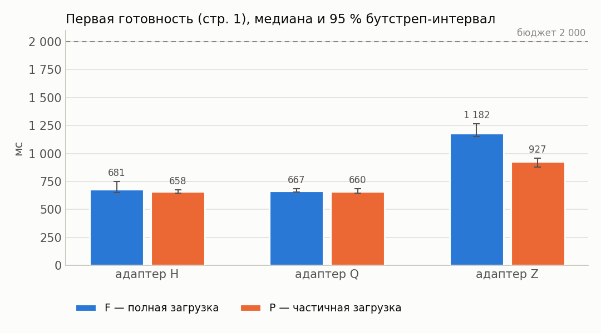

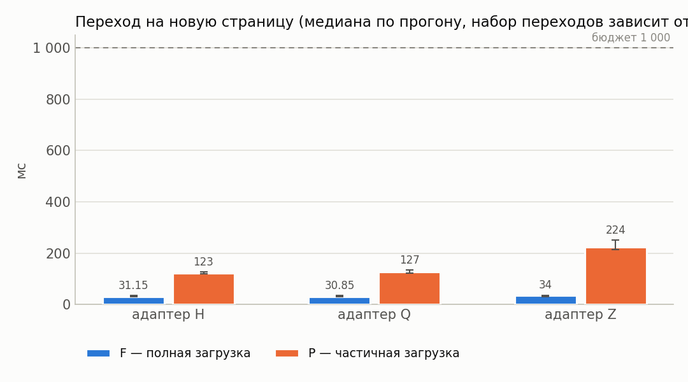

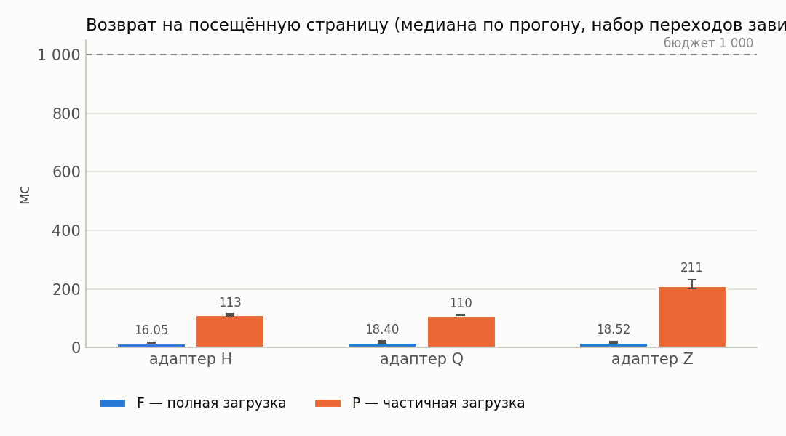

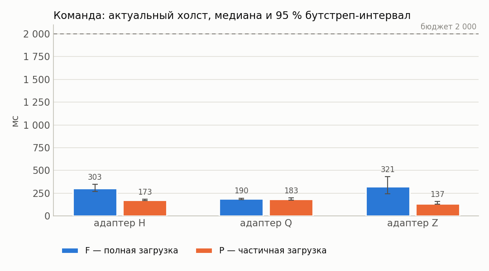

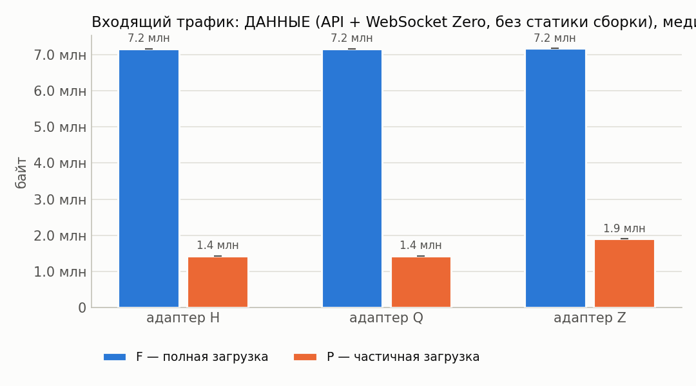

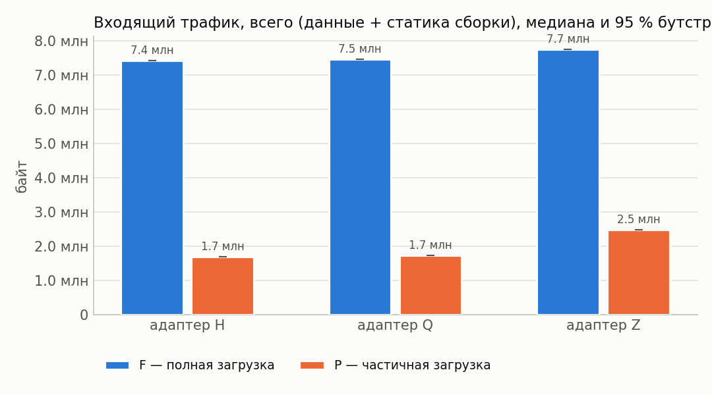

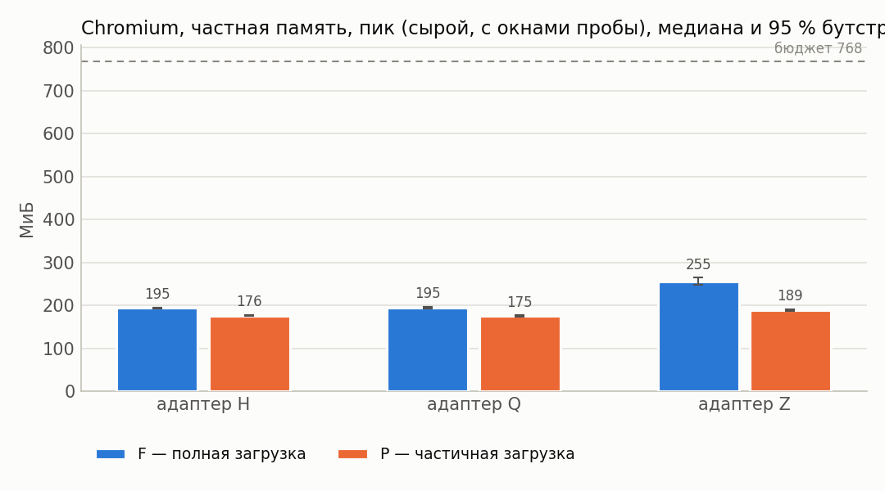

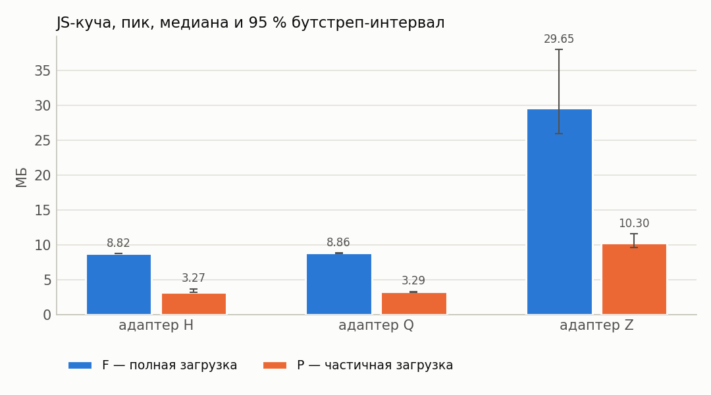

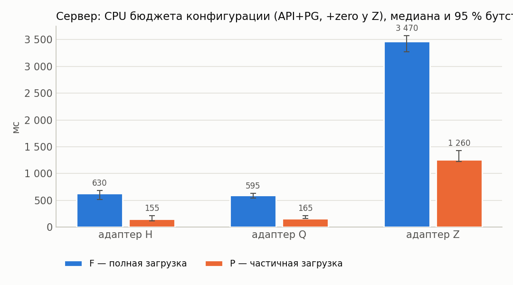

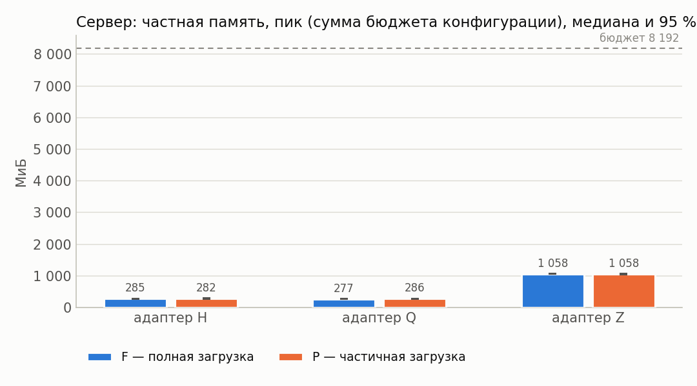

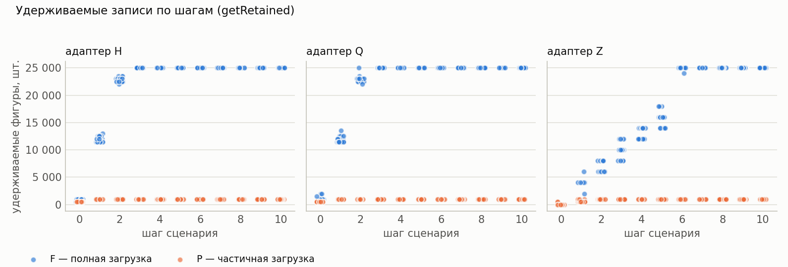

## 12. Выводы

* Оценки изменения P−F ниже — **парные** (медиана поблочных разностей, блок = повторение).
* Все бюджеты §7.4 выполнены для конфигураций: H/F [baseline], H/F [concentrated], H/F [large-share], H/F [spread], H/P (cache=1) [baseline], H/P (cache=1) [concentrated], H/P (cache=1) [large-share], H/P (cache=1) [spread], Q/F [baseline], Q/F [concentrated], Q/F [large-share], Q/F [spread], Q/P (cache=1) [baseline], Q/P (cache=1) [concentrated], Q/P (cache=1) [large-share], Q/P (cache=1) [spread], Z/F [baseline], Z/F [concentrated], Z/F [spread], Z/P (cache=1) [baseline], Z/P (cache=1) [concentrated], Z/P (cache=1) [large-share], Z/P (cache=1) [spread].
* Z/F [large-share]: нарушены бюджеты — Команда до холста, медиана ≤ 2 000 мс.
* H, cache=1, команда baseline: в режиме P первая готовность на 3 % меньше, чем в F (P/F = 0.97, 95 % интервал [0.87; 1.03]; интервал Δ содержит 0 — различие не подтверждено).
* Q, cache=1, команда baseline: в режиме P первая готовность на 2 % меньше, чем в F (P/F = 0.98, 95 % интервал [0.97; 1.03]; интервал Δ содержит 0 — различие не подтверждено).
* Z, cache=1, команда baseline: в режиме P первая готовность на 20 % меньше, чем в F (P/F = 0.80, 95 % интервал [0.70; 0.82]; интервал Δ не содержит 0).
* H, cache=1, команда concentrated: в режиме P первая готовность на 2 % больше, чем в F (P/F = 1.02, 95 % интервал [0.97; 1.05]; интервал Δ содержит 0 — различие не подтверждено).
* Q, cache=1, команда concentrated: в режиме P первая готовность на 1 % меньше, чем в F (P/F = 0.99, 95 % интервал [0.93; 1.03]; интервал Δ содержит 0 — различие не подтверждено).
* Z, cache=1, команда concentrated: в режиме P первая готовность на 20 % меньше, чем в F (P/F = 0.80, 95 % интервал [0.72; 0.82]; интервал Δ не содержит 0).
* H, cache=1, команда large-share: в режиме P первая готовность на 1 % больше, чем в F (P/F = 1.01, 95 % интервал [0.97; 1.03]; интервал Δ содержит 0 — различие не подтверждено).
* Q, cache=1, команда large-share: в режиме P первая готовность на 3 % больше, чем в F (P/F = 1.03, 95 % интервал [0.97; 1.11]; интервал Δ содержит 0 — различие не подтверждено).
* Z, cache=1, команда large-share: в режиме P первая готовность на 22 % меньше, чем в F (P/F = 0.78, 95 % интервал [0.74; 0.79]; интервал Δ не содержит 0).
* H, cache=1, команда spread: в режиме P первая готовность на 2 % больше, чем в F (P/F = 1.02, 95 % интервал [0.94; 1.05]; интервал Δ содержит 0 — различие не подтверждено).
* Q, cache=1, команда spread: в режиме P первая готовность на 1 % меньше, чем в F (P/F = 0.99, 95 % интервал [0.97; 1.01]; интервал Δ содержит 0 — различие не подтверждено).
* Z, cache=1, команда spread: в режиме P первая готовность на 23 % меньше, чем в F (P/F = 0.77, 95 % интервал [0.71; 0.82]; интервал Δ не содержит 0).
* H, cache=1, команда baseline: в режиме P пик частной памяти Chromium на 10 % меньше, чем в F (P/F = 0.90, 95 % интервал [0.90; 0.92]; интервал Δ не содержит 0).
* Q, cache=1, команда baseline: в режиме P пик частной памяти Chromium на 10 % меньше, чем в F (P/F = 0.90, 95 % интервал [0.88; 0.92]; интервал Δ не содержит 0).
* Z, cache=1, команда baseline: в режиме P пик частной памяти Chromium на 26 % меньше, чем в F (P/F = 0.74, 95 % интервал [0.71; 0.77]; интервал Δ не содержит 0).
* H, cache=1, команда concentrated: в режиме P пик частной памяти Chromium на 9 % меньше, чем в F (P/F = 0.91, 95 % интервал [0.89; 0.92]; интервал Δ не содержит 0).
* Q, cache=1, команда concentrated: в режиме P пик частной памяти Chromium на 9 % меньше, чем в F (P/F = 0.91, 95 % интервал [0.89; 0.93]; интервал Δ не содержит 0).
* Z, cache=1, команда concentrated: в режиме P пик частной памяти Chromium на 27 % меньше, чем в F (P/F = 0.73, 95 % интервал [0.70; 0.77]; интервал Δ не содержит 0).
* H, cache=1, команда large-share: в режиме P пик частной памяти Chromium на 15 % меньше, чем в F (P/F = 0.85, 95 % интервал [0.83; 0.85]; интервал Δ не содержит 0).
* Q, cache=1, команда large-share: в режиме P пик частной памяти Chromium на 15 % меньше, чем в F (P/F = 0.85, 95 % интервал [0.84; 0.86]; интервал Δ не содержит 0).
* Z, cache=1, команда large-share: в режиме P пик частной памяти Chromium на 38 % меньше, чем в F (P/F = 0.62, 95 % интервал [0.61; 0.63]; интервал Δ не содержит 0).
* H, cache=1, команда spread: в режиме P пик частной памяти Chromium на 16 % меньше, чем в F (P/F = 0.84, 95 % интервал [0.83; 0.87]; интервал Δ не содержит 0).
* Q, cache=1, команда spread: в режиме P пик частной памяти Chromium на 16 % меньше, чем в F (P/F = 0.84, 95 % интервал [0.83; 0.86]; интервал Δ не содержит 0).
* Z, cache=1, команда spread: в режиме P пик частной памяти Chromium на 26 % меньше, чем в F (P/F = 0.74, 95 % интервал [0.70; 0.77]; интервал Δ не содержит 0).
* H, cache=1, команда baseline: в режиме P входящий трафик на 77 % меньше, чем в F (P/F = 0.23, 95 % интервал [0.23; 0.23]; интервал Δ не содержит 0).
* Q, cache=1, команда baseline: в режиме P входящий трафик на 77 % меньше, чем в F (P/F = 0.23, 95 % интервал [0.23; 0.23]; интервал Δ не содержит 0).
* Z, cache=1, команда baseline: в режиме P входящий трафик на 68 % меньше, чем в F (P/F = 0.32, 95 % интервал [0.32; 0.32]; интервал Δ не содержит 0).
* H, cache=1, команда concentrated: в режиме P входящий трафик на 74 % меньше, чем в F (P/F = 0.26, 95 % интервал [0.26; 0.26]; интервал Δ не содержит 0).
* Q, cache=1, команда concentrated: в режиме P входящий трафик на 73 % меньше, чем в F (P/F = 0.27, 95 % интервал [0.27; 0.27]; интервал Δ не содержит 0).
* Z, cache=1, команда concentrated: в режиме P входящий трафик на 68 % меньше, чем в F (P/F = 0.32, 95 % интервал [0.32; 0.32]; интервал Δ не содержит 0).
* H, cache=1, команда large-share: в режиме P входящий трафик на 86 % меньше, чем в F (P/F = 0.14, 95 % интервал [0.14; 0.14]; интервал Δ не содержит 0).
* Q, cache=1, команда large-share: в режиме P входящий трафик на 86 % меньше, чем в F (P/F = 0.14, 95 % интервал [0.14; 0.14]; интервал Δ не содержит 0).
* Z, cache=1, команда large-share: в режиме P входящий трафик на 70 % меньше, чем в F (P/F = 0.30, 95 % интервал [0.30; 0.30]; интервал Δ не содержит 0).
* H, cache=1, команда spread: в режиме P входящий трафик на 86 % меньше, чем в F (P/F = 0.14, 95 % интервал [0.14; 0.14]; интервал Δ не содержит 0).
* Q, cache=1, команда spread: в режиме P входящий трафик на 86 % меньше, чем в F (P/F = 0.14, 95 % интервал [0.14; 0.14]; интервал Δ не содержит 0).
* Z, cache=1, команда spread: в режиме P входящий трафик на 68 % меньше, чем в F (P/F = 0.32, 95 % интервал [0.32; 0.32]; интервал Δ не содержит 0).
* H, cache=1, команда baseline: в режиме P максимум удерживаемых фигур на 96 % меньше, чем в F (P/F = 0.04, 95 % интервал [0.04; 0.04]; интервал Δ не содержит 0).
* Q, cache=1, команда baseline: в режиме P максимум удерживаемых фигур на 96 % меньше, чем в F (P/F = 0.04, 95 % интервал [0.04; 0.04]; интервал Δ не содержит 0).
* Z, cache=1, команда baseline: в режиме P максимум удерживаемых фигур на 96 % меньше, чем в F (P/F = 0.04, 95 % интервал [0.04; 0.04]; интервал Δ не содержит 0).
* H, cache=1, команда concentrated: в режиме P максимум удерживаемых фигур на 96 % меньше, чем в F (P/F = 0.04, 95 % интервал [0.04; 0.04]; интервал Δ не содержит 0).
* Q, cache=1, команда concentrated: в режиме P максимум удерживаемых фигур на 96 % меньше, чем в F (P/F = 0.04, 95 % интервал [0.04; 0.04]; интервал Δ не содержит 0).
* Z, cache=1, команда concentrated: в режиме P максимум удерживаемых фигур на 96 % меньше, чем в F (P/F = 0.04, 95 % интервал [0.04; 0.04]; интервал Δ не содержит 0).
* H, cache=1, команда large-share: в режиме P максимум удерживаемых фигур на 96 % меньше, чем в F (P/F = 0.04, 95 % интервал [0.04; 0.04]; интервал Δ не содержит 0).
* Q, cache=1, команда large-share: в режиме P максимум удерживаемых фигур на 96 % меньше, чем в F (P/F = 0.04, 95 % интервал [0.04; 0.04]; интервал Δ не содержит 0).
* Z, cache=1, команда large-share: в режиме P максимум удерживаемых фигур на 96 % меньше, чем в F (P/F = 0.04, 95 % интервал [0.04; 0.04]; интервал Δ не содержит 0).
* H, cache=1, команда spread: в режиме P максимум удерживаемых фигур на 96 % меньше, чем в F (P/F = 0.04, 95 % интервал [0.04; 0.04]; интервал Δ не содержит 0).
* Q, cache=1, команда spread: в режиме P максимум удерживаемых фигур на 96 % меньше, чем в F (P/F = 0.04, 95 % интервал [0.04; 0.04]; интервал Δ не содержит 0).
* Z, cache=1, команда spread: в режиме P максимум удерживаемых фигур на 96 % меньше, чем в F (P/F = 0.04, 95 % интервал [0.04; 0.04]; интервал Δ не содержит 0).
* H, cache=1, команда baseline: в режиме P переход на новую страницу на 297 % больше, чем в F (P/F = 3.97, 95 % интервал [3.47; 4.15]; интервал Δ не содержит 0).
* Q, cache=1, команда baseline: в режиме P переход на новую страницу на 298 % больше, чем в F (P/F = 3.98, 95 % интервал [3.79; 4.42]; интервал Δ не содержит 0).
* Z, cache=1, команда baseline: в режиме P переход на новую страницу на 545 % больше, чем в F (P/F = 6.45, 95 % интервал [6.05; 8.29]; интервал Δ не содержит 0).
* H, cache=1, команда concentrated: в режиме P переход на новую страницу на 312 % больше, чем в F (P/F = 4.12, 95 % интервал [3.65; 4.48]; интервал Δ не содержит 0).
* Q, cache=1, команда concentrated: в режиме P переход на новую страницу на 301 % больше, чем в F (P/F = 4.01, 95 % интервал [3.55; 4.11]; интервал Δ не содержит 0).
* Z, cache=1, команда concentrated: в режиме P переход на новую страницу на 619 % больше, чем в F (P/F = 7.19, 95 % интервал [5.90; 7.80]; интервал Δ не содержит 0).
* H, cache=1, команда large-share: в режиме P переход на новую страницу на 308 % больше, чем в F (P/F = 4.08, 95 % интервал [3.94; 4.38]; интервал Δ не содержит 0).
* Q, cache=1, команда large-share: в режиме P переход на новую страницу на 250 % больше, чем в F (P/F = 3.50, 95 % интервал [3.17; 4.15]; интервал Δ не содержит 0).
* Z, cache=1, команда large-share: в режиме P переход на новую страницу на 593 % больше, чем в F (P/F = 6.93, 95 % интервал [6.38; 7.59]; интервал Δ не содержит 0).
* H, cache=1, команда spread: в режиме P переход на новую страницу на 261 % больше, чем в F (P/F = 3.61, 95 % интервал [3.17; 4.17]; интервал Δ не содержит 0).
* Q, cache=1, команда spread: в режиме P переход на новую страницу на 254 % больше, чем в F (P/F = 3.54, 95 % интервал [3.29; 3.90]; интервал Δ не содержит 0).
* Z, cache=1, команда spread: в режиме P переход на новую страницу на 632 % больше, чем в F (P/F = 7.32, 95 % интервал [6.94; 7.86]; интервал Δ не содержит 0).
* Перекрёстная проверка обмена сошлась во всех конфигурациях (наибольшее расхождение шейпера и суммы CDP HTTP+WebSocket — 0.1 %).
* У конфигураций Z/F [baseline], Z/F [concentrated], Z/F [large-share], Z/F [spread], Z/P (cache=1) [baseline], Z/P (cache=1) [concentrated], Z/P (cache=1) [large-share], Z/P (cache=1) [spread] холст успевает обновиться раньше подтверждения сервера — доставка синхронизацией опережает ответ по HTTP; обе величины приведены отдельно в разделе 4.
* Точечная доля успеха ≥ 95 %: H/F [baseline], H/F [concentrated], H/F [large-share], H/F [spread], H/P (cache=1) [baseline], H/P (cache=1) [concentrated], H/P (cache=1) [large-share], H/P (cache=1) [spread], Q/F [baseline], Q/F [concentrated], Q/F [large-share], Q/F [spread], Q/P (cache=1) [baseline], Q/P (cache=1) [concentrated], Q/P (cache=1) [large-share], Q/P (cache=1) [spread], Z/F [baseline], Z/F [concentrated], Z/F [large-share], Z/F [spread], Z/P (cache=1) [baseline], Z/P (cache=1) [concentrated], Z/P (cache=1) [large-share], Z/P (cache=1) [spread].
* Нижняя граница интервала Уилсона ниже 95 % для: H/F [baseline], H/F [concentrated], H/F [large-share], H/F [spread], H/P (cache=1) [baseline], H/P (cache=1) [concentrated], H/P (cache=1) [large-share], H/P (cache=1) [spread], Q/F [baseline], Q/F [concentrated], Q/F [large-share], Q/F [spread], Q/P (cache=1) [baseline], Q/P (cache=1) [concentrated], Q/P (cache=1) [large-share], Q/P (cache=1) [spread], Z/F [baseline], Z/F [concentrated], Z/F [large-share], Z/F [spread], Z/P (cache=1) [baseline], Z/P (cache=1) [concentrated], Z/P (cache=1) [large-share], Z/P (cache=1) [spread]. При n < 73 прогонов она не достигает 95 % даже без единого отказа, поэтому здесь это ограничение объёма серии, а не свидетельство ненадёжности; при наличии отказов — см. раздел «Ошибки».
* Условия применимости частичной загрузки: режим P оправдан, когда его выигрыш по первой готовности/памяти/трафику подтверждён интервалом (не содержащим 0) и при этом переходы на новые страницы и команда до холста остаются в бюджете, а удерживаемые записи не выходят за объявленное окно.
