# Результаты серии «doc50x1000»

Сформировано 2026-09-14 02:48 UTC из `../../results/doc50x1000/runs.csv` (60 прогонов, 6 конфигураций). Бутстреп: 2000 ресемплов, seed=42, перцентильные 95 % интервалы. Времена и ресурсы считаются по прогонам с `outcome=ok`; доли — по всем начатым прогонам.

**Определения статистик** (одинаковы во всех таблицах): медиана — обычная выборочная; p95 — перцентиль по линейной интерполяции порядковых статистик (`numpy.percentile`, тип 7), при n = 30 это интерполяция между 29‑м и 30‑м значением, поэтому p95 не превышает максимум выборки и при малых n смещён вниз; интервалы медианы и p95 — перцентильный бутстреп по одной матрице ресемплов (согласованы между собой); доли — интервал Уилсона 95 % без поправки на непрерывность; при n < 8 интервалы помечены † как ненадёжные, при n < 2 не строятся.

Проверка схемы: OK — rows=60

## 1. Паспорт серии

| Параметр | Значение |
|---|---|
| `series` | doc50x1000 |
| `startedAt` | 2026-09-14T01:01:50.257Z |
| `finishedAt` | 2026-09-14T01:21:12.916Z |
| `host` | {"hostname": "vm", "os": "Linux 6.18.44-fc-v24", "platform": "linux", "arch": "x64", "kernel": "6.18.44-fc-v24", "distro": "Ubuntu 24.04.4 LTS", "cpuModel": "Intel(R) Xeon(R) Processor @ 2.80GHz", "cp |
| `versions` | {"node": "v24.21.0", "npm": "11.19.0", "postgres": "psql (PostgreSQL) 16.13 (Ubuntu 16.13-0ubuntu0.24.04.1)", "chromium": "141.0.7390.37", "playwright": "1.56.0", "zero": "1.9.0", "reactQuery": "5.102 |
| `packages` | {"playwright": "1.56.0", "@types/node": "24.13.4", "typescript": "5.9.3", "ws": "8.21.3", "@rocicorp/zero": "1.9.0", "@tanstack/react-query": "5.102.8", "react": "19.3.0", "react-dom": "19.3.0", "@typ |
| `packagesHoistedDifferent` | {"postgres": "3.4.7", "@fastify/cors": "10.1.0"} |
| `workspacePackages` | {"packages/bench": {"playwright": "1.56.0", "@types/node": "24.13.4", "typescript": "5.9.3", "ws": "8.21.3"}, "packages/client": {"@rocicorp/zero": "1.9.0", "@tanstack/react-query": "5.102.8", "react" |
| `lockfileVersion` | 3 |
| `shaper` | {"delayMs": 25, "bandwidthMbit": 20, "handshakeRtt": true, "statsUrl": "http://127.0.0.1:8081", "effective": {"delayMs": 25, "bandwidthMbit": 20, "bucketMs": 20, "segmentBytes": 4096, "bucketBytes": 5 |
| `seed` | 20260911 |
| `repetitions` | 10 |
| `configs` | [{"adapter": "H", "mode": "F", "cache": 1}, {"adapter": "H", "mode": "P", "cache": 1}, {"adapter": "Q", "mode": "F", "cache": 1}, {"adapter": "Q", "mode": "P", "cache": 1}, {"adapter": "Z", "mode": "F |
| `seriesConfig` | {"name": "doc50x1000", "doc": "doc-dense-50x1000", "sourceId": "doc-dense-50x1000-src-1", "fill": "#1e90ff", "docJson": "data/dense-50x1000.json", "configs": [{"adapter": "H", "mode": "F", "cache": 1} |
| `procGroups` | [{"name": "api", "pidFile": "/home/claude/stand/results/logs/api.pid", "exclude": ["netshaper", "zero-cache"]}, {"name": "pg", "patterns": ["(^\|/)postgres .*16/main", "^postgres: 16/main"], "exclude": |
| `browser` | {"channel": "chromium", "args": ["--disable-extensions"], "headless": true, "viewport": {"width": 1280, "height": 800}} |
| `scenario` | {"route": [2, 3, 1, 4, 2, 5, 1, 6, 3, 50], "pauseMs": 1000, "budgets": {"firstReadyMs": 2000, "navMs": 1000, "cmdDrawnMs": 2000, "scenarioMs": 30000}} |
| `plan` | [{"run_id": "doc50x1000-0000-QP1", "order_index": 0, "repetition": 0, "adapter": "Q", "mode": "P", "cache": 1}, {"run_id": "doc50x1000-0001-ZP1", "order_index": 1, "repetition": 0, "adapter": "Z", "mo |
| `client` | {"dist": [{"path": "adapter-settings.json", "bytes": 1004, "mtime": "2026-09-13T19:30:30.755Z", "sha256": "5d7d9af8420141ebb66ea6894d26792039f489306b9ba46bfea9900ef01071b1"}, {"path": "assets/h-BRsLg0 |
| `adapters` | {"available": true, "source": "packages/client/dist/adapter-settings.json", "generatedFrom": ["packages/client/src/adapters/types.ts → ADAPTER_SETTINGS", "packages/client/src/adapters/settings.ts → Z_ |
| `api` | {"url": "http://127.0.0.1:3000", "available": true, "logLevel": "warn", "health": {"status": "ok", "db": "ok", "uptimeSec": 59913, "testHooks": true, "logLevel": "warn", "now": "2026-09-14T01:01:50.50 |
| `zero` | {"config": {"pid": 1025, "env": {"ZERO_QUERY_URL": "http://127.0.0.1:3000/api/zero/query", "NODE_OPTIONS": "--max-old-space-size=8192 --import=/home/claude/stand/scripts/zero-ipv4-shim.mjs", "ZERO_ENA |
| `commit` | None |
| `code` | {"commit": null, "isGitRepo": false, "dirty": null, "codeId": "4bb9e4465904a250bc72d8338d19363855cfe7f827b12662d8600f4f90ee5917", "clientBuildId": "e8d6c0b226b1ac5d27bc8bd39b66d2b5bc2aab491b4d5f8e554c |
| `harness` | {"harnessId": "4c4cbf708da6f47c77b17aeb70567eb7e181ccc297d11c4f65ed9aa67aa09454", "harnessIdShort": "4c4cbf708da6f47c", "benchId": "8e1bdf1d09f201b6d42ff58f62fccfc4be22cd53ac554a5dd2aeb14ed5a99ccf", " |
| `preSeriesChecks` | {"at": "2026-09-14T01:01:50.547Z", "samplers": {"ok": true, "groups": [{"group": "api", "needed": true, "processes": 1, "pids": [984], "verdict": "ok", "spec": "pidFile=/home/claude/stand/results/logs |
| `runsExecutedNow` | 60 |
| `runsExecutedTotal` | 60 |
| `runsOk` | 60 |
| `runsTotalPlanned` | 60 |

## 2. Состав серии и доля успеха

Успех прогона = `outcome=ok` ∧ `t_scenario ≤ 30 с` ∧ все проверки эталона прошли (SPEC §7.3).

Доли считаются по **всем** начатым прогонам конфигурации (ошибка и таймаут = неуспех); сводки времени и ресурсов ниже — только по прогонам `outcome=ok`.

| Конфигурация | Прогонов | ok | error | timeout | эталон ✓ | ok, но эталон ✗ | успех | Доля успеха [Уилсон 95 %] |
|---|---|---|---|---|---|---|---|---|
| H/F | 10 | 10 | 0 | 0 | 10 | 0 | 10 | 100.0 % [72.2 %; 100.0 %] |
| H/P (cache=1) | 10 | 10 | 0 | 0 | 10 | 0 | 10 | 100.0 % [72.2 %; 100.0 %] |
| Q/F | 10 | 10 | 0 | 0 | 10 | 0 | 10 | 100.0 % [72.2 %; 100.0 %] |
| Q/P (cache=1) | 10 | 10 | 0 | 0 | 10 | 0 | 10 | 100.0 % [72.2 %; 100.0 %] |
| Z/F | 10 | 10 | 0 | 0 | 10 | 0 | 10 | 100.0 % [72.2 %; 100.0 %] |
| Z/P (cache=1) | 10 | 10 | 0 | 0 | 10 | 0 | 10 | 100.0 % [72.2 %; 100.0 %] |

## 3. Сводные показатели по конфигурациям

Для каждого показателя приводятся n, медиана с 95 % перцентильным бутстреп‑интервалом, p95 (линейная интерполяция порядковых статистик) с таким же интервалом, min и max. Знак † — интервал построен по n < 8 наблюдениям и ненадёжен; «—» вместо интервала — n < 2, интервал не определён.

### 3.1 Время

**Первая готовность (стр. 1), мс**

| Конфигурация | n | Медиана | 95 % ИД медианы | p95 | 95 % ИД p95 | min | max |
|---|---|---|---|---|---|---|---|
| H/F | 10 | 759 | [748; 782] | 801 | [774; 817] | 709 | 817 |
| H/P (cache=1) | 10 | 741 | [734; 743] | 761 | [742; 775] | 725 | 775 |
| Q/F | 10 | 759 | [748; 769] | 789 | [760; 799] | 743 | 799 |
| Q/P (cache=1) | 10 | 746 | [733; 761] | 769 | [750; 769] | 727 | 769 |
| Z/F | 10 | 1 579 | [1 542; 1 633] | 1 697 | [1 602; 1 725] | 1 511 | 1 725 |
| Z/P (cache=1) | 10 | 1 056 | [1 010; 1 086] | 1 098 | [1 068; 1 105] | 986 | 1 105 |

**Переход на новую страницу (медиана по прогону, набор переходов зависит от маршрута серии), мс**

| Конфигурация | n | Медиана | 95 % ИД медианы | p95 | 95 % ИД p95 | min | max |
|---|---|---|---|---|---|---|---|
| H/F | 10 | 54 | [52; 57] | 66 | [55; 70] | 48 | 70 |
| H/P (cache=1) | 10 | 199 | [196; 202] | 209 | [201; 214] | 194 | 214 |
| Q/F | 10 | 56 | [52; 62] | 68 | [60; 71] | 51 | 71 |
| Q/P (cache=1) | 10 | 200 | [199; 203] | 204 | [202; 204] | 197 | 204 |
| Z/F | 10 | 61 | [58; 74] | 81 | [67; 81] | 54 | 81 |
| Z/P (cache=1) | 10 | 388 | [380; 405] | 410 | [399; 412] | 354 | 412 |

**Возврат на посещённую страницу (медиана по прогону, набор переходов зависит от маршрута серии), мс**

| Конфигурация | n | Медиана | 95 % ИД медианы | p95 | 95 % ИД p95 | min | max |
|---|---|---|---|---|---|---|---|
| H/F | 10 | 46 | [44; 51] | 57 | [46; 57] | 43 | 57 |
| H/P (cache=1) | 10 | 192 | [190; 196] | 200 | [193; 203] | 187 | 203 |
| Q/F | 10 | 47 | [45; 52] | 56 | [49; 56] | 42 | 56 |
| Q/P (cache=1) | 10 | 194 | [192; 199] | 206 | [194; 207] | 189 | 207 |
| Z/F | 10 | 53 | [49; 62] | 68 | [58; 72] | 46 | 72 |
| Z/P (cache=1) | 10 | 386 | [372; 407] | 420 | [395; 428] | 363 | 428 |

**Команда: подтверждение транспорта (Z — .server, H/Q — ответ POST), мс**

| Конфигурация | n | Медиана | 95 % ИД медианы | p95 | 95 % ИД p95 | min | max |
|---|---|---|---|---|---|---|---|
| H/F | 10 | 68 | [66; 72] | 75 | [70; 77] | 65 | 77 |
| H/P (cache=1) | 10 | 69 | [67; 71] | 73 | [71; 73] | 64 | 73 |
| Q/F | 10 | 69 | [66; 73] | 74 | [70; 74] | 65 | 74 |
| Q/P (cache=1) | 10 | 70 | [68; 77] | 116 | [74; 147] | 68 | 147 |
| Z/F | 10 | 675 | [332; 964] | 1 104 | [854; 1 143] | 278 | 1 143 |
| Z/P (cache=1) | 10 | 136 | [125; 143] | 150 | [139; 154] | 114 | 154 |

**Команда: подтверждение сервера (результат операции), мс**

| Конфигурация | n | Медиана | 95 % ИД медианы | p95 | 95 % ИД p95 | min | max |
|---|---|---|---|---|---|---|---|
| H/F | 10 | 69 | [66; 72] | 76 | [71; 77] | 65 | 77 |
| H/P (cache=1) | 10 | 69 | [67; 71] | 73 | [70; 73] | 64 | 73 |
| Q/F | 10 | 69 | [66; 73] | 74 | [70; 74] | 66 | 74 |
| Q/P (cache=1) | 10 | 70 | [68; 77] | 116 | [75; 147] | 68 | 147 |
| Z/F | 10 | 745 | [403; 1 021] | 1 167 | [926; 1 208] | 350 | 1 208 |
| Z/P (cache=1) | 10 | 202 | [184; 212] | 220 | [206; 222] | 174 | 222 |

**Команда: цена протокола подтверждения (ack − транспорт), мс**

| Конфигурация | n | Медиана | 95 % ИД медианы | p95 | 95 % ИД p95 | min | max |
|---|---|---|---|---|---|---|---|
| H/F | 10 | 0 | [0; 0] | 1 | [0; 1] | 0 | 1 |
| H/P (cache=1) | 10 | 0 | [0; 0] | 0 | [0; 0] | 0 | 0 |
| Q/F | 10 | 0 | [0; 0] | 0 | [0; 0] | 0 | 0 |
| Q/P (cache=1) | 10 | 0 | [0; 0] | 0 | [0; 0] | 0 | 0 |
| Z/F | 10 | 68 | [65; 71] | 74 | [69; 76] | 60 | 76 |
| Z/P (cache=1) | 10 | 62 | [60; 66] | 83 | [64; 95] | 57 | 95 |

**Команда: данные в хранилище активной страницы, мс**

| Конфигурация | n | Медиана | 95 % ИД медианы | p95 | 95 % ИД p95 | min | max |
|---|---|---|---|---|---|---|---|
| H/F | 10 | 326 | [241; 433] | 535 | [333; 537] | 224 | 537 |
| H/P (cache=1) | 10 | 228 | [216; 229] | 230 | [228; 230] | 213 | 230 |
| Q/F | 10 | 225 | [220; 227] | 232 | [226; 234] | 216 | 234 |
| Q/P (cache=1) | 10 | 224 | [221; 230] | 269 | [227; 297] | 218 | 297 |
| Z/F | 10 | 674 | [331; 953] | 1 104 | [814; 1 142] | 278 | 1 142 |
| Z/P (cache=1) | 10 | 136 | [125; 142] | 150 | [140; 154] | 114 | 154 |

**Команда: актуальный холст, мс**

| Конфигурация | n | Медиана | 95 % ИД медианы | p95 | 95 % ИД p95 | min | max |
|---|---|---|---|---|---|---|---|
| H/F | 10 | 342 | [257; 449] | 550 | [350; 551] | 238 | 551 |
| H/P (cache=1) | 10 | 240 | [230; 244] | 259 | [242; 270] | 225 | 270 |
| Q/F | 10 | 242 | [234; 244] | 248 | [243; 250] | 231 | 250 |
| Q/P (cache=1) | 10 | 239 | [237; 245] | 283 | [242; 311] | 230 | 311 |
| Z/F | 10 | 694 | [352; 978] | 1 124 | [881; 1 163] | 301 | 1 163 |
| Z/P (cache=1) | 10 | 156 | [143; 162] | 171 | [159; 177] | 128 | 177 |

**Переход, медиана всех переходов прогона (маршрут любой длины), мс**

| Конфигурация | n | Медиана | 95 % ИД медианы | p95 | 95 % ИД p95 | min | max |
|---|---|---|---|---|---|---|---|
| H/F | 10 | 52 | [50; 54] | 59 | [52; 62] | 47 | 62 |
| H/P (cache=1) | 10 | 197 | [194; 200] | 203 | [199; 206] | 192 | 206 |
| Q/F | 10 | 53 | [50; 59] | 60 | [55; 61] | 49 | 61 |
| Q/P (cache=1) | 10 | 198 | [197; 201] | 202 | [198; 203] | 194 | 203 |
| Z/F | 10 | 58 | [56; 64] | 69 | [60; 71] | 50 | 71 |
| Z/P (cache=1) | 10 | 389 | [380; 401] | 408 | [395; 412] | 376 | 412 |

**Сценарий целиком (с паузами, без проб оболочки), мс**

| Конфигурация | n | Медиана | 95 % ИД медианы | p95 | 95 % ИД p95 | min | max |
|---|---|---|---|---|---|---|---|
| H/F | 10 | 12 640 | [12 582; 12 744] | 12 843 | [12 712; 12 873] | 12 519 | 12 873 |
| H/P (cache=1) | 10 | 13 951 | [13 927; 14 009] | 14 048 | [13 975; 14 055] | 13 914 | 14 055 |
| Q/F | 10 | 12 578 | [12 503; 12 598] | 12 603 | [12 586; 12 605] | 12 494 | 12 605 |
| Q/P (cache=1) | 10 | 13 992 | [13 945; 14 040] | 14 048 | [14 021; 14 050] | 13 918 | 14 050 |
| Z/F | 10 | 13 969 | [13 719; 14 220] | 14 417 | [14 060; 14 524] | 13 587 | 14 524 |
| Z/P (cache=1) | 10 | 16 157 | [16 061; 16 294] | 16 402 | [16 227; 16 421] | 15 976 | 16 421 |

**Сценарий целиком, сырое время (с пробами оболочки), мс**

| Конфигурация | n | Медиана | 95 % ИД медианы | p95 | 95 % ИД p95 | min | max |
|---|---|---|---|---|---|---|---|
| H/F | 10 | 12 660 | [12 602; 12 769] | 12 861 | [12 712; 12 890] | 12 542 | 12 890 |
| H/P (cache=1) | 10 | 13 979 | [13 949; 14 027] | 14 073 | [13 994; 14 083] | 13 939 | 14 083 |
| Q/F | 10 | 12 591 | [12 528; 12 618] | 12 629 | [12 611; 12 634] | 12 514 | 12 634 |
| Q/P (cache=1) | 10 | 14 002 | [13 963; 14 060] | 14 072 | [14 043; 14 078] | 13 935 | 14 078 |
| Z/F | 10 | 15 984 | [15 461; 16 809] | 17 492 | [16 374; 17 827] | 14 905 | 17 827 |
| Z/P (cache=1) | 10 | 16 178 | [16 102; 16 310] | 16 434 | [16 198; 16 451] | 15 997 | 16 451 |

**Пробы оболочки сверх объявленных пауз, мс**

| Конфигурация | n | Медиана | 95 % ИД медианы | p95 | 95 % ИД p95 | min | max |
|---|---|---|---|---|---|---|---|
| H/F | 10 | 20 | [17; 25] | 31 | [23; 33] | 13 | 33 |
| H/P (cache=1) | 10 | 23 | [17; 28] | 31 | [25; 33] | 9 | 33 |
| Q/F | 10 | 26 | [17; 28] | 32 | [26; 34] | 9 | 34 |
| Q/P (cache=1) | 10 | 15 | [10; 24] | 31 | [21; 32] | 6 | 32 |
| Z/F | 10 | 2 203 | [1 318; 2 737] | 3 344 | [2 450; 3 607] | 1 234 | 3 607 |
| Z/P (cache=1) | 10 | 21 | [17; 30] | 33 | [26; 34] | 14 | 34 |

### 3.2 Объём обмена

**Головная величина обмена — «только данные»** (`bytes_in_data`: API + кадры синхронизации Zero). Полный `bytes_in` включает статику сборки — поадаптерную константу, одинаковую в F и в P, поэтому в отношениях P/F она искажает сравнение (`docs/DEVIATIONS.md` §3.1). Оба числа приводятся рядом, разложение — ниже.

**Входящий трафик: ДАННЫЕ (API + WebSocket Zero, без статики сборки), байт**

| Конфигурация | n | Медиана | 95 % ИД медианы | p95 | 95 % ИД p95 | min | max |
|---|---|---|---|---|---|---|---|
| H/F | 10 | 14 682 592 | [14 682 592; 14 682 592] | 14 682 592 | [14 682 592; 14 682 592] | 14 682 592 | 14 682 592 |
| H/P (cache=1) | 10 | 2 923 274 | [2 923 274; 2 923 274] | 2 923 274 | [2 923 274; 2 923 274] | 2 923 274 | 2 923 274 |
| Q/F | 10 | 14 682 592 | [14 682 592; 14 682 592] | 14 682 592 | [14 682 592; 14 682 592] | 14 682 592 | 14 682 592 |
| Q/P (cache=1) | 10 | 2 923 274 | [2 923 274; 2 923 274] | 2 923 274 | [2 923 274; 2 923 274] | 2 923 274 | 2 923 274 |
| Z/F | 10 | 14 624 508 | [14 624 508; 14 624 521] | 14 626 997 | [14 624 515; 14 626 997] | 14 624 508 | 14 626 997 |
| Z/P (cache=1) | 10 | 3 881 519 | [3 881 519; 3 881 519] | 3 881 519 | [3 881 519; 3 881 519] | 3 881 519 | 3 881 519 |

**Входящий трафик, всего (данные + статика сборки), байт**

| Конфигурация | n | Медиана | 95 % ИД медианы | p95 | 95 % ИД p95 | min | max |
|---|---|---|---|---|---|---|---|
| H/F | 10 | 14 942 986 | [14 942 986; 14 942 986] | 14 942 986 | [14 942 986; 14 942 986] | 14 942 986 | 14 942 986 |
| H/P (cache=1) | 10 | 3 183 668 | [3 183 668; 3 183 668] | 3 183 668 | [3 183 668; 3 183 668] | 3 183 668 | 3 183 668 |
| Q/F | 10 | 14 973 998 | [14 973 998; 14 973 998] | 14 973 998 | [14 973 998; 14 973 998] | 14 973 998 | 14 973 998 |
| Q/P (cache=1) | 10 | 3 214 680 | [3 214 680; 3 214 680] | 3 214 680 | [3 214 680; 3 214 680] | 3 214 680 | 3 214 680 |
| Z/F | 10 | 15 197 032 | [15 197 032; 15 198 276] | 15 199 521 | [15 197 045; 15 199 521] | 15 197 032 | 15 199 521 |
| Z/P (cache=1) | 10 | 4 454 043 | [4 454 043; 4 454 043] | 4 454 043 | [4 454 043; 4 454 043] | 4 454 043 | 4 454 043 |

**Статика сборки за прогон (поадаптерная константа), байт**

| Конфигурация | n | Медиана | 95 % ИД медианы | p95 | 95 % ИД p95 | min | max |
|---|---|---|---|---|---|---|---|
| H/F | 10 | 260 394 | [260 394; 260 394] | 260 394 | [260 394; 260 394] | 260 394 | 260 394 |
| H/P (cache=1) | 10 | 260 394 | [260 394; 260 394] | 260 394 | [260 394; 260 394] | 260 394 | 260 394 |
| Q/F | 10 | 291 406 | [291 406; 291 406] | 291 406 | [291 406; 291 406] | 291 406 | 291 406 |
| Q/P (cache=1) | 10 | 291 406 | [291 406; 291 406] | 291 406 | [291 406; 291 406] | 291 406 | 291 406 |
| Z/F | 10 | 572 524 | [572 524; 572 524] | 572 524 | [572 524; 572 524] | 572 524 | 572 524 |
| Z/P (cache=1) | 10 | 572 524 | [572 524; 572 524] | 572 524 | [572 524; 572 524] | 572 524 | 572 524 |

**Исходящий трафик: данные (без статики), байт**

| Конфигурация | n | Медиана | 95 % ИД медианы | p95 | 95 % ИД p95 | min | max |
|---|---|---|---|---|---|---|---|
| H/F | 10 | 51 843 | [51 843; 51 843] | 51 843 | [51 843; 51 843] | 51 843 | 51 843 |
| H/P (cache=1) | 10 | 12 387 | [12 387; 12 387] | 12 387 | [12 387; 12 387] | 12 387 | 12 387 |
| Q/F | 10 | 51 843 | [51 843; 51 843] | 51 843 | [51 843; 51 843] | 51 843 | 51 843 |
| Q/P (cache=1) | 10 | 12 387 | [12 387; 12 387] | 12 387 | [12 387; 12 387] | 12 387 | 12 387 |
| Z/F | 10 | 12 990 | [12 989; 13 007] | 13 007 | [12 999; 13 007] | 12 976 | 13 007 |
| Z/P (cache=1) | 10 | 7 478 | [7 478; 7 478] | 7 478 | [7 478; 7 478] | 7 466 | 7 478 |

**Исходящий трафик, всего (шейпер), байт**

| Конфигурация | n | Медиана | 95 % ИД медианы | p95 | 95 % ИД p95 | min | max |
|---|---|---|---|---|---|---|---|
| H/F | 10 | 55 940 | [55 940; 55 940] | 55 940 | [55 940; 55 940] | 55 940 | 55 940 |
| H/P (cache=1) | 10 | 16 484 | [16 484; 16 484] | 16 484 | [16 484; 16 484] | 16 484 | 16 484 |
| Q/F | 10 | 55 940 | [55 940; 55 940] | 55 940 | [55 940; 55 940] | 55 940 | 55 940 |
| Q/P (cache=1) | 10 | 16 484 | [16 484; 16 484] | 16 484 | [16 484; 16 484] | 16 484 | 16 484 |
| Z/F | 10 | 17 145 | [17 144; 17 162] | 17 162 | [17 148; 17 162] | 17 131 | 17 162 |
| Z/P (cache=1) | 10 | 11 633 | [11 633; 11 633] | 11 633 | [11 633; 11 633] | 11 621 | 11 633 |

**Входящий трафик (CDP, перекрёстная проверка), байт**

| Конфигурация | n | Медиана | 95 % ИД медианы | p95 | 95 % ИД p95 | min | max |
|---|---|---|---|---|---|---|---|
| H/F | 10 | 14 942 986 | [14 942 986; 14 942 986] | 14 942 986 | [14 942 986; 14 942 986] | 14 942 986 | 14 942 986 |
| H/P (cache=1) | 10 | 3 183 668 | [3 183 668; 3 183 668] | 3 183 668 | [3 183 668; 3 183 668] | 3 183 668 | 3 183 668 |
| Q/F | 10 | 14 973 998 | [14 973 998; 14 973 998] | 14 973 998 | [14 973 998; 14 973 998] | 14 973 998 | 14 973 998 |
| Q/P (cache=1) | 10 | 3 214 680 | [3 214 680; 3 214 680] | 3 214 680 | [3 214 680; 3 214 680] | 3 214 680 | 3 214 680 |
| Z/F | 10 | 576 832 | [576 832; 576 832] | 576 832 | [576 832; 576 832] | 576 832 | 576 832 |
| Z/P (cache=1) | 10 | 576 832 | [576 832; 576 832] | 576 832 | [576 832; 576 832] | 576 832 | 576 832 |

**Обмен данными против полного объёма**

Источник разложения: колонки оболочки `bytes_in_api` / `bytes_in_zero` / `bytes_in_static`.

Разброс статики внутри конфигурации обязан быть нулевым — это константа сборки, а не измеряемая величина; ненулевой разброс означал бы, что в статику попало что‑то ещё, и его надо разбирать.

| Конфигурация | n | **Данные (API + WS), байт** | Статика сборки, байт | Всего, байт | Доля статики | Разброс статики |
|---|---|---|---|---|---|---|
| H/F | 10‡ | 14 682 592 | 260 394 | 14 942 986 | 1.7 % | 0 |
| H/P (cache=1) | 10‡ | 2 923 274 | 260 394 | 3 183 668 | 8.2 % | 0 |
| Q/F | 10‡ | 14 682 592 | 291 406 | 14 973 998 | 1.9 % | 0 |
| Q/P (cache=1) | 10‡ | 2 923 274 | 291 406 | 3 214 680 | 9.1 % | 0 |
| Z/F | 10‡ | 14 624 508 | 572 524 | 15 197 032 | 3.8 % | 0 |
| Z/P (cache=1) | 10‡ | 3 881 519 | 572 524 | 4 454 043 | 12.9 % | 0 |

**P/F обмена: по полному трафику и по данным** (парная оценка, блок = повторение)

| Адаптер | Пар | Статика, байт | P/F полный (как публиковалось) | **P/F данные (головное)** | Изменилось |
|---|---|---|---|---|---|
| H (cache=1) | 10‡ | 260 394 | 0.213 [0.213; 0.213] | **0.199** [0.199; 0.199] | да, -0.014 |
| Q (cache=1) | 10‡ | 291 406 | 0.215 [0.215; 0.215] | **0.199** [0.199; 0.199] | да, -0.016 |
| Z (cache=1) | 10‡ | 572 524 | 0.293 [0.293; 0.293] | **0.265** [0.265; 0.265] | да, -0.028 |

Последний столбец отвечает на вопрос «какие опубликованные числа двигает вычитание статики»: величина сдвига = P/F(данные) − P/F(полный).

**Полнота разложения: сумма по маршрутам против итога**

Головное число обмена — `bytes_in_data = bytes_in_api + bytes_in_zero`. Оно осмысленно ровно настолько, насколько разложение полное, поэтому проверка идёт **по каждому прогону**, а не по медианам: столбцы «расхождение» — максимум по прогонам конфигурации от |(api + zero + статика + прочее) − итог|, столбцы «остаток» — максимум собственной контрольной колонки оболочки `bytes_*_route_residual`. Ожидаемое значение всех четырёх — ноль.

| Конфигурация | n | Расхождение вход, Б | Расхождение исход, Б | Остаток вход, Б | Остаток исход, Б | Прочее (вход), Б | Сошлось |
|---|---|---|---|---|---|---|---|
| H/F | 10‡ | 0 | 0 | 0 | 0 | 0 | ✓ |
| H/P (cache=1) | 10‡ | 0 | 0 | 0 | 0 | 0 | ✓ |
| Q/F | 10‡ | 0 | 0 | 0 | 0 | 0 | ✓ |
| Q/P (cache=1) | 10‡ | 0 | 0 | 0 | 0 | 0 | ✓ |
| Z/F | 10‡ | 0 | 0 | 0 | 0 | 0 | ✓ |
| Z/P (cache=1) | 10‡ | 0 | 0 | 0 | 0 | 0 | ✓ |

Все конфигурации сошлись побайтно: «данные + статика + прочее» исчерпывают весь наблюдаемый обмен, и головная величина `bytes_in_data` ничего не теряет.

**Перекрёстная проверка трафика (шейпер vs CDP)**

Шейпер считает байты TCP‑полезной нагрузки всех соединений клиента; CDP даёт их двумя счётчиками — `cdp_bytes_in` (`encodedDataLength` HTTP‑ответов) и `cdp_ws_bytes_in` (кадры WebSocket). У H/Q второй счётчик нулевой, у Z по WebSocket идёт почти весь обмен, поэтому сверять нужно **сумму**: сравнение только с `cdp_bytes_in` давало ложный провал у Z (в прежнем `results/smoke/report.md` — Z/F 92.5 %, Z/P 76.6 %).

| Конфигурация | bytes_in (шейпер) | CDP: HTTP | CDP: WebSocket | CDP: сумма | Расхождение | ≤ 10 % |
|---|---|---|---|---|---|---|
| H/F | 14 942 986 | 14 942 986 | 0 | 14 942 986 | 0.0 % | ✓ |
| H/P (cache=1) | 3 183 668 | 3 183 668 | 0 | 3 183 668 | 0.0 % | ✓ |
| Q/F | 14 973 998 | 14 973 998 | 0 | 14 973 998 | 0.0 % | ✓ |
| Q/P (cache=1) | 3 214 680 | 3 214 680 | 0 | 3 214 680 | 0.0 % | ✓ |
| Z/F | 15 197 032 | 576 832 | 14 616 717 | 15 193 549 | 0.0 % | ✓ |
| Z/P (cache=1) | 4 454 043 | 576 832 | 3 874 908 | 4 451 740 | 0.1 % | ✓ |

**Исходящее направление — справочно.** `cdp_bytes_out` не измеряется, а оценивается по `Network.requestWillBeSent` (стартовая строка + известные CDP заголовки + тело) и систематически занижен на заголовки, которые добавляет сетевой стек браузера, и на рукопожатие WebSocket. Расхождение 20–40 % здесь — свойство оценки, а не признак ошибки измерения; в вердикт конфигурации это направление не входит.

| Конфигурация | bytes_out (шейпер) | CDP: сумма (оценка) | Расхождение | ≤ 50 % |
|---|---|---|---|---|
| H/F | 55 940 | 43 364 | 22.5 % | ✓ |
| H/P (cache=1) | 16 484 | 12 260 | 25.6 % | ✓ |
| Q/F | 55 940 | 43 364 | 22.5 % | ✓ |
| Q/P (cache=1) | 16 484 | 12 260 | 25.6 % | ✓ |
| Z/F | 17 145 | 12 035 | 29.8 % | ✓ |
| Z/P (cache=1) | 11 633 | 7 097 | 39.0 % | ✓ |

### 3.3 Память клиента

**Chromium, частная память, пик без окон пробы, МиБ**

| Конфигурация | n | Медиана | 95 % ИД медианы | p95 | 95 % ИД p95 | min | max |
|---|---|---|---|---|---|---|---|
| H/F | 10 | 221.6 | [218.7; 223.2] | 225.7 | [222.0; 226.2] | 214.8 | 226.2 |
| H/P (cache=1) | 10 | 179.7 | [179.1; 180.6] | 181.2 | [179.9; 181.4] | 178.3 | 181.4 |
| Q/F | 10 | 222.4 | [219.7; 224.6] | 226.2 | [223.1; 226.3] | 217.6 | 226.3 |
| Q/P (cache=1) | 10 | 179.3 | [179.0; 180.6] | 182.4 | [179.8; 183.4] | 178.3 | 183.4 |
| Z/F | 10 | 254.0 | [251.7; 267.8] | 290.0 | [255.4; 297.9] | 248.6 | 297.9 |
| Z/P (cache=1) | 10 | 200.4 | [199.4; 203.1] | 205.6 | [202.0; 207.2] | 197.8 | 207.2 |

**Chromium, частная память, пик (сырой, с окнами пробы), МиБ**

| Конфигурация | n | Медиана | 95 % ИД медианы | p95 | 95 % ИД p95 | min | max |
|---|---|---|---|---|---|---|---|
| H/F | 10 | 221.7 | [219.7; 223.6] | 225.7 | [222.0; 226.2] | 217.3 | 226.2 |
| H/P (cache=1) | 10 | 181.3 | [180.9; 181.9] | 182.0 | [181.5; 182.0] | 179.4 | 182.0 |
| Q/F | 10 | 222.9 | [219.7; 224.9] | 226.2 | [223.8; 226.3] | 217.6 | 226.3 |
| Q/P (cache=1) | 10 | 181.2 | [180.9; 182.6] | 183.1 | [181.4; 183.4] | 180.5 | 183.4 |
| Z/F | 10 | 311.0 | [303.7; 329.2] | 348.2 | [321.2; 357.1] | 301.2 | 357.1 |
| Z/P (cache=1) | 10 | 200.4 | [199.4; 203.1] | 205.6 | [202.0; 207.2] | 197.8 | 207.2 |

**Chromium, частная память, конец, МиБ**

| Конфигурация | n | Медиана | 95 % ИД медианы | p95 | 95 % ИД p95 | min | max |
|---|---|---|---|---|---|---|---|
| H/F | 10 | 217.7 | [216.0; 219.6] | 221.2 | [218.5; 221.3] | 213.8 | 221.3 |
| H/P (cache=1) | 10 | 179.6 | [179.1; 180.3] | 180.8 | [179.8; 180.9] | 178.3 | 180.9 |
| Q/F | 10 | 218.7 | [215.5; 220.1] | 220.8 | [219.8; 220.9] | 213.1 | 220.9 |
| Q/P (cache=1) | 10 | 179.2 | [179.1; 180.6] | 182.4 | [179.8; 183.4] | 178.3 | 183.4 |
| Z/F | 10 | 216.0 | [214.8; 217.0] | 217.6 | [216.6; 217.8] | 214.4 | 217.8 |
| Z/P (cache=1) | 10 | 185.6 | [185.1; 186.5] | 186.7 | [186.2; 186.8] | 183.9 | 186.8 |

**JS‑куча, пик, МБ**

| Конфигурация | n | Медиана | 95 % ИД медианы | p95 | 95 % ИД p95 | min | max |
|---|---|---|---|---|---|---|---|
| H/F | 10 | 15.5 | [15.3; 15.7] | 15.8 | [15.6; 15.8] | 15.0 | 15.8 |
| H/P (cache=1) | 10 | 3.5 | [3.5; 3.5] | 3.5 | [3.5; 3.5] | 3.5 | 3.5 |
| Q/F | 10 | 15.2 | [15.2; 15.2] | 15.2 | [15.2; 15.2] | 15.1 | 15.2 |
| Q/P (cache=1) | 10 | 3.6 | [3.6; 3.6] | 3.7 | [3.6; 3.7] | 3.6 | 3.7 |
| Z/F | 10 | 48.1 | [47.1; 51.0] | 55.3 | [48.6; 56.9] | 42.9 | 56.9 |
| Z/P (cache=1) | 10 | 15.2 | [13.1; 18.1] | 18.8 | [16.8; 19.1] | 12.6 | 19.1 |

**JS‑куча, конец, МБ**

| Конфигурация | n | Медиана | 95 % ИД медианы | p95 | 95 % ИД p95 | min | max |
|---|---|---|---|---|---|---|---|
| H/F | 10 | 13.9 | [13.8; 13.9] | 13.9 | [13.9; 13.9] | 13.8 | 13.9 |
| H/P (cache=1) | 10 | 3.1 | [3.1; 3.1] | 3.1 | [3.1; 3.1] | 3.0 | 3.1 |
| Q/F | 10 | 13.2 | [13.1; 13.2] | 13.2 | [13.2; 13.2] | 13.1 | 13.2 |
| Q/P (cache=1) | 10 | 3.2 | [3.2; 3.2] | 3.2 | [3.2; 3.2] | 3.2 | 3.2 |
| Z/F | 10 | 33.9 | [27.9; 42.4] | 43.9 | [40.9; 44.8] | 27.8 | 44.8 |
| Z/P (cache=1) | 10 | 8.5 | [8.5; 8.6] | 8.8 | [8.5; 8.9] | 8.4 | 8.9 |

**JS‑куча после принудительной сборки (остановка часов), МБ**

| Конфигурация | n | Медиана | 95 % ИД медианы | p95 | 95 % ИД p95 | min | max |
|---|---|---|---|---|---|---|---|
| H/F | 10 | 13.9 | [13.8; 13.9] | 13.9 | [13.9; 13.9] | 13.8 | 13.9 |
| H/P (cache=1) | 10 | 3.1 | [3.1; 3.1] | 3.1 | [3.1; 3.1] | 3.0 | 3.1 |
| Q/F | 10 | 13.2 | [13.1; 13.2] | 13.2 | [13.2; 13.2] | 13.1 | 13.2 |
| Q/P (cache=1) | 10 | 3.2 | [3.2; 3.2] | 3.2 | [3.2; 3.2] | 3.2 | 3.2 |
| Z/F | 10 | 34.1 | [27.9; 42.4] | 43.8 | [41.0; 44.9] | 27.8 | 44.9 |
| Z/P (cache=1) | 10 | 8.5 | [8.5; 8.6] | 8.8 | [8.5; 8.9] | 8.4 | 8.9 |

**Принудительных сборок мусора за прогон, шт.**

| Конфигурация | n | Медиана | 95 % ИД медианы | p95 | 95 % ИД p95 | min | max |
|---|---|---|---|---|---|---|---|
| H/F | 10 | 26 | [26; 26] | 26 | [26; 26] | 26 | 26 |
| H/P (cache=1) | 10 | 26 | [26; 26] | 26 | [26; 26] | 26 | 26 |
| Q/F | 10 | 26 | [26; 26] | 26 | [26; 26] | 26 | 26 |
| Q/P (cache=1) | 10 | 26 | [26; 26] | 26 | [26; 26] | 26 | 26 |
| Z/F | 10 | 26 | [26; 26] | 26 | [26; 26] | 26 | 26 |
| Z/P (cache=1) | 10 | 26 | [26; 26] | 26 | [26; 26] | 26 | 26 |

**Постоянное хранилище клиента, байт**

| Конфигурация | n | Медиана | 95 % ИД медианы | p95 | 95 % ИД p95 | min | max |
|---|---|---|---|---|---|---|---|
| H/F | 10 | 0 | [0; 0] | 0 | [0; 0] | 0 | 0 |
| H/P (cache=1) | 10 | 0 | [0; 0] | 0 | [0; 0] | 0 | 0 |
| Q/F | 10 | 0 | [0; 0] | 0 | [0; 0] | 0 | 0 |
| Q/P (cache=1) | 10 | 0 | [0; 0] | 0 | [0; 0] | 0 | 0 |
| Z/F | 10 | 3 658 268 | [3 654 892; 3 662 278] | 3 666 450 | [3 660 564; 3 667 970] | 3 639 550 | 3 667 970 |
| Z/P (cache=1) | 10 | 177 952 | [177 715; 178 521] | 316 510 | [178 127; 429 116] | 177 591 | 429 116 |

**Окна измерительных проб: паритет политики и цена их исключения**

Число окон проб одинаково во всех конфигурациях серии (14) — политика проб к адаптерам не привязана, и пики памяти между ними сравнимы. Историческая колонка `chromium_private_peak_mib` во всех прогонах совпадает с `chromium_private_peak_raw_mib` — сырой пик доступен под обоими именами, и старые таблицы читаются как «пик с окнами пробы».

Длительность окон у адаптеров различается законно: это измеренное свойство адаптера (точный скан хранилища у Z/F дороже), а не нарушение паритета. «Доля выборок в окнах» показывает, какая часть наблюдений исключена из пика без пробы; «покрытие кучи» — доля времени прогона, покрытая опросом JS‑кучи (сэмплер кучи на время скана приостанавливается, поэтому пик кучи читается только вместе с ним).

| Конфигурация | n | Окон проб | Разброс окон | В окнах, мс | Пик сырой, МиБ | **Пик без проб, МиБ** | Разница, МиБ | Доля выборок в окнах | Покрытие кучи |
|---|---|---|---|---|---|---|---|---|---|
| H/F | 10‡ | 14 | 0 | 2 002 | 221.7 | 221.6 | 0.1 | 11.8 % | 1.000 |
| H/P (cache=1) | 10‡ | 14 | 0 | 1 205 | 181.3 | 179.7 | 1.6 | 8.5 % | 1.000 |
| Q/F | 10‡ | 14 | 0 | 2 054 | 222.9 | 222.4 | 0.5 | 15.5 % | 1.000 |
| Q/P (cache=1) | 10‡ | 14 | 0 | 1 217 | 181.2 | 179.3 | 2.0 | 8.5 % | 1.000 |
| Z/F | 10‡ | 14 | 0 | 7 640 | 311.0 | 254.0 | 57.0 | 40.6 % | 0.663 |
| Z/P (cache=1) | 10‡ | 14 | 0 | 1 995 | 200.4 | 200.4 | 0.0 | 11.9 % | 1.000 |

**Паритет давления сборщика мусора**

**Расписание принудительных сборок мусора одинаково у всех конфигураций: 26 вызовов `HeapProfiler.collectGarbage` на прогон.** Точки вызова заданы оболочкой и не зависят ни от адаптера, ни от режима, ни от вида пробы, поэтому `js_heap_peak_mb` и `chromium_private_peak_mib` измерены при одинаковом давлении сборщика и сравнимы между адаптерами (раньше было ≈13 у H/Q против 2–3 у Z/F — дефект N2).

`js_heap_post_gc_mb` — куча сразу после принудительной сборки в фиксированной точке «остановка часов сценария»: величина, не зависящая от момента самопроизвольной сборки, и потому более устойчивая мера удерживаемой памяти, чем пик. `js_heap_suspended_ms` — сколько опрос кучи был приостановлен (два точных скана хранилища и выгрузка снимков); у Z/F больше просто потому, что дороже сам скан.

| Конфигурация | n | `js_heap_gc_count` | `js_heap_peak_mb`, медиана | `js_heap_post_gc_mb`, медиана | `js_heap_suspended_ms`, медиана |
|---|---|---|---|---|---|
| H/F | 10 | 26 | 15.5 | 13.9 | 1 959 |
| H/P (cache=1) | 10 | 26 | 3.5 | 3.1 | 1 168 |
| Q/F | 10 | 26 | 15.2 | 13.2 | 1 966 |
| Q/P (cache=1) | 10 | 26 | 3.6 | 3.2 | 1 192 |
| Z/F | 10 | 26 | 48.1 | 34.1 | 6 562 |
| Z/P (cache=1) | 10 | 26 | 15.2 | 8.5 | 1 894 |

### 3.4 Удерживаемые записи

**Удерживаемые фигуры, максимум (дешёвые пробы шагов), шт.**

| Конфигурация | n | Медиана | 95 % ИД медианы | p95 | 95 % ИД p95 | min | max |
|---|---|---|---|---|---|---|---|
| H/F | 10 | 50 000 | [50 000; 50 000] | 50 000 | [50 000; 50 000] | 50 000 | 50 000 |
| H/P (cache=1) | 10 | 2 000 | [2 000; 2 000] | 2 000 | [2 000; 2 000] | 2 000 | 2 000 |
| Q/F | 10 | 50 000 | [50 000; 50 000] | 50 000 | [50 000; 50 000] | 50 000 | 50 000 |
| Q/P (cache=1) | 10 | 2 000 | [2 000; 2 000] | 2 000 | [2 000; 2 000] | 2 000 | 2 000 |
| Z/F | 10 | 50 000 | [50 000; 50 000] | 50 000 | [50 000; 50 000] | 50 000 | 50 000 |
| Z/P (cache=1) | 10 | 2 000 | [2 000; 2 000] | 2 000 | [2 000; 2 000] | 2 000 | 2 000 |

**Удерживаемые фигуры, конец — точный скан, шт.**

| Конфигурация | n | Медиана | 95 % ИД медианы | p95 | 95 % ИД p95 | min | max |
|---|---|---|---|---|---|---|---|
| H/F | 10 | 50 000 | [50 000; 50 000] | 50 000 | [50 000; 50 000] | 50 000 | 50 000 |
| H/P (cache=1) | 10 | 2 000 | [2 000; 2 000] | 2 000 | [2 000; 2 000] | 2 000 | 2 000 |
| Q/F | 10 | 50 000 | [50 000; 50 000] | 50 000 | [50 000; 50 000] | 50 000 | 50 000 |
| Q/P (cache=1) | 10 | 2 000 | [2 000; 2 000] | 2 000 | [2 000; 2 000] | 2 000 | 2 000 |
| Z/F | 10 | 50 000 | [50 000; 50 000] | 50 000 | [50 000; 50 000] | 50 000 | 50 000 |
| Z/P (cache=1) | 10 | 2 000 | [2 000; 2 000] | 2 000 | [2 000; 2 000] | 2 000 | 2 000 |

**Удерживаемые фигуры, конец, шт.**

| Конфигурация | n | Медиана | 95 % ИД медианы | p95 | 95 % ИД p95 | min | max |
|---|---|---|---|---|---|---|---|
| H/F | 10 | 50 000 | [50 000; 50 000] | 50 000 | [50 000; 50 000] | 50 000 | 50 000 |
| H/P (cache=1) | 10 | 2 000 | [2 000; 2 000] | 2 000 | [2 000; 2 000] | 2 000 | 2 000 |
| Q/F | 10 | 50 000 | [50 000; 50 000] | 50 000 | [50 000; 50 000] | 50 000 | 50 000 |
| Q/P (cache=1) | 10 | 2 000 | [2 000; 2 000] | 2 000 | [2 000; 2 000] | 2 000 | 2 000 |
| Z/F | 10 | 50 000 | [50 000; 50 000] | 50 000 | [50 000; 50 000] | 50 000 | 50 000 |
| Z/P (cache=1) | 10 | 2 000 | [2 000; 2 000] | 2 000 | [2 000; 2 000] | 2 000 | 2 000 |

**Удерживаемые страницы, максимум (дешёвые пробы шагов), шт.**

| Конфигурация | n | Медиана | 95 % ИД медианы | p95 | 95 % ИД p95 | min | max |
|---|---|---|---|---|---|---|---|
| H/F | 10 | 50 | [50; 50] | 50 | [50; 50] | 50 | 50 |
| H/P (cache=1) | 10 | 2 | [2; 2] | 2 | [2; 2] | 2 | 2 |
| Q/F | 10 | 50 | [50; 50] | 50 | [50; 50] | 50 | 50 |
| Q/P (cache=1) | 10 | 2 | [2; 2] | 2 | [2; 2] | 2 | 2 |
| Z/F | 10 | 50 | [50; 50] | 50 | [50; 50] | 50 | 50 |
| Z/P (cache=1) | 10 | 2 | [2; 2] | 2 | [2; 2] | 2 | 2 |

**Удерживаемые страницы, конец — точный скан, шт.**

| Конфигурация | n | Медиана | 95 % ИД медианы | p95 | 95 % ИД p95 | min | max |
|---|---|---|---|---|---|---|---|
| H/F | 10 | 50 | [50; 50] | 50 | [50; 50] | 50 | 50 |
| H/P (cache=1) | 10 | 2 | [2; 2] | 2 | [2; 2] | 2 | 2 |
| Q/F | 10 | 50 | [50; 50] | 50 | [50; 50] | 50 | 50 |
| Q/P (cache=1) | 10 | 2 | [2; 2] | 2 | [2; 2] | 2 | 2 |
| Z/F | 10 | 50 | [50; 50] | 50 | [50; 50] | 50 | 50 |
| Z/P (cache=1) | 10 | 2 | [2; 2] | 2 | [2; 2] | 2 | 2 |

**Удерживаемые страницы, конец, шт.**

| Конфигурация | n | Медиана | 95 % ИД медианы | p95 | 95 % ИД p95 | min | max |
|---|---|---|---|---|---|---|---|
| H/F | 10 | 50 | [50; 50] | 50 | [50; 50] | 50 | 50 |
| H/P (cache=1) | 10 | 2 | [2; 2] | 2 | [2; 2] | 2 | 2 |
| Q/F | 10 | 50 | [50; 50] | 50 | [50; 50] | 50 | 50 |
| Q/P (cache=1) | 10 | 2 | [2; 2] | 2 | [2; 2] | 2 | 2 |
| Z/F | 10 | 50 | [50; 50] | 50 | [50; 50] | 50 | 50 |
| Z/P (cache=1) | 10 | 2 | [2; 2] | 2 | [2; 2] | 2 | 2 |

**Загруженные страницы, конец, шт.**

| Конфигурация | n | Медиана | 95 % ИД медианы | p95 | 95 % ИД p95 | min | max |
|---|---|---|---|---|---|---|---|
| H/F | 10 | 50 | [50; 50] | 50 | [50; 50] | 50 | 50 |
| H/P (cache=1) | 10 | 2 | [2; 2] | 2 | [2; 2] | 2 | 2 |
| Q/F | 10 | 50 | [50; 50] | 50 | [50; 50] | 50 | 50 |
| Q/P (cache=1) | 10 | 2 | [2; 2] | 2 | [2; 2] | 2 | 2 |
| Z/F | 10 | 50 | [50; 50] | 50 | [50; 50] | 50 | 50 |
| Z/P (cache=1) | 10 | 2 | [2; 2] | 2 | [2; 2] | 2 | 2 |

### 3.4.1 Маршрут и повторные чтения

`nav_cache_misses` — переходы, при которых страница уже не удерживалась и её пришлось загружать; считается одинаково у H, Q и Z и потому сравним между всеми тремя адаптерами. `api_page_reads` — прямой счётчик HTTP‑чтений страниц; **у Z он равен нулю по устройству адаптера** (страницы приходят синхронизацией), и это измерение, а не пропуск.

**Переходы с промахом окна (страница требовала загрузки), шт.**

| Конфигурация | n | Медиана | 95 % ИД медианы | p95 | 95 % ИД p95 | min | max |
|---|---|---|---|---|---|---|---|
| H/F | 10 | 1 | [0; 1] | 1 | [1; 1] | 0 | 1 |
| H/P (cache=1) | 10 | 10 | [10; 10] | 10 | [10; 10] | 10 | 10 |
| Q/F | 10 | 1 | [0; 1] | 1 | [1; 1] | 0 | 1 |
| Q/P (cache=1) | 10 | 10 | [10; 10] | 10 | [10; 10] | 10 | 10 |
| Z/F | 10 | 0 | [0; 0] | 0 | [0; 0] | 0 | 0 |
| Z/P (cache=1) | 10 | 10 | [10; 10] | 10 | [10; 10] | 10 | 10 |

**Переходы с попаданием в окно (страница удерживалась), шт.**

| Конфигурация | n | Медиана | 95 % ИД медианы | p95 | 95 % ИД p95 | min | max |
|---|---|---|---|---|---|---|---|
| H/F | 10 | 9 | [9; 10] | 10 | [10; 10] | 9 | 10 |
| H/P (cache=1) | 10 | 0 | [0; 0] | 0 | [0; 0] | 0 | 0 |
| Q/F | 10 | 9 | [9; 10] | 10 | [10; 10] | 9 | 10 |
| Q/P (cache=1) | 10 | 0 | [0; 0] | 0 | [0; 0] | 0 | 0 |
| Z/F | 10 | 10 | [10; 10] | 10 | [10; 10] | 10 | 10 |
| Z/P (cache=1) | 10 | 0 | [0; 0] | 0 | [0; 0] | 0 | 0 |

**Загрузок страниц за прогон (промахи + открытие), шт.**

| Конфигурация | n | Медиана | 95 % ИД медианы | p95 | 95 % ИД p95 | min | max |
|---|---|---|---|---|---|---|---|
| H/F | 10 | 2 | [1; 2] | 2 | [2; 2] | 1 | 2 |
| H/P (cache=1) | 10 | 11 | [11; 11] | 11 | [11; 11] | 11 | 11 |
| Q/F | 10 | 2 | [1; 2] | 2 | [2; 2] | 1 | 2 |
| Q/P (cache=1) | 10 | 11 | [11; 11] | 11 | [11; 11] | 11 | 11 |
| Z/F | 10 | 1 | [1; 1] | 1 | [1; 1] | 1 | 1 |
| Z/P (cache=1) | 10 | 11 | [11; 11] | 11 | [11; 11] | 11 | 11 |

**HTTP‑чтений страниц `GET /api/…/pages/*` (у Z — 0 по устройству), шт.**

| Конфигурация | n | Медиана | 95 % ИД медианы | p95 | 95 % ИД p95 | min | max |
|---|---|---|---|---|---|---|---|
| H/F | 10 | 60 | [60; 60] | 60 | [60; 60] | 60 | 60 |
| H/P (cache=1) | 10 | 12 | [12; 12] | 12 | [12; 12] | 12 | 12 |
| Q/F | 10 | 60 | [60; 60] | 60 | [60; 60] | 60 | 60 |
| Q/P (cache=1) | 10 | 12 | [12; 12] | 12 | [12; 12] | 12 | 12 |
| Z/F | 10 | 0 | [0; 0] | 0 | [0; 0] | 0 | 0 |
| Z/P (cache=1) | 10 | 0 | [0; 0] | 0 | [0; 0] | 0 | 0 |

**Разных страниц среди HTTP‑чтений, шт.**

| Конфигурация | n | Медиана | 95 % ИД медианы | p95 | 95 % ИД p95 | min | max |
|---|---|---|---|---|---|---|---|
| H/F | 10 | 50 | [50; 50] | 50 | [50; 50] | 50 | 50 |
| H/P (cache=1) | 10 | 7 | [7; 7] | 7 | [7; 7] | 7 | 7 |
| Q/F | 10 | 50 | [50; 50] | 50 | [50; 50] | 50 | 50 |
| Q/P (cache=1) | 10 | 7 | [7; 7] | 7 | [7; 7] | 7 | 7 |
| Z/F | 10 | 0 | [0; 0] | 0 | [0; 0] | 0 | 0 |
| Z/P (cache=1) | 10 | 0 | [0; 0] | 0 | [0; 0] | 0 | 0 |

**Байт в ответах на HTTP‑чтения страниц, байт**

| Конфигурация | n | Медиана | 95 % ИД медианы | p95 | 95 % ИД p95 | min | max |
|---|---|---|---|---|---|---|---|
| H/F | 10 | 14 678 305 | [14 678 305; 14 678 305] | 14 678 305 | [14 678 305; 14 678 305] | 14 678 305 | 14 678 305 |
| H/P (cache=1) | 10 | 2 918 987 | [2 918 987; 2 918 987] | 2 918 987 | [2 918 987; 2 918 987] | 2 918 987 | 2 918 987 |
| Q/F | 10 | 14 678 305 | [14 678 305; 14 678 305] | 14 678 305 | [14 678 305; 14 678 305] | 14 678 305 | 14 678 305 |
| Q/P (cache=1) | 10 | 2 918 987 | [2 918 987; 2 918 987] | 2 918 987 | [2 918 987; 2 918 987] | 2 918 987 | 2 918 987 |
| Z/F | 10 | 0 | [0; 0] | 0 | [0; 0] | 0 | 0 |
| Z/P (cache=1) | 10 | 0 | [0; 0] | 0 | [0; 0] | 0 | 0 |

### 3.5 Сервер

**Сервер: CPU бюджета конфигурации (API+PG, +zero у Z), мс**

| Конфигурация | n | Медиана | 95 % ИД медианы | p95 | 95 % ИД p95 | min | max |
|---|---|---|---|---|---|---|---|
| H/F | 10 | 825 | [790; 910] | 920 | [830; 920] | 720 | 920 |
| H/P (cache=1) | 10 | 240 | [195; 290] | 322 | [280; 340] | 160 | 340 |
| Q/F | 10 | 890 | [820; 950] | 961 | [923; 970] | 700 | 970 |
| Q/P (cache=1) | 10 | 210 | [170; 270] | 316 | [233; 320] | 140 | 320 |
| Z/F | 10 | 6 370 | [6 145; 6 720] | 6 945 | [6 550; 6 990] | 5 840 | 6 990 |
| Z/P (cache=1) | 10 | 2 155 | [2 040; 2 230] | 2 280 | [2 200; 2 320] | 1 970 | 2 320 |

**Сервер: CPU API, мс**

| Конфигурация | n | Медиана | 95 % ИД медианы | p95 | 95 % ИД p95 | min | max |
|---|---|---|---|---|---|---|---|
| H/F | 10 | 615 | [605; 700] | 711 | [659; 720] | 510 | 720 |
| H/P (cache=1) | 10 | 185 | [140; 220] | 231 | [220; 240] | 130 | 240 |
| Q/F | 10 | 685 | [620; 725] | 766 | [700; 780] | 490 | 780 |
| Q/P (cache=1) | 10 | 140 | [130; 210] | 261 | [170; 270] | 120 | 270 |
| Z/F | 10 | 80 | [70; 85] | 112 | [80; 130] | 70 | 130 |
| Z/P (cache=1) | 10 | 70 | [70; 75] | 80 | [70; 80] | 60 | 80 |

**Сервер: CPU PostgreSQL, мс**

| Конфигурация | n | Медиана | 95 % ИД медианы | p95 | 95 % ИД p95 | min | max |
|---|---|---|---|---|---|---|---|
| H/F | 10 | 205 | [195; 210] | 216 | [210; 220] | 170 | 220 |
| H/P (cache=1) | 10 | 60 | [55; 70] | 91 | [60; 100] | 30 | 100 |
| Q/F | 10 | 205 | [190; 225] | 236 | [220; 240] | 180 | 240 |
| Q/P (cache=1) | 10 | 55 | [40; 65] | 70 | [60; 70] | 20 | 70 |
| Z/F | 10 | 2 265 | [2 230; 2 340] | 2 850 | [2 295; 3 260] | 2 190 | 3 260 |
| Z/P (cache=1) | 10 | 860 | [840; 880] | 896 | [870; 910] | 800 | 910 |

**Сервер: CPU zero‑cache (у H/Q — измеренный фон, не их бюджет), мс**

| Конфигурация | n | Медиана | 95 % ИД медианы | p95 | 95 % ИД p95 | min | max |
|---|---|---|---|---|---|---|---|
| H/F | 10 | 50 | [40; 65] | 103 | [55; 130] | 40 | 130 |
| H/P (cache=1) | 10 | 50 | [40; 55] | 60 | [50; 60] | 30 | 60 |
| Q/F | 10 | 40 | [35; 50] | 55 | [45; 60] | 20 | 60 |
| Q/P (cache=1) | 10 | 40 | [30; 50] | 50 | [40; 50] | 20 | 50 |
| Z/F | 10 | 3 980 | [3 650; 4 240] | 4 364 | [4 100; 4 450] | 3 570 | 4 450 |
| Z/P (cache=1) | 10 | 1 230 | [1 110; 1 280] | 1 344 | [1 260; 1 380] | 1 040 | 1 380 |

**Сервер: частная память, пик (сумма бюджета конфигурации), МиБ**

| Конфигурация | n | Медиана | 95 % ИД медианы | p95 | 95 % ИД p95 | min | max |
|---|---|---|---|---|---|---|---|
| H/F | 10 | 293.1 | [282.5; 300.9] | 307.9 | [299.2; 312.4] | 273.9 | 312.4 |
| H/P (cache=1) | 10 | 293.2 | [276.2; 297.0] | 301.6 | [294.3; 302.9] | 269.2 | 302.9 |
| Q/F | 10 | 295.6 | [290.4; 300.5] | 305.0 | [298.6; 308.6] | 284.1 | 308.6 |
| Q/P (cache=1) | 10 | 289.6 | [278.2; 295.9] | 309.5 | [291.6; 317.5] | 272.9 | 317.5 |
| Z/F | 10 | 1 070.0 | [1 063.9; 1 078.5] | 1 080.9 | [1 075.0; 1 082.8] | 1 060.4 | 1 082.8 |
| Z/P (cache=1) | 10 | 1 050.0 | [1 044.2; 1 061.6] | 1 065.4 | [1 056.9; 1 066.0] | 1 038.8 | 1 066.0 |

**Сервер: интеграл частной памяти (сумма бюджета конфигурации), МиБ·с**

| Конфигурация | n | Медиана | 95 % ИД медианы | p95 | 95 % ИД p95 | min | max |
|---|---|---|---|---|---|---|---|
| H/F | 10 | 3 872 | [3 761; 4 031] | 4 118 | [3 985; 4 178] | 3 629 | 4 178 |
| H/P (cache=1) | 10 | 3 998 | [3 899; 4 208] | 4 225 | [4 120; 4 235] | 3 887 | 4 235 |
| Q/F | 10 | 3 918 | [3 806; 3 989] | 4 044 | [3 956; 4 071] | 3 735 | 4 071 |
| Q/P (cache=1) | 10 | 4 158 | [3 993; 4 250] | 4 371 | [4 190; 4 420] | 3 931 | 4 420 |
| Z/F | 10 | 19 397 | [18 575; 20 001] | 20 528 | [19 833; 20 868] | 18 174 | 20 868 |
| Z/P (cache=1) | 10 | 17 667 | [17 526; 17 776] | 18 004 | [17 727; 18 190] | 17 442 | 18 190 |

**Диск реплики zero‑cache, байт**

| Конфигурация | n | Медиана | 95 % ИД медианы | p95 | 95 % ИД p95 | min | max |
|---|---|---|---|---|---|---|---|
| H/F | 10 | 90 057 720 | [90 051 576; 90 059 768] | 90 059 768 | [90 059 768; 90 059 768] | 90 047 480 | 90 059 768 |
| H/P (cache=1) | 10 | 90 057 720 | [90 051 576; 90 059 768] | 90 059 768 | [90 059 768; 90 059 768] | 90 047 480 | 90 059 768 |
| Q/F | 10 | 90 057 720 | [90 051 576; 90 059 768] | 90 059 768 | [90 059 768; 90 059 768] | 90 047 480 | 90 059 768 |
| Q/P (cache=1) | 10 | 90 057 720 | [90 051 576; 90 059 768] | 90 059 768 | [90 059 768; 90 059 768] | 90 043 384 | 90 059 768 |
| Z/F | 10 | 90 057 720 | [90 053 624; 90 059 768] | 90 059 768 | [90 059 768; 90 059 768] | 90 043 384 | 90 059 768 |
| Z/P (cache=1) | 10 | 90 057 720 | [90 051 576; 90 059 768] | 90 059 768 | [90 059 768; 90 059 768] | 90 043 384 | 90 059 768 |

**zero‑cache: бюджет профиля Z и измеренный фон у H/Q**

zero‑cache работает на стенде постоянно и с 2026-09-13 сэмплируется в **каждом** прогоне, а не только в прогонах Z (§1.2, дефект A8: раньше `server_zero_*` были нулями «по построению», и оценка фона ничем не проверялась). Поэтому у H/Q здесь не ноль, а измеренная величина — **фон простоя компонента, который нужен только профилю Z**. Прибавлять его к серверному бюджету H/Q нельзя (они этот компонент не используют), скрывать тоже нельзя (это измеренная цена того, что стенд держит zero‑cache постоянно): различие несёт колонка `server_zero_applicable`.

Суммы `server_cpu_ms_total` / `server_mem_peak_mib_total` выше и бюджеты §7.4 ниже считаются как **бюджет конфигурации**: слагаемое zero‑cache входит в них только там, где `server_zero_applicable = true`. Пустая ячейка `server_zero_*` означала бы, что сэмплер не нашёл процесса, то есть измерения не было (`sampling_incomplete`), — нуля вместо неизмеренной величины не бывает.

| Конфигурация | n | CPU zero‑cache, мс | Память zero‑cache, МиБ | Реплика, байт | `server_zero_applicable` |
|---|---|---|---|---|---|
| H/F | 10 | 50 | 761.0 | 90 057 720 | фон (не в бюджете) |
| H/P (cache=1) | 10 | 50 | 760.8 | 90 057 720 | фон (не в бюджете) |
| Q/F | 10 | 40 | 761.2 | 90 057 720 | фон (не в бюджете) |
| Q/P (cache=1) | 10 | 40 | 761.0 | 90 057 720 | фон (не в бюджете) |
| Z/F | 10 | 3 980 | 762.9 | 90 057 720 | бюджет конфигурации |
| Z/P (cache=1) | 10 | 1 230 | 762.0 | 90 057 720 | бюджет конфигурации |

## 4. Моменты команды: подтверждение сервера и актуальный холст

§1.8 требует отсчитывать время **до фактического обновления холста**, а подтверждение сервера регистрировать отдельно. Поэтому `t_cmd_ack` (событие `command-acked`) и `t_cmd_drawn` (`command-drawn`) приводятся как две независимые величины, а их разность считается **внутри одного прогона** (настоящая пара) и может быть любого знака: у HTTP‑адаптеров холст обновляется после ответа сервера и перечитывания страницы (разность > 0), у Z данные приходят синхронизацией и могут опередить подтверждение (разность < 0). Бюджет §1.2 «команда до актуального холста ≤ 2 с» проверяется по `t_cmd_drawn`.

> Разность, равная нулю с точностью до 0.1 мс, — не результат, а признак того, что одно событие выпускается из обработчика другого; доля таких прогонов вынесена в отдельную колонку, её ненулевое значение требует объяснения.

| Конфигурация | n | `t_cmd_ack`: медиана [95 %] / p95, мс | `t_cmd_drawn`: медиана [95 %] / p95, мс | drawn − ack: медиана [95 %], мс | Доля прогонов drawn < ack | Доля drawn = ack (±0.5 мс) |
|---|---|---|---|---|---|---|
| H/F | 10 | 68.9 [66.4; 72.2] / 75.5 | 341.6 [256.7; 448.7] / 549.6 | 269.8 [186.6; 376.3] | 0.0 % | 0.0 % |
| H/P (cache=1) | 10 | 68.9 [67.1; 71.4] / 72.6 | 240.3 [230.1; 243.8] / 259.0 | 169.6 [163.7; 173.0] | 0.0 % | 0.0 % |
| Q/F | 10 | 69.2 [66.3; 72.8] / 73.8 | 241.5 [234.1; 244.2] / 248.3 | 170.1 [166.0; 176.5] | 0.0 % | 0.0 % |
| Q/P (cache=1) | 10 | 70.1 [68.1; 77.2] / 115.9 | 239.4 [236.8; 244.7] / 282.6 | 168.4 [163.7; 171.2] | 0.0 % | 0.0 % |
| Z/F | 10 | 744.9 [403.4; 1 020.9] / 1 167.5 | 693.8 [352.1; 978.5] / 1 124.3 | -46.2 [-50.4; -42.6] | 100.0 % | 0.0 % |
| Z/P (cache=1) | 10 | 202.4 [184.4; 211.9] / 220.0 | 156.1 [143.4; 161.6] / 171.1 | -43.8 [-46.4; -40.8] | 100.0 % | 0.0 % |

**Разложение времени команды у Z** (колонки пишутся оболочкой, если доступны): `t_cmd_server_ms` — момент разрешения серверной части мутатора (`.server`), `t_cmd_synced_ms` — момент, когда клиент увидел синхронизированную ревизию, `t_cmd_opget_ms` — стоимость дополнительного `GET /api/operations/:opId`, который нужен только для получения `revision`/`affectedPages` (DEVIATIONS 2.2).

**Команда: подтверждение транспорта (Z — .server, H/Q — ответ POST), мс**

| Конфигурация | n | Медиана | 95 % ИД медианы | p95 | 95 % ИД p95 | min | max |
|---|---|---|---|---|---|---|---|
| H/F | 10 | 68 | [66; 72] | 75 | [70; 77] | 65 | 77 |
| H/P (cache=1) | 10 | 69 | [67; 71] | 73 | [71; 73] | 64 | 73 |
| Q/F | 10 | 69 | [66; 73] | 74 | [70; 74] | 65 | 74 |
| Q/P (cache=1) | 10 | 70 | [68; 77] | 116 | [74; 147] | 68 | 147 |
| Z/F | 10 | 675 | [332; 964] | 1 104 | [854; 1 143] | 278 | 1 143 |
| Z/P (cache=1) | 10 | 136 | [125; 143] | 150 | [139; 154] | 114 | 154 |

**Команда: данные в хранилище активной страницы, мс**

| Конфигурация | n | Медиана | 95 % ИД медианы | p95 | 95 % ИД p95 | min | max |
|---|---|---|---|---|---|---|---|
| H/F | 10 | 326 | [241; 433] | 535 | [333; 537] | 224 | 537 |
| H/P (cache=1) | 10 | 228 | [216; 229] | 230 | [228; 230] | 213 | 230 |
| Q/F | 10 | 225 | [220; 227] | 232 | [226; 234] | 216 | 234 |
| Q/P (cache=1) | 10 | 224 | [221; 230] | 269 | [227; 297] | 218 | 297 |
| Z/F | 10 | 674 | [331; 953] | 1 104 | [814; 1 142] | 278 | 1 142 |
| Z/P (cache=1) | 10 | 136 | [125; 142] | 150 | [140; 154] | 114 | 154 |

**Команда: цена протокола подтверждения (ack − транспорт), мс**

| Конфигурация | n | Медиана | 95 % ИД медианы | p95 | 95 % ИД p95 | min | max |
|---|---|---|---|---|---|---|---|
| H/F | 10 | 0 | [0; 0] | 1 | [0; 1] | 0 | 1 |
| H/P (cache=1) | 10 | 0 | [0; 0] | 0 | [0; 0] | 0 | 0 |
| Q/F | 10 | 0 | [0; 0] | 0 | [0; 0] | 0 | 0 |
| Q/P (cache=1) | 10 | 0 | [0; 0] | 0 | [0; 0] | 0 | 0 |
| Z/F | 10 | 68 | [65; 71] | 74 | [69; 76] | 60 | 76 |
| Z/P (cache=1) | 10 | 62 | [60; 66] | 83 | [64; 95] | 57 | 95 |

## 5. Бюджеты (§1.2 / SPEC §7.4)

Бюджеты §1.2: первая готовность ≤ 2 с, переход ≤ 1 с, команда до **актуального холста** ≤ 2 с (всё — медианы); сценарий с объявленными паузами ≤ 30 с не менее чем в 95 % **начатых** прогонов (с интервалом Уилсона); пиковая суммарная частная память выделенного Chromium ≤ 768 МиБ; серверная конфигурация целиком (API + PostgreSQL + zero‑cache) ≤ 4 vCPU, ≤ 8 ГиБ памяти, ≤ 40 ГиБ диска.

Как считается: времена — медианы по прогонам `outcome=ok`; доля сценариев ≤ 30 с — по всем прогонам (ошибка/таймаут = не уложился), в скобках интервал Уилсона 95 %; Chromium — медиана и максимум пика; сервер — медиана загрузки (сумма CPU‑мс групп api+pg+zero / мс сценария) и медиана пика суммарной памяти; диск — максимум по прогонам; эталон — доля прогонов с `reference_ok=true` среди проверенных.

Объём выборки и интервалы для каждой медианы этой матрицы — в разделе 3 (там же p95 и его интервал); n для медиан равен числу прогонов `ok` из раздела 2, n для долей — числу начатых прогонов. 

**Как читать отметки.** `✓`/`✗` относятся к ТОЧЕЧНОЙ оценке (медиане, доле). Рядом стоит знак вердикта по интервалу: пусто — интервал целиком по нужную сторону порога (выполнение или нарушение подтверждено), `≈` — интервал порог накрывает и данные вопрос не решают, `!` — интервал порог исключает, то есть **нарушение подтверждено**. Утверждать «бюджет §1.2 нарушен» допустимо только при `!`: медиана 2 007 мс при пороге 2 000 с интервалом [1 962; 2 058] — это «точечная оценка вне бюджета», а не нарушение. Для доли сценариев интервал — Уилсона, и выполнение подтверждено только при нижней границе не ниже 95 %.

**К какой серии §1.2 применим.** Глава 1 говорит: «Приёмочные требования проверяются на контрольном сценарии, а дополнительные нагрузки выявляют границы применимости». Формальный вердикт §1.2 поэтому относится к приёмочной серии (`main`: документ 50×500, маршрут §7.2, команда на 81 фигуру, RTT 50 мс); в сериях другого документа, маршрута, команды или канала те же пороги — **ориентир**, и превышение называется превышением ориентира при нагрузке вне приёмочного сценария, а не нарушением требования.

Столбец «Худший переход» — справочный: §1.2 задаёт бюджет перехода **медианой**, поэтому отдельный длинный переход нарушением не считается; но если в конфигурации есть прогоны, где хотя бы один переход вышел за секунду (`within_budget_nav=false`), их число печатается тут же — умолчание о них противоречило бы §1.7.

> Оговорки к бюджетам, которые нельзя опускать при чтении отметок: (1) бюджет команды проверяется по `t_cmd_drawn_ms`, поэтому он зависит от того, как оболочка определяет момент отрисовки — см. раздел о моментах команды; (2) бюджет диска проверяется по реплике zero‑cache, а полная занятость серверного диска (PostgreSQL + WAL + реплика + журналы) попадает в отметку `Диск сервера` только если оболочка пишет соответствующую колонку, иначе там «—»; (3) «сервер ≤ 4 vCPU» на машине с 2 vCPU означает загрузку не более 2 фактически доступных ядер (`docs/DEVIATIONS.md` 1.3).

| Конфигурация | Первая готовность, мс (≤ 2 000) | Переход, мс (≤ 1 000) | Команда до холста, мс (≤ 2 000) | Сценарий ≤ 30 с (≥ 95 %) | Худший переход, мс (справочно) | Chromium, МиБ, медиана (≤ 768) | Chromium, МиБ, максимум | Сервер, vCPU (≤ 4) | Сервер, МиБ (≤ 8 192) | Реплика, байт (≤ 40 ГиБ) | Диск сервера, байт (≤ 40 ГиБ) | Эталон (100 %) |
|---|---|---|---|---|---|---|---|---|---|---|---|---|
| H/F | 759 [747; 782] (n=10) ✓ | 52 [50; 54] (n=100) ✓ | 342 [257; 445] (n=10) ✓ | 100.0 % [72.2 %; 100.0 %] (n=10) ✓≈ | 82 (n=100) | 221.6 [218.7; 223.6] (n=10) ✓ | 226.2 (n=10) ✓ | 0.07 [0.06; 0.07] (n=10) ✓ | 293.1 [282.5; 300.9] (n=10) ✓ | 90 059 768 ✓ | 5 708 038 719 ✓ | 100.0 % (n=10) ✓ |
| H/P (cache=1) | 741 [734; 743] (n=10) ✓ | 197 [195; 199] (n=100) ✓ | 240 [230; 244] (n=10) ✓ | 100.0 % [72.2 %; 100.0 %] (n=10) ✓≈ | 235 (n=100) | 179.7 [179.1; 180.6] (n=10) ✓ | 181.4 (n=10) ✓ | 0.02 [0.01; 0.02] (n=10) ✓ | 293.2 [280.1; 296.2] (n=10) ✓ | 90 059 768 ✓ | 5 669 833 127 ✓ | 100.0 % (n=10) ✓ |
| Q/F | 759 [748; 768] (n=10) ✓ | 53 [50; 55] (n=100) ✓ | 242 [235; 244] (n=10) ✓ | 100.0 % [72.2 %; 100.0 %] (n=10) ✓≈ | 86 (n=100) | 222.4 [219.7; 224.6] (n=10) ✓ | 226.3 (n=10) ✓ | 0.07 [0.07; 0.08] (n=10) ✓ | 295.6 [290.4; 300.5] (n=10) ✓ | 90 059 768 ✓ | 5 708 038 575 ✓ | 100.0 % (n=10) ✓ |
| Q/P (cache=1) | 746 [733; 761] (n=10) ✓ | 198 [197; 200] (n=100) ✓ | 239 [237; 247] (n=10) ✓ | 100.0 % [72.2 %; 100.0 %] (n=10) ✓≈ | 234 (n=100) | 179.3 [178.9; 180.6] (n=10) ✓ | 183.4 (n=10) ✓ | 0.01 [0.01; 0.02] (n=10) ✓ | 289.6 [278.2; 295.8] (n=10) ✓ | 90 059 768 ✓ | 5 703 961 579 ✓ | 100.0 % (n=10) ✓ |
| Z/F | 1 579 [1 542; 1 631] (n=10) ✓ | 58 [54; 62] (n=100) ✓ | 694 [352; 978] (n=10) ✓ | 100.0 % [72.2 %; 100.0 %] (n=10) ✓≈ | 216 (n=100) | 254.0 [252.0; 267.8] (n=10) ✓ | 297.9 (n=10) ✓ | 0.47 [0.44; 0.48] (n=10) ✓ | 1 070.0 [1 063.9; 1 078.5] (n=10) ✓ | 90 059 768 ✓ | 5 703 961 147 ✓ | 100.0 % (n=10) ✓ |
| Z/P (cache=1) | 1 056 [1 010; 1 086] (n=10) ✓ | 386 [381; 396] (n=100) ✓ | 156 [143; 162] (n=10) ✓ | 100.0 % [72.2 %; 100.0 %] (n=10) ✓≈ | 533 (n=100) | 200.4 [199.4; 203.3] (n=10) ✓ | 207.2 (n=10) ✓ | 0.13 [0.13; 0.14] (n=10) ✓ | 1 050.0 [1 044.2; 1 061.6] (n=10) ✓ | 90 059 768 ✓ | 5 708 038 419 ✓ | 100.0 % (n=10) ✓ |

**Итог по конфигурациям**

| Конфигурация | Все бюджеты выполнены (точечно) | Точечная оценка вне бюджета | **Нарушение подтверждено интервалом** | Интервал накрывает порог (не решено) |
|---|---|---|---|---|
| H/F | ✓ | — | — | Сценарий в бюджете серии, доля ≥ 95 % |
| H/P (cache=1) | ✓ | — | — | Сценарий в бюджете серии, доля ≥ 95 % |
| Q/F | ✓ | — | — | Сценарий в бюджете серии, доля ≥ 95 % |
| Q/P (cache=1) | ✓ | — | — | Сценарий в бюджете серии, доля ≥ 95 % |
| Z/F | ✓ | — | — | Сценарий в бюджете серии, доля ≥ 95 % |
| Z/P (cache=1) | ✓ | — | — | Сценарий в бюджете серии, доля ≥ 95 % |

## 6. Изменение внутри адаптера: P − F и P / F

### 6.1 Парный (блочный) анализ — основной

Парность возможна: блок = `repetition` (в одном повторении по одному прогону каждой конфигурации), пар до 10. Раннер выполняет каждое повторение как блок — по одному прогону каждой конфигурации, порядок внутри блока перемешан, перед каждым прогоном сброс документа и новый процесс Chromium. Поэтому разность P − F берётся внутри блока: медленный дрейф машины между блоками (прогрев, фоновая нагрузка, рост реплики) сокращается. Точечная оценка — **медиана поблочных разностей** (и поблочных отношений), а не разность медиан; интервал — перцентильный бутстреп по блокам.

Чего парность не делает: прогоны блока разнесены во времени и идут в разном порядке, поэтому это блок, а не одновременное измерение; эффект позиции внутри блока не снимается. Пара, в которой хотя бы один прогон не `ok`, отбрасывается целиком (колонка «Отброшено прогонов»), поэтому при несимметричных отказах парная и непарная оценки считаются по разным подмножествам — расхождение между ними и есть мера этой чувствительности.

Пометки объёма выборки: `†` — n < 8, перцентильный интервал ненадёжен; `‡` — n < 30, то есть меньше, чем требует §1.8 («первоначально планируется не менее 30 повторений»); объём выборки указан при каждом числе.

Столбец «знаковый критерий» — точный двусторонний критерий знаков по поблочным разностям: он не зависит ни от формы распределения, ни от величины выбросов, и именно он держит выводы на тонких ячейках (при 6 парах одного знака p = 0.031 — меньше, чем может дать бутстреп по шести точкам).

**Первая готовность (стр. 1), мс**

| Адаптер | Пар (блоков) | Отброшено прогонов | med(P − F) [95 %] | med(P / F) [95 %] | Знаковый критерий |
|---|---|---|---|---|---|
| H (cache=1) | 10‡ | 0 | -15 [-33; -4] | 0.98 [0.96; 0.99] | 9/10 −, p = 0.021 |
| Q (cache=1) | 10‡ | 0 | -9 [-33; 7] | 0.99 [0.96; 1.01] | 6/10 −, p = 0.754 |
| Z (cache=1) | 10‡ | 0 | -535 [-604; -443] | 0.66 [0.63; 0.71] | 10/10 −, p = 0.002 |

**Переход на новую страницу (медиана по прогону, набор переходов зависит от маршрута серии), мс**

| Адаптер | Пар (блоков) | Отброшено прогонов | med(P − F) [95 %] | med(P / F) [95 %] | Знаковый критерий |
|---|---|---|---|---|---|
| H (cache=1) | 10‡ | 0 | 144 [142; 149] | 3.65 [3.56; 3.79] | 10/10 +, p = 0.002 |
| Q (cache=1) | 10‡ | 0 | 143 [137; 149] | 3.56 [3.22; 3.89] | 10/10 +, p = 0.002 |
| Z (cache=1) | 10‡ | 0 | 328 [312; 339] | 6.06 [5.44; 6.98] | 10/10 +, p = 0.002 |

**Возврат на посещённую страницу (медиана по прогону, набор переходов зависит от маршрута серии), мс**

| Адаптер | Пар (блоков) | Отброшено прогонов | med(P − F) [95 %] | med(P / F) [95 %] | Знаковый критерий |
|---|---|---|---|---|---|
| H (cache=1) | 10‡ | 0 | 147 [139; 148] | 4.22 [3.77; 4.39] | 10/10 +, p = 0.002 |
| Q (cache=1) | 10‡ | 0 | 148 [141; 151] | 4.17 [3.71; 4.39] | 10/10 +, p = 0.002 |
| Z (cache=1) | 10‡ | 0 | 333 [320; 343] | 7.06 [6.30; 8.02] | 10/10 +, p = 0.002 |

**Команда: актуальный холст, мс**

| Адаптер | Пар (блоков) | Отброшено прогонов | med(P − F) [95 %] | med(P / F) [95 %] | Знаковый критерий |
|---|---|---|---|---|---|
| H (cache=1) | 10‡ | 0 | -103 [-215; -14] | 0.70 [0.50; 0.95] | 9/10 −, p = 0.021 |
| Q (cache=1) | 10‡ | 0 | -3 [-9; 10] | 0.99 [0.96; 1.04] | 6/10 −, p = 0.754 |
| Z (cache=1) | 10‡ | 0 | -543 [-825; -209] | 0.22 [0.16; 0.40] | 10/10 −, p = 0.002 |

**Сценарий целиком (с паузами, без проб оболочки), мс**

| Адаптер | Пар (блоков) | Отброшено прогонов | med(P − F) [95 %] | med(P / F) [95 %] | Знаковый критерий |
|---|---|---|---|---|---|
| H (cache=1) | 10‡ | 0 | 1 297 [1 230; 1 390] | 1.10 [1.09; 1.11] | 10/10 +, p = 0.002 |
| Q (cache=1) | 10‡ | 0 | 1 449 [1 360; 1 483] | 1.11 [1.11; 1.12] | 10/10 +, p = 0.002 |
| Z (cache=1) | 10‡ | 0 | 2 232 [1 995; 2 384] | 1.16 [1.14; 1.17] | 10/10 +, p = 0.002 |

**Входящий трафик: ДАННЫЕ (API + WebSocket Zero, без статики сборки), байт**

| Адаптер | Пар (блоков) | Отброшено прогонов | med(P − F) [95 %] | med(P / F) [95 %] | Знаковый критерий |
|---|---|---|---|---|---|
| H (cache=1) | 10‡ | 0 | -11 759 318 [-11 759 318; -11 759 318] | 0.20 [0.20; 0.20] | 10/10 −, p = 0.002 |
| Q (cache=1) | 10‡ | 0 | -11 759 318 [-11 759 318; -11 759 318] | 0.20 [0.20; 0.20] | 10/10 −, p = 0.002 |
| Z (cache=1) | 10‡ | 0 | -10 742 989 [-10 744 240; -10 742 989] | 0.27 [0.27; 0.27] | 10/10 −, p = 0.002 |

**Входящий трафик, всего (данные + статика сборки), байт**

| Адаптер | Пар (блоков) | Отброшено прогонов | med(P − F) [95 %] | med(P / F) [95 %] | Знаковый критерий |
|---|---|---|---|---|---|
| H (cache=1) | 10‡ | 0 | -11 759 318 [-11 759 318; -11 759 318] | 0.21 [0.21; 0.21] | 10/10 −, p = 0.002 |
| Q (cache=1) | 10‡ | 0 | -11 759 318 [-11 759 318; -11 759 318] | 0.21 [0.21; 0.21] | 10/10 −, p = 0.002 |
| Z (cache=1) | 10‡ | 0 | -10 742 989 [-10 744 240; -10 742 989] | 0.29 [0.29; 0.29] | 10/10 −, p = 0.002 |

**Chromium, частная память, пик без окон пробы, МиБ**

| Адаптер | Пар (блоков) | Отброшено прогонов | med(P − F) [95 %] | med(P / F) [95 %] | Знаковый критерий |
|---|---|---|---|---|---|
| H (cache=1) | 10‡ | 0 | -41.4 [-44.6; -38.3] | 0.81 [0.80; 0.83] | 10/10 −, p = 0.002 |
| Q (cache=1) | 10‡ | 0 | -42.2 [-43.5; -40.2] | 0.81 [0.80; 0.82] | 10/10 −, p = 0.002 |
| Z (cache=1) | 10‡ | 0 | -53.4 [-65.5; -50.6] | 0.79 [0.76; 0.80] | 10/10 −, p = 0.002 |

**Chromium, частная память, пик (сырой, с окнами пробы), МиБ**

| Адаптер | Пар (блоков) | Отброшено прогонов | med(P − F) [95 %] | med(P / F) [95 %] | Знаковый критерий |
|---|---|---|---|---|---|
| H (cache=1) | 10‡ | 0 | -40.0 [-43.0; -38.4] | 0.82 [0.81; 0.83] | 10/10 −, p = 0.002 |
| Q (cache=1) | 10‡ | 0 | -41.5 [-42.7; -39.6] | 0.81 [0.81; 0.82] | 10/10 −, p = 0.002 |
| Z (cache=1) | 10‡ | 0 | -110.4 [-127.7; -102.8] | 0.64 [0.62; 0.66] | 10/10 −, p = 0.002 |

**JS‑куча, пик, МБ**

| Адаптер | Пар (блоков) | Отброшено прогонов | med(P − F) [95 %] | med(P / F) [95 %] | Знаковый критерий |
|---|---|---|---|---|---|
| H (cache=1) | 10‡ | 0 | -12.0 [-12.2; -11.8] | 0.23 [0.22; 0.23] | 10/10 −, p = 0.002 |
| Q (cache=1) | 10‡ | 0 | -11.6 [-11.6; -11.5] | 0.24 [0.24; 0.24] | 10/10 −, p = 0.002 |
| Z (cache=1) | 10‡ | 0 | -33.1 [-37.4; -29.0] | 0.31 [0.26; 0.37] | 10/10 −, p = 0.002 |

**Удерживаемые фигуры, максимум (дешёвые пробы шагов), шт.**

| Адаптер | Пар (блоков) | Отброшено прогонов | med(P − F) [95 %] | med(P / F) [95 %] | Знаковый критерий |
|---|---|---|---|---|---|
| H (cache=1) | 10‡ | 0 | -48 000 [-48 000; -48 000] | 0.04 [0.04; 0.04] | 10/10 −, p = 0.002 |
| Q (cache=1) | 10‡ | 0 | -48 000 [-48 000; -48 000] | 0.04 [0.04; 0.04] | 10/10 −, p = 0.002 |
| Z (cache=1) | 10‡ | 0 | -48 000 [-48 000; -48 000] | 0.04 [0.04; 0.04] | 10/10 −, p = 0.002 |

**Сервер: CPU бюджета конфигурации (API+PG, +zero у Z), мс**

| Адаптер | Пар (блоков) | Отброшено прогонов | med(P − F) [95 %] | med(P / F) [95 %] | Знаковый критерий |
|---|---|---|---|---|---|
| H (cache=1) | 10‡ | 0 | -585 [-630; -530] | 0.28 [0.25; 0.35] | 10/10 −, p = 0.002 |
| Q (cache=1) | 10‡ | 0 | -685 [-760; -570] | 0.23 [0.19; 0.30] | 10/10 −, p = 0.002 |
| Z (cache=1) | 10‡ | 0 | -4 270 [-4 510; -4 080] | 0.33 [0.33; 0.33] | 10/10 −, p = 0.002 |

**Сервер: частная память, пик (сумма бюджета конфигурации), МиБ**

| Адаптер | Пар (блоков) | Отброшено прогонов | med(P − F) [95 %] | med(P / F) [95 %] | Знаковый критерий |
|---|---|---|---|---|---|
| H (cache=1) | 10‡ | 0 | -4.8 [-16.0; 4.1] | 0.98 [0.94; 1.02] | 7/10 −, p = 0.344 |
| Q (cache=1) | 10‡ | 0 | -7.5 [-11.1; -4.6] | 0.98 [0.96; 0.99] | 8/10 −, p = 0.109 |
| Z (cache=1) | 10‡ | 0 | -21.1 [-27.4; -14.0] | 0.98 [0.97; 0.99] | 9/10 −, p = 0.021 |

### 6.2 Непарная оценка (независимый ресемплинг F и P)

Разность и отношение **медиан** при независимом ресемплинге двух выборок. Не использует блоки повторений, поэтому включает все прогоны `outcome=ok`, но не снимает дрейф между блоками.

**Первая готовность (стр. 1), мс**

| Адаптер | n (F/P) | Медиана F | Медиана P | P − F [95 %] | P / F [95 %] |
|---|---|---|---|---|---|
| H (cache=1) | 10/10 | 759 | 741 | -18 [-42; -6] | 0.98 [0.95; 0.99] |
| Q (cache=1) | 10/10 | 759 | 746 | -13 [-29; 6] | 0.98 [0.96; 1.01] |
| Z (cache=1) | 10/10 | 1 579 | 1 056 | -523 [-590; -467] | 0.67 [0.63; 0.70] |

**Переход на новую страницу (медиана по прогону, набор переходов зависит от маршрута серии), мс**

| Адаптер | n (F/P) | Медиана F | Медиана P | P − F [95 %] | P / F [95 %] |
|---|---|---|---|---|---|
| H (cache=1) | 10/10 | 54 | 199 | 145 [141; 149] | 3.68 [3.48; 3.82] |
| Q (cache=1) | 10/10 | 56 | 200 | 144 [138; 148] | 3.58 [3.21; 3.86] |
| Z (cache=1) | 10/10 | 61 | 388 | 327 [313; 345] | 6.32 [5.28; 6.89] |

**Возврат на посещённую страницу (медиана по прогону, набор переходов зависит от маршрута серии), мс**

| Адаптер | n (F/P) | Медиана F | Медиана P | P − F [95 %] | P / F [95 %] |
|---|---|---|---|---|---|
| H (cache=1) | 10/10 | 46 | 192 | 146 [141; 150] | 4.22 [3.74; 4.34] |
| Q (cache=1) | 10/10 | 47 | 194 | 147 [141; 152] | 4.12 [3.75; 4.32] |
| Z (cache=1) | 10/10 | 53 | 386 | 333 [316; 355] | 7.29 [6.20; 7.94] |

**Команда: актуальный холст, мс**

| Адаптер | n (F/P) | Медиана F | Медиана P | P − F [95 %] | P / F [95 %] |
|---|---|---|---|---|---|
| H (cache=1) | 10/10 | 342 | 240 | -101 [-212; -15] | 0.70 [0.52; 0.94] |
| Q (cache=1) | 10/10 | 242 | 239 | -2 [-6; 6] | 0.99 [0.98; 1.03] |
| Z (cache=1) | 10/10 | 694 | 156 | -538 [-828; -196] | 0.22 [0.15; 0.45] |

**Сценарий целиком (с паузами, без проб оболочки), мс**

| Адаптер | n (F/P) | Медиана F | Медиана P | P − F [95 %] | P / F [95 %] |
|---|---|---|---|---|---|
| H (cache=1) | 10/10 | 12 640 | 13 951 | 1 311 [1 206; 1 398] | 1.10 [1.09; 1.11] |
| Q (cache=1) | 10/10 | 12 578 | 13 992 | 1 414 [1 359; 1 501] | 1.11 [1.11; 1.12] |
| Z (cache=1) | 10/10 | 13 969 | 16 157 | 2 188 [1 916; 2 469] | 1.16 [1.14; 1.18] |

**Входящий трафик: ДАННЫЕ (API + WebSocket Zero, без статики сборки), байт**

| Адаптер | n (F/P) | Медиана F | Медиана P | P − F [95 %] | P / F [95 %] |
|---|---|---|---|---|---|
| H (cache=1) | 10/10 | 14 682 592 | 2 923 274 | -11 759 318 [-11 759 318; -11 759 318] | 0.20 [0.20; 0.20] |
| Q (cache=1) | 10/10 | 14 682 592 | 2 923 274 | -11 759 318 [-11 759 318; -11 759 318] | 0.20 [0.20; 0.20] |
| Z (cache=1) | 10/10 | 14 624 508 | 3 881 519 | -10 742 989 [-10 744 234; -10 742 989] | 0.27 [0.27; 0.27] |

**Входящий трафик, всего (данные + статика сборки), байт**

| Адаптер | n (F/P) | Медиана F | Медиана P | P − F [95 %] | P / F [95 %] |
|---|---|---|---|---|---|
| H (cache=1) | 10/10 | 14 942 986 | 3 183 668 | -11 759 318 [-11 759 318; -11 759 318] | 0.21 [0.21; 0.21] |
| Q (cache=1) | 10/10 | 14 973 998 | 3 214 680 | -11 759 318 [-11 759 318; -11 759 318] | 0.21 [0.21; 0.21] |
| Z (cache=1) | 10/10 | 15 197 032 | 4 454 043 | -10 742 989 [-10 744 240; -10 742 989] | 0.29 [0.29; 0.29] |

**Chromium, частная память, пик без окон пробы, МиБ**

| Адаптер | n (F/P) | Медиана F | Медиана P | P − F [95 %] | P / F [95 %] |
|---|---|---|---|---|---|
| H (cache=1) | 10/10 | 221.6 | 179.7 | -41.9 [-43.9; -39.2] | 0.81 [0.80; 0.82] |
| Q (cache=1) | 10/10 | 222.4 | 179.3 | -43.2 [-45.2; -40.3] | 0.81 [0.80; 0.82] |
| Z (cache=1) | 10/10 | 254.0 | 200.4 | -53.5 [-66.7; -49.3] | 0.79 [0.75; 0.80] |

**Chromium, частная память, пик (сырой, с окнами пробы), МиБ**

| Адаптер | n (F/P) | Медиана F | Медиана P | P − F [95 %] | P / F [95 %] |
|---|---|---|---|---|---|
| H (cache=1) | 10/10 | 221.7 | 181.3 | -40.4 [-42.5; -38.4] | 0.82 [0.81; 0.83] |
| Q (cache=1) | 10/10 | 222.9 | 181.2 | -41.7 [-43.3; -38.5] | 0.81 [0.81; 0.82] |
| Z (cache=1) | 10/10 | 311.0 | 200.4 | -110.5 [-126.4; -102.3] | 0.64 [0.61; 0.66] |

**JS‑куча, пик, МБ**

| Адаптер | n (F/P) | Медиана F | Медиана P | P − F [95 %] | P / F [95 %] |
|---|---|---|---|---|---|
| H (cache=1) | 10/10 | 15.5 | 3.5 | -12.0 [-12.2; -11.8] | 0.23 [0.23; 0.23] |
| Q (cache=1) | 10/10 | 15.2 | 3.6 | -11.6 [-11.6; -11.5] | 0.24 [0.24; 0.24] |
| Z (cache=1) | 10/10 | 48.1 | 15.2 | -33.0 [-35.6; -29.8] | 0.31 [0.27; 0.38] |

**Удерживаемые фигуры, максимум (дешёвые пробы шагов), шт.**

| Адаптер | n (F/P) | Медиана F | Медиана P | P − F [95 %] | P / F [95 %] |
|---|---|---|---|---|---|
| H (cache=1) | 10/10 | 50 000 | 2 000 | -48 000 [-48 000; -48 000] | 0.04 [0.04; 0.04] |
| Q (cache=1) | 10/10 | 50 000 | 2 000 | -48 000 [-48 000; -48 000] | 0.04 [0.04; 0.04] |
| Z (cache=1) | 10/10 | 50 000 | 2 000 | -48 000 [-48 000; -48 000] | 0.04 [0.04; 0.04] |

**Сервер: CPU бюджета конфигурации (API+PG, +zero у Z), мс**

| Адаптер | n (F/P) | Медиана F | Медиана P | P − F [95 %] | P / F [95 %] |
|---|---|---|---|---|---|
| H (cache=1) | 10/10 | 825 | 240 | -585 [-710; -515] | 0.29 [0.23; 0.36] |
| Q (cache=1) | 10/10 | 890 | 210 | -680 [-750; -595] | 0.24 [0.19; 0.32] |
| Z (cache=1) | 10/10 | 6 370 | 2 155 | -4 215 [-4 575; -4 010] | 0.34 [0.31; 0.35] |

**Сервер: частная память, пик (сумма бюджета конфигурации), МиБ**

| Адаптер | n (F/P) | Медиана F | Медиана P | P − F [95 %] | P / F [95 %] |
|---|---|---|---|---|---|
| H (cache=1) | 10/10 | 293.1 | 293.2 | 0.0 [-18.9; 11.4] | 1.00 [0.94; 1.04] |
| Q (cache=1) | 10/10 | 295.6 | 289.6 | -6.0 [-20.5; 1.3] | 0.98 [0.93; 1.00] |
| Z (cache=1) | 10/10 | 1 070.0 | 1 050.0 | -20.0 [-31.3; -7.5] | 0.98 [0.97; 0.99] |

## 7. Сопоставление изменения между адаптерами (§1.8)

### 7.1 Парное сопоставление на общих блоках — основное

Для каждого блока считаются d_A = P_A − F_A и d_B = P_B − F_B, затем сравниваются на **одних и тех же** блоках: общий для обоих адаптеров дрейф машины сокращается. Интервал, не содержащий 0 (для отношения отношений — 1), означает, что частичная загрузка влияет на адаптеры по‑разному.

**Первая готовность (стр. 1), мс**

| Пара адаптеров | Блоков | med Δ_A | med Δ_B | med(Δ_A − Δ_B) [95 %] | med((P/F)_A / (P/F)_B) [95 %] | Знаковый критерий |
|---|---|---|---|---|---|---|
| H vs Q (cache=1) | 10‡ | -15 | -9 | -17 [-28; 19] | 0.98 [0.96; 1.03] | 6/10 −, p = 0.754 |
| H vs Z (cache=1) | 10‡ | -15 | -535 | 531 [414; 574] | 1.51 [1.35; 1.55] | 10/10 +, p = 0.002 |
| Q vs Z (cache=1) | 10‡ | -9 | -535 | 528 [439; 574] | 1.48 [1.40; 1.59] | 10/10 +, p = 0.002 |

**Переход на новую страницу (медиана по прогону, набор переходов зависит от маршрута серии), мс**

| Пара адаптеров | Блоков | med Δ_A | med Δ_B | med(Δ_A − Δ_B) [95 %] | med((P/F)_A / (P/F)_B) [95 %] | Знаковый критерий |
|---|---|---|---|---|---|---|
| H vs Q (cache=1) | 10‡ | 144 | 143 | 4 [-5; 10] | 1.07 [0.94; 1.16] | 7/10 +, p = 0.344 |
| H vs Z (cache=1) | 10‡ | 144 | 328 | -181 [-193; -170] | 0.61 [0.52; 0.64] | 10/10 −, p = 0.002 |
| Q vs Z (cache=1) | 10‡ | 143 | 328 | -184 [-198; -165] | 0.56 [0.54; 0.60] | 10/10 −, p = 0.002 |

**Возврат на посещённую страницу (медиана по прогону, набор переходов зависит от маршрута серии), мс**

| Пара адаптеров | Блоков | med Δ_A | med Δ_B | med(Δ_A − Δ_B) [95 %] | med((P/F)_A / (P/F)_B) [95 %] | Знаковый критерий |
|---|---|---|---|---|---|---|
| H vs Q (cache=1) | 10‡ | 147 | 148 | -1 [-10; 7] | 1.01 [0.92; 1.10] | 5/10 +, p = 1.000 |
| H vs Z (cache=1) | 10‡ | 147 | 333 | -185 [-203; -173] | 0.58 [0.49; 0.71] | 10/10 −, p = 0.002 |
| Q vs Z (cache=1) | 10‡ | 148 | 333 | -185 [-206; -163] | 0.58 [0.52; 0.64] | 10/10 −, p = 0.002 |

**Команда: актуальный холст, мс**

| Пара адаптеров | Блоков | med Δ_A | med Δ_B | med(Δ_A − Δ_B) [95 %] | med((P/F)_A / (P/F)_B) [95 %] | Знаковый критерий |
|---|---|---|---|---|---|---|
| H vs Q (cache=1) | 10‡ | -103 | -3 | -103 [-267; -15] | 0.70 [0.52; 0.94] | 9/10 −, p = 0.021 |
| H vs Z (cache=1) | 10‡ | -103 | -543 | 459 [74; 717] | 2.92 [1.71; 4.71] | 8/10 +, p = 0.109 |
| Q vs Z (cache=1) | 10‡ | -3 | -543 | 536 [245; 837] | 4.45 [2.85; 6.69] | 10/10 +, p = 0.002 |

**Сценарий целиком (с паузами, без проб оболочки), мс**

| Пара адаптеров | Блоков | med Δ_A | med Δ_B | med(Δ_A − Δ_B) [95 %] | med((P/F)_A / (P/F)_B) [95 %] | Знаковый критерий |
|---|---|---|---|---|---|---|
| H vs Q (cache=1) | 10‡ | 1 297 | 1 449 | -138 [-233; -2] | 0.99 [0.98; 1.00] | 8/10 −, p = 0.109 |
| H vs Z (cache=1) | 10‡ | 1 297 | 2 232 | -903 [-1 175; -729] | 0.95 [0.94; 0.97] | 10/10 −, p = 0.002 |
| Q vs Z (cache=1) | 10‡ | 1 449 | 2 232 | -860 [-959; -565] | 0.96 [0.95; 0.98] | 10/10 −, p = 0.002 |

**Входящий трафик: ДАННЫЕ (API + WebSocket Zero, без статики сборки), байт**

| Пара адаптеров | Блоков | med Δ_A | med Δ_B | med(Δ_A − Δ_B) [95 %] | med((P/F)_A / (P/F)_B) [95 %] | Знаковый критерий |
|---|---|---|---|---|---|---|
| H vs Q (cache=1) | 10‡ | -11 759 318 | -11 759 318 | 0 [0; 0] | 1.00 [1.00; 1.00] | — |
| H vs Z (cache=1) | 10‡ | -11 759 318 | -10 742 989 | -1 016 329 [-1 016 329; -1 015 078] | 0.75 [0.75; 0.75] | 10/10 −, p = 0.002 |
| Q vs Z (cache=1) | 10‡ | -11 759 318 | -10 742 989 | -1 016 329 [-1 016 329; -1 015 078] | 0.75 [0.75; 0.75] | 10/10 −, p = 0.002 |

**Входящий трафик, всего (данные + статика сборки), байт**

| Пара адаптеров | Блоков | med Δ_A | med Δ_B | med(Δ_A − Δ_B) [95 %] | med((P/F)_A / (P/F)_B) [95 %] | Знаковый критерий |
|---|---|---|---|---|---|---|
| H vs Q (cache=1) | 10‡ | -11 759 318 | -11 759 318 | 0 [0; 0] | 0.99 [0.99; 0.99] | — |
| H vs Z (cache=1) | 10‡ | -11 759 318 | -10 742 989 | -1 016 329 [-1 016 329; -1 015 078] | 0.73 [0.73; 0.73] | 10/10 −, p = 0.002 |
| Q vs Z (cache=1) | 10‡ | -11 759 318 | -10 742 989 | -1 016 329 [-1 016 329; -1 015 078] | 0.73 [0.73; 0.73] | 10/10 −, p = 0.002 |

**Chromium, частная память, пик без окон пробы, МиБ**

| Пара адаптеров | Блоков | med Δ_A | med Δ_B | med(Δ_A − Δ_B) [95 %] | med((P/F)_A / (P/F)_B) [95 %] | Знаковый критерий |
|---|---|---|---|---|---|---|
| H vs Q (cache=1) | 10‡ | -41.4 | -42.2 | 1.2 [-3.1; 4.3] | 1.01 [0.99; 1.02] | 6/10 +, p = 0.754 |
| H vs Z (cache=1) | 10‡ | -41.4 | -53.4 | 13.8 [9.9; 24.4] | 1.04 [1.02; 1.08] | 10/10 +, p = 0.002 |
| Q vs Z (cache=1) | 10‡ | -42.2 | -53.4 | 10.8 [8.3; 23.1] | 1.02 [1.01; 1.07] | 10/10 +, p = 0.002 |

**Chromium, частная память, пик (сырой, с окнами пробы), МиБ**

| Пара адаптеров | Блоков | med Δ_A | med Δ_B | med(Δ_A − Δ_B) [95 %] | med((P/F)_A / (P/F)_B) [95 %] | Знаковый критерий |
|---|---|---|---|---|---|---|
| H vs Q (cache=1) | 10‡ | -40.0 | -41.5 | 0.4 [-2.9; 3.3] | 1.00 [0.99; 1.02] | 6/10 +, p = 0.754 |
| H vs Z (cache=1) | 10‡ | -40.0 | -110.4 | 69.9 [63.9; 88.0] | 1.27 [1.24; 1.35] | 10/10 +, p = 0.002 |
| Q vs Z (cache=1) | 10‡ | -41.5 | -110.4 | 71.5 [61.5; 88.2] | 1.28 [1.24; 1.35] | 10/10 +, p = 0.002 |

**JS‑куча, пик, МБ**

| Пара адаптеров | Блоков | med Δ_A | med Δ_B | med(Δ_A − Δ_B) [95 %] | med((P/F)_A / (P/F)_B) [95 %] | Знаковый критерий |
|---|---|---|---|---|---|---|
| H vs Q (cache=1) | 10‡ | -12.0 | -11.6 | -0.4 [-0.6; -0.3] | 0.96 [0.94; 0.96] | 9/10 −, p = 0.021 |
| H vs Z (cache=1) | 10‡ | -12.0 | -33.1 | 21.2 [17.4; 25.3] | 0.73 [0.60; 0.87] | 10/10 +, p = 0.002 |
| Q vs Z (cache=1) | 10‡ | -11.6 | -33.1 | 21.5 [17.8; 24.4] | 0.77 [0.63; 0.91] | 10/10 +, p = 0.002 |

**Удерживаемые фигуры, максимум (дешёвые пробы шагов), шт.**

| Пара адаптеров | Блоков | med Δ_A | med Δ_B | med(Δ_A − Δ_B) [95 %] | med((P/F)_A / (P/F)_B) [95 %] | Знаковый критерий |
|---|---|---|---|---|---|---|
| H vs Q (cache=1) | 10‡ | -48 000 | -48 000 | 0 [0; 0] | 1.00 [1.00; 1.00] | — |
| H vs Z (cache=1) | 10‡ | -48 000 | -48 000 | 0 [0; 0] | 1.00 [1.00; 1.00] | — |
| Q vs Z (cache=1) | 10‡ | -48 000 | -48 000 | 0 [0; 0] | 1.00 [1.00; 1.00] | — |

**Сервер: CPU бюджета конфигурации (API+PG, +zero у Z), мс**

| Пара адаптеров | Блоков | med Δ_A | med Δ_B | med(Δ_A − Δ_B) [95 %] | med((P/F)_A / (P/F)_B) [95 %] | Знаковый критерий |
|---|---|---|---|---|---|---|
| H vs Q (cache=1) | 10‡ | -585 | -685 | 5 [-15; 230] | 1.17 [0.75; 1.88] | 5/8 +, p = 0.727 |
| H vs Z (cache=1) | 10‡ | -585 | -4 270 | 3 715 [3 425; 3 830] | 0.86 [0.75; 1.04] | 10/10 +, p = 0.002 |
| Q vs Z (cache=1) | 10‡ | -685 | -4 270 | 3 590 [3 455; 3 800] | 0.70 [0.60; 0.95] | 10/10 +, p = 0.002 |

**Сервер: частная память, пик (сумма бюджета конфигурации), МиБ**

| Пара адаптеров | Блоков | med Δ_A | med Δ_B | med(Δ_A − Δ_B) [95 %] | med((P/F)_A / (P/F)_B) [95 %] | Знаковый критерий |
|---|---|---|---|---|---|---|
| H vs Q (cache=1) | 10‡ | -4.8 | -7.5 | 4.1 [-15.2; 11.3] | 1.01 [0.96; 1.04] | 6/10 +, p = 0.754 |
| H vs Z (cache=1) | 10‡ | -4.8 | -21.1 | 9.9 [2.8; 25.0] | 1.00 [0.97; 1.03] | 8/10 +, p = 0.109 |
| Q vs Z (cache=1) | 10‡ | -7.5 | -21.1 | 12.7 [5.2; 22.9] | 0.99 [0.98; 1.02] | 9/10 +, p = 0.021 |

### 7.2 Непарное сопоставление

Δ_A − Δ_B — разность изменений P−F двух адаптеров; отношение отношений — (P/F)_A / (P/F)_B, при независимом ресемплинге четырёх групп.

**Первая готовность (стр. 1), мс**

| Пара адаптеров | Δ_A = P−F (A) | Δ_B = P−F (B) | Δ_A − Δ_B [95 %] | (P/F)_A / (P/F)_B [95 %] |
|---|---|---|---|---|
| H vs Q (cache=1) | -18 | -13 | -5 [-37; 15] | 0.99 [0.95; 1.02] |
| H vs Z (cache=1) | -18 | -523 | 505 [442; 569] | 1.46 [1.38; 1.54] |
| Q vs Z (cache=1) | -13 | -523 | 510 [454; 576] | 1.47 [1.41; 1.56] |

**Переход на новую страницу (медиана по прогону, набор переходов зависит от маршрута серии), мс**

| Пара адаптеров | Δ_A = P−F (A) | Δ_B = P−F (B) | Δ_A − Δ_B [95 %] | (P/F)_A / (P/F)_B [95 %] |
|---|---|---|---|---|
| H vs Q (cache=1) | 145 | 144 | 0 [-5; 9] | 1.03 [0.95; 1.16] |
| H vs Z (cache=1) | 145 | 327 | -182 [-200; -168] | 0.58 [0.53; 0.69] |
| Q vs Z (cache=1) | 144 | 327 | -183 [-203; -168] | 0.57 [0.48; 0.67] |

**Возврат на посещённую страницу (медиана по прогону, набор переходов зависит от маршрута серии), мс**

| Пара адаптеров | Δ_A = P−F (A) | Δ_B = P−F (B) | Δ_A − Δ_B [95 %] | (P/F)_A / (P/F)_B [95 %] |
|---|---|---|---|---|
| H vs Q (cache=1) | 146 | 147 | -0 [-7; 6] | 1.02 [0.94; 1.13] |
| H vs Z (cache=1) | 146 | 333 | -186 [-208; -169] | 0.58 [0.52; 0.68] |
| Q vs Z (cache=1) | 147 | 333 | -186 [-209; -169] | 0.57 [0.49; 0.67] |

**Команда: актуальный холст, мс**

| Пара адаптеров | Δ_A = P−F (A) | Δ_B = P−F (B) | Δ_A − Δ_B [95 %] | (P/F)_A / (P/F)_B [95 %] |
|---|---|---|---|---|
| H vs Q (cache=1) | -101 | -2 | -99 [-211; -14] | 0.71 [0.52; 0.94] |
| H vs Z (cache=1) | -101 | -538 | 437 [85; 767] | 3.13 [1.51; 5.35] |
| Q vs Z (cache=1) | -2 | -538 | 536 [194; 834] | 4.41 [2.25; 6.49] |

**Сценарий целиком (с паузами, без проб оболочки), мс**

| Пара адаптеров | Δ_A = P−F (A) | Δ_B = P−F (B) | Δ_A − Δ_B [95 %] | (P/F)_A / (P/F)_B [95 %] |
|---|---|---|---|---|
| H vs Q (cache=1) | 1 311 | 1 414 | -103 [-249; 5] | 0.99 [0.98; 1.00] |
| H vs Z (cache=1) | 1 311 | 2 188 | -878 [-1 173; -605] | 0.95 [0.93; 0.97] |
| Q vs Z (cache=1) | 1 414 | 2 188 | -774 [-1 048; -476] | 0.96 [0.94; 0.98] |

**Входящий трафик: ДАННЫЕ (API + WebSocket Zero, без статики сборки), байт**

| Пара адаптеров | Δ_A = P−F (A) | Δ_B = P−F (B) | Δ_A − Δ_B [95 %] | (P/F)_A / (P/F)_B [95 %] |
|---|---|---|---|---|
| H vs Q (cache=1) | -11 759 318 | -11 759 318 | 0 [0; 0] | 1.00 [1.00; 1.00] |
| H vs Z (cache=1) | -11 759 318 | -10 742 989 | -1 016 329 [-1 016 329; -1 015 084] | 0.75 [0.75; 0.75] |
| Q vs Z (cache=1) | -11 759 318 | -10 742 989 | -1 016 329 [-1 016 329; -1 015 084] | 0.75 [0.75; 0.75] |

**Входящий трафик, всего (данные + статика сборки), байт**

| Пара адаптеров | Δ_A = P−F (A) | Δ_B = P−F (B) | Δ_A − Δ_B [95 %] | (P/F)_A / (P/F)_B [95 %] |
|---|---|---|---|---|
| H vs Q (cache=1) | -11 759 318 | -11 759 318 | 0 [0; 0] | 0.99 [0.99; 0.99] |
| H vs Z (cache=1) | -11 759 318 | -10 742 989 | -1 016 329 [-1 016 329; -1 015 078] | 0.73 [0.73; 0.73] |
| Q vs Z (cache=1) | -11 759 318 | -10 742 989 | -1 016 329 [-1 016 329; -1 015 078] | 0.73 [0.73; 0.73] |

**Chromium, частная память, пик без окон пробы, МиБ**

| Пара адаптеров | Δ_A = P−F (A) | Δ_B = P−F (B) | Δ_A − Δ_B [95 %] | (P/F)_A / (P/F)_B [95 %] |
|---|---|---|---|---|
| H vs Q (cache=1) | -41.9 | -43.2 | 1.3 [-1.9; 4.6] | 1.01 [0.99; 1.02] |
| H vs Z (cache=1) | -41.9 | -53.5 | 11.6 [7.1; 24.9] | 1.03 [1.01; 1.08] |
| Q vs Z (cache=1) | -43.2 | -53.5 | 10.4 [5.9; 23.3] | 1.02 [1.00; 1.07] |

**Chromium, частная память, пик (сырой, с окнами пробы), МиБ**

| Пара адаптеров | Δ_A = P−F (A) | Δ_B = P−F (B) | Δ_A − Δ_B [95 %] | (P/F)_A / (P/F)_B [95 %] |
|---|---|---|---|---|
| H vs Q (cache=1) | -40.4 | -41.7 | 1.3 [-2.0; 3.9] | 1.01 [0.99; 1.02] |
| H vs Z (cache=1) | -40.4 | -110.5 | 70.1 [61.7; 86.4] | 1.27 [1.23; 1.34] |
| Q vs Z (cache=1) | -41.7 | -110.5 | 68.9 [60.5; 88.0] | 1.26 [1.22; 1.34] |

**JS‑куча, пик, МБ**

| Пара адаптеров | Δ_A = P−F (A) | Δ_B = P−F (B) | Δ_A − Δ_B [95 %] | (P/F)_A / (P/F)_B [95 %] |
|---|---|---|---|---|
| H vs Q (cache=1) | -12.0 | -11.6 | -0.4 [-0.6; -0.2] | 0.96 [0.94; 0.97] |
| H vs Z (cache=1) | -12.0 | -33.0 | 21.0 [17.8; 23.5] | 0.73 [0.60; 0.84] |
| Q vs Z (cache=1) | -11.6 | -33.0 | 21.4 [18.2; 24.0] | 0.76 [0.63; 0.88] |

**Удерживаемые фигуры, максимум (дешёвые пробы шагов), шт.**

| Пара адаптеров | Δ_A = P−F (A) | Δ_B = P−F (B) | Δ_A − Δ_B [95 %] | (P/F)_A / (P/F)_B [95 %] |
|---|---|---|---|---|
| H vs Q (cache=1) | -48 000 | -48 000 | 0 [0; 0] | 1.00 [1.00; 1.00] |
| H vs Z (cache=1) | -48 000 | -48 000 | 0 [0; 0] | 1.00 [1.00; 1.00] |
| Q vs Z (cache=1) | -48 000 | -48 000 | 0 [0; 0] | 1.00 [1.00; 1.00] |

**Сервер: CPU бюджета конфигурации (API+PG, +zero у Z), мс**

| Пара адаптеров | Δ_A = P−F (A) | Δ_B = P−F (B) | Δ_A − Δ_B [95 %] | (P/F)_A / (P/F)_B [95 %] |
|---|---|---|---|---|
| H vs Q (cache=1) | -585 | -680 | 95 [-30; 210] | 1.23 [0.83; 1.75] |
| H vs Z (cache=1) | -585 | -4 215 | 3 630 [3 365; 4 010] | 0.86 [0.67; 1.09] |
| Q vs Z (cache=1) | -680 | -4 215 | 3 535 [3 265; 3 905] | 0.70 [0.56; 0.93] |

**Сервер: частная память, пик (сумма бюджета конфигурации), МиБ**

| Пара адаптеров | Δ_A = P−F (A) | Δ_B = P−F (B) | Δ_A − Δ_B [95 %] | (P/F)_A / (P/F)_B [95 %] |
|---|---|---|---|---|
| H vs Q (cache=1) | 0.0 | -6.0 | 6.0 [-14.0; 24.9] | 1.02 [0.95; 1.09] |
| H vs Z (cache=1) | 0.0 | -20.0 | 20.1 [-3.4; 37.8] | 1.02 [0.95; 1.06] |
| Q vs Z (cache=1) | -6.0 | -20.0 | 14.1 [-3.8; 27.3] | 1.00 [0.95; 1.03] |

## 8. Удерживаемые записи и объявленное окно кеша

В режиме P допустимо не более `cache + 1` страниц (активная + окно); в F ожидается удержание всех страниц документа (если `doc_pages` известно).

**Конец прогона — точный скан хранилища** (`retained_pages_end_exact` / `retained_shapes_end_exact`): один и тот же скан в одной и той же точке у всех адаптеров, поэтому именно он сравним между ними и именно по нему делается вывод об окне кеша (§3.2 `packages/bench/README.md`).

Колонки `retained_*_max` — максимум по ДЕШЁВЫМ шаговым пробам, то есть по собственному значению адаптера (у H/Q — точный размер `Map`/`queryCache`, у Z — кеш, обновляемый асинхронно после `complete`/вытеснения). Расписание проб одинаково у всех конфигураций (`retained_probe_mode = cached-steps+exact-after-cmd-and-end`), но сами величины отвечают на другой вопрос — «что адаптер сам считает удержанным», — и приводятся как диагностика.

| Конфигурация | n | Объявленное окно (страниц, вкл. активную) | Конец, страниц (точный скан) | Конец, фигур (точный скан) | Предел фигур | retained_pages_max, медиана | retained_pages_max, максимум | retained_shapes_max, медиана | Доля прогонов в окне | Соответствие |
|---|---|---|---|---|---|---|---|---|---|---|
| H/F | 10 | 50 | 50 | 50 000 | — | 50 | 50 | 50 000 | 100.0 % | ✓ |
| H/P (cache=1) | 10 | 2 | 2 | 2 000 | 2 000 | 2 | 2 | 2 000 | 100.0 % | ✓ |
| Q/F | 10 | 50 | 50 | 50 000 | — | 50 | 50 | 50 000 | 100.0 % | ✓ |
| Q/P (cache=1) | 10 | 2 | 2 | 2 000 | 2 000 | 2 | 2 | 2 000 | 100.0 % | ✓ |
| Z/F | 10 | 50 | 50 | 50 000 | — | 50 | 50 | 50 000 | 100.0 % | ✓ |
| Z/P (cache=1) | 10 | 2 | 2 | 2 000 | 2 000 | 2 | 2 | 2 000 | 100.0 % | ✓ |

## 9. Ошибки, прерывания и выбросы

Ошибок и прерываний не зафиксировано.

**Выбросы и их вклад**

Выброс — прогон за границей `Q3 + 3·IQR` (или `Q1 − 3·IQR`) внутри своей конфигурации. **Ни один такой прогон не отброшен**: он входит во все таблицы отчёта, в долю успеха и в p95. Таблица показывает обратное — насколько сдвинулись бы медиана и p95, если бы его отбросили, чтобы вклад одного прогона был виден явно (§1.7: ошибочные и аномальные прогоны не подменяются).

| Конфигурация | Показатель | Прогон | Значение | n | Медиана с ним → без него | p95 с ним → без него |
|---|---|---|---|---|---|---|
| H/P (cache=1) | Первая готовность (стр. 1) | doc50x1000-0007-HP1 | 775 | 10‡ | 741 → 740 | 761 → 743 |
| Q/P (cache=1) | Команда: актуальный холст | doc50x1000-0014-QP1 | 311 | 10‡ | 239 → 238 | 283 → 247 |

## 10. Полнота данных: необязательные и новые колонки

Анализ рассчитан на то, что оболочка может добавлять колонки (новая семантика моментов команды, учёт накладных расходов пробы) и может какие‑то ещё не писать. Отсутствующие необязательные колонки пропускаются, присутствующие попадают в соответствующие разделы; и те и другие перечислены здесь.

| Колонка | Смысл | Есть в серии | Значений |
|---|---|---|---|
| `t_cmd_server_ms` | Команда: разрешение мутатора на сервере (Z, `.server`) | ✓ | 60 |
| `t_cmd_synced_ms` | Команда: синхронизированная ревизия у клиента (Z) | ✓ | 60 |
| `t_cmd_opget_ms` | Команда: чтение результата операции `GET /api/operations` (Z) | ✓ | 60 |
| `t_scenario_wall_ms` | Сценарий: настенное время оболочки (с пробами) | ✓ | 60 |
| `t_scenario_model_ms` | Сценарий: независимая модель по журналу событий страницы | ✓ | 60 |
| `probe_overrun_ms` | Превышение объявленной паузы измерительной пробой | ✓ | 60 |
| `probe_total_ms` | Суммарное время измерительных проб за прогон | ✓ | 60 |
| `js_heap_samples` | Число проб JS‑кучи за прогон | ✓ | 60 |
| `js_heap_sample_interval_ms` | Интервал опроса JS‑кучи | ✓ | 60 |
| `t_scenario_model_residual_ms` | Сценарий: остаток модели (`t_scenario` − модель по журналу) | ✓ | 60 |
| `retained_pages_end_exact` | Удерживаемые страницы, конец — точный скан | ✓ | 60 |
| `retained_shapes_end_exact` | Удерживаемые фигуры, конец — точный скан | ✓ | 60 |
| `js_heap_gc_count` | Принудительных сборок мусора за прогон | ✓ | 60 |
| `js_heap_post_gc_mb` | JS‑куча после принудительной сборки (остановка часов) | ✓ | 60 |
| `js_heap_suspended_ms` | Опрос JS‑кучи приостановлен (сканы + выгрузка снимков) | ✓ | 60 |
| `chromium_private_peak_raw_mib` | Chromium, пик частной памяти, сырой (все выборки) | ✓ | 60 |
| `chromium_samples` | Выборок `procfs` Chromium за прогон | ✓ | 60 |
| `chromium_probe_ticks` | Из них попавших в окна измерительных проб | ✓ | 60 |
| `probe_window_count` | Окон измерительных проб за прогон (паритет политики проб) | ✓ | 60 |
| `probe_window_ms` | Время в окнах измерительных проб | ✓ | 60 |
| `js_heap_sampler_coverage` | Покрытие сэмплера JS‑кучи (доля времени прогона) | ✓ | 60 |
| `server_api_mem_peak_excl_probe_mib` | Сервер api: пик памяти без окон проб | ✓ | 60 |
| `server_pg_mem_peak_excl_probe_mib` | Сервер postgres: пик памяти без окон проб | ✓ | 60 |
| `server_zero_mem_peak_excl_probe_mib` | Сервер zero‑cache: пик памяти без окон проб | ✓ | 60 |

Колонки, которых нет ни в обязательной, ни в необязательной части схемы (`packages/analysis/analysis/schema.py`). Анализ их не использует, но и не отбрасывает молча: если это новая метрика оболочки, её нужно описать в схеме и `COLUMNS.md`.

| Колонка | Значений |
|---|---|
| `traffic_split_source` | 60 |

## 11. Графики

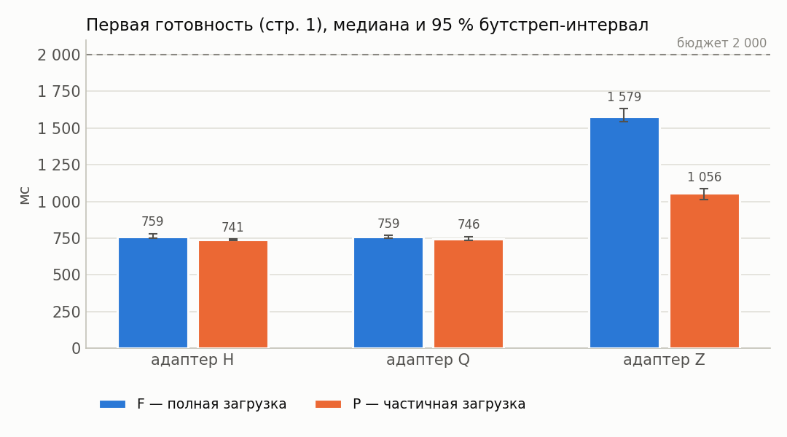

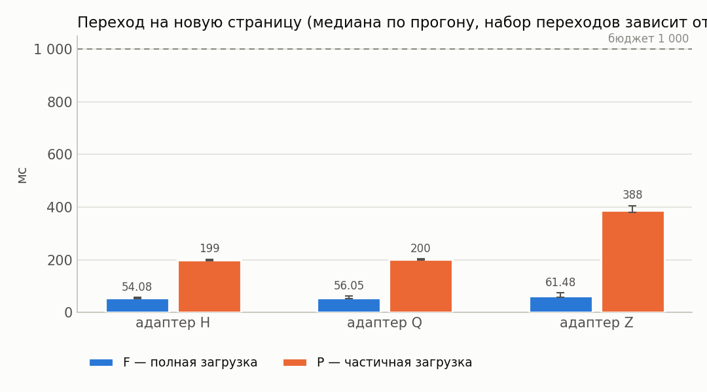

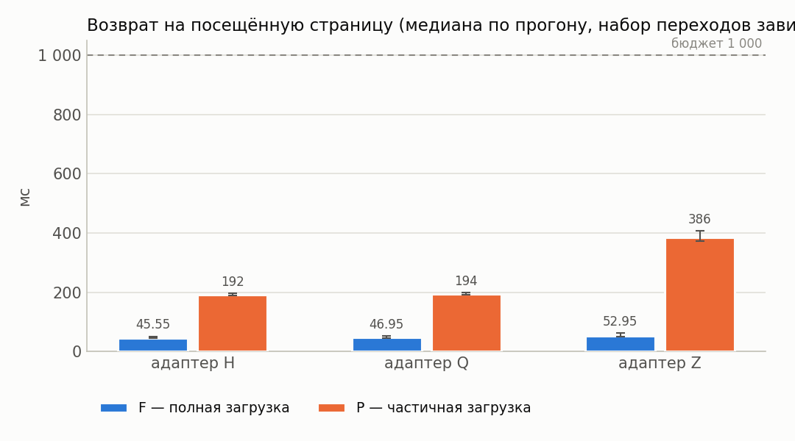

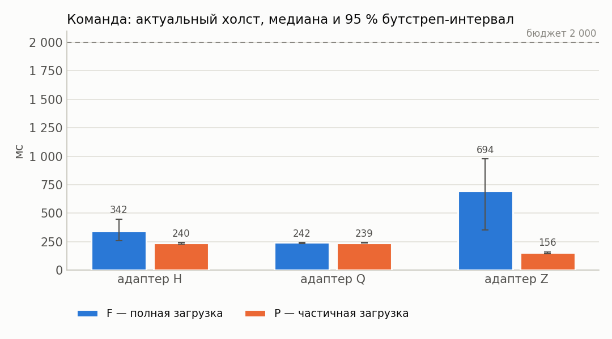

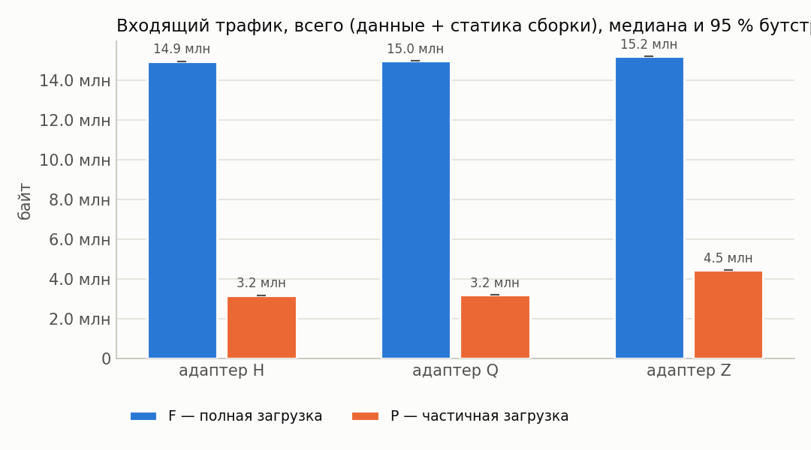

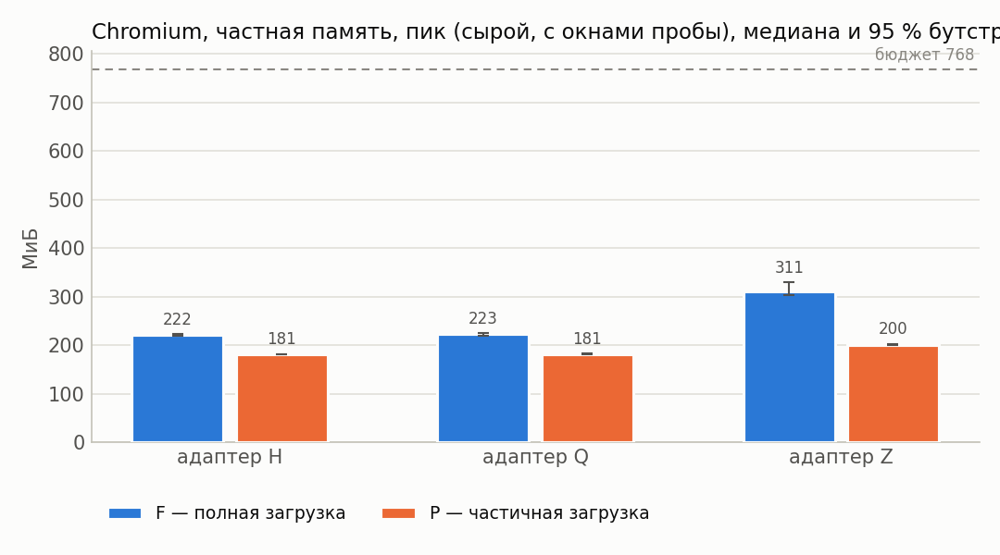

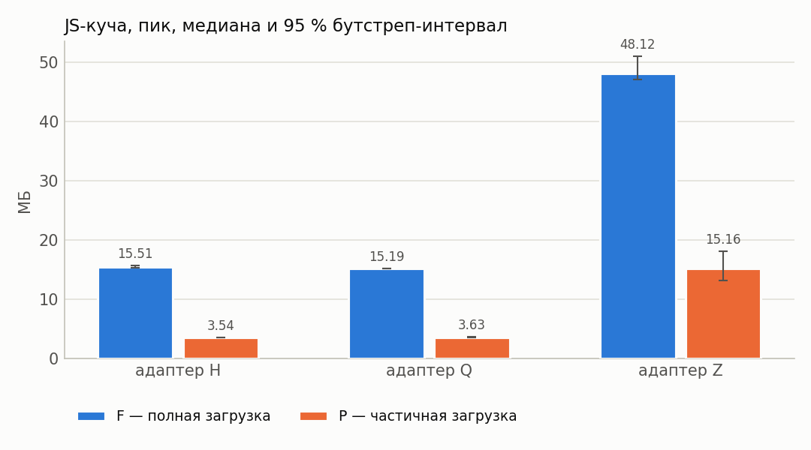

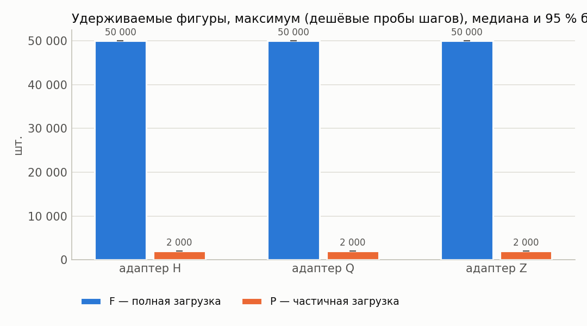

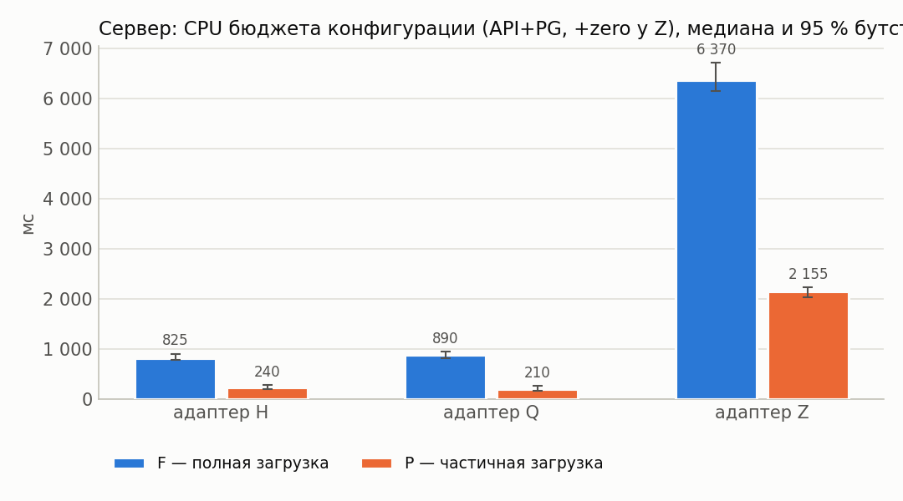

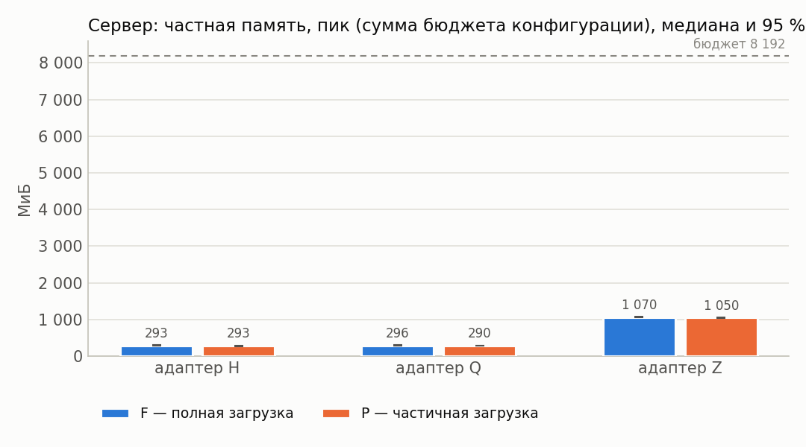

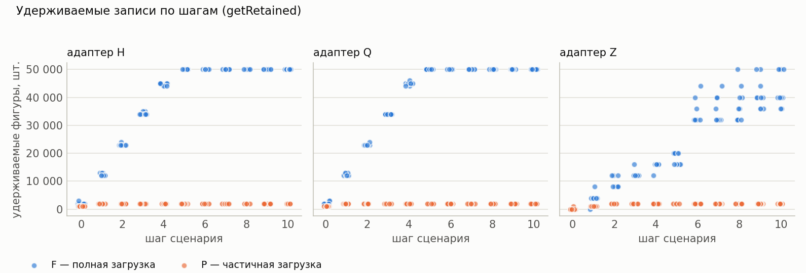

## 12. Выводы

* Оценки изменения P−F ниже — **парные** (медиана поблочных разностей, блок = повторение).
* Все бюджеты §7.4 выполнены для конфигураций: H/F, H/P (cache=1), Q/F, Q/P (cache=1), Z/F, Z/P (cache=1).
* H, cache=1: в режиме P первая готовность на 2 % меньше, чем в F (P/F = 0.98, 95 % интервал [0.96; 0.99]; интервал Δ не содержит 0).
* Q, cache=1: в режиме P первая готовность на 1 % меньше, чем в F (P/F = 0.99, 95 % интервал [0.96; 1.01]; интервал Δ содержит 0 — различие не подтверждено).
* Z, cache=1: в режиме P первая готовность на 34 % меньше, чем в F (P/F = 0.66, 95 % интервал [0.63; 0.71]; интервал Δ не содержит 0).
* H, cache=1: в режиме P пик частной памяти Chromium на 18 % меньше, чем в F (P/F = 0.82, 95 % интервал [0.81; 0.83]; интервал Δ не содержит 0).
* Q, cache=1: в режиме P пик частной памяти Chromium на 19 % меньше, чем в F (P/F = 0.81, 95 % интервал [0.81; 0.82]; интервал Δ не содержит 0).
* Z, cache=1: в режиме P пик частной памяти Chromium на 36 % меньше, чем в F (P/F = 0.64, 95 % интервал [0.62; 0.66]; интервал Δ не содержит 0).
* H, cache=1: в режиме P входящий трафик на 79 % меньше, чем в F (P/F = 0.21, 95 % интервал [0.21; 0.21]; интервал Δ не содержит 0).
* Q, cache=1: в режиме P входящий трафик на 79 % меньше, чем в F (P/F = 0.21, 95 % интервал [0.21; 0.21]; интервал Δ не содержит 0).
* Z, cache=1: в режиме P входящий трафик на 71 % меньше, чем в F (P/F = 0.29, 95 % интервал [0.29; 0.29]; интервал Δ не содержит 0).
* H, cache=1: в режиме P максимум удерживаемых фигур на 96 % меньше, чем в F (P/F = 0.04, 95 % интервал [0.04; 0.04]; интервал Δ не содержит 0).
* Q, cache=1: в режиме P максимум удерживаемых фигур на 96 % меньше, чем в F (P/F = 0.04, 95 % интервал [0.04; 0.04]; интервал Δ не содержит 0).
* Z, cache=1: в режиме P максимум удерживаемых фигур на 96 % меньше, чем в F (P/F = 0.04, 95 % интервал [0.04; 0.04]; интервал Δ не содержит 0).
* H, cache=1: в режиме P переход на новую страницу на 265 % больше, чем в F (P/F = 3.65, 95 % интервал [3.56; 3.79]; интервал Δ не содержит 0).
* Q, cache=1: в режиме P переход на новую страницу на 256 % больше, чем в F (P/F = 3.56, 95 % интервал [3.22; 3.89]; интервал Δ не содержит 0).
* Z, cache=1: в режиме P переход на новую страницу на 506 % больше, чем в F (P/F = 6.06, 95 % интервал [5.44; 6.98]; интервал Δ не содержит 0).
* Перекрёстная проверка обмена сошлась во всех конфигурациях (наибольшее расхождение шейпера и суммы CDP HTTP+WebSocket — 0.1 %).
* У конфигураций Z/F, Z/P (cache=1) холст успевает обновиться раньше подтверждения сервера — доставка синхронизацией опережает ответ по HTTP; обе величины приведены отдельно в разделе 4.
* Точечная доля успеха ≥ 95 %: H/F, H/P (cache=1), Q/F, Q/P (cache=1), Z/F, Z/P (cache=1).
* Нижняя граница интервала Уилсона ниже 95 % для: H/F, H/P (cache=1), Q/F, Q/P (cache=1), Z/F, Z/P (cache=1). При n < 73 прогонов она не достигает 95 % даже без единого отказа, поэтому здесь это ограничение объёма серии, а не свидетельство ненадёжности; при наличии отказов — см. раздел «Ошибки».
* Условия применимости частичной загрузки: режим P оправдан, когда его выигрыш по первой готовности/памяти/трафику подтверждён интервалом (не содержащим 0) и при этом переходы на новые страницы и команда до холста остаются в бюджете, а удерживаемые записи не выходят за объявленное окно.
