# Результаты серии «doc5x100»

Сформировано 2026-09-14 02:49 UTC из `../../results/doc5x100/runs.csv` (60 прогонов, 6 конфигураций). Бутстреп: 2000 ресемплов, seed=42, перцентильные 95 % интервалы. Времена и ресурсы считаются по прогонам с `outcome=ok`; доли — по всем начатым прогонам.

**Определения статистик** (одинаковы во всех таблицах): медиана — обычная выборочная; p95 — перцентиль по линейной интерполяции порядковых статистик (`numpy.percentile`, тип 7), при n = 30 это интерполяция между 29‑м и 30‑м значением, поэтому p95 не превышает максимум выборки и при малых n смещён вниз; интервалы медианы и p95 — перцентильный бутстреп по одной матрице ресемплов (согласованы между собой); доли — интервал Уилсона 95 % без поправки на непрерывность; при n < 8 интервалы помечены † как ненадёжные, при n < 2 не строятся.

Проверка схемы: OK — rows=60

## 1. Паспорт серии

| Параметр | Значение |
|---|---|
| `series` | doc5x100 |
| `startedAt` | 2026-09-14T01:21:20.986Z |
| `finishedAt` | 2026-09-14T01:36:25.702Z |
| `host` | {"hostname": "vm", "os": "Linux 6.18.44-fc-v24", "platform": "linux", "arch": "x64", "kernel": "6.18.44-fc-v24", "distro": "Ubuntu 24.04.4 LTS", "cpuModel": "Intel(R) Xeon(R) Processor @ 2.80GHz", "cp |
| `versions` | {"node": "v24.21.0", "npm": "11.19.0", "postgres": "psql (PostgreSQL) 16.13 (Ubuntu 16.13-0ubuntu0.24.04.1)", "chromium": "141.0.7390.37", "playwright": "1.56.0", "zero": "1.9.0", "reactQuery": "5.102 |
| `packages` | {"playwright": "1.56.0", "@types/node": "24.13.4", "typescript": "5.9.3", "ws": "8.21.3", "@rocicorp/zero": "1.9.0", "@tanstack/react-query": "5.102.8", "react": "19.3.0", "react-dom": "19.3.0", "@typ |
| `packagesHoistedDifferent` | {"postgres": "3.4.7", "@fastify/cors": "10.1.0"} |
| `workspacePackages` | {"packages/bench": {"playwright": "1.56.0", "@types/node": "24.13.4", "typescript": "5.9.3", "ws": "8.21.3"}, "packages/client": {"@rocicorp/zero": "1.9.0", "@tanstack/react-query": "5.102.8", "react" |
| `lockfileVersion` | 3 |
| `shaper` | {"delayMs": 25, "bandwidthMbit": 20, "handshakeRtt": true, "statsUrl": "http://127.0.0.1:8081", "effective": {"delayMs": 25, "bandwidthMbit": 20, "bucketMs": 20, "segmentBytes": 4096, "bucketBytes": 5 |
| `seed` | 20260911 |
| `repetitions` | 10 |
| `configs` | [{"adapter": "H", "mode": "F", "cache": 1}, {"adapter": "H", "mode": "P", "cache": 1}, {"adapter": "Q", "mode": "F", "cache": 1}, {"adapter": "Q", "mode": "P", "cache": 1}, {"adapter": "Z", "mode": "F |
| `seriesConfig` | {"name": "doc5x100", "doc": "doc-small-5x100", "sourceId": "doc-small-5x100-src-1", "fill": "#1e90ff", "docJson": "data/small-5x100.json", "configs": [{"adapter": "H", "mode": "F", "cache": 1}, {"adap |
| `procGroups` | [{"name": "api", "pidFile": "/home/claude/stand/results/logs/api.pid", "exclude": ["netshaper", "zero-cache"]}, {"name": "pg", "patterns": ["(^\|/)postgres .*16/main", "^postgres: 16/main"], "exclude": |
| `browser` | {"channel": "chromium", "args": ["--disable-extensions"], "headless": true, "viewport": {"width": 1280, "height": 800}} |
| `scenario` | {"route": [2, 3, 1, 4, 2, 5, 1, 3, 2, 5], "pauseMs": 1000, "budgets": {"firstReadyMs": 2000, "navMs": 1000, "cmdDrawnMs": 2000, "scenarioMs": 30000}} |
| `plan` | [{"run_id": "doc5x100-0000-QP1", "order_index": 0, "repetition": 0, "adapter": "Q", "mode": "P", "cache": 1}, {"run_id": "doc5x100-0001-ZP1", "order_index": 1, "repetition": 0, "adapter": "Z", "mode": |
| `client` | {"dist": [{"path": "adapter-settings.json", "bytes": 1004, "mtime": "2026-09-13T19:30:30.755Z", "sha256": "5d7d9af8420141ebb66ea6894d26792039f489306b9ba46bfea9900ef01071b1"}, {"path": "assets/h-BRsLg0 |
| `adapters` | {"available": true, "source": "packages/client/dist/adapter-settings.json", "generatedFrom": ["packages/client/src/adapters/types.ts → ADAPTER_SETTINGS", "packages/client/src/adapters/settings.ts → Z_ |
| `api` | {"url": "http://127.0.0.1:3000", "available": true, "logLevel": "warn", "health": {"status": "ok", "db": "ok", "uptimeSec": 61083, "testHooks": true, "logLevel": "warn", "now": "2026-09-14T01:21:21.25 |
| `zero` | {"config": {"pid": 1025, "env": {"ZERO_QUERY_URL": "http://127.0.0.1:3000/api/zero/query", "NODE_OPTIONS": "--max-old-space-size=8192 --import=/home/claude/stand/scripts/zero-ipv4-shim.mjs", "ZERO_ENA |
| `commit` | None |
| `code` | {"commit": null, "isGitRepo": false, "dirty": null, "codeId": "4bb9e4465904a250bc72d8338d19363855cfe7f827b12662d8600f4f90ee5917", "clientBuildId": "e8d6c0b226b1ac5d27bc8bd39b66d2b5bc2aab491b4d5f8e554c |
| `harness` | {"harnessId": "8c45e82c17085d2e111f8e1bdb71bf756145513e1a7f1b5498f70077960d1be0", "harnessIdShort": "8c45e82c17085d2e", "benchId": "8e1bdf1d09f201b6d42ff58f62fccfc4be22cd53ac554a5dd2aeb14ed5a99ccf", " |
| `preSeriesChecks` | {"at": "2026-09-14T01:21:21.297Z", "samplers": {"ok": true, "groups": [{"group": "api", "needed": true, "processes": 1, "pids": [984], "verdict": "ok", "spec": "pidFile=/home/claude/stand/results/logs |
| `runsExecutedNow` | 60 |
| `runsExecutedTotal` | 60 |
| `runsOk` | 60 |
| `runsTotalPlanned` | 60 |

## 2. Состав серии и доля успеха

Успех прогона = `outcome=ok` ∧ `t_scenario ≤ 30 с` ∧ все проверки эталона прошли (SPEC §7.3).

Доли считаются по **всем** начатым прогонам конфигурации (ошибка и таймаут = неуспех); сводки времени и ресурсов ниже — только по прогонам `outcome=ok`.

| Конфигурация | Прогонов | ok | error | timeout | эталон ✓ | ok, но эталон ✗ | успех | Доля успеха [Уилсон 95 %] |
|---|---|---|---|---|---|---|---|---|
| H/F | 10 | 10 | 0 | 0 | 10 | 0 | 10 | 100.0 % [72.2 %; 100.0 %] |
| H/P (cache=1) | 10 | 10 | 0 | 0 | 10 | 0 | 10 | 100.0 % [72.2 %; 100.0 %] |
| Q/F | 10 | 10 | 0 | 0 | 10 | 0 | 10 | 100.0 % [72.2 %; 100.0 %] |
| Q/P (cache=1) | 10 | 10 | 0 | 0 | 10 | 0 | 10 | 100.0 % [72.2 %; 100.0 %] |
| Z/F | 10 | 10 | 0 | 0 | 10 | 0 | 10 | 100.0 % [72.2 %; 100.0 %] |
| Z/P (cache=1) | 10 | 10 | 0 | 0 | 10 | 0 | 10 | 100.0 % [72.2 %; 100.0 %] |

## 3. Сводные показатели по конфигурациям

Для каждого показателя приводятся n, медиана с 95 % перцентильным бутстреп‑интервалом, p95 (линейная интерполяция порядковых статистик) с таким же интервалом, min и max. Знак † — интервал построен по n < 8 наблюдениям и ненадёжен; «—» вместо интервала — n < 2, интервал не определён.

### 3.1 Время

**Первая готовность (стр. 1), мс**

| Конфигурация | n | Медиана | 95 % ИД медианы | p95 | 95 % ИД p95 | min | max |
|---|---|---|---|---|---|---|---|
| H/F | 10 | 615 | [601; 643] | 674 | [621; 684] | 594 | 684 |
| H/P (cache=1) | 10 | 629 | [610; 646] | 667 | [638; 679] | 590 | 679 |
| Q/F | 10 | 625 | [612; 646] | 670 | [629; 675] | 601 | 675 |
| Q/P (cache=1) | 10 | 623 | [615; 640] | 661 | [634; 679] | 591 | 679 |
| Z/F | 10 | 828 | [816; 849] | 879 | [840; 886] | 812 | 886 |
| Z/P (cache=1) | 10 | 809 | [778; 858] | 926 | [836; 972] | 760 | 972 |

**Переход на новую страницу (медиана по прогону, набор переходов зависит от маршрута серии), мс**

| Конфигурация | n | Медиана | 95 % ИД медианы | p95 | 95 % ИД p95 | min | max |
|---|---|---|---|---|---|---|---|
| H/F | 10 | 15 | [14; 16] | 17 | [16; 18] | 14 | 18 |
| H/P (cache=1) | 10 | 82 | [81; 83] | 83 | [83; 83] | 79 | 83 |
| Q/F | 10 | 16 | [15; 16] | 19 | [16; 21] | 14 | 21 |
| Q/P (cache=1) | 10 | 83 | [81; 84] | 85 | [83; 85] | 81 | 85 |
| Z/F | 10 | 15 | [14; 19] | 20 | [16; 20] | 13 | 20 |
| Z/P (cache=1) | 10 | 112 | [107; 114] | 117 | [113; 118] | 101 | 118 |

**Возврат на посещённую страницу (медиана по прогону, набор переходов зависит от маршрута серии), мс**

| Конфигурация | n | Медиана | 95 % ИД медианы | p95 | 95 % ИД p95 | min | max |
|---|---|---|---|---|---|---|---|
| H/F | 10 | 14 | [13; 14] | 16 | [14; 16] | 12 | 16 |
| H/P (cache=1) | 10 | 82 | [81; 83] | 83 | [83; 83] | 79 | 83 |
| Q/F | 10 | 14 | [13; 16] | 17 | [15; 17] | 11 | 17 |
| Q/P (cache=1) | 10 | 81 | [80; 83] | 83 | [82; 83] | 79 | 83 |
| Z/F | 10 | 14 | [13; 15] | 16 | [14; 16] | 12 | 16 |
| Z/P (cache=1) | 10 | 102 | [100; 106] | 108 | [104; 109] | 98 | 109 |

**Команда: подтверждение транспорта (Z — .server, H/Q — ответ POST), мс**

| Конфигурация | n | Медиана | 95 % ИД медианы | p95 | 95 % ИД p95 | min | max |
|---|---|---|---|---|---|---|---|
| H/F | 10 | 69 | [66; 72] | 93 | [70; 108] | 64 | 108 |
| H/P (cache=1) | 10 | 66 | [63; 68] | 75 | [67; 80] | 61 | 80 |
| Q/F | 10 | 69 | [66; 74] | 80 | [70; 81] | 62 | 81 |
| Q/P (cache=1) | 10 | 71 | [67; 75] | 77 | [72; 77] | 65 | 77 |
| Z/F | 10 | 137 | [126; 163] | 191 | [145; 212] | 118 | 212 |
| Z/P (cache=1) | 10 | 136 | [128; 155] | 211 | [146; 220] | 121 | 220 |

**Команда: подтверждение сервера (результат операции), мс**

| Конфигурация | n | Медиана | 95 % ИД медианы | p95 | 95 % ИД p95 | min | max |
|---|---|---|---|---|---|---|---|
| H/F | 10 | 70 | [67; 72] | 93 | [70; 109] | 64 | 109 |
| H/P (cache=1) | 10 | 66 | [64; 69] | 75 | [67; 80] | 61 | 80 |
| Q/F | 10 | 69 | [66; 74] | 80 | [70; 82] | 62 | 82 |
| Q/P (cache=1) | 10 | 71 | [67; 75] | 77 | [72; 77] | 65 | 77 |
| Z/F | 10 | 197 | [189; 224] | 253 | [205; 274] | 184 | 274 |
| Z/P (cache=1) | 10 | 196 | [186; 238] | 275 | [215; 286] | 178 | 286 |

**Команда: цена протокола подтверждения (ack − транспорт), мс**

| Конфигурация | n | Медиана | 95 % ИД медианы | p95 | 95 % ИД p95 | min | max |
|---|---|---|---|---|---|---|---|
| H/F | 10 | 0 | [0; 0] | 0 | [0; 0] | 0 | 0 |
| H/P (cache=1) | 10 | 0 | [0; 0] | 0 | [0; 0] | 0 | 0 |
| Q/F | 10 | 0 | [0; 0] | 0 | [0; 0] | 0 | 0 |
| Q/P (cache=1) | 10 | 0 | [0; 0] | 0 | [0; 0] | 0 | 0 |
| Z/F | 10 | 62 | [59; 64] | 70 | [62; 73] | 57 | 73 |
| Z/P (cache=1) | 10 | 61 | [58; 63] | 65 | [63; 66] | 56 | 66 |

**Команда: данные в хранилище активной страницы, мс**

| Конфигурация | n | Медиана | 95 % ИД медианы | p95 | 95 % ИД p95 | min | max |
|---|---|---|---|---|---|---|---|
| H/F | 10 | 146 | [139; 156] | 174 | [151; 180] | 138 | 180 |
| H/P (cache=1) | 10 | 131 | [125; 133] | 141 | [132; 147] | 122 | 147 |
| Q/F | 10 | 138 | [133; 146] | 152 | [143; 157] | 131 | 157 |
| Q/P (cache=1) | 10 | 135 | [134; 142] | 143 | [138; 144] | 132 | 144 |
| Z/F | 10 | 136 | [126; 162] | 191 | [149; 212] | 117 | 212 |
| Z/P (cache=1) | 10 | 135 | [128; 177] | 211 | [146; 220] | 121 | 220 |

**Команда: актуальный холст, мс**

| Конфигурация | n | Медиана | 95 % ИД медианы | p95 | 95 % ИД p95 | min | max |
|---|---|---|---|---|---|---|---|
| H/F | 10 | 160 | [149; 173] | 190 | [165; 196] | 146 | 196 |
| H/P (cache=1) | 10 | 136 | [130; 146] | 149 | [142; 152] | 129 | 152 |
| Q/F | 10 | 150 | [145; 153] | 161 | [151; 167] | 138 | 167 |
| Q/P (cache=1) | 10 | 149 | [147; 151] | 152 | [150; 152] | 138 | 152 |
| Z/F | 10 | 150 | [133; 171] | 200 | [163; 217] | 129 | 217 |
| Z/P (cache=1) | 10 | 150 | [134; 184] | 225 | [161; 232] | 130 | 232 |

**Переход, медиана всех переходов прогона (маршрут любой длины), мс**

| Конфигурация | n | Медиана | 95 % ИД медианы | p95 | 95 % ИД p95 | min | max |
|---|---|---|---|---|---|---|---|
| H/F | 10 | 14 | [14; 16] | 16 | [15; 16] | 13 | 16 |
| H/P (cache=1) | 10 | 83 | [80; 83] | 83 | [83; 83] | 80 | 83 |
| Q/F | 10 | 14 | [13; 16] | 17 | [16; 17] | 13 | 17 |
| Q/P (cache=1) | 10 | 83 | [81; 83] | 83 | [83; 83] | 80 | 83 |
| Z/F | 10 | 15 | [14; 16] | 17 | [15; 17] | 13 | 17 |
| Z/P (cache=1) | 10 | 106 | [103; 109] | 112 | [107; 113] | 100 | 113 |

**Сценарий целиком (с паузами, без проб оболочки), мс**

| Конфигурация | n | Медиана | 95 % ИД медианы | p95 | 95 % ИД p95 | min | max |
|---|---|---|---|---|---|---|---|
| H/F | 10 | 11 921 | [11 904; 11 957] | 11 979 | [11 935; 11 993] | 11 895 | 11 993 |
| H/P (cache=1) | 10 | 12 579 | [12 568; 12 616] | 12 621 | [12 584; 12 623] | 12 552 | 12 623 |
| Q/F | 10 | 11 924 | [11 909; 11 952] | 11 962 | [11 934; 11 970] | 11 896 | 11 970 |
| Q/P (cache=1) | 10 | 12 584 | [12 576; 12 627] | 12 644 | [12 601; 12 652] | 12 562 | 12 652 |
| Z/F | 10 | 12 174 | [12 154; 12 222] | 12 255 | [12 197; 12 269] | 12 141 | 12 269 |
| Z/P (cache=1) | 10 | 13 127 | [13 057; 13 164] | 13 194 | [13 140; 13 208] | 13 022 | 13 208 |

**Сценарий целиком, сырое время (с пробами оболочки), мс**

| Конфигурация | n | Медиана | 95 % ИД медианы | p95 | 95 % ИД p95 | min | max |
|---|---|---|---|---|---|---|---|
| H/F | 10 | 11 942 | [11 930; 11 978] | 11 998 | [11 951; 12 010] | 11 920 | 12 010 |
| H/P (cache=1) | 10 | 12 601 | [12 585; 12 628] | 12 631 | [12 614; 12 633] | 12 567 | 12 633 |
| Q/F | 10 | 11 951 | [11 935; 11 961] | 11 979 | [11 958; 11 991] | 11 911 | 11 991 |
| Q/P (cache=1) | 10 | 12 606 | [12 598; 12 640] | 12 661 | [12 622; 12 678] | 12 578 | 12 678 |
| Z/F | 10 | 12 191 | [12 166; 12 238] | 12 277 | [12 217; 12 291] | 12 158 | 12 291 |
| Z/P (cache=1) | 10 | 13 146 | [13 066; 13 185] | 13 221 | [13 165; 13 237] | 13 032 | 13 237 |

**Пробы оболочки сверх объявленных пауз, мс**

| Конфигурация | n | Медиана | 95 % ИД медианы | p95 | 95 % ИД p95 | min | max |
|---|---|---|---|---|---|---|---|
| H/F | 10 | 21 | [17; 26] | 31 | [24; 33] | 16 | 33 |
| H/P (cache=1) | 10 | 15 | [10; 25] | 29 | [21; 32] | 6 | 32 |
| Q/F | 10 | 19 | [11; 26] | 35 | [23; 40] | 9 | 40 |
| Q/P (cache=1) | 10 | 20 | [15; 23] | 25 | [22; 25] | 6 | 25 |
| Z/F | 10 | 17 | [14; 23] | 25 | [21; 25] | 5 | 25 |
| Z/P (cache=1) | 10 | 21 | [13; 24] | 27 | [23; 30] | 9 | 30 |

### 3.2 Объём обмена

**Головная величина обмена — «только данные»** (`bytes_in_data`: API + кадры синхронизации Zero). Полный `bytes_in` включает статику сборки — поадаптерную константу, одинаковую в F и в P, поэтому в отношениях P/F она искажает сравнение (`docs/DEVIATIONS.md` §3.1). Оба числа приводятся рядом, разложение — ниже.

**Входящий трафик: ДАННЫЕ (API + WebSocket Zero, без статики сборки), байт**

| Конфигурация | n | Медиана | 95 % ИД медианы | p95 | 95 % ИД p95 | min | max |
|---|---|---|---|---|---|---|---|
| H/F | 10 | 222 893 | [222 893; 222 893] | 222 893 | [222 893; 222 893] | 222 893 | 222 893 |
| H/P (cache=1) | 10 | 295 255 | [295 255; 295 255] | 295 255 | [295 255; 295 255] | 295 255 | 295 255 |
| Q/F | 10 | 222 893 | [222 893; 222 893] | 222 893 | [222 893; 222 893] | 222 893 | 222 893 |
| Q/P (cache=1) | 10 | 295 255 | [295 255; 295 255] | 295 255 | [295 255; 295 255] | 295 255 | 295 255 |
| Z/F | 10 | 176 056 | [176 056; 176 056] | 176 056 | [176 056; 176 056] | 176 056 | 176 056 |
| Z/P (cache=1) | 10 | 405 454 | [405 454; 405 454] | 405 454 | [405 454; 405 454] | 405 454 | 405 454 |

**Входящий трафик, всего (данные + статика сборки), байт**

| Конфигурация | n | Медиана | 95 % ИД медианы | p95 | 95 % ИД p95 | min | max |
|---|---|---|---|---|---|---|---|
| H/F | 10 | 483 287 | [483 287; 483 287] | 483 287 | [483 287; 483 287] | 483 287 | 483 287 |
| H/P (cache=1) | 10 | 555 649 | [555 649; 555 649] | 555 649 | [555 649; 555 649] | 555 649 | 555 649 |
| Q/F | 10 | 514 299 | [514 299; 514 299] | 514 299 | [514 299; 514 299] | 514 299 | 514 299 |
| Q/P (cache=1) | 10 | 586 661 | [586 661; 586 661] | 586 661 | [586 661; 586 661] | 586 661 | 586 661 |
| Z/F | 10 | 748 580 | [748 580; 748 580] | 748 580 | [748 580; 748 580] | 748 580 | 748 580 |
| Z/P (cache=1) | 10 | 977 978 | [977 978; 977 978] | 977 978 | [977 978; 977 978] | 977 978 | 977 978 |

**Статика сборки за прогон (поадаптерная константа), байт**

| Конфигурация | n | Медиана | 95 % ИД медианы | p95 | 95 % ИД p95 | min | max |
|---|---|---|---|---|---|---|---|
| H/F | 10 | 260 394 | [260 394; 260 394] | 260 394 | [260 394; 260 394] | 260 394 | 260 394 |
| H/P (cache=1) | 10 | 260 394 | [260 394; 260 394] | 260 394 | [260 394; 260 394] | 260 394 | 260 394 |
| Q/F | 10 | 291 406 | [291 406; 291 406] | 291 406 | [291 406; 291 406] | 291 406 | 291 406 |
| Q/P (cache=1) | 10 | 291 406 | [291 406; 291 406] | 291 406 | [291 406; 291 406] | 291 406 | 291 406 |
| Z/F | 10 | 572 524 | [572 524; 572 524] | 572 524 | [572 524; 572 524] | 572 524 | 572 524 |
| Z/P (cache=1) | 10 | 572 524 | [572 524; 572 524] | 572 524 | [572 524; 572 524] | 572 524 | 572 524 |

**Исходящий трафик: данные (без статики), байт**

| Конфигурация | n | Медиана | 95 % ИД медианы | p95 | 95 % ИД p95 | min | max |
|---|---|---|---|---|---|---|---|
| H/F | 10 | 9 857 | [9 857; 9 857] | 9 857 | [9 857; 9 857] | 9 857 | 9 857 |
| H/P (cache=1) | 10 | 12 302 | [12 302; 12 302] | 12 302 | [12 302; 12 302] | 12 302 | 12 302 |
| Q/F | 10 | 9 857 | [9 857; 9 857] | 9 857 | [9 857; 9 857] | 9 857 | 9 857 |
| Q/P (cache=1) | 10 | 12 302 | [12 302; 12 302] | 12 302 | [12 302; 12 302] | 12 302 | 12 302 |
| Z/F | 10 | 5 924 | [5 911; 5 924] | 5 924 | [5 924; 5 924] | 5 910 | 5 924 |
| Z/P (cache=1) | 10 | 7 424 | [7 418; 7 424] | 7 424 | [7 424; 7 424] | 7 410 | 7 424 |

**Исходящий трафик, всего (шейпер), байт**

| Конфигурация | n | Медиана | 95 % ИД медианы | p95 | 95 % ИД p95 | min | max |
|---|---|---|---|---|---|---|---|
| H/F | 10 | 13 946 | [13 946; 13 946] | 13 946 | [13 946; 13 946] | 13 946 | 13 946 |
| H/P (cache=1) | 10 | 16 391 | [16 391; 16 391] | 16 391 | [16 391; 16 391] | 16 391 | 16 391 |
| Q/F | 10 | 13 946 | [13 946; 13 946] | 13 946 | [13 946; 13 946] | 13 946 | 13 946 |
| Q/P (cache=1) | 10 | 16 391 | [16 391; 16 391] | 16 391 | [16 391; 16 391] | 16 391 | 16 391 |
| Z/F | 10 | 10 070 | [10 059; 10 071] | 10 071 | [10 071; 10 071] | 10 057 | 10 071 |
| Z/P (cache=1) | 10 | 11 570 | [11 564; 11 571] | 11 571 | [11 571; 11 571] | 11 557 | 11 571 |

**Входящий трафик (CDP, перекрёстная проверка), байт**

| Конфигурация | n | Медиана | 95 % ИД медианы | p95 | 95 % ИД p95 | min | max |
|---|---|---|---|---|---|---|---|
| H/F | 10 | 483 287 | [483 287; 483 287] | 483 287 | [483 287; 483 287] | 483 287 | 483 287 |
| H/P (cache=1) | 10 | 555 649 | [555 649; 555 649] | 555 649 | [555 649; 555 649] | 555 649 | 555 649 |
| Q/F | 10 | 514 299 | [514 299; 514 299] | 514 299 | [514 299; 514 299] | 514 299 | 514 299 |
| Q/P (cache=1) | 10 | 586 661 | [586 661; 586 661] | 586 661 | [586 661; 586 661] | 586 661 | 586 661 |
| Z/F | 10 | 574 021 | [574 021; 574 021] | 574 021 | [574 021; 574 021] | 574 021 | 574 021 |
| Z/P (cache=1) | 10 | 574 021 | [574 021; 574 021] | 574 021 | [574 021; 574 021] | 574 021 | 574 021 |

**Обмен данными против полного объёма**

Источник разложения: колонки оболочки `bytes_in_api` / `bytes_in_zero` / `bytes_in_static`.

Разброс статики внутри конфигурации обязан быть нулевым — это константа сборки, а не измеряемая величина; ненулевой разброс означал бы, что в статику попало что‑то ещё, и его надо разбирать.

| Конфигурация | n | **Данные (API + WS), байт** | Статика сборки, байт | Всего, байт | Доля статики | Разброс статики |
|---|---|---|---|---|---|---|
| H/F | 10‡ | 222 893 | 260 394 | 483 287 | 53.9 % | 0 |
| H/P (cache=1) | 10‡ | 295 255 | 260 394 | 555 649 | 46.9 % | 0 |
| Q/F | 10‡ | 222 893 | 291 406 | 514 299 | 56.7 % | 0 |
| Q/P (cache=1) | 10‡ | 295 255 | 291 406 | 586 661 | 49.7 % | 0 |
| Z/F | 10‡ | 176 056 | 572 524 | 748 580 | 76.5 % | 0 |
| Z/P (cache=1) | 10‡ | 405 454 | 572 524 | 977 978 | 58.5 % | 0 |

**P/F обмена: по полному трафику и по данным** (парная оценка, блок = повторение)

| Адаптер | Пар | Статика, байт | P/F полный (как публиковалось) | **P/F данные (головное)** | Изменилось |
|---|---|---|---|---|---|
| H (cache=1) | 10‡ | 260 394 | 1.150 [1.150; 1.150] | **1.325** [1.325; 1.325] | да, 0.175 |
| Q (cache=1) | 10‡ | 291 406 | 1.141 [1.141; 1.141] | **1.325** [1.325; 1.325] | да, 0.184 |
| Z (cache=1) | 10‡ | 572 524 | 1.306 [1.306; 1.306] | **2.303** [2.303; 2.303] | да, 0.997 |

Последний столбец отвечает на вопрос «какие опубликованные числа двигает вычитание статики»: величина сдвига = P/F(данные) − P/F(полный).

**Полнота разложения: сумма по маршрутам против итога**

Головное число обмена — `bytes_in_data = bytes_in_api + bytes_in_zero`. Оно осмысленно ровно настолько, насколько разложение полное, поэтому проверка идёт **по каждому прогону**, а не по медианам: столбцы «расхождение» — максимум по прогонам конфигурации от |(api + zero + статика + прочее) − итог|, столбцы «остаток» — максимум собственной контрольной колонки оболочки `bytes_*_route_residual`. Ожидаемое значение всех четырёх — ноль.

| Конфигурация | n | Расхождение вход, Б | Расхождение исход, Б | Остаток вход, Б | Остаток исход, Б | Прочее (вход), Б | Сошлось |
|---|---|---|---|---|---|---|---|
| H/F | 10‡ | 0 | 0 | 0 | 0 | 0 | ✓ |
| H/P (cache=1) | 10‡ | 0 | 0 | 0 | 0 | 0 | ✓ |
| Q/F | 10‡ | 0 | 0 | 0 | 0 | 0 | ✓ |
| Q/P (cache=1) | 10‡ | 0 | 0 | 0 | 0 | 0 | ✓ |
| Z/F | 10‡ | 0 | 0 | 0 | 0 | 0 | ✓ |
| Z/P (cache=1) | 10‡ | 0 | 0 | 0 | 0 | 0 | ✓ |

Все конфигурации сошлись побайтно: «данные + статика + прочее» исчерпывают весь наблюдаемый обмен, и головная величина `bytes_in_data` ничего не теряет.

**Перекрёстная проверка трафика (шейпер vs CDP)**

Шейпер считает байты TCP‑полезной нагрузки всех соединений клиента; CDP даёт их двумя счётчиками — `cdp_bytes_in` (`encodedDataLength` HTTP‑ответов) и `cdp_ws_bytes_in` (кадры WebSocket). У H/Q второй счётчик нулевой, у Z по WebSocket идёт почти весь обмен, поэтому сверять нужно **сумму**: сравнение только с `cdp_bytes_in` давало ложный провал у Z (в прежнем `results/smoke/report.md` — Z/F 92.5 %, Z/P 76.6 %).

| Конфигурация | bytes_in (шейпер) | CDP: HTTP | CDP: WebSocket | CDP: сумма | Расхождение | ≤ 10 % |
|---|---|---|---|---|---|---|
| H/F | 483 287 | 483 287 | 0 | 483 287 | 0.0 % | ✓ |
| H/P (cache=1) | 555 649 | 555 649 | 0 | 555 649 | 0.0 % | ✓ |
| Q/F | 514 299 | 514 299 | 0 | 514 299 | 0.0 % | ✓ |
| Q/P (cache=1) | 586 661 | 586 661 | 0 | 586 661 | 0.0 % | ✓ |
| Z/F | 748 580 | 574 021 | 172 136 | 746 157 | 0.3 % | ✓ |
| Z/P (cache=1) | 977 978 | 574 021 | 402 014 | 976 035 | 0.2 % | ✓ |

**Исходящее направление — справочно.** `cdp_bytes_out` не измеряется, а оценивается по `Network.requestWillBeSent` (стартовая строка + известные CDP заголовки + тело) и систематически занижен на заголовки, которые добавляет сетевой стек браузера, и на рукопожатие WebSocket. Расхождение 20–40 % здесь — свойство оценки, а не признак ошибки измерения; в вердикт конфигурации это направление не входит.

| Конфигурация | bytes_out (шейпер) | CDP: сумма (оценка) | Расхождение | ≤ 50 % |
|---|---|---|---|---|
| H/F | 13 946 | 10 244 | 26.5 % | ✓ |
| H/P (cache=1) | 16 391 | 12 167 | 25.8 % | ✓ |
| Q/F | 13 946 | 10 244 | 26.5 % | ✓ |
| Q/P (cache=1) | 16 391 | 12 167 | 25.8 % | ✓ |
| Z/F | 10 070 | 5 007 | 50.3 % | ✗ |
| Z/P (cache=1) | 11 570 | 7 035 | 39.2 % | ✓ |

### 3.3 Память клиента

**Chromium, частная память, пик без окон пробы, МиБ**

| Конфигурация | n | Медиана | 95 % ИД медианы | p95 | 95 % ИД p95 | min | max |
|---|---|---|---|---|---|---|---|
| H/F | 10 | 165.7 | [164.9; 167.0] | 168.7 | [166.1; 169.3] | 163.7 | 169.3 |
| H/P (cache=1) | 10 | 165.5 | [164.7; 167.3] | 168.5 | [166.2; 168.5] | 164.2 | 168.5 |
| Q/F | 10 | 165.4 | [164.6; 165.9] | 167.0 | [165.6; 167.8] | 163.4 | 167.8 |
| Q/P (cache=1) | 10 | 164.1 | [161.6; 165.8] | 167.6 | [165.2; 168.9] | 159.2 | 168.9 |
| Z/F | 10 | 171.4 | [170.3; 171.9] | 172.5 | [171.6; 172.8] | 169.8 | 172.8 |
| Z/P (cache=1) | 10 | 176.6 | [175.0; 178.3] | 179.8 | [177.6; 180.9] | 174.1 | 180.9 |

**Chromium, частная память, пик (сырой, с окнами пробы), МиБ**

| Конфигурация | n | Медиана | 95 % ИД медианы | p95 | 95 % ИД p95 | min | max |
|---|---|---|---|---|---|---|---|
| H/F | 10 | 165.9 | [165.3; 167.0] | 168.7 | [166.1; 169.3] | 163.7 | 169.3 |
| H/P (cache=1) | 10 | 165.6 | [164.7; 167.3] | 168.5 | [166.2; 168.5] | 164.2 | 168.5 |
| Q/F | 10 | 165.4 | [164.4; 166.1] | 167.2 | [165.7; 167.8] | 163.9 | 167.8 |
| Q/P (cache=1) | 10 | 164.1 | [161.9; 165.8] | 167.6 | [165.2; 168.9] | 159.2 | 168.9 |
| Z/F | 10 | 171.4 | [170.3; 171.8] | 172.5 | [171.6; 172.8] | 169.8 | 172.8 |
| Z/P (cache=1) | 10 | 176.6 | [175.0; 178.3] | 179.8 | [177.6; 180.9] | 174.1 | 180.9 |

**Chromium, частная память, конец, МиБ**

| Конфигурация | n | Медиана | 95 % ИД медианы | p95 | 95 % ИД p95 | min | max |
|---|---|---|---|---|---|---|---|
| H/F | 10 | 165.7 | [164.9; 166.8] | 168.7 | [166.1; 169.3] | 163.7 | 169.3 |
| H/P (cache=1) | 10 | 165.5 | [164.7; 167.3] | 168.5 | [166.2; 168.5] | 164.2 | 168.5 |
| Q/F | 10 | 165.3 | [164.4; 165.8] | 167.0 | [165.6; 167.8] | 163.4 | 167.8 |
| Q/P (cache=1) | 10 | 163.4 | [161.9; 165.8] | 167.6 | [165.2; 168.9] | 159.2 | 168.9 |
| Z/F | 10 | 168.9 | [167.5; 169.8] | 172.1 | [169.4; 172.8] | 166.8 | 172.8 |
| Z/P (cache=1) | 10 | 173.5 | [171.8; 175.5] | 176.8 | [174.9; 177.4] | 171.0 | 177.4 |

**JS‑куча, пик, МБ**

| Конфигурация | n | Медиана | 95 % ИД медианы | p95 | 95 % ИД p95 | min | max |
|---|---|---|---|---|---|---|---|
| H/F | 10 | 3.0 | [3.0; 3.0] | 3.0 | [3.0; 3.0] | 3.0 | 3.0 |
| H/P (cache=1) | 10 | 3.0 | [2.9; 3.0] | 3.0 | [3.0; 3.0] | 2.9 | 3.0 |
| Q/F | 10 | 3.2 | [3.1; 3.2] | 3.2 | [3.2; 3.2] | 3.1 | 3.2 |
| Q/P (cache=1) | 10 | 3.1 | [3.1; 3.1] | 3.1 | [3.1; 3.1] | 3.1 | 3.1 |
| Z/F | 10 | 5.9 | [5.9; 5.9] | 6.0 | [5.9; 6.0] | 5.8 | 6.0 |
| Z/P (cache=1) | 10 | 7.0 | [6.7; 7.3] | 7.5 | [7.2; 7.7] | 6.4 | 7.7 |

**JS‑куча, конец, МБ**

| Конфигурация | n | Медиана | 95 % ИД медианы | p95 | 95 % ИД p95 | min | max |
|---|---|---|---|---|---|---|---|
| H/F | 10 | 2.6 | [2.6; 2.6] | 2.6 | [2.6; 2.6] | 2.6 | 2.6 |
| H/P (cache=1) | 10 | 2.6 | [2.6; 2.6] | 2.6 | [2.6; 2.6] | 2.5 | 2.6 |
| Q/F | 10 | 2.8 | [2.8; 2.8] | 2.8 | [2.8; 2.8] | 2.8 | 2.8 |
| Q/P (cache=1) | 10 | 2.7 | [2.7; 2.8] | 2.8 | [2.8; 2.8] | 2.7 | 2.8 |
| Z/F | 10 | 4.8 | [4.8; 4.8] | 4.8 | [4.8; 4.8] | 4.7 | 4.8 |
| Z/P (cache=1) | 10 | 5.5 | [5.5; 5.5] | 5.6 | [5.5; 5.6] | 5.5 | 5.6 |

**JS‑куча после принудительной сборки (остановка часов), МБ**

| Конфигурация | n | Медиана | 95 % ИД медианы | p95 | 95 % ИД p95 | min | max |
|---|---|---|---|---|---|---|---|
| H/F | 10 | 2.6 | [2.6; 2.6] | 2.6 | [2.6; 2.6] | 2.6 | 2.6 |
| H/P (cache=1) | 10 | 2.6 | [2.6; 2.6] | 2.6 | [2.6; 2.6] | 2.5 | 2.6 |
| Q/F | 10 | 2.8 | [2.8; 2.8] | 2.8 | [2.8; 2.8] | 2.8 | 2.8 |
| Q/P (cache=1) | 10 | 2.7 | [2.7; 2.8] | 2.8 | [2.7; 2.8] | 2.7 | 2.8 |
| Z/F | 10 | 4.8 | [4.8; 4.8] | 4.8 | [4.8; 4.8] | 4.7 | 4.8 |
| Z/P (cache=1) | 10 | 5.5 | [5.5; 5.8] | 6.0 | [5.5; 6.0] | 5.5 | 6.0 |

**Принудительных сборок мусора за прогон, шт.**

| Конфигурация | n | Медиана | 95 % ИД медианы | p95 | 95 % ИД p95 | min | max |
|---|---|---|---|---|---|---|---|
| H/F | 10 | 26 | [26; 26] | 26 | [26; 26] | 26 | 26 |
| H/P (cache=1) | 10 | 26 | [26; 26] | 26 | [26; 26] | 26 | 26 |
| Q/F | 10 | 26 | [26; 26] | 26 | [26; 26] | 26 | 26 |
| Q/P (cache=1) | 10 | 26 | [26; 26] | 26 | [26; 26] | 26 | 26 |
| Z/F | 10 | 26 | [26; 26] | 26 | [26; 26] | 26 | 26 |
| Z/P (cache=1) | 10 | 26 | [26; 26] | 26 | [26; 26] | 26 | 26 |

**Постоянное хранилище клиента, байт**

| Конфигурация | n | Медиана | 95 % ИД медианы | p95 | 95 % ИД p95 | min | max |
|---|---|---|---|---|---|---|---|
| H/F | 10 | 0 | [0; 0] | 0 | [0; 0] | 0 | 0 |
| H/P (cache=1) | 10 | 0 | [0; 0] | 0 | [0; 0] | 0 | 0 |
| Q/F | 10 | 0 | [0; 0] | 0 | [0; 0] | 0 | 0 |
| Q/P (cache=1) | 10 | 0 | [0; 0] | 0 | [0; 0] | 0 | 0 |
| Z/F | 10 | 75 030 | [75 027; 75 032] | 75 033 | [75 031; 75 034] | 74 928 | 75 034 |
| Z/P (cache=1) | 10 | 134 484 | [124 781; 153 474] | 161 744 | [146 559; 162 932] | 112 117 | 162 932 |

**Окна измерительных проб: паритет политики и цена их исключения**

Число окон проб одинаково во всех конфигурациях серии (14) — политика проб к адаптерам не привязана, и пики памяти между ними сравнимы. Историческая колонка `chromium_private_peak_mib` во всех прогонах совпадает с `chromium_private_peak_raw_mib` — сырой пик доступен под обоими именами, и старые таблицы читаются как «пик с окнами пробы».

Длительность окон у адаптеров различается законно: это измеренное свойство адаптера (точный скан хранилища у Z/F дороже), а не нарушение паритета. «Доля выборок в окнах» показывает, какая часть наблюдений исключена из пика без пробы; «покрытие кучи» — доля времени прогона, покрытая опросом JS‑кучи (сэмплер кучи на время скана приостанавливается, поэтому пик кучи читается только вместе с ним).

| Конфигурация | n | Окон проб | Разброс окон | В окнах, мс | Пик сырой, МиБ | **Пик без проб, МиБ** | Разница, МиБ | Доля выборок в окнах | Покрытие кучи |
|---|---|---|---|---|---|---|---|---|---|
| H/F | 10‡ | 14 | 0 | 419 | 165.9 | 165.7 | 0.2 | 3.0 % | 1.000 |
| H/P (cache=1) | 10‡ | 14 | 0 | 366 | 165.6 | 165.5 | 0.1 | 1.9 % | 1.000 |
| Q/F | 10‡ | 14 | 0 | 432 | 165.4 | 165.4 | 0.1 | 4.0 % | 1.000 |
| Q/P (cache=1) | 10‡ | 14 | 0 | 348 | 164.1 | 164.1 | 0.0 | 3.8 % | 1.000 |
| Z/F | 10‡ | 14 | 0 | 590 | 171.4 | 171.4 | 0.0 | 2.0 % | 1.000 |
| Z/P (cache=1) | 10‡ | 14 | 0 | 528 | 176.6 | 176.6 | 0.0 | 3.6 % | 1.000 |

**Паритет давления сборщика мусора**

**Расписание принудительных сборок мусора одинаково у всех конфигураций: 26 вызовов `HeapProfiler.collectGarbage` на прогон.** Точки вызова заданы оболочкой и не зависят ни от адаптера, ни от режима, ни от вида пробы, поэтому `js_heap_peak_mb` и `chromium_private_peak_mib` измерены при одинаковом давлении сборщика и сравнимы между адаптерами (раньше было ≈13 у H/Q против 2–3 у Z/F — дефект N2).

`js_heap_post_gc_mb` — куча сразу после принудительной сборки в фиксированной точке «остановка часов сценария»: величина, не зависящая от момента самопроизвольной сборки, и потому более устойчивая мера удерживаемой памяти, чем пик. `js_heap_suspended_ms` — сколько опрос кучи был приостановлен (два точных скана хранилища и выгрузка снимков); у Z/F больше просто потому, что дороже сам скан.

| Конфигурация | n | `js_heap_gc_count` | `js_heap_peak_mb`, медиана | `js_heap_post_gc_mb`, медиана | `js_heap_suspended_ms`, медиана |
|---|---|---|---|---|---|
| H/F | 10 | 26 | 3.0 | 2.6 | 408 |
| H/P (cache=1) | 10 | 26 | 3.0 | 2.6 | 335 |
| Q/F | 10 | 26 | 3.2 | 2.8 | 420 |
| Q/P (cache=1) | 10 | 26 | 3.1 | 2.7 | 336 |
| Z/F | 10 | 26 | 5.9 | 4.8 | 532 |
| Z/P (cache=1) | 10 | 26 | 7.0 | 5.5 | 476 |

### 3.4 Удерживаемые записи

**Удерживаемые фигуры, максимум (дешёвые пробы шагов), шт.**

| Конфигурация | n | Медиана | 95 % ИД медианы | p95 | 95 % ИД p95 | min | max |
|---|---|---|---|---|---|---|---|
| H/F | 10 | 500 | [500; 500] | 500 | [500; 500] | 500 | 500 |
| H/P (cache=1) | 10 | 200 | [200; 200] | 200 | [200; 200] | 200 | 200 |
| Q/F | 10 | 500 | [500; 500] | 500 | [500; 500] | 500 | 500 |
| Q/P (cache=1) | 10 | 200 | [200; 200] | 200 | [200; 200] | 200 | 200 |
| Z/F | 10 | 500 | [500; 500] | 500 | [500; 500] | 500 | 500 |
| Z/P (cache=1) | 10 | 200 | [200; 200] | 200 | [200; 200] | 200 | 200 |

**Удерживаемые фигуры, конец — точный скан, шт.**

| Конфигурация | n | Медиана | 95 % ИД медианы | p95 | 95 % ИД p95 | min | max |
|---|---|---|---|---|---|---|---|
| H/F | 10 | 500 | [500; 500] | 500 | [500; 500] | 500 | 500 |
| H/P (cache=1) | 10 | 200 | [200; 200] | 200 | [200; 200] | 200 | 200 |
| Q/F | 10 | 500 | [500; 500] | 500 | [500; 500] | 500 | 500 |
| Q/P (cache=1) | 10 | 200 | [200; 200] | 200 | [200; 200] | 200 | 200 |
| Z/F | 10 | 500 | [500; 500] | 500 | [500; 500] | 500 | 500 |
| Z/P (cache=1) | 10 | 200 | [200; 200] | 200 | [200; 200] | 200 | 200 |

**Удерживаемые фигуры, конец, шт.**

| Конфигурация | n | Медиана | 95 % ИД медианы | p95 | 95 % ИД p95 | min | max |
|---|---|---|---|---|---|---|---|
| H/F | 10 | 500 | [500; 500] | 500 | [500; 500] | 500 | 500 |
| H/P (cache=1) | 10 | 200 | [200; 200] | 200 | [200; 200] | 200 | 200 |
| Q/F | 10 | 500 | [500; 500] | 500 | [500; 500] | 500 | 500 |
| Q/P (cache=1) | 10 | 200 | [200; 200] | 200 | [200; 200] | 200 | 200 |
| Z/F | 10 | 500 | [500; 500] | 500 | [500; 500] | 500 | 500 |
| Z/P (cache=1) | 10 | 200 | [200; 200] | 200 | [200; 200] | 200 | 200 |

**Удерживаемые страницы, максимум (дешёвые пробы шагов), шт.**

| Конфигурация | n | Медиана | 95 % ИД медианы | p95 | 95 % ИД p95 | min | max |
|---|---|---|---|---|---|---|---|
| H/F | 10 | 5 | [5; 5] | 5 | [5; 5] | 5 | 5 |
| H/P (cache=1) | 10 | 2 | [2; 2] | 2 | [2; 2] | 2 | 2 |
| Q/F | 10 | 5 | [5; 5] | 5 | [5; 5] | 5 | 5 |
| Q/P (cache=1) | 10 | 2 | [2; 2] | 2 | [2; 2] | 2 | 2 |
| Z/F | 10 | 5 | [5; 5] | 5 | [5; 5] | 5 | 5 |
| Z/P (cache=1) | 10 | 2 | [2; 2] | 2 | [2; 2] | 2 | 2 |

**Удерживаемые страницы, конец — точный скан, шт.**

| Конфигурация | n | Медиана | 95 % ИД медианы | p95 | 95 % ИД p95 | min | max |
|---|---|---|---|---|---|---|---|
| H/F | 10 | 5 | [5; 5] | 5 | [5; 5] | 5 | 5 |
| H/P (cache=1) | 10 | 2 | [2; 2] | 2 | [2; 2] | 2 | 2 |
| Q/F | 10 | 5 | [5; 5] | 5 | [5; 5] | 5 | 5 |
| Q/P (cache=1) | 10 | 2 | [2; 2] | 2 | [2; 2] | 2 | 2 |
| Z/F | 10 | 5 | [5; 5] | 5 | [5; 5] | 5 | 5 |
| Z/P (cache=1) | 10 | 2 | [2; 2] | 2 | [2; 2] | 2 | 2 |

**Удерживаемые страницы, конец, шт.**

| Конфигурация | n | Медиана | 95 % ИД медианы | p95 | 95 % ИД p95 | min | max |
|---|---|---|---|---|---|---|---|
| H/F | 10 | 5 | [5; 5] | 5 | [5; 5] | 5 | 5 |
| H/P (cache=1) | 10 | 2 | [2; 2] | 2 | [2; 2] | 2 | 2 |
| Q/F | 10 | 5 | [5; 5] | 5 | [5; 5] | 5 | 5 |
| Q/P (cache=1) | 10 | 2 | [2; 2] | 2 | [2; 2] | 2 | 2 |
| Z/F | 10 | 5 | [5; 5] | 5 | [5; 5] | 5 | 5 |
| Z/P (cache=1) | 10 | 2 | [2; 2] | 2 | [2; 2] | 2 | 2 |

**Загруженные страницы, конец, шт.**

| Конфигурация | n | Медиана | 95 % ИД медианы | p95 | 95 % ИД p95 | min | max |
|---|---|---|---|---|---|---|---|
| H/F | 10 | 5 | [5; 5] | 5 | [5; 5] | 5 | 5 |
| H/P (cache=1) | 10 | 2 | [2; 2] | 2 | [2; 2] | 2 | 2 |
| Q/F | 10 | 5 | [5; 5] | 5 | [5; 5] | 5 | 5 |
| Q/P (cache=1) | 10 | 2 | [2; 2] | 2 | [2; 2] | 2 | 2 |
| Z/F | 10 | 5 | [5; 5] | 5 | [5; 5] | 5 | 5 |
| Z/P (cache=1) | 10 | 2 | [2; 2] | 2 | [2; 2] | 2 | 2 |

### 3.4.1 Маршрут и повторные чтения

`nav_cache_misses` — переходы, при которых страница уже не удерживалась и её пришлось загружать; считается одинаково у H, Q и Z и потому сравним между всеми тремя адаптерами. `api_page_reads` — прямой счётчик HTTP‑чтений страниц; **у Z он равен нулю по устройству адаптера** (страницы приходят синхронизацией), и это измерение, а не пропуск.

**Переходы с промахом окна (страница требовала загрузки), шт.**

| Конфигурация | n | Медиана | 95 % ИД медианы | p95 | 95 % ИД p95 | min | max |
|---|---|---|---|---|---|---|---|
| H/F | 10 | 1 | [1; 1] | 1 | [1; 1] | 0 | 1 |
| H/P (cache=1) | 10 | 10 | [10; 10] | 10 | [10; 10] | 10 | 10 |
| Q/F | 10 | 1 | [1; 1] | 1 | [1; 1] | 1 | 1 |
| Q/P (cache=1) | 10 | 10 | [10; 10] | 10 | [10; 10] | 10 | 10 |
| Z/F | 10 | 0 | [0; 0] | 0 | [0; 0] | 0 | 0 |
| Z/P (cache=1) | 10 | 10 | [10; 10] | 10 | [10; 10] | 10 | 10 |

**Переходы с попаданием в окно (страница удерживалась), шт.**

| Конфигурация | n | Медиана | 95 % ИД медианы | p95 | 95 % ИД p95 | min | max |
|---|---|---|---|---|---|---|---|
| H/F | 10 | 9 | [9; 9] | 10 | [9; 10] | 9 | 10 |
| H/P (cache=1) | 10 | 0 | [0; 0] | 0 | [0; 0] | 0 | 0 |
| Q/F | 10 | 9 | [9; 9] | 9 | [9; 9] | 9 | 9 |
| Q/P (cache=1) | 10 | 0 | [0; 0] | 0 | [0; 0] | 0 | 0 |
| Z/F | 10 | 10 | [10; 10] | 10 | [10; 10] | 10 | 10 |
| Z/P (cache=1) | 10 | 0 | [0; 0] | 0 | [0; 0] | 0 | 0 |

**Загрузок страниц за прогон (промахи + открытие), шт.**

| Конфигурация | n | Медиана | 95 % ИД медианы | p95 | 95 % ИД p95 | min | max |
|---|---|---|---|---|---|---|---|
| H/F | 10 | 2 | [2; 2] | 2 | [2; 2] | 1 | 2 |
| H/P (cache=1) | 10 | 11 | [11; 11] | 11 | [11; 11] | 11 | 11 |
| Q/F | 10 | 2 | [2; 2] | 2 | [2; 2] | 2 | 2 |
| Q/P (cache=1) | 10 | 11 | [11; 11] | 11 | [11; 11] | 11 | 11 |
| Z/F | 10 | 1 | [1; 1] | 1 | [1; 1] | 1 | 1 |
| Z/P (cache=1) | 10 | 11 | [11; 11] | 11 | [11; 11] | 11 | 11 |

**HTTP‑чтений страниц `GET /api/…/pages/*` (у Z — 0 по устройству), шт.**

| Конфигурация | n | Медиана | 95 % ИД медианы | p95 | 95 % ИД p95 | min | max |
|---|---|---|---|---|---|---|---|
| H/F | 10 | 9 | [9; 9] | 9 | [9; 9] | 9 | 9 |
| H/P (cache=1) | 10 | 12 | [12; 12] | 12 | [12; 12] | 12 | 12 |
| Q/F | 10 | 9 | [9; 9] | 9 | [9; 9] | 9 | 9 |
| Q/P (cache=1) | 10 | 12 | [12; 12] | 12 | [12; 12] | 12 | 12 |
| Z/F | 10 | 0 | [0; 0] | 0 | [0; 0] | 0 | 0 |
| Z/P (cache=1) | 10 | 0 | [0; 0] | 0 | [0; 0] | 0 | 0 |

**Разных страниц среди HTTP‑чтений, шт.**

| Конфигурация | n | Медиана | 95 % ИД медианы | p95 | 95 % ИД p95 | min | max |
|---|---|---|---|---|---|---|---|
| H/F | 10 | 5 | [5; 5] | 5 | [5; 5] | 5 | 5 |
| H/P (cache=1) | 10 | 5 | [5; 5] | 5 | [5; 5] | 5 | 5 |
| Q/F | 10 | 5 | [5; 5] | 5 | [5; 5] | 5 | 5 |
| Q/P (cache=1) | 10 | 5 | [5; 5] | 5 | [5; 5] | 5 | 5 |
| Z/F | 10 | 0 | [0; 0] | 0 | [0; 0] | 0 | 0 |
| Z/P (cache=1) | 10 | 0 | [0; 0] | 0 | [0; 0] | 0 | 0 |

**Байт в ответах на HTTP‑чтения страниц, байт**

| Конфигурация | n | Медиана | 95 % ИД медианы | p95 | 95 % ИД p95 | min | max |
|---|---|---|---|---|---|---|---|
| H/F | 10 | 221 417 | [221 417; 221 417] | 221 417 | [221 417; 221 417] | 221 417 | 221 417 |
| H/P (cache=1) | 10 | 293 779 | [293 779; 293 779] | 293 779 | [293 779; 293 779] | 293 779 | 293 779 |
| Q/F | 10 | 221 417 | [221 417; 221 417] | 221 417 | [221 417; 221 417] | 221 417 | 221 417 |
| Q/P (cache=1) | 10 | 293 779 | [293 779; 293 779] | 293 779 | [293 779; 293 779] | 293 779 | 293 779 |
| Z/F | 10 | 0 | [0; 0] | 0 | [0; 0] | 0 | 0 |
| Z/P (cache=1) | 10 | 0 | [0; 0] | 0 | [0; 0] | 0 | 0 |

### 3.5 Сервер

**Сервер: CPU бюджета конфигурации (API+PG, +zero у Z), мс**

| Конфигурация | n | Медиана | 95 % ИД медианы | p95 | 95 % ИД p95 | min | max |
|---|---|---|---|---|---|---|---|
| H/F | 10 | 95 | [90; 115] | 136 | [101; 140] | 70 | 140 |
| H/P (cache=1) | 10 | 110 | [100; 130] | 140 | [120; 140] | 80 | 140 |
| Q/F | 10 | 90 | [80; 100] | 115 | [90; 120] | 80 | 120 |
| Q/P (cache=1) | 10 | 115 | [100; 125] | 130 | [120; 130] | 90 | 130 |
| Z/F | 10 | 260 | [225; 320] | 377 | [270; 400] | 210 | 400 |
| Z/P (cache=1) | 10 | 595 | [560; 625] | 630 | [612; 630] | 530 | 630 |

**Сервер: CPU API, мс**

| Конфигурация | n | Медиана | 95 % ИД медианы | p95 | 95 % ИД p95 | min | max |
|---|---|---|---|---|---|---|---|
| H/F | 10 | 70 | [60; 70] | 103 | [70; 130] | 60 | 130 |
| H/P (cache=1) | 10 | 90 | [80; 90] | 90 | [90; 90] | 80 | 90 |
| Q/F | 10 | 70 | [70; 70] | 81 | [70; 90] | 70 | 90 |
| Q/P (cache=1) | 10 | 80 | [80; 90] | 95 | [80; 100] | 70 | 100 |
| Z/F | 10 | 60 | [60; 70] | 70 | [65; 70] | 60 | 70 |
| Z/P (cache=1) | 10 | 70 | [65; 80] | 107 | [75; 130] | 60 | 130 |

**Сервер: CPU PostgreSQL, мс**

| Конфигурация | n | Медиана | 95 % ИД медианы | p95 | 95 % ИД p95 | min | max |
|---|---|---|---|---|---|---|---|
| H/F | 10 | 25 | [15; 40] | 56 | [35; 70] | 0 | 70 |
| H/P (cache=1) | 10 | 30 | [20; 40] | 50 | [35; 50] | 0 | 50 |
| Q/F | 10 | 20 | [10; 30] | 35 | [20; 40] | 10 | 40 |
| Q/P (cache=1) | 10 | 25 | [20; 45] | 50 | [35; 50] | 10 | 50 |
| Z/F | 10 | 55 | [40; 65] | 70 | [60; 70] | 30 | 70 |
| Z/P (cache=1) | 10 | 135 | [130; 160] | 171 | [151; 180] | 120 | 180 |

**Сервер: CPU zero‑cache (у H/Q — измеренный фон, не их бюджет), мс**

| Конфигурация | n | Медиана | 95 % ИД медианы | p95 | 95 % ИД p95 | min | max |
|---|---|---|---|---|---|---|---|
| H/F | 10 | 40 | [20; 40] | 51 | [40; 60] | 20 | 60 |
| H/P (cache=1) | 10 | 40 | [30; 45] | 50 | [40; 50] | 30 | 50 |
| Q/F | 10 | 40 | [40; 55] | 98 | [45; 130] | 30 | 130 |
| Q/P (cache=1) | 10 | 40 | [40; 45] | 50 | [40; 50] | 30 | 50 |
| Z/F | 10 | 135 | [110; 220] | 247 | [150; 270] | 110 | 270 |
| Z/P (cache=1) | 10 | 370 | [360; 390] | 400 | [380; 400] | 340 | 400 |

**Сервер: частная память, пик (сумма бюджета конфигурации), МиБ**

| Конфигурация | n | Медиана | 95 % ИД медианы | p95 | 95 % ИД p95 | min | max |
|---|---|---|---|---|---|---|---|
| H/F | 10 | 267.6 | [265.9; 269.4] | 269.6 | [268.6; 269.7] | 264.0 | 269.7 |
| H/P (cache=1) | 10 | 267.3 | [263.8; 269.6] | 269.6 | [268.7; 269.6] | 263.5 | 269.6 |
| Q/F | 10 | 268.2 | [264.1; 273.6] | 278.4 | [269.2; 278.5] | 263.4 | 278.5 |
| Q/P (cache=1) | 10 | 268.7 | [263.7; 269.2] | 293.1 | [268.8; 312.4] | 263.5 | 312.4 |
| Z/F | 10 | 1 027.3 | [1 024.0; 1 027.9] | 1 028.7 | [1 027.5; 1 029.4] | 1 021.5 | 1 029.4 |
| Z/P (cache=1) | 10 | 1 027.1 | [1 024.3; 1 027.8] | 1 028.0 | [1 027.6; 1 028.0] | 1 022.5 | 1 028.0 |

**Сервер: интеграл частной памяти (сумма бюджета конфигурации), МиБ·с**

| Конфигурация | n | Медиана | 95 % ИД медианы | p95 | 95 % ИД p95 | min | max |
|---|---|---|---|---|---|---|---|
| H/F | 10 | 3 270 | [3 258; 3 288] | 3 294 | [3 278; 3 298] | 3 228 | 3 298 |
| H/P (cache=1) | 10 | 3 429 | [3 378; 3 446] | 3 450 | [3 435; 3 451] | 3 366 | 3 451 |
| Q/F | 10 | 3 266 | [3 238; 3 296] | 3 307 | [3 284; 3 307] | 3 214 | 3 307 |
| Q/P (cache=1) | 10 | 3 436 | [3 412; 3 460] | 3 721 | [3 439; 3 917] | 3 373 | 3 917 |
| Z/F | 10 | 12 849 | [12 794; 12 917] | 12 965 | [12 874; 12 969] | 12 753 | 12 969 |
| Z/P (cache=1) | 10 | 13 828 | [13 793; 13 866] | 13 951 | [13 852; 14 003] | 13 751 | 14 003 |

**Диск реплики zero‑cache, байт**

| Конфигурация | n | Медиана | 95 % ИД медианы | p95 | 95 % ИД p95 | min | max |
|---|---|---|---|---|---|---|---|
| H/F | 10 | 90 059 768 | [90 059 768; 90 059 768] | 90 059 768 | [90 059 768; 90 059 768] | 90 059 768 | 90 059 768 |
| H/P (cache=1) | 10 | 90 059 768 | [90 059 768; 90 059 768] | 90 059 768 | [90 059 768; 90 059 768] | 90 059 768 | 90 059 768 |
| Q/F | 10 | 90 059 768 | [90 059 768; 90 059 768] | 90 059 768 | [90 059 768; 90 059 768] | 90 059 768 | 90 059 768 |
| Q/P (cache=1) | 10 | 90 059 768 | [90 059 768; 90 059 768] | 90 059 768 | [90 059 768; 90 059 768] | 90 059 768 | 90 059 768 |
| Z/F | 10 | 90 059 768 | [90 059 768; 90 059 768] | 90 059 768 | [90 059 768; 90 059 768] | 90 059 768 | 90 059 768 |
| Z/P (cache=1) | 10 | 90 059 768 | [90 059 768; 90 059 768] | 90 059 768 | [90 059 768; 90 059 768] | 90 059 768 | 90 059 768 |

**zero‑cache: бюджет профиля Z и измеренный фон у H/Q**

zero‑cache работает на стенде постоянно и с 2026-09-13 сэмплируется в **каждом** прогоне, а не только в прогонах Z (§1.2, дефект A8: раньше `server_zero_*` были нулями «по построению», и оценка фона ничем не проверялась). Поэтому у H/Q здесь не ноль, а измеренная величина — **фон простоя компонента, который нужен только профилю Z**. Прибавлять его к серверному бюджету H/Q нельзя (они этот компонент не используют), скрывать тоже нельзя (это измеренная цена того, что стенд держит zero‑cache постоянно): различие несёт колонка `server_zero_applicable`.

Суммы `server_cpu_ms_total` / `server_mem_peak_mib_total` выше и бюджеты §7.4 ниже считаются как **бюджет конфигурации**: слагаемое zero‑cache входит в них только там, где `server_zero_applicable = true`. Пустая ячейка `server_zero_*` означала бы, что сэмплер не нашёл процесса, то есть измерения не было (`sampling_incomplete`), — нуля вместо неизмеренной величины не бывает.

| Конфигурация | n | CPU zero‑cache, мс | Память zero‑cache, МиБ | Реплика, байт | `server_zero_applicable` |
|---|---|---|---|---|---|
| H/F | 10 | 40 | 758.4 | 90 059 768 | фон (не в бюджете) |
| H/P (cache=1) | 10 | 40 | 758.4 | 90 059 768 | фон (не в бюджете) |
| Q/F | 10 | 40 | 758.4 | 90 059 768 | фон (не в бюджете) |
| Q/P (cache=1) | 10 | 40 | 758.4 | 90 059 768 | фон (не в бюджете) |
| Z/F | 10 | 135 | 758.4 | 90 059 768 | бюджет конфигурации |
| Z/P (cache=1) | 10 | 370 | 758.4 | 90 059 768 | бюджет конфигурации |

## 4. Моменты команды: подтверждение сервера и актуальный холст

§1.8 требует отсчитывать время **до фактического обновления холста**, а подтверждение сервера регистрировать отдельно. Поэтому `t_cmd_ack` (событие `command-acked`) и `t_cmd_drawn` (`command-drawn`) приводятся как две независимые величины, а их разность считается **внутри одного прогона** (настоящая пара) и может быть любого знака: у HTTP‑адаптеров холст обновляется после ответа сервера и перечитывания страницы (разность > 0), у Z данные приходят синхронизацией и могут опередить подтверждение (разность < 0). Бюджет §1.2 «команда до актуального холста ≤ 2 с» проверяется по `t_cmd_drawn`.

> Разность, равная нулю с точностью до 0.1 мс, — не результат, а признак того, что одно событие выпускается из обработчика другого; доля таких прогонов вынесена в отдельную колонку, её ненулевое значение требует объяснения.

| Конфигурация | n | `t_cmd_ack`: медиана [95 %] / p95, мс | `t_cmd_drawn`: медиана [95 %] / p95, мс | drawn − ack: медиана [95 %], мс | Доля прогонов drawn < ack | Доля drawn = ack (±0.5 мс) |
|---|---|---|---|---|---|---|
| H/F | 10 | 69.6 [66.7; 72.1] / 93.0 | 160.5 [149.3; 172.8] / 190.0 | 88.5 [81.2; 96.9] | 0.0 % | 0.0 % |
| H/P (cache=1) | 10 | 66.5 [63.5; 68.7] / 74.9 | 135.9 [130.0; 146.3] / 149.3 | 69.7 [66.8; 77.5] | 0.0 % | 0.0 % |
| Q/F | 10 | 68.8 [66.2; 74.1] / 80.0 | 149.9 [144.7; 153.1] / 161.4 | 80.6 [74.4; 84.0] | 0.0 % | 0.0 % |
| Q/P (cache=1) | 10 | 70.8 [67.0; 75.1] / 76.8 | 149.1 [147.3; 150.9] / 152.0 | 77.6 [73.4; 79.7] | 0.0 % | 0.0 % |
| Z/F | 10 | 197.0 [188.7; 224.0] / 253.4 | 149.9 [133.0; 171.4] / 200.3 | -51.5 [-56.8; -46.9] | 100.0 % | 0.0 % |
| Z/P (cache=1) | 10 | 195.6 [186.1; 237.5] / 274.8 | 150.0 [134.2; 184.2] / 224.9 | -48.6 [-51.6; -46.0] | 100.0 % | 0.0 % |

**Разложение времени команды у Z** (колонки пишутся оболочкой, если доступны): `t_cmd_server_ms` — момент разрешения серверной части мутатора (`.server`), `t_cmd_synced_ms` — момент, когда клиент увидел синхронизированную ревизию, `t_cmd_opget_ms` — стоимость дополнительного `GET /api/operations/:opId`, который нужен только для получения `revision`/`affectedPages` (DEVIATIONS 2.2).

**Команда: подтверждение транспорта (Z — .server, H/Q — ответ POST), мс**

| Конфигурация | n | Медиана | 95 % ИД медианы | p95 | 95 % ИД p95 | min | max |
|---|---|---|---|---|---|---|---|
| H/F | 10 | 69 | [66; 72] | 93 | [70; 108] | 64 | 108 |
| H/P (cache=1) | 10 | 66 | [63; 68] | 75 | [67; 80] | 61 | 80 |
| Q/F | 10 | 69 | [66; 74] | 80 | [70; 81] | 62 | 81 |
| Q/P (cache=1) | 10 | 71 | [67; 75] | 77 | [72; 77] | 65 | 77 |
| Z/F | 10 | 137 | [126; 163] | 191 | [145; 212] | 118 | 212 |
| Z/P (cache=1) | 10 | 136 | [128; 155] | 211 | [146; 220] | 121 | 220 |

**Команда: данные в хранилище активной страницы, мс**

| Конфигурация | n | Медиана | 95 % ИД медианы | p95 | 95 % ИД p95 | min | max |
|---|---|---|---|---|---|---|---|
| H/F | 10 | 146 | [139; 156] | 174 | [151; 180] | 138 | 180 |
| H/P (cache=1) | 10 | 131 | [125; 133] | 141 | [132; 147] | 122 | 147 |
| Q/F | 10 | 138 | [133; 146] | 152 | [143; 157] | 131 | 157 |
| Q/P (cache=1) | 10 | 135 | [134; 142] | 143 | [138; 144] | 132 | 144 |
| Z/F | 10 | 136 | [126; 162] | 191 | [149; 212] | 117 | 212 |
| Z/P (cache=1) | 10 | 135 | [128; 177] | 211 | [146; 220] | 121 | 220 |

**Команда: цена протокола подтверждения (ack − транспорт), мс**

| Конфигурация | n | Медиана | 95 % ИД медианы | p95 | 95 % ИД p95 | min | max |
|---|---|---|---|---|---|---|---|
| H/F | 10 | 0 | [0; 0] | 0 | [0; 0] | 0 | 0 |
| H/P (cache=1) | 10 | 0 | [0; 0] | 0 | [0; 0] | 0 | 0 |
| Q/F | 10 | 0 | [0; 0] | 0 | [0; 0] | 0 | 0 |
| Q/P (cache=1) | 10 | 0 | [0; 0] | 0 | [0; 0] | 0 | 0 |
| Z/F | 10 | 62 | [59; 64] | 70 | [62; 73] | 57 | 73 |
| Z/P (cache=1) | 10 | 61 | [58; 63] | 65 | [63; 66] | 56 | 66 |

## 5. Бюджеты (§1.2 / SPEC §7.4)

Бюджеты §1.2: первая готовность ≤ 2 с, переход ≤ 1 с, команда до **актуального холста** ≤ 2 с (всё — медианы); сценарий с объявленными паузами ≤ 30 с не менее чем в 95 % **начатых** прогонов (с интервалом Уилсона); пиковая суммарная частная память выделенного Chromium ≤ 768 МиБ; серверная конфигурация целиком (API + PostgreSQL + zero‑cache) ≤ 4 vCPU, ≤ 8 ГиБ памяти, ≤ 40 ГиБ диска.

Как считается: времена — медианы по прогонам `outcome=ok`; доля сценариев ≤ 30 с — по всем прогонам (ошибка/таймаут = не уложился), в скобках интервал Уилсона 95 %; Chromium — медиана и максимум пика; сервер — медиана загрузки (сумма CPU‑мс групп api+pg+zero / мс сценария) и медиана пика суммарной памяти; диск — максимум по прогонам; эталон — доля прогонов с `reference_ok=true` среди проверенных.

Объём выборки и интервалы для каждой медианы этой матрицы — в разделе 3 (там же p95 и его интервал); n для медиан равен числу прогонов `ok` из раздела 2, n для долей — числу начатых прогонов. 

**Как читать отметки.** `✓`/`✗` относятся к ТОЧЕЧНОЙ оценке (медиане, доле). Рядом стоит знак вердикта по интервалу: пусто — интервал целиком по нужную сторону порога (выполнение или нарушение подтверждено), `≈` — интервал порог накрывает и данные вопрос не решают, `!` — интервал порог исключает, то есть **нарушение подтверждено**. Утверждать «бюджет §1.2 нарушен» допустимо только при `!`: медиана 2 007 мс при пороге 2 000 с интервалом [1 962; 2 058] — это «точечная оценка вне бюджета», а не нарушение. Для доли сценариев интервал — Уилсона, и выполнение подтверждено только при нижней границе не ниже 95 %.

**К какой серии §1.2 применим.** Глава 1 говорит: «Приёмочные требования проверяются на контрольном сценарии, а дополнительные нагрузки выявляют границы применимости». Формальный вердикт §1.2 поэтому относится к приёмочной серии (`main`: документ 50×500, маршрут §7.2, команда на 81 фигуру, RTT 50 мс); в сериях другого документа, маршрута, команды или канала те же пороги — **ориентир**, и превышение называется превышением ориентира при нагрузке вне приёмочного сценария, а не нарушением требования.

Столбец «Худший переход» — справочный: §1.2 задаёт бюджет перехода **медианой**, поэтому отдельный длинный переход нарушением не считается; но если в конфигурации есть прогоны, где хотя бы один переход вышел за секунду (`within_budget_nav=false`), их число печатается тут же — умолчание о них противоречило бы §1.7.

> Оговорки к бюджетам, которые нельзя опускать при чтении отметок: (1) бюджет команды проверяется по `t_cmd_drawn_ms`, поэтому он зависит от того, как оболочка определяет момент отрисовки — см. раздел о моментах команды; (2) бюджет диска проверяется по реплике zero‑cache, а полная занятость серверного диска (PostgreSQL + WAL + реплика + журналы) попадает в отметку `Диск сервера` только если оболочка пишет соответствующую колонку, иначе там «—»; (3) «сервер ≤ 4 vCPU» на машине с 2 vCPU означает загрузку не более 2 фактически доступных ядер (`docs/DEVIATIONS.md` 1.3).

| Конфигурация | Первая готовность, мс (≤ 2 000) | Переход, мс (≤ 1 000) | Команда до холста, мс (≤ 2 000) | Сценарий ≤ 30 с (≥ 95 %) | Худший переход, мс (справочно) | Chromium, МиБ, медиана (≤ 768) | Chromium, МиБ, максимум | Сервер, vCPU (≤ 4) | Сервер, МиБ (≤ 8 192) | Реплика, байт (≤ 40 ГиБ) | Диск сервера, байт (≤ 40 ГиБ) | Эталон (100 %) |
|---|---|---|---|---|---|---|---|---|---|---|---|---|
| H/F | 615 [601; 639] (n=10) ✓ | 15 [13; 16] (n=100) ✓ | 160 [149; 174] (n=10) ✓ | 100.0 % [72.2 %; 100.0 %] (n=10) ✓≈ | 22 (n=100) | 165.7 [164.9; 167.0] (n=10) ✓ | 169.3 (n=10) ✓ | 0.01 [0.01; 0.01] (n=10) ✓ | 267.6 [265.9; 269.4] (n=10) ✓ | 90 059 768 ✓ | 5 713 502 919 ✓ | 100.0 % (n=10) ✓ |
| H/P (cache=1) | 629 [608; 646] (n=10) ✓ | 83 [82; 83] (n=100) ✓ | 136 [130; 146] (n=10) ✓ | 100.0 % [72.2 %; 100.0 %] (n=10) ✓≈ | 96 (n=100) | 165.5 [164.7; 167.4] (n=10) ✓ | 168.5 (n=10) ✓ | 0.01 [0.01; 0.01] (n=10) ✓ | 267.3 [263.8; 269.6] (n=10) ✓ | 90 059 768 ✓ | 5 712 996 787 ✓ | 100.0 % (n=10) ✓ |
| Q/F | 625 [607; 644] (n=10) ✓ | 14 [14; 16] (n=100) ✓ | 150 [145; 153] (n=10) ✓ | 100.0 % [72.2 %; 100.0 %] (n=10) ✓≈ | 36 (n=100) | 165.4 [164.6; 165.9] (n=10) ✓ | 167.8 (n=10) ✓ | 0.01 [0.01; 0.01] (n=10) ✓ | 268.2 [264.1; 273.8] (n=10) ✓ | 90 059 768 ✓ | 5 713 502 919 ✓ | 100.0 % (n=10) ✓ |
| Q/P (cache=1) | 623 [615; 640] (n=10) ✓ | 83 [82; 83] (n=100) ✓ | 149 [147; 151] (n=10) ✓ | 100.0 % [72.2 %; 100.0 %] (n=10) ✓≈ | 96 (n=100) | 164.1 [161.6; 165.8] (n=10) ✓ | 168.9 (n=10) ✓ | 0.01 [0.01; 0.01] (n=10) ✓ | 268.7 [263.7; 269.2] (n=10) ✓ | 90 059 768 ✓ | 5 713 174 951 ✓ | 100.0 % (n=10) ✓ |
| Z/F | 828 [816; 855] (n=10) ✓ | 15 [14; 16] (n=100) ✓ | 150 [133; 171] (n=10) ✓ | 100.0 % [72.2 %; 100.0 %] (n=10) ✓≈ | 24 (n=100) | 171.4 [170.3; 171.9] (n=10) ✓ | 172.8 (n=10) ✓ | 0.02 [0.02; 0.03] (n=10) ✓ | 1 027.3 [1 024.4; 1 027.8] (n=10) ✓ | 90 059 768 ✓ | 5 713 177 155 ✓ | 100.0 % (n=10) ✓ |
| Z/P (cache=1) | 809 [779; 851] (n=10) ✓ | 106 [103; 109] (n=100) ✓ | 150 [134; 191] (n=10) ✓ | 100.0 % [72.2 %; 100.0 %] (n=10) ✓≈ | 154 (n=100) | 176.6 [174.9; 178.3] (n=10) ✓ | 180.9 (n=10) ✓ | 0.05 [0.04; 0.05] (n=10) ✓ | 1 027.1 [1 024.3; 1 027.8] (n=10) ✓ | 90 059 768 ✓ | 5 713 502 775 ✓ | 100.0 % (n=10) ✓ |

**Итог по конфигурациям**

| Конфигурация | Все бюджеты выполнены (точечно) | Точечная оценка вне бюджета | **Нарушение подтверждено интервалом** | Интервал накрывает порог (не решено) |
|---|---|---|---|---|
| H/F | ✓ | — | — | Сценарий в бюджете серии, доля ≥ 95 % |
| H/P (cache=1) | ✓ | — | — | Сценарий в бюджете серии, доля ≥ 95 % |
| Q/F | ✓ | — | — | Сценарий в бюджете серии, доля ≥ 95 % |
| Q/P (cache=1) | ✓ | — | — | Сценарий в бюджете серии, доля ≥ 95 % |
| Z/F | ✓ | — | — | Сценарий в бюджете серии, доля ≥ 95 % |
| Z/P (cache=1) | ✓ | — | — | Сценарий в бюджете серии, доля ≥ 95 % |

## 6. Изменение внутри адаптера: P − F и P / F

### 6.1 Парный (блочный) анализ — основной

Парность возможна: блок = `repetition` (в одном повторении по одному прогону каждой конфигурации), пар до 10. Раннер выполняет каждое повторение как блок — по одному прогону каждой конфигурации, порядок внутри блока перемешан, перед каждым прогоном сброс документа и новый процесс Chromium. Поэтому разность P − F берётся внутри блока: медленный дрейф машины между блоками (прогрев, фоновая нагрузка, рост реплики) сокращается. Точечная оценка — **медиана поблочных разностей** (и поблочных отношений), а не разность медиан; интервал — перцентильный бутстреп по блокам.

Чего парность не делает: прогоны блока разнесены во времени и идут в разном порядке, поэтому это блок, а не одновременное измерение; эффект позиции внутри блока не снимается. Пара, в которой хотя бы один прогон не `ok`, отбрасывается целиком (колонка «Отброшено прогонов»), поэтому при несимметричных отказах парная и непарная оценки считаются по разным подмножествам — расхождение между ними и есть мера этой чувствительности.

Пометки объёма выборки: `†` — n < 8, перцентильный интервал ненадёжен; `‡` — n < 30, то есть меньше, чем требует §1.8 («первоначально планируется не менее 30 повторений»); объём выборки указан при каждом числе.

Столбец «знаковый критерий» — точный двусторонний критерий знаков по поблочным разностям: он не зависит ни от формы распределения, ни от величины выбросов, и именно он держит выводы на тонких ячейках (при 6 парах одного знака p = 0.031 — меньше, чем может дать бутстреп по шести точкам).

**Первая готовность (стр. 1), мс**

| Адаптер | Пар (блоков) | Отброшено прогонов | med(P − F) [95 %] | med(P / F) [95 %] | Знаковый критерий |
|---|---|---|---|---|---|
| H (cache=1) | 10‡ | 0 | 8 [-15; 32] | 1.01 [0.98; 1.05] | 7/10 +, p = 0.344 |
| Q (cache=1) | 10‡ | 0 | 5 [-12; 16] | 1.01 [0.97; 1.03] | 6/10 +, p = 0.754 |
| Z (cache=1) | 10‡ | 0 | -15 [-50; 29] | 0.98 [0.94; 1.05] | 5/10 +, p = 1.000 |

**Переход на новую страницу (медиана по прогону, набор переходов зависит от маршрута серии), мс**

| Адаптер | Пар (блоков) | Отброшено прогонов | med(P − F) [95 %] | med(P / F) [95 %] | Знаковый критерий |
|---|---|---|---|---|---|
| H (cache=1) | 10‡ | 0 | 66 [65; 67] | 5.38 [5.06; 5.65] | 10/10 +, p = 0.002 |
| Q (cache=1) | 10‡ | 0 | 67 [65; 69] | 5.21 [5.00; 5.63] | 10/10 +, p = 0.002 |
| Z (cache=1) | 10‡ | 0 | 95 [90; 99] | 7.46 [5.98; 8.01] | 10/10 +, p = 0.002 |

**Возврат на посещённую страницу (медиана по прогону, набор переходов зависит от маршрута серии), мс**

| Адаптер | Пар (блоков) | Отброшено прогонов | med(P − F) [95 %] | med(P / F) [95 %] | Знаковый критерий |
|---|---|---|---|---|---|
| H (cache=1) | 10‡ | 0 | 68 [67; 69] | 5.84 [5.63; 6.20] | 10/10 +, p = 0.002 |
| Q (cache=1) | 10‡ | 0 | 68 [65; 69] | 5.62 [5.25; 6.41] | 10/10 +, p = 0.002 |
| Z (cache=1) | 10‡ | 0 | 88 [85; 92] | 7.37 [6.70; 7.74] | 10/10 +, p = 0.002 |

**Команда: актуальный холст, мс**

| Адаптер | Пар (блоков) | Отброшено прогонов | med(P − F) [95 %] | med(P / F) [95 %] | Знаковый критерий |
|---|---|---|---|---|---|
| H (cache=1) | 10‡ | 0 | -18 [-33; -12] | 0.89 [0.79; 0.92] | 9/10 −, p = 0.021 |
| Q (cache=1) | 10‡ | 0 | -3 [-7; 6] | 0.98 [0.95; 1.04] | 6/10 −, p = 0.754 |
| Z (cache=1) | 10‡ | 0 | -1 [-41; 50] | 1.00 [0.77; 1.33] | 5/10 +, p = 1.000 |

**Сценарий целиком (с паузами, без проб оболочки), мс**

| Адаптер | Пар (блоков) | Отброшено прогонов | med(P − F) [95 %] | med(P / F) [95 %] | Знаковый критерий |
|---|---|---|---|---|---|
| H (cache=1) | 10‡ | 0 | 662 [632; 676] | 1.06 [1.05; 1.06] | 10/10 +, p = 0.002 |
| Q (cache=1) | 10‡ | 0 | 676 [645; 689] | 1.06 [1.05; 1.06] | 10/10 +, p = 0.002 |
| Z (cache=1) | 10‡ | 0 | 959 [899; 979] | 1.08 [1.07; 1.08] | 10/10 +, p = 0.002 |

**Входящий трафик: ДАННЫЕ (API + WebSocket Zero, без статики сборки), байт**

| Адаптер | Пар (блоков) | Отброшено прогонов | med(P − F) [95 %] | med(P / F) [95 %] | Знаковый критерий |
|---|---|---|---|---|---|
| H (cache=1) | 10‡ | 0 | 72 362 [72 362; 72 362] | 1.32 [1.32; 1.32] | 10/10 +, p = 0.002 |
| Q (cache=1) | 10‡ | 0 | 72 362 [72 362; 72 362] | 1.32 [1.32; 1.32] | 10/10 +, p = 0.002 |
| Z (cache=1) | 10‡ | 0 | 229 398 [229 398; 229 398] | 2.30 [2.30; 2.30] | 10/10 +, p = 0.002 |

**Входящий трафик, всего (данные + статика сборки), байт**

| Адаптер | Пар (блоков) | Отброшено прогонов | med(P − F) [95 %] | med(P / F) [95 %] | Знаковый критерий |
|---|---|---|---|---|---|
| H (cache=1) | 10‡ | 0 | 72 362 [72 362; 72 362] | 1.15 [1.15; 1.15] | 10/10 +, p = 0.002 |
| Q (cache=1) | 10‡ | 0 | 72 362 [72 362; 72 362] | 1.14 [1.14; 1.14] | 10/10 +, p = 0.002 |
| Z (cache=1) | 10‡ | 0 | 229 398 [229 398; 229 398] | 1.31 [1.31; 1.31] | 10/10 +, p = 0.002 |

**Chromium, частная память, пик без окон пробы, МиБ**

| Адаптер | Пар (блоков) | Отброшено прогонов | med(P − F) [95 %] | med(P / F) [95 %] | Знаковый критерий |
|---|---|---|---|---|---|
| H (cache=1) | 10‡ | 0 | -0.2 [-1.7; 1.1] | 1.00 [1.00; 1.01] | 6/10 −, p = 0.754 |
| Q (cache=1) | 10‡ | 0 | -0.8 [-4.5; 0.6] | 1.00 [0.97; 1.00] | 7/10 −, p = 0.344 |
| Z (cache=1) | 10‡ | 0 | 5.2 [3.6; 7.0] | 1.03 [1.02; 1.04] | 10/10 +, p = 0.002 |

**Chromium, частная память, пик (сырой, с окнами пробы), МиБ**

| Адаптер | Пар (блоков) | Отброшено прогонов | med(P − F) [95 %] | med(P / F) [95 %] | Знаковый критерий |
|---|---|---|---|---|---|
| H (cache=1) | 10‡ | 0 | -0.4 [-1.8; 1.0] | 1.00 [0.99; 1.01] | 6/10 −, p = 0.754 |
| Q (cache=1) | 10‡ | 0 | -1.0 [-4.5; 0.5] | 0.99 [0.97; 1.00] | 7/10 −, p = 0.344 |
| Z (cache=1) | 10‡ | 0 | 5.2 [3.6; 7.5] | 1.03 [1.02; 1.04] | 10/10 +, p = 0.002 |

**JS‑куча, пик, МБ**

| Адаптер | Пар (блоков) | Отброшено прогонов | med(P − F) [95 %] | med(P / F) [95 %] | Знаковый критерий |
|---|---|---|---|---|---|
| H (cache=1) | 10‡ | 0 | -0.0 [-0.1; 0.0] | 0.99 [0.98; 1.01] | 7/10 −, p = 0.344 |
| Q (cache=1) | 10‡ | 0 | -0.1 [-0.1; -0.0] | 0.98 [0.97; 0.99] | 10/10 −, p = 0.002 |
| Z (cache=1) | 10‡ | 0 | 1.2 [0.9; 1.4] | 1.20 [1.15; 1.24] | 10/10 +, p = 0.002 |

**Удерживаемые фигуры, максимум (дешёвые пробы шагов), шт.**

| Адаптер | Пар (блоков) | Отброшено прогонов | med(P − F) [95 %] | med(P / F) [95 %] | Знаковый критерий |
|---|---|---|---|---|---|
| H (cache=1) | 10‡ | 0 | -300 [-300; -300] | 0.40 [0.40; 0.40] | 10/10 −, p = 0.002 |
| Q (cache=1) | 10‡ | 0 | -300 [-300; -300] | 0.40 [0.40; 0.40] | 10/10 −, p = 0.002 |
| Z (cache=1) | 10‡ | 0 | -300 [-300; -300] | 0.40 [0.40; 0.40] | 10/10 −, p = 0.002 |

**Сервер: CPU бюджета конфигурации (API+PG, +zero у Z), мс**

| Адаптер | Пар (блоков) | Отброшено прогонов | med(P − F) [95 %] | med(P / F) [95 %] | Знаковый критерий |
|---|---|---|---|---|---|
| H (cache=1) | 10‡ | 0 | 10 [-10; 30] | 1.10 [0.89; 1.33] | 7/10 +, p = 0.344 |
| Q (cache=1) | 10‡ | 0 | 25 [0; 40] | 1.29 [1.00; 1.44] | 7/8 +, p = 0.070 |
| Z (cache=1) | 10‡ | 0 | 325 [275; 370] | 2.37 [1.81; 2.54] | 10/10 +, p = 0.002 |

**Сервер: частная память, пик (сумма бюджета конфигурации), МиБ**

| Адаптер | Пар (блоков) | Отброшено прогонов | med(P − F) [95 %] | med(P / F) [95 %] | Знаковый критерий |
|---|---|---|---|---|---|
| H (cache=1) | 10‡ | 0 | -0.0 [-1.8; 0.1] | 1.00 [0.99; 1.00] | 6/8 −, p = 0.289 |
| Q (cache=1) | 10‡ | 0 | -0.0 [-1.1; 2.4] | 1.00 [1.00; 1.01] | 5/8 −, p = 0.727 |
| Z (cache=1) | 10‡ | 0 | 0.1 [-1.1; 0.8] | 1.00 [1.00; 1.00] | 5/10 +, p = 1.000 |

### 6.2 Непарная оценка (независимый ресемплинг F и P)

Разность и отношение **медиан** при независимом ресемплинге двух выборок. Не использует блоки повторений, поэтому включает все прогоны `outcome=ok`, но не снимает дрейф между блоками.

**Первая готовность (стр. 1), мс**

| Адаптер | n (F/P) | Медиана F | Медиана P | P − F [95 %] | P / F [95 %] |
|---|---|---|---|---|---|
| H (cache=1) | 10/10 | 615 | 629 | 14 [-13; 37] | 1.02 [0.98; 1.06] |
| Q (cache=1) | 10/10 | 625 | 623 | -2 [-20; 23] | 1.00 [0.96; 1.04] |
| Z (cache=1) | 10/10 | 828 | 809 | -19 [-63; 31] | 0.98 [0.93; 1.04] |

**Переход на новую страницу (медиана по прогону, набор переходов зависит от маршрута серии), мс**

| Адаптер | n (F/P) | Медиана F | Медиана P | P − F [95 %] | P / F [95 %] |
|---|---|---|---|---|---|
| H (cache=1) | 10/10 | 15 | 82 | 67 [65; 68] | 5.49 [4.99; 5.72] |
| Q (cache=1) | 10/10 | 16 | 83 | 67 [65; 69] | 5.21 [5.01; 5.71] |
| Z (cache=1) | 10/10 | 15 | 112 | 97 [91; 99] | 7.32 [5.98; 8.14] |

**Возврат на посещённую страницу (медиана по прогону, набор переходов зависит от маршрута серии), мс**

| Адаптер | n (F/P) | Медиана F | Медиана P | P − F [95 %] | P / F [95 %] |
|---|---|---|---|---|---|
| H (cache=1) | 10/10 | 14 | 82 | 68 [67; 70] | 5.89 [5.71; 6.23] |
| Q (cache=1) | 10/10 | 14 | 81 | 67 [65; 69] | 5.63 [5.28; 6.44] |
| Z (cache=1) | 10/10 | 14 | 102 | 88 [86; 91] | 7.10 [6.74; 8.10] |

**Команда: актуальный холст, мс**

| Адаптер | n (F/P) | Медиана F | Медиана P | P − F [95 %] | P / F [95 %] |
|---|---|---|---|---|---|
| H (cache=1) | 10/10 | 160 | 136 | -25 [-37; -5] | 0.85 [0.78; 0.96] |
| Q (cache=1) | 10/10 | 150 | 149 | -1 [-4; 5] | 0.99 [0.97; 1.03] |
| Z (cache=1) | 10/10 | 150 | 150 | 0 [-29; 35] | 1.00 [0.84; 1.27] |

**Сценарий целиком (с паузами, без проб оболочки), мс**

| Адаптер | n (F/P) | Медиана F | Медиана P | P − F [95 %] | P / F [95 %] |
|---|---|---|---|---|---|
| H (cache=1) | 10/10 | 11 921 | 12 579 | 658 [622; 695] | 1.06 [1.05; 1.06] |
| Q (cache=1) | 10/10 | 11 924 | 12 584 | 660 [633; 705] | 1.06 [1.05; 1.06] |
| Z (cache=1) | 10/10 | 12 174 | 13 127 | 953 [870; 995] | 1.08 [1.07; 1.08] |

**Входящий трафик: ДАННЫЕ (API + WebSocket Zero, без статики сборки), байт**

| Адаптер | n (F/P) | Медиана F | Медиана P | P − F [95 %] | P / F [95 %] |
|---|---|---|---|---|---|
| H (cache=1) | 10/10 | 222 893 | 295 255 | 72 362 [72 362; 72 362] | 1.32 [1.32; 1.32] |
| Q (cache=1) | 10/10 | 222 893 | 295 255 | 72 362 [72 362; 72 362] | 1.32 [1.32; 1.32] |
| Z (cache=1) | 10/10 | 176 056 | 405 454 | 229 398 [229 398; 229 398] | 2.30 [2.30; 2.30] |

**Входящий трафик, всего (данные + статика сборки), байт**

| Адаптер | n (F/P) | Медиана F | Медиана P | P − F [95 %] | P / F [95 %] |
|---|---|---|---|---|---|
| H (cache=1) | 10/10 | 483 287 | 555 649 | 72 362 [72 362; 72 362] | 1.15 [1.15; 1.15] |
| Q (cache=1) | 10/10 | 514 299 | 586 661 | 72 362 [72 362; 72 362] | 1.14 [1.14; 1.14] |
| Z (cache=1) | 10/10 | 748 580 | 977 978 | 229 398 [229 398; 229 398] | 1.31 [1.31; 1.31] |

**Chromium, частная память, пик без окон пробы, МиБ**

| Адаптер | n (F/P) | Медиана F | Медиана P | P − F [95 %] | P / F [95 %] |
|---|---|---|---|---|---|
| H (cache=1) | 10/10 | 165.7 | 165.5 | -0.2 [-1.3; 1.5] | 1.00 [0.99; 1.01] |
| Q (cache=1) | 10/10 | 165.4 | 164.1 | -1.2 [-3.8; 0.8] | 0.99 [0.98; 1.01] |
| Z (cache=1) | 10/10 | 171.4 | 176.6 | 5.2 [3.4; 7.0] | 1.03 [1.02; 1.04] |

**Chromium, частная память, пик (сырой, с окнами пробы), МиБ**

| Адаптер | n (F/P) | Медиана F | Медиана P | P − F [95 %] | P / F [95 %] |
|---|---|---|---|---|---|
| H (cache=1) | 10/10 | 165.9 | 165.6 | -0.3 [-1.6; 1.4] | 1.00 [0.99; 1.01] |
| Q (cache=1) | 10/10 | 165.4 | 164.1 | -1.3 [-4.0; 0.7] | 0.99 [0.98; 1.00] |
| Z (cache=1) | 10/10 | 171.4 | 176.6 | 5.2 [3.4; 7.2] | 1.03 [1.02; 1.04] |

**JS‑куча, пик, МБ**

| Адаптер | n (F/P) | Медиана F | Медиана P | P − F [95 %] | P / F [95 %] |
|---|---|---|---|---|---|
| H (cache=1) | 10/10 | 3.0 | 3.0 | -0.1 [-0.1; 0.0] | 0.98 [0.97; 1.01] |
| Q (cache=1) | 10/10 | 3.2 | 3.1 | -0.1 [-0.1; -0.0] | 0.98 [0.97; 1.00] |
| Z (cache=1) | 10/10 | 5.9 | 7.0 | 1.2 [0.8; 1.4] | 1.20 [1.14; 1.25] |

**Удерживаемые фигуры, максимум (дешёвые пробы шагов), шт.**

| Адаптер | n (F/P) | Медиана F | Медиана P | P − F [95 %] | P / F [95 %] |
|---|---|---|---|---|---|
| H (cache=1) | 10/10 | 500 | 200 | -300 [-300; -300] | 0.40 [0.40; 0.40] |
| Q (cache=1) | 10/10 | 500 | 200 | -300 [-300; -300] | 0.40 [0.40; 0.40] |
| Z (cache=1) | 10/10 | 500 | 200 | -300 [-300; -300] | 0.40 [0.40; 0.40] |

**Сервер: CPU бюджета конфигурации (API+PG, +zero у Z), мс**

| Адаптер | n (F/P) | Медиана F | Медиана P | P − F [95 %] | P / F [95 %] |
|---|---|---|---|---|---|
| H (cache=1) | 10/10 | 95 | 110 | 15 [-0; 40] | 1.16 [0.96; 1.39] |
| Q (cache=1) | 10/10 | 90 | 115 | 25 [10; 40] | 1.28 [1.10; 1.44] |
| Z (cache=1) | 10/10 | 260 | 595 | 335 [270; 385] | 2.29 [1.81; 2.70] |

**Сервер: частная память, пик (сумма бюджета конфигурации), МиБ**

| Адаптер | n (F/P) | Медиана F | Медиана P | P − F [95 %] | P / F [95 %] |
|---|---|---|---|---|---|
| H (cache=1) | 10/10 | 267.6 | 267.3 | -0.3 [-4.5; 2.6] | 1.00 [0.98; 1.01] |
| Q (cache=1) | 10/10 | 268.2 | 268.7 | 0.5 [-5.7; 4.5] | 1.00 [0.98; 1.02] |
| Z (cache=1) | 10/10 | 1 027.3 | 1 027.1 | -0.1 [-3.0; 3.0] | 1.00 [1.00; 1.00] |

## 7. Сопоставление изменения между адаптерами (§1.8)

### 7.1 Парное сопоставление на общих блоках — основное

Для каждого блока считаются d_A = P_A − F_A и d_B = P_B − F_B, затем сравниваются на **одних и тех же** блоках: общий для обоих адаптеров дрейф машины сокращается. Интервал, не содержащий 0 (для отношения отношений — 1), означает, что частичная загрузка влияет на адаптеры по‑разному.

**Первая готовность (стр. 1), мс**

| Пара адаптеров | Блоков | med Δ_A | med Δ_B | med(Δ_A − Δ_B) [95 %] | med((P/F)_A / (P/F)_B) [95 %] | Знаковый критерий |
|---|---|---|---|---|---|---|
| H vs Q (cache=1) | 10‡ | 8 | 5 | 8 [-20; 30] | 1.01 [0.97; 1.05] | 6/10 +, p = 0.754 |
| H vs Z (cache=1) | 10‡ | 8 | -15 | 9 [-31; 60] | 1.01 [0.97; 1.08] | 6/10 +, p = 0.754 |
| Q vs Z (cache=1) | 10‡ | 5 | -15 | 8 [-47; 49] | 1.01 [0.95; 1.06] | 6/10 +, p = 0.754 |

**Переход на новую страницу (медиана по прогону, набор переходов зависит от маршрута серии), мс**

| Пара адаптеров | Блоков | med Δ_A | med Δ_B | med(Δ_A − Δ_B) [95 %] | med((P/F)_A / (P/F)_B) [95 %] | Знаковый критерий |
|---|---|---|---|---|---|---|
| H vs Q (cache=1) | 10‡ | 66 | 67 | -0 [-3; 2] | 1.01 [0.96; 1.12] | 5/10 +, p = 1.000 |
| H vs Z (cache=1) | 10‡ | 66 | 95 | -29 [-33; -23] | 0.72 [0.65; 0.88] | 10/10 −, p = 0.002 |
| Q vs Z (cache=1) | 10‡ | 67 | 95 | -28 [-33; -24] | 0.70 [0.62; 0.91] | 10/10 −, p = 0.002 |

**Возврат на посещённую страницу (медиана по прогону, набор переходов зависит от маршрута серии), мс**

| Пара адаптеров | Блоков | med Δ_A | med Δ_B | med(Δ_A − Δ_B) [95 %] | med((P/F)_A / (P/F)_B) [95 %] | Знаковый критерий |
|---|---|---|---|---|---|---|
| H vs Q (cache=1) | 10‡ | 68 | 68 | 1 [-1; 2] | 1.05 [0.90; 1.14] | 6/10 +, p = 0.754 |
| H vs Z (cache=1) | 10‡ | 68 | 88 | -21 [-24; -16] | 0.78 [0.75; 0.87] | 10/10 −, p = 0.002 |
| Q vs Z (cache=1) | 10‡ | 68 | 88 | -22 [-24; -19] | 0.79 [0.69; 0.91] | 10/10 −, p = 0.002 |

**Команда: актуальный холст, мс**

| Пара адаптеров | Блоков | med Δ_A | med Δ_B | med(Δ_A − Δ_B) [95 %] | med((P/F)_A / (P/F)_B) [95 %] | Знаковый критерий |
|---|---|---|---|---|---|---|
| H vs Q (cache=1) | 10‡ | -18 | -3 | -21 [-36; -8] | 0.87 [0.79; 0.95] | 9/10 −, p = 0.021 |
| H vs Z (cache=1) | 10‡ | -18 | -1 | -26 [-76; 26] | 0.84 [0.65; 1.14] | 7/10 −, p = 0.344 |
| Q vs Z (cache=1) | 10‡ | -3 | -1 | -1 [-25; 39] | 1.00 [0.73; 1.28] | 5/10 +, p = 1.000 |

**Сценарий целиком (с паузами, без проб оболочки), мс**

| Пара адаптеров | Блоков | med Δ_A | med Δ_B | med(Δ_A − Δ_B) [95 %] | med((P/F)_A / (P/F)_B) [95 %] | Знаковый критерий |
|---|---|---|---|---|---|---|
| H vs Q (cache=1) | 10‡ | 662 | 676 | -8 [-26; 5] | 1.00 [1.00; 1.00] | 6/10 −, p = 0.754 |
| H vs Z (cache=1) | 10‡ | 662 | 959 | -300 [-334; -228] | 0.98 [0.98; 0.98] | 10/10 −, p = 0.002 |
| Q vs Z (cache=1) | 10‡ | 676 | 959 | -287 [-325; -203] | 0.98 [0.98; 0.98] | 10/10 −, p = 0.002 |

**Входящий трафик: ДАННЫЕ (API + WebSocket Zero, без статики сборки), байт**

| Пара адаптеров | Блоков | med Δ_A | med Δ_B | med(Δ_A − Δ_B) [95 %] | med((P/F)_A / (P/F)_B) [95 %] | Знаковый критерий |
|---|---|---|---|---|---|---|
| H vs Q (cache=1) | 10‡ | 72 362 | 72 362 | 0 [0; 0] | 1.00 [1.00; 1.00] | — |
| H vs Z (cache=1) | 10‡ | 72 362 | 229 398 | -157 036 [-157 036; -157 036] | 0.58 [0.58; 0.58] | 10/10 −, p = 0.002 |
| Q vs Z (cache=1) | 10‡ | 72 362 | 229 398 | -157 036 [-157 036; -157 036] | 0.58 [0.58; 0.58] | 10/10 −, p = 0.002 |

**Входящий трафик, всего (данные + статика сборки), байт**

| Пара адаптеров | Блоков | med Δ_A | med Δ_B | med(Δ_A − Δ_B) [95 %] | med((P/F)_A / (P/F)_B) [95 %] | Знаковый критерий |
|---|---|---|---|---|---|---|
| H vs Q (cache=1) | 10‡ | 72 362 | 72 362 | 0 [0; 0] | 1.01 [1.01; 1.01] | — |
| H vs Z (cache=1) | 10‡ | 72 362 | 229 398 | -157 036 [-157 036; -157 036] | 0.88 [0.88; 0.88] | 10/10 −, p = 0.002 |
| Q vs Z (cache=1) | 10‡ | 72 362 | 229 398 | -157 036 [-157 036; -157 036] | 0.87 [0.87; 0.87] | 10/10 −, p = 0.002 |

**Chromium, частная память, пик без окон пробы, МиБ**

| Пара адаптеров | Блоков | med Δ_A | med Δ_B | med(Δ_A − Δ_B) [95 %] | med((P/F)_A / (P/F)_B) [95 %] | Знаковый критерий |
|---|---|---|---|---|---|---|
| H vs Q (cache=1) | 10‡ | -0.2 | -0.8 | 1.7 [-1.9; 3.8] | 1.01 [0.99; 1.02] | 6/10 +, p = 0.754 |
| H vs Z (cache=1) | 10‡ | -0.2 | 5.2 | -6.1 [-8.2; -2.5] | 0.97 [0.95; 0.99] | 10/10 −, p = 0.002 |
| Q vs Z (cache=1) | 10‡ | -0.8 | 5.2 | -5.7 [-11.0; -4.3] | 0.97 [0.94; 0.98] | 10/10 −, p = 0.002 |

**Chromium, частная память, пик (сырой, с окнами пробы), МиБ**

| Пара адаптеров | Блоков | med Δ_A | med Δ_B | med(Δ_A − Δ_B) [95 %] | med((P/F)_A / (P/F)_B) [95 %] | Знаковый критерий |
|---|---|---|---|---|---|---|
| H vs Q (cache=1) | 10‡ | -0.4 | -1.0 | 1.3 [-2.4; 3.9] | 1.01 [0.99; 1.02] | 7/10 +, p = 0.344 |
| H vs Z (cache=1) | 10‡ | -0.4 | 5.2 | -6.1 [-8.5; -2.5] | 0.97 [0.95; 0.99] | 10/10 −, p = 0.002 |
| Q vs Z (cache=1) | 10‡ | -1.0 | 5.2 | -5.8 [-11.2; -4.6] | 0.97 [0.94; 0.97] | 10/10 −, p = 0.002 |

**JS‑куча, пик, МБ**

| Пара адаптеров | Блоков | med Δ_A | med Δ_B | med(Δ_A − Δ_B) [95 %] | med((P/F)_A / (P/F)_B) [95 %] | Знаковый критерий |
|---|---|---|---|---|---|---|
| H vs Q (cache=1) | 10‡ | -0.0 | -0.1 | 0.1 [-0.0; 0.1] | 1.02 [0.99; 1.03] | 6/10 +, p = 0.754 |
| H vs Z (cache=1) | 10‡ | -0.0 | 1.2 | -1.2 [-1.5; -0.9] | 0.82 [0.80; 0.87] | 10/10 −, p = 0.002 |
| Q vs Z (cache=1) | 10‡ | -0.1 | 1.2 | -1.3 [-1.5; -0.9] | 0.81 [0.78; 0.86] | 10/10 −, p = 0.002 |

**Удерживаемые фигуры, максимум (дешёвые пробы шагов), шт.**

| Пара адаптеров | Блоков | med Δ_A | med Δ_B | med(Δ_A − Δ_B) [95 %] | med((P/F)_A / (P/F)_B) [95 %] | Знаковый критерий |
|---|---|---|---|---|---|---|
| H vs Q (cache=1) | 10‡ | -300 | -300 | 0 [0; 0] | 1.00 [1.00; 1.00] | — |
| H vs Z (cache=1) | 10‡ | -300 | -300 | 0 [0; 0] | 1.00 [1.00; 1.00] | — |
| Q vs Z (cache=1) | 10‡ | -300 | -300 | 0 [0; 0] | 1.00 [1.00; 1.00] | — |

**Сервер: CPU бюджета конфигурации (API+PG, +zero у Z), мс**

| Пара адаптеров | Блоков | med Δ_A | med Δ_B | med(Δ_A − Δ_B) [95 %] | med((P/F)_A / (P/F)_B) [95 %] | Знаковый критерий |
|---|---|---|---|---|---|---|
| H vs Q (cache=1) | 10‡ | 10 | 25 | -5 [-40; 20] | 0.96 [0.71; 1.23] | 5/9 −, p = 1.000 |
| H vs Z (cache=1) | 10‡ | 10 | 325 | -290 [-350; -260] | 0.55 [0.41; 0.60] | 10/10 −, p = 0.002 |
| Q vs Z (cache=1) | 10‡ | 25 | 325 | -320 [-340; -260] | 0.57 [0.45; 0.65] | 10/10 −, p = 0.002 |

**Сервер: частная память, пик (сумма бюджета конфигурации), МиБ**

| Пара адаптеров | Блоков | med Δ_A | med Δ_B | med(Δ_A − Δ_B) [95 %] | med((P/F)_A / (P/F)_B) [95 %] | Знаковый критерий |
|---|---|---|---|---|---|---|
| H vs Q (cache=1) | 10‡ | -0.0 | -0.0 | 0.0 [-5.2; 1.8] | 1.00 [0.98; 1.01] | 5/9 +, p = 1.000 |
| H vs Z (cache=1) | 10‡ | -0.0 | 0.1 | -0.2 [-2.2; 0.6] | 1.00 [0.99; 1.00] | 5/10 +, p = 1.000 |
| Q vs Z (cache=1) | 10‡ | -0.0 | 0.1 | -0.7 [-1.9; 2.4] | 1.00 [1.00; 1.01] | 7/10 −, p = 0.344 |

### 7.2 Непарное сопоставление

Δ_A − Δ_B — разность изменений P−F двух адаптеров; отношение отношений — (P/F)_A / (P/F)_B, при независимом ресемплинге четырёх групп.

**Первая готовность (стр. 1), мс**

| Пара адаптеров | Δ_A = P−F (A) | Δ_B = P−F (B) | Δ_A − Δ_B [95 %] | (P/F)_A / (P/F)_B [95 %] |
|---|---|---|---|---|
| H vs Q (cache=1) | 14 | -2 | 16 [-23; 43] | 1.03 [0.96; 1.07] |
| H vs Z (cache=1) | 14 | -19 | 33 [-32; 83] | 1.05 [0.96; 1.12] |
| Q vs Z (cache=1) | -2 | -19 | 17 [-35; 69] | 1.02 [0.96; 1.10] |

**Переход на новую страницу (медиана по прогону, набор переходов зависит от маршрута серии), мс**

| Пара адаптеров | Δ_A = P−F (A) | Δ_B = P−F (B) | Δ_A − Δ_B [95 %] | (P/F)_A / (P/F)_B [95 %] |
|---|---|---|---|---|
| H vs Q (cache=1) | 67 | 67 | 0 [-3; 3] | 1.05 [0.93; 1.12] |
| H vs Z (cache=1) | 67 | 97 | -29 [-33; -24] | 0.75 [0.65; 0.90] |
| Q vs Z (cache=1) | 67 | 97 | -30 [-33; -24] | 0.71 [0.63; 0.87] |

**Возврат на посещённую страницу (медиана по прогону, набор переходов зависит от маршрута серии), мс**

| Пара адаптеров | Δ_A = P−F (A) | Δ_B = P−F (B) | Δ_A − Δ_B [95 %] | (P/F)_A / (P/F)_B [95 %] |
|---|---|---|---|---|
| H vs Q (cache=1) | 68 | 67 | 1 [-1; 3] | 1.05 [0.91; 1.13] |
| H vs Z (cache=1) | 68 | 88 | -20 [-23; -17] | 0.83 [0.73; 0.88] |
| Q vs Z (cache=1) | 67 | 88 | -21 [-25; -18] | 0.79 [0.69; 0.90] |

**Команда: актуальный холст, мс**

| Пара адаптеров | Δ_A = P−F (A) | Δ_B = P−F (B) | Δ_A − Δ_B [95 %] | (P/F)_A / (P/F)_B [95 %] |
|---|---|---|---|---|
| H vs Q (cache=1) | -25 | -1 | -24 [-37; -4] | 0.85 [0.78; 0.97] |
| H vs Z (cache=1) | -25 | 0 | -25 [-62; 10] | 0.85 [0.67; 1.06] |
| Q vs Z (cache=1) | -1 | 0 | -1 [-41; 27] | 0.99 [0.77; 1.19] |

**Сценарий целиком (с паузами, без проб оболочки), мс**

| Пара адаптеров | Δ_A = P−F (A) | Δ_B = P−F (B) | Δ_A − Δ_B [95 %] | (P/F)_A / (P/F)_B [95 %] |
|---|---|---|---|---|
| H vs Q (cache=1) | 658 | 660 | -2 [-54; 39] | 1.00 [1.00; 1.00] |
| H vs Z (cache=1) | 658 | 953 | -295 [-345; -201] | 0.98 [0.97; 0.99] |
| Q vs Z (cache=1) | 660 | 953 | -293 [-340; -202] | 0.98 [0.98; 0.99] |

**Входящий трафик: ДАННЫЕ (API + WebSocket Zero, без статики сборки), байт**

| Пара адаптеров | Δ_A = P−F (A) | Δ_B = P−F (B) | Δ_A − Δ_B [95 %] | (P/F)_A / (P/F)_B [95 %] |
|---|---|---|---|---|
| H vs Q (cache=1) | 72 362 | 72 362 | 0 [0; 0] | 1.00 [1.00; 1.00] |
| H vs Z (cache=1) | 72 362 | 229 398 | -157 036 [-157 036; -157 036] | 0.58 [0.58; 0.58] |
| Q vs Z (cache=1) | 72 362 | 229 398 | -157 036 [-157 036; -157 036] | 0.58 [0.58; 0.58] |

**Входящий трафик, всего (данные + статика сборки), байт**

| Пара адаптеров | Δ_A = P−F (A) | Δ_B = P−F (B) | Δ_A − Δ_B [95 %] | (P/F)_A / (P/F)_B [95 %] |
|---|---|---|---|---|
| H vs Q (cache=1) | 72 362 | 72 362 | 0 [0; 0] | 1.01 [1.01; 1.01] |
| H vs Z (cache=1) | 72 362 | 229 398 | -157 036 [-157 036; -157 036] | 0.88 [0.88; 0.88] |
| Q vs Z (cache=1) | 72 362 | 229 398 | -157 036 [-157 036; -157 036] | 0.87 [0.87; 0.87] |

**Chromium, частная память, пик без окон пробы, МиБ**

| Пара адаптеров | Δ_A = P−F (A) | Δ_B = P−F (B) | Δ_A − Δ_B [95 %] | (P/F)_A / (P/F)_B [95 %] |
|---|---|---|---|---|
| H vs Q (cache=1) | -0.2 | -1.2 | 1.1 [-1.2; 4.1] | 1.01 [0.99; 1.03] |
| H vs Z (cache=1) | -0.2 | 5.2 | -5.4 [-7.8; -2.8] | 0.97 [0.96; 0.98] |
| Q vs Z (cache=1) | -1.2 | 5.2 | -6.5 [-10.0; -3.3] | 0.96 [0.94; 0.98] |

**Chromium, частная память, пик (сырой, с окнами пробы), МиБ**

| Пара адаптеров | Δ_A = P−F (A) | Δ_B = P−F (B) | Δ_A − Δ_B [95 %] | (P/F)_A / (P/F)_B [95 %] |
|---|---|---|---|---|
| H vs Q (cache=1) | -0.3 | -1.3 | 1.0 [-1.4; 4.2] | 1.01 [0.99; 1.03] |
| H vs Z (cache=1) | -0.3 | 5.2 | -5.5 [-7.8; -3.1] | 0.97 [0.96; 0.98] |
| Q vs Z (cache=1) | -1.3 | 5.2 | -6.5 [-10.1; -3.7] | 0.96 [0.94; 0.98] |

**JS‑куча, пик, МБ**

| Пара адаптеров | Δ_A = P−F (A) | Δ_B = P−F (B) | Δ_A − Δ_B [95 %] | (P/F)_A / (P/F)_B [95 %] |
|---|---|---|---|---|
| H vs Q (cache=1) | -0.1 | -0.1 | 0.0 [-0.0; 0.1] | 1.01 [0.98; 1.03] |
| H vs Z (cache=1) | -0.1 | 1.2 | -1.2 [-1.5; -0.9] | 0.82 [0.79; 0.87] |
| Q vs Z (cache=1) | -0.1 | 1.2 | -1.2 [-1.5; -0.9] | 0.82 [0.78; 0.86] |

**Удерживаемые фигуры, максимум (дешёвые пробы шагов), шт.**

| Пара адаптеров | Δ_A = P−F (A) | Δ_B = P−F (B) | Δ_A − Δ_B [95 %] | (P/F)_A / (P/F)_B [95 %] |
|---|---|---|---|---|
| H vs Q (cache=1) | -300 | -300 | 0 [0; 0] | 1.00 [1.00; 1.00] |
| H vs Z (cache=1) | -300 | -300 | 0 [0; 0] | 1.00 [1.00; 1.00] |
| Q vs Z (cache=1) | -300 | -300 | 0 [0; 0] | 1.00 [1.00; 1.00] |

**Сервер: CPU бюджета конфигурации (API+PG, +zero у Z), мс**

| Пара адаптеров | Δ_A = P−F (A) | Δ_B = P−F (B) | Δ_A − Δ_B [95 %] | (P/F)_A / (P/F)_B [95 %] |
|---|---|---|---|---|
| H vs Q (cache=1) | 15 | 25 | -10 [-30; 20] | 0.91 [0.73; 1.16] |
| H vs Z (cache=1) | 15 | 335 | -320 [-375; -245] | 0.51 [0.40; 0.67] |
| Q vs Z (cache=1) | 25 | 335 | -310 [-365; -240] | 0.56 [0.44; 0.71] |

**Сервер: частная память, пик (сумма бюджета конфигурации), МиБ**

| Пара адаптеров | Δ_A = P−F (A) | Δ_B = P−F (B) | Δ_A − Δ_B [95 %] | (P/F)_A / (P/F)_B [95 %] |
|---|---|---|---|---|
| H vs Q (cache=1) | -0.3 | 0.5 | -0.8 [-6.2; 5.6] | 1.00 [0.98; 1.02] |
| H vs Z (cache=1) | -0.3 | -0.1 | -0.2 [-5.5; 3.7] | 1.00 [0.98; 1.01] |
| Q vs Z (cache=1) | 0.5 | -0.1 | 0.6 [-6.0; 5.6] | 1.00 [0.98; 1.02] |

## 8. Удерживаемые записи и объявленное окно кеша

В режиме P допустимо не более `cache + 1` страниц (активная + окно); в F ожидается удержание всех страниц документа (если `doc_pages` известно).

**Конец прогона — точный скан хранилища** (`retained_pages_end_exact` / `retained_shapes_end_exact`): один и тот же скан в одной и той же точке у всех адаптеров, поэтому именно он сравним между ними и именно по нему делается вывод об окне кеша (§3.2 `packages/bench/README.md`).

Колонки `retained_*_max` — максимум по ДЕШЁВЫМ шаговым пробам, то есть по собственному значению адаптера (у H/Q — точный размер `Map`/`queryCache`, у Z — кеш, обновляемый асинхронно после `complete`/вытеснения). Расписание проб одинаково у всех конфигураций (`retained_probe_mode = cached-steps+exact-after-cmd-and-end`), но сами величины отвечают на другой вопрос — «что адаптер сам считает удержанным», — и приводятся как диагностика.

| Конфигурация | n | Объявленное окно (страниц, вкл. активную) | Конец, страниц (точный скан) | Конец, фигур (точный скан) | Предел фигур | retained_pages_max, медиана | retained_pages_max, максимум | retained_shapes_max, медиана | Доля прогонов в окне | Соответствие |
|---|---|---|---|---|---|---|---|---|---|---|
| H/F | 10 | 5 | 5 | 500 | — | 5 | 5 | 500 | 100.0 % | ✓ |
| H/P (cache=1) | 10 | 2 | 2 | 200 | 200 | 2 | 2 | 200 | 100.0 % | ✓ |
| Q/F | 10 | 5 | 5 | 500 | — | 5 | 5 | 500 | 100.0 % | ✓ |
| Q/P (cache=1) | 10 | 2 | 2 | 200 | 200 | 2 | 2 | 200 | 100.0 % | ✓ |
| Z/F | 10 | 5 | 5 | 500 | — | 5 | 5 | 500 | 100.0 % | ✓ |
| Z/P (cache=1) | 10 | 2 | 2 | 200 | 200 | 2 | 2 | 200 | 100.0 % | ✓ |

## 9. Ошибки, прерывания и выбросы

Ошибок и прерываний не зафиксировано.

**Выбросы и их вклад**

Выброс — прогон за границей `Q3 + 3·IQR` (или `Q1 − 3·IQR`) внутри своей конфигурации. **Ни один такой прогон не отброшен**: он входит во все таблицы отчёта, в долю успеха и в p95. Таблица показывает обратное — насколько сдвинулись бы медиана и p95, если бы его отбросили, чтобы вклад одного прогона был виден явно (§1.7: ошибочные и аномальные прогоны не подменяются).

| Конфигурация | Показатель | Прогон | Значение | n | Медиана с ним → без него | p95 с ним → без него |
|---|---|---|---|---|---|---|
| Q/P (cache=1) | Команда: актуальный холст | doc5x100-0031-QP1 | 138 | 10‡ | 149 → 150 | 152 → 152 |

## 10. Полнота данных: необязательные и новые колонки

Анализ рассчитан на то, что оболочка может добавлять колонки (новая семантика моментов команды, учёт накладных расходов пробы) и может какие‑то ещё не писать. Отсутствующие необязательные колонки пропускаются, присутствующие попадают в соответствующие разделы; и те и другие перечислены здесь.

| Колонка | Смысл | Есть в серии | Значений |
|---|---|---|---|
| `t_cmd_server_ms` | Команда: разрешение мутатора на сервере (Z, `.server`) | ✓ | 60 |
| `t_cmd_synced_ms` | Команда: синхронизированная ревизия у клиента (Z) | ✓ | 60 |
| `t_cmd_opget_ms` | Команда: чтение результата операции `GET /api/operations` (Z) | ✓ | 60 |
| `t_scenario_wall_ms` | Сценарий: настенное время оболочки (с пробами) | ✓ | 60 |
| `t_scenario_model_ms` | Сценарий: независимая модель по журналу событий страницы | ✓ | 60 |
| `probe_overrun_ms` | Превышение объявленной паузы измерительной пробой | ✓ | 60 |
| `probe_total_ms` | Суммарное время измерительных проб за прогон | ✓ | 60 |
| `js_heap_samples` | Число проб JS‑кучи за прогон | ✓ | 60 |
| `js_heap_sample_interval_ms` | Интервал опроса JS‑кучи | ✓ | 60 |
| `t_scenario_model_residual_ms` | Сценарий: остаток модели (`t_scenario` − модель по журналу) | ✓ | 60 |
| `retained_pages_end_exact` | Удерживаемые страницы, конец — точный скан | ✓ | 60 |
| `retained_shapes_end_exact` | Удерживаемые фигуры, конец — точный скан | ✓ | 60 |
| `js_heap_gc_count` | Принудительных сборок мусора за прогон | ✓ | 60 |
| `js_heap_post_gc_mb` | JS‑куча после принудительной сборки (остановка часов) | ✓ | 60 |
| `js_heap_suspended_ms` | Опрос JS‑кучи приостановлен (сканы + выгрузка снимков) | ✓ | 60 |
| `chromium_private_peak_raw_mib` | Chromium, пик частной памяти, сырой (все выборки) | ✓ | 60 |
| `chromium_samples` | Выборок `procfs` Chromium за прогон | ✓ | 60 |
| `chromium_probe_ticks` | Из них попавших в окна измерительных проб | ✓ | 60 |
| `probe_window_count` | Окон измерительных проб за прогон (паритет политики проб) | ✓ | 60 |
| `probe_window_ms` | Время в окнах измерительных проб | ✓ | 60 |
| `js_heap_sampler_coverage` | Покрытие сэмплера JS‑кучи (доля времени прогона) | ✓ | 60 |
| `server_api_mem_peak_excl_probe_mib` | Сервер api: пик памяти без окон проб | ✓ | 60 |
| `server_pg_mem_peak_excl_probe_mib` | Сервер postgres: пик памяти без окон проб | ✓ | 60 |
| `server_zero_mem_peak_excl_probe_mib` | Сервер zero‑cache: пик памяти без окон проб | ✓ | 60 |

Колонки, которых нет ни в обязательной, ни в необязательной части схемы (`packages/analysis/analysis/schema.py`). Анализ их не использует, но и не отбрасывает молча: если это новая метрика оболочки, её нужно описать в схеме и `COLUMNS.md`.

| Колонка | Значений |
|---|---|
| `traffic_split_source` | 60 |

## 11. Графики

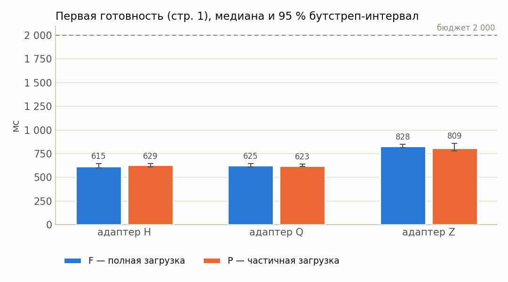

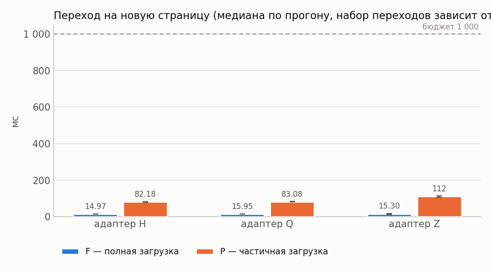

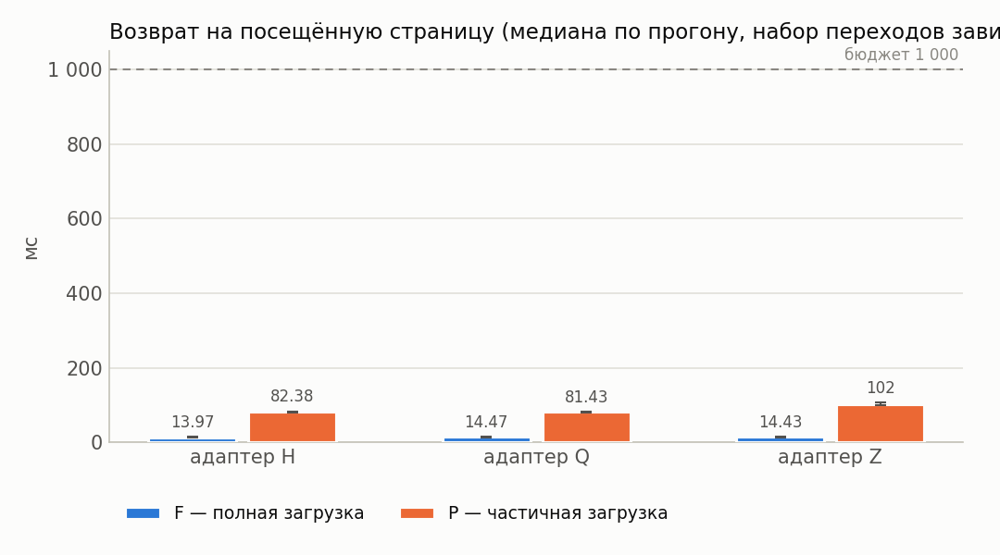

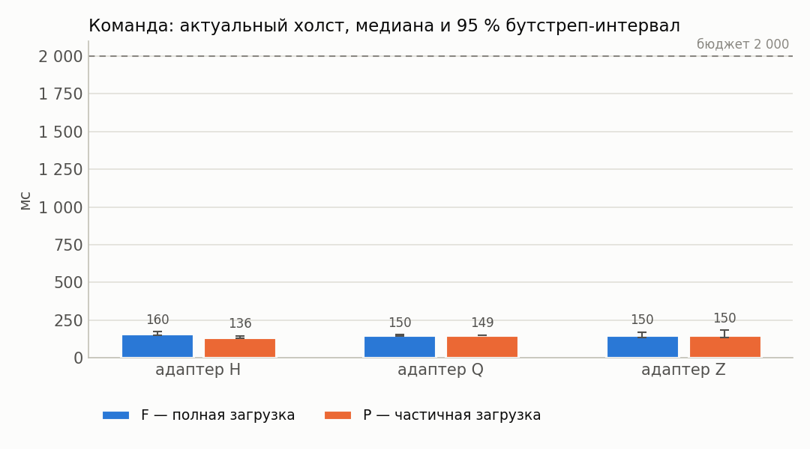

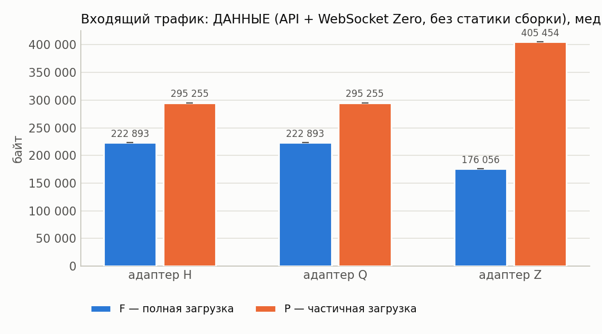

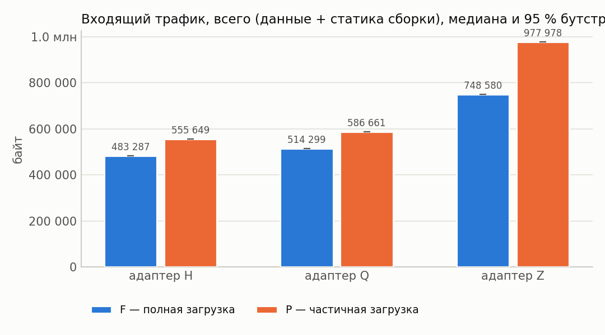

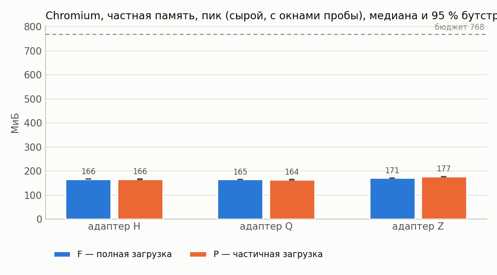

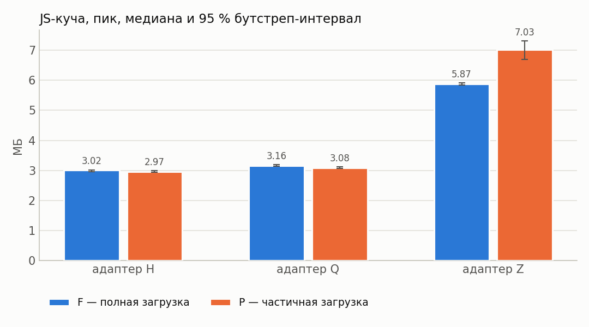

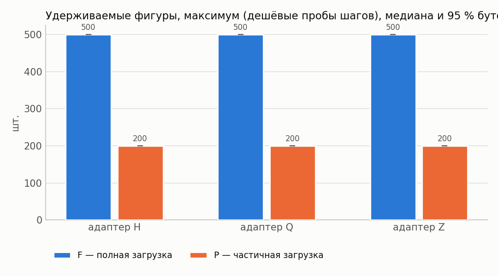

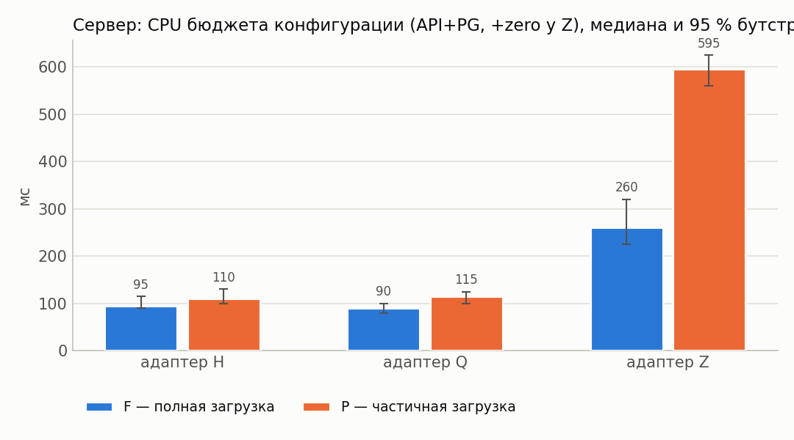

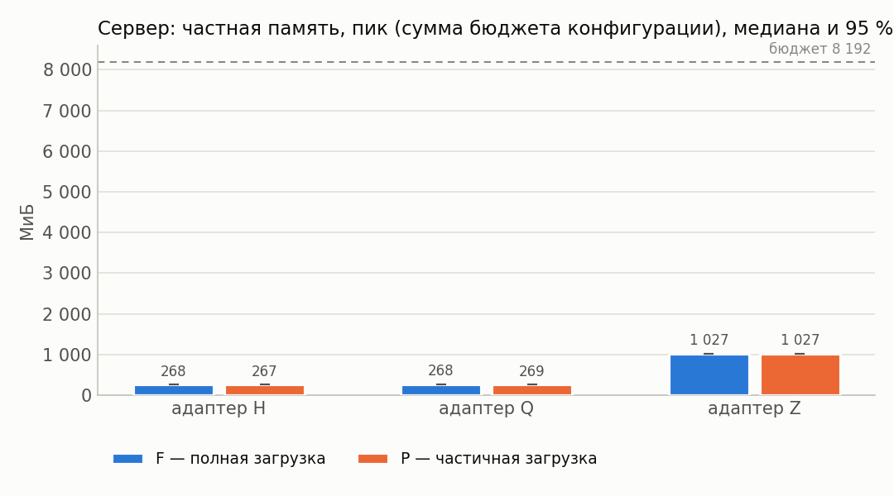

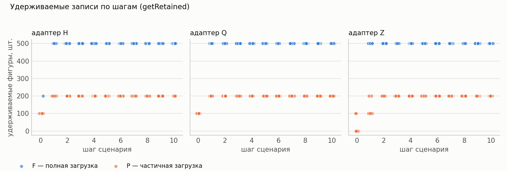

## 12. Выводы

* Оценки изменения P−F ниже — **парные** (медиана поблочных разностей, блок = повторение).
* Все бюджеты §7.4 выполнены для конфигураций: H/F, H/P (cache=1), Q/F, Q/P (cache=1), Z/F, Z/P (cache=1).
* H, cache=1: в режиме P первая готовность на 1 % больше, чем в F (P/F = 1.01, 95 % интервал [0.98; 1.05]; интервал Δ содержит 0 — различие не подтверждено).
* Q, cache=1: в режиме P первая готовность на 1 % больше, чем в F (P/F = 1.01, 95 % интервал [0.97; 1.03]; интервал Δ содержит 0 — различие не подтверждено).
* Z, cache=1: в режиме P первая готовность на 2 % меньше, чем в F (P/F = 0.98, 95 % интервал [0.94; 1.05]; интервал Δ содержит 0 — различие не подтверждено).
* H, cache=1: в режиме P пик частной памяти Chromium на 0 % меньше, чем в F (P/F = 1.00, 95 % интервал [0.99; 1.01]; интервал Δ содержит 0 — различие не подтверждено).
* Q, cache=1: в режиме P пик частной памяти Chromium на 1 % меньше, чем в F (P/F = 0.99, 95 % интервал [0.97; 1.00]; интервал Δ содержит 0 — различие не подтверждено).
* Z, cache=1: в режиме P пик частной памяти Chromium на 3 % больше, чем в F (P/F = 1.03, 95 % интервал [1.02; 1.04]; интервал Δ не содержит 0).
* H, cache=1: в режиме P входящий трафик на 15 % больше, чем в F (P/F = 1.15, 95 % интервал [1.15; 1.15]; интервал Δ не содержит 0).
* Q, cache=1: в режиме P входящий трафик на 14 % больше, чем в F (P/F = 1.14, 95 % интервал [1.14; 1.14]; интервал Δ не содержит 0).
* Z, cache=1: в режиме P входящий трафик на 31 % больше, чем в F (P/F = 1.31, 95 % интервал [1.31; 1.31]; интервал Δ не содержит 0).
* H, cache=1: в режиме P максимум удерживаемых фигур на 60 % меньше, чем в F (P/F = 0.40, 95 % интервал [0.40; 0.40]; интервал Δ не содержит 0).
* Q, cache=1: в режиме P максимум удерживаемых фигур на 60 % меньше, чем в F (P/F = 0.40, 95 % интервал [0.40; 0.40]; интервал Δ не содержит 0).
* Z, cache=1: в режиме P максимум удерживаемых фигур на 60 % меньше, чем в F (P/F = 0.40, 95 % интервал [0.40; 0.40]; интервал Δ не содержит 0).
* H, cache=1: в режиме P переход на новую страницу на 438 % больше, чем в F (P/F = 5.38, 95 % интервал [5.06; 5.65]; интервал Δ не содержит 0).
* Q, cache=1: в режиме P переход на новую страницу на 421 % больше, чем в F (P/F = 5.21, 95 % интервал [5.00; 5.63]; интервал Δ не содержит 0).
* Z, cache=1: в режиме P переход на новую страницу на 646 % больше, чем в F (P/F = 7.46, 95 % интервал [5.98; 8.01]; интервал Δ не содержит 0).
* Перекрёстная проверка обмена сошлась во всех конфигурациях (наибольшее расхождение шейпера и суммы CDP HTTP+WebSocket — 0.3 %).
* У конфигураций Z/F, Z/P (cache=1) холст успевает обновиться раньше подтверждения сервера — доставка синхронизацией опережает ответ по HTTP; обе величины приведены отдельно в разделе 4.
* Точечная доля успеха ≥ 95 %: H/F, H/P (cache=1), Q/F, Q/P (cache=1), Z/F, Z/P (cache=1).
* Нижняя граница интервала Уилсона ниже 95 % для: H/F, H/P (cache=1), Q/F, Q/P (cache=1), Z/F, Z/P (cache=1). При n < 73 прогонов она не достигает 95 % даже без единого отказа, поэтому здесь это ограничение объёма серии, а не свидетельство ненадёжности; при наличии отказов — см. раздел «Ошибки».
* Условия применимости частичной загрузки: режим P оправдан, когда его выигрыш по первой готовности/памяти/трафику подтверждён интервалом (не содержащим 0) и при этом переходы на новые страницы и команда до холста остаются в бюджете, а удерживаемые записи не выходят за объявленное окно.
