# Результаты серии «main»

Сформировано 2026-09-14 02:47 UTC из `../../results/main/runs.csv` (180 прогонов, 6 конфигураций). Бутстреп: 2000 ресемплов, seed=42, перцентильные 95 % интервалы. Времена и ресурсы считаются по прогонам с `outcome=ok`; доли — по всем начатым прогонам.

**Определения статистик** (одинаковы во всех таблицах): медиана — обычная выборочная; p95 — перцентиль по линейной интерполяции порядковых статистик (`numpy.percentile`, тип 7), при n = 30 это интерполяция между 29‑м и 30‑м значением, поэтому p95 не превышает максимум выборки и при малых n смещён вниз; интервалы медианы и p95 — перцентильный бутстреп по одной матрице ресемплов (согласованы между собой); доли — интервал Уилсона 95 % без поправки на непрерывность; при n < 8 интервалы помечены † как ненадёжные, при n < 2 не строятся.

Проверка схемы: OK — rows=180

## 1. Паспорт серии

| Параметр | Значение |
|---|---|
| `series` | main |
| `startedAt` | 2026-09-13T19:47:09.122Z |
| `finishedAt` | 2026-09-13T20:37:27.134Z |
| `host` | {"hostname": "vm", "os": "Linux 6.18.44-fc-v24", "platform": "linux", "arch": "x64", "kernel": "6.18.44-fc-v24", "distro": "Ubuntu 24.04.4 LTS", "cpuModel": "Intel(R) Xeon(R) Processor @ 2.80GHz", "cp |
| `versions` | {"node": "v24.21.0", "npm": "11.19.0", "postgres": "psql (PostgreSQL) 16.13 (Ubuntu 16.13-0ubuntu0.24.04.1)", "chromium": "141.0.7390.37", "playwright": "1.56.0", "zero": "1.9.0", "reactQuery": "5.102 |
| `packages` | {"playwright": "1.56.0", "@types/node": "24.13.4", "typescript": "5.9.3", "ws": "8.21.3", "@rocicorp/zero": "1.9.0", "@tanstack/react-query": "5.102.8", "react": "19.3.0", "react-dom": "19.3.0", "@typ |
| `packagesHoistedDifferent` | {"postgres": "3.4.7", "@fastify/cors": "10.1.0"} |
| `workspacePackages` | {"packages/bench": {"playwright": "1.56.0", "@types/node": "24.13.4", "typescript": "5.9.3", "ws": "8.21.3"}, "packages/client": {"@rocicorp/zero": "1.9.0", "@tanstack/react-query": "5.102.8", "react" |
| `lockfileVersion` | 3 |
| `shaper` | {"delayMs": 25, "bandwidthMbit": 20, "handshakeRtt": true, "statsUrl": "http://127.0.0.1:8081", "effective": {"delayMs": 25, "bandwidthMbit": 20, "bucketMs": 20, "segmentBytes": 4096, "bucketBytes": 5 |
| `seed` | 20260911 |
| `repetitions` | 30 |
| `configs` | [{"adapter": "H", "mode": "F", "cache": 1}, {"adapter": "H", "mode": "P", "cache": 1}, {"adapter": "Q", "mode": "F", "cache": 1}, {"adapter": "Q", "mode": "P", "cache": 1}, {"adapter": "Z", "mode": "F |
| `seriesConfig` | {"name": "main", "doc": "doc-acc-50x500", "sourceId": "doc-acc-50x500-src-1", "fill": "#1e90ff", "docJson": "data/acceptance.json", "configs": [{"adapter": "H", "mode": "F", "cache": 1}, {"adapter": " |
| `procGroups` | [{"name": "api", "pidFile": "/home/claude/stand/results/logs/api.pid", "exclude": ["netshaper", "zero-cache"]}, {"name": "pg", "patterns": ["(^\|/)postgres .*16/main", "^postgres: 16/main"], "exclude": |
| `browser` | {"channel": "chromium", "args": ["--disable-extensions"], "headless": true, "viewport": {"width": 1280, "height": 800}} |
| `scenario` | {"route": [2, 3, 1, 4, 2, 5, 1, 6, 3, 50], "pauseMs": 1000, "budgets": {"firstReadyMs": 2000, "navMs": 1000, "cmdDrawnMs": 2000, "scenarioMs": 30000}} |
| `plan` | [{"run_id": "main-0000-QP1", "order_index": 0, "repetition": 0, "adapter": "Q", "mode": "P", "cache": 1}, {"run_id": "main-0001-ZP1", "order_index": 1, "repetition": 0, "adapter": "Z", "mode": "P", "c |
| `client` | {"dist": [{"path": "adapter-settings.json", "bytes": 1004, "mtime": "2026-09-13T19:30:30.755Z", "sha256": "5d7d9af8420141ebb66ea6894d26792039f489306b9ba46bfea9900ef01071b1"}, {"path": "assets/h-BRsLg0 |
| `adapters` | {"available": true, "source": "packages/client/dist/adapter-settings.json", "generatedFrom": ["packages/client/src/adapters/types.ts → ADAPTER_SETTINGS", "packages/client/src/adapters/settings.ts → Z_ |
| `api` | {"url": "http://127.0.0.1:3000", "available": true, "logLevel": "warn", "health": {"status": "ok", "db": "ok", "uptimeSec": 41032, "testHooks": true, "logLevel": "warn", "now": "2026-09-13T19:47:09.38 |
| `zero` | {"config": {"pid": 1025, "env": {"ZERO_QUERY_URL": "http://127.0.0.1:3000/api/zero/query", "NODE_OPTIONS": "--max-old-space-size=8192 --import=/home/claude/stand/scripts/zero-ipv4-shim.mjs", "ZERO_ENA |
| `commit` | None |
| `code` | {"commit": null, "isGitRepo": false, "dirty": null, "codeId": "4bb9e4465904a250bc72d8338d19363855cfe7f827b12662d8600f4f90ee5917", "clientBuildId": "e8d6c0b226b1ac5d27bc8bd39b66d2b5bc2aab491b4d5f8e554c |
| `harness` | {"harnessId": "ab2103e73b1655e77b5a64c23e51cdefdcc213e3b9c1c5df5bd2deaf98e6b157", "harnessIdShort": "ab2103e73b1655e7", "benchId": "8e1bdf1d09f201b6d42ff58f62fccfc4be22cd53ac554a5dd2aeb14ed5a99ccf", " |
| `preSeriesChecks` | {"at": "2026-09-13T19:47:09.432Z", "samplers": {"ok": true, "groups": [{"group": "api", "needed": true, "processes": 1, "pids": [984], "verdict": "ok", "spec": "pidFile=/home/claude/stand/results/logs |
| `runsExecutedNow` | 180 |
| `runsExecutedTotal` | 180 |
| `runsOk` | 180 |
| `runsTotalPlanned` | 180 |

## 2. Состав серии и доля успеха

Успех прогона = `outcome=ok` ∧ `t_scenario ≤ 30 с` ∧ все проверки эталона прошли (SPEC §7.3).

Доли считаются по **всем** начатым прогонам конфигурации (ошибка и таймаут = неуспех); сводки времени и ресурсов ниже — только по прогонам `outcome=ok`.

| Конфигурация | Прогонов | ok | error | timeout | эталон ✓ | ok, но эталон ✗ | успех | Доля успеха [Уилсон 95 %] |
|---|---|---|---|---|---|---|---|---|
| H/F | 30 | 30 | 0 | 0 | 30 | 0 | 30 | 100.0 % [88.6 %; 100.0 %] |
| H/P (cache=1) | 30 | 30 | 0 | 0 | 30 | 0 | 30 | 100.0 % [88.6 %; 100.0 %] |
| Q/F | 30 | 30 | 0 | 0 | 30 | 0 | 30 | 100.0 % [88.6 %; 100.0 %] |
| Q/P (cache=1) | 30 | 30 | 0 | 0 | 30 | 0 | 30 | 100.0 % [88.6 %; 100.0 %] |
| Z/F | 30 | 30 | 0 | 0 | 30 | 0 | 30 | 100.0 % [88.6 %; 100.0 %] |
| Z/P (cache=1) | 30 | 30 | 0 | 0 | 30 | 0 | 30 | 100.0 % [88.6 %; 100.0 %] |

## 3. Сводные показатели по конфигурациям

Для каждого показателя приводятся n, медиана с 95 % перцентильным бутстреп‑интервалом, p95 (линейная интерполяция порядковых статистик) с таким же интервалом, min и max. Знак † — интервал построен по n < 8 наблюдениям и ненадёжен; «—» вместо интервала — n < 2, интервал не определён.

### 3.1 Время

**Первая готовность (стр. 1), мс**

| Конфигурация | n | Медиана | 95 % ИД медианы | p95 | 95 % ИД p95 | min | max |
|---|---|---|---|---|---|---|---|
| H/F | 30 | 676 | [670; 682] | 703 | [687; 712] | 650 | 712 |
| H/P (cache=1) | 30 | 663 | [654; 674] | 708 | [683; 713] | 633 | 713 |
| Q/F | 30 | 686 | [673; 690] | 718 | [700; 718] | 649 | 718 |
| Q/P (cache=1) | 30 | 668 | [662; 678] | 711 | [692; 725] | 648 | 725 |
| Z/F | 30 | 1 183 | [1 148; 1 193] | 1 250 | [1 215; 1 310] | 1 100 | 1 310 |
| Z/P (cache=1) | 30 | 889 | [873; 915] | 974 | [943; 995] | 854 | 995 |

**Переход на новую страницу (медиана по прогону, набор переходов зависит от маршрута серии), мс**

| Конфигурация | n | Медиана | 95 % ИД медианы | p95 | 95 % ИД p95 | min | max |
|---|---|---|---|---|---|---|---|
| H/F | 30 | 34 | [33; 37] | 42 | [39; 42] | 30 | 42 |
| H/P (cache=1) | 30 | 126 | [124; 127] | 133 | [130; 136] | 119 | 136 |
| Q/F | 30 | 35 | [33; 36] | 41 | [36; 44] | 29 | 44 |
| Q/P (cache=1) | 30 | 125 | [124; 127] | 131 | [130; 133] | 120 | 133 |
| Z/F | 30 | 35 | [33; 36] | 41 | [37; 46] | 29 | 46 |
| Z/P (cache=1) | 30 | 220 | [218; 223] | 235 | [227; 243] | 203 | 243 |

**Возврат на посещённую страницу (медиана по прогону, набор переходов зависит от маршрута серии), мс**

| Конфигурация | n | Медиана | 95 % ИД медианы | p95 | 95 % ИД p95 | min | max |
|---|---|---|---|---|---|---|---|
| H/F | 30 | 15 | [15; 17] | 20 | [17; 21] | 12 | 21 |
| H/P (cache=1) | 30 | 112 | [110; 113] | 117 | [116; 119] | 103 | 119 |
| Q/F | 30 | 16 | [15; 17] | 22 | [18; 22] | 11 | 22 |
| Q/P (cache=1) | 30 | 110 | [108; 112] | 119 | [115; 120] | 102 | 120 |
| Z/F | 30 | 18 | [18; 20] | 24 | [20; 25] | 14 | 25 |
| Z/P (cache=1) | 30 | 206 | [199; 209] | 232 | [214; 243] | 182 | 243 |

**Команда: подтверждение транспорта (Z — .server, H/Q — ответ POST), мс**

| Конфигурация | n | Медиана | 95 % ИД медианы | p95 | 95 % ИД p95 | min | max |
|---|---|---|---|---|---|---|---|
| H/F | 30 | 72 | [69; 75] | 81 | [76; 85] | 64 | 85 |
| H/P (cache=1) | 30 | 68 | [67; 71] | 84 | [73; 90] | 64 | 90 |
| Q/F | 30 | 70 | [67; 71] | 80 | [74; 86] | 62 | 86 |
| Q/P (cache=1) | 30 | 68 | [67; 71] | 76 | [73; 78] | 63 | 78 |
| Z/F | 30 | 273 | [238; 396] | 474 | [431; 806] | 169 | 806 |
| Z/P (cache=1) | 30 | 119 | [115; 126] | 157 | [132; 167] | 102 | 167 |

**Команда: подтверждение сервера (результат операции), мс**

| Конфигурация | n | Медиана | 95 % ИД медианы | p95 | 95 % ИД p95 | min | max |
|---|---|---|---|---|---|---|---|
| H/F | 30 | 73 | [69; 75] | 81 | [76; 85] | 64 | 85 |
| H/P (cache=1) | 30 | 69 | [68; 71] | 84 | [73; 90] | 64 | 90 |
| Q/F | 30 | 70 | [67; 71] | 80 | [73; 86] | 62 | 86 |
| Q/P (cache=1) | 30 | 69 | [67; 71] | 76 | [73; 78] | 64 | 78 |
| Z/F | 30 | 342 | [312; 454] | 554 | [499; 883] | 233 | 883 |
| Z/P (cache=1) | 30 | 182 | [176; 187] | 219 | [197; 234] | 164 | 234 |

**Команда: цена протокола подтверждения (ack − транспорт), мс**

| Конфигурация | n | Медиана | 95 % ИД медианы | p95 | 95 % ИД p95 | min | max |
|---|---|---|---|---|---|---|---|
| H/F | 30 | 0 | [0; 0] | 0 | [0; 0] | 0 | 0 |
| H/P (cache=1) | 30 | 0 | [0; 0] | 0 | [0; 0] | 0 | 0 |
| Q/F | 30 | 0 | [0; 0] | 0 | [0; 0] | 0 | 0 |
| Q/P (cache=1) | 30 | 0 | [0; 0] | 0 | [0; 1] | 0 | 1 |
| Z/F | 30 | 65 | [62; 68] | 91 | [77; 98] | 57 | 98 |
| Z/P (cache=1) | 30 | 60 | [60; 62] | 68 | [66; 68] | 57 | 68 |

**Команда: данные в хранилище активной страницы, мс**

| Конфигурация | n | Медиана | 95 % ИД медианы | p95 | 95 % ИД p95 | min | max |
|---|---|---|---|---|---|---|---|
| H/F | 30 | 221 | [188; 248] | 309 | [287; 330] | 158 | 330 |
| H/P (cache=1) | 30 | 166 | [163; 171] | 183 | [175; 191] | 154 | 191 |
| Q/F | 30 | 168 | [166; 174] | 188 | [181; 195] | 157 | 195 |
| Q/P (cache=1) | 30 | 166 | [163; 169] | 179 | [173; 182] | 158 | 182 |
| Z/F | 30 | 272 | [232; 393] | 473 | [435; 805] | 169 | 805 |
| Z/P (cache=1) | 30 | 119 | [115; 126] | 156 | [131; 166] | 102 | 166 |

**Команда: актуальный холст, мс**

| Конфигурация | n | Медиана | 95 % ИД медианы | p95 | 95 % ИД p95 | min | max |
|---|---|---|---|---|---|---|---|
| H/F | 30 | 233 | [203; 260] | 318 | [298; 344] | 168 | 344 |
| H/P (cache=1) | 30 | 179 | [176; 182] | 194 | [185; 199] | 162 | 199 |
| Q/F | 30 | 181 | [179; 186] | 202 | [191; 206] | 167 | 206 |
| Q/P (cache=1) | 30 | 177 | [172; 181] | 192 | [184; 196] | 166 | 196 |
| Z/F | 30 | 289 | [258; 408] | 493 | [456; 816] | 181 | 816 |
| Z/P (cache=1) | 30 | 133 | [130; 141] | 170 | [148; 182] | 117 | 182 |

**Переход, медиана всех переходов прогона (маршрут любой длины), мс**

| Конфигурация | n | Медиана | 95 % ИД медианы | p95 | 95 % ИД p95 | min | max |
|---|---|---|---|---|---|---|---|
| H/F | 30 | 30 | [29; 30] | 34 | [32; 35] | 27 | 35 |
| H/P (cache=1) | 30 | 121 | [120; 122] | 125 | [123; 128] | 114 | 128 |
| Q/F | 30 | 29 | [28; 30] | 36 | [32; 38] | 27 | 38 |
| Q/P (cache=1) | 30 | 121 | [120; 122] | 126 | [124; 127] | 116 | 127 |
| Z/F | 30 | 30 | [29; 32] | 36 | [33; 38] | 27 | 38 |
| Z/P (cache=1) | 30 | 215 | [209; 217] | 232 | [221; 243] | 200 | 243 |

**Сценарий целиком (с паузами, без проб оболочки), мс**

| Конфигурация | n | Медиана | 95 % ИД медианы | p95 | 95 % ИД p95 | min | max |
|---|---|---|---|---|---|---|---|
| H/F | 30 | 12 206 | [12 179; 12 233] | 12 291 | [12 257; 12 315] | 12 096 | 12 315 |
| H/P (cache=1) | 30 | 13 054 | [13 040; 13 068] | 13 132 | [13 073; 13 133] | 12 955 | 13 133 |
| Q/F | 30 | 12 161 | [12 147; 12 177] | 12 200 | [12 190; 12 241] | 12 114 | 12 241 |
| Q/P (cache=1) | 30 | 13 068 | [13 048; 13 087] | 13 116 | [13 103; 13 132] | 13 000 | 13 132 |
| Z/F | 30 | 12 859 | [12 756; 12 958] | 13 070 | [12 994; 13 318] | 12 624 | 13 318 |
| Z/P (cache=1) | 30 | 14 262 | [14 226; 14 305] | 14 454 | [14 367; 14 576] | 14 113 | 14 576 |

**Сценарий целиком, сырое время (с пробами оболочки), мс**

| Конфигурация | n | Медиана | 95 % ИД медианы | p95 | 95 % ИД p95 | min | max |
|---|---|---|---|---|---|---|---|
| H/F | 30 | 12 222 | [12 204; 12 255] | 12 317 | [12 278; 12 336] | 12 117 | 12 336 |
| H/P (cache=1) | 30 | 13 077 | [13 061; 13 089] | 13 157 | [13 096; 13 158] | 12 978 | 13 158 |
| Q/F | 30 | 12 184 | [12 167; 12 195] | 12 224 | [12 211; 12 254] | 12 132 | 12 254 |
| Q/P (cache=1) | 30 | 13 082 | [13 064; 13 100] | 13 135 | [13 128; 13 141] | 13 016 | 13 141 |
| Z/F | 30 | 13 135 | [13 041; 13 201] | 13 327 | [13 248; 13 446] | 12 752 | 13 446 |
| Z/P (cache=1) | 30 | 14 282 | [14 241; 14 328] | 14 483 | [14 392; 14 597] | 14 125 | 14 597 |

**Пробы оболочки сверх объявленных пауз, мс**

| Конфигурация | n | Медиана | 95 % ИД медианы | p95 | 95 % ИД p95 | min | max |
|---|---|---|---|---|---|---|---|
| H/F | 30 | 20 | [20; 23] | 30 | [26; 33] | 9 | 33 |
| H/P (cache=1) | 30 | 21 | [17; 24] | 28 | [27; 32] | 12 | 32 |
| Q/F | 30 | 20 | [17; 24] | 31 | [27; 34] | 9 | 34 |
| Q/P (cache=1) | 30 | 18 | [14; 21] | 32 | [25; 33] | 3 | 33 |
| Z/F | 30 | 206 | [163; 273] | 463 | [366; 596] | 17 | 596 |
| Z/P (cache=1) | 30 | 20 | [17; 22] | 33 | [25; 39] | 5 | 39 |

### 3.2 Объём обмена

**Головная величина обмена — «только данные»** (`bytes_in_data`: API + кадры синхронизации Zero). Полный `bytes_in` включает статику сборки — поадаптерную константу, одинаковую в F и в P, поэтому в отношениях P/F она искажает сравнение (`docs/DEVIATIONS.md` §3.1). Оба числа приводятся рядом, разложение — ниже.

**Входящий трафик: ДАННЫЕ (API + WebSocket Zero, без статики сборки), байт**

| Конфигурация | n | Медиана | 95 % ИД медианы | p95 | 95 % ИД p95 | min | max |
|---|---|---|---|---|---|---|---|
| H/F | 30 | 7 066 121 | [7 066 121; 7 066 121] | 7 066 121 | [7 066 121; 7 066 121] | 7 066 121 | 7 066 121 |
| H/P (cache=1) | 30 | 1 408 402 | [1 408 402; 1 408 402] | 1 408 402 | [1 408 402; 1 408 402] | 1 408 402 | 1 408 402 |
| Q/F | 30 | 7 066 121 | [7 066 121; 7 066 121] | 7 066 121 | [7 066 121; 7 066 121] | 7 066 121 | 7 066 121 |
| Q/P (cache=1) | 30 | 1 408 402 | [1 408 402; 1 408 402] | 1 408 402 | [1 408 402; 1 408 402] | 1 408 402 | 1 408 402 |
| Z/F | 30 | 7 098 034 | [7 098 034; 7 098 034] | 7 098 034 | [7 098 034; 7 098 034] | 7 095 352 | 7 098 034 |
| Z/P (cache=1) | 30 | 1 881 586 | [1 881 586; 1 881 586] | 1 881 586 | [1 881 586; 1 881 586] | 1 881 586 | 1 881 586 |

**Входящий трафик, всего (данные + статика сборки), байт**

| Конфигурация | n | Медиана | 95 % ИД медианы | p95 | 95 % ИД p95 | min | max |
|---|---|---|---|---|---|---|---|
| H/F | 30 | 7 326 515 | [7 326 515; 7 326 515] | 7 326 515 | [7 326 515; 7 326 515] | 7 326 515 | 7 326 515 |
| H/P (cache=1) | 30 | 1 668 796 | [1 668 796; 1 668 796] | 1 668 796 | [1 668 796; 1 668 796] | 1 668 796 | 1 668 796 |
| Q/F | 30 | 7 357 527 | [7 357 527; 7 357 527] | 7 357 527 | [7 357 527; 7 357 527] | 7 357 527 | 7 357 527 |
| Q/P (cache=1) | 30 | 1 699 808 | [1 699 808; 1 699 808] | 1 699 808 | [1 699 808; 1 699 808] | 1 699 808 | 1 699 808 |
| Z/F | 30 | 7 670 558 | [7 670 558; 7 670 558] | 7 670 558 | [7 670 558; 7 670 558] | 7 667 876 | 7 670 558 |
| Z/P (cache=1) | 30 | 2 454 110 | [2 454 110; 2 454 110] | 2 454 110 | [2 454 110; 2 454 110] | 2 454 110 | 2 454 110 |

**Статика сборки за прогон (поадаптерная константа), байт**

| Конфигурация | n | Медиана | 95 % ИД медианы | p95 | 95 % ИД p95 | min | max |
|---|---|---|---|---|---|---|---|
| H/F | 30 | 260 394 | [260 394; 260 394] | 260 394 | [260 394; 260 394] | 260 394 | 260 394 |
| H/P (cache=1) | 30 | 260 394 | [260 394; 260 394] | 260 394 | [260 394; 260 394] | 260 394 | 260 394 |
| Q/F | 30 | 291 406 | [291 406; 291 406] | 291 406 | [291 406; 291 406] | 291 406 | 291 406 |
| Q/P (cache=1) | 30 | 291 406 | [291 406; 291 406] | 291 406 | [291 406; 291 406] | 291 406 | 291 406 |
| Z/F | 30 | 572 524 | [572 524; 572 524] | 572 524 | [572 524; 572 524] | 572 524 | 572 524 |
| Z/P (cache=1) | 30 | 572 524 | [572 524; 572 524] | 572 524 | [572 524; 572 524] | 572 524 | 572 524 |

**Исходящий трафик: данные (без статики), байт**

| Конфигурация | n | Медиана | 95 % ИД медианы | p95 | 95 % ИД p95 | min | max |
|---|---|---|---|---|---|---|---|
| H/F | 30 | 51 285 | [51 285; 51 285] | 51 285 | [51 285; 51 285] | 51 285 | 51 285 |
| H/P (cache=1) | 30 | 12 261 | [12 261; 12 261] | 12 261 | [12 261; 12 261] | 12 261 | 12 261 |
| Q/F | 30 | 51 285 | [51 285; 51 285] | 51 285 | [51 285; 51 285] | 51 285 | 51 285 |
| Q/P (cache=1) | 30 | 12 261 | [12 261; 12 261] | 12 261 | [12 261; 12 261] | 12 261 | 12 261 |
| Z/F | 30 | 12 678 | [12 677; 12 678] | 12 678 | [12 678; 12 678] | 12 664 | 12 678 |
| Z/P (cache=1) | 30 | 7 394 | [7 394; 7 394] | 7 394 | [7 394; 7 394] | 7 380 | 7 394 |

**Исходящий трафик, всего (шейпер), байт**

| Конфигурация | n | Медиана | 95 % ИД медианы | p95 | 95 % ИД p95 | min | max |
|---|---|---|---|---|---|---|---|
| H/F | 30 | 55 370 | [55 370; 55 370] | 55 370 | [55 370; 55 370] | 55 370 | 55 370 |
| H/P (cache=1) | 30 | 16 346 | [16 346; 16 346] | 16 346 | [16 346; 16 346] | 16 346 | 16 346 |
| Q/F | 30 | 55 370 | [55 370; 55 370] | 55 370 | [55 370; 55 370] | 55 370 | 55 370 |
| Q/P (cache=1) | 30 | 16 346 | [16 346; 16 346] | 16 346 | [16 346; 16 346] | 16 346 | 16 346 |
| Z/F | 30 | 16 821 | [16 820; 16 821] | 16 821 | [16 821; 16 821] | 16 807 | 16 821 |
| Z/P (cache=1) | 30 | 11 537 | [11 537; 11 537] | 11 537 | [11 537; 11 537] | 11 523 | 11 537 |

**Входящий трафик (CDP, перекрёстная проверка), байт**

| Конфигурация | n | Медиана | 95 % ИД медианы | p95 | 95 % ИД p95 | min | max |
|---|---|---|---|---|---|---|---|
| H/F | 30 | 7 326 515 | [7 326 515; 7 326 515] | 7 326 515 | [7 326 515; 7 326 515] | 7 326 515 | 7 326 515 |
| H/P (cache=1) | 30 | 1 668 796 | [1 668 796; 1 668 796] | 1 668 796 | [1 668 796; 1 668 796] | 1 668 796 | 1 668 796 |
| Q/F | 30 | 7 357 527 | [7 357 527; 7 357 527] | 7 357 527 | [7 357 527; 7 357 527] | 7 357 527 | 7 357 527 |
| Q/P (cache=1) | 30 | 1 699 808 | [1 699 808; 1 699 808] | 1 699 808 | [1 699 808; 1 699 808] | 1 699 808 | 1 699 808 |
| Z/F | 30 | 576 646 | [576 646; 576 646] | 576 646 | [576 646; 576 646] | 576 646 | 576 646 |
| Z/P (cache=1) | 30 | 576 646 | [576 646; 576 646] | 576 646 | [576 646; 576 646] | 576 646 | 576 646 |

**Обмен данными против полного объёма**

Источник разложения: колонки оболочки `bytes_in_api` / `bytes_in_zero` / `bytes_in_static`.

Разброс статики внутри конфигурации обязан быть нулевым — это константа сборки, а не измеряемая величина; ненулевой разброс означал бы, что в статику попало что‑то ещё, и его надо разбирать.

| Конфигурация | n | **Данные (API + WS), байт** | Статика сборки, байт | Всего, байт | Доля статики | Разброс статики |
|---|---|---|---|---|---|---|
| H/F | 30 | 7 066 121 | 260 394 | 7 326 515 | 3.6 % | 0 |
| H/P (cache=1) | 30 | 1 408 402 | 260 394 | 1 668 796 | 15.6 % | 0 |
| Q/F | 30 | 7 066 121 | 291 406 | 7 357 527 | 4.0 % | 0 |
| Q/P (cache=1) | 30 | 1 408 402 | 291 406 | 1 699 808 | 17.1 % | 0 |
| Z/F | 30 | 7 098 034 | 572 524 | 7 670 558 | 7.5 % | 0 |
| Z/P (cache=1) | 30 | 1 881 586 | 572 524 | 2 454 110 | 23.3 % | 0 |

**P/F обмена: по полному трафику и по данным** (парная оценка, блок = повторение)

| Адаптер | Пар | Статика, байт | P/F полный (как публиковалось) | **P/F данные (головное)** | Изменилось |
|---|---|---|---|---|---|
| H (cache=1) | 30 | 260 394 | 0.228 [0.228; 0.228] | **0.199** [0.199; 0.199] | да, -0.028 |
| Q (cache=1) | 30 | 291 406 | 0.231 [0.231; 0.231] | **0.199** [0.199; 0.199] | да, -0.032 |
| Z (cache=1) | 30 | 572 524 | 0.320 [0.320; 0.320] | **0.265** [0.265; 0.265] | да, -0.055 |

Последний столбец отвечает на вопрос «какие опубликованные числа двигает вычитание статики»: величина сдвига = P/F(данные) − P/F(полный).

**Полнота разложения: сумма по маршрутам против итога**

Головное число обмена — `bytes_in_data = bytes_in_api + bytes_in_zero`. Оно осмысленно ровно настолько, насколько разложение полное, поэтому проверка идёт **по каждому прогону**, а не по медианам: столбцы «расхождение» — максимум по прогонам конфигурации от |(api + zero + статика + прочее) − итог|, столбцы «остаток» — максимум собственной контрольной колонки оболочки `bytes_*_route_residual`. Ожидаемое значение всех четырёх — ноль.

| Конфигурация | n | Расхождение вход, Б | Расхождение исход, Б | Остаток вход, Б | Остаток исход, Б | Прочее (вход), Б | Сошлось |
|---|---|---|---|---|---|---|---|
| H/F | 30 | 0 | 0 | 0 | 0 | 0 | ✓ |
| H/P (cache=1) | 30 | 0 | 0 | 0 | 0 | 0 | ✓ |
| Q/F | 30 | 0 | 0 | 0 | 0 | 0 | ✓ |
| Q/P (cache=1) | 30 | 0 | 0 | 0 | 0 | 0 | ✓ |
| Z/F | 30 | 0 | 0 | 0 | 0 | 0 | ✓ |
| Z/P (cache=1) | 30 | 0 | 0 | 0 | 0 | 0 | ✓ |

Все конфигурации сошлись побайтно: «данные + статика + прочее» исчерпывают весь наблюдаемый обмен, и головная величина `bytes_in_data` ничего не теряет.

**Перекрёстная проверка трафика (шейпер vs CDP)**

Шейпер считает байты TCP‑полезной нагрузки всех соединений клиента; CDP даёт их двумя счётчиками — `cdp_bytes_in` (`encodedDataLength` HTTP‑ответов) и `cdp_ws_bytes_in` (кадры WebSocket). У H/Q второй счётчик нулевой, у Z по WebSocket идёт почти весь обмен, поэтому сверять нужно **сумму**: сравнение только с `cdp_bytes_in` давало ложный провал у Z (в прежнем `results/smoke/report.md` — Z/F 92.5 %, Z/P 76.6 %).

| Конфигурация | bytes_in (шейпер) | CDP: HTTP | CDP: WebSocket | CDP: сумма | Расхождение | ≤ 10 % |
|---|---|---|---|---|---|---|
| H/F | 7 326 515 | 7 326 515 | 0 | 7 326 515 | 0.0 % | ✓ |
| H/P (cache=1) | 1 668 796 | 1 668 796 | 0 | 1 668 796 | 0.0 % | ✓ |
| Q/F | 7 357 527 | 7 357 527 | 0 | 7 357 527 | 0.0 % | ✓ |
| Q/P (cache=1) | 1 699 808 | 1 699 808 | 0 | 1 699 808 | 0.0 % | ✓ |
| Z/F | 7 670 558 | 576 646 | 7 090 963 | 7 667 609 | 0.0 % | ✓ |
| Z/P (cache=1) | 2 454 110 | 576 646 | 1 875 371 | 2 452 017 | 0.1 % | ✓ |

**Исходящее направление — справочно.** `cdp_bytes_out` не измеряется, а оценивается по `Network.requestWillBeSent` (стартовая строка + известные CDP заголовки + тело) и систематически занижен на заголовки, которые добавляет сетевой стек браузера, и на рукопожатие WebSocket. Расхождение 20–40 % здесь — свойство оценки, а не признак ошибки измерения; в вердикт конфигурации это направление не входит.

| Конфигурация | bytes_out (шейпер) | CDP: сумма (оценка) | Расхождение | ≤ 50 % |
|---|---|---|---|---|
| H/F | 55 370 | 42 794 | 22.7 % | ✓ |
| H/P (cache=1) | 16 346 | 12 122 | 25.8 % | ✓ |
| Q/F | 55 370 | 42 794 | 22.7 % | ✓ |
| Q/P (cache=1) | 16 346 | 12 122 | 25.8 % | ✓ |
| Z/F | 16 821 | 11 745 | 30.2 % | ✓ |
| Z/P (cache=1) | 11 537 | 7 011 | 39.2 % | ✓ |

### 3.3 Память клиента

**Chromium, частная память, пик без окон пробы, МиБ**

| Конфигурация | n | Медиана | 95 % ИД медианы | p95 | 95 % ИД p95 | min | max |
|---|---|---|---|---|---|---|---|
| H/F | 30 | 194.8 | [194.0; 195.9] | 198.5 | [197.2; 199.0] | 191.4 | 199.0 |
| H/P (cache=1) | 30 | 175.0 | [174.6; 175.6] | 178.9 | [176.4; 179.1] | 170.5 | 179.1 |
| Q/F | 30 | 194.3 | [193.5; 195.5] | 197.6 | [196.8; 198.0] | 191.5 | 198.0 |
| Q/P (cache=1) | 30 | 175.4 | [174.8; 176.1] | 178.9 | [176.4; 178.9] | 169.6 | 178.9 |
| Z/F | 30 | 236.2 | [229.6; 240.1] | 249.2 | [242.2; 252.1] | 221.2 | 252.1 |
| Z/P (cache=1) | 30 | 190.3 | [188.8; 191.9] | 195.5 | [193.5; 196.4] | 186.0 | 196.4 |

**Chromium, частная память, пик (сырой, с окнами пробы), МиБ**

| Конфигурация | n | Медиана | 95 % ИД медианы | p95 | 95 % ИД p95 | min | max |
|---|---|---|---|---|---|---|---|
| H/F | 30 | 195.4 | [194.3; 196.5] | 199.5 | [197.7; 200.1] | 192.2 | 200.1 |
| H/P (cache=1) | 30 | 175.3 | [175.0; 175.8] | 179.2 | [176.4; 179.6] | 170.5 | 179.6 |
| Q/F | 30 | 195.3 | [194.1; 196.0] | 198.4 | [197.1; 198.8] | 191.5 | 198.8 |
| Q/P (cache=1) | 30 | 175.7 | [175.1; 176.2] | 179.2 | [177.1; 179.9] | 169.9 | 179.9 |
| Z/F | 30 | 261.7 | [258.0; 262.8] | 273.5 | [269.0; 280.8] | 241.1 | 280.8 |
| Z/P (cache=1) | 30 | 190.7 | [188.9; 191.9] | 195.5 | [193.5; 196.4] | 186.0 | 196.4 |

**Chromium, частная память, конец, МиБ**

| Конфигурация | n | Медиана | 95 % ИД медианы | p95 | 95 % ИД p95 | min | max |
|---|---|---|---|---|---|---|---|
| H/F | 30 | 194.2 | [193.3; 194.7] | 197.7 | [196.6; 198.4] | 190.8 | 198.4 |
| H/P (cache=1) | 30 | 175.0 | [174.6; 175.6] | 178.9 | [176.4; 179.1] | 170.5 | 179.1 |
| Q/F | 30 | 193.5 | [193.1; 194.1] | 197.3 | [194.6; 197.9] | 190.1 | 197.9 |
| Q/P (cache=1) | 30 | 175.4 | [174.8; 176.1] | 178.9 | [176.4; 178.9] | 169.6 | 178.9 |
| Z/F | 30 | 199.3 | [198.9; 199.5] | 201.5 | [199.9; 201.8] | 197.6 | 201.8 |
| Z/P (cache=1) | 30 | 181.9 | [181.1; 182.6] | 184.8 | [183.6; 185.8] | 178.5 | 185.8 |

**JS‑куча, пик, МБ**

| Конфигурация | n | Медиана | 95 % ИД медианы | p95 | 95 % ИД p95 | min | max |
|---|---|---|---|---|---|---|---|
| H/F | 30 | 8.7 | [8.7; 8.8] | 8.8 | [8.8; 8.9] | 8.6 | 8.9 |
| H/P (cache=1) | 30 | 3.3 | [3.2; 3.3] | 3.9 | [3.5; 4.0] | 3.2 | 4.0 |
| Q/F | 30 | 8.6 | [8.6; 8.7] | 8.7 | [8.7; 8.7] | 8.3 | 8.7 |
| Q/P (cache=1) | 30 | 3.3 | [3.3; 3.3] | 3.6 | [3.4; 3.8] | 3.3 | 3.8 |
| Z/F | 30 | 31.3 | [29.4; 34.8] | 40.5 | [38.2; 43.0] | 26.1 | 43.0 |
| Z/P (cache=1) | 30 | 11.0 | [10.7; 11.1] | 11.8 | [11.5; 12.4] | 9.5 | 12.4 |

**JS‑куча, конец, МБ**

| Конфигурация | n | Медиана | 95 % ИД медианы | p95 | 95 % ИД p95 | min | max |
|---|---|---|---|---|---|---|---|
| H/F | 30 | 7.9 | [7.9; 7.9] | 7.9 | [7.9; 7.9] | 7.9 | 7.9 |
| H/P (cache=1) | 30 | 2.8 | [2.8; 2.8] | 2.8 | [2.8; 2.8] | 2.8 | 2.8 |
| Q/F | 30 | 7.7 | [7.7; 7.7] | 7.7 | [7.7; 7.7] | 7.7 | 7.7 |
| Q/P (cache=1) | 30 | 3.0 | [3.0; 3.0] | 3.0 | [3.0; 3.0] | 3.0 | 3.0 |
| Z/F | 30 | 16.1 | [16.1; 16.2] | 16.2 | [16.2; 16.2] | 16.1 | 16.2 |
| Z/P (cache=1) | 30 | 7.0 | [7.0; 7.0] | 7.9 | [7.0; 8.3] | 6.9 | 8.3 |

**JS‑куча после принудительной сборки (остановка часов), МБ**

| Конфигурация | n | Медиана | 95 % ИД медианы | p95 | 95 % ИД p95 | min | max |
|---|---|---|---|---|---|---|---|
| H/F | 30 | 7.9 | [7.9; 7.9] | 7.9 | [7.9; 7.9] | 7.9 | 7.9 |
| H/P (cache=1) | 30 | 2.8 | [2.8; 2.8] | 2.8 | [2.8; 2.8] | 2.8 | 2.8 |
| Q/F | 30 | 7.7 | [7.7; 7.7] | 7.7 | [7.7; 7.7] | 7.7 | 7.7 |
| Q/P (cache=1) | 30 | 3.0 | [3.0; 3.0] | 3.0 | [3.0; 3.0] | 3.0 | 3.0 |
| Z/F | 30 | 16.1 | [16.1; 16.2] | 16.2 | [16.2; 16.2] | 16.1 | 16.2 |
| Z/P (cache=1) | 30 | 7.0 | [7.0; 7.0] | 7.1 | [7.0; 7.4] | 6.9 | 7.4 |

**Принудительных сборок мусора за прогон, шт.**

| Конфигурация | n | Медиана | 95 % ИД медианы | p95 | 95 % ИД p95 | min | max |
|---|---|---|---|---|---|---|---|
| H/F | 30 | 26 | [26; 26] | 26 | [26; 26] | 26 | 26 |
| H/P (cache=1) | 30 | 26 | [26; 26] | 26 | [26; 26] | 26 | 26 |
| Q/F | 30 | 26 | [26; 26] | 26 | [26; 26] | 26 | 26 |
| Q/P (cache=1) | 30 | 26 | [26; 26] | 26 | [26; 26] | 26 | 26 |
| Z/F | 30 | 26 | [26; 26] | 26 | [26; 26] | 26 | 26 |
| Z/P (cache=1) | 30 | 26 | [26; 26] | 26 | [26; 26] | 26 | 26 |

**Постоянное хранилище клиента, байт**

| Конфигурация | n | Медиана | 95 % ИД медианы | p95 | 95 % ИД p95 | min | max |
|---|---|---|---|---|---|---|---|
| H/F | 30 | 0 | [0; 0] | 0 | [0; 0] | 0 | 0 |
| H/P (cache=1) | 30 | 0 | [0; 0] | 0 | [0; 0] | 0 | 0 |
| Q/F | 30 | 0 | [0; 0] | 0 | [0; 0] | 0 | 0 |
| Q/P (cache=1) | 30 | 0 | [0; 0] | 0 | [0; 0] | 0 | 0 |
| Z/F | 30 | 1 786 608 | [1 785 062; 1 788 884] | 2 769 109 | [1 790 687; 3 644 128] | 1 774 905 | 3 644 128 |
| Z/P (cache=1) | 30 | 151 760 | [101 283; 151 962] | 189 617 | [154 385; 334 101] | 96 716 | 334 101 |

**Окна измерительных проб: паритет политики и цена их исключения**

Число окон проб одинаково во всех конфигурациях серии (14) — политика проб к адаптерам не привязана, и пики памяти между ними сравнимы. Историческая колонка `chromium_private_peak_mib` во всех прогонах совпадает с `chromium_private_peak_raw_mib` — сырой пик доступен под обоими именами, и старые таблицы читаются как «пик с окнами пробы».

Длительность окон у адаптеров различается законно: это измеренное свойство адаптера (точный скан хранилища у Z/F дороже), а не нарушение паритета. «Доля выборок в окнах» показывает, какая часть наблюдений исключена из пика без пробы; «покрытие кучи» — доля времени прогона, покрытая опросом JS‑кучи (сэмплер кучи на время скана приостанавливается, поэтому пик кучи читается только вместе с ним).

| Конфигурация | n | Окон проб | Разброс окон | В окнах, мс | Пик сырой, МиБ | **Пик без проб, МиБ** | Разница, МиБ | Доля выборок в окнах | Покрытие кучи |
|---|---|---|---|---|---|---|---|---|---|
| H/F | 30 | 14 | 0 | 1 204 | 195.4 | 194.8 | 0.6 | 9.6 % | 1.000 |
| H/P (cache=1) | 30 | 14 | 0 | 738 | 175.3 | 175.0 | 0.3 | 3.7 % | 1.000 |
| Q/F | 30 | 14 | 0 | 1 211 | 195.3 | 194.3 | 1.0 | 7.7 % | 1.000 |
| Q/P (cache=1) | 30 | 14 | 0 | 792 | 175.7 | 175.4 | 0.3 | 5.6 % | 1.000 |
| Z/F | 30 | 14 | 0 | 3 805 | 261.7 | 236.2 | 25.5 | 26.8 % | 0.892 |
| Z/P (cache=1) | 30 | 14 | 0 | 1 265 | 190.7 | 190.3 | 0.4 | 6.7 % | 1.000 |

**Паритет давления сборщика мусора**

**Расписание принудительных сборок мусора одинаково у всех конфигураций: 26 вызовов `HeapProfiler.collectGarbage` на прогон.** Точки вызова заданы оболочкой и не зависят ни от адаптера, ни от режима, ни от вида пробы, поэтому `js_heap_peak_mb` и `chromium_private_peak_mib` измерены при одинаковом давлении сборщика и сравнимы между адаптерами (раньше было ≈13 у H/Q против 2–3 у Z/F — дефект N2).

`js_heap_post_gc_mb` — куча сразу после принудительной сборки в фиксированной точке «остановка часов сценария»: величина, не зависящая от момента самопроизвольной сборки, и потому более устойчивая мера удерживаемой памяти, чем пик. `js_heap_suspended_ms` — сколько опрос кучи был приостановлен (два точных скана хранилища и выгрузка снимков); у Z/F больше просто потому, что дороже сам скан.

| Конфигурация | n | `js_heap_gc_count` | `js_heap_peak_mb`, медиана | `js_heap_post_gc_mb`, медиана | `js_heap_suspended_ms`, медиана |
|---|---|---|---|---|---|
| H/F | 30 | 26 | 8.7 | 7.9 | 1 174 |
| H/P (cache=1) | 30 | 26 | 3.3 | 2.8 | 719 |
| Q/F | 30 | 26 | 8.6 | 7.7 | 1 185 |
| Q/P (cache=1) | 30 | 26 | 3.3 | 3.0 | 762 |
| Z/F | 30 | 26 | 31.3 | 16.1 | 3 296 |
| Z/P (cache=1) | 30 | 26 | 11.0 | 7.0 | 1 170 |

### 3.4 Удерживаемые записи

**Удерживаемые фигуры, максимум (дешёвые пробы шагов), шт.**

| Конфигурация | n | Медиана | 95 % ИД медианы | p95 | 95 % ИД p95 | min | max |
|---|---|---|---|---|---|---|---|
| H/F | 30 | 25 000 | [25 000; 25 000] | 25 000 | [25 000; 25 000] | 25 000 | 25 000 |
| H/P (cache=1) | 30 | 1 000 | [1 000; 1 000] | 1 000 | [1 000; 1 000] | 1 000 | 1 000 |
| Q/F | 30 | 25 000 | [25 000; 25 000] | 25 000 | [25 000; 25 000] | 25 000 | 25 000 |
| Q/P (cache=1) | 30 | 1 000 | [1 000; 1 000] | 1 000 | [1 000; 1 000] | 1 000 | 1 000 |
| Z/F | 30 | 25 000 | [25 000; 25 000] | 25 000 | [25 000; 25 000] | 25 000 | 25 000 |
| Z/P (cache=1) | 30 | 1 000 | [1 000; 1 000] | 1 000 | [1 000; 1 000] | 1 000 | 1 000 |

**Удерживаемые фигуры, конец — точный скан, шт.**

| Конфигурация | n | Медиана | 95 % ИД медианы | p95 | 95 % ИД p95 | min | max |
|---|---|---|---|---|---|---|---|
| H/F | 30 | 25 000 | [25 000; 25 000] | 25 000 | [25 000; 25 000] | 25 000 | 25 000 |
| H/P (cache=1) | 30 | 1 000 | [1 000; 1 000] | 1 000 | [1 000; 1 000] | 1 000 | 1 000 |
| Q/F | 30 | 25 000 | [25 000; 25 000] | 25 000 | [25 000; 25 000] | 25 000 | 25 000 |
| Q/P (cache=1) | 30 | 1 000 | [1 000; 1 000] | 1 000 | [1 000; 1 000] | 1 000 | 1 000 |
| Z/F | 30 | 25 000 | [25 000; 25 000] | 25 000 | [25 000; 25 000] | 25 000 | 25 000 |
| Z/P (cache=1) | 30 | 1 000 | [1 000; 1 000] | 1 000 | [1 000; 1 000] | 1 000 | 1 000 |

**Удерживаемые фигуры, конец, шт.**

| Конфигурация | n | Медиана | 95 % ИД медианы | p95 | 95 % ИД p95 | min | max |
|---|---|---|---|---|---|---|---|
| H/F | 30 | 25 000 | [25 000; 25 000] | 25 000 | [25 000; 25 000] | 25 000 | 25 000 |
| H/P (cache=1) | 30 | 1 000 | [1 000; 1 000] | 1 000 | [1 000; 1 000] | 1 000 | 1 000 |
| Q/F | 30 | 25 000 | [25 000; 25 000] | 25 000 | [25 000; 25 000] | 25 000 | 25 000 |
| Q/P (cache=1) | 30 | 1 000 | [1 000; 1 000] | 1 000 | [1 000; 1 000] | 1 000 | 1 000 |
| Z/F | 30 | 25 000 | [25 000; 25 000] | 25 000 | [25 000; 25 000] | 25 000 | 25 000 |
| Z/P (cache=1) | 30 | 1 000 | [1 000; 1 000] | 1 000 | [1 000; 1 000] | 1 000 | 1 000 |

**Удерживаемые страницы, максимум (дешёвые пробы шагов), шт.**

| Конфигурация | n | Медиана | 95 % ИД медианы | p95 | 95 % ИД p95 | min | max |
|---|---|---|---|---|---|---|---|
| H/F | 30 | 50 | [50; 50] | 50 | [50; 50] | 50 | 50 |
| H/P (cache=1) | 30 | 2 | [2; 2] | 2 | [2; 2] | 2 | 2 |
| Q/F | 30 | 50 | [50; 50] | 50 | [50; 50] | 50 | 50 |
| Q/P (cache=1) | 30 | 2 | [2; 2] | 2 | [2; 2] | 2 | 2 |
| Z/F | 30 | 50 | [50; 50] | 50 | [50; 50] | 50 | 50 |
| Z/P (cache=1) | 30 | 2 | [2; 2] | 2 | [2; 2] | 2 | 2 |

**Удерживаемые страницы, конец — точный скан, шт.**

| Конфигурация | n | Медиана | 95 % ИД медианы | p95 | 95 % ИД p95 | min | max |
|---|---|---|---|---|---|---|---|
| H/F | 30 | 50 | [50; 50] | 50 | [50; 50] | 50 | 50 |
| H/P (cache=1) | 30 | 2 | [2; 2] | 2 | [2; 2] | 2 | 2 |
| Q/F | 30 | 50 | [50; 50] | 50 | [50; 50] | 50 | 50 |
| Q/P (cache=1) | 30 | 2 | [2; 2] | 2 | [2; 2] | 2 | 2 |
| Z/F | 30 | 50 | [50; 50] | 50 | [50; 50] | 50 | 50 |
| Z/P (cache=1) | 30 | 2 | [2; 2] | 2 | [2; 2] | 2 | 2 |

**Удерживаемые страницы, конец, шт.**

| Конфигурация | n | Медиана | 95 % ИД медианы | p95 | 95 % ИД p95 | min | max |
|---|---|---|---|---|---|---|---|
| H/F | 30 | 50 | [50; 50] | 50 | [50; 50] | 50 | 50 |
| H/P (cache=1) | 30 | 2 | [2; 2] | 2 | [2; 2] | 2 | 2 |
| Q/F | 30 | 50 | [50; 50] | 50 | [50; 50] | 50 | 50 |
| Q/P (cache=1) | 30 | 2 | [2; 2] | 2 | [2; 2] | 2 | 2 |
| Z/F | 30 | 50 | [50; 50] | 50 | [50; 50] | 50 | 50 |
| Z/P (cache=1) | 30 | 2 | [2; 2] | 2 | [2; 2] | 2 | 2 |

**Загруженные страницы, конец, шт.**

| Конфигурация | n | Медиана | 95 % ИД медианы | p95 | 95 % ИД p95 | min | max |
|---|---|---|---|---|---|---|---|
| H/F | 30 | 50 | [50; 50] | 50 | [50; 50] | 50 | 50 |
| H/P (cache=1) | 30 | 2 | [2; 2] | 2 | [2; 2] | 2 | 2 |
| Q/F | 30 | 50 | [50; 50] | 50 | [50; 50] | 50 | 50 |
| Q/P (cache=1) | 30 | 2 | [2; 2] | 2 | [2; 2] | 2 | 2 |
| Z/F | 30 | 50 | [50; 50] | 50 | [50; 50] | 50 | 50 |
| Z/P (cache=1) | 30 | 2 | [2; 2] | 2 | [2; 2] | 2 | 2 |

### 3.4.1 Маршрут и повторные чтения

`nav_cache_misses` — переходы, при которых страница уже не удерживалась и её пришлось загружать; считается одинаково у H, Q и Z и потому сравним между всеми тремя адаптерами. `api_page_reads` — прямой счётчик HTTP‑чтений страниц; **у Z он равен нулю по устройству адаптера** (страницы приходят синхронизацией), и это измерение, а не пропуск.

**Переходы с промахом окна (страница требовала загрузки), шт.**

| Конфигурация | n | Медиана | 95 % ИД медианы | p95 | 95 % ИД p95 | min | max |
|---|---|---|---|---|---|---|---|
| H/F | 30 | 1 | [1; 1] | 1 | [1; 1] | 0 | 1 |
| H/P (cache=1) | 30 | 10 | [10; 10] | 10 | [10; 10] | 10 | 10 |
| Q/F | 30 | 1 | [0; 1] | 1 | [1; 1] | 0 | 1 |
| Q/P (cache=1) | 30 | 10 | [10; 10] | 10 | [10; 10] | 10 | 10 |
| Z/F | 30 | 0 | [0; 0] | 0 | [0; 0] | 0 | 0 |
| Z/P (cache=1) | 30 | 10 | [10; 10] | 10 | [10; 10] | 10 | 10 |

**Переходы с попаданием в окно (страница удерживалась), шт.**

| Конфигурация | n | Медиана | 95 % ИД медианы | p95 | 95 % ИД p95 | min | max |
|---|---|---|---|---|---|---|---|
| H/F | 30 | 9 | [9; 9] | 10 | [10; 10] | 9 | 10 |
| H/P (cache=1) | 30 | 0 | [0; 0] | 0 | [0; 0] | 0 | 0 |
| Q/F | 30 | 9 | [9; 10] | 10 | [10; 10] | 9 | 10 |
| Q/P (cache=1) | 30 | 0 | [0; 0] | 0 | [0; 0] | 0 | 0 |
| Z/F | 30 | 10 | [10; 10] | 10 | [10; 10] | 10 | 10 |
| Z/P (cache=1) | 30 | 0 | [0; 0] | 0 | [0; 0] | 0 | 0 |

**Загрузок страниц за прогон (промахи + открытие), шт.**

| Конфигурация | n | Медиана | 95 % ИД медианы | p95 | 95 % ИД p95 | min | max |
|---|---|---|---|---|---|---|---|
| H/F | 30 | 2 | [2; 2] | 2 | [2; 2] | 1 | 2 |
| H/P (cache=1) | 30 | 11 | [11; 11] | 11 | [11; 11] | 11 | 11 |
| Q/F | 30 | 2 | [1; 2] | 2 | [2; 2] | 1 | 2 |
| Q/P (cache=1) | 30 | 11 | [11; 11] | 11 | [11; 11] | 11 | 11 |
| Z/F | 30 | 1 | [1; 1] | 1 | [1; 1] | 1 | 1 |
| Z/P (cache=1) | 30 | 11 | [11; 11] | 11 | [11; 11] | 11 | 11 |

**HTTP‑чтений страниц `GET /api/…/pages/*` (у Z — 0 по устройству), шт.**

| Конфигурация | n | Медиана | 95 % ИД медианы | p95 | 95 % ИД p95 | min | max |
|---|---|---|---|---|---|---|---|
| H/F | 30 | 60 | [60; 60] | 60 | [60; 60] | 60 | 60 |
| H/P (cache=1) | 30 | 12 | [12; 12] | 12 | [12; 12] | 12 | 12 |
| Q/F | 30 | 60 | [60; 60] | 60 | [60; 60] | 60 | 60 |
| Q/P (cache=1) | 30 | 12 | [12; 12] | 12 | [12; 12] | 12 | 12 |
| Z/F | 30 | 0 | [0; 0] | 0 | [0; 0] | 0 | 0 |
| Z/P (cache=1) | 30 | 0 | [0; 0] | 0 | [0; 0] | 0 | 0 |

**Разных страниц среди HTTP‑чтений, шт.**

| Конфигурация | n | Медиана | 95 % ИД медианы | p95 | 95 % ИД p95 | min | max |
|---|---|---|---|---|---|---|---|
| H/F | 30 | 50 | [50; 50] | 50 | [50; 50] | 50 | 50 |
| H/P (cache=1) | 30 | 7 | [7; 7] | 7 | [7; 7] | 7 | 7 |
| Q/F | 30 | 50 | [50; 50] | 50 | [50; 50] | 50 | 50 |
| Q/P (cache=1) | 30 | 7 | [7; 7] | 7 | [7; 7] | 7 | 7 |
| Z/F | 30 | 0 | [0; 0] | 0 | [0; 0] | 0 | 0 |
| Z/P (cache=1) | 30 | 0 | [0; 0] | 0 | [0; 0] | 0 | 0 |

**Байт в ответах на HTTP‑чтения страниц, байт**

| Конфигурация | n | Медиана | 95 % ИД медианы | p95 | 95 % ИД p95 | min | max |
|---|---|---|---|---|---|---|---|
| H/F | 30 | 7 062 020 | [7 062 020; 7 062 020] | 7 062 020 | [7 062 020; 7 062 020] | 7 062 020 | 7 062 020 |
| H/P (cache=1) | 30 | 1 404 301 | [1 404 301; 1 404 301] | 1 404 301 | [1 404 301; 1 404 301] | 1 404 301 | 1 404 301 |
| Q/F | 30 | 7 062 020 | [7 062 020; 7 062 020] | 7 062 020 | [7 062 020; 7 062 020] | 7 062 020 | 7 062 020 |
| Q/P (cache=1) | 30 | 1 404 301 | [1 404 301; 1 404 301] | 1 404 301 | [1 404 301; 1 404 301] | 1 404 301 | 1 404 301 |
| Z/F | 30 | 0 | [0; 0] | 0 | [0; 0] | 0 | 0 |
| Z/P (cache=1) | 30 | 0 | [0; 0] | 0 | [0; 0] | 0 | 0 |

### 3.5 Сервер

**Сервер: CPU бюджета конфигурации (API+PG, +zero у Z), мс**

| Конфигурация | n | Медиана | 95 % ИД медианы | p95 | 95 % ИД p95 | min | max |
|---|---|---|---|---|---|---|---|
| H/F | 30 | 535 | [515; 560] | 1 339 | [600; 2 470] | 420 | 2 470 |
| H/P (cache=1) | 30 | 160 | [150; 195] | 245 | [220; 260] | 130 | 260 |
| Q/F | 30 | 565 | [540; 590] | 650 | [620; 6 130] | 490 | 6 130 |
| Q/P (cache=1) | 30 | 150 | [150; 170] | 245 | [210; 250] | 130 | 250 |
| Z/F | 30 | 3 340 | [3 265; 3 450] | 3 596 | [3 516; 3 980] | 2 970 | 3 980 |
| Z/P (cache=1) | 30 | 1 185 | [1 130; 1 230] | 1 400 | [1 356; 1 570] | 990 | 1 570 |

**Сервер: CPU API, мс**

| Конфигурация | n | Медиана | 95 % ИД медианы | p95 | 95 % ИД p95 | min | max |
|---|---|---|---|---|---|---|---|
| H/F | 30 | 395 | [380; 410] | 491 | [436; 530] | 310 | 530 |
| H/P (cache=1) | 30 | 120 | [110; 160] | 195 | [175; 210] | 90 | 210 |
| Q/F | 30 | 425 | [395; 460] | 510 | [460; 540] | 360 | 540 |
| Q/P (cache=1) | 30 | 110 | [110; 120] | 185 | [147; 200] | 90 | 200 |
| Z/F | 30 | 80 | [70; 80] | 90 | [80; 100] | 60 | 100 |
| Z/P (cache=1) | 30 | 70 | [70; 70] | 80 | [80; 90] | 60 | 90 |

**Сервер: CPU PostgreSQL, мс**

| Конфигурация | n | Медиана | 95 % ИД медианы | p95 | 95 % ИД p95 | min | max |
|---|---|---|---|---|---|---|---|
| H/F | 30 | 130 | [120; 140] | 963 | [145; 2 100] | 100 | 2 100 |
| H/P (cache=1) | 30 | 45 | [35; 50] | 70 | [60; 70] | 20 | 70 |
| Q/F | 30 | 140 | [130; 150] | 175 | [160; 5 590] | 120 | 5 590 |
| Q/P (cache=1) | 30 | 45 | [40; 50] | 75 | [60; 90] | 20 | 90 |
| Z/F | 30 | 1 165 | [1 145; 1 180] | 1 256 | [1 200; 2 000] | 1 090 | 2 000 |
| Z/P (cache=1) | 30 | 445 | [430; 460] | 496 | [470; 860] | 400 | 860 |

**Сервер: CPU zero‑cache (у H/Q — измеренный фон, не их бюджет), мс**

| Конфигурация | n | Медиана | 95 % ИД медианы | p95 | 95 % ИД p95 | min | max |
|---|---|---|---|---|---|---|---|
| H/F | 30 | 40 | [40; 50] | 70 | [55; 150] | 20 | 150 |
| H/P (cache=1) | 30 | 40 | [35; 50] | 97 | [50; 150] | 30 | 150 |
| Q/F | 30 | 40 | [40; 50] | 70 | [55; 140] | 20 | 140 |
| Q/P (cache=1) | 30 | 40 | [40; 50] | 60 | [50; 100] | 20 | 100 |
| Z/F | 30 | 2 130 | [2 025; 2 165] | 2 308 | [2 210; 2 360] | 1 750 | 2 360 |
| Z/P (cache=1) | 30 | 665 | [625; 690] | 840 | [778; 900] | 510 | 900 |

**Сервер: частная память, пик (сумма бюджета конфигурации), МиБ**

| Конфигурация | n | Медиана | 95 % ИД медианы | p95 | 95 % ИД p95 | min | max |
|---|---|---|---|---|---|---|---|
| H/F | 30 | 276.0 | [274.3; 277.2] | 288.2 | [282.5; 293.7] | 258.7 | 293.7 |
| H/P (cache=1) | 30 | 278.3 | [276.0; 282.8] | 284.4 | [283.6; 291.4] | 258.6 | 291.4 |
| Q/F | 30 | 277.1 | [274.9; 282.2] | 289.7 | [284.0; 291.4] | 263.5 | 291.4 |
| Q/P (cache=1) | 30 | 276.1 | [272.6; 280.6] | 290.9 | [284.3; 291.5] | 258.6 | 291.5 |
| Z/F | 30 | 1 039.4 | [1 035.2; 1 047.2] | 1 048.0 | [1 047.5; 1 048.8] | 1 028.6 | 1 048.8 |
| Z/P (cache=1) | 30 | 1 033.8 | [1 031.8; 1 037.9] | 1 043.9 | [1 039.2; 1 065.1] | 1 021.2 | 1 065.1 |

**Сервер: интеграл частной памяти (сумма бюджета конфигурации), МиБ·с**

| Конфигурация | n | Медиана | 95 % ИД медианы | p95 | 95 % ИД p95 | min | max |
|---|---|---|---|---|---|---|---|
| H/F | 30 | 3 528 | [3 473; 3 545] | 3 674 | [3 622; 3 688] | 3 307 | 3 688 |
| H/P (cache=1) | 30 | 3 709 | [3 662; 3 734] | 3 817 | [3 775; 3 910] | 3 466 | 3 910 |
| Q/F | 30 | 3 539 | [3 497; 3 592] | 3 711 | [3 615; 3 773] | 3 356 | 3 773 |
| Q/P (cache=1) | 30 | 3 697 | [3 652; 3 708] | 3 861 | [3 816; 3 916] | 3 473 | 3 916 |
| Z/F | 30 | 14 807 | [14 744; 14 908] | 15 090 | [14 943; 15 189] | 14 158 | 15 189 |
| Z/P (cache=1) | 30 | 15 268 | [15 224; 15 378] | 15 574 | [15 439; 15 743] | 15 114 | 15 743 |

**Диск реплики zero‑cache, байт**

| Конфигурация | n | Медиана | 95 % ИД медианы | p95 | 95 % ИД p95 | min | max |
|---|---|---|---|---|---|---|---|
| H/F | 30 | 89 961 464 | [89 953 272; 89 961 464] | 89 969 656 | [89 969 656; 89 973 752] | 89 940 984 | 89 973 752 |
| H/P (cache=1) | 30 | 89 961 464 | [89 953 272; 89 961 464] | 89 969 656 | [89 969 656; 89 973 752] | 89 940 984 | 89 973 752 |
| Q/F | 30 | 89 961 464 | [89 953 272; 89 961 464] | 89 969 656 | [89 969 656; 89 969 656] | 89 940 984 | 89 969 656 |
| Q/P (cache=1) | 30 | 89 961 464 | [89 953 272; 89 961 464] | 89 969 656 | [89 969 656; 89 973 752] | 89 940 984 | 89 973 752 |
| Z/F | 30 | 89 961 464 | [89 953 272; 89 961 464] | 89 969 656 | [89 969 656; 89 969 656] | 89 940 984 | 89 969 656 |
| Z/P (cache=1) | 30 | 89 961 464 | [89 953 272; 89 961 464] | 89 969 656 | [89 969 656; 89 969 656] | 89 940 984 | 89 969 656 |

**zero‑cache: бюджет профиля Z и измеренный фон у H/Q**

zero‑cache работает на стенде постоянно и с 2026-09-13 сэмплируется в **каждом** прогоне, а не только в прогонах Z (§1.2, дефект A8: раньше `server_zero_*` были нулями «по построению», и оценка фона ничем не проверялась). Поэтому у H/Q здесь не ноль, а измеренная величина — **фон простоя компонента, который нужен только профилю Z**. Прибавлять его к серверному бюджету H/Q нельзя (они этот компонент не используют), скрывать тоже нельзя (это измеренная цена того, что стенд держит zero‑cache постоянно): различие несёт колонка `server_zero_applicable`.

Суммы `server_cpu_ms_total` / `server_mem_peak_mib_total` выше и бюджеты §7.4 ниже считаются как **бюджет конфигурации**: слагаемое zero‑cache входит в них только там, где `server_zero_applicable = true`. Пустая ячейка `server_zero_*` означала бы, что сэмплер не нашёл процесса, то есть измерения не было (`sampling_incomplete`), — нуля вместо неизмеренной величины не бывает.

| Конфигурация | n | CPU zero‑cache, мс | Память zero‑cache, МиБ | Реплика, байт | `server_zero_applicable` |
|---|---|---|---|---|---|
| H/F | 30 | 40 | 754.9 | 89 961 464 | фон (не в бюджете) |
| H/P (cache=1) | 30 | 40 | 754.8 | 89 961 464 | фон (не в бюджете) |
| Q/F | 30 | 40 | 754.8 | 89 961 464 | фон (не в бюджете) |
| Q/P (cache=1) | 30 | 40 | 755.3 | 89 961 464 | фон (не в бюджете) |
| Z/F | 30 | 2 130 | 756.2 | 89 961 464 | бюджет конфигурации |
| Z/P (cache=1) | 30 | 665 | 755.9 | 89 961 464 | бюджет конфигурации |

## 4. Моменты команды: подтверждение сервера и актуальный холст

§1.8 требует отсчитывать время **до фактического обновления холста**, а подтверждение сервера регистрировать отдельно. Поэтому `t_cmd_ack` (событие `command-acked`) и `t_cmd_drawn` (`command-drawn`) приводятся как две независимые величины, а их разность считается **внутри одного прогона** (настоящая пара) и может быть любого знака: у HTTP‑адаптеров холст обновляется после ответа сервера и перечитывания страницы (разность > 0), у Z данные приходят синхронизацией и могут опередить подтверждение (разность < 0). Бюджет §1.2 «команда до актуального холста ≤ 2 с» проверяется по `t_cmd_drawn`.

> Разность, равная нулю с точностью до 0.1 мс, — не результат, а признак того, что одно событие выпускается из обработчика другого; доля таких прогонов вынесена в отдельную колонку, её ненулевое значение требует объяснения.

| Конфигурация | n | `t_cmd_ack`: медиана [95 %] / p95, мс | `t_cmd_drawn`: медиана [95 %] / p95, мс | drawn − ack: медиана [95 %], мс | Доля прогонов drawn < ack | Доля drawn = ack (±0.5 мс) |
|---|---|---|---|---|---|---|
| H/F | 30 | 72.6 [69.0; 74.7] / 81.1 | 232.8 [203.2; 259.7] / 318.2 | 162.3 [127.0; 188.2] | 0.0 % | 0.0 % |
| H/P (cache=1) | 30 | 68.7 [67.5; 71.3] / 84.3 | 179.2 [176.0; 182.1] / 194.3 | 108.6 [104.3; 111.1] | 0.0 % | 0.0 % |
| Q/F | 30 | 69.9 [67.3; 71.0] / 80.0 | 180.6 [178.9; 186.5] / 201.9 | 111.4 [109.3; 115.0] | 0.0 % | 0.0 % |
| Q/P (cache=1) | 30 | 68.7 [67.3; 71.1] / 76.0 | 177.1 [172.1; 181.2] / 191.9 | 106.8 [104.5; 111.6] | 0.0 % | 0.0 % |
| Z/F | 30 | 341.9 [312.1; 453.8] / 554.0 | 289.3 [257.6; 407.9] / 492.9 | -49.5 [-53.6; -47.8] | 100.0 % | 0.0 % |
| Z/P (cache=1) | 30 | 181.9 [175.6; 186.6] / 219.2 | 133.0 [129.8; 140.7] / 169.9 | -47.9 [-49.5; -45.8] | 100.0 % | 0.0 % |

**Разложение времени команды у Z** (колонки пишутся оболочкой, если доступны): `t_cmd_server_ms` — момент разрешения серверной части мутатора (`.server`), `t_cmd_synced_ms` — момент, когда клиент увидел синхронизированную ревизию, `t_cmd_opget_ms` — стоимость дополнительного `GET /api/operations/:opId`, который нужен только для получения `revision`/`affectedPages` (DEVIATIONS 2.2).

**Команда: подтверждение транспорта (Z — .server, H/Q — ответ POST), мс**

| Конфигурация | n | Медиана | 95 % ИД медианы | p95 | 95 % ИД p95 | min | max |
|---|---|---|---|---|---|---|---|
| H/F | 30 | 72 | [69; 75] | 81 | [76; 85] | 64 | 85 |
| H/P (cache=1) | 30 | 68 | [67; 71] | 84 | [73; 90] | 64 | 90 |
| Q/F | 30 | 70 | [67; 71] | 80 | [74; 86] | 62 | 86 |
| Q/P (cache=1) | 30 | 68 | [67; 71] | 76 | [73; 78] | 63 | 78 |
| Z/F | 30 | 273 | [238; 396] | 474 | [431; 806] | 169 | 806 |
| Z/P (cache=1) | 30 | 119 | [115; 126] | 157 | [132; 167] | 102 | 167 |

**Команда: данные в хранилище активной страницы, мс**

| Конфигурация | n | Медиана | 95 % ИД медианы | p95 | 95 % ИД p95 | min | max |
|---|---|---|---|---|---|---|---|
| H/F | 30 | 221 | [188; 248] | 309 | [287; 330] | 158 | 330 |
| H/P (cache=1) | 30 | 166 | [163; 171] | 183 | [175; 191] | 154 | 191 |
| Q/F | 30 | 168 | [166; 174] | 188 | [181; 195] | 157 | 195 |
| Q/P (cache=1) | 30 | 166 | [163; 169] | 179 | [173; 182] | 158 | 182 |
| Z/F | 30 | 272 | [232; 393] | 473 | [435; 805] | 169 | 805 |
| Z/P (cache=1) | 30 | 119 | [115; 126] | 156 | [131; 166] | 102 | 166 |

**Команда: цена протокола подтверждения (ack − транспорт), мс**

| Конфигурация | n | Медиана | 95 % ИД медианы | p95 | 95 % ИД p95 | min | max |
|---|---|---|---|---|---|---|---|
| H/F | 30 | 0 | [0; 0] | 0 | [0; 0] | 0 | 0 |
| H/P (cache=1) | 30 | 0 | [0; 0] | 0 | [0; 0] | 0 | 0 |
| Q/F | 30 | 0 | [0; 0] | 0 | [0; 0] | 0 | 0 |
| Q/P (cache=1) | 30 | 0 | [0; 0] | 0 | [0; 1] | 0 | 1 |
| Z/F | 30 | 65 | [62; 68] | 91 | [77; 98] | 57 | 98 |
| Z/P (cache=1) | 30 | 60 | [60; 62] | 68 | [66; 68] | 57 | 68 |

## 5. Бюджеты (§1.2 / SPEC §7.4)

Бюджеты §1.2: первая готовность ≤ 2 с, переход ≤ 1 с, команда до **актуального холста** ≤ 2 с (всё — медианы); сценарий с объявленными паузами ≤ 30 с не менее чем в 95 % **начатых** прогонов (с интервалом Уилсона); пиковая суммарная частная память выделенного Chromium ≤ 768 МиБ; серверная конфигурация целиком (API + PostgreSQL + zero‑cache) ≤ 4 vCPU, ≤ 8 ГиБ памяти, ≤ 40 ГиБ диска.

Как считается: времена — медианы по прогонам `outcome=ok`; доля сценариев ≤ 30 с — по всем прогонам (ошибка/таймаут = не уложился), в скобках интервал Уилсона 95 %; Chromium — медиана и максимум пика; сервер — медиана загрузки (сумма CPU‑мс групп api+pg+zero / мс сценария) и медиана пика суммарной памяти; диск — максимум по прогонам; эталон — доля прогонов с `reference_ok=true` среди проверенных.

Объём выборки и интервалы для каждой медианы этой матрицы — в разделе 3 (там же p95 и его интервал); n для медиан равен числу прогонов `ok` из раздела 2, n для долей — числу начатых прогонов. 

**Как читать отметки.** `✓`/`✗` относятся к ТОЧЕЧНОЙ оценке (медиане, доле). Рядом стоит знак вердикта по интервалу: пусто — интервал целиком по нужную сторону порога (выполнение или нарушение подтверждено), `≈` — интервал порог накрывает и данные вопрос не решают, `!` — интервал порог исключает, то есть **нарушение подтверждено**. Утверждать «бюджет §1.2 нарушен» допустимо только при `!`: медиана 2 007 мс при пороге 2 000 с интервалом [1 962; 2 058] — это «точечная оценка вне бюджета», а не нарушение. Для доли сценариев интервал — Уилсона, и выполнение подтверждено только при нижней границе не ниже 95 %.

**К какой серии §1.2 применим.** Глава 1 говорит: «Приёмочные требования проверяются на контрольном сценарии, а дополнительные нагрузки выявляют границы применимости». Формальный вердикт §1.2 поэтому относится к приёмочной серии (`main`: документ 50×500, маршрут §7.2, команда на 81 фигуру, RTT 50 мс); в сериях другого документа, маршрута, команды или канала те же пороги — **ориентир**, и превышение называется превышением ориентира при нагрузке вне приёмочного сценария, а не нарушением требования.

Столбец «Худший переход» — справочный: §1.2 задаёт бюджет перехода **медианой**, поэтому отдельный длинный переход нарушением не считается; но если в конфигурации есть прогоны, где хотя бы один переход вышел за секунду (`within_budget_nav=false`), их число печатается тут же — умолчание о них противоречило бы §1.7.

> Оговорки к бюджетам, которые нельзя опускать при чтении отметок: (1) бюджет команды проверяется по `t_cmd_drawn_ms`, поэтому он зависит от того, как оболочка определяет момент отрисовки — см. раздел о моментах команды; (2) бюджет диска проверяется по реплике zero‑cache, а полная занятость серверного диска (PostgreSQL + WAL + реплика + журналы) попадает в отметку `Диск сервера` только если оболочка пишет соответствующую колонку, иначе там «—»; (3) «сервер ≤ 4 vCPU» на машине с 2 vCPU означает загрузку не более 2 фактически доступных ядер (`docs/DEVIATIONS.md` 1.3).

| Конфигурация | Первая готовность, мс (≤ 2 000) | Переход, мс (≤ 1 000) | Команда до холста, мс (≤ 2 000) | Сценарий ≤ 30 с (≥ 95 %) | Худший переход, мс (справочно) | Chromium, МиБ, медиана (≤ 768) | Chromium, МиБ, максимум | Сервер, vCPU (≤ 4) | Сервер, МиБ (≤ 8 192) | Реплика, байт (≤ 40 ГиБ) | Диск сервера, байт (≤ 40 ГиБ) | Эталон (100 %) |
|---|---|---|---|---|---|---|---|---|---|---|---|---|
| H/F | 676 [670; 682] (n=30) ✓ | 29 [28; 30] (n=300) ✓ | 233 [203; 258] (n=30) ✓ | 100.0 % [88.6 %; 100.0 %] (n=30) ✓≈ | 72 (n=300) | 194.8 [194.0; 195.9] (n=30) ✓ | 199.0 (n=30) ✓ | 0.04 [0.04; 0.05] (n=30) ✓ | 276.0 [274.3; 277.2] (n=30) ✓ | 89 973 752 ✓ | 4 865 177 763 ✓ | 100.0 % (n=30) ✓ |
| H/P (cache=1) | 663 [654; 674] (n=30) ✓ | 121 [119; 122] (n=300) ✓ | 179 [176; 182] (n=30) ✓ | 100.0 % [88.6 %; 100.0 %] (n=30) ✓≈ | 156 (n=300) | 175.0 [174.6; 175.6] (n=30) ✓ | 179.1 (n=30) ✓ | 0.01 [0.01; 0.01] (n=30) ✓ | 278.3 [276.0; 282.8] (n=30) ✓ | 89 973 752 ✓ | 4 865 177 907 ✓ | 100.0 % (n=30) ✓ |
| Q/F | 686 [672; 690] (n=30) ✓ | 29 [28; 31] (n=300) ✓ | 181 [179; 186] (n=30) ✓ | 100.0 % [88.6 %; 100.0 %] (n=30) ✓≈ | 66 (n=300) | 194.3 [193.5; 195.5] (n=30) ✓ | 198.0 (n=30) ✓ | 0.05 [0.04; 0.05] (n=30) ✓ | 277.1 [274.9; 282.5] (n=30) ✓ | 89 969 656 ✓ | 4 865 178 051 ✓ | 100.0 % (n=30) ✓ |
| Q/P (cache=1) | 668 [663; 678] (n=30) ✓ | 121 [120; 123] (n=300) ✓ | 177 [172; 182] (n=30) ✓ | 100.0 % [88.6 %; 100.0 %] (n=30) ✓≈ | 204 (n=300) | 175.4 [174.8; 176.1] (n=30) ✓ | 178.9 (n=30) ✓ | 0.01 [0.01; 0.01] (n=30) ✓ | 276.1 [272.4; 280.6] (n=30) ✓ | 89 973 752 ✓ | 4 854 248 891 ✓ | 100.0 % (n=30) ✓ |
| Z/F | 1 183 [1 148; 1 192] (n=30) ✓ | 30 [29; 32] (n=300) ✓ | 289 [258; 411] (n=30) ✓ | 100.0 % [88.6 %; 100.0 %] (n=30) ✓≈ | 85 (n=300) | 236.2 [229.6; 240.1] (n=30) ✓ | 252.1 (n=30) ✓ | 0.26 [0.25; 0.27] (n=30) ✓ | 1 039.4 [1 035.2; 1 047.2] (n=30) ✓ | 89 969 656 ✓ | 4 865 177 323 ✓ | 100.0 % (n=30) ✓ |
| Z/P (cache=1) | 889 [874; 914] (n=30) ✓ | 213 [209; 217] (n=300) ✓ | 133 [130; 141] (n=30) ✓ | 100.0 % [88.6 %; 100.0 %] (n=30) ✓≈ | 374 (n=300) | 190.3 [188.9; 191.9] (n=30) ✓ | 196.4 (n=30) ✓ | 0.08 [0.08; 0.09] (n=30) ✓ | 1 033.8 [1 031.7; 1 037.9] (n=30) ✓ | 89 969 656 ✓ | 4 867 185 387 ✓ | 100.0 % (n=30) ✓ |

**Итог по конфигурациям**

| Конфигурация | Все бюджеты выполнены (точечно) | Точечная оценка вне бюджета | **Нарушение подтверждено интервалом** | Интервал накрывает порог (не решено) |
|---|---|---|---|---|
| H/F | ✓ | — | — | Сценарий в бюджете серии, доля ≥ 95 % |
| H/P (cache=1) | ✓ | — | — | Сценарий в бюджете серии, доля ≥ 95 % |
| Q/F | ✓ | — | — | Сценарий в бюджете серии, доля ≥ 95 % |
| Q/P (cache=1) | ✓ | — | — | Сценарий в бюджете серии, доля ≥ 95 % |
| Z/F | ✓ | — | — | Сценарий в бюджете серии, доля ≥ 95 % |
| Z/P (cache=1) | ✓ | — | — | Сценарий в бюджете серии, доля ≥ 95 % |

## 6. Изменение внутри адаптера: P − F и P / F

### 6.1 Парный (блочный) анализ — основной

Парность возможна: блок = `repetition` (в одном повторении по одному прогону каждой конфигурации), пар до 30. Раннер выполняет каждое повторение как блок — по одному прогону каждой конфигурации, порядок внутри блока перемешан, перед каждым прогоном сброс документа и новый процесс Chromium. Поэтому разность P − F берётся внутри блока: медленный дрейф машины между блоками (прогрев, фоновая нагрузка, рост реплики) сокращается. Точечная оценка — **медиана поблочных разностей** (и поблочных отношений), а не разность медиан; интервал — перцентильный бутстреп по блокам.

Чего парность не делает: прогоны блока разнесены во времени и идут в разном порядке, поэтому это блок, а не одновременное измерение; эффект позиции внутри блока не снимается. Пара, в которой хотя бы один прогон не `ok`, отбрасывается целиком (колонка «Отброшено прогонов»), поэтому при несимметричных отказах парная и непарная оценки считаются по разным подмножествам — расхождение между ними и есть мера этой чувствительности.

Пометки объёма выборки: `†` — n < 8, перцентильный интервал ненадёжен; `‡` — n < 30, то есть меньше, чем требует §1.8 («первоначально планируется не менее 30 повторений»); объём выборки указан при каждом числе.

Столбец «знаковый критерий» — точный двусторонний критерий знаков по поблочным разностям: он не зависит ни от формы распределения, ни от величины выбросов, и именно он держит выводы на тонких ячейках (при 6 парах одного знака p = 0.031 — меньше, чем может дать бутстреп по шести точкам).

**Первая готовность (стр. 1), мс**

| Адаптер | Пар (блоков) | Отброшено прогонов | med(P − F) [95 %] | med(P / F) [95 %] | Знаковый критерий |
|---|---|---|---|---|---|
| H (cache=1) | 30 | 0 | -12 [-23; 2] | 0.98 [0.97; 1.00] | 19/29 −, p = 0.136 |
| Q (cache=1) | 30 | 0 | -4 [-19; 4] | 0.99 [0.97; 1.01] | 18/30 −, p = 0.362 |
| Z (cache=1) | 30 | 0 | -266 [-304; -244] | 0.77 [0.74; 0.79] | 30/30 −, p < 0.001 |

**Переход на новую страницу (медиана по прогону, набор переходов зависит от маршрута серии), мс**

| Адаптер | Пар (блоков) | Отброшено прогонов | med(P − F) [95 %] | med(P / F) [95 %] | Знаковый критерий |
|---|---|---|---|---|---|
| H (cache=1) | 30 | 0 | 92 [90; 93] | 3.73 [3.48; 3.84] | 30/30 +, p < 0.001 |
| Q (cache=1) | 30 | 0 | 91 [89; 92] | 3.62 [3.49; 3.81] | 30/30 +, p < 0.001 |
| Z (cache=1) | 30 | 0 | 185 [181; 188] | 6.30 [6.19; 6.57] | 30/30 +, p < 0.001 |

**Возврат на посещённую страницу (медиана по прогону, набор переходов зависит от маршрута серии), мс**

| Адаптер | Пар (блоков) | Отброшено прогонов | med(P − F) [95 %] | med(P / F) [95 %] | Знаковый критерий |
|---|---|---|---|---|---|
| H (cache=1) | 30 | 0 | 96 [94; 97] | 7.18 [6.85; 7.51] | 30/30 +, p < 0.001 |
| Q (cache=1) | 30 | 0 | 95 [92; 97] | 6.94 [6.51; 7.44] | 30/30 +, p < 0.001 |
| Z (cache=1) | 30 | 0 | 186 [181; 191] | 11.12 [10.56; 11.61] | 30/30 +, p < 0.001 |

**Команда: актуальный холст, мс**

| Адаптер | Пар (блоков) | Отброшено прогонов | med(P − F) [95 %] | med(P / F) [95 %] | Знаковый критерий |
|---|---|---|---|---|---|
| H (cache=1) | 30 | 0 | -53 [-84; -28] | 0.77 [0.67; 0.86] | 27/30 −, p < 0.001 |
| Q (cache=1) | 30 | 0 | -6 [-11; 0] | 0.97 [0.94; 1.00] | 19/30 −, p = 0.200 |
| Z (cache=1) | 30 | 0 | -163 [-265; -116] | 0.47 [0.34; 0.57] | 30/30 −, p < 0.001 |

**Сценарий целиком (с паузами, без проб оболочки), мс**

| Адаптер | Пар (блоков) | Отброшено прогонов | med(P − F) [95 %] | med(P / F) [95 %] | Знаковый критерий |
|---|---|---|---|---|---|
| H (cache=1) | 30 | 0 | 849 [814; 876] | 1.07 [1.07; 1.07] | 30/30 +, p < 0.001 |
| Q (cache=1) | 30 | 0 | 910 [893; 921] | 1.07 [1.07; 1.08] | 30/30 +, p < 0.001 |
| Z (cache=1) | 30 | 0 | 1 390 [1 302; 1 497] | 1.11 [1.10; 1.12] | 30/30 +, p < 0.001 |

**Входящий трафик: ДАННЫЕ (API + WebSocket Zero, без статики сборки), байт**

| Адаптер | Пар (блоков) | Отброшено прогонов | med(P − F) [95 %] | med(P / F) [95 %] | Знаковый критерий |
|---|---|---|---|---|---|
| H (cache=1) | 30 | 0 | -5 657 719 [-5 657 719; -5 657 719] | 0.20 [0.20; 0.20] | 30/30 −, p < 0.001 |
| Q (cache=1) | 30 | 0 | -5 657 719 [-5 657 719; -5 657 719] | 0.20 [0.20; 0.20] | 30/30 −, p < 0.001 |
| Z (cache=1) | 30 | 0 | -5 216 448 [-5 216 448; -5 216 448] | 0.27 [0.27; 0.27] | 30/30 −, p < 0.001 |

**Входящий трафик, всего (данные + статика сборки), байт**

| Адаптер | Пар (блоков) | Отброшено прогонов | med(P − F) [95 %] | med(P / F) [95 %] | Знаковый критерий |
|---|---|---|---|---|---|
| H (cache=1) | 30 | 0 | -5 657 719 [-5 657 719; -5 657 719] | 0.23 [0.23; 0.23] | 30/30 −, p < 0.001 |
| Q (cache=1) | 30 | 0 | -5 657 719 [-5 657 719; -5 657 719] | 0.23 [0.23; 0.23] | 30/30 −, p < 0.001 |
| Z (cache=1) | 30 | 0 | -5 216 448 [-5 216 448; -5 216 448] | 0.32 [0.32; 0.32] | 30/30 −, p < 0.001 |

**Chromium, частная память, пик без окон пробы, МиБ**

| Адаптер | Пар (блоков) | Отброшено прогонов | med(P − F) [95 %] | med(P / F) [95 %] | Знаковый критерий |
|---|---|---|---|---|---|
| H (cache=1) | 30 | 0 | -20.1 [-21.0; -18.5] | 0.90 [0.89; 0.90] | 30/30 −, p < 0.001 |
| Q (cache=1) | 30 | 0 | -19.1 [-20.6; -17.8] | 0.90 [0.90; 0.91] | 30/30 −, p < 0.001 |
| Z (cache=1) | 30 | 0 | -43.9 [-50.6; -37.3] | 0.81 [0.79; 0.84] | 30/30 −, p < 0.001 |

**Chromium, частная память, пик (сырой, с окнами пробы), МиБ**

| Адаптер | Пар (блоков) | Отброшено прогонов | med(P − F) [95 %] | med(P / F) [95 %] | Знаковый критерий |
|---|---|---|---|---|---|
| H (cache=1) | 30 | 0 | -19.9 [-21.7; -18.9] | 0.90 [0.89; 0.90] | 30/30 −, p < 0.001 |
| Q (cache=1) | 30 | 0 | -19.9 [-20.6; -18.5] | 0.90 [0.89; 0.90] | 30/30 −, p < 0.001 |
| Z (cache=1) | 30 | 0 | -68.6 [-74.5; -66.4] | 0.74 [0.72; 0.74] | 30/30 −, p < 0.001 |

**JS‑куча, пик, МБ**

| Адаптер | Пар (блоков) | Отброшено прогонов | med(P − F) [95 %] | med(P / F) [95 %] | Знаковый критерий |
|---|---|---|---|---|---|
| H (cache=1) | 30 | 0 | -5.5 [-5.5; -5.4] | 0.37 [0.37; 0.38] | 30/30 −, p < 0.001 |
| Q (cache=1) | 30 | 0 | -5.3 [-5.4; -5.3] | 0.38 [0.38; 0.39] | 30/30 −, p < 0.001 |
| Z (cache=1) | 30 | 0 | -20.2 [-24.0; -18.4] | 0.35 [0.31; 0.37] | 30/30 −, p < 0.001 |

**Удерживаемые фигуры, максимум (дешёвые пробы шагов), шт.**

| Адаптер | Пар (блоков) | Отброшено прогонов | med(P − F) [95 %] | med(P / F) [95 %] | Знаковый критерий |
|---|---|---|---|---|---|
| H (cache=1) | 30 | 0 | -24 000 [-24 000; -24 000] | 0.04 [0.04; 0.04] | 30/30 −, p < 0.001 |
| Q (cache=1) | 30 | 0 | -24 000 [-24 000; -24 000] | 0.04 [0.04; 0.04] | 30/30 −, p < 0.001 |
| Z (cache=1) | 30 | 0 | -24 000 [-24 000; -24 000] | 0.04 [0.04; 0.04] | 30/30 −, p < 0.001 |

**Сервер: CPU бюджета конфигурации (API+PG, +zero у Z), мс**

| Адаптер | Пар (блоков) | Отброшено прогонов | med(P − F) [95 %] | med(P / F) [95 %] | Знаковый критерий |
|---|---|---|---|---|---|
| H (cache=1) | 30 | 0 | -375 [-400; -355] | 0.30 [0.28; 0.33] | 30/30 −, p < 0.001 |
| Q (cache=1) | 30 | 0 | -390 [-425; -370] | 0.28 [0.27; 0.30] | 30/30 −, p < 0.001 |
| Z (cache=1) | 30 | 0 | -2 160 [-2 240; -1 980] | 0.35 [0.33; 0.39] | 30/30 −, p < 0.001 |

**Сервер: частная память, пик (сумма бюджета конфигурации), МиБ**

| Адаптер | Пар (блоков) | Отброшено прогонов | med(P − F) [95 %] | med(P / F) [95 %] | Знаковый критерий |
|---|---|---|---|---|---|
| H (cache=1) | 30 | 0 | 0.0 [-0.0; 0.9] | 1.00 [1.00; 1.00] | 14/24 +, p = 0.541 |
| Q (cache=1) | 30 | 0 | -0.0 [-0.1; 0.0] | 1.00 [1.00; 1.00] | 15/25 −, p = 0.424 |
| Z (cache=1) | 30 | 0 | -7.1 [-9.3; -3.3] | 0.99 [0.99; 1.00] | 25/30 −, p < 0.001 |

### 6.2 Непарная оценка (независимый ресемплинг F и P)

Разность и отношение **медиан** при независимом ресемплинге двух выборок. Не использует блоки повторений, поэтому включает все прогоны `outcome=ok`, но не снимает дрейф между блоками.

**Первая готовность (стр. 1), мс**

| Адаптер | n (F/P) | Медиана F | Медиана P | P − F [95 %] | P / F [95 %] |
|---|---|---|---|---|---|
| H (cache=1) | 30/30 | 676 | 663 | -12 [-24; 1] | 0.98 [0.96; 1.00] |
| Q (cache=1) | 30/30 | 686 | 668 | -18 [-25; 1] | 0.97 [0.96; 1.00] |
| Z (cache=1) | 30/30 | 1 183 | 889 | -294 [-312; -252] | 0.75 [0.74; 0.78] |

**Переход на новую страницу (медиана по прогону, набор переходов зависит от маршрута серии), мс**

| Адаптер | n (F/P) | Медиана F | Медиана P | P − F [95 %] | P / F [95 %] |
|---|---|---|---|---|---|
| H (cache=1) | 30/30 | 34 | 126 | 92 [89; 94] | 3.74 [3.43; 3.86] |
| Q (cache=1) | 30/30 | 35 | 125 | 91 [89; 92] | 3.61 [3.49; 3.77] |
| Z (cache=1) | 30/30 | 35 | 220 | 185 [182; 188] | 6.34 [6.04; 6.65] |

**Возврат на посещённую страницу (медиана по прогону, набор переходов зависит от маршрута серии), мс**

| Адаптер | n (F/P) | Медиана F | Медиана P | P − F [95 %] | P / F [95 %] |
|---|---|---|---|---|---|
| H (cache=1) | 30/30 | 15 | 112 | 96 [94; 98] | 7.24 [6.72; 7.63] |
| Q (cache=1) | 30/30 | 16 | 110 | 94 [92; 96] | 6.92 [6.51; 7.39] |
| Z (cache=1) | 30/30 | 18 | 206 | 188 [180; 191] | 11.16 [10.43; 11.77] |

**Команда: актуальный холст, мс**

| Адаптер | n (F/P) | Медиана F | Медиана P | P − F [95 %] | P / F [95 %] |
|---|---|---|---|---|---|
| H (cache=1) | 30/30 | 233 | 179 | -54 [-76; -24] | 0.77 [0.69; 0.88] |
| Q (cache=1) | 30/30 | 181 | 177 | -4 [-11; 1] | 0.98 [0.94; 1.01] |
| Z (cache=1) | 30/30 | 289 | 133 | -156 [-272; -121] | 0.46 [0.33; 0.53] |

**Сценарий целиком (с паузами, без проб оболочки), мс**

| Адаптер | n (F/P) | Медиана F | Медиана P | P − F [95 %] | P / F [95 %] |
|---|---|---|---|---|---|
| H (cache=1) | 30/30 | 12 206 | 13 054 | 849 [818; 876] | 1.07 [1.07; 1.07] |
| Q (cache=1) | 30/30 | 12 161 | 13 068 | 907 [882; 929] | 1.07 [1.07; 1.08] |
| Z (cache=1) | 30/30 | 12 859 | 14 262 | 1 404 [1 290; 1 513] | 1.11 [1.10; 1.12] |

**Входящий трафик: ДАННЫЕ (API + WebSocket Zero, без статики сборки), байт**

| Адаптер | n (F/P) | Медиана F | Медиана P | P − F [95 %] | P / F [95 %] |
|---|---|---|---|---|---|
| H (cache=1) | 30/30 | 7 066 121 | 1 408 402 | -5 657 719 [-5 657 719; -5 657 719] | 0.20 [0.20; 0.20] |
| Q (cache=1) | 30/30 | 7 066 121 | 1 408 402 | -5 657 719 [-5 657 719; -5 657 719] | 0.20 [0.20; 0.20] |
| Z (cache=1) | 30/30 | 7 098 034 | 1 881 586 | -5 216 448 [-5 216 448; -5 216 448] | 0.27 [0.27; 0.27] |

**Входящий трафик, всего (данные + статика сборки), байт**

| Адаптер | n (F/P) | Медиана F | Медиана P | P − F [95 %] | P / F [95 %] |
|---|---|---|---|---|---|
| H (cache=1) | 30/30 | 7 326 515 | 1 668 796 | -5 657 719 [-5 657 719; -5 657 719] | 0.23 [0.23; 0.23] |
| Q (cache=1) | 30/30 | 7 357 527 | 1 699 808 | -5 657 719 [-5 657 719; -5 657 719] | 0.23 [0.23; 0.23] |
| Z (cache=1) | 30/30 | 7 670 558 | 2 454 110 | -5 216 448 [-5 216 448; -5 216 448] | 0.32 [0.32; 0.32] |

**Chromium, частная память, пик без окон пробы, МиБ**

| Адаптер | n (F/P) | Медиана F | Медиана P | P − F [95 %] | P / F [95 %] |
|---|---|---|---|---|---|
| H (cache=1) | 30/30 | 194.8 | 175.0 | -19.7 [-21.0; -18.8] | 0.90 [0.89; 0.90] |
| Q (cache=1) | 30/30 | 194.3 | 175.4 | -18.9 [-20.2; -17.7] | 0.90 [0.90; 0.91] |
| Z (cache=1) | 30/30 | 236.2 | 190.3 | -45.9 [-50.5; -38.7] | 0.81 [0.79; 0.83] |

**Chromium, частная память, пик (сырой, с окнами пробы), МиБ**

| Адаптер | n (F/P) | Медиана F | Медиана P | P − F [95 %] | P / F [95 %] |
|---|---|---|---|---|---|
| H (cache=1) | 30/30 | 195.4 | 175.3 | -20.0 [-21.3; -18.8] | 0.90 [0.89; 0.90] |
| Q (cache=1) | 30/30 | 195.3 | 175.7 | -19.6 [-20.7; -18.6] | 0.90 [0.89; 0.90] |
| Z (cache=1) | 30/30 | 261.7 | 190.7 | -71.0 [-73.4; -66.8] | 0.73 [0.72; 0.74] |

**JS‑куча, пик, МБ**

| Адаптер | n (F/P) | Медиана F | Медиана P | P − F [95 %] | P / F [95 %] |
|---|---|---|---|---|---|
| H (cache=1) | 30/30 | 8.7 | 3.3 | -5.4 [-5.5; -5.4] | 0.38 [0.37; 0.38] |
| Q (cache=1) | 30/30 | 8.6 | 3.3 | -5.3 [-5.4; -5.3] | 0.38 [0.38; 0.39] |
| Z (cache=1) | 30/30 | 31.3 | 11.0 | -20.3 [-23.8; -18.4] | 0.35 [0.31; 0.37] |

**Удерживаемые фигуры, максимум (дешёвые пробы шагов), шт.**

| Адаптер | n (F/P) | Медиана F | Медиана P | P − F [95 %] | P / F [95 %] |
|---|---|---|---|---|---|
| H (cache=1) | 30/30 | 25 000 | 1 000 | -24 000 [-24 000; -24 000] | 0.04 [0.04; 0.04] |
| Q (cache=1) | 30/30 | 25 000 | 1 000 | -24 000 [-24 000; -24 000] | 0.04 [0.04; 0.04] |
| Z (cache=1) | 30/30 | 25 000 | 1 000 | -24 000 [-24 000; -24 000] | 0.04 [0.04; 0.04] |

**Сервер: CPU бюджета конфигурации (API+PG, +zero у Z), мс**

| Адаптер | n (F/P) | Медиана F | Медиана P | P − F [95 %] | P / F [95 %] |
|---|---|---|---|---|---|
| H (cache=1) | 30/30 | 535 | 160 | -375 [-400; -335] | 0.30 [0.28; 0.37] |
| Q (cache=1) | 30/30 | 565 | 150 | -415 [-440; -385] | 0.27 [0.25; 0.30] |
| Z (cache=1) | 30/30 | 3 340 | 1 185 | -2 155 [-2 280; -2 065] | 0.35 [0.33; 0.37] |

**Сервер: частная память, пик (сумма бюджета конфигурации), МиБ**

| Адаптер | n (F/P) | Медиана F | Медиана P | P − F [95 %] | P / F [95 %] |
|---|---|---|---|---|---|
| H (cache=1) | 30/30 | 276.0 | 278.3 | 2.3 [-0.6; 6.7] | 1.01 [1.00; 1.02] |
| Q (cache=1) | 30/30 | 277.1 | 276.1 | -1.0 [-6.9; 4.2] | 1.00 [0.98; 1.02] |
| Z (cache=1) | 30/30 | 1 039.4 | 1 033.8 | -5.7 [-13.4; 1.0] | 0.99 [0.99; 1.00] |

## 7. Сопоставление изменения между адаптерами (§1.8)

### 7.1 Парное сопоставление на общих блоках — основное

Для каждого блока считаются d_A = P_A − F_A и d_B = P_B − F_B, затем сравниваются на **одних и тех же** блоках: общий для обоих адаптеров дрейф машины сокращается. Интервал, не содержащий 0 (для отношения отношений — 1), означает, что частичная загрузка влияет на адаптеры по‑разному.

**Первая готовность (стр. 1), мс**

| Пара адаптеров | Блоков | med Δ_A | med Δ_B | med(Δ_A − Δ_B) [95 %] | med((P/F)_A / (P/F)_B) [95 %] | Знаковый критерий |
|---|---|---|---|---|---|---|
| H vs Q (cache=1) | 30 | -12 | -4 | -6 [-17; 6] | 0.99 [0.97; 1.01] | 17/30 −, p = 0.585 |
| H vs Z (cache=1) | 30 | -12 | -266 | 257 [229; 291] | 1.26 [1.23; 1.33] | 30/30 +, p < 0.001 |
| Q vs Z (cache=1) | 30 | -4 | -266 | 255 [231; 300] | 1.29 [1.23; 1.33] | 30/30 +, p < 0.001 |

**Переход на новую страницу (медиана по прогону, набор переходов зависит от маршрута серии), мс**

| Пара адаптеров | Блоков | med Δ_A | med Δ_B | med(Δ_A − Δ_B) [95 %] | med((P/F)_A / (P/F)_B) [95 %] | Знаковый критерий |
|---|---|---|---|---|---|---|
| H vs Q (cache=1) | 30 | 92 | 91 | -0 [-3; 4] | 1.01 [0.92; 1.10] | 16/30 −, p = 0.856 |
| H vs Z (cache=1) | 30 | 92 | 185 | -93 [-96; -90] | 0.58 [0.54; 0.62] | 30/30 −, p < 0.001 |
| Q vs Z (cache=1) | 30 | 91 | 185 | -95 [-97; -90] | 0.56 [0.54; 0.59] | 30/30 −, p < 0.001 |

**Возврат на посещённую страницу (медиана по прогону, набор переходов зависит от маршрута серии), мс**

| Пара адаптеров | Блоков | med Δ_A | med Δ_B | med(Δ_A − Δ_B) [95 %] | med((P/F)_A / (P/F)_B) [95 %] | Знаковый критерий |
|---|---|---|---|---|---|---|
| H vs Q (cache=1) | 30 | 96 | 95 | 3 [-2; 5] | 1.05 [0.92; 1.15] | 18/30 +, p = 0.362 |
| H vs Z (cache=1) | 30 | 96 | 186 | -93 [-97; -83] | 0.63 [0.59; 0.71] | 30/30 −, p < 0.001 |
| Q vs Z (cache=1) | 30 | 95 | 186 | -89 [-95; -85] | 0.62 [0.57; 0.68] | 30/30 −, p < 0.001 |

**Команда: актуальный холст, мс**

| Пара адаптеров | Блоков | med Δ_A | med Δ_B | med(Δ_A − Δ_B) [95 %] | med((P/F)_A / (P/F)_B) [95 %] | Знаковый критерий |
|---|---|---|---|---|---|---|
| H vs Q (cache=1) | 30 | -53 | -6 | -45 [-81; -21] | 0.80 [0.69; 0.89] | 26/30 −, p < 0.001 |
| H vs Z (cache=1) | 30 | -53 | -163 | 121 [67; 172] | 1.79 [1.36; 2.02] | 25/30 +, p < 0.001 |
| Q vs Z (cache=1) | 30 | -6 | -163 | 166 [93; 266] | 2.17 [1.62; 2.90] | 29/30 +, p < 0.001 |

**Сценарий целиком (с паузами, без проб оболочки), мс**

| Пара адаптеров | Блоков | med Δ_A | med Δ_B | med(Δ_A − Δ_B) [95 %] | med((P/F)_A / (P/F)_B) [95 %] | Знаковый критерий |
|---|---|---|---|---|---|---|
| H vs Q (cache=1) | 30 | 849 | 910 | -54 [-90; -35] | 1.00 [0.99; 1.00] | 23/30 −, p = 0.005 |
| H vs Z (cache=1) | 30 | 849 | 1 390 | -574 [-674; -429] | 0.96 [0.96; 0.97] | 30/30 −, p < 0.001 |
| Q vs Z (cache=1) | 30 | 910 | 1 390 | -471 [-570; -411] | 0.97 [0.96; 0.97] | 30/30 −, p < 0.001 |

**Входящий трафик: ДАННЫЕ (API + WebSocket Zero, без статики сборки), байт**

| Пара адаптеров | Блоков | med Δ_A | med Δ_B | med(Δ_A − Δ_B) [95 %] | med((P/F)_A / (P/F)_B) [95 %] | Знаковый критерий |
|---|---|---|---|---|---|---|
| H vs Q (cache=1) | 30 | -5 657 719 | -5 657 719 | 0 [0; 0] | 1.00 [1.00; 1.00] | — |
| H vs Z (cache=1) | 30 | -5 657 719 | -5 216 448 | -441 271 [-441 271; -441 271] | 0.75 [0.75; 0.75] | 30/30 −, p < 0.001 |
| Q vs Z (cache=1) | 30 | -5 657 719 | -5 216 448 | -441 271 [-441 271; -441 271] | 0.75 [0.75; 0.75] | 30/30 −, p < 0.001 |

**Входящий трафик, всего (данные + статика сборки), байт**

| Пара адаптеров | Блоков | med Δ_A | med Δ_B | med(Δ_A − Δ_B) [95 %] | med((P/F)_A / (P/F)_B) [95 %] | Знаковый критерий |
|---|---|---|---|---|---|---|
| H vs Q (cache=1) | 30 | -5 657 719 | -5 657 719 | 0 [0; 0] | 0.99 [0.99; 0.99] | — |
| H vs Z (cache=1) | 30 | -5 657 719 | -5 216 448 | -441 271 [-441 271; -441 271] | 0.71 [0.71; 0.71] | 30/30 −, p < 0.001 |
| Q vs Z (cache=1) | 30 | -5 657 719 | -5 216 448 | -441 271 [-441 271; -441 271] | 0.72 [0.72; 0.72] | 30/30 −, p < 0.001 |

**Chromium, частная память, пик без окон пробы, МиБ**

| Пара адаптеров | Блоков | med Δ_A | med Δ_B | med(Δ_A − Δ_B) [95 %] | med((P/F)_A / (P/F)_B) [95 %] | Знаковый критерий |
|---|---|---|---|---|---|---|
| H vs Q (cache=1) | 30 | -20.1 | -19.1 | -0.6 [-2.5; 1.3] | 1.00 [0.99; 1.01] | 17/30 −, p = 0.585 |
| H vs Z (cache=1) | 30 | -20.1 | -43.9 | 24.9 [17.4; 27.6] | 1.10 [1.07; 1.12] | 30/30 +, p < 0.001 |
| Q vs Z (cache=1) | 30 | -19.1 | -43.9 | 25.1 [16.4; 33.1] | 1.11 [1.07; 1.14] | 30/30 +, p < 0.001 |

**Chromium, частная память, пик (сырой, с окнами пробы), МиБ**

| Пара адаптеров | Блоков | med Δ_A | med Δ_B | med(Δ_A − Δ_B) [95 %] | med((P/F)_A / (P/F)_B) [95 %] | Знаковый критерий |
|---|---|---|---|---|---|---|
| H vs Q (cache=1) | 30 | -19.9 | -19.9 | -0.5 [-1.7; 1.2] | 1.00 [0.99; 1.01] | 17/30 −, p = 0.585 |
| H vs Z (cache=1) | 30 | -19.9 | -68.6 | 50.2 [46.1; 52.3] | 1.23 [1.21; 1.25] | 30/30 +, p < 0.001 |
| Q vs Z (cache=1) | 30 | -19.9 | -68.6 | 49.1 [46.0; 54.9] | 1.23 [1.21; 1.25] | 30/30 +, p < 0.001 |

**JS‑куча, пик, МБ**

| Пара адаптеров | Блоков | med Δ_A | med Δ_B | med(Δ_A − Δ_B) [95 %] | med((P/F)_A / (P/F)_B) [95 %] | Знаковый критерий |
|---|---|---|---|---|---|---|
| H vs Q (cache=1) | 30 | -5.5 | -5.3 | -0.1 [-0.2; -0.1] | 0.97 [0.96; 0.98] | 24/30 −, p = 0.001 |
| H vs Z (cache=1) | 30 | -5.5 | -20.2 | 14.7 [13.1; 18.9] | 1.08 [1.03; 1.24] | 30/30 +, p < 0.001 |
| Q vs Z (cache=1) | 30 | -5.3 | -20.2 | 15.1 [13.1; 18.6] | 1.10 [1.05; 1.29] | 30/30 +, p < 0.001 |

**Удерживаемые фигуры, максимум (дешёвые пробы шагов), шт.**

| Пара адаптеров | Блоков | med Δ_A | med Δ_B | med(Δ_A − Δ_B) [95 %] | med((P/F)_A / (P/F)_B) [95 %] | Знаковый критерий |
|---|---|---|---|---|---|---|
| H vs Q (cache=1) | 30 | -24 000 | -24 000 | 0 [0; 0] | 1.00 [1.00; 1.00] | — |
| H vs Z (cache=1) | 30 | -24 000 | -24 000 | 0 [0; 0] | 1.00 [1.00; 1.00] | — |
| Q vs Z (cache=1) | 30 | -24 000 | -24 000 | 0 [0; 0] | 1.00 [1.00; 1.00] | — |

**Сервер: CPU бюджета конфигурации (API+PG, +zero у Z), мс**

| Пара адаптеров | Блоков | med Δ_A | med Δ_B | med(Δ_A − Δ_B) [95 %] | med((P/F)_A / (P/F)_B) [95 %] | Знаковый критерий |
|---|---|---|---|---|---|---|
| H vs Q (cache=1) | 30 | -375 | -390 | 40 [0; 80] | 1.07 [0.95; 1.22] | 19/28 +, p = 0.087 |
| H vs Z (cache=1) | 30 | -375 | -2 160 | 1 795 [1 630; 1 880] | 0.91 [0.76; 0.94] | 30/30 +, p < 0.001 |
| Q vs Z (cache=1) | 30 | -390 | -2 160 | 1 720 [1 580; 1 860] | 0.76 [0.69; 0.85] | 29/30 +, p < 0.001 |

**Сервер: частная память, пик (сумма бюджета конфигурации), МиБ**

| Пара адаптеров | Блоков | med Δ_A | med Δ_B | med(Δ_A − Δ_B) [95 %] | med((P/F)_A / (P/F)_B) [95 %] | Знаковый критерий |
|---|---|---|---|---|---|---|
| H vs Q (cache=1) | 30 | 0.0 | -0.0 | 0.0 [-2.1; 0.1] | 1.00 [0.99; 1.00] | 14/28 +, p = 1.000 |
| H vs Z (cache=1) | 30 | 0.0 | -7.1 | 7.6 [2.0; 14.1] | 1.01 [1.00; 1.01] | 23/30 +, p = 0.005 |
| Q vs Z (cache=1) | 30 | -0.0 | -7.1 | 4.6 [0.0; 7.9] | 1.01 [1.00; 1.01] | 20/30 +, p = 0.099 |

### 7.2 Непарное сопоставление

Δ_A − Δ_B — разность изменений P−F двух адаптеров; отношение отношений — (P/F)_A / (P/F)_B, при независимом ресемплинге четырёх групп.

**Первая готовность (стр. 1), мс**

| Пара адаптеров | Δ_A = P−F (A) | Δ_B = P−F (B) | Δ_A − Δ_B [95 %] | (P/F)_A / (P/F)_B [95 %] |
|---|---|---|---|---|
| H vs Q (cache=1) | -12 | -18 | 5 [-19; 19] | 1.01 [0.97; 1.03] |
| H vs Z (cache=1) | -12 | -294 | 282 [236; 303] | 1.31 [1.25; 1.34] |
| Q vs Z (cache=1) | -18 | -294 | 276 [235; 304] | 1.30 [1.24; 1.34] |

**Переход на новую страницу (медиана по прогону, набор переходов зависит от маршрута серии), мс**

| Пара адаптеров | Δ_A = P−F (A) | Δ_B = P−F (B) | Δ_A − Δ_B [95 %] | (P/F)_A / (P/F)_B [95 %] |
|---|---|---|---|---|
| H vs Q (cache=1) | 92 | 91 | 2 [-2; 4] | 1.04 [0.95; 1.08] |
| H vs Z (cache=1) | 92 | 185 | -93 [-97; -89] | 0.59 [0.54; 0.63] |
| Q vs Z (cache=1) | 91 | 185 | -94 [-98; -91] | 0.57 [0.54; 0.61] |

**Возврат на посещённую страницу (медиана по прогону, набор переходов зависит от маршрута серии), мс**

| Пара адаптеров | Δ_A = P−F (A) | Δ_B = P−F (B) | Δ_A − Δ_B [95 %] | (P/F)_A / (P/F)_B [95 %] |
|---|---|---|---|---|
| H vs Q (cache=1) | 96 | 94 | 2 [-1; 5] | 1.05 [0.94; 1.14] |
| H vs Z (cache=1) | 96 | 188 | -92 [-96; -84] | 0.65 [0.59; 0.70] |
| Q vs Z (cache=1) | 94 | 188 | -94 [-97; -86] | 0.62 [0.57; 0.68] |

**Команда: актуальный холст, мс**

| Пара адаптеров | Δ_A = P−F (A) | Δ_B = P−F (B) | Δ_A − Δ_B [95 %] | (P/F)_A / (P/F)_B [95 %] |
|---|---|---|---|---|
| H vs Q (cache=1) | -54 | -4 | -50 [-76; -19] | 0.79 [0.71; 0.91] |
| H vs Z (cache=1) | -54 | -156 | 103 [56; 226] | 1.67 [1.40; 2.42] |
| Q vs Z (cache=1) | -4 | -156 | 153 [116; 270] | 2.13 [1.82; 2.98] |

**Сценарий целиком (с паузами, без проб оболочки), мс**

| Пара адаптеров | Δ_A = P−F (A) | Δ_B = P−F (B) | Δ_A − Δ_B [95 %] | (P/F)_A / (P/F)_B [95 %] |
|---|---|---|---|---|
| H vs Q (cache=1) | 849 | 907 | -59 [-98; -18] | 1.00 [0.99; 1.00] |
| H vs Z (cache=1) | 849 | 1 404 | -555 [-674; -438] | 0.96 [0.96; 0.97] |
| Q vs Z (cache=1) | 907 | 1 404 | -496 [-618; -385] | 0.97 [0.96; 0.98] |

**Входящий трафик: ДАННЫЕ (API + WebSocket Zero, без статики сборки), байт**

| Пара адаптеров | Δ_A = P−F (A) | Δ_B = P−F (B) | Δ_A − Δ_B [95 %] | (P/F)_A / (P/F)_B [95 %] |
|---|---|---|---|---|
| H vs Q (cache=1) | -5 657 719 | -5 657 719 | 0 [0; 0] | 1.00 [1.00; 1.00] |
| H vs Z (cache=1) | -5 657 719 | -5 216 448 | -441 271 [-441 271; -441 271] | 0.75 [0.75; 0.75] |
| Q vs Z (cache=1) | -5 657 719 | -5 216 448 | -441 271 [-441 271; -441 271] | 0.75 [0.75; 0.75] |

**Входящий трафик, всего (данные + статика сборки), байт**

| Пара адаптеров | Δ_A = P−F (A) | Δ_B = P−F (B) | Δ_A − Δ_B [95 %] | (P/F)_A / (P/F)_B [95 %] |
|---|---|---|---|---|
| H vs Q (cache=1) | -5 657 719 | -5 657 719 | 0 [0; 0] | 0.99 [0.99; 0.99] |
| H vs Z (cache=1) | -5 657 719 | -5 216 448 | -441 271 [-441 271; -441 271] | 0.71 [0.71; 0.71] |
| Q vs Z (cache=1) | -5 657 719 | -5 216 448 | -441 271 [-441 271; -441 271] | 0.72 [0.72; 0.72] |

**Chromium, частная память, пик без окон пробы, МиБ**

| Пара адаптеров | Δ_A = P−F (A) | Δ_B = P−F (B) | Δ_A − Δ_B [95 %] | (P/F)_A / (P/F)_B [95 %] |
|---|---|---|---|---|
| H vs Q (cache=1) | -19.7 | -18.9 | -0.9 [-2.6; 0.7] | 1.00 [0.99; 1.00] |
| H vs Z (cache=1) | -19.7 | -45.9 | 26.2 [18.7; 30.7] | 1.12 [1.08; 1.14] |
| Q vs Z (cache=1) | -18.9 | -45.9 | 27.0 [19.5; 31.7] | 1.12 [1.08; 1.14] |

**Chromium, частная память, пик (сырой, с окнами пробы), МиБ**

| Пара адаптеров | Δ_A = P−F (A) | Δ_B = P−F (B) | Δ_A − Δ_B [95 %] | (P/F)_A / (P/F)_B [95 %] |
|---|---|---|---|---|
| H vs Q (cache=1) | -20.0 | -19.6 | -0.4 [-2.0; 1.4] | 1.00 [0.99; 1.01] |
| H vs Z (cache=1) | -20.0 | -71.0 | 50.9 [46.4; 53.7] | 1.23 [1.21; 1.25] |
| Q vs Z (cache=1) | -19.6 | -71.0 | 51.4 [47.0; 54.1] | 1.23 [1.21; 1.25] |

**JS‑куча, пик, МБ**

| Пара адаптеров | Δ_A = P−F (A) | Δ_B = P−F (B) | Δ_A − Δ_B [95 %] | (P/F)_A / (P/F)_B [95 %] |
|---|---|---|---|---|
| H vs Q (cache=1) | -5.4 | -5.3 | -0.1 [-0.2; -0.1] | 0.98 [0.96; 0.99] |
| H vs Z (cache=1) | -5.4 | -20.3 | 14.8 [12.9; 18.3] | 1.07 [0.99; 1.19] |
| Q vs Z (cache=1) | -5.3 | -20.3 | 14.9 [13.0; 18.5] | 1.09 [1.02; 1.22] |

**Удерживаемые фигуры, максимум (дешёвые пробы шагов), шт.**

| Пара адаптеров | Δ_A = P−F (A) | Δ_B = P−F (B) | Δ_A − Δ_B [95 %] | (P/F)_A / (P/F)_B [95 %] |
|---|---|---|---|---|
| H vs Q (cache=1) | -24 000 | -24 000 | 0 [0; 0] | 1.00 [1.00; 1.00] |
| H vs Z (cache=1) | -24 000 | -24 000 | 0 [0; 0] | 1.00 [1.00; 1.00] |
| Q vs Z (cache=1) | -24 000 | -24 000 | 0 [0; 0] | 1.00 [1.00; 1.00] |

**Сервер: CPU бюджета конфигурации (API+PG, +zero у Z), мс**

| Пара адаптеров | Δ_A = P−F (A) | Δ_B = P−F (B) | Δ_A − Δ_B [95 %] | (P/F)_A / (P/F)_B [95 %] |
|---|---|---|---|---|
| H vs Q (cache=1) | -375 | -415 | 40 [0; 85] | 1.13 [0.97; 1.36] |
| H vs Z (cache=1) | -375 | -2 155 | 1 780 [1 690; 1 920] | 0.84 [0.78; 1.03] |
| Q vs Z (cache=1) | -415 | -2 155 | 1 740 [1 645; 1 875] | 0.75 [0.71; 0.87] |

**Сервер: частная память, пик (сумма бюджета конфигурации), МиБ**

| Пара адаптеров | Δ_A = P−F (A) | Δ_B = P−F (B) | Δ_A − Δ_B [95 %] | (P/F)_A / (P/F)_B [95 %] |
|---|---|---|---|---|
| H vs Q (cache=1) | 2.3 | -1.0 | 3.3 [-2.5; 9.8] | 1.01 [0.99; 1.04] |
| H vs Z (cache=1) | 2.3 | -5.7 | 7.9 [1.0; 16.2] | 1.01 [1.00; 1.03] |
| Q vs Z (cache=1) | -1.0 | -5.7 | 4.7 [-4.0; 13.6] | 1.00 [0.98; 1.02] |

## 8. Удерживаемые записи и объявленное окно кеша

В режиме P допустимо не более `cache + 1` страниц (активная + окно); в F ожидается удержание всех страниц документа (если `doc_pages` известно).

**Конец прогона — точный скан хранилища** (`retained_pages_end_exact` / `retained_shapes_end_exact`): один и тот же скан в одной и той же точке у всех адаптеров, поэтому именно он сравним между ними и именно по нему делается вывод об окне кеша (§3.2 `packages/bench/README.md`).

Колонки `retained_*_max` — максимум по ДЕШЁВЫМ шаговым пробам, то есть по собственному значению адаптера (у H/Q — точный размер `Map`/`queryCache`, у Z — кеш, обновляемый асинхронно после `complete`/вытеснения). Расписание проб одинаково у всех конфигураций (`retained_probe_mode = cached-steps+exact-after-cmd-and-end`), но сами величины отвечают на другой вопрос — «что адаптер сам считает удержанным», — и приводятся как диагностика.

| Конфигурация | n | Объявленное окно (страниц, вкл. активную) | Конец, страниц (точный скан) | Конец, фигур (точный скан) | Предел фигур | retained_pages_max, медиана | retained_pages_max, максимум | retained_shapes_max, медиана | Доля прогонов в окне | Соответствие |
|---|---|---|---|---|---|---|---|---|---|---|
| H/F | 30 | 50 | 50 | 25 000 | — | 50 | 50 | 25 000 | 100.0 % | ✓ |
| H/P (cache=1) | 30 | 2 | 2 | 1 000 | 1 000 | 2 | 2 | 1 000 | 100.0 % | ✓ |
| Q/F | 30 | 50 | 50 | 25 000 | — | 50 | 50 | 25 000 | 100.0 % | ✓ |
| Q/P (cache=1) | 30 | 2 | 2 | 1 000 | 1 000 | 2 | 2 | 1 000 | 100.0 % | ✓ |
| Z/F | 30 | 50 | 50 | 25 000 | — | 50 | 50 | 25 000 | 100.0 % | ✓ |
| Z/P (cache=1) | 30 | 2 | 2 | 1 000 | 1 000 | 2 | 2 | 1 000 | 100.0 % | ✓ |

## 9. Ошибки, прерывания и выбросы

Ошибок и прерываний не зафиксировано.

**Выбросы и их вклад**

Выброс — прогон за границей `Q3 + 3·IQR` (или `Q1 − 3·IQR`) внутри своей конфигурации. **Ни один такой прогон не отброшен**: он входит во все таблицы отчёта, в долю успеха и в p95. Таблица показывает обратное — насколько сдвинулись бы медиана и p95, если бы его отбросили, чтобы вклад одного прогона был виден явно (§1.7: ошибочные и аномальные прогоны не подменяются).

| Конфигурация | Показатель | Прогон | Значение | n | Медиана с ним → без него | p95 с ним → без него |
|---|---|---|---|---|---|---|
| H/F | Сервер: CPU бюджета конфигурации (API+PG, +zero у Z) | main-0115-HF1 | 1 870 | 30 | 535 → 530 | 1 339 → 656 |
| H/F | Сервер: CPU бюджета конфигурации (API+PG, +zero у Z) | main-0160-HF1 | 2 470 | 30 | 535 → 530 | 1 339 → 656 |
| Q/F | Сервер: CPU бюджета конфигурации (API+PG, +zero у Z) | main-0159-QF1 | 6 130 | 30 | 565 → 560 | 650 → 650 |
| H/P (cache=1) | Chromium, частная память, пик (сырой, с окнами пробы) | main-0021-HP1 | 179.6 | 30 | 175.3 → 175.3 | 179.2 → 178.8 |
| H/P (cache=1) | Chromium, частная память, пик (сырой, с окнами пробы) | main-0100-HP1 | 170.5 | 30 | 175.3 → 175.3 | 179.2 → 178.8 |

## 10. Полнота данных: необязательные и новые колонки

Анализ рассчитан на то, что оболочка может добавлять колонки (новая семантика моментов команды, учёт накладных расходов пробы) и может какие‑то ещё не писать. Отсутствующие необязательные колонки пропускаются, присутствующие попадают в соответствующие разделы; и те и другие перечислены здесь.

| Колонка | Смысл | Есть в серии | Значений |
|---|---|---|---|
| `t_cmd_server_ms` | Команда: разрешение мутатора на сервере (Z, `.server`) | ✓ | 180 |
| `t_cmd_synced_ms` | Команда: синхронизированная ревизия у клиента (Z) | ✓ | 180 |
| `t_cmd_opget_ms` | Команда: чтение результата операции `GET /api/operations` (Z) | ✓ | 180 |
| `t_scenario_wall_ms` | Сценарий: настенное время оболочки (с пробами) | ✓ | 180 |
| `t_scenario_model_ms` | Сценарий: независимая модель по журналу событий страницы | ✓ | 180 |
| `probe_overrun_ms` | Превышение объявленной паузы измерительной пробой | ✓ | 180 |
| `probe_total_ms` | Суммарное время измерительных проб за прогон | ✓ | 180 |
| `js_heap_samples` | Число проб JS‑кучи за прогон | ✓ | 180 |
| `js_heap_sample_interval_ms` | Интервал опроса JS‑кучи | ✓ | 180 |
| `t_scenario_model_residual_ms` | Сценарий: остаток модели (`t_scenario` − модель по журналу) | ✓ | 180 |
| `retained_pages_end_exact` | Удерживаемые страницы, конец — точный скан | ✓ | 180 |
| `retained_shapes_end_exact` | Удерживаемые фигуры, конец — точный скан | ✓ | 180 |
| `js_heap_gc_count` | Принудительных сборок мусора за прогон | ✓ | 180 |
| `js_heap_post_gc_mb` | JS‑куча после принудительной сборки (остановка часов) | ✓ | 180 |
| `js_heap_suspended_ms` | Опрос JS‑кучи приостановлен (сканы + выгрузка снимков) | ✓ | 180 |
| `chromium_private_peak_raw_mib` | Chromium, пик частной памяти, сырой (все выборки) | ✓ | 180 |
| `chromium_samples` | Выборок `procfs` Chromium за прогон | ✓ | 180 |
| `chromium_probe_ticks` | Из них попавших в окна измерительных проб | ✓ | 180 |
| `probe_window_count` | Окон измерительных проб за прогон (паритет политики проб) | ✓ | 180 |
| `probe_window_ms` | Время в окнах измерительных проб | ✓ | 180 |
| `js_heap_sampler_coverage` | Покрытие сэмплера JS‑кучи (доля времени прогона) | ✓ | 180 |
| `server_api_mem_peak_excl_probe_mib` | Сервер api: пик памяти без окон проб | ✓ | 180 |
| `server_pg_mem_peak_excl_probe_mib` | Сервер postgres: пик памяти без окон проб | ✓ | 180 |
| `server_zero_mem_peak_excl_probe_mib` | Сервер zero‑cache: пик памяти без окон проб | ✓ | 180 |

Колонки, которых нет ни в обязательной, ни в необязательной части схемы (`packages/analysis/analysis/schema.py`). Анализ их не использует, но и не отбрасывает молча: если это новая метрика оболочки, её нужно описать в схеме и `COLUMNS.md`.

| Колонка | Значений |
|---|---|
| `traffic_split_source` | 180 |

## 11. Графики

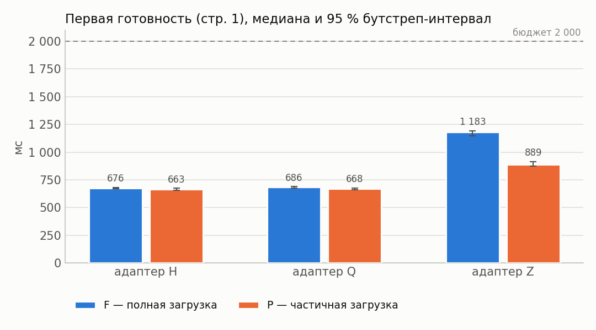

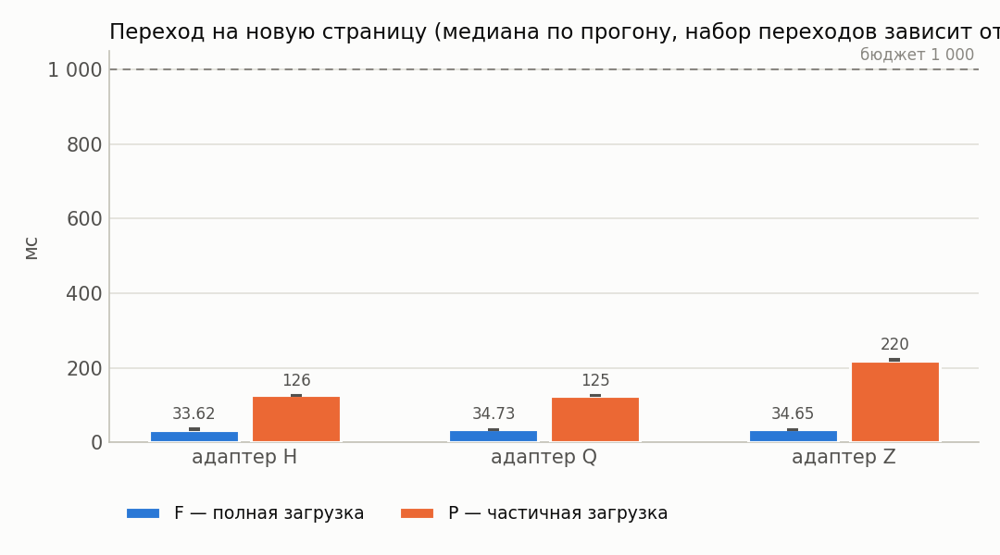

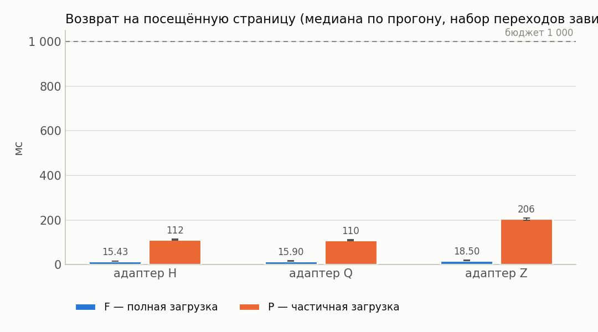

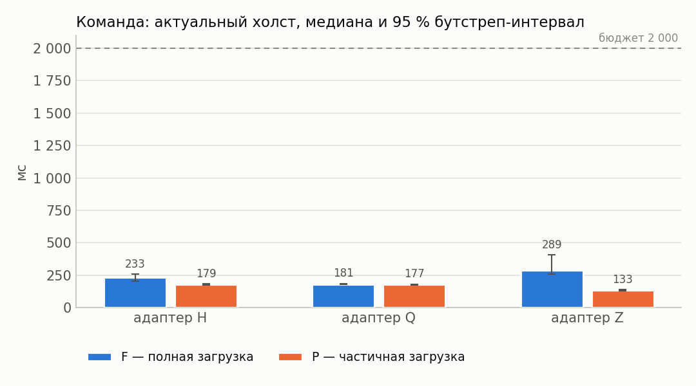

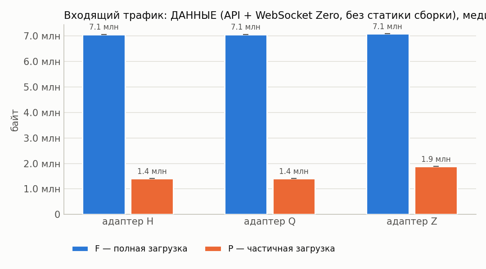

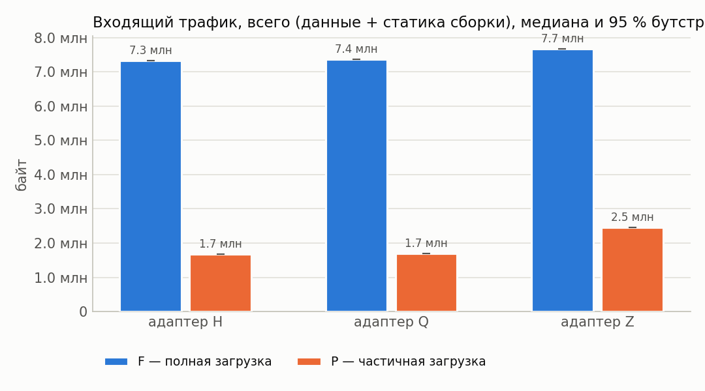

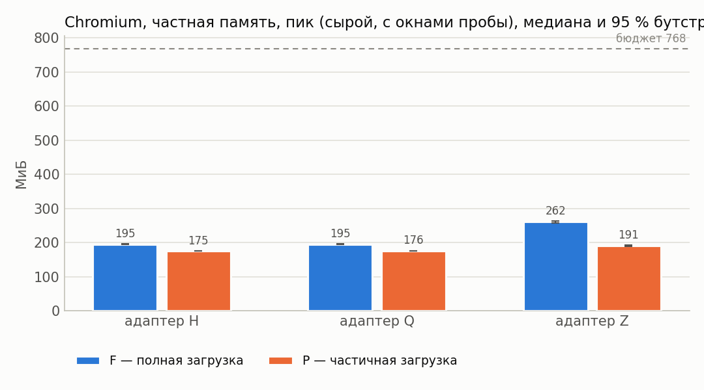

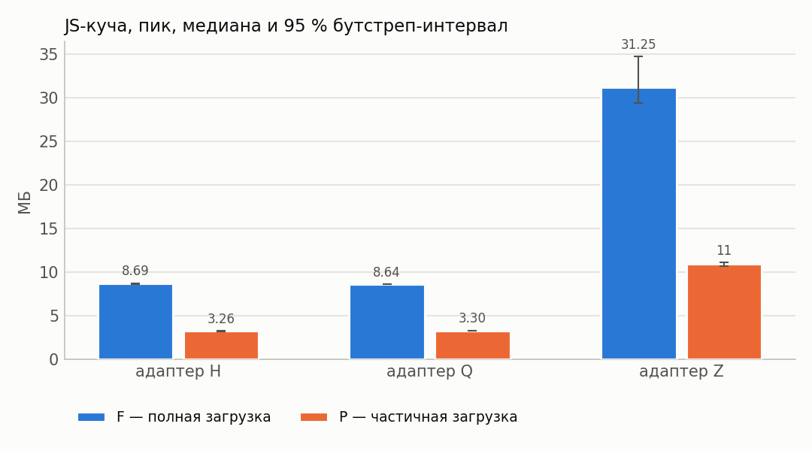

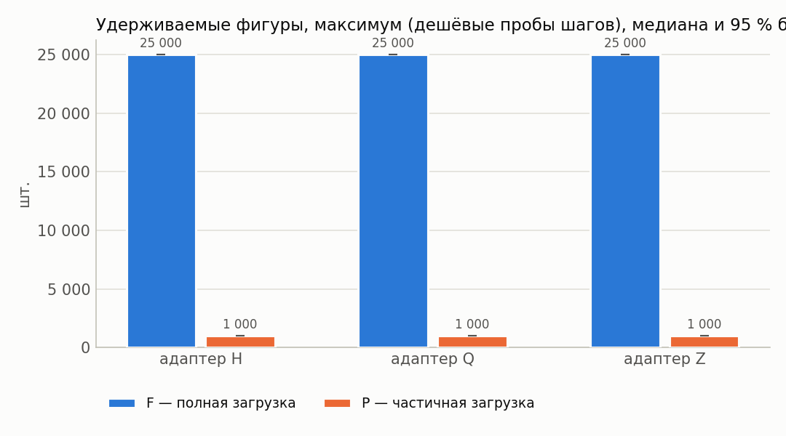

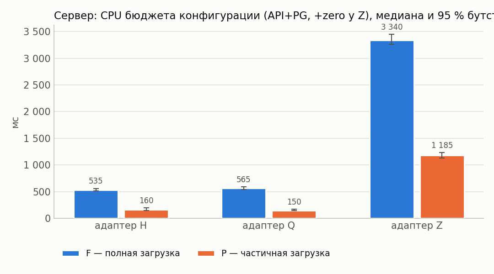

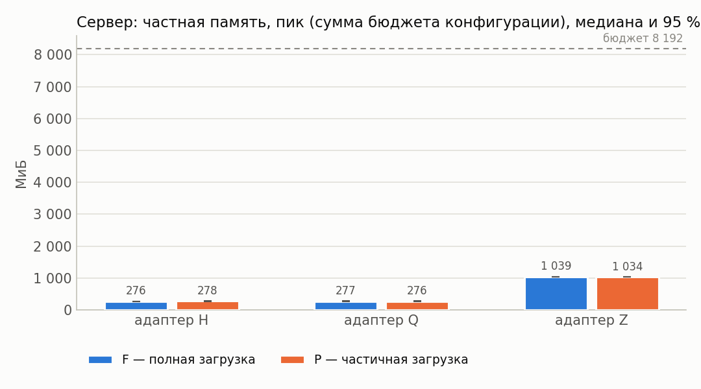

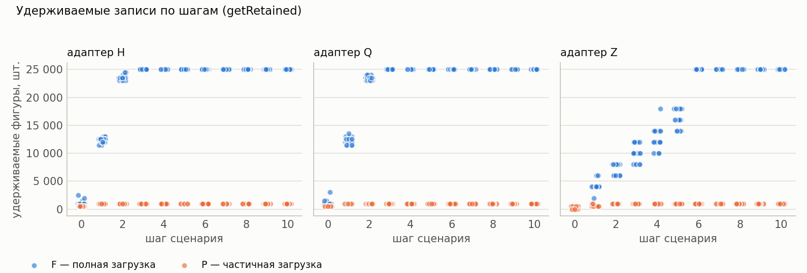

## 12. Выводы

* Оценки изменения P−F ниже — **парные** (медиана поблочных разностей, блок = повторение).
* Все бюджеты §7.4 выполнены для конфигураций: H/F, H/P (cache=1), Q/F, Q/P (cache=1), Z/F, Z/P (cache=1).
* H, cache=1: в режиме P первая готовность на 2 % меньше, чем в F (P/F = 0.98, 95 % интервал [0.97; 1.00]; интервал Δ содержит 0 — различие не подтверждено).
* Q, cache=1: в режиме P первая готовность на 1 % меньше, чем в F (P/F = 0.99, 95 % интервал [0.97; 1.01]; интервал Δ содержит 0 — различие не подтверждено).
* Z, cache=1: в режиме P первая готовность на 23 % меньше, чем в F (P/F = 0.77, 95 % интервал [0.74; 0.79]; интервал Δ не содержит 0).
* H, cache=1: в режиме P пик частной памяти Chromium на 10 % меньше, чем в F (P/F = 0.90, 95 % интервал [0.89; 0.90]; интервал Δ не содержит 0).
* Q, cache=1: в режиме P пик частной памяти Chromium на 10 % меньше, чем в F (P/F = 0.90, 95 % интервал [0.89; 0.90]; интервал Δ не содержит 0).
* Z, cache=1: в режиме P пик частной памяти Chromium на 26 % меньше, чем в F (P/F = 0.74, 95 % интервал [0.72; 0.74]; интервал Δ не содержит 0).
* H, cache=1: в режиме P входящий трафик на 77 % меньше, чем в F (P/F = 0.23, 95 % интервал [0.23; 0.23]; интервал Δ не содержит 0).
* Q, cache=1: в режиме P входящий трафик на 77 % меньше, чем в F (P/F = 0.23, 95 % интервал [0.23; 0.23]; интервал Δ не содержит 0).
* Z, cache=1: в режиме P входящий трафик на 68 % меньше, чем в F (P/F = 0.32, 95 % интервал [0.32; 0.32]; интервал Δ не содержит 0).
* H, cache=1: в режиме P максимум удерживаемых фигур на 96 % меньше, чем в F (P/F = 0.04, 95 % интервал [0.04; 0.04]; интервал Δ не содержит 0).
* Q, cache=1: в режиме P максимум удерживаемых фигур на 96 % меньше, чем в F (P/F = 0.04, 95 % интервал [0.04; 0.04]; интервал Δ не содержит 0).
* Z, cache=1: в режиме P максимум удерживаемых фигур на 96 % меньше, чем в F (P/F = 0.04, 95 % интервал [0.04; 0.04]; интервал Δ не содержит 0).
* H, cache=1: в режиме P переход на новую страницу на 273 % больше, чем в F (P/F = 3.73, 95 % интервал [3.48; 3.84]; интервал Δ не содержит 0).
* Q, cache=1: в режиме P переход на новую страницу на 262 % больше, чем в F (P/F = 3.62, 95 % интервал [3.49; 3.81]; интервал Δ не содержит 0).
* Z, cache=1: в режиме P переход на новую страницу на 530 % больше, чем в F (P/F = 6.30, 95 % интервал [6.19; 6.57]; интервал Δ не содержит 0).
* Перекрёстная проверка обмена сошлась во всех конфигурациях (наибольшее расхождение шейпера и суммы CDP HTTP+WebSocket — 0.1 %).
* У конфигураций Z/F, Z/P (cache=1) холст успевает обновиться раньше подтверждения сервера — доставка синхронизацией опережает ответ по HTTP; обе величины приведены отдельно в разделе 4.
* Точечная доля успеха ≥ 95 %: H/F, H/P (cache=1), Q/F, Q/P (cache=1), Z/F, Z/P (cache=1).
* Нижняя граница интервала Уилсона ниже 95 % для: H/F, H/P (cache=1), Q/F, Q/P (cache=1), Z/F, Z/P (cache=1). При n < 73 прогонов она не достигает 95 % даже без единого отказа, поэтому здесь это ограничение объёма серии, а не свидетельство ненадёжности; при наличии отказов — см. раздел «Ошибки».
* Условия применимости частичной загрузки: режим P оправдан, когда его выигрыш по первой готовности/памяти/трафику подтверждён интервалом (не содержащим 0) и при этом переходы на новые страницы и команда до холста остаются в бюджете, а удерживаемые записи не выходят за объявленное окно.
