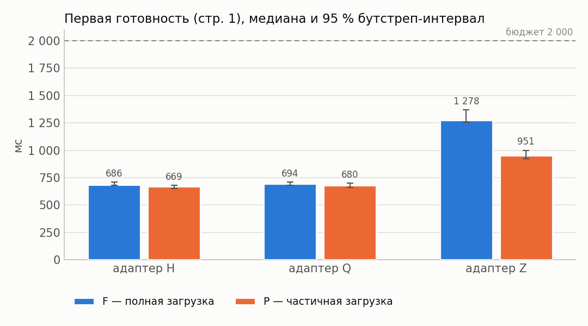
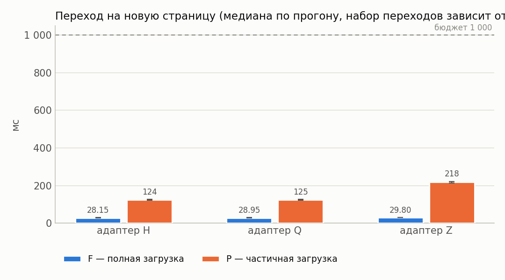
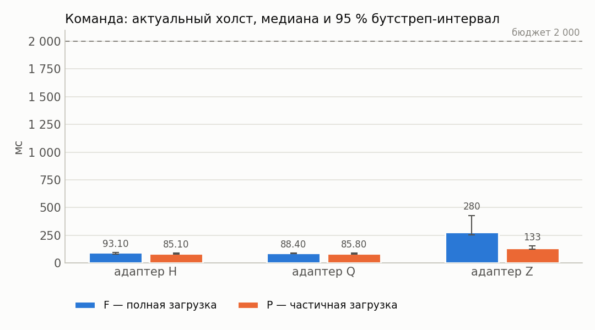
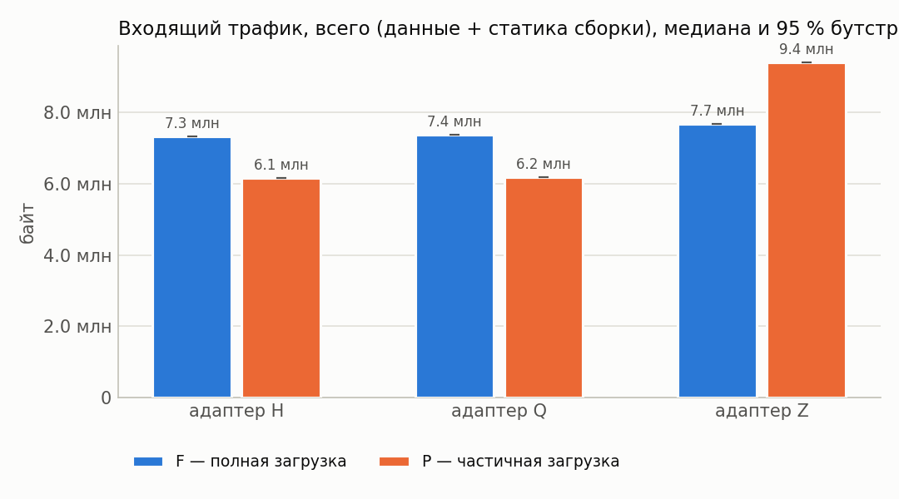
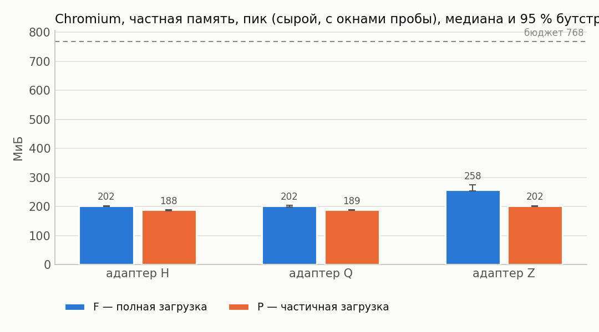
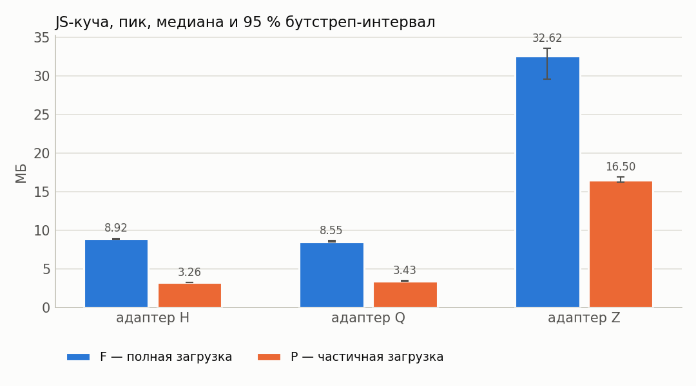
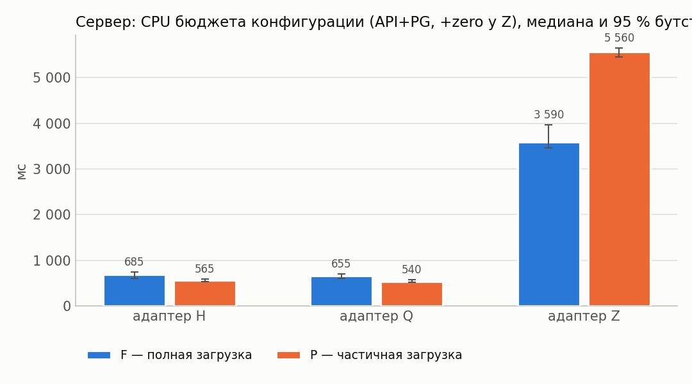
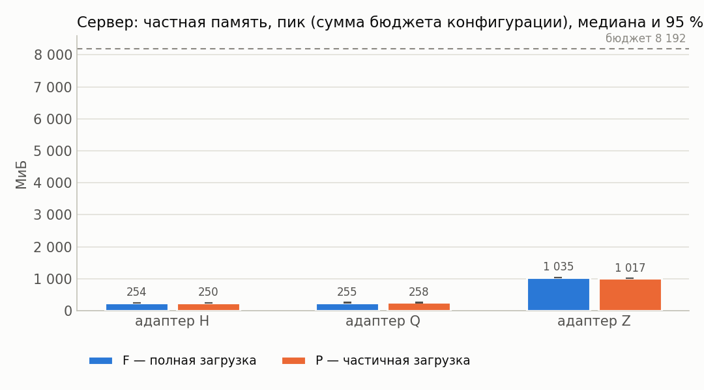
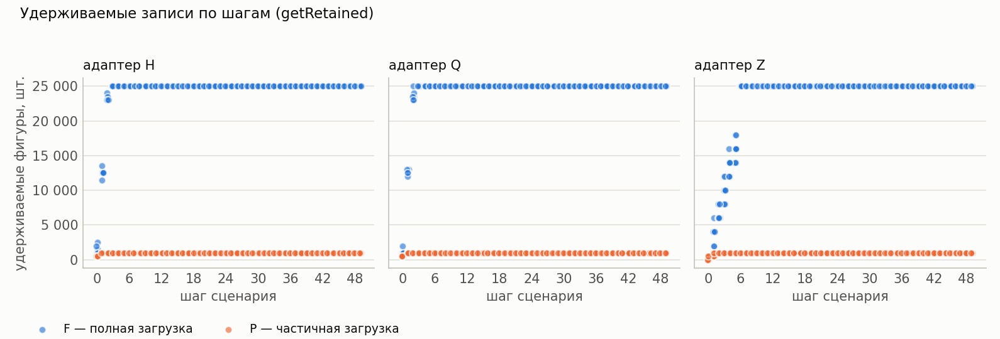

# Результаты серии «route-full»

Сформировано 2026-09-14 02:48 UTC из `../../results/route-full/runs.csv` (60 прогонов, 6 конфигураций). Бутстреп: 2000 ресемплов, seed=42, перцентильные 95 % интервалы. Времена и ресурсы считаются по прогонам с `outcome=ok`; доли — по всем начатым прогонам.

**Определения статистик** (одинаковы во всех таблицах): медиана — обычная выборочная; p95 — перцентиль по линейной интерполяции порядковых статистик (`numpy.percentile`, тип 7), при n = 30 это интерполяция между 29‑м и 30‑м значением, поэтому p95 не превышает максимум выборки и при малых n смещён вниз; интервалы медианы и p95 — перцентильный бутстреп по одной матрице ресемплов (согласованы между собой); доли — интервал Уилсона 95 % без поправки на непрерывность; при n < 8 интервалы помечены † как ненадёжные, при n < 2 не строятся.

Проверка схемы: OK — rows=60

## 1. Паспорт серии

| Параметр | Значение |
|---|---|
| `series` | route-full |
| `startedAt` | 2026-09-13T23:42:39.125Z |
| `finishedAt` | 2026-09-14T00:43:12.283Z |
| `host` | {"hostname": "vm", "os": "Linux 6.18.44-fc-v24", "platform": "linux", "arch": "x64", "kernel": "6.18.44-fc-v24", "distro": "Ubuntu 24.04.4 LTS", "cpuModel": "Intel(R) Xeon(R) Processor @ 2.80GHz", "cp |
| `versions` | {"node": "v24.21.0", "npm": "11.19.0", "postgres": "psql (PostgreSQL) 16.13 (Ubuntu 16.13-0ubuntu0.24.04.1)", "chromium": "141.0.7390.37", "playwright": "1.56.0", "zero": "1.9.0", "reactQuery": "5.102 |
| `packages` | {"playwright": "1.56.0", "@types/node": "24.13.4", "typescript": "5.9.3", "ws": "8.21.3", "@rocicorp/zero": "1.9.0", "@tanstack/react-query": "5.102.8", "react": "19.3.0", "react-dom": "19.3.0", "@typ |
| `packagesHoistedDifferent` | {"postgres": "3.4.7", "@fastify/cors": "10.1.0"} |
| `workspacePackages` | {"packages/bench": {"playwright": "1.56.0", "@types/node": "24.13.4", "typescript": "5.9.3", "ws": "8.21.3"}, "packages/client": {"@rocicorp/zero": "1.9.0", "@tanstack/react-query": "5.102.8", "react" |
| `lockfileVersion` | 3 |
| `shaper` | {"delayMs": 25, "bandwidthMbit": 20, "handshakeRtt": true, "statsUrl": "http://127.0.0.1:8081", "effective": {"delayMs": 25, "bandwidthMbit": 20, "bucketMs": 20, "segmentBytes": 4096, "bucketBytes": 5 |
| `seed` | 20260911 |
| `repetitions` | 10 |
| `configs` | [{"adapter": "H", "mode": "F", "cache": 1}, {"adapter": "H", "mode": "P", "cache": 1}, {"adapter": "Q", "mode": "F", "cache": 1}, {"adapter": "Q", "mode": "P", "cache": 1}, {"adapter": "Z", "mode": "F |
| `seriesConfig` | {"name": "route-full", "doc": "doc-acc-50x500", "sourceId": "doc-acc-50x500-src-1", "fill": "#1e90ff", "docJson": "data/acceptance.json", "configs": [{"adapter": "H", "mode": "F", "cache": 1}, {"adapt |
| `procGroups` | [{"name": "api", "pidFile": "/home/claude/stand/results/logs/api.pid", "exclude": ["netshaper", "zero-cache"]}, {"name": "pg", "patterns": ["(^\|/)postgres .*16/main", "^postgres: 16/main"], "exclude": |
| `browser` | {"channel": "chromium", "args": ["--disable-extensions"], "headless": true, "viewport": {"width": 1280, "height": 800}} |
| `scenario` | {"route": [2, 3, 4, 5, 6, 7, 8, 9, 10, 11, 12, 13, 14, 15, 16, 17, 18, 19, 20, 21, 22, 23, 24, 25, 26, 27, 28, 29, 30, 31, 32, 33, 34, 35, 36, 37, 38, 39, 40, 41, 42, 43, 44, 45, 46, 47, 48, 49, 50],  |
| `plan` | [{"run_id": "route-full-0000-QP1", "order_index": 0, "repetition": 0, "adapter": "Q", "mode": "P", "cache": 1}, {"run_id": "route-full-0001-ZP1", "order_index": 1, "repetition": 0, "adapter": "Z", "mo |
| `client` | {"dist": [{"path": "adapter-settings.json", "bytes": 1004, "mtime": "2026-09-13T19:30:30.755Z", "sha256": "5d7d9af8420141ebb66ea6894d26792039f489306b9ba46bfea9900ef01071b1"}, {"path": "assets/h-BRsLg0 |
| `adapters` | {"available": true, "source": "packages/client/dist/adapter-settings.json", "generatedFrom": ["packages/client/src/adapters/types.ts → ADAPTER_SETTINGS", "packages/client/src/adapters/settings.ts → Z_ |
| `api` | {"url": "http://127.0.0.1:3000", "available": true, "logLevel": "warn", "health": {"status": "ok", "db": "ok", "uptimeSec": 55162, "testHooks": true, "logLevel": "warn", "now": "2026-09-13T23:42:40.19 |
| `zero` | {"config": {"pid": 1025, "env": {"ZERO_QUERY_URL": "http://127.0.0.1:3000/api/zero/query", "NODE_OPTIONS": "--max-old-space-size=8192 --import=/home/claude/stand/scripts/zero-ipv4-shim.mjs", "ZERO_ENA |
| `commit` | None |
| `code` | {"commit": null, "isGitRepo": false, "dirty": null, "codeId": "4bb9e4465904a250bc72d8338d19363855cfe7f827b12662d8600f4f90ee5917", "clientBuildId": "e8d6c0b226b1ac5d27bc8bd39b66d2b5bc2aab491b4d5f8e554c |
| `harness` | {"harnessId": "f9124ac37a30d3f6c56ee2a0e98a05f8be36f7863c8e9aab8afd69c6fcc33557", "harnessIdShort": "f9124ac37a30d3f6", "benchId": "8e1bdf1d09f201b6d42ff58f62fccfc4be22cd53ac554a5dd2aeb14ed5a99ccf", " |
| `preSeriesChecks` | {"at": "2026-09-13T23:42:40.432Z", "samplers": {"ok": true, "groups": [{"group": "api", "needed": true, "processes": 1, "pids": [984], "verdict": "ok", "spec": "pidFile=/home/claude/stand/results/logs |
| `runsExecutedNow` | 60 |
| `runsExecutedTotal` | 60 |
| `runsOk` | 60 |
| `runsTotalPlanned` | 60 |

## 2. Состав серии и доля успеха

Успех прогона = `outcome=ok` ∧ `t_scenario ≤ 70 с (бюджет серии, объявлен в паспорте; §1.2 задаёт 30 с для маршрута §7.2 из 11 действий)` ∧ все проверки эталона прошли (SPEC §7.3).

Доли считаются по **всем** начатым прогонам конфигурации (ошибка и таймаут = неуспех); сводки времени и ресурсов ниже — только по прогонам `outcome=ok`.

| Конфигурация | Прогонов | ok | error | timeout | эталон ✓ | ok, но эталон ✗ | успех | Доля успеха [Уилсон 95 %] |
|---|---|---|---|---|---|---|---|---|
| H/F | 10 | 10 | 0 | 0 | 10 | 0 | 10 | 100.0 % [72.2 %; 100.0 %] |
| H/P (cache=1) | 10 | 10 | 0 | 0 | 10 | 0 | 10 | 100.0 % [72.2 %; 100.0 %] |
| Q/F | 10 | 10 | 0 | 0 | 10 | 0 | 10 | 100.0 % [72.2 %; 100.0 %] |
| Q/P (cache=1) | 10 | 10 | 0 | 0 | 10 | 0 | 10 | 100.0 % [72.2 %; 100.0 %] |
| Z/F | 10 | 10 | 0 | 0 | 10 | 0 | 10 | 100.0 % [72.2 %; 100.0 %] |
| Z/P (cache=1) | 10 | 10 | 0 | 0 | 10 | 0 | 10 | 100.0 % [72.2 %; 100.0 %] |

## 3. Сводные показатели по конфигурациям

Для каждого показателя приводятся n, медиана с 95 % перцентильным бутстреп‑интервалом, p95 (линейная интерполяция порядковых статистик) с таким же интервалом, min и max. Знак † — интервал построен по n < 8 наблюдениям и ненадёжен; «—» вместо интервала — n < 2, интервал не определён.

### 3.1 Время

**Первая готовность (стр. 1), мс**

| Конфигурация | n | Медиана | 95 % ИД медианы | p95 | 95 % ИД p95 | min | max |
|---|---|---|---|---|---|---|---|
| H/F | 10 | 686 | [680; 708] | 716 | [697; 720] | 663 | 720 |
| H/P (cache=1) | 10 | 669 | [653; 680] | 699 | [673; 711] | 634 | 711 |
| Q/F | 10 | 694 | [682; 709] | 730 | [700; 740] | 665 | 740 |
| Q/P (cache=1) | 10 | 680 | [663; 700] | 723 | [692; 740] | 652 | 740 |
| Z/F | 10 | 1 278 | [1 253; 1 368] | 1 403 | [1 330; 1 431] | 1 138 | 1 431 |
| Z/P (cache=1) | 10 | 951 | [923; 999] | 1 030 | [969; 1 030] | 906 | 1 030 |

**Переход на новую страницу (медиана по прогону, набор переходов зависит от маршрута серии), мс**

| Конфигурация | n | Медиана | 95 % ИД медианы | p95 | 95 % ИД p95 | min | max |
|---|---|---|---|---|---|---|---|
| H/F | 10 | 28 | [28; 29] | 30 | [28; 30] | 27 | 30 |
| H/P (cache=1) | 10 | 124 | [121; 126] | 127 | [125; 127] | 121 | 127 |
| Q/F | 10 | 29 | [28; 30] | 31 | [30; 31] | 28 | 31 |
| Q/P (cache=1) | 10 | 125 | [123; 126] | 128 | [126; 128] | 121 | 128 |
| Z/F | 10 | 30 | [29; 31] | 31 | [30; 31] | 29 | 31 |
| Z/P (cache=1) | 10 | 218 | [213; 222] | 227 | [219; 228] | 208 | 228 |

**Команда: подтверждение транспорта (Z — .server, H/Q — ответ POST), мс**

| Конфигурация | n | Медиана | 95 % ИД медианы | p95 | 95 % ИД p95 | min | max |
|---|---|---|---|---|---|---|---|
| H/F | 10 | 76 | [67; 79] | 84 | [78; 89] | 64 | 89 |
| H/P (cache=1) | 10 | 73 | [70; 74] | 77 | [74; 78] | 68 | 78 |
| Q/F | 10 | 68 | [66; 71] | 72 | [70; 72] | 62 | 72 |
| Q/P (cache=1) | 10 | 68 | [65; 74] | 79 | [71; 81] | 62 | 81 |
| Z/F | 10 | 258 | [223; 411] | 608 | [320; 698] | 164 | 698 |
| Z/P (cache=1) | 10 | 118 | [114; 138] | 149 | [130; 154] | 112 | 154 |

**Команда: подтверждение сервера (результат операции), мс**

| Конфигурация | n | Медиана | 95 % ИД медианы | p95 | 95 % ИД p95 | min | max |
|---|---|---|---|---|---|---|---|
| H/F | 10 | 76 | [67; 79] | 84 | [77; 89] | 64 | 89 |
| H/P (cache=1) | 10 | 73 | [70; 75] | 77 | [74; 78] | 68 | 78 |
| Q/F | 10 | 68 | [66; 71] | 72 | [70; 73] | 62 | 73 |
| Q/P (cache=1) | 10 | 68 | [65; 74] | 79 | [73; 81] | 63 | 81 |
| Z/F | 10 | 325 | [296; 475] | 684 | [402; 780] | 244 | 780 |
| Z/P (cache=1) | 10 | 181 | [174; 199] | 207 | [184; 213] | 173 | 213 |

**Команда: цена протокола подтверждения (ack − транспорт), мс**

| Конфигурация | n | Медиана | 95 % ИД медианы | p95 | 95 % ИД p95 | min | max |
|---|---|---|---|---|---|---|---|
| H/F | 10 | 0 | [0; 0] | 0 | [0; 0] | 0 | 0 |
| H/P (cache=1) | 10 | 0 | [0; 0] | 0 | [0; 0] | 0 | 0 |
| Q/F | 10 | 0 | [0; 0] | 0 | [0; 0] | 0 | 0 |
| Q/P (cache=1) | 10 | 0 | [0; 0] | 0 | [0; 0] | 0 | 0 |
| Z/F | 10 | 70 | [64; 80] | 82 | [74; 82] | 62 | 82 |
| Z/P (cache=1) | 10 | 60 | [58; 61] | 65 | [60; 68] | 57 | 68 |

**Команда: данные в хранилище активной страницы, мс**

| Конфигурация | n | Медиана | 95 % ИД медианы | p95 | 95 % ИД p95 | min | max |
|---|---|---|---|---|---|---|---|
| H/F | 10 | 80 | [71; 83] | 88 | [82; 93] | 67 | 93 |
| H/P (cache=1) | 10 | 74 | [71; 76] | 79 | [76; 80] | 69 | 80 |
| Q/F | 10 | 78 | [73; 80] | 82 | [79; 82] | 72 | 82 |
| Q/P (cache=1) | 10 | 70 | [67; 76] | 81 | [74; 83] | 64 | 83 |
| Z/F | 10 | 257 | [223; 411] | 607 | [320; 697] | 164 | 697 |
| Z/P (cache=1) | 10 | 118 | [113; 138] | 148 | [124; 154] | 112 | 154 |

**Команда: актуальный холст, мс**

| Конфигурация | n | Медиана | 95 % ИД медианы | p95 | 95 % ИД p95 | min | max |
|---|---|---|---|---|---|---|---|
| H/F | 10 | 93 | [81; 96] | 105 | [95; 112] | 77 | 112 |
| H/P (cache=1) | 10 | 85 | [82; 88] | 91 | [86; 91] | 78 | 91 |
| Q/F | 10 | 88 | [85; 91] | 94 | [90; 96] | 84 | 96 |
| Q/P (cache=1) | 10 | 86 | [79; 89] | 93 | [87; 96] | 75 | 96 |
| Z/F | 10 | 280 | [253; 429] | 625 | [339; 712] | 179 | 712 |
| Z/P (cache=1) | 10 | 133 | [126; 152] | 164 | [135; 173] | 121 | 173 |

**Переход, медиана всех переходов прогона (маршрут любой длины), мс**

| Конфигурация | n | Медиана | 95 % ИД медианы | p95 | 95 % ИД p95 | min | max |
|---|---|---|---|---|---|---|---|
| H/F | 10 | 28 | [28; 29] | 30 | [28; 30] | 27 | 30 |
| H/P (cache=1) | 10 | 124 | [121; 126] | 127 | [125; 127] | 121 | 127 |
| Q/F | 10 | 29 | [28; 30] | 31 | [30; 31] | 28 | 31 |
| Q/P (cache=1) | 10 | 125 | [123; 126] | 128 | [125; 128] | 121 | 128 |
| Z/F | 10 | 30 | [29; 31] | 31 | [30; 31] | 29 | 31 |
| Z/P (cache=1) | 10 | 218 | [213; 222] | 227 | [219; 228] | 208 | 228 |

**Сценарий целиком (с паузами, без проб оболочки), мс**

| Конфигурация | n | Медиана | 95 % ИД медианы | p95 | 95 % ИД p95 | min | max |
|---|---|---|---|---|---|---|---|
| H/F | 10 | 52 271 | [52 240; 52 321] | 52 370 | [52 291; 52 383] | 52 226 | 52 383 |
| H/P (cache=1) | 10 | 56 877 | [56 803; 57 003] | 57 017 | [56 953; 57 025] | 56 705 | 57 025 |
| Q/F | 10 | 52 324 | [52 275; 52 411] | 52 457 | [52 359; 52 488] | 52 239 | 52 488 |
| Q/P (cache=1) | 10 | 56 915 | [56 837; 57 062] | 57 069 | [56 959; 57 073] | 56 781 | 57 073 |
| Z/F | 10 | 53 290 | [53 194; 53 460] | 53 678 | [53 314; 53 781] | 52 975 | 53 781 |
| Z/P (cache=1) | 10 | 62 086 | [61 891; 62 358] | 62 635 | [62 273; 62 815] | 61 783 | 62 815 |

**Сценарий целиком, сырое время (с пробами оболочки), мс**

| Конфигурация | n | Медиана | 95 % ИД медианы | p95 | 95 % ИД p95 | min | max |
|---|---|---|---|---|---|---|---|
| H/F | 10 | 52 352 | [52 322; 52 410] | 52 449 | [52 380; 52 462] | 52 316 | 52 462 |
| H/P (cache=1) | 10 | 56 950 | [56 888; 57 068] | 57 105 | [57 024; 57 109] | 56 793 | 57 109 |
| Q/F | 10 | 52 403 | [52 365; 52 490] | 52 554 | [52 451; 52 589] | 52 336 | 52 589 |
| Q/P (cache=1) | 10 | 57 006 | [56 938; 57 119] | 57 136 | [57 053; 57 140] | 56 882 | 57 140 |
| Z/F | 10 | 53 739 | [53 579; 54 157] | 54 832 | [53 829; 55 116] | 53 270 | 55 116 |
| Z/P (cache=1) | 10 | 62 180 | [62 000; 62 450] | 62 728 | [62 349; 62 902] | 61 882 | 62 902 |

**Пробы оболочки сверх объявленных пауз, мс**

| Конфигурация | n | Медиана | 95 % ИД медианы | p95 | 95 % ИД p95 | min | max |
|---|---|---|---|---|---|---|---|
| H/F | 10 | 80 | [78; 91] | 96 | [86; 96] | 76 | 96 |
| H/P (cache=1) | 10 | 85 | [75; 92] | 98 | [88; 100] | 62 | 100 |
| Q/F | 10 | 90 | [73; 100] | 108 | [97; 113] | 70 | 113 |
| Q/P (cache=1) | 10 | 86 | [70; 97] | 103 | [92; 105] | 54 | 105 |
| Z/F | 10 | 497 | [360; 630] | 1 227 | [555; 1 655] | 189 | 1 655 |
| Z/P (cache=1) | 10 | 90 | [85; 99] | 100 | [95; 100] | 67 | 100 |

### 3.2 Объём обмена

**Головная величина обмена — «только данные»** (`bytes_in_data`: API + кадры синхронизации Zero). Полный `bytes_in` включает статику сборки — поадаптерную константу, одинаковую в F и в P, поэтому в отношениях P/F она искажает сравнение (`docs/DEVIATIONS.md` §3.1). Оба числа приводятся рядом, разложение — ниже.

**Входящий трафик: ДАННЫЕ (API + WebSocket Zero, без статики сборки), байт**

| Конфигурация | n | Медиана | 95 % ИД медианы | p95 | 95 % ИД p95 | min | max |
|---|---|---|---|---|---|---|---|
| H/F | 10 | 7 066 121 | [7 066 121; 7 066 121] | 7 066 121 | [7 066 121; 7 066 121] | 7 066 121 | 7 066 121 |
| H/P (cache=1) | 10 | 5 887 995 | [5 887 995; 5 887 995] | 5 887 995 | [5 887 995; 5 887 995] | 5 887 995 | 5 887 995 |
| Q/F | 10 | 7 066 121 | [7 066 121; 7 066 121] | 7 066 121 | [7 066 121; 7 066 121] | 7 066 121 | 7 066 121 |
| Q/P (cache=1) | 10 | 5 887 995 | [5 887 995; 5 887 995] | 5 887 995 | [5 887 995; 5 887 995] | 5 887 995 | 5 887 995 |
| Z/F | 10 | 7 098 138 | [7 098 138; 7 098 138] | 7 098 138 | [7 098 138; 7 098 138] | 7 095 456 | 7 098 138 |
| Z/P (cache=1) | 10 | 8 825 072 | [8 825 072; 8 825 072] | 8 825 072 | [8 825 072; 8 825 072] | 8 825 072 | 8 825 072 |

**Входящий трафик, всего (данные + статика сборки), байт**

| Конфигурация | n | Медиана | 95 % ИД медианы | p95 | 95 % ИД p95 | min | max |
|---|---|---|---|---|---|---|---|
| H/F | 10 | 7 326 515 | [7 326 515; 7 326 515] | 7 326 515 | [7 326 515; 7 326 515] | 7 326 515 | 7 326 515 |
| H/P (cache=1) | 10 | 6 148 389 | [6 148 389; 6 148 389] | 6 148 389 | [6 148 389; 6 148 389] | 6 148 389 | 6 148 389 |
| Q/F | 10 | 7 357 527 | [7 357 527; 7 357 527] | 7 357 527 | [7 357 527; 7 357 527] | 7 357 527 | 7 357 527 |
| Q/P (cache=1) | 10 | 6 179 401 | [6 179 401; 6 179 401] | 6 179 401 | [6 179 401; 6 179 401] | 6 179 401 | 6 179 401 |
| Z/F | 10 | 7 670 662 | [7 670 662; 7 670 662] | 7 670 662 | [7 670 662; 7 670 662] | 7 667 980 | 7 670 662 |
| Z/P (cache=1) | 10 | 9 397 596 | [9 397 596; 9 397 596] | 9 397 596 | [9 397 596; 9 397 596] | 9 397 596 | 9 397 596 |

**Статика сборки за прогон (поадаптерная константа), байт**

| Конфигурация | n | Медиана | 95 % ИД медианы | p95 | 95 % ИД p95 | min | max |
|---|---|---|---|---|---|---|---|
| H/F | 10 | 260 394 | [260 394; 260 394] | 260 394 | [260 394; 260 394] | 260 394 | 260 394 |
| H/P (cache=1) | 10 | 260 394 | [260 394; 260 394] | 260 394 | [260 394; 260 394] | 260 394 | 260 394 |
| Q/F | 10 | 291 406 | [291 406; 291 406] | 291 406 | [291 406; 291 406] | 291 406 | 291 406 |
| Q/P (cache=1) | 10 | 291 406 | [291 406; 291 406] | 291 406 | [291 406; 291 406] | 291 406 | 291 406 |
| Z/F | 10 | 572 524 | [572 524; 572 524] | 572 524 | [572 524; 572 524] | 572 524 | 572 524 |
| Z/P (cache=1) | 10 | 572 524 | [572 524; 572 524] | 572 524 | [572 524; 572 524] | 572 524 | 572 524 |

**Исходящий трафик: данные (без статики), байт**

| Конфигурация | n | Медиана | 95 % ИД медианы | p95 | 95 % ИД p95 | min | max |
|---|---|---|---|---|---|---|---|
| H/F | 10 | 51 285 | [51 285; 51 285] | 51 285 | [51 285; 51 285] | 51 285 | 51 285 |
| H/P (cache=1) | 10 | 43 157 | [43 157; 43 157] | 43 157 | [43 157; 43 157] | 43 157 | 43 157 |
| Q/F | 10 | 51 285 | [51 285; 51 285] | 51 285 | [51 285; 51 285] | 51 285 | 51 285 |
| Q/P (cache=1) | 10 | 43 157 | [43 157; 43 157] | 43 157 | [43 157; 43 157] | 43 157 | 43 157 |
| Z/F | 10 | 12 814 | [12 808; 12 814] | 12 814 | [12 814; 12 814] | 12 802 | 12 814 |
| Z/P (cache=1) | 10 | 16 384 | [16 372; 16 384] | 16 384 | [16 384; 16 384] | 16 370 | 16 384 |

**Исходящий трафик, всего (шейпер), байт**

| Конфигурация | n | Медиана | 95 % ИД медианы | p95 | 95 % ИД p95 | min | max |
|---|---|---|---|---|---|---|---|
| H/F | 10 | 55 370 | [55 370; 55 370] | 55 370 | [55 370; 55 370] | 55 370 | 55 370 |
| H/P (cache=1) | 10 | 47 242 | [47 242; 47 242] | 47 242 | [47 242; 47 242] | 47 242 | 47 242 |
| Q/F | 10 | 55 370 | [55 370; 55 370] | 55 370 | [55 370; 55 370] | 55 370 | 55 370 |
| Q/P (cache=1) | 10 | 47 242 | [47 242; 47 242] | 47 242 | [47 242; 47 242] | 47 242 | 47 242 |
| Z/F | 10 | 16 956 | [16 950; 16 957] | 16 957 | [16 957; 16 957] | 16 945 | 16 957 |
| Z/P (cache=1) | 10 | 20 527 | [20 515; 20 527] | 20 527 | [20 527; 20 527] | 20 513 | 20 527 |

**Входящий трафик (CDP, перекрёстная проверка), байт**

| Конфигурация | n | Медиана | 95 % ИД медианы | p95 | 95 % ИД p95 | min | max |
|---|---|---|---|---|---|---|---|
| H/F | 10 | 7 326 515 | [7 326 515; 7 326 515] | 7 326 515 | [7 326 515; 7 326 515] | 7 326 515 | 7 326 515 |
| H/P (cache=1) | 10 | 6 148 389 | [6 148 389; 6 148 389] | 6 148 389 | [6 148 389; 6 148 389] | 6 148 389 | 6 148 389 |
| Q/F | 10 | 7 357 527 | [7 357 527; 7 357 527] | 7 357 527 | [7 357 527; 7 357 527] | 7 357 527 | 7 357 527 |
| Q/P (cache=1) | 10 | 6 179 401 | [6 179 401; 6 179 401] | 6 179 401 | [6 179 401; 6 179 401] | 6 179 401 | 6 179 401 |
| Z/F | 10 | 576 646 | [576 646; 576 646] | 576 646 | [576 646; 576 646] | 576 646 | 576 646 |
| Z/P (cache=1) | 10 | 576 646 | [576 646; 576 646] | 576 646 | [576 646; 576 646] | 576 646 | 576 646 |

**Обмен данными против полного объёма**

Источник разложения: колонки оболочки `bytes_in_api` / `bytes_in_zero` / `bytes_in_static`.

Разброс статики внутри конфигурации обязан быть нулевым — это константа сборки, а не измеряемая величина; ненулевой разброс означал бы, что в статику попало что‑то ещё, и его надо разбирать.

| Конфигурация | n | **Данные (API + WS), байт** | Статика сборки, байт | Всего, байт | Доля статики | Разброс статики |
|---|---|---|---|---|---|---|
| H/F | 10‡ | 7 066 121 | 260 394 | 7 326 515 | 3.6 % | 0 |
| H/P (cache=1) | 10‡ | 5 887 995 | 260 394 | 6 148 389 | 4.2 % | 0 |
| Q/F | 10‡ | 7 066 121 | 291 406 | 7 357 527 | 4.0 % | 0 |
| Q/P (cache=1) | 10‡ | 5 887 995 | 291 406 | 6 179 401 | 4.7 % | 0 |
| Z/F | 10‡ | 7 098 138 | 572 524 | 7 670 662 | 7.5 % | 0 |
| Z/P (cache=1) | 10‡ | 8 825 072 | 572 524 | 9 397 596 | 6.1 % | 0 |

**P/F обмена: по полному трафику и по данным** (парная оценка, блок = повторение)

| Адаптер | Пар | Статика, байт | P/F полный (как публиковалось) | **P/F данные (головное)** | Изменилось |
|---|---|---|---|---|---|
| H (cache=1) | 10‡ | 260 394 | 0.839 [0.839; 0.839] | **0.833** [0.833; 0.833] | да, -0.006 |
| Q (cache=1) | 10‡ | 291 406 | 0.840 [0.840; 0.840] | **0.833** [0.833; 0.833] | да, -0.007 |
| Z (cache=1) | 10‡ | 572 524 | 1.225 [1.225; 1.225] | **1.243** [1.243; 1.243] | да, 0.018 |

Последний столбец отвечает на вопрос «какие опубликованные числа двигает вычитание статики»: величина сдвига = P/F(данные) − P/F(полный).

**Полнота разложения: сумма по маршрутам против итога**

Головное число обмена — `bytes_in_data = bytes_in_api + bytes_in_zero`. Оно осмысленно ровно настолько, насколько разложение полное, поэтому проверка идёт **по каждому прогону**, а не по медианам: столбцы «расхождение» — максимум по прогонам конфигурации от |(api + zero + статика + прочее) − итог|, столбцы «остаток» — максимум собственной контрольной колонки оболочки `bytes_*_route_residual`. Ожидаемое значение всех четырёх — ноль.

| Конфигурация | n | Расхождение вход, Б | Расхождение исход, Б | Остаток вход, Б | Остаток исход, Б | Прочее (вход), Б | Сошлось |
|---|---|---|---|---|---|---|---|
| H/F | 10‡ | 0 | 0 | 0 | 0 | 0 | ✓ |
| H/P (cache=1) | 10‡ | 0 | 0 | 0 | 0 | 0 | ✓ |
| Q/F | 10‡ | 0 | 0 | 0 | 0 | 0 | ✓ |
| Q/P (cache=1) | 10‡ | 0 | 0 | 0 | 0 | 0 | ✓ |
| Z/F | 10‡ | 0 | 0 | 0 | 0 | 0 | ✓ |
| Z/P (cache=1) | 10‡ | 0 | 0 | 0 | 0 | 0 | ✓ |

Все конфигурации сошлись побайтно: «данные + статика + прочее» исчерпывают весь наблюдаемый обмен, и головная величина `bytes_in_data` ничего не теряет.

**Перекрёстная проверка трафика (шейпер vs CDP)**

Шейпер считает байты TCP‑полезной нагрузки всех соединений клиента; CDP даёт их двумя счётчиками — `cdp_bytes_in` (`encodedDataLength` HTTP‑ответов) и `cdp_ws_bytes_in` (кадры WebSocket). У H/Q второй счётчик нулевой, у Z по WebSocket идёт почти весь обмен, поэтому сверять нужно **сумму**: сравнение только с `cdp_bytes_in` давало ложный провал у Z (в прежнем `results/smoke/report.md` — Z/F 92.5 %, Z/P 76.6 %).

| Конфигурация | bytes_in (шейпер) | CDP: HTTP | CDP: WebSocket | CDP: сумма | Расхождение | ≤ 10 % |
|---|---|---|---|---|---|---|
| H/F | 7 326 515 | 7 326 515 | 0 | 7 326 515 | 0.0 % | ✓ |
| H/P (cache=1) | 6 148 389 | 6 148 389 | 0 | 6 148 389 | 0.0 % | ✓ |
| Q/F | 7 357 527 | 7 357 527 | 0 | 7 357 527 | 0.0 % | ✓ |
| Q/P (cache=1) | 6 179 401 | 6 179 401 | 0 | 6 179 401 | 0.0 % | ✓ |
| Z/F | 7 670 662 | 576 646 | 7 091 067 | 7 667 713 | 0.0 % | ✓ |
| Z/P (cache=1) | 9 397 596 | 576 646 | 8 817 921 | 9 394 567 | 0.0 % | ✓ |

**Исходящее направление — справочно.** `cdp_bytes_out` не измеряется, а оценивается по `Network.requestWillBeSent` (стартовая строка + известные CDP заголовки + тело) и систематически занижен на заголовки, которые добавляет сетевой стек браузера, и на рукопожатие WebSocket. Расхождение 20–40 % здесь — свойство оценки, а не признак ошибки измерения; в вердикт конфигурации это направление не входит.

| Конфигурация | bytes_out (шейпер) | CDP: сумма (оценка) | Расхождение | ≤ 50 % |
|---|---|---|---|---|
| H/F | 55 370 | 42 794 | 22.7 % | ✓ |
| H/P (cache=1) | 47 242 | 36 406 | 22.9 % | ✓ |
| Q/F | 55 370 | 42 794 | 22.7 % | ✓ |
| Q/P (cache=1) | 47 242 | 36 406 | 22.9 % | ✓ |
| Z/F | 16 956 | 11 881 | 29.9 % | ✓ |
| Z/P (cache=1) | 20 527 | 15 923 | 22.4 % | ✓ |

### 3.3 Память клиента

**Chromium, частная память, пик без окон пробы, МиБ**

| Конфигурация | n | Медиана | 95 % ИД медианы | p95 | 95 % ИД p95 | min | max |
|---|---|---|---|---|---|---|---|
| H/F | 10 | 198.9 | [197.6; 199.7] | 200.9 | [199.3; 201.7] | 196.0 | 201.7 |
| H/P (cache=1) | 10 | 188.0 | [184.8; 188.9] | 189.0 | [188.6; 189.1] | 184.1 | 189.1 |
| Q/F | 10 | 197.1 | [196.2; 199.7] | 200.3 | [198.7; 200.3] | 194.7 | 200.3 |
| Q/P (cache=1) | 10 | 188.7 | [186.8; 189.1] | 189.6 | [188.9; 189.7] | 185.1 | 189.7 |
| Z/F | 10 | 233.1 | [230.5; 247.6] | 252.5 | [242.6; 254.7] | 225.1 | 254.7 |
| Z/P (cache=1) | 10 | 202.1 | [200.9; 203.0] | 203.7 | [202.6; 204.1] | 199.5 | 204.1 |

**Chromium, частная память, пик (сырой, с окнами пробы), МиБ**

| Конфигурация | n | Медиана | 95 % ИД медианы | p95 | 95 % ИД p95 | min | max |
|---|---|---|---|---|---|---|---|
| H/F | 10 | 201.9 | [200.6; 203.0] | 205.0 | [202.4; 206.2] | 198.9 | 206.2 |
| H/P (cache=1) | 10 | 188.4 | [184.8; 189.0] | 189.4 | [188.9; 189.8] | 184.7 | 189.8 |
| Q/F | 10 | 201.5 | [199.0; 204.3] | 205.6 | [203.6; 206.1] | 197.6 | 206.1 |
| Q/P (cache=1) | 10 | 188.8 | [187.2; 189.2] | 189.6 | [189.0; 189.8] | 185.1 | 189.8 |
| Z/F | 10 | 257.7 | [254.0; 274.0] | 275.9 | [258.9; 276.6] | 253.2 | 276.6 |
| Z/P (cache=1) | 10 | 202.1 | [200.9; 202.9] | 203.7 | [202.4; 204.1] | 199.5 | 204.1 |

**Chromium, частная память, конец, МиБ**

| Конфигурация | n | Медиана | 95 % ИД медианы | p95 | 95 % ИД p95 | min | max |
|---|---|---|---|---|---|---|---|
| H/F | 10 | 198.9 | [197.9; 199.7] | 200.9 | [199.3; 201.7] | 196.0 | 201.7 |
| H/P (cache=1) | 10 | 188.0 | [184.8; 188.9] | 189.0 | [188.6; 189.1] | 184.1 | 189.1 |
| Q/F | 10 | 197.1 | [196.5; 200.0] | 200.3 | [198.6; 200.3] | 194.7 | 200.3 |
| Q/P (cache=1) | 10 | 188.7 | [186.8; 189.1] | 189.6 | [188.8; 189.7] | 185.1 | 189.7 |
| Z/F | 10 | 201.3 | [200.4; 202.0] | 203.4 | [201.5; 204.4] | 199.2 | 204.4 |
| Z/P (cache=1) | 10 | 189.4 | [189.2; 189.8] | 190.2 | [189.7; 190.4] | 188.4 | 190.4 |

**JS‑куча, пик, МБ**

| Конфигурация | n | Медиана | 95 % ИД медианы | p95 | 95 % ИД p95 | min | max |
|---|---|---|---|---|---|---|---|
| H/F | 10 | 8.9 | [8.8; 9.0] | 9.0 | [9.0; 9.0] | 8.7 | 9.0 |
| H/P (cache=1) | 10 | 3.3 | [3.3; 3.3] | 3.3 | [3.3; 3.3] | 3.3 | 3.3 |
| Q/F | 10 | 8.6 | [8.5; 8.7] | 8.7 | [8.6; 8.7] | 8.3 | 8.7 |
| Q/P (cache=1) | 10 | 3.4 | [3.4; 3.5] | 3.8 | [3.5; 4.0] | 3.4 | 4.0 |
| Z/F | 10 | 32.6 | [29.6; 33.6] | 38.3 | [33.2; 41.9] | 27.5 | 41.9 |
| Z/P (cache=1) | 10 | 16.5 | [16.3; 17.0] | 17.1 | [16.8; 17.1] | 16.2 | 17.1 |

**JS‑куча, конец, МБ**

| Конфигурация | n | Медиана | 95 % ИД медианы | p95 | 95 % ИД p95 | min | max |
|---|---|---|---|---|---|---|---|
| H/F | 10 | 8.0 | [8.0; 8.0] | 8.0 | [8.0; 8.0] | 8.0 | 8.0 |
| H/P (cache=1) | 10 | 2.9 | [2.9; 2.9] | 2.9 | [2.9; 2.9] | 2.9 | 2.9 |
| Q/F | 10 | 7.8 | [7.8; 7.8] | 7.8 | [7.8; 7.8] | 7.8 | 7.8 |
| Q/P (cache=1) | 10 | 3.1 | [3.1; 3.1] | 3.1 | [3.1; 3.1] | 3.1 | 3.1 |
| Z/F | 10 | 16.3 | [16.2; 16.3] | 16.3 | [16.3; 16.3] | 16.2 | 16.3 |
| Z/P (cache=1) | 10 | 12.6 | [12.4; 12.8] | 13.0 | [12.6; 13.0] | 12.4 | 13.0 |

**JS‑куча после принудительной сборки (остановка часов), МБ**

| Конфигурация | n | Медиана | 95 % ИД медианы | p95 | 95 % ИД p95 | min | max |
|---|---|---|---|---|---|---|---|
| H/F | 10 | 8.0 | [8.0; 8.0] | 8.0 | [8.0; 8.0] | 8.0 | 8.0 |
| H/P (cache=1) | 10 | 2.9 | [2.9; 2.9] | 2.9 | [2.9; 2.9] | 2.9 | 2.9 |
| Q/F | 10 | 7.8 | [7.8; 7.8] | 7.8 | [7.8; 7.8] | 7.8 | 7.8 |
| Q/P (cache=1) | 10 | 3.1 | [3.1; 3.1] | 3.1 | [3.1; 3.1] | 3.1 | 3.1 |
| Z/F | 10 | 16.3 | [16.2; 16.3] | 16.3 | [16.3; 16.3] | 16.2 | 16.3 |
| Z/P (cache=1) | 10 | 12.8 | [12.6; 13.1] | 13.4 | [12.9; 13.5] | 12.4 | 13.5 |

**Принудительных сборок мусора за прогон, шт.**

| Конфигурация | n | Медиана | 95 % ИД медианы | p95 | 95 % ИД p95 | min | max |
|---|---|---|---|---|---|---|---|
| H/F | 10 | 104 | [104; 104] | 104 | [104; 104] | 104 | 104 |
| H/P (cache=1) | 10 | 104 | [104; 104] | 104 | [104; 104] | 104 | 104 |
| Q/F | 10 | 104 | [104; 104] | 104 | [104; 104] | 104 | 104 |
| Q/P (cache=1) | 10 | 104 | [104; 104] | 104 | [104; 104] | 104 | 104 |
| Z/F | 10 | 104 | [104; 104] | 104 | [104; 104] | 104 | 104 |
| Z/P (cache=1) | 10 | 104 | [104; 104] | 104 | [104; 104] | 104 | 104 |

**Постоянное хранилище клиента, байт**

| Конфигурация | n | Медиана | 95 % ИД медианы | p95 | 95 % ИД p95 | min | max |
|---|---|---|---|---|---|---|---|
| H/F | 10 | 0 | [0; 0] | 0 | [0; 0] | 0 | 0 |
| H/P (cache=1) | 10 | 0 | [0; 0] | 0 | [0; 0] | 0 | 0 |
| Q/F | 10 | 0 | [0; 0] | 0 | [0; 0] | 0 | 0 |
| Q/P (cache=1) | 10 | 0 | [0; 0] | 0 | [0; 0] | 0 | 0 |
| Z/F | 10 | 1 789 337 | [1 780 348; 1 791 118] | 2 769 007 | [1 790 097; 3 568 263] | 1 775 748 | 3 568 263 |
| Z/P (cache=1) | 10 | 219 942 | [152 612; 236 521] | 241 469 | [233 746; 244 992] | 152 498 | 244 992 |

**Окна измерительных проб: паритет политики и цена их исключения**

Число окон проб одинаково во всех конфигурациях серии (53) — политика проб к адаптерам не привязана, и пики памяти между ними сравнимы. Историческая колонка `chromium_private_peak_mib` во всех прогонах совпадает с `chromium_private_peak_raw_mib` — сырой пик доступен под обоими именами, и старые таблицы читаются как «пик с окнами пробы».

Длительность окон у адаптеров различается законно: это измеренное свойство адаптера (точный скан хранилища у Z/F дороже), а не нарушение паритета. «Доля выборок в окнах» показывает, какая часть наблюдений исключена из пика без пробы; «покрытие кучи» — доля времени прогона, покрытая опросом JS‑кучи (сэмплер кучи на время скана приостанавливается, поэтому пик кучи читается только вместе с ним).

| Конфигурация | n | Окон проб | Разброс окон | В окнах, мс | Пик сырой, МиБ | **Пик без проб, МиБ** | Разница, МиБ | Доля выборок в окнах | Покрытие кучи |
|---|---|---|---|---|---|---|---|---|---|
| H/F | 10‡ | 53 | 0 | 5 962 | 201.9 | 198.9 | 3.0 | 10.9 % | 1.000 |
| H/P (cache=1) | 10‡ | 53 | 0 | 2 834 | 188.4 | 188.0 | 0.4 | 5.7 % | 1.000 |
| Q/F | 10‡ | 53 | 0 | 6 066 | 201.5 | 197.1 | 4.5 | 11.1 % | 1.000 |
| Q/P (cache=1) | 10‡ | 53 | 0 | 3 125 | 188.8 | 188.7 | 0.1 | 6.7 % | 1.000 |
| Z/F | 10‡ | 53 | 0 | 10 264 | 257.7 | 233.1 | 24.7 | 18.2 % | 0.979 |
| Z/P (cache=1) | 10‡ | 53 | 0 | 5 628 | 202.1 | 202.1 | 0.0 | 9.0 % | 1.000 |

**Паритет давления сборщика мусора**

**Расписание принудительных сборок мусора одинаково у всех конфигураций: 104 вызовов `HeapProfiler.collectGarbage` на прогон.** Точки вызова заданы оболочкой и не зависят ни от адаптера, ни от режима, ни от вида пробы, поэтому `js_heap_peak_mb` и `chromium_private_peak_mib` измерены при одинаковом давлении сборщика и сравнимы между адаптерами (раньше было ≈13 у H/Q против 2–3 у Z/F — дефект N2).

`js_heap_post_gc_mb` — куча сразу после принудительной сборки в фиксированной точке «остановка часов сценария»: величина, не зависящая от момента самопроизвольной сборки, и потому более устойчивая мера удерживаемой памяти, чем пик. `js_heap_suspended_ms` — сколько опрос кучи был приостановлен (два точных скана хранилища и выгрузка снимков); у Z/F больше просто потому, что дороже сам скан.

| Конфигурация | n | `js_heap_gc_count` | `js_heap_peak_mb`, медиана | `js_heap_post_gc_mb`, медиана | `js_heap_suspended_ms`, медиана |
|---|---|---|---|---|---|
| H/F | 10 | 104 | 8.9 | 8.0 | 5 932 |
| H/P (cache=1) | 10 | 104 | 3.3 | 2.9 | 2 823 |
| Q/F | 10 | 104 | 8.6 | 7.8 | 6 028 |
| Q/P (cache=1) | 10 | 104 | 3.4 | 3.1 | 3 100 |
| Z/F | 10 | 104 | 32.6 | 16.3 | 9 736 |
| Z/P (cache=1) | 10 | 104 | 16.5 | 12.8 | 5 541 |

### 3.4 Удерживаемые записи

**Удерживаемые фигуры, максимум (дешёвые пробы шагов), шт.**

| Конфигурация | n | Медиана | 95 % ИД медианы | p95 | 95 % ИД p95 | min | max |
|---|---|---|---|---|---|---|---|
| H/F | 10 | 25 000 | [25 000; 25 000] | 25 000 | [25 000; 25 000] | 25 000 | 25 000 |
| H/P (cache=1) | 10 | 1 000 | [1 000; 1 000] | 1 000 | [1 000; 1 000] | 1 000 | 1 000 |
| Q/F | 10 | 25 000 | [25 000; 25 000] | 25 000 | [25 000; 25 000] | 25 000 | 25 000 |
| Q/P (cache=1) | 10 | 1 000 | [1 000; 1 000] | 1 000 | [1 000; 1 000] | 1 000 | 1 000 |
| Z/F | 10 | 25 000 | [25 000; 25 000] | 25 000 | [25 000; 25 000] | 25 000 | 25 000 |
| Z/P (cache=1) | 10 | 1 000 | [1 000; 1 000] | 1 000 | [1 000; 1 000] | 1 000 | 1 000 |

**Удерживаемые фигуры, конец — точный скан, шт.**

| Конфигурация | n | Медиана | 95 % ИД медианы | p95 | 95 % ИД p95 | min | max |
|---|---|---|---|---|---|---|---|
| H/F | 10 | 25 000 | [25 000; 25 000] | 25 000 | [25 000; 25 000] | 25 000 | 25 000 |
| H/P (cache=1) | 10 | 1 000 | [1 000; 1 000] | 1 000 | [1 000; 1 000] | 1 000 | 1 000 |
| Q/F | 10 | 25 000 | [25 000; 25 000] | 25 000 | [25 000; 25 000] | 25 000 | 25 000 |
| Q/P (cache=1) | 10 | 1 000 | [1 000; 1 000] | 1 000 | [1 000; 1 000] | 1 000 | 1 000 |
| Z/F | 10 | 25 000 | [25 000; 25 000] | 25 000 | [25 000; 25 000] | 25 000 | 25 000 |
| Z/P (cache=1) | 10 | 1 000 | [1 000; 1 000] | 1 000 | [1 000; 1 000] | 1 000 | 1 000 |

**Удерживаемые фигуры, конец, шт.**

| Конфигурация | n | Медиана | 95 % ИД медианы | p95 | 95 % ИД p95 | min | max |
|---|---|---|---|---|---|---|---|
| H/F | 10 | 25 000 | [25 000; 25 000] | 25 000 | [25 000; 25 000] | 25 000 | 25 000 |
| H/P (cache=1) | 10 | 1 000 | [1 000; 1 000] | 1 000 | [1 000; 1 000] | 1 000 | 1 000 |
| Q/F | 10 | 25 000 | [25 000; 25 000] | 25 000 | [25 000; 25 000] | 25 000 | 25 000 |
| Q/P (cache=1) | 10 | 1 000 | [1 000; 1 000] | 1 000 | [1 000; 1 000] | 1 000 | 1 000 |
| Z/F | 10 | 25 000 | [25 000; 25 000] | 25 000 | [25 000; 25 000] | 25 000 | 25 000 |
| Z/P (cache=1) | 10 | 1 000 | [1 000; 1 000] | 1 000 | [1 000; 1 000] | 1 000 | 1 000 |

**Удерживаемые страницы, максимум (дешёвые пробы шагов), шт.**

| Конфигурация | n | Медиана | 95 % ИД медианы | p95 | 95 % ИД p95 | min | max |
|---|---|---|---|---|---|---|---|
| H/F | 10 | 50 | [50; 50] | 50 | [50; 50] | 50 | 50 |
| H/P (cache=1) | 10 | 2 | [2; 2] | 2 | [2; 2] | 2 | 2 |
| Q/F | 10 | 50 | [50; 50] | 50 | [50; 50] | 50 | 50 |
| Q/P (cache=1) | 10 | 2 | [2; 2] | 2 | [2; 2] | 2 | 2 |
| Z/F | 10 | 50 | [50; 50] | 50 | [50; 50] | 50 | 50 |
| Z/P (cache=1) | 10 | 2 | [2; 2] | 2 | [2; 2] | 2 | 2 |

**Удерживаемые страницы, конец — точный скан, шт.**

| Конфигурация | n | Медиана | 95 % ИД медианы | p95 | 95 % ИД p95 | min | max |
|---|---|---|---|---|---|---|---|
| H/F | 10 | 50 | [50; 50] | 50 | [50; 50] | 50 | 50 |
| H/P (cache=1) | 10 | 2 | [2; 2] | 2 | [2; 2] | 2 | 2 |
| Q/F | 10 | 50 | [50; 50] | 50 | [50; 50] | 50 | 50 |
| Q/P (cache=1) | 10 | 2 | [2; 2] | 2 | [2; 2] | 2 | 2 |
| Z/F | 10 | 50 | [50; 50] | 50 | [50; 50] | 50 | 50 |
| Z/P (cache=1) | 10 | 2 | [2; 2] | 2 | [2; 2] | 2 | 2 |

**Удерживаемые страницы, конец, шт.**

| Конфигурация | n | Медиана | 95 % ИД медианы | p95 | 95 % ИД p95 | min | max |
|---|---|---|---|---|---|---|---|
| H/F | 10 | 50 | [50; 50] | 50 | [50; 50] | 50 | 50 |
| H/P (cache=1) | 10 | 2 | [2; 2] | 2 | [2; 2] | 2 | 2 |
| Q/F | 10 | 50 | [50; 50] | 50 | [50; 50] | 50 | 50 |
| Q/P (cache=1) | 10 | 2 | [2; 2] | 2 | [2; 2] | 2 | 2 |
| Z/F | 10 | 50 | [50; 50] | 50 | [50; 50] | 50 | 50 |
| Z/P (cache=1) | 10 | 2 | [2; 2] | 2 | [2; 2] | 2 | 2 |

**Загруженные страницы, конец, шт.**

| Конфигурация | n | Медиана | 95 % ИД медианы | p95 | 95 % ИД p95 | min | max |
|---|---|---|---|---|---|---|---|
| H/F | 10 | 50 | [50; 50] | 50 | [50; 50] | 50 | 50 |
| H/P (cache=1) | 10 | 2 | [2; 2] | 2 | [2; 2] | 2 | 2 |
| Q/F | 10 | 50 | [50; 50] | 50 | [50; 50] | 50 | 50 |
| Q/P (cache=1) | 10 | 2 | [2; 2] | 2 | [2; 2] | 2 | 2 |
| Z/F | 10 | 50 | [50; 50] | 50 | [50; 50] | 50 | 50 |
| Z/P (cache=1) | 10 | 2 | [2; 2] | 2 | [2; 2] | 2 | 2 |

### 3.4.1 Маршрут и повторные чтения

`nav_cache_misses` — переходы, при которых страница уже не удерживалась и её пришлось загружать; считается одинаково у H, Q и Z и потому сравним между всеми тремя адаптерами. `api_page_reads` — прямой счётчик HTTP‑чтений страниц; **у Z он равен нулю по устройству адаптера** (страницы приходят синхронизацией), и это измерение, а не пропуск.

**Переходы с промахом окна (страница требовала загрузки), шт.**

| Конфигурация | n | Медиана | 95 % ИД медианы | p95 | 95 % ИД p95 | min | max |
|---|---|---|---|---|---|---|---|
| H/F | 10 | 0 | [0; 1] | 1 | [0; 1] | 0 | 1 |
| H/P (cache=1) | 10 | 49 | [49; 49] | 49 | [49; 49] | 49 | 49 |
| Q/F | 10 | 0 | [0; 0] | 1 | [0; 1] | 0 | 1 |
| Q/P (cache=1) | 10 | 49 | [49; 49] | 49 | [49; 49] | 49 | 49 |
| Z/F | 10 | 0 | [0; 0] | 0 | [0; 0] | 0 | 0 |
| Z/P (cache=1) | 10 | 49 | [49; 49] | 49 | [49; 49] | 49 | 49 |

**Переходы с попаданием в окно (страница удерживалась), шт.**

| Конфигурация | n | Медиана | 95 % ИД медианы | p95 | 95 % ИД p95 | min | max |
|---|---|---|---|---|---|---|---|
| H/F | 10 | 49 | [48; 49] | 49 | [49; 49] | 48 | 49 |
| H/P (cache=1) | 10 | 0 | [0; 0] | 0 | [0; 0] | 0 | 0 |
| Q/F | 10 | 49 | [49; 49] | 49 | [49; 49] | 48 | 49 |
| Q/P (cache=1) | 10 | 0 | [0; 0] | 0 | [0; 0] | 0 | 0 |
| Z/F | 10 | 49 | [49; 49] | 49 | [49; 49] | 49 | 49 |
| Z/P (cache=1) | 10 | 0 | [0; 0] | 0 | [0; 0] | 0 | 0 |

**Загрузок страниц за прогон (промахи + открытие), шт.**

| Конфигурация | n | Медиана | 95 % ИД медианы | p95 | 95 % ИД p95 | min | max |
|---|---|---|---|---|---|---|---|
| H/F | 10 | 1 | [1; 2] | 2 | [1; 2] | 1 | 2 |
| H/P (cache=1) | 10 | 50 | [50; 50] | 50 | [50; 50] | 50 | 50 |
| Q/F | 10 | 1 | [1; 1] | 2 | [1; 2] | 1 | 2 |
| Q/P (cache=1) | 10 | 50 | [50; 50] | 50 | [50; 50] | 50 | 50 |
| Z/F | 10 | 1 | [1; 1] | 1 | [1; 1] | 1 | 1 |
| Z/P (cache=1) | 10 | 50 | [50; 50] | 50 | [50; 50] | 50 | 50 |

**HTTP‑чтений страниц `GET /api/…/pages/*` (у Z — 0 по устройству), шт.**

| Конфигурация | n | Медиана | 95 % ИД медианы | p95 | 95 % ИД p95 | min | max |
|---|---|---|---|---|---|---|---|
| H/F | 10 | 60 | [60; 60] | 60 | [60; 60] | 60 | 60 |
| H/P (cache=1) | 10 | 50 | [50; 50] | 50 | [50; 50] | 50 | 50 |
| Q/F | 10 | 60 | [60; 60] | 60 | [60; 60] | 60 | 60 |
| Q/P (cache=1) | 10 | 50 | [50; 50] | 50 | [50; 50] | 50 | 50 |
| Z/F | 10 | 0 | [0; 0] | 0 | [0; 0] | 0 | 0 |
| Z/P (cache=1) | 10 | 0 | [0; 0] | 0 | [0; 0] | 0 | 0 |

**Разных страниц среди HTTP‑чтений, шт.**

| Конфигурация | n | Медиана | 95 % ИД медианы | p95 | 95 % ИД p95 | min | max |
|---|---|---|---|---|---|---|---|
| H/F | 10 | 50 | [50; 50] | 50 | [50; 50] | 50 | 50 |
| H/P (cache=1) | 10 | 50 | [50; 50] | 50 | [50; 50] | 50 | 50 |
| Q/F | 10 | 50 | [50; 50] | 50 | [50; 50] | 50 | 50 |
| Q/P (cache=1) | 10 | 50 | [50; 50] | 50 | [50; 50] | 50 | 50 |
| Z/F | 10 | 0 | [0; 0] | 0 | [0; 0] | 0 | 0 |
| Z/P (cache=1) | 10 | 0 | [0; 0] | 0 | [0; 0] | 0 | 0 |

**Байт в ответах на HTTP‑чтения страниц, байт**

| Конфигурация | n | Медиана | 95 % ИД медианы | p95 | 95 % ИД p95 | min | max |
|---|---|---|---|---|---|---|---|
| H/F | 10 | 7 062 020 | [7 062 020; 7 062 020] | 7 062 020 | [7 062 020; 7 062 020] | 7 062 020 | 7 062 020 |
| H/P (cache=1) | 10 | 5 883 894 | [5 883 894; 5 883 894] | 5 883 894 | [5 883 894; 5 883 894] | 5 883 894 | 5 883 894 |
| Q/F | 10 | 7 062 020 | [7 062 020; 7 062 020] | 7 062 020 | [7 062 020; 7 062 020] | 7 062 020 | 7 062 020 |
| Q/P (cache=1) | 10 | 5 883 894 | [5 883 894; 5 883 894] | 5 883 894 | [5 883 894; 5 883 894] | 5 883 894 | 5 883 894 |
| Z/F | 10 | 0 | [0; 0] | 0 | [0; 0] | 0 | 0 |
| Z/P (cache=1) | 10 | 0 | [0; 0] | 0 | [0; 0] | 0 | 0 |

### 3.5 Сервер

**Сервер: CPU бюджета конфигурации (API+PG, +zero у Z), мс**

| Конфигурация | n | Медиана | 95 % ИД медианы | p95 | 95 % ИД p95 | min | max |
|---|---|---|---|---|---|---|---|
| H/F | 10 | 685 | [600; 740] | 776 | [710; 780] | 570 | 780 |
| H/P (cache=1) | 10 | 565 | [540; 590] | 5 901 | [570; 10 230] | 520 | 10 230 |
| Q/F | 10 | 655 | [600; 700] | 726 | [680; 730] | 550 | 730 |
| Q/P (cache=1) | 10 | 540 | [520; 570] | 618 | [550; 640] | 500 | 640 |
| Z/F | 10 | 3 590 | [3 470; 3 965] | 4 488 | [3 700; 4 700] | 3 390 | 4 700 |
| Z/P (cache=1) | 10 | 5 560 | [5 455; 5 650] | 5 756 | [5 590; 5 810] | 5 230 | 5 810 |

**Сервер: CPU API, мс**

| Конфигурация | n | Медиана | 95 % ИД медианы | p95 | 95 % ИД p95 | min | max |
|---|---|---|---|---|---|---|---|
| H/F | 10 | 475 | [415; 550] | 578 | [518; 600] | 370 | 600 |
| H/P (cache=1) | 10 | 385 | [360; 410] | 426 | [390; 430] | 360 | 430 |
| Q/F | 10 | 465 | [400; 505] | 531 | [490; 540] | 370 | 540 |
| Q/P (cache=1) | 10 | 365 | [360; 395] | 442 | [376; 460] | 350 | 460 |
| Z/F | 10 | 105 | [100; 140] | 176 | [110; 180] | 80 | 180 |
| Z/P (cache=1) | 10 | 130 | [120; 140] | 146 | [136; 150] | 120 | 150 |

**Сервер: CPU PostgreSQL, мс**

| Конфигурация | n | Медиана | 95 % ИД медианы | p95 | 95 % ИД p95 | min | max |
|---|---|---|---|---|---|---|---|
| H/F | 10 | 200 | [170; 210] | 226 | [200; 230] | 150 | 230 |
| H/P (cache=1) | 10 | 185 | [160; 200] | 5 506 | [190; 9 840] | 110 | 9 840 |
| Q/F | 10 | 200 | [180; 210] | 220 | [200; 220] | 180 | 220 |
| Q/P (cache=1) | 10 | 170 | [155; 180] | 207 | [176; 230] | 110 | 230 |
| Z/F | 10 | 1 225 | [1 180; 1 280] | 1 968 | [1 230; 2 490] | 1 170 | 2 490 |
| Z/P (cache=1) | 10 | 2 390 | [2 340; 2 400] | 2 421 | [2 390; 2 430] | 2 240 | 2 430 |

**Сервер: CPU zero‑cache (у H/Q — измеренный фон, не их бюджет), мс**

| Конфигурация | n | Медиана | 95 % ИД медианы | p95 | 95 % ИД p95 | min | max |
|---|---|---|---|---|---|---|---|
| H/F | 10 | 60 | [50; 70] | 70 | [60; 70] | 40 | 70 |
| H/P (cache=1) | 10 | 70 | [55; 100] | 240 | [70; 330] | 50 | 330 |
| Q/F | 10 | 65 | [55; 100] | 120 | [80; 120] | 50 | 120 |
| Q/P (cache=1) | 10 | 60 | [50; 70] | 75 | [60; 80] | 40 | 80 |
| Z/F | 10 | 2 190 | [2 130; 2 435] | 2 659 | [2 370; 2 790] | 2 070 | 2 790 |
| Z/P (cache=1) | 10 | 3 070 | [2 940; 3 135] | 3 214 | [3 100; 3 250] | 2 850 | 3 250 |

**Сервер: частная память, пик (сумма бюджета конфигурации), МиБ**

| Конфигурация | n | Медиана | 95 % ИД медианы | p95 | 95 % ИД p95 | min | max |
|---|---|---|---|---|---|---|---|
| H/F | 10 | 253.6 | [252.1; 255.7] | 260.1 | [253.8; 263.3] | 252.1 | 263.3 |
| H/P (cache=1) | 10 | 250.4 | [248.5; 254.1] | 263.9 | [252.8; 271.3] | 248.4 | 271.3 |
| Q/F | 10 | 255.2 | [252.9; 271.3] | 272.1 | [258.4; 272.3] | 252.0 | 272.3 |
| Q/P (cache=1) | 10 | 258.1 | [248.5; 270.3] | 277.8 | [261.0; 280.8] | 248.4 | 280.8 |
| Z/F | 10 | 1 035.2 | [1 033.0; 1 046.2] | 1 053.0 | [1 035.7; 1 056.0] | 1 031.5 | 1 056.0 |
| Z/P (cache=1) | 10 | 1 017.2 | [1 016.8; 1 019.3] | 1 042.2 | [1 018.8; 1 053.3] | 1 016.7 | 1 053.3 |

**Сервер: интеграл частной памяти (сумма бюджета конфигурации), МиБ·с**

| Конфигурация | n | Медиана | 95 % ИД медианы | p95 | 95 % ИД p95 | min | max |
|---|---|---|---|---|---|---|---|
| H/F | 10 | 13 563 | [13 535; 13 604] | 13 876 | [13 585; 14 086] | 13 508 | 14 086 |
| H/P (cache=1) | 10 | 14 360 | [14 265; 14 587] | 14 999 | [14 495; 15 326] | 14 207 | 15 326 |
| Q/F | 10 | 13 684 | [13 581; 14 440] | 14 546 | [13 771; 14 551] | 13 519 | 14 551 |
| Q/P (cache=1) | 10 | 14 693 | [14 274; 15 113] | 15 688 | [14 893; 15 992] | 14 241 | 15 992 |
| Z/F | 10 | 57 788 | [57 193; 58 683] | 59 182 | [58 317; 59 361] | 56 782 | 59 361 |
| Z/P (cache=1) | 10 | 63 948 | [63 436; 64 330] | 64 931 | [64 038; 65 403] | 63 230 | 65 403 |

**Диск реплики zero‑cache, байт**

| Конфигурация | n | Медиана | 95 % ИД медианы | p95 | 95 % ИД p95 | min | max |
|---|---|---|---|---|---|---|---|
| H/F | 10 | 90 031 096 | [90 031 096; 90 033 144] | 90 035 192 | [90 031 096; 90 035 192] | 90 031 096 | 90 035 192 |
| H/P (cache=1) | 10 | 90 031 096 | [90 031 096; 90 035 192] | 90 035 192 | [90 031 096; 90 035 192] | 90 031 096 | 90 035 192 |
| Q/F | 10 | 90 031 096 | [90 031 096; 90 033 144] | 90 035 192 | [90 031 096; 90 035 192] | 90 031 096 | 90 035 192 |
| Q/P (cache=1) | 10 | 90 031 096 | [90 031 096; 90 035 192] | 90 035 192 | [90 031 096; 90 035 192] | 90 031 096 | 90 035 192 |
| Z/F | 10 | 90 031 096 | [90 031 096; 90 033 144] | 90 035 192 | [90 031 096; 90 035 192] | 90 031 096 | 90 035 192 |
| Z/P (cache=1) | 10 | 90 031 096 | [90 031 096; 90 033 144] | 90 035 192 | [90 031 096; 90 035 192] | 90 031 096 | 90 035 192 |

**zero‑cache: бюджет профиля Z и измеренный фон у H/Q**

zero‑cache работает на стенде постоянно и с 2026-09-13 сэмплируется в **каждом** прогоне, а не только в прогонах Z (§1.2, дефект A8: раньше `server_zero_*` были нулями «по построению», и оценка фона ничем не проверялась). Поэтому у H/Q здесь не ноль, а измеренная величина — **фон простоя компонента, который нужен только профилю Z**. Прибавлять его к серверному бюджету H/Q нельзя (они этот компонент не используют), скрывать тоже нельзя (это измеренная цена того, что стенд держит zero‑cache постоянно): различие несёт колонка `server_zero_applicable`.

Суммы `server_cpu_ms_total` / `server_mem_peak_mib_total` выше и бюджеты §7.4 ниже считаются как **бюджет конфигурации**: слагаемое zero‑cache входит в них только там, где `server_zero_applicable = true`. Пустая ячейка `server_zero_*` означала бы, что сэмплер не нашёл процесса, то есть измерения не было (`sampling_incomplete`), — нуля вместо неизмеренной величины не бывает.

| Конфигурация | n | CPU zero‑cache, мс | Память zero‑cache, МиБ | Реплика, байт | `server_zero_applicable` |
|---|---|---|---|---|---|
| H/F | 10 | 60 | 758.4 | 90 031 096 | фон (не в бюджете) |
| H/P (cache=1) | 10 | 70 | 758.4 | 90 031 096 | фон (не в бюджете) |
| Q/F | 10 | 65 | 758.4 | 90 031 096 | фон (не в бюджете) |
| Q/P (cache=1) | 10 | 60 | 758.1 | 90 031 096 | фон (не в бюджете) |
| Z/F | 10 | 2 190 | 759.8 | 90 031 096 | бюджет конфигурации |
| Z/P (cache=1) | 10 | 3 070 | 758.8 | 90 031 096 | бюджет конфигурации |

## 4. Моменты команды: подтверждение сервера и актуальный холст

§1.8 требует отсчитывать время **до фактического обновления холста**, а подтверждение сервера регистрировать отдельно. Поэтому `t_cmd_ack` (событие `command-acked`) и `t_cmd_drawn` (`command-drawn`) приводятся как две независимые величины, а их разность считается **внутри одного прогона** (настоящая пара) и может быть любого знака: у HTTP‑адаптеров холст обновляется после ответа сервера и перечитывания страницы (разность > 0), у Z данные приходят синхронизацией и могут опередить подтверждение (разность < 0). Бюджет §1.2 «команда до актуального холста ≤ 2 с» проверяется по `t_cmd_drawn`.

> Разность, равная нулю с точностью до 0.1 мс, — не результат, а признак того, что одно событие выпускается из обработчика другого; доля таких прогонов вынесена в отдельную колонку, её ненулевое значение требует объяснения.

| Конфигурация | n | `t_cmd_ack`: медиана [95 %] / p95, мс | `t_cmd_drawn`: медиана [95 %] / p95, мс | drawn − ack: медиана [95 %], мс | Доля прогонов drawn < ack | Доля drawn = ack (±0.5 мс) |
|---|---|---|---|---|---|---|
| H/F | 10 | 76.1 [67.1; 78.8] / 84.4 | 93.1 [80.6; 96.0] / 105.4 | 16.8 [13.3; 18.7] | 0.0 % | 0.0 % |
| H/P (cache=1) | 10 | 73.1 [69.7; 75.1] / 77.0 | 85.1 [82.5; 88.0] / 90.7 | 12.5 [10.8; 14.2] | 0.0 % | 0.0 % |
| Q/F | 10 | 68.5 [65.7; 70.9] / 72.0 | 88.4 [85.0; 91.1] / 94.1 | 20.0 [17.5; 22.7] | 0.0 % | 0.0 % |
| Q/P (cache=1) | 10 | 68.1 [65.2; 74.0] / 79.2 | 85.8 [78.8; 89.0] / 92.9 | 15.2 [12.1; 16.8] | 0.0 % | 0.0 % |
| Z/F | 10 | 325.4 [296.3; 474.6] / 684.0 | 280.5 [252.6; 428.8] / 624.6 | -51.5 [-63.1; -48.4] | 100.0 % | 0.0 % |
| Z/P (cache=1) | 10 | 180.8 [173.6; 198.9] / 207.4 | 133.0 [126.1; 152.3] / 164.1 | -47.5 [-49.2; -45.5] | 100.0 % | 0.0 % |

**Разложение времени команды у Z** (колонки пишутся оболочкой, если доступны): `t_cmd_server_ms` — момент разрешения серверной части мутатора (`.server`), `t_cmd_synced_ms` — момент, когда клиент увидел синхронизированную ревизию, `t_cmd_opget_ms` — стоимость дополнительного `GET /api/operations/:opId`, который нужен только для получения `revision`/`affectedPages` (DEVIATIONS 2.2).

**Команда: подтверждение транспорта (Z — .server, H/Q — ответ POST), мс**

| Конфигурация | n | Медиана | 95 % ИД медианы | p95 | 95 % ИД p95 | min | max |
|---|---|---|---|---|---|---|---|
| H/F | 10 | 76 | [67; 79] | 84 | [78; 89] | 64 | 89 |
| H/P (cache=1) | 10 | 73 | [70; 74] | 77 | [74; 78] | 68 | 78 |
| Q/F | 10 | 68 | [66; 71] | 72 | [70; 72] | 62 | 72 |
| Q/P (cache=1) | 10 | 68 | [65; 74] | 79 | [71; 81] | 62 | 81 |
| Z/F | 10 | 258 | [223; 411] | 608 | [320; 698] | 164 | 698 |
| Z/P (cache=1) | 10 | 118 | [114; 138] | 149 | [130; 154] | 112 | 154 |

**Команда: данные в хранилище активной страницы, мс**

| Конфигурация | n | Медиана | 95 % ИД медианы | p95 | 95 % ИД p95 | min | max |
|---|---|---|---|---|---|---|---|
| H/F | 10 | 80 | [71; 83] | 88 | [82; 93] | 67 | 93 |
| H/P (cache=1) | 10 | 74 | [71; 76] | 79 | [76; 80] | 69 | 80 |
| Q/F | 10 | 78 | [73; 80] | 82 | [79; 82] | 72 | 82 |
| Q/P (cache=1) | 10 | 70 | [67; 76] | 81 | [74; 83] | 64 | 83 |
| Z/F | 10 | 257 | [223; 411] | 607 | [320; 697] | 164 | 697 |
| Z/P (cache=1) | 10 | 118 | [113; 138] | 148 | [124; 154] | 112 | 154 |

**Команда: цена протокола подтверждения (ack − транспорт), мс**

| Конфигурация | n | Медиана | 95 % ИД медианы | p95 | 95 % ИД p95 | min | max |
|---|---|---|---|---|---|---|---|
| H/F | 10 | 0 | [0; 0] | 0 | [0; 0] | 0 | 0 |
| H/P (cache=1) | 10 | 0 | [0; 0] | 0 | [0; 0] | 0 | 0 |
| Q/F | 10 | 0 | [0; 0] | 0 | [0; 0] | 0 | 0 |
| Q/P (cache=1) | 10 | 0 | [0; 0] | 0 | [0; 0] | 0 | 0 |
| Z/F | 10 | 70 | [64; 80] | 82 | [74; 82] | 62 | 82 |
| Z/P (cache=1) | 10 | 60 | [58; 61] | 65 | [60; 68] | 57 | 68 |

## 5. Бюджеты (§1.2 / SPEC §7.4)

Бюджеты §1.2: первая готовность ≤ 2 с, переход ≤ 1 с, команда до **актуального холста** ≤ 2 с (всё — медианы); сценарий с объявленными паузами ≤ 70 с (бюджет серии, объявлен в паспорте; §1.2 задаёт 30 с для маршрута §7.2 из 11 действий) не менее чем в 95 % **начатых** прогонов (с интервалом Уилсона); пиковая суммарная частная память выделенного Chromium ≤ 768 МиБ; серверная конфигурация целиком (API + PostgreSQL + zero‑cache) ≤ 4 vCPU, ≤ 8 ГиБ памяти, ≤ 40 ГиБ диска.

Как считается: времена — медианы по прогонам `outcome=ok`; доля сценариев ≤ 70 с — по всем прогонам (ошибка/таймаут = не уложился), в скобках интервал Уилсона 95 %; Chromium — медиана и максимум пика; сервер — медиана загрузки (сумма CPU‑мс групп api+pg+zero / мс сценария) и медиана пика суммарной памяти; диск — максимум по прогонам; эталон — доля прогонов с `reference_ok=true` среди проверенных.

Объём выборки и интервалы для каждой медианы этой матрицы — в разделе 3 (там же p95 и его интервал); n для медиан равен числу прогонов `ok` из раздела 2, n для долей — числу начатых прогонов. 

**Как читать отметки.** `✓`/`✗` относятся к ТОЧЕЧНОЙ оценке (медиане, доле). Рядом стоит знак вердикта по интервалу: пусто — интервал целиком по нужную сторону порога (выполнение или нарушение подтверждено), `≈` — интервал порог накрывает и данные вопрос не решают, `!` — интервал порог исключает, то есть **нарушение подтверждено**. Утверждать «бюджет §1.2 нарушен» допустимо только при `!`: медиана 2 007 мс при пороге 2 000 с интервалом [1 962; 2 058] — это «точечная оценка вне бюджета», а не нарушение. Для доли сценариев интервал — Уилсона, и выполнение подтверждено только при нижней границе не ниже 95 %.

**К какой серии §1.2 применим.** Глава 1 говорит: «Приёмочные требования проверяются на контрольном сценарии, а дополнительные нагрузки выявляют границы применимости». Формальный вердикт §1.2 поэтому относится к приёмочной серии (`main`: документ 50×500, маршрут §7.2, команда на 81 фигуру, RTT 50 мс); в сериях другого документа, маршрута, команды или канала те же пороги — **ориентир**, и превышение называется превышением ориентира при нагрузке вне приёмочного сценария, а не нарушением требования.

Столбец «Худший переход» — справочный: §1.2 задаёт бюджет перехода **медианой**, поэтому отдельный длинный переход нарушением не считается; но если в конфигурации есть прогоны, где хотя бы один переход вышел за секунду (`within_budget_nav=false`), их число печатается тут же — умолчание о них противоречило бы §1.7.

> Оговорки к бюджетам, которые нельзя опускать при чтении отметок: (1) бюджет команды проверяется по `t_cmd_drawn_ms`, поэтому он зависит от того, как оболочка определяет момент отрисовки — см. раздел о моментах команды; (2) бюджет диска проверяется по реплике zero‑cache, а полная занятость серверного диска (PostgreSQL + WAL + реплика + журналы) попадает в отметку `Диск сервера` только если оболочка пишет соответствующую колонку, иначе там «—»; (3) «сервер ≤ 4 vCPU» на машине с 2 vCPU означает загрузку не более 2 фактически доступных ядер (`docs/DEVIATIONS.md` 1.3).

| Конфигурация | Первая готовность, мс (≤ 2 000) | Переход, мс (≤ 1 000) | Команда до холста, мс (≤ 2 000) | Сценарий ≤ 70 с (≥ 95 %) | Худший переход, мс (справочно) | Chromium, МиБ, медиана (≤ 768) | Chromium, МиБ, максимум | Сервер, vCPU (≤ 4) | Сервер, МиБ (≤ 8 192) | Реплика, байт (≤ 40 ГиБ) | Диск сервера, байт (≤ 40 ГиБ) | Эталон (100 %) |
|---|---|---|---|---|---|---|---|---|---|---|---|---|
| H/F | 686 [680; 705] (n=10) ✓ | 28 [28; 29] (n=490) ✓ | 93 [81; 96] (n=10) ✓ | 100.0 % [72.2 %; 100.0 %] (n=10) ✓≈ | 62 (n=490) | 198.9 [197.5; 199.7] (n=10) ✓ | 201.7 (n=10) ✓ | 0.01 [0.01; 0.01] (n=10) ✓ | 253.6 [252.1; 255.7] (n=10) ✓ | 90 035 192 ✓ | 5 311 514 019 ✓ | 100.0 % (n=10) ✓ |
| H/P (cache=1) | 669 [653; 680] (n=10) ✓ | 123 [123; 124] (n=490) ✓ | 85 [82; 88] (n=10) ✓ | 100.0 % [72.2 %; 100.0 %] (n=10) ✓≈ | 174 (n=490) | 188.0 [184.8; 188.9] (n=10) ✓ | 189.1 (n=10) ✓ | 0.01 [0.01; 0.01] (n=10) ✓ | 250.4 [248.5; 253.6] (n=10) ✓ | 90 035 192 ✓ | 5 299 774 735 ✓ | 100.0 % (n=10) ✓ |
| Q/F | 694 [681; 709] (n=10) ✓ | 29 [29; 30] (n=490) ✓ | 88 [85; 91] (n=10) ✓ | 100.0 % [72.2 %; 100.0 %] (n=10) ✓≈ | 94 (n=490) | 197.1 [196.2; 199.7] (n=10) ✓ | 200.3 (n=10) ✓ | 0.01 [0.01; 0.01] (n=10) ✓ | 255.2 [252.9; 271.3] (n=10) ✓ | 90 035 192 ✓ | 5 311 513 583 ✓ | 100.0 % (n=10) ✓ |
| Q/P (cache=1) | 680 [663; 700] (n=10) ✓ | 124 [124; 125] (n=490) ✓ | 86 [79; 89] (n=10) ✓ | 100.0 % [72.2 %; 100.0 %] (n=10) ✓≈ | 163 (n=490) | 188.7 [186.8; 189.1] (n=10) ✓ | 189.7 (n=10) ✓ | 0.01 [0.01; 0.01] (n=10) ✓ | 258.1 [248.5; 270.3] (n=10) ✓ | 90 035 192 ✓ | 5 304 273 163 ✓ | 100.0 % (n=10) ✓ |
| Z/F | 1 278 [1 253; 1 368] (n=10) ✓ | 30 [29; 30] (n=490) ✓ | 280 [248; 429] (n=10) ✓ | 100.0 % [72.2 %; 100.0 %] (n=10) ✓≈ | 111 (n=490) | 233.1 [230.5; 247.6] (n=10) ✓ | 254.7 (n=10) ✓ | 0.07 [0.07; 0.07] (n=10) ✓ | 1 035.2 [1 033.0; 1 046.2] (n=10) ✓ | 90 035 192 ✓ | 5 304 272 723 ✓ | 100.0 % (n=10) ✓ |
| Z/P (cache=1) | 951 [924; 999] (n=10) ✓ | 217 [214; 220] (n=490) ✓ | 133 [126; 152] (n=10) ✓ | 100.0 % [72.2 %; 100.0 %] (n=10) ✓≈ | 367 (n=490) | 202.1 [200.7; 202.9] (n=10) ✓ | 204.1 (n=10) ✓ | 0.09 [0.09; 0.09] (n=10) ✓ | 1 017.2 [1 016.8; 1 022.8] (n=10) ✓ | 90 035 192 ✓ | 5 311 513 287 ✓ | 100.0 % (n=10) ✓ |

**Итог по конфигурациям**

| Конфигурация | Все бюджеты выполнены (точечно) | Точечная оценка вне бюджета | **Нарушение подтверждено интервалом** | Интервал накрывает порог (не решено) |
|---|---|---|---|---|
| H/F | ✓ | — | — | Сценарий в бюджете серии, доля ≥ 95 % |
| H/P (cache=1) | ✓ | — | — | Сценарий в бюджете серии, доля ≥ 95 % |
| Q/F | ✓ | — | — | Сценарий в бюджете серии, доля ≥ 95 % |
| Q/P (cache=1) | ✓ | — | — | Сценарий в бюджете серии, доля ≥ 95 % |
| Z/F | ✓ | — | — | Сценарий в бюджете серии, доля ≥ 95 % |
| Z/P (cache=1) | ✓ | — | — | Сценарий в бюджете серии, доля ≥ 95 % |

## 6. Изменение внутри адаптера: P − F и P / F

### 6.1 Парный (блочный) анализ — основной

Парность возможна: блок = `repetition` (в одном повторении по одному прогону каждой конфигурации), пар до 10. Раннер выполняет каждое повторение как блок — по одному прогону каждой конфигурации, порядок внутри блока перемешан, перед каждым прогоном сброс документа и новый процесс Chromium. Поэтому разность P − F берётся внутри блока: медленный дрейф машины между блоками (прогрев, фоновая нагрузка, рост реплики) сокращается. Точечная оценка — **медиана поблочных разностей** (и поблочных отношений), а не разность медиан; интервал — перцентильный бутстреп по блокам.

Чего парность не делает: прогоны блока разнесены во времени и идут в разном порядке, поэтому это блок, а не одновременное измерение; эффект позиции внутри блока не снимается. Пара, в которой хотя бы один прогон не `ok`, отбрасывается целиком (колонка «Отброшено прогонов»), поэтому при несимметричных отказах парная и непарная оценки считаются по разным подмножествам — расхождение между ними и есть мера этой чувствительности.

Пометки объёма выборки: `†` — n < 8, перцентильный интервал ненадёжен; `‡` — n < 30, то есть меньше, чем требует §1.8 («первоначально планируется не менее 30 повторений»); объём выборки указан при каждом числе.

Столбец «знаковый критерий» — точный двусторонний критерий знаков по поблочным разностям: он не зависит ни от формы распределения, ни от величины выбросов, и именно он держит выводы на тонких ячейках (при 6 парах одного знака p = 0.031 — меньше, чем может дать бутстреп по шести точкам).

**Первая готовность (стр. 1), мс**

| Адаптер | Пар (блоков) | Отброшено прогонов | med(P − F) [95 %] | med(P / F) [95 %] | Знаковый критерий |
|---|---|---|---|---|---|
| H (cache=1) | 10‡ | 0 | -8 [-44; 2] | 0.99 [0.93; 1.00] | 7/10 −, p = 0.344 |
| Q (cache=1) | 10‡ | 0 | -9 [-44; 19] | 0.99 [0.94; 1.03] | 6/10 −, p = 0.754 |
| Z (cache=1) | 10‡ | 0 | -337 [-399; -265] | 0.74 [0.70; 0.79] | 10/10 −, p = 0.002 |

**Переход на новую страницу (медиана по прогону, набор переходов зависит от маршрута серии), мс**

| Адаптер | Пар (блоков) | Отброшено прогонов | med(P − F) [95 %] | med(P / F) [95 %] | Знаковый критерий |
|---|---|---|---|---|---|
| H (cache=1) | 10‡ | 0 | 96 [94; 97] | 4.41 [4.24; 4.47] | 10/10 +, p = 0.002 |
| Q (cache=1) | 10‡ | 0 | 96 [94; 97] | 4.33 [4.18; 4.39] | 10/10 +, p = 0.002 |
| Z (cache=1) | 10‡ | 0 | 187 [184; 192] | 7.30 [7.08; 7.37] | 10/10 +, p = 0.002 |

**Команда: актуальный холст, мс**

| Адаптер | Пар (блоков) | Отброшено прогонов | med(P − F) [95 %] | med(P / F) [95 %] | Знаковый критерий |
|---|---|---|---|---|---|
| H (cache=1) | 10‡ | 0 | -4 [-12; 3] | 0.96 [0.86; 1.03] | 7/10 −, p = 0.344 |
| Q (cache=1) | 10‡ | 0 | -4 [-11; 3] | 0.96 [0.89; 1.04] | 6/10 −, p = 0.754 |
| Z (cache=1) | 10‡ | 0 | -137 [-302; -117] | 0.48 [0.31; 0.57] | 10/10 −, p = 0.002 |

**Сценарий целиком (с паузами, без проб оболочки), мс**

| Адаптер | Пар (блоков) | Отброшено прогонов | med(P − F) [95 %] | med(P / F) [95 %] | Знаковый критерий |
|---|---|---|---|---|---|
| H (cache=1) | 10‡ | 0 | 4 586 [4 529; 4 670] | 1.09 [1.09; 1.09] | 10/10 +, p = 0.002 |
| Q (cache=1) | 10‡ | 0 | 4 575 [4 520; 4 656] | 1.09 [1.09; 1.09] | 10/10 +, p = 0.002 |
| Z (cache=1) | 10‡ | 0 | 8 822 [8 634; 9 117] | 1.17 [1.16; 1.17] | 10/10 +, p = 0.002 |

**Входящий трафик: ДАННЫЕ (API + WebSocket Zero, без статики сборки), байт**

| Адаптер | Пар (блоков) | Отброшено прогонов | med(P − F) [95 %] | med(P / F) [95 %] | Знаковый критерий |
|---|---|---|---|---|---|
| H (cache=1) | 10‡ | 0 | -1 178 126 [-1 178 126; -1 178 126] | 0.83 [0.83; 0.83] | 10/10 −, p = 0.002 |
| Q (cache=1) | 10‡ | 0 | -1 178 126 [-1 178 126; -1 178 126] | 0.83 [0.83; 0.83] | 10/10 −, p = 0.002 |
| Z (cache=1) | 10‡ | 0 | 1 726 934 [1 726 934; 1 726 934] | 1.24 [1.24; 1.24] | 10/10 +, p = 0.002 |

**Входящий трафик, всего (данные + статика сборки), байт**

| Адаптер | Пар (блоков) | Отброшено прогонов | med(P − F) [95 %] | med(P / F) [95 %] | Знаковый критерий |
|---|---|---|---|---|---|
| H (cache=1) | 10‡ | 0 | -1 178 126 [-1 178 126; -1 178 126] | 0.84 [0.84; 0.84] | 10/10 −, p = 0.002 |
| Q (cache=1) | 10‡ | 0 | -1 178 126 [-1 178 126; -1 178 126] | 0.84 [0.84; 0.84] | 10/10 −, p = 0.002 |
| Z (cache=1) | 10‡ | 0 | 1 726 934 [1 726 934; 1 726 934] | 1.23 [1.23; 1.23] | 10/10 +, p = 0.002 |

**Chromium, частная память, пик без окон пробы, МиБ**

| Адаптер | Пар (блоков) | Отброшено прогонов | med(P − F) [95 %] | med(P / F) [95 %] | Знаковый критерий |
|---|---|---|---|---|---|
| H (cache=1) | 10‡ | 0 | -11.2 [-13.6; -9.6] | 0.94 [0.93; 0.95] | 10/10 −, p = 0.002 |
| Q (cache=1) | 10‡ | 0 | -9.1 [-11.7; -7.2] | 0.95 [0.94; 0.96] | 10/10 −, p = 0.002 |
| Z (cache=1) | 10‡ | 0 | -31.8 [-45.4; -29.0] | 0.86 [0.82; 0.88] | 10/10 −, p = 0.002 |

**Chromium, частная память, пик (сырой, с окнами пробы), МиБ**

| Адаптер | Пар (блоков) | Отброшено прогонов | med(P − F) [95 %] | med(P / F) [95 %] | Знаковый критерий |
|---|---|---|---|---|---|
| H (cache=1) | 10‡ | 0 | -14.1 [-17.4; -12.0] | 0.93 [0.91; 0.94] | 10/10 −, p = 0.002 |
| Q (cache=1) | 10‡ | 0 | -13.1 [-17.4; -9.9] | 0.94 [0.92; 0.95] | 10/10 −, p = 0.002 |
| Z (cache=1) | 10‡ | 0 | -55.8 [-70.8; -51.9] | 0.78 [0.74; 0.79] | 10/10 −, p = 0.002 |

**JS‑куча, пик, МБ**

| Адаптер | Пар (блоков) | Отброшено прогонов | med(P − F) [95 %] | med(P / F) [95 %] | Знаковый критерий |
|---|---|---|---|---|---|
| H (cache=1) | 10‡ | 0 | -5.6 [-5.7; -5.6] | 0.37 [0.36; 0.37] | 10/10 −, p = 0.002 |
| Q (cache=1) | 10‡ | 0 | -5.1 [-5.3; -4.9] | 0.40 [0.39; 0.42] | 10/10 −, p = 0.002 |
| Z (cache=1) | 10‡ | 0 | -15.9 [-16.9; -13.8] | 0.51 [0.49; 0.55] | 10/10 −, p = 0.002 |

**Удерживаемые фигуры, максимум (дешёвые пробы шагов), шт.**

| Адаптер | Пар (блоков) | Отброшено прогонов | med(P − F) [95 %] | med(P / F) [95 %] | Знаковый критерий |
|---|---|---|---|---|---|
| H (cache=1) | 10‡ | 0 | -24 000 [-24 000; -24 000] | 0.04 [0.04; 0.04] | 10/10 −, p = 0.002 |
| Q (cache=1) | 10‡ | 0 | -24 000 [-24 000; -24 000] | 0.04 [0.04; 0.04] | 10/10 −, p = 0.002 |
| Z (cache=1) | 10‡ | 0 | -24 000 [-24 000; -24 000] | 0.04 [0.04; 0.04] | 10/10 −, p = 0.002 |

**Сервер: CPU бюджета конфигурации (API+PG, +zero у Z), мс**

| Адаптер | Пар (блоков) | Отброшено прогонов | med(P − F) [95 %] | med(P / F) [95 %] | Знаковый критерий |
|---|---|---|---|---|---|
| H (cache=1) | 10‡ | 0 | -130 [-175; -44] | 0.81 [0.76; 0.94] | 8/10 −, p = 0.109 |
| Q (cache=1) | 10‡ | 0 | -115 [-150; -60] | 0.83 [0.78; 0.90] | 9/10 −, p = 0.021 |
| Z (cache=1) | 10‡ | 0 | 1 940 [1 510; 2 110] | 1.54 [1.39; 1.62] | 10/10 +, p = 0.002 |

**Сервер: частная память, пик (сумма бюджета конфигурации), МиБ**

| Адаптер | Пар (блоков) | Отброшено прогонов | med(P − F) [95 %] | med(P / F) [95 %] | Знаковый критерий |
|---|---|---|---|---|---|
| H (cache=1) | 10‡ | 0 | -2.2 [-5.1; -0.9] | 0.99 [0.98; 1.00] | 9/10 −, p = 0.021 |
| Q (cache=1) | 10‡ | 0 | 4.5 [-22.8; 16.7] | 1.02 [0.92; 1.07] | 6/10 +, p = 0.754 |
| Z (cache=1) | 10‡ | 0 | -16.5 [-18.5; -10.7] | 0.98 [0.98; 0.99] | 10/10 −, p = 0.002 |

### 6.2 Непарная оценка (независимый ресемплинг F и P)

Разность и отношение **медиан** при независимом ресемплинге двух выборок. Не использует блоки повторений, поэтому включает все прогоны `outcome=ok`, но не снимает дрейф между блоками.

**Первая готовность (стр. 1), мс**

| Адаптер | n (F/P) | Медиана F | Медиана P | P − F [95 %] | P / F [95 %] |
|---|---|---|---|---|---|
| H (cache=1) | 10/10 | 686 | 669 | -17 [-38; -4] | 0.98 [0.95; 1.00] |
| Q (cache=1) | 10/10 | 694 | 680 | -14 [-36; 13] | 0.98 [0.95; 1.02] |
| Z (cache=1) | 10/10 | 1 278 | 951 | -327 [-432; -283] | 0.74 [0.69; 0.77] |

**Переход на новую страницу (медиана по прогону, набор переходов зависит от маршрута серии), мс**

| Адаптер | n (F/P) | Медиана F | Медиана P | P − F [95 %] | P / F [95 %] |
|---|---|---|---|---|---|
| H (cache=1) | 10/10 | 28 | 124 | 96 [93; 98] | 4.40 [4.23; 4.50] |
| Q (cache=1) | 10/10 | 29 | 125 | 96 [94; 98] | 4.31 [4.12; 4.45] |
| Z (cache=1) | 10/10 | 30 | 218 | 188 [183; 192] | 7.30 [7.02; 7.52] |

**Команда: актуальный холст, мс**

| Адаптер | n (F/P) | Медиана F | Медиана P | P − F [95 %] | P / F [95 %] |
|---|---|---|---|---|---|
| H (cache=1) | 10/10 | 93 | 85 | -8 [-11; 5] | 0.91 [0.88; 1.06] |
| Q (cache=1) | 10/10 | 88 | 86 | -3 [-9; 2] | 0.97 [0.90; 1.02] |
| Z (cache=1) | 10/10 | 280 | 133 | -148 [-299; -110] | 0.47 [0.30; 0.57] |

**Сценарий целиком (с паузами, без проб оболочки), мс**

| Адаптер | n (F/P) | Медиана F | Медиана P | P − F [95 %] | P / F [95 %] |
|---|---|---|---|---|---|
| H (cache=1) | 10/10 | 52 271 | 56 877 | 4 606 [4 515; 4 741] | 1.09 [1.09; 1.09] |
| Q (cache=1) | 10/10 | 52 324 | 56 915 | 4 592 [4 472; 4 740] | 1.09 [1.09; 1.09] |
| Z (cache=1) | 10/10 | 53 290 | 62 086 | 8 796 [8 528; 9 110] | 1.17 [1.16; 1.17] |

**Входящий трафик: ДАННЫЕ (API + WebSocket Zero, без статики сборки), байт**

| Адаптер | n (F/P) | Медиана F | Медиана P | P − F [95 %] | P / F [95 %] |
|---|---|---|---|---|---|
| H (cache=1) | 10/10 | 7 066 121 | 5 887 995 | -1 178 126 [-1 178 126; -1 178 126] | 0.83 [0.83; 0.83] |
| Q (cache=1) | 10/10 | 7 066 121 | 5 887 995 | -1 178 126 [-1 178 126; -1 178 126] | 0.83 [0.83; 0.83] |
| Z (cache=1) | 10/10 | 7 098 138 | 8 825 072 | 1 726 934 [1 726 934; 1 726 934] | 1.24 [1.24; 1.24] |

**Входящий трафик, всего (данные + статика сборки), байт**

| Адаптер | n (F/P) | Медиана F | Медиана P | P − F [95 %] | P / F [95 %] |
|---|---|---|---|---|---|
| H (cache=1) | 10/10 | 7 326 515 | 6 148 389 | -1 178 126 [-1 178 126; -1 178 126] | 0.84 [0.84; 0.84] |
| Q (cache=1) | 10/10 | 7 357 527 | 6 179 401 | -1 178 126 [-1 178 126; -1 178 126] | 0.84 [0.84; 0.84] |
| Z (cache=1) | 10/10 | 7 670 662 | 9 397 596 | 1 726 934 [1 726 934; 1 726 934] | 1.23 [1.23; 1.23] |

**Chromium, частная память, пик без окон пробы, МиБ**

| Адаптер | n (F/P) | Медиана F | Медиана P | P − F [95 %] | P / F [95 %] |
|---|---|---|---|---|---|
| H (cache=1) | 10/10 | 198.9 | 188.0 | -10.9 [-14.1; -9.3] | 0.95 [0.93; 0.95] |
| Q (cache=1) | 10/10 | 197.1 | 188.7 | -8.4 [-11.4; -7.5] | 0.96 [0.94; 0.96] |
| Z (cache=1) | 10/10 | 233.1 | 202.1 | -31.0 [-45.0; -28.4] | 0.87 [0.82; 0.88] |

**Chromium, частная память, пик (сырой, с окнами пробы), МиБ**

| Адаптер | n (F/P) | Медиана F | Медиана P | P − F [95 %] | P / F [95 %] |
|---|---|---|---|---|---|
| H (cache=1) | 10/10 | 201.9 | 188.4 | -13.5 [-17.3; -12.2] | 0.93 [0.91; 0.94] |
| Q (cache=1) | 10/10 | 201.5 | 188.8 | -12.8 [-16.0; -10.2] | 0.94 [0.92; 0.95] |
| Z (cache=1) | 10/10 | 257.7 | 202.1 | -55.6 [-72.2; -51.8] | 0.78 [0.74; 0.80] |

**JS‑куча, пик, МБ**

| Адаптер | n (F/P) | Медиана F | Медиана P | P − F [95 %] | P / F [95 %] |
|---|---|---|---|---|---|
| H (cache=1) | 10/10 | 8.9 | 3.3 | -5.7 [-5.7; -5.6] | 0.37 [0.36; 0.37] |
| Q (cache=1) | 10/10 | 8.6 | 3.4 | -5.1 [-5.3; -5.0] | 0.40 [0.39; 0.41] |
| Z (cache=1) | 10/10 | 32.6 | 16.5 | -16.1 [-17.2; -14.0] | 0.51 [0.49; 0.55] |

**Удерживаемые фигуры, максимум (дешёвые пробы шагов), шт.**

| Адаптер | n (F/P) | Медиана F | Медиана P | P − F [95 %] | P / F [95 %] |
|---|---|---|---|---|---|
| H (cache=1) | 10/10 | 25 000 | 1 000 | -24 000 [-24 000; -24 000] | 0.04 [0.04; 0.04] |
| Q (cache=1) | 10/10 | 25 000 | 1 000 | -24 000 [-24 000; -24 000] | 0.04 [0.04; 0.04] |
| Z (cache=1) | 10/10 | 25 000 | 1 000 | -24 000 [-24 000; -24 000] | 0.04 [0.04; 0.04] |

**Сервер: CPU бюджета конфигурации (API+PG, +zero у Z), мс**

| Адаптер | n (F/P) | Медиана F | Медиана P | P − F [95 %] | P / F [95 %] |
|---|---|---|---|---|---|
| H (cache=1) | 10/10 | 685 | 565 | -120 [-180; -30] | 0.82 [0.76; 0.95] |
| Q (cache=1) | 10/10 | 655 | 540 | -115 [-165; -55] | 0.82 [0.76; 0.91] |
| Z (cache=1) | 10/10 | 3 590 | 5 560 | 1 970 [1 605; 2 120] | 1.55 [1.40; 1.61] |

**Сервер: частная память, пик (сумма бюджета конфигурации), МиБ**

| Адаптер | n (F/P) | Медиана F | Медиана P | P − F [95 %] | P / F [95 %] |
|---|---|---|---|---|---|
| H (cache=1) | 10/10 | 253.6 | 250.4 | -3.2 [-5.4; 0.6] | 0.99 [0.98; 1.00] |
| Q (cache=1) | 10/10 | 255.2 | 258.1 | 3.0 [-15.6; 15.2] | 1.01 [0.94; 1.06] |
| Z (cache=1) | 10/10 | 1 035.2 | 1 017.2 | -18.0 [-29.1; -12.2] | 0.98 [0.97; 0.99] |

## 7. Сопоставление изменения между адаптерами (§1.8)

### 7.1 Парное сопоставление на общих блоках — основное

Для каждого блока считаются d_A = P_A − F_A и d_B = P_B − F_B, затем сравниваются на **одних и тех же** блоках: общий для обоих адаптеров дрейф машины сокращается. Интервал, не содержащий 0 (для отношения отношений — 1), означает, что частичная загрузка влияет на адаптеры по‑разному.

**Первая готовность (стр. 1), мс**

| Пара адаптеров | Блоков | med Δ_A | med Δ_B | med(Δ_A − Δ_B) [95 %] | med((P/F)_A / (P/F)_B) [95 %] | Знаковый критерий |
|---|---|---|---|---|---|---|
| H vs Q (cache=1) | 10‡ | -8 | -9 | -10 [-48; 32] | 0.99 [0.94; 1.05] | 5/10 +, p = 1.000 |
| H vs Z (cache=1) | 10‡ | -8 | -337 | 309 [259; 393] | 1.32 [1.23; 1.38] | 10/10 +, p = 0.002 |
| Q vs Z (cache=1) | 10‡ | -9 | -337 | 317 [245; 395] | 1.33 [1.25; 1.44] | 10/10 +, p = 0.002 |

**Переход на новую страницу (медиана по прогону, набор переходов зависит от маршрута серии), мс**

| Пара адаптеров | Блоков | med Δ_A | med Δ_B | med(Δ_A − Δ_B) [95 %] | med((P/F)_A / (P/F)_B) [95 %] | Знаковый критерий |
|---|---|---|---|---|---|---|
| H vs Q (cache=1) | 10‡ | 96 | 96 | 0 [-2; 1] | 1.02 [1.00; 1.04] | 5/9 +, p = 1.000 |
| H vs Z (cache=1) | 10‡ | 96 | 187 | -92 [-96; -88] | 0.60 [0.59; 0.61] | 10/10 −, p = 0.002 |
| Q vs Z (cache=1) | 10‡ | 96 | 187 | -93 [-96; -87] | 0.59 [0.57; 0.60] | 10/10 −, p = 0.002 |

**Команда: актуальный холст, мс**

| Пара адаптеров | Блоков | med Δ_A | med Δ_B | med(Δ_A − Δ_B) [95 %] | med((P/F)_A / (P/F)_B) [95 %] | Знаковый критерий |
|---|---|---|---|---|---|---|
| H vs Q (cache=1) | 10‡ | -4 | -4 | 1 [-13; 11] | 1.02 [0.86; 1.14] | 5/10 +, p = 1.000 |
| H vs Z (cache=1) | 10‡ | -4 | -137 | 130 [98; 307] | 1.93 [1.67; 3.16] | 10/10 +, p = 0.002 |
| Q vs Z (cache=1) | 10‡ | -4 | -137 | 129 [105; 280] | 1.90 [1.59; 3.47] | 10/10 +, p = 0.002 |

**Сценарий целиком (с паузами, без проб оболочки), мс**

| Пара адаптеров | Блоков | med Δ_A | med Δ_B | med(Δ_A − Δ_B) [95 %] | med((P/F)_A / (P/F)_B) [95 %] | Знаковый критерий |
|---|---|---|---|---|---|---|
| H vs Q (cache=1) | 10‡ | 4 586 | 4 575 | -19 [-63; 100] | 1.00 [1.00; 1.00] | 6/10 −, p = 0.754 |
| H vs Z (cache=1) | 10‡ | 4 586 | 8 822 | -4 259 [-4 473; -4 044] | 0.93 [0.93; 0.94] | 10/10 −, p = 0.002 |
| Q vs Z (cache=1) | 10‡ | 4 575 | 8 822 | -4 300 [-4 526; -4 053] | 0.93 [0.93; 0.94] | 10/10 −, p = 0.002 |

**Входящий трафик: ДАННЫЕ (API + WebSocket Zero, без статики сборки), байт**

| Пара адаптеров | Блоков | med Δ_A | med Δ_B | med(Δ_A − Δ_B) [95 %] | med((P/F)_A / (P/F)_B) [95 %] | Знаковый критерий |
|---|---|---|---|---|---|---|
| H vs Q (cache=1) | 10‡ | -1 178 126 | -1 178 126 | 0 [0; 0] | 1.00 [1.00; 1.00] | — |
| H vs Z (cache=1) | 10‡ | -1 178 126 | 1 726 934 | -2 905 060 [-2 905 060; -2 905 060] | 0.67 [0.67; 0.67] | 10/10 −, p = 0.002 |
| Q vs Z (cache=1) | 10‡ | -1 178 126 | 1 726 934 | -2 905 060 [-2 905 060; -2 905 060] | 0.67 [0.67; 0.67] | 10/10 −, p = 0.002 |

**Входящий трафик, всего (данные + статика сборки), байт**

| Пара адаптеров | Блоков | med Δ_A | med Δ_B | med(Δ_A − Δ_B) [95 %] | med((P/F)_A / (P/F)_B) [95 %] | Знаковый критерий |
|---|---|---|---|---|---|---|
| H vs Q (cache=1) | 10‡ | -1 178 126 | -1 178 126 | 0 [0; 0] | 1.00 [1.00; 1.00] | — |
| H vs Z (cache=1) | 10‡ | -1 178 126 | 1 726 934 | -2 905 060 [-2 905 060; -2 905 060] | 0.68 [0.68; 0.68] | 10/10 −, p = 0.002 |
| Q vs Z (cache=1) | 10‡ | -1 178 126 | 1 726 934 | -2 905 060 [-2 905 060; -2 905 060] | 0.69 [0.69; 0.69] | 10/10 −, p = 0.002 |

**Chromium, частная память, пик без окон пробы, МиБ**

| Пара адаптеров | Блоков | med Δ_A | med Δ_B | med(Δ_A − Δ_B) [95 %] | med((P/F)_A / (P/F)_B) [95 %] | Знаковый критерий |
|---|---|---|---|---|---|---|
| H vs Q (cache=1) | 10‡ | -11.2 | -9.1 | -2.5 [-4.7; -0.3] | 0.99 [0.98; 1.00] | 8/10 −, p = 0.109 |
| H vs Z (cache=1) | 10‡ | -11.2 | -31.8 | 18.9 [15.9; 33.6] | 1.08 [1.07; 1.15] | 10/10 +, p = 0.002 |
| Q vs Z (cache=1) | 10‡ | -9.1 | -31.8 | 23.2 [20.5; 33.5] | 1.11 [1.09; 1.15] | 10/10 +, p = 0.002 |

**Chromium, частная память, пик (сырой, с окнами пробы), МиБ**

| Пара адаптеров | Блоков | med Δ_A | med Δ_B | med(Δ_A − Δ_B) [95 %] | med((P/F)_A / (P/F)_B) [95 %] | Знаковый критерий |
|---|---|---|---|---|---|---|
| H vs Q (cache=1) | 10‡ | -14.1 | -13.1 | -1.1 [-4.0; 0.9] | 0.99 [0.98; 1.00] | 7/10 −, p = 0.344 |
| H vs Z (cache=1) | 10‡ | -14.1 | -55.8 | 39.8 [38.0; 56.2] | 1.18 [1.17; 1.25] | 10/10 +, p = 0.002 |
| Q vs Z (cache=1) | 10‡ | -13.1 | -55.8 | 40.7 [38.8; 56.5] | 1.18 [1.17; 1.26] | 10/10 +, p = 0.002 |

**JS‑куча, пик, МБ**

| Пара адаптеров | Блоков | med Δ_A | med Δ_B | med(Δ_A − Δ_B) [95 %] | med((P/F)_A / (P/F)_B) [95 %] | Знаковый критерий |
|---|---|---|---|---|---|---|
| H vs Q (cache=1) | 10‡ | -5.6 | -5.1 | -0.5 [-0.7; -0.3] | 0.92 [0.88; 0.93] | 10/10 −, p = 0.002 |
| H vs Z (cache=1) | 10‡ | -5.6 | -15.9 | 10.4 [7.7; 11.3] | 0.72 [0.66; 0.74] | 10/10 +, p = 0.002 |
| Q vs Z (cache=1) | 10‡ | -5.1 | -15.9 | 10.9 [8.2; 12.1] | 0.79 [0.72; 0.87] | 10/10 +, p = 0.002 |

**Удерживаемые фигуры, максимум (дешёвые пробы шагов), шт.**

| Пара адаптеров | Блоков | med Δ_A | med Δ_B | med(Δ_A − Δ_B) [95 %] | med((P/F)_A / (P/F)_B) [95 %] | Знаковый критерий |
|---|---|---|---|---|---|---|
| H vs Q (cache=1) | 10‡ | -24 000 | -24 000 | 0 [0; 0] | 1.00 [1.00; 1.00] | — |
| H vs Z (cache=1) | 10‡ | -24 000 | -24 000 | 0 [0; 0] | 1.00 [1.00; 1.00] | — |
| Q vs Z (cache=1) | 10‡ | -24 000 | -24 000 | 0 [0; 0] | 1.00 [1.00; 1.00] | — |

**Сервер: CPU бюджета конфигурации (API+PG, +zero у Z), мс**

| Пара адаптеров | Блоков | med Δ_A | med Δ_B | med(Δ_A − Δ_B) [95 %] | med((P/F)_A / (P/F)_B) [95 %] | Знаковый критерий |
|---|---|---|---|---|---|---|
| H vs Q (cache=1) | 10‡ | -130 | -115 | -45 [-95; 95] | 0.96 [0.88; 1.17] | 6/10 −, p = 0.754 |
| H vs Z (cache=1) | 10‡ | -130 | 1 940 | -2 010 [-2 190; -1 680] | 0.54 [0.51; 0.61] | 9/10 −, p = 0.021 |
| Q vs Z (cache=1) | 10‡ | -115 | 1 940 | -1 950 [-2 220; -1 640] | 0.55 [0.52; 0.63] | 10/10 −, p = 0.002 |

**Сервер: частная память, пик (сумма бюджета конфигурации), МиБ**

| Пара адаптеров | Блоков | med Δ_A | med Δ_B | med(Δ_A − Δ_B) [95 %] | med((P/F)_A / (P/F)_B) [95 %] | Знаковый критерий |
|---|---|---|---|---|---|---|
| H vs Q (cache=1) | 10‡ | -2.2 | 4.5 | -6.5 [-19.3; 17.6] | 0.98 [0.93; 1.07] | 6/10 −, p = 0.754 |
| H vs Z (cache=1) | 10‡ | -2.2 | -16.5 | 15.7 [7.6; 21.9] | 1.01 [1.00; 1.02] | 8/10 +, p = 0.109 |
| Q vs Z (cache=1) | 10‡ | 4.5 | -16.5 | 19.8 [-4.9; 35.8] | 1.03 [0.93; 1.10] | 7/10 +, p = 0.344 |

### 7.2 Непарное сопоставление

Δ_A − Δ_B — разность изменений P−F двух адаптеров; отношение отношений — (P/F)_A / (P/F)_B, при независимом ресемплинге четырёх групп.

**Первая готовность (стр. 1), мс**

| Пара адаптеров | Δ_A = P−F (A) | Δ_B = P−F (B) | Δ_A − Δ_B [95 %] | (P/F)_A / (P/F)_B [95 %] |
|---|---|---|---|---|
| H vs Q (cache=1) | -17 | -14 | -3 [-36; 23] | 1.00 [0.95; 1.03] |
| H vs Z (cache=1) | -17 | -327 | 310 [257; 410] | 1.31 [1.24; 1.42] |
| Q vs Z (cache=1) | -14 | -327 | 313 [265; 421] | 1.32 [1.25; 1.45] |

**Переход на новую страницу (медиана по прогону, набор переходов зависит от маршрута серии), мс**

| Пара адаптеров | Δ_A = P−F (A) | Δ_B = P−F (B) | Δ_A − Δ_B [95 %] | (P/F)_A / (P/F)_B [95 %] |
|---|---|---|---|---|
| H vs Q (cache=1) | 96 | 96 | -0 [-4; 3] | 1.02 [0.97; 1.07] |
| H vs Z (cache=1) | 96 | 188 | -92 [-97; -86] | 0.60 [0.57; 0.63] |
| Q vs Z (cache=1) | 96 | 188 | -92 [-96; -86] | 0.59 [0.56; 0.63] |

**Команда: актуальный холст, мс**

| Пара адаптеров | Δ_A = P−F (A) | Δ_B = P−F (B) | Δ_A − Δ_B [95 %] | (P/F)_A / (P/F)_B [95 %] |
|---|---|---|---|---|
| H vs Q (cache=1) | -8 | -3 | -5 [-11; 10] | 0.94 [0.88; 1.12] |
| H vs Z (cache=1) | -8 | -148 | 140 [104; 295] | 1.93 [1.64; 3.11] |
| Q vs Z (cache=1) | -3 | -148 | 145 [106; 299] | 2.05 [1.68; 3.26] |

**Сценарий целиком (с паузами, без проб оболочки), мс**

| Пара адаптеров | Δ_A = P−F (A) | Δ_B = P−F (B) | Δ_A − Δ_B [95 %] | (P/F)_A / (P/F)_B [95 %] |
|---|---|---|---|---|
| H vs Q (cache=1) | 4 606 | 4 592 | 14 [-159; 203] | 1.00 [1.00; 1.00] |
| H vs Z (cache=1) | 4 606 | 8 796 | -4 190 [-4 531; -3 905] | 0.93 [0.93; 0.94] |
| Q vs Z (cache=1) | 4 592 | 8 796 | -4 204 [-4 548; -3 921] | 0.93 [0.93; 0.94] |

**Входящий трафик: ДАННЫЕ (API + WebSocket Zero, без статики сборки), байт**

| Пара адаптеров | Δ_A = P−F (A) | Δ_B = P−F (B) | Δ_A − Δ_B [95 %] | (P/F)_A / (P/F)_B [95 %] |
|---|---|---|---|---|
| H vs Q (cache=1) | -1 178 126 | -1 178 126 | 0 [0; 0] | 1.00 [1.00; 1.00] |
| H vs Z (cache=1) | -1 178 126 | 1 726 934 | -2 905 060 [-2 905 060; -2 905 060] | 0.67 [0.67; 0.67] |
| Q vs Z (cache=1) | -1 178 126 | 1 726 934 | -2 905 060 [-2 905 060; -2 905 060] | 0.67 [0.67; 0.67] |

**Входящий трафик, всего (данные + статика сборки), байт**

| Пара адаптеров | Δ_A = P−F (A) | Δ_B = P−F (B) | Δ_A − Δ_B [95 %] | (P/F)_A / (P/F)_B [95 %] |
|---|---|---|---|---|
| H vs Q (cache=1) | -1 178 126 | -1 178 126 | 0 [0; 0] | 1.00 [1.00; 1.00] |
| H vs Z (cache=1) | -1 178 126 | 1 726 934 | -2 905 060 [-2 905 060; -2 905 060] | 0.68 [0.68; 0.68] |
| Q vs Z (cache=1) | -1 178 126 | 1 726 934 | -2 905 060 [-2 905 060; -2 905 060] | 0.69 [0.69; 0.69] |

**Chromium, частная память, пик без окон пробы, МиБ**

| Пара адаптеров | Δ_A = P−F (A) | Δ_B = P−F (B) | Δ_A − Δ_B [95 %] | (P/F)_A / (P/F)_B [95 %] |
|---|---|---|---|---|
| H vs Q (cache=1) | -10.9 | -8.4 | -2.5 [-5.8; 1.2] | 0.99 [0.97; 1.01] |
| H vs Z (cache=1) | -10.9 | -31.0 | 20.1 [15.9; 34.5] | 1.09 [1.07; 1.16] |
| Q vs Z (cache=1) | -8.4 | -31.0 | 22.6 [18.3; 36.9] | 1.10 [1.08; 1.17] |

**Chromium, частная память, пик (сырой, с окнами пробы), МиБ**

| Пара адаптеров | Δ_A = P−F (A) | Δ_B = P−F (B) | Δ_A − Δ_B [95 %] | (P/F)_A / (P/F)_B [95 %] |
|---|---|---|---|---|
| H vs Q (cache=1) | -13.5 | -12.8 | -0.8 [-6.0; 3.1] | 1.00 [0.97; 1.02] |
| H vs Z (cache=1) | -13.5 | -55.6 | 42.1 [36.4; 57.8] | 1.19 [1.16; 1.26] |
| Q vs Z (cache=1) | -12.8 | -55.6 | 42.9 [36.9; 58.7] | 1.19 [1.16; 1.27] |

**JS‑куча, пик, МБ**

| Пара адаптеров | Δ_A = P−F (A) | Δ_B = P−F (B) | Δ_A − Δ_B [95 %] | (P/F)_A / (P/F)_B [95 %] |
|---|---|---|---|---|
| H vs Q (cache=1) | -5.7 | -5.1 | -0.5 [-0.6; -0.3] | 0.91 [0.89; 0.93] |
| H vs Z (cache=1) | -5.7 | -16.1 | 10.5 [7.4; 11.6] | 0.72 [0.66; 0.75] |
| Q vs Z (cache=1) | -5.1 | -16.1 | 11.0 [8.1; 12.0] | 0.79 [0.73; 0.83] |

**Удерживаемые фигуры, максимум (дешёвые пробы шагов), шт.**

| Пара адаптеров | Δ_A = P−F (A) | Δ_B = P−F (B) | Δ_A − Δ_B [95 %] | (P/F)_A / (P/F)_B [95 %] |
|---|---|---|---|---|
| H vs Q (cache=1) | -24 000 | -24 000 | 0 [0; 0] | 1.00 [1.00; 1.00] |
| H vs Z (cache=1) | -24 000 | -24 000 | 0 [0; 0] | 1.00 [1.00; 1.00] |
| Q vs Z (cache=1) | -24 000 | -24 000 | 0 [0; 0] | 1.00 [1.00; 1.00] |

**Сервер: CPU бюджета конфигурации (API+PG, +zero у Z), мс**

| Пара адаптеров | Δ_A = P−F (A) | Δ_B = P−F (B) | Δ_A − Δ_B [95 %] | (P/F)_A / (P/F)_B [95 %] |
|---|---|---|---|---|
| H vs Q (cache=1) | -120 | -115 | -5 [-90; 105] | 1.00 [0.87; 1.19] |
| H vs Z (cache=1) | -120 | 1 970 | -2 090 [-2 245; -1 710] | 0.53 [0.48; 0.63] |
| Q vs Z (cache=1) | -115 | 1 970 | -2 085 [-2 245; -1 730] | 0.53 [0.49; 0.61] |

**Сервер: частная память, пик (сумма бюджета конфигурации), МиБ**

| Пара адаптеров | Δ_A = P−F (A) | Δ_B = P−F (B) | Δ_A − Δ_B [95 %] | (P/F)_A / (P/F)_B [95 %] |
|---|---|---|---|---|
| H vs Q (cache=1) | -3.2 | 3.0 | -6.1 [-18.5; 12.9] | 0.98 [0.93; 1.05] |
| H vs Z (cache=1) | -3.2 | -18.0 | 14.8 [8.5; 26.2] | 1.00 [0.99; 1.02] |
| Q vs Z (cache=1) | 3.0 | -18.0 | 20.9 [1.9; 35.1] | 1.03 [0.96; 1.08] |

## 8. Удерживаемые записи и объявленное окно кеша

В режиме P допустимо не более `cache + 1` страниц (активная + окно); в F ожидается удержание всех страниц документа (если `doc_pages` известно).

**Конец прогона — точный скан хранилища** (`retained_pages_end_exact` / `retained_shapes_end_exact`): один и тот же скан в одной и той же точке у всех адаптеров, поэтому именно он сравним между ними и именно по нему делается вывод об окне кеша (§3.2 `packages/bench/README.md`).

Колонки `retained_*_max` — максимум по ДЕШЁВЫМ шаговым пробам, то есть по собственному значению адаптера (у H/Q — точный размер `Map`/`queryCache`, у Z — кеш, обновляемый асинхронно после `complete`/вытеснения). Расписание проб одинаково у всех конфигураций (`retained_probe_mode = cached-steps+exact-after-cmd-and-end`), но сами величины отвечают на другой вопрос — «что адаптер сам считает удержанным», — и приводятся как диагностика.

| Конфигурация | n | Объявленное окно (страниц, вкл. активную) | Конец, страниц (точный скан) | Конец, фигур (точный скан) | Предел фигур | retained_pages_max, медиана | retained_pages_max, максимум | retained_shapes_max, медиана | Доля прогонов в окне | Соответствие |
|---|---|---|---|---|---|---|---|---|---|---|
| H/F | 10 | 50 | 50 | 25 000 | — | 50 | 50 | 25 000 | 100.0 % | ✓ |
| H/P (cache=1) | 10 | 2 | 2 | 1 000 | 1 000 | 2 | 2 | 1 000 | 100.0 % | ✓ |
| Q/F | 10 | 50 | 50 | 25 000 | — | 50 | 50 | 25 000 | 100.0 % | ✓ |
| Q/P (cache=1) | 10 | 2 | 2 | 1 000 | 1 000 | 2 | 2 | 1 000 | 100.0 % | ✓ |
| Z/F | 10 | 50 | 50 | 25 000 | — | 50 | 50 | 25 000 | 100.0 % | ✓ |
| Z/P (cache=1) | 10 | 2 | 2 | 1 000 | 1 000 | 2 | 2 | 1 000 | 100.0 % | ✓ |

## 9. Ошибки, прерывания и выбросы

Ошибок и прерываний не зафиксировано.

**Выбросы и их вклад**

Выброс — прогон за границей `Q3 + 3·IQR` (или `Q1 − 3·IQR`) внутри своей конфигурации. **Ни один такой прогон не отброшен**: он входит во все таблицы отчёта, в долю успеха и в p95. Таблица показывает обратное — насколько сдвинулись бы медиана и p95, если бы его отбросили, чтобы вклад одного прогона был виден явно (§1.7: ошибочные и аномальные прогоны не подменяются).

| Конфигурация | Показатель | Прогон | Значение | n | Медиана с ним → без него | p95 с ним → без него |
|---|---|---|---|---|---|---|
| H/P (cache=1) | Сервер: CPU бюджета конфигурации (API+PG, +zero у Z) | route-full-0003-HP1 | 10 230 | 10‡ | 565 → 560 | 5 901 → 598 |
| Z/P (cache=1) | Сервер: CPU бюджета конфигурации (API+PG, +zero у Z) | route-full-0012-ZP1 | 5 230 | 10‡ | 5 560 → 5 570 | 5 756 → 5 762 |

## 10. Полнота данных: необязательные и новые колонки

Анализ рассчитан на то, что оболочка может добавлять колонки (новая семантика моментов команды, учёт накладных расходов пробы) и может какие‑то ещё не писать. Отсутствующие необязательные колонки пропускаются, присутствующие попадают в соответствующие разделы; и те и другие перечислены здесь.

| Колонка | Смысл | Есть в серии | Значений |
|---|---|---|---|
| `t_cmd_server_ms` | Команда: разрешение мутатора на сервере (Z, `.server`) | ✓ | 60 |
| `t_cmd_synced_ms` | Команда: синхронизированная ревизия у клиента (Z) | ✓ | 60 |
| `t_cmd_opget_ms` | Команда: чтение результата операции `GET /api/operations` (Z) | ✓ | 60 |
| `t_scenario_wall_ms` | Сценарий: настенное время оболочки (с пробами) | ✓ | 60 |
| `t_scenario_model_ms` | Сценарий: независимая модель по журналу событий страницы | ✓ | 60 |
| `probe_overrun_ms` | Превышение объявленной паузы измерительной пробой | ✓ | 60 |
| `probe_total_ms` | Суммарное время измерительных проб за прогон | ✓ | 60 |
| `js_heap_samples` | Число проб JS‑кучи за прогон | ✓ | 60 |
| `js_heap_sample_interval_ms` | Интервал опроса JS‑кучи | ✓ | 60 |
| `t_scenario_model_residual_ms` | Сценарий: остаток модели (`t_scenario` − модель по журналу) | ✓ | 60 |
| `retained_pages_end_exact` | Удерживаемые страницы, конец — точный скан | ✓ | 60 |
| `retained_shapes_end_exact` | Удерживаемые фигуры, конец — точный скан | ✓ | 60 |
| `js_heap_gc_count` | Принудительных сборок мусора за прогон | ✓ | 60 |
| `js_heap_post_gc_mb` | JS‑куча после принудительной сборки (остановка часов) | ✓ | 60 |
| `js_heap_suspended_ms` | Опрос JS‑кучи приостановлен (сканы + выгрузка снимков) | ✓ | 60 |
| `chromium_private_peak_raw_mib` | Chromium, пик частной памяти, сырой (все выборки) | ✓ | 60 |
| `chromium_samples` | Выборок `procfs` Chromium за прогон | ✓ | 60 |
| `chromium_probe_ticks` | Из них попавших в окна измерительных проб | ✓ | 60 |
| `probe_window_count` | Окон измерительных проб за прогон (паритет политики проб) | ✓ | 60 |
| `probe_window_ms` | Время в окнах измерительных проб | ✓ | 60 |
| `js_heap_sampler_coverage` | Покрытие сэмплера JS‑кучи (доля времени прогона) | ✓ | 60 |
| `server_api_mem_peak_excl_probe_mib` | Сервер api: пик памяти без окон проб | ✓ | 60 |
| `server_pg_mem_peak_excl_probe_mib` | Сервер postgres: пик памяти без окон проб | ✓ | 60 |
| `server_zero_mem_peak_excl_probe_mib` | Сервер zero‑cache: пик памяти без окон проб | ✓ | 60 |

Колонки, которых нет ни в обязательной, ни в необязательной части схемы (`packages/analysis/analysis/schema.py`). Анализ их не использует, но и не отбрасывает молча: если это новая метрика оболочки, её нужно описать в схеме и `COLUMNS.md`.

| Колонка | Значений |
|---|---|
| `traffic_split_source` | 60 |

## 11. Графики

## 12. Выводы

* Оценки изменения P−F ниже — **парные** (медиана поблочных разностей, блок = повторение).
* Все бюджеты §7.4 выполнены для конфигураций: H/F, H/P (cache=1), Q/F, Q/P (cache=1), Z/F, Z/P (cache=1).
* H, cache=1: в режиме P первая готовность на 1 % меньше, чем в F (P/F = 0.99, 95 % интервал [0.93; 1.00]; интервал Δ содержит 0 — различие не подтверждено).
* Q, cache=1: в режиме P первая готовность на 1 % меньше, чем в F (P/F = 0.99, 95 % интервал [0.94; 1.03]; интервал Δ содержит 0 — различие не подтверждено).
* Z, cache=1: в режиме P первая готовность на 26 % меньше, чем в F (P/F = 0.74, 95 % интервал [0.70; 0.79]; интервал Δ не содержит 0).
* H, cache=1: в режиме P пик частной памяти Chromium на 7 % меньше, чем в F (P/F = 0.93, 95 % интервал [0.91; 0.94]; интервал Δ не содержит 0).
* Q, cache=1: в режиме P пик частной памяти Chromium на 6 % меньше, чем в F (P/F = 0.94, 95 % интервал [0.92; 0.95]; интервал Δ не содержит 0).
* Z, cache=1: в режиме P пик частной памяти Chromium на 22 % меньше, чем в F (P/F = 0.78, 95 % интервал [0.74; 0.79]; интервал Δ не содержит 0).
* H, cache=1: в режиме P входящий трафик на 16 % меньше, чем в F (P/F = 0.84, 95 % интервал [0.84; 0.84]; интервал Δ не содержит 0).
* Q, cache=1: в режиме P входящий трафик на 16 % меньше, чем в F (P/F = 0.84, 95 % интервал [0.84; 0.84]; интервал Δ не содержит 0).
* Z, cache=1: в режиме P входящий трафик на 23 % больше, чем в F (P/F = 1.23, 95 % интервал [1.23; 1.23]; интервал Δ не содержит 0).
* H, cache=1: в режиме P максимум удерживаемых фигур на 96 % меньше, чем в F (P/F = 0.04, 95 % интервал [0.04; 0.04]; интервал Δ не содержит 0).
* Q, cache=1: в режиме P максимум удерживаемых фигур на 96 % меньше, чем в F (P/F = 0.04, 95 % интервал [0.04; 0.04]; интервал Δ не содержит 0).
* Z, cache=1: в режиме P максимум удерживаемых фигур на 96 % меньше, чем в F (P/F = 0.04, 95 % интервал [0.04; 0.04]; интервал Δ не содержит 0).
* H, cache=1: в режиме P переход на новую страницу на 341 % больше, чем в F (P/F = 4.41, 95 % интервал [4.24; 4.47]; интервал Δ не содержит 0).
* Q, cache=1: в режиме P переход на новую страницу на 333 % больше, чем в F (P/F = 4.33, 95 % интервал [4.18; 4.39]; интервал Δ не содержит 0).
* Z, cache=1: в режиме P переход на новую страницу на 630 % больше, чем в F (P/F = 7.30, 95 % интервал [7.08; 7.37]; интервал Δ не содержит 0).
* Перекрёстная проверка обмена сошлась во всех конфигурациях (наибольшее расхождение шейпера и суммы CDP HTTP+WebSocket — 0.0 %).
* У конфигураций Z/F, Z/P (cache=1) холст успевает обновиться раньше подтверждения сервера — доставка синхронизацией опережает ответ по HTTP; обе величины приведены отдельно в разделе 4.
* Точечная доля успеха ≥ 95 %: H/F, H/P (cache=1), Q/F, Q/P (cache=1), Z/F, Z/P (cache=1).
* Нижняя граница интервала Уилсона ниже 95 % для: H/F, H/P (cache=1), Q/F, Q/P (cache=1), Z/F, Z/P (cache=1). При n < 73 прогонов она не достигает 95 % даже без единого отказа, поэтому здесь это ограничение объёма серии, а не свидетельство ненадёжности; при наличии отказов — см. раздел «Ошибки».
* Условия применимости частичной загрузки: режим P оправдан, когда его выигрыш по первой готовности/памяти/трафику подтверждён интервалом (не содержащим 0) и при этом переходы на новые страницы и команда до холста остаются в бюджете, а удерживаемые записи не выходят за объявленное окно.
