# Результаты серии «route-repeat»

Сформировано 2026-09-14 02:48 UTC из `../../results/route-repeat/runs.csv` (120 прогонов, 12 конфигураций). Бутстреп: 2000 ресемплов, seed=42, перцентильные 95 % интервалы. Времена и ресурсы считаются по прогонам с `outcome=ok`; доли — по всем начатым прогонам.

**Определения статистик** (одинаковы во всех таблицах): медиана — обычная выборочная; p95 — перцентиль по линейной интерполяции порядковых статистик (`numpy.percentile`, тип 7), при n = 30 это интерполяция между 29‑м и 30‑м значением, поэтому p95 не превышает максимум выборки и при малых n смещён вниз; интервалы медианы и p95 — перцентильный бутстреп по одной матрице ресемплов (согласованы между собой); доли — интервал Уилсона 95 % без поправки на непрерывность; при n < 8 интервалы помечены † как ненадёжные, при n < 2 не строятся.

Проверка схемы: OK — rows=120

## 1. Паспорт серии

| Параметр | Значение |
|---|---|
| `series` | route-repeat |
| `startedAt` | 2026-09-13T22:10:02.071Z |
| `finishedAt` | 2026-09-13T23:01:29.632Z |
| `host` | {"hostname": "vm", "os": "Linux 6.18.44-fc-v24", "platform": "linux", "arch": "x64", "kernel": "6.18.44-fc-v24", "distro": "Ubuntu 24.04.4 LTS", "cpuModel": "Intel(R) Xeon(R) Processor @ 2.80GHz", "cp |
| `versions` | {"node": "v24.21.0", "npm": "11.19.0", "postgres": "psql (PostgreSQL) 16.13 (Ubuntu 16.13-0ubuntu0.24.04.1)", "chromium": "141.0.7390.37", "playwright": "1.56.0", "zero": "1.9.0", "reactQuery": "5.102 |
| `packages` | {"playwright": "1.56.0", "@types/node": "24.13.4", "typescript": "5.9.3", "ws": "8.21.3", "@rocicorp/zero": "1.9.0", "@tanstack/react-query": "5.102.8", "react": "19.3.0", "react-dom": "19.3.0", "@typ |
| `packagesHoistedDifferent` | {"postgres": "3.4.7", "@fastify/cors": "10.1.0"} |
| `workspacePackages` | {"packages/bench": {"playwright": "1.56.0", "@types/node": "24.13.4", "typescript": "5.9.3", "ws": "8.21.3"}, "packages/client": {"@rocicorp/zero": "1.9.0", "@tanstack/react-query": "5.102.8", "react" |
| `lockfileVersion` | 3 |
| `shaper` | {"delayMs": 25, "bandwidthMbit": 20, "handshakeRtt": true, "statsUrl": "http://127.0.0.1:8081", "effective": {"delayMs": 25, "bandwidthMbit": 20, "bucketMs": 20, "segmentBytes": 4096, "bucketBytes": 5 |
| `seed` | 20260911 |
| `repetitions` | 10 |
| `configs` | [{"adapter": "H", "mode": "F", "cache": 1}, {"adapter": "Q", "mode": "F", "cache": 1}, {"adapter": "Z", "mode": "F", "cache": 1}, {"adapter": "H", "mode": "P", "cache": 1}, {"adapter": "H", "mode": "P |
| `seriesConfig` | {"name": "route-repeat", "doc": "doc-acc-50x500", "sourceId": "doc-acc-50x500-src-1", "fill": "#1e90ff", "docJson": "data/acceptance.json", "configs": [{"adapter": "H", "mode": "F", "cache": 1}, {"ada |
| `procGroups` | [{"name": "api", "pidFile": "/home/claude/stand/results/logs/api.pid", "exclude": ["netshaper", "zero-cache"]}, {"name": "pg", "patterns": ["(^\|/)postgres .*16/main", "^postgres: 16/main"], "exclude": |
| `browser` | {"channel": "chromium", "args": ["--disable-extensions"], "headless": true, "viewport": {"width": 1280, "height": 800}} |
| `scenario` | {"route": [2, 3, 4, 2, 5, 6, 7, 5, 2, 8, 9, 10, 8, 11, 12, 50, 4, 6], "pauseMs": 1000, "budgets": {"firstReadyMs": 2000, "navMs": 1000, "cmdDrawnMs": 2000, "scenarioMs": 40000}} |
| `plan` | [{"run_id": "route-repeat-0000-HF1", "order_index": 0, "repetition": 0, "adapter": "H", "mode": "F", "cache": 1}, {"run_id": "route-repeat-0001-HP1", "order_index": 1, "repetition": 0, "adapter": "H", |
| `client` | {"dist": [{"path": "adapter-settings.json", "bytes": 1004, "mtime": "2026-09-13T19:30:30.755Z", "sha256": "5d7d9af8420141ebb66ea6894d26792039f489306b9ba46bfea9900ef01071b1"}, {"path": "assets/h-BRsLg0 |
| `adapters` | {"available": true, "source": "packages/client/dist/adapter-settings.json", "generatedFrom": ["packages/client/src/adapters/types.ts → ADAPTER_SETTINGS", "packages/client/src/adapters/settings.ts → Z_ |
| `api` | {"url": "http://127.0.0.1:3000", "available": true, "logLevel": "warn", "health": {"status": "ok", "db": "ok", "uptimeSec": 49605, "testHooks": true, "logLevel": "warn", "now": "2026-09-13T22:10:02.33 |
| `zero` | {"config": {"pid": 1025, "env": {"ZERO_QUERY_URL": "http://127.0.0.1:3000/api/zero/query", "NODE_OPTIONS": "--max-old-space-size=8192 --import=/home/claude/stand/scripts/zero-ipv4-shim.mjs", "ZERO_ENA |
| `commit` | None |
| `code` | {"commit": null, "isGitRepo": false, "dirty": null, "codeId": "4bb9e4465904a250bc72d8338d19363855cfe7f827b12662d8600f4f90ee5917", "clientBuildId": "e8d6c0b226b1ac5d27bc8bd39b66d2b5bc2aab491b4d5f8e554c |
| `harness` | {"harnessId": "12888e1db3637b88035a741201ed378b24216fb9183b371815fc49b69159f26b", "harnessIdShort": "12888e1db3637b88", "benchId": "8e1bdf1d09f201b6d42ff58f62fccfc4be22cd53ac554a5dd2aeb14ed5a99ccf", " |
| `preSeriesChecks` | {"at": "2026-09-13T22:10:02.385Z", "samplers": {"ok": true, "groups": [{"group": "api", "needed": true, "processes": 1, "pids": [984], "verdict": "ok", "spec": "pidFile=/home/claude/stand/results/logs |
| `runsExecutedNow` | 120 |
| `runsExecutedTotal` | 120 |
| `runsOk` | 120 |
| `runsTotalPlanned` | 120 |

## 2. Состав серии и доля успеха

Успех прогона = `outcome=ok` ∧ `t_scenario ≤ 40 с (бюджет серии, объявлен в паспорте; §1.2 задаёт 30 с для маршрута §7.2 из 11 действий)` ∧ все проверки эталона прошли (SPEC §7.3).

Доли считаются по **всем** начатым прогонам конфигурации (ошибка и таймаут = неуспех); сводки времени и ресурсов ниже — только по прогонам `outcome=ok`.

| Конфигурация | Прогонов | ok | error | timeout | эталон ✓ | ok, но эталон ✗ | успех | Доля успеха [Уилсон 95 %] |
|---|---|---|---|---|---|---|---|---|
| H/F | 10 | 10 | 0 | 0 | 10 | 0 | 10 | 100.0 % [72.2 %; 100.0 %] |
| H/P (cache=1) | 10 | 10 | 0 | 0 | 10 | 0 | 10 | 100.0 % [72.2 %; 100.0 %] |
| H/P (cache=3) | 10 | 10 | 0 | 0 | 10 | 0 | 10 | 100.0 % [72.2 %; 100.0 %] |
| H/P (cache=10) | 10 | 10 | 0 | 0 | 10 | 0 | 10 | 100.0 % [72.2 %; 100.0 %] |
| Q/F | 10 | 10 | 0 | 0 | 10 | 0 | 10 | 100.0 % [72.2 %; 100.0 %] |
| Q/P (cache=1) | 10 | 10 | 0 | 0 | 10 | 0 | 10 | 100.0 % [72.2 %; 100.0 %] |
| Q/P (cache=3) | 10 | 10 | 0 | 0 | 10 | 0 | 10 | 100.0 % [72.2 %; 100.0 %] |
| Q/P (cache=10) | 10 | 10 | 0 | 0 | 10 | 0 | 10 | 100.0 % [72.2 %; 100.0 %] |
| Z/F | 10 | 10 | 0 | 0 | 10 | 0 | 10 | 100.0 % [72.2 %; 100.0 %] |
| Z/P (cache=1) | 10 | 10 | 0 | 0 | 10 | 0 | 10 | 100.0 % [72.2 %; 100.0 %] |
| Z/P (cache=3) | 10 | 10 | 0 | 0 | 10 | 0 | 10 | 100.0 % [72.2 %; 100.0 %] |
| Z/P (cache=10) | 10 | 10 | 0 | 0 | 10 | 0 | 10 | 100.0 % [72.2 %; 100.0 %] |

## 3. Сводные показатели по конфигурациям

Для каждого показателя приводятся n, медиана с 95 % перцентильным бутстреп‑интервалом, p95 (линейная интерполяция порядковых статистик) с таким же интервалом, min и max. Знак † — интервал построен по n < 8 наблюдениям и ненадёжен; «—» вместо интервала — n < 2, интервал не определён.

### 3.1 Время

**Первая готовность (стр. 1), мс**

| Конфигурация | n | Медиана | 95 % ИД медианы | p95 | 95 % ИД p95 | min | max |
|---|---|---|---|---|---|---|---|
| H/F | 10 | 681 | [666; 698] | 704 | [688; 708] | 658 | 708 |
| H/P (cache=1) | 10 | 652 | [648; 686] | 690 | [670; 690] | 644 | 690 |
| H/P (cache=3) | 10 | 660 | [648; 680] | 682 | [671; 682] | 643 | 682 |
| H/P (cache=10) | 10 | 656 | [647; 666] | 671 | [662; 673] | 640 | 673 |
| Q/F | 10 | 670 | [652; 690] | 700 | [684; 708] | 641 | 708 |
| Q/P (cache=1) | 10 | 654 | [649; 667] | 685 | [657; 692] | 640 | 692 |
| Q/P (cache=3) | 10 | 648 | [640; 659] | 678 | [651; 688] | 632 | 688 |
| Q/P (cache=10) | 10 | 661 | [658; 667] | 674 | [663; 678] | 647 | 678 |
| Z/F | 10 | 1 166 | [1 154; 1 220] | 1 250 | [1 179; 1 262] | 1 142 | 1 262 |
| Z/P (cache=1) | 10 | 894 | [864; 922] | 957 | [908; 974] | 844 | 974 |
| Z/P (cache=3) | 10 | 894 | [870; 933] | 970 | [908; 981] | 854 | 981 |
| Z/P (cache=10) | 10 | 871 | [854; 904] | 947 | [890; 981] | 840 | 981 |

**Переход на новую страницу (медиана по прогону, набор переходов зависит от маршрута серии), мс**

| Конфигурация | n | Медиана | 95 % ИД медианы | p95 | 95 % ИД p95 | min | max |
|---|---|---|---|---|---|---|---|
| H/F | 10 | 29 | [29; 30] | 32 | [30; 32] | 28 | 32 |
| H/P (cache=1) | 10 | 124 | [122; 127] | 130 | [126; 130] | 119 | 130 |
| H/P (cache=3) | 10 | 124 | [122; 126] | 128 | [124; 128] | 120 | 128 |
| H/P (cache=10) | 10 | 124 | [122; 126] | 127 | [125; 127] | 121 | 127 |
| Q/F | 10 | 29 | [27; 30] | 32 | [30; 33] | 26 | 33 |
| Q/P (cache=1) | 10 | 125 | [123; 128] | 130 | [126; 130] | 120 | 130 |
| Q/P (cache=3) | 10 | 124 | [122; 128] | 130 | [126; 130] | 120 | 130 |
| Q/P (cache=10) | 10 | 125 | [123; 128] | 128 | [127; 128] | 121 | 128 |
| Z/F | 10 | 32 | [30; 33] | 33 | [32; 34] | 28 | 34 |
| Z/P (cache=1) | 10 | 214 | [208; 227] | 236 | [223; 240] | 205 | 240 |
| Z/P (cache=3) | 10 | 223 | [220; 235] | 244 | [229; 248] | 217 | 248 |
| Z/P (cache=10) | 10 | 189 | [182; 198] | 207 | [190; 210] | 180 | 210 |

**Возврат на посещённую страницу (медиана по прогону, набор переходов зависит от маршрута серии), мс**

| Конфигурация | n | Медиана | 95 % ИД медианы | p95 | 95 % ИД p95 | min | max |
|---|---|---|---|---|---|---|---|
| H/F | 10 | 20 | [18; 22] | 24 | [21; 25] | 17 | 25 |
| H/P (cache=1) | 10 | 111 | [109; 117] | 118 | [113; 119] | 108 | 119 |
| H/P (cache=3) | 10 | 63 | [63; 68] | 71 | [66; 71] | 61 | 71 |
| H/P (cache=10) | 10 | 24 | [22; 24] | 26 | [24; 27] | 22 | 27 |
| Q/F | 10 | 19 | [18; 21] | 21 | [20; 21] | 16 | 21 |
| Q/P (cache=1) | 10 | 114 | [112; 114] | 116 | [114; 117] | 109 | 117 |
| Q/P (cache=3) | 10 | 63 | [59; 66] | 70 | [65; 71] | 58 | 71 |
| Q/P (cache=10) | 10 | 23 | [22; 24] | 25 | [23; 26] | 21 | 26 |
| Z/F | 10 | 20 | [18; 24] | 27 | [22; 28] | 17 | 28 |
| Z/P (cache=1) | 10 | 205 | [197; 219] | 239 | [214; 254] | 192 | 254 |
| Z/P (cache=3) | 10 | 20 | [19; 22] | 23 | [21; 24] | 16 | 24 |
| Z/P (cache=10) | 10 | 21 | [18; 23] | 23 | [22; 23] | 17 | 23 |

**Команда: подтверждение транспорта (Z — .server, H/Q — ответ POST), мс**

| Конфигурация | n | Медиана | 95 % ИД медианы | p95 | 95 % ИД p95 | min | max |
|---|---|---|---|---|---|---|---|
| H/F | 10 | 71 | [65; 77] | 82 | [74; 84] | 64 | 84 |
| H/P (cache=1) | 10 | 67 | [66; 70] | 70 | [69; 70] | 62 | 70 |
| H/P (cache=3) | 10 | 69 | [66; 73] | 74 | [70; 75] | 64 | 75 |
| H/P (cache=10) | 10 | 64 | [63; 71] | 72 | [68; 72] | 63 | 72 |
| Q/F | 10 | 67 | [66; 69] | 70 | [67; 70] | 64 | 70 |
| Q/P (cache=1) | 10 | 68 | [66; 71] | 75 | [70; 77] | 63 | 77 |
| Q/P (cache=3) | 10 | 69 | [62; 72] | 74 | [70; 74] | 61 | 74 |
| Q/P (cache=10) | 10 | 70 | [67; 72] | 75 | [71; 75] | 65 | 75 |
| Z/F | 10 | 332 | [256; 496] | 623 | [427; 628] | 173 | 628 |
| Z/P (cache=1) | 10 | 130 | [118; 143] | 153 | [138; 156] | 106 | 156 |
| Z/P (cache=3) | 10 | 123 | [113; 128] | 150 | [125; 165] | 103 | 165 |
| Z/P (cache=10) | 10 | 118 | [112; 127] | 138 | [119; 146] | 111 | 146 |

**Команда: подтверждение сервера (результат операции), мс**

| Конфигурация | n | Медиана | 95 % ИД медианы | p95 | 95 % ИД p95 | min | max |
|---|---|---|---|---|---|---|---|
| H/F | 10 | 72 | [65; 77] | 83 | [74; 84] | 64 | 84 |
| H/P (cache=1) | 10 | 68 | [66; 70] | 70 | [69; 70] | 62 | 70 |
| H/P (cache=3) | 10 | 69 | [66; 73] | 74 | [71; 75] | 64 | 75 |
| H/P (cache=10) | 10 | 64 | [63; 71] | 72 | [68; 73] | 63 | 73 |
| Q/F | 10 | 68 | [66; 69] | 71 | [68; 71] | 64 | 71 |
| Q/P (cache=1) | 10 | 69 | [65; 71] | 75 | [70; 77] | 63 | 77 |
| Q/P (cache=3) | 10 | 69 | [62; 72] | 74 | [71; 74] | 61 | 74 |
| Q/P (cache=10) | 10 | 70 | [67; 72] | 75 | [71; 75] | 66 | 75 |
| Z/F | 10 | 393 | [316; 577] | 698 | [498; 706] | 255 | 706 |
| Z/P (cache=1) | 10 | 194 | [177; 205] | 219 | [202; 229] | 165 | 229 |
| Z/P (cache=3) | 10 | 183 | [171; 191] | 209 | [187; 223] | 161 | 223 |
| Z/P (cache=10) | 10 | 182 | [175; 186] | 199 | [183; 209] | 172 | 209 |

**Команда: цена протокола подтверждения (ack − транспорт), мс**

| Конфигурация | n | Медиана | 95 % ИД медианы | p95 | 95 % ИД p95 | min | max |
|---|---|---|---|---|---|---|---|
| H/F | 10 | 0 | [0; 0] | 0 | [0; 0] | 0 | 0 |
| H/P (cache=1) | 10 | 0 | [0; 0] | 0 | [0; 0] | 0 | 0 |
| H/P (cache=3) | 10 | 0 | [0; 0] | 0 | [0; 0] | 0 | 0 |
| H/P (cache=10) | 10 | 0 | [0; 0] | 0 | [0; 0] | 0 | 0 |
| Q/F | 10 | 0 | [0; 0] | 0 | [0; 0] | 0 | 0 |
| Q/P (cache=1) | 10 | 0 | [0; 0] | 0 | [0; 0] | 0 | 0 |
| Q/P (cache=3) | 10 | 0 | [0; 0] | 0 | [0; 0] | 0 | 0 |
| Q/P (cache=10) | 10 | 0 | [0; 0] | 0 | [0; 0] | 0 | 0 |
| Z/F | 10 | 68 | [62; 84] | 101 | [76; 111] | 60 | 111 |
| Z/P (cache=1) | 10 | 59 | [58; 65] | 71 | [59; 72] | 58 | 72 |
| Z/P (cache=3) | 10 | 59 | [58; 64] | 68 | [59; 70] | 58 | 70 |
| Z/P (cache=10) | 10 | 63 | [60; 64] | 66 | [63; 66] | 59 | 66 |

**Команда: данные в хранилище активной страницы, мс**

| Конфигурация | n | Медиана | 95 % ИД медианы | p95 | 95 % ИД p95 | min | max |
|---|---|---|---|---|---|---|---|
| H/F | 10 | 76 | [70; 81] | 86 | [77; 87] | 67 | 87 |
| H/P (cache=1) | 10 | 69 | [67; 71] | 72 | [70; 72] | 63 | 72 |
| H/P (cache=3) | 10 | 71 | [67; 74] | 76 | [71; 76] | 65 | 76 |
| H/P (cache=10) | 10 | 66 | [65; 72] | 73 | [70; 74] | 64 | 74 |
| Q/F | 10 | 75 | [72; 78] | 79 | [76; 80] | 72 | 80 |
| Q/P (cache=1) | 10 | 71 | [68; 74] | 77 | [73; 79] | 65 | 79 |
| Q/P (cache=3) | 10 | 71 | [65; 74] | 76 | [73; 77] | 63 | 77 |
| Q/P (cache=10) | 10 | 73 | [70; 77] | 78 | [74; 78] | 68 | 78 |
| Z/F | 10 | 331 | [256; 533] | 623 | [427; 628] | 173 | 628 |
| Z/P (cache=1) | 10 | 130 | [118; 146] | 153 | [141; 156] | 106 | 156 |
| Z/P (cache=3) | 10 | 122 | [113; 128] | 150 | [125; 165] | 103 | 165 |
| Z/P (cache=10) | 10 | 118 | [112; 126] | 137 | [119; 146] | 111 | 146 |

**Команда: актуальный холст, мс**

| Конфигурация | n | Медиана | 95 % ИД медианы | p95 | 95 % ИД p95 | min | max |
|---|---|---|---|---|---|---|---|
| H/F | 10 | 89 | [82; 91] | 97 | [90; 100] | 75 | 100 |
| H/P (cache=1) | 10 | 80 | [78; 80] | 82 | [80; 82] | 75 | 82 |
| H/P (cache=3) | 10 | 85 | [80; 90] | 97 | [86; 100] | 78 | 100 |
| H/P (cache=10) | 10 | 78 | [76; 82] | 87 | [79; 89] | 74 | 89 |
| Q/F | 10 | 85 | [83; 88] | 90 | [85; 91] | 81 | 91 |
| Q/P (cache=1) | 10 | 80 | [78; 86] | 89 | [84; 91] | 74 | 91 |
| Q/P (cache=3) | 10 | 82 | [75; 84] | 86 | [83; 86] | 72 | 86 |
| Q/P (cache=10) | 10 | 86 | [83; 90] | 90 | [87; 91] | 80 | 91 |
| Z/F | 10 | 342 | [270; 547] | 636 | [458; 639] | 184 | 639 |
| Z/P (cache=1) | 10 | 142 | [131; 158] | 169 | [148; 174] | 119 | 174 |
| Z/P (cache=3) | 10 | 133 | [124; 145] | 165 | [138; 175] | 113 | 175 |
| Z/P (cache=10) | 10 | 131 | [125; 136] | 149 | [132; 160] | 120 | 160 |

**Переход, медиана всех переходов прогона (маршрут любой длины), мс**

| Конфигурация | n | Медиана | 95 % ИД медианы | p95 | 95 % ИД p95 | min | max |
|---|---|---|---|---|---|---|---|
| H/F | 10 | 28 | [28; 29] | 29 | [28; 30] | 27 | 30 |
| H/P (cache=1) | 10 | 121 | [118; 123] | 124 | [123; 125] | 117 | 125 |
| H/P (cache=3) | 10 | 122 | [119; 124] | 125 | [123; 126] | 118 | 126 |
| H/P (cache=10) | 10 | 120 | [119; 121] | 121 | [120; 121] | 117 | 121 |
| Q/F | 10 | 27 | [26; 29] | 30 | [28; 30] | 26 | 30 |
| Q/P (cache=1) | 10 | 122 | [121; 125] | 126 | [123; 126] | 119 | 126 |
| Q/P (cache=3) | 10 | 123 | [119; 125] | 127 | [124; 127] | 118 | 127 |
| Q/P (cache=10) | 10 | 120 | [118; 121] | 124 | [121; 125] | 118 | 125 |
| Z/F | 10 | 29 | [28; 31] | 32 | [30; 33] | 27 | 33 |
| Z/P (cache=1) | 10 | 213 | [209; 222] | 226 | [215; 227] | 202 | 227 |
| Z/P (cache=3) | 10 | 218 | [212; 222] | 236 | [219; 244] | 209 | 244 |
| Z/P (cache=10) | 10 | 178 | [175; 180] | 185 | [179; 189] | 171 | 189 |

**Сценарий целиком (с паузами, без проб оболочки), мс**

| Конфигурация | n | Медиана | 95 % ИД медианы | p95 | 95 % ИД p95 | min | max |
|---|---|---|---|---|---|---|---|
| H/F | 10 | 20 294 | [20 272; 20 318] | 20 353 | [20 303; 20 375] | 20 222 | 20 375 |
| H/P (cache=1) | 10 | 21 931 | [21 878; 21 982] | 22 033 | [21 955; 22 054] | 21 862 | 22 054 |
| H/P (cache=3) | 10 | 21 677 | [21 647; 21 709] | 21 735 | [21 680; 21 738] | 21 617 | 21 738 |
| H/P (cache=10) | 10 | 21 479 | [21 441; 21 499] | 21 512 | [21 489; 21 522] | 21 420 | 21 522 |
| Q/F | 10 | 20 278 | [20 213; 20 311] | 20 329 | [20 295; 20 338] | 20 184 | 20 338 |
| Q/P (cache=1) | 10 | 21 944 | [21 904; 21 979] | 22 031 | [21 960; 22 056] | 21 874 | 22 056 |
| Q/P (cache=3) | 10 | 21 648 | [21 634; 21 678] | 21 704 | [21 660; 21 714] | 21 591 | 21 714 |
| Q/P (cache=10) | 10 | 21 478 | [21 447; 21 515] | 21 520 | [21 486; 21 524] | 21 436 | 21 524 |
| Z/F | 10 | 21 121 | [21 079; 21 332] | 21 454 | [21 193; 21 464] | 20 959 | 21 464 |
| Z/P (cache=1) | 10 | 24 062 | [23 917; 24 178] | 24 255 | [24 142; 24 302] | 23 832 | 24 302 |
| Z/P (cache=3) | 10 | 23 414 | [23 302; 23 525] | 23 619 | [23 464; 23 631] | 23 272 | 23 631 |
| Z/P (cache=10) | 10 | 22 669 | [22 631; 22 722] | 22 804 | [22 685; 22 834] | 22 602 | 22 834 |

**Сценарий целиком, сырое время (с пробами оболочки), мс**

| Конфигурация | n | Медиана | 95 % ИД медианы | p95 | 95 % ИД p95 | min | max |
|---|---|---|---|---|---|---|---|
| H/F | 10 | 20 332 | [20 301; 20 351] | 20 388 | [20 342; 20 410] | 20 260 | 20 410 |
| H/P (cache=1) | 10 | 21 961 | [21 909; 22 018] | 22 061 | [21 979; 22 077] | 21 898 | 22 077 |
| H/P (cache=3) | 10 | 21 706 | [21 676; 21 736] | 21 756 | [21 721; 21 759] | 21 639 | 21 759 |
| H/P (cache=10) | 10 | 21 504 | [21 475; 21 524] | 21 542 | [21 517; 21 554] | 21 454 | 21 554 |
| Q/F | 10 | 20 309 | [20 261; 20 343] | 20 367 | [20 326; 20 373] | 20 206 | 20 373 |
| Q/P (cache=1) | 10 | 21 983 | [21 940; 22 020] | 22 061 | [21 995; 22 089] | 21 903 | 22 089 |
| Q/P (cache=3) | 10 | 21 679 | [21 663; 21 723] | 21 739 | [21 704; 21 748] | 21 636 | 21 748 |
| Q/P (cache=10) | 10 | 21 507 | [21 481; 21 548] | 21 557 | [21 515; 21 565] | 21 461 | 21 565 |
| Z/F | 10 | 21 470 | [21 336; 21 719] | 21 854 | [21 604; 21 873] | 21 173 | 21 873 |
| Z/P (cache=1) | 10 | 24 101 | [23 958; 24 225] | 24 298 | [24 203; 24 339] | 23 869 | 24 339 |
| Z/P (cache=3) | 10 | 23 452 | [23 334; 23 562] | 23 657 | [23 473; 23 665] | 23 308 | 23 665 |
| Z/P (cache=10) | 10 | 22 696 | [22 663; 22 727] | 22 837 | [22 707; 22 871] | 22 643 | 22 871 |

**Пробы оболочки сверх объявленных пауз, мс**

| Конфигурация | n | Медиана | 95 % ИД медианы | p95 | 95 % ИД p95 | min | max |
|---|---|---|---|---|---|---|---|
| H/F | 10 | 33 | [30; 40] | 46 | [35; 47] | 27 | 47 |
| H/P (cache=1) | 10 | 30 | [23; 36] | 38 | [35; 38] | 22 | 38 |
| H/P (cache=3) | 10 | 30 | [22; 41] | 42 | [34; 42] | 20 | 42 |
| H/P (cache=10) | 10 | 31 | [22; 34] | 40 | [33; 45] | 19 | 45 |
| Q/F | 10 | 32 | [27; 39] | 46 | [35; 50] | 22 | 50 |
| Q/P (cache=1) | 10 | 36 | [29; 42] | 54 | [38; 59] | 14 | 59 |
| Q/P (cache=3) | 10 | 33 | [29; 40] | 45 | [35; 45] | 22 | 45 |
| Q/P (cache=10) | 10 | 32 | [29; 36] | 41 | [34; 41] | 25 | 41 |
| Z/F | 10 | 272 | [198; 432] | 686 | [355; 750] | 54 | 750 |
| Z/P (cache=1) | 10 | 40 | [35; 46] | 49 | [44; 49] | 32 | 49 |
| Z/P (cache=3) | 10 | 36 | [29; 45] | 47 | [41; 48] | 26 | 48 |
| Z/P (cache=10) | 10 | 30 | [27; 37] | 41 | [31; 41] | 22 | 41 |

### 3.2 Объём обмена

**Головная величина обмена — «только данные»** (`bytes_in_data`: API + кадры синхронизации Zero). Полный `bytes_in` включает статику сборки — поадаптерную константу, одинаковую в F и в P, поэтому в отношениях P/F она искажает сравнение (`docs/DEVIATIONS.md` §3.1). Оба числа приводятся рядом, разложение — ниже.

**Входящий трафик: ДАННЫЕ (API + WebSocket Zero, без статики сборки), байт**

| Конфигурация | n | Медиана | 95 % ИД медианы | p95 | 95 % ИД p95 | min | max |
|---|---|---|---|---|---|---|---|
| H/F | 10 | 7 066 121 | [7 066 121; 7 066 121] | 7 066 121 | [7 066 121; 7 066 121] | 7 066 121 | 7 066 121 |
| H/P (cache=1) | 10 | 2 229 451 | [2 229 451; 2 229 451] | 2 229 451 | [2 229 451; 2 229 451] | 2 229 451 | 2 229 451 |
| H/P (cache=3) | 10 | 1 878 493 | [1 878 493; 1 878 493] | 1 878 493 | [1 878 493; 1 878 493] | 1 878 493 | 1 878 493 |
| H/P (cache=10) | 10 | 1 644 860 | [1 644 860; 1 644 860] | 1 644 860 | [1 644 860; 1 644 860] | 1 644 860 | 1 644 860 |
| Q/F | 10 | 7 066 121 | [7 066 121; 7 066 121] | 7 066 121 | [7 066 121; 7 066 121] | 7 066 121 | 7 066 121 |
| Q/P (cache=1) | 10 | 2 229 451 | [2 229 451; 2 229 451] | 2 229 451 | [2 229 451; 2 229 451] | 2 229 451 | 2 229 451 |
| Q/P (cache=3) | 10 | 1 878 493 | [1 878 493; 1 878 493] | 1 878 493 | [1 878 493; 1 878 493] | 1 878 493 | 1 878 493 |
| Q/P (cache=10) | 10 | 1 644 860 | [1 644 860; 1 644 860] | 1 644 860 | [1 644 860; 1 644 860] | 1 644 860 | 1 644 860 |
| Z/F | 10 | 7 098 047 | [7 098 047; 7 098 054] | 7 098 060 | [7 098 047; 7 098 060] | 7 095 365 | 7 098 060 |
| Z/P (cache=1) | 10 | 3 299 592 | [3 299 592; 3 299 592] | 3 299 592 | [3 299 592; 3 299 592] | 3 299 592 | 3 299 592 |
| Z/P (cache=3) | 10 | 2 520 081 | [2 520 081; 2 520 081] | 2 520 081 | [2 520 081; 2 520 081] | 2 520 081 | 2 520 081 |
| Z/P (cache=10) | 10 | 1 915 627 | [1 915 627; 1 915 627] | 1 915 627 | [1 915 627; 1 915 627] | 1 915 627 | 1 915 627 |

**Входящий трафик, всего (данные + статика сборки), байт**

| Конфигурация | n | Медиана | 95 % ИД медианы | p95 | 95 % ИД p95 | min | max |
|---|---|---|---|---|---|---|---|
| H/F | 10 | 7 326 515 | [7 326 515; 7 326 515] | 7 326 515 | [7 326 515; 7 326 515] | 7 326 515 | 7 326 515 |
| H/P (cache=1) | 10 | 2 489 845 | [2 489 845; 2 489 845] | 2 489 845 | [2 489 845; 2 489 845] | 2 489 845 | 2 489 845 |
| H/P (cache=3) | 10 | 2 138 887 | [2 138 887; 2 138 887] | 2 138 887 | [2 138 887; 2 138 887] | 2 138 887 | 2 138 887 |
| H/P (cache=10) | 10 | 1 905 254 | [1 905 254; 1 905 254] | 1 905 254 | [1 905 254; 1 905 254] | 1 905 254 | 1 905 254 |
| Q/F | 10 | 7 357 527 | [7 357 527; 7 357 527] | 7 357 527 | [7 357 527; 7 357 527] | 7 357 527 | 7 357 527 |
| Q/P (cache=1) | 10 | 2 520 857 | [2 520 857; 2 520 857] | 2 520 857 | [2 520 857; 2 520 857] | 2 520 857 | 2 520 857 |
| Q/P (cache=3) | 10 | 2 169 899 | [2 169 899; 2 169 899] | 2 169 899 | [2 169 899; 2 169 899] | 2 169 899 | 2 169 899 |
| Q/P (cache=10) | 10 | 1 936 266 | [1 936 266; 1 936 266] | 1 936 266 | [1 936 266; 1 936 266] | 1 936 266 | 1 936 266 |
| Z/F | 10 | 7 670 571 | [7 670 571; 7 670 578] | 7 670 584 | [7 670 571; 7 670 584] | 7 667 889 | 7 670 584 |
| Z/P (cache=1) | 10 | 3 872 116 | [3 872 116; 3 872 116] | 3 872 116 | [3 872 116; 3 872 116] | 3 872 116 | 3 872 116 |
| Z/P (cache=3) | 10 | 3 092 605 | [3 092 605; 3 092 605] | 3 092 605 | [3 092 605; 3 092 605] | 3 092 605 | 3 092 605 |
| Z/P (cache=10) | 10 | 2 488 151 | [2 488 151; 2 488 151] | 2 488 151 | [2 488 151; 2 488 151] | 2 488 151 | 2 488 151 |

**Статика сборки за прогон (поадаптерная константа), байт**

| Конфигурация | n | Медиана | 95 % ИД медианы | p95 | 95 % ИД p95 | min | max |
|---|---|---|---|---|---|---|---|
| H/F | 10 | 260 394 | [260 394; 260 394] | 260 394 | [260 394; 260 394] | 260 394 | 260 394 |
| H/P (cache=1) | 10 | 260 394 | [260 394; 260 394] | 260 394 | [260 394; 260 394] | 260 394 | 260 394 |
| H/P (cache=3) | 10 | 260 394 | [260 394; 260 394] | 260 394 | [260 394; 260 394] | 260 394 | 260 394 |
| H/P (cache=10) | 10 | 260 394 | [260 394; 260 394] | 260 394 | [260 394; 260 394] | 260 394 | 260 394 |
| Q/F | 10 | 291 406 | [291 406; 291 406] | 291 406 | [291 406; 291 406] | 291 406 | 291 406 |
| Q/P (cache=1) | 10 | 291 406 | [291 406; 291 406] | 291 406 | [291 406; 291 406] | 291 406 | 291 406 |
| Q/P (cache=3) | 10 | 291 406 | [291 406; 291 406] | 291 406 | [291 406; 291 406] | 291 406 | 291 406 |
| Q/P (cache=10) | 10 | 291 406 | [291 406; 291 406] | 291 406 | [291 406; 291 406] | 291 406 | 291 406 |
| Z/F | 10 | 572 524 | [572 524; 572 524] | 572 524 | [572 524; 572 524] | 572 524 | 572 524 |
| Z/P (cache=1) | 10 | 572 524 | [572 524; 572 524] | 572 524 | [572 524; 572 524] | 572 524 | 572 524 |
| Z/P (cache=3) | 10 | 572 524 | [572 524; 572 524] | 572 524 | [572 524; 572 524] | 572 524 | 572 524 |
| Z/P (cache=10) | 10 | 572 524 | [572 524; 572 524] | 572 524 | [572 524; 572 524] | 572 524 | 572 524 |

**Исходящий трафик: данные (без статики), байт**

| Конфигурация | n | Медиана | 95 % ИД медианы | p95 | 95 % ИД p95 | min | max |
|---|---|---|---|---|---|---|---|
| H/F | 10 | 51 285 | [51 285; 51 285] | 51 285 | [51 285; 51 285] | 51 285 | 51 285 |
| H/P (cache=1) | 10 | 17 948 | [17 948; 17 948] | 17 948 | [17 948; 17 948] | 17 948 | 17 948 |
| H/P (cache=3) | 10 | 15 512 | [15 512; 15 512] | 15 512 | [15 512; 15 512] | 15 512 | 15 512 |
| H/P (cache=10) | 10 | 13 905 | [13 905; 13 905] | 13 905 | [13 905; 13 905] | 13 905 | 13 905 |
| Q/F | 10 | 51 285 | [51 285; 51 285] | 51 285 | [51 285; 51 285] | 51 285 | 51 285 |
| Q/P (cache=1) | 10 | 17 948 | [17 948; 17 948] | 17 948 | [17 948; 17 948] | 17 948 | 17 948 |
| Q/P (cache=3) | 10 | 15 512 | [15 512; 15 512] | 15 512 | [15 512; 15 512] | 15 512 | 15 512 |
| Q/P (cache=10) | 10 | 13 905 | [13 905; 13 905] | 13 905 | [13 905; 13 905] | 13 905 | 13 905 |
| Z/F | 10 | 12 694 | [12 681; 12 698] | 12 707 | [12 696; 12 712] | 12 680 | 12 712 |
| Z/P (cache=1) | 10 | 9 232 | [9 221; 9 233] | 9 233 | [9 233; 9 233] | 9 220 | 9 233 |
| Z/P (cache=3) | 10 | 8 246 | [8 245; 8 246] | 8 246 | [8 246; 8 246] | 8 244 | 8 246 |
| Z/P (cache=10) | 10 | 7 538 | [7 524; 7 538] | 7 538 | [7 538; 7 538] | 7 524 | 7 538 |

**Исходящий трафик, всего (шейпер), байт**

| Конфигурация | n | Медиана | 95 % ИД медианы | p95 | 95 % ИД p95 | min | max |
|---|---|---|---|---|---|---|---|
| H/F | 10 | 55 370 | [55 370; 55 370] | 55 370 | [55 370; 55 370] | 55 370 | 55 370 |
| H/P (cache=1) | 10 | 22 033 | [22 033; 22 033] | 22 033 | [22 033; 22 033] | 22 033 | 22 033 |
| H/P (cache=3) | 10 | 19 597 | [19 597; 19 597] | 19 597 | [19 597; 19 597] | 19 597 | 19 597 |
| H/P (cache=10) | 10 | 17 994 | [17 994; 17 994] | 17 994 | [17 994; 17 994] | 17 994 | 17 994 |
| Q/F | 10 | 55 370 | [55 370; 55 370] | 55 370 | [55 370; 55 370] | 55 370 | 55 370 |
| Q/P (cache=1) | 10 | 22 033 | [22 033; 22 033] | 22 033 | [22 033; 22 033] | 22 033 | 22 033 |
| Q/P (cache=3) | 10 | 19 597 | [19 597; 19 597] | 19 597 | [19 597; 19 597] | 19 597 | 19 597 |
| Q/P (cache=10) | 10 | 17 994 | [17 994; 17 994] | 17 994 | [17 994; 17 994] | 17 994 | 17 994 |
| Z/F | 10 | 16 837 | [16 824; 16 841] | 16 850 | [16 838; 16 855] | 16 823 | 16 855 |
| Z/P (cache=1) | 10 | 13 375 | [13 364; 13 376] | 13 376 | [13 376; 13 376] | 13 363 | 13 376 |
| Z/P (cache=3) | 10 | 12 389 | [12 388; 12 389] | 12 389 | [12 389; 12 389] | 12 387 | 12 389 |
| Z/P (cache=10) | 10 | 11 684 | [11 671; 11 685] | 11 685 | [11 685; 11 685] | 11 671 | 11 685 |

**Входящий трафик (CDP, перекрёстная проверка), байт**

| Конфигурация | n | Медиана | 95 % ИД медианы | p95 | 95 % ИД p95 | min | max |
|---|---|---|---|---|---|---|---|
| H/F | 10 | 7 326 515 | [7 326 515; 7 326 515] | 7 326 515 | [7 326 515; 7 326 515] | 7 326 515 | 7 326 515 |
| H/P (cache=1) | 10 | 2 489 845 | [2 489 845; 2 489 845] | 2 489 845 | [2 489 845; 2 489 845] | 2 489 845 | 2 489 845 |
| H/P (cache=3) | 10 | 2 138 887 | [2 138 887; 2 138 887] | 2 138 887 | [2 138 887; 2 138 887] | 2 138 887 | 2 138 887 |
| H/P (cache=10) | 10 | 1 905 254 | [1 905 254; 1 905 254] | 1 905 254 | [1 905 254; 1 905 254] | 1 905 254 | 1 905 254 |
| Q/F | 10 | 7 357 527 | [7 357 527; 7 357 527] | 7 357 527 | [7 357 527; 7 357 527] | 7 357 527 | 7 357 527 |
| Q/P (cache=1) | 10 | 2 520 857 | [2 520 857; 2 520 857] | 2 520 857 | [2 520 857; 2 520 857] | 2 520 857 | 2 520 857 |
| Q/P (cache=3) | 10 | 2 169 899 | [2 169 899; 2 169 899] | 2 169 899 | [2 169 899; 2 169 899] | 2 169 899 | 2 169 899 |
| Q/P (cache=10) | 10 | 1 936 266 | [1 936 266; 1 936 266] | 1 936 266 | [1 936 266; 1 936 266] | 1 936 266 | 1 936 266 |
| Z/F | 10 | 576 646 | [576 646; 576 646] | 576 646 | [576 646; 576 646] | 576 646 | 576 646 |
| Z/P (cache=1) | 10 | 576 646 | [576 646; 576 646] | 576 646 | [576 646; 576 646] | 576 646 | 576 646 |
| Z/P (cache=3) | 10 | 576 646 | [576 646; 576 646] | 576 646 | [576 646; 576 646] | 576 646 | 576 646 |
| Z/P (cache=10) | 10 | 576 646 | [576 646; 576 646] | 576 646 | [576 646; 576 646] | 576 646 | 576 646 |

**Обмен данными против полного объёма**

Источник разложения: колонки оболочки `bytes_in_api` / `bytes_in_zero` / `bytes_in_static`.

Разброс статики внутри конфигурации обязан быть нулевым — это константа сборки, а не измеряемая величина; ненулевой разброс означал бы, что в статику попало что‑то ещё, и его надо разбирать.

| Конфигурация | n | **Данные (API + WS), байт** | Статика сборки, байт | Всего, байт | Доля статики | Разброс статики |
|---|---|---|---|---|---|---|
| H/F | 10‡ | 7 066 121 | 260 394 | 7 326 515 | 3.6 % | 0 |
| H/P (cache=1) | 10‡ | 2 229 451 | 260 394 | 2 489 845 | 10.5 % | 0 |
| H/P (cache=3) | 10‡ | 1 878 493 | 260 394 | 2 138 887 | 12.2 % | 0 |
| H/P (cache=10) | 10‡ | 1 644 860 | 260 394 | 1 905 254 | 13.7 % | 0 |
| Q/F | 10‡ | 7 066 121 | 291 406 | 7 357 527 | 4.0 % | 0 |
| Q/P (cache=1) | 10‡ | 2 229 451 | 291 406 | 2 520 857 | 11.6 % | 0 |
| Q/P (cache=3) | 10‡ | 1 878 493 | 291 406 | 2 169 899 | 13.4 % | 0 |
| Q/P (cache=10) | 10‡ | 1 644 860 | 291 406 | 1 936 266 | 15.0 % | 0 |
| Z/F | 10‡ | 7 098 047 | 572 524 | 7 670 571 | 7.5 % | 0 |
| Z/P (cache=1) | 10‡ | 3 299 592 | 572 524 | 3 872 116 | 14.8 % | 0 |
| Z/P (cache=3) | 10‡ | 2 520 081 | 572 524 | 3 092 605 | 18.5 % | 0 |
| Z/P (cache=10) | 10‡ | 1 915 627 | 572 524 | 2 488 151 | 23.0 % | 0 |

**P/F обмена: по полному трафику и по данным** (парная оценка, блок = повторение)

| Адаптер | Пар | Статика, байт | P/F полный (как публиковалось) | **P/F данные (головное)** | Изменилось |
|---|---|---|---|---|---|
| H (cache=1) | 10‡ | 260 394 | 0.340 [0.340; 0.340] | **0.316** [0.316; 0.316] | да, -0.024 |
| H (cache=3) | 10‡ | 260 394 | 0.292 [0.292; 0.292] | **0.266** [0.266; 0.266] | да, -0.026 |
| H (cache=10) | 10‡ | 260 394 | 0.260 [0.260; 0.260] | **0.233** [0.233; 0.233] | да, -0.027 |
| Q (cache=1) | 10‡ | 291 406 | 0.343 [0.343; 0.343] | **0.316** [0.316; 0.316] | да, -0.027 |
| Q (cache=3) | 10‡ | 291 406 | 0.295 [0.295; 0.295] | **0.266** [0.266; 0.266] | да, -0.029 |
| Q (cache=10) | 10‡ | 291 406 | 0.263 [0.263; 0.263] | **0.233** [0.233; 0.233] | да, -0.030 |
| Z (cache=1) | 10‡ | 572 524 | 0.505 [0.505; 0.505] | **0.465** [0.465; 0.465] | да, -0.040 |
| Z (cache=3) | 10‡ | 572 524 | 0.403 [0.403; 0.403] | **0.355** [0.355; 0.355] | да, -0.048 |
| Z (cache=10) | 10‡ | 572 524 | 0.324 [0.324; 0.324] | **0.270** [0.270; 0.270] | да, -0.054 |

Последний столбец отвечает на вопрос «какие опубликованные числа двигает вычитание статики»: величина сдвига = P/F(данные) − P/F(полный).

**Полнота разложения: сумма по маршрутам против итога**

Головное число обмена — `bytes_in_data = bytes_in_api + bytes_in_zero`. Оно осмысленно ровно настолько, насколько разложение полное, поэтому проверка идёт **по каждому прогону**, а не по медианам: столбцы «расхождение» — максимум по прогонам конфигурации от |(api + zero + статика + прочее) − итог|, столбцы «остаток» — максимум собственной контрольной колонки оболочки `bytes_*_route_residual`. Ожидаемое значение всех четырёх — ноль.

| Конфигурация | n | Расхождение вход, Б | Расхождение исход, Б | Остаток вход, Б | Остаток исход, Б | Прочее (вход), Б | Сошлось |
|---|---|---|---|---|---|---|---|
| H/F | 10‡ | 0 | 0 | 0 | 0 | 0 | ✓ |
| H/P (cache=1) | 10‡ | 0 | 0 | 0 | 0 | 0 | ✓ |
| H/P (cache=3) | 10‡ | 0 | 0 | 0 | 0 | 0 | ✓ |
| H/P (cache=10) | 10‡ | 0 | 0 | 0 | 0 | 0 | ✓ |
| Q/F | 10‡ | 0 | 0 | 0 | 0 | 0 | ✓ |
| Q/P (cache=1) | 10‡ | 0 | 0 | 0 | 0 | 0 | ✓ |
| Q/P (cache=3) | 10‡ | 0 | 0 | 0 | 0 | 0 | ✓ |
| Q/P (cache=10) | 10‡ | 0 | 0 | 0 | 0 | 0 | ✓ |
| Z/F | 10‡ | 0 | 0 | 0 | 0 | 0 | ✓ |
| Z/P (cache=1) | 10‡ | 0 | 0 | 0 | 0 | 0 | ✓ |
| Z/P (cache=3) | 10‡ | 0 | 0 | 0 | 0 | 0 | ✓ |
| Z/P (cache=10) | 10‡ | 0 | 0 | 0 | 0 | 0 | ✓ |

Все конфигурации сошлись побайтно: «данные + статика + прочее» исчерпывают весь наблюдаемый обмен, и головная величина `bytes_in_data` ничего не теряет.

**Перекрёстная проверка трафика (шейпер vs CDP)**

Шейпер считает байты TCP‑полезной нагрузки всех соединений клиента; CDP даёт их двумя счётчиками — `cdp_bytes_in` (`encodedDataLength` HTTP‑ответов) и `cdp_ws_bytes_in` (кадры WebSocket). У H/Q второй счётчик нулевой, у Z по WebSocket идёт почти весь обмен, поэтому сверять нужно **сумму**: сравнение только с `cdp_bytes_in` давало ложный провал у Z (в прежнем `results/smoke/report.md` — Z/F 92.5 %, Z/P 76.6 %).

| Конфигурация | bytes_in (шейпер) | CDP: HTTP | CDP: WebSocket | CDP: сумма | Расхождение | ≤ 10 % |
|---|---|---|---|---|---|---|
| H/F | 7 326 515 | 7 326 515 | 0 | 7 326 515 | 0.0 % | ✓ |
| H/P (cache=1) | 2 489 845 | 2 489 845 | 0 | 2 489 845 | 0.0 % | ✓ |
| H/P (cache=3) | 2 138 887 | 2 138 887 | 0 | 2 138 887 | 0.0 % | ✓ |
| H/P (cache=10) | 1 905 254 | 1 905 254 | 0 | 1 905 254 | 0.0 % | ✓ |
| Q/F | 7 357 527 | 7 357 527 | 0 | 7 357 527 | 0.0 % | ✓ |
| Q/P (cache=1) | 2 520 857 | 2 520 857 | 0 | 2 520 857 | 0.0 % | ✓ |
| Q/P (cache=3) | 2 169 899 | 2 169 899 | 0 | 2 169 899 | 0.0 % | ✓ |
| Q/P (cache=10) | 1 936 266 | 1 936 266 | 0 | 1 936 266 | 0.0 % | ✓ |
| Z/F | 7 670 571 | 576 646 | 7 090 976 | 7 667 622 | 0.0 % | ✓ |
| Z/P (cache=1) | 3 872 116 | 576 646 | 3 293 185 | 3 869 831 | 0.1 % | ✓ |
| Z/P (cache=3) | 3 092 605 | 576 646 | 2 513 794 | 3 090 440 | 0.1 % | ✓ |
| Z/P (cache=10) | 2 488 151 | 576 646 | 1 909 472 | 2 486 118 | 0.1 % | ✓ |

**Исходящее направление — справочно.** `cdp_bytes_out` не измеряется, а оценивается по `Network.requestWillBeSent` (стартовая строка + известные CDP заголовки + тело) и систематически занижен на заголовки, которые добавляет сетевой стек браузера, и на рукопожатие WebSocket. Расхождение 20–40 % здесь — свойство оценки, а не признак ошибки измерения; в вердикт конфигурации это направление не входит.

| Конфигурация | bytes_out (шейпер) | CDP: сумма (оценка) | Расхождение | ≤ 50 % |
|---|---|---|---|---|
| H/F | 55 370 | 42 794 | 22.7 % | ✓ |
| H/P (cache=1) | 22 033 | 16 591 | 24.7 % | ✓ |
| H/P (cache=3) | 19 597 | 14 677 | 25.1 % | ✓ |
| H/P (cache=10) | 17 994 | 13 422 | 25.4 % | ✓ |
| Q/F | 55 370 | 42 794 | 22.7 % | ✓ |
| Q/P (cache=1) | 22 033 | 16 591 | 24.7 % | ✓ |
| Q/P (cache=3) | 19 597 | 14 677 | 25.1 % | ✓ |
| Q/P (cache=10) | 17 994 | 13 422 | 25.4 % | ✓ |
| Z/F | 16 837 | 11 762 | 30.1 % | ✓ |
| Z/P (cache=1) | 13 375 | 8 834 | 34.0 % | ✓ |
| Z/P (cache=3) | 12 389 | 7 855 | 36.6 % | ✓ |
| Z/P (cache=10) | 11 684 | 7 155 | 38.8 % | ✓ |

### 3.3 Память клиента

**Chromium, частная память, пик без окон пробы, МиБ**

| Конфигурация | n | Медиана | 95 % ИД медианы | p95 | 95 % ИД p95 | min | max |
|---|---|---|---|---|---|---|---|
| H/F | 10 | 195.3 | [194.9; 195.9] | 196.6 | [195.6; 196.7] | 192.3 | 196.7 |
| H/P (cache=1) | 10 | 177.2 | [176.7; 178.3] | 178.8 | [177.7; 178.8] | 173.5 | 178.8 |
| H/P (cache=3) | 10 | 176.0 | [174.5; 177.2] | 178.5 | [176.4; 178.8] | 173.4 | 178.8 |
| H/P (cache=10) | 10 | 174.6 | [174.1; 176.8] | 177.8 | [175.6; 178.2] | 173.4 | 178.2 |
| Q/F | 10 | 196.7 | [196.1; 196.8] | 197.0 | [196.7; 197.0] | 193.8 | 197.0 |
| Q/P (cache=1) | 10 | 175.0 | [173.9; 176.9] | 177.7 | [176.1; 178.1] | 173.6 | 178.1 |
| Q/P (cache=3) | 10 | 175.3 | [174.2; 177.3] | 177.7 | [176.8; 178.0] | 173.7 | 178.0 |
| Q/P (cache=10) | 10 | 177.8 | [174.4; 179.0] | 179.2 | [178.4; 179.3] | 173.7 | 179.3 |
| Z/F | 10 | 236.0 | [231.2; 243.5] | 247.7 | [240.3; 248.4] | 225.7 | 248.4 |
| Z/P (cache=1) | 10 | 193.1 | [191.6; 193.9] | 194.3 | [193.7; 194.5] | 191.0 | 194.5 |
| Z/P (cache=3) | 10 | 195.9 | [194.9; 196.6] | 197.1 | [196.2; 197.2] | 193.7 | 197.2 |
| Z/P (cache=10) | 10 | 204.1 | [198.4; 207.1] | 210.9 | [205.2; 212.1] | 193.8 | 212.1 |

**Chromium, частная память, пик (сырой, с окнами пробы), МиБ**

| Конфигурация | n | Медиана | 95 % ИД медианы | p95 | 95 % ИД p95 | min | max |
|---|---|---|---|---|---|---|---|
| H/F | 10 | 196.7 | [195.5; 198.0] | 198.3 | [197.8; 198.5] | 193.3 | 198.5 |
| H/P (cache=1) | 10 | 177.6 | [176.8; 179.2] | 179.7 | [177.7; 179.9] | 173.5 | 179.9 |
| H/P (cache=3) | 10 | 176.3 | [175.3; 178.0] | 179.5 | [176.7; 179.7] | 174.4 | 179.7 |
| H/P (cache=10) | 10 | 175.7 | [174.9; 177.8] | 178.8 | [176.8; 179.3] | 174.4 | 179.3 |
| Q/F | 10 | 197.9 | [196.7; 198.6] | 199.4 | [198.4; 199.9] | 196.5 | 199.9 |
| Q/P (cache=1) | 10 | 175.6 | [174.8; 177.5] | 178.0 | [176.8; 178.1] | 173.7 | 178.1 |
| Q/P (cache=3) | 10 | 175.9 | [175.2; 178.3] | 178.9 | [177.3; 179.3] | 174.6 | 179.3 |
| Q/P (cache=10) | 10 | 179.3 | [175.8; 180.2] | 181.6 | [179.8; 182.3] | 174.8 | 182.3 |
| Z/F | 10 | 263.8 | [258.7; 266.9] | 270.5 | [266.2; 273.3] | 250.2 | 273.3 |
| Z/P (cache=1) | 10 | 193.1 | [191.6; 193.9] | 194.3 | [193.7; 194.5] | 191.0 | 194.5 |
| Z/P (cache=3) | 10 | 195.9 | [194.9; 196.6] | 197.1 | [196.2; 197.2] | 193.7 | 197.2 |
| Z/P (cache=10) | 10 | 204.1 | [198.4; 206.8] | 210.9 | [204.8; 212.1] | 193.8 | 212.1 |

**Chromium, частная память, конец, МиБ**

| Конфигурация | n | Медиана | 95 % ИД медианы | p95 | 95 % ИД p95 | min | max |
|---|---|---|---|---|---|---|---|
| H/F | 10 | 194.8 | [194.5; 195.2] | 195.4 | [195.0; 195.5] | 190.3 | 195.5 |
| H/P (cache=1) | 10 | 177.2 | [176.6; 178.3] | 178.8 | [177.7; 178.8] | 173.2 | 178.8 |
| H/P (cache=3) | 10 | 176.0 | [174.5; 177.2] | 178.5 | [176.4; 178.8] | 173.4 | 178.8 |
| H/P (cache=10) | 10 | 174.6 | [173.9; 176.8] | 177.8 | [175.6; 178.2] | 173.4 | 178.2 |
| Q/F | 10 | 195.6 | [195.2; 196.6] | 197.0 | [196.1; 197.0] | 193.8 | 197.0 |
| Q/P (cache=1) | 10 | 175.0 | [173.9; 176.9] | 177.7 | [176.1; 178.1] | 173.6 | 178.1 |
| Q/P (cache=3) | 10 | 175.3 | [174.2; 177.3] | 177.7 | [176.6; 178.0] | 173.7 | 178.0 |
| Q/P (cache=10) | 10 | 177.8 | [173.7; 179.0] | 179.2 | [178.5; 179.3] | 173.4 | 179.3 |
| Z/F | 10 | 198.2 | [197.2; 199.5] | 200.5 | [198.9; 201.1] | 195.9 | 201.1 |
| Z/P (cache=1) | 10 | 183.7 | [182.6; 185.1] | 186.1 | [184.4; 186.6] | 181.6 | 186.6 |
| Z/P (cache=3) | 10 | 184.1 | [183.7; 184.9] | 185.6 | [184.7; 185.9] | 182.6 | 185.9 |
| Z/P (cache=10) | 10 | 184.8 | [184.5; 185.5] | 188.3 | [184.9; 190.2] | 184.0 | 190.2 |

**JS‑куча, пик, МБ**

| Конфигурация | n | Медиана | 95 % ИД медианы | p95 | 95 % ИД p95 | min | max |
|---|---|---|---|---|---|---|---|
| H/F | 10 | 8.9 | [8.9; 8.9] | 9.0 | [8.9; 9.0] | 8.8 | 9.0 |
| H/P (cache=1) | 10 | 3.2 | [3.2; 3.5] | 3.8 | [3.4; 3.9] | 3.2 | 3.9 |
| H/P (cache=3) | 10 | 3.4 | [3.4; 3.4] | 3.6 | [3.4; 3.7] | 3.4 | 3.7 |
| H/P (cache=10) | 10 | 4.1 | [4.1; 4.1] | 4.1 | [4.1; 4.2] | 4.1 | 4.2 |
| Q/F | 10 | 8.7 | [8.6; 8.7] | 8.7 | [8.7; 8.7] | 8.5 | 8.7 |
| Q/P (cache=1) | 10 | 3.3 | [3.3; 3.3] | 3.4 | [3.3; 3.4] | 3.3 | 3.4 |
| Q/P (cache=3) | 10 | 3.6 | [3.6; 3.6] | 3.6 | [3.6; 3.7] | 3.6 | 3.7 |
| Q/P (cache=10) | 10 | 4.2 | [4.2; 4.2] | 4.2 | [4.2; 4.2] | 4.2 | 4.2 |
| Z/F | 10 | 35.0 | [31.7; 36.0] | 36.6 | [35.6; 36.8] | 26.9 | 36.8 |
| Z/P (cache=1) | 10 | 11.9 | [11.6; 12.3] | 12.7 | [12.0; 12.7] | 11.2 | 12.7 |
| Z/P (cache=3) | 10 | 12.9 | [12.7; 13.3] | 13.8 | [13.1; 13.9] | 11.7 | 13.9 |
| Z/P (cache=10) | 10 | 15.6 | [14.2; 17.4] | 18.6 | [16.1; 18.6] | 13.4 | 18.6 |

**JS‑куча, конец, МБ**

| Конфигурация | n | Медиана | 95 % ИД медианы | p95 | 95 % ИД p95 | min | max |
|---|---|---|---|---|---|---|---|
| H/F | 10 | 7.9 | [7.9; 7.9] | 7.9 | [7.9; 7.9] | 7.9 | 7.9 |
| H/P (cache=1) | 10 | 2.9 | [2.9; 2.9] | 2.9 | [2.9; 2.9] | 2.9 | 2.9 |
| H/P (cache=3) | 10 | 3.1 | [3.1; 3.1] | 3.1 | [3.1; 3.1] | 3.1 | 3.1 |
| H/P (cache=10) | 10 | 3.8 | [3.8; 3.8] | 3.8 | [3.8; 3.8] | 3.8 | 3.8 |
| Q/F | 10 | 7.7 | [7.7; 7.7] | 7.7 | [7.7; 7.7] | 7.7 | 7.7 |
| Q/P (cache=1) | 10 | 3.0 | [3.0; 3.0] | 3.0 | [3.0; 3.0] | 3.0 | 3.0 |
| Q/P (cache=3) | 10 | 3.2 | [3.2; 3.2] | 3.2 | [3.2; 3.2] | 3.2 | 3.2 |
| Q/P (cache=10) | 10 | 3.9 | [3.9; 3.9] | 3.9 | [3.9; 3.9] | 3.9 | 3.9 |
| Z/F | 10 | 16.2 | [16.1; 16.2] | 16.2 | [16.2; 16.2] | 16.1 | 16.2 |
| Z/P (cache=1) | 10 | 8.0 | [8.0; 8.1] | 8.3 | [8.0; 8.3] | 8.0 | 8.3 |
| Z/P (cache=3) | 10 | 8.0 | [7.9; 8.2] | 8.4 | [8.1; 8.5] | 7.8 | 8.5 |
| Z/P (cache=10) | 10 | 8.1 | [8.1; 8.1] | 8.1 | [8.1; 8.1] | 8.1 | 8.1 |

**JS‑куча после принудительной сборки (остановка часов), МБ**

| Конфигурация | n | Медиана | 95 % ИД медианы | p95 | 95 % ИД p95 | min | max |
|---|---|---|---|---|---|---|---|
| H/F | 10 | 7.9 | [7.9; 7.9] | 7.9 | [7.9; 7.9] | 7.9 | 7.9 |
| H/P (cache=1) | 10 | 2.9 | [2.9; 2.9] | 2.9 | [2.9; 2.9] | 2.9 | 2.9 |
| H/P (cache=3) | 10 | 3.1 | [3.1; 3.1] | 3.1 | [3.1; 3.1] | 3.1 | 3.1 |
| H/P (cache=10) | 10 | 3.8 | [3.8; 3.8] | 3.8 | [3.8; 3.8] | 3.8 | 3.8 |
| Q/F | 10 | 7.7 | [7.7; 7.7] | 7.7 | [7.7; 7.7] | 7.7 | 7.7 |
| Q/P (cache=1) | 10 | 3.0 | [3.0; 3.0] | 3.0 | [3.0; 3.0] | 3.0 | 3.0 |
| Q/P (cache=3) | 10 | 3.2 | [3.2; 3.2] | 3.2 | [3.2; 3.2] | 3.2 | 3.2 |
| Q/P (cache=10) | 10 | 3.9 | [3.9; 3.9] | 3.9 | [3.9; 3.9] | 3.9 | 3.9 |
| Z/F | 10 | 16.2 | [16.1; 16.2] | 16.2 | [16.2; 16.2] | 16.1 | 16.2 |
| Z/P (cache=1) | 10 | 8.0 | [8.0; 8.2] | 8.3 | [8.1; 8.3] | 8.0 | 8.3 |
| Z/P (cache=3) | 10 | 8.1 | [7.9; 8.7] | 9.5 | [8.3; 9.9] | 7.8 | 9.9 |
| Z/P (cache=10) | 10 | 8.1 | [8.1; 8.1] | 8.1 | [8.1; 8.1] | 8.1 | 8.1 |

**Принудительных сборок мусора за прогон, шт.**

| Конфигурация | n | Медиана | 95 % ИД медианы | p95 | 95 % ИД p95 | min | max |
|---|---|---|---|---|---|---|---|
| H/F | 10 | 42 | [42; 42] | 42 | [42; 42] | 42 | 42 |
| H/P (cache=1) | 10 | 42 | [42; 42] | 42 | [42; 42] | 42 | 42 |
| H/P (cache=3) | 10 | 42 | [42; 42] | 42 | [42; 42] | 42 | 42 |
| H/P (cache=10) | 10 | 42 | [42; 42] | 42 | [42; 42] | 42 | 42 |
| Q/F | 10 | 42 | [42; 42] | 42 | [42; 42] | 42 | 42 |
| Q/P (cache=1) | 10 | 42 | [42; 42] | 42 | [42; 42] | 42 | 42 |
| Q/P (cache=3) | 10 | 42 | [42; 42] | 42 | [42; 42] | 42 | 42 |
| Q/P (cache=10) | 10 | 42 | [42; 42] | 42 | [42; 42] | 42 | 42 |
| Z/F | 10 | 42 | [42; 42] | 42 | [42; 42] | 42 | 42 |
| Z/P (cache=1) | 10 | 42 | [42; 42] | 42 | [42; 42] | 42 | 42 |
| Z/P (cache=3) | 10 | 42 | [42; 42] | 42 | [42; 42] | 42 | 42 |
| Z/P (cache=10) | 10 | 42 | [42; 42] | 42 | [42; 42] | 42 | 42 |

**Постоянное хранилище клиента, байт**

| Конфигурация | n | Медиана | 95 % ИД медианы | p95 | 95 % ИД p95 | min | max |
|---|---|---|---|---|---|---|---|
| H/F | 10 | 0 | [0; 0] | 0 | [0; 0] | 0 | 0 |
| H/P (cache=1) | 10 | 0 | [0; 0] | 0 | [0; 0] | 0 | 0 |
| H/P (cache=3) | 10 | 0 | [0; 0] | 0 | [0; 0] | 0 | 0 |
| H/P (cache=10) | 10 | 0 | [0; 0] | 0 | [0; 0] | 0 | 0 |
| Q/F | 10 | 0 | [0; 0] | 0 | [0; 0] | 0 | 0 |
| Q/P (cache=1) | 10 | 0 | [0; 0] | 0 | [0; 0] | 0 | 0 |
| Q/P (cache=3) | 10 | 0 | [0; 0] | 0 | [0; 0] | 0 | 0 |
| Q/P (cache=10) | 10 | 0 | [0; 0] | 0 | [0; 0] | 0 | 0 |
| Z/F | 10 | 1 787 374 | [1 781 731; 1 792 067] | 2 797 264 | [1 791 500; 3 619 552] | 1 776 520 | 3 619 552 |
| Z/P (cache=1) | 10 | 135 936 | [111 563; 196 218] | 198 445 | [160 851; 199 276] | 111 260 | 199 276 |
| Z/P (cache=3) | 10 | 176 130 | [175 832; 178 101] | 218 281 | [176 167; 249 520] | 175 748 | 249 520 |
| Z/P (cache=10) | 10 | 401 114 | [400 700; 401 677] | 654 948 | [401 356; 862 002] | 399 553 | 862 002 |

**Окна измерительных проб: паритет политики и цена их исключения**

Число окон проб одинаково во всех конфигурациях серии (22) — политика проб к адаптерам не привязана, и пики памяти между ними сравнимы. Историческая колонка `chromium_private_peak_mib` во всех прогонах совпадает с `chromium_private_peak_raw_mib` — сырой пик доступен под обоими именами, и старые таблицы читаются как «пик с окнами пробы».

Длительность окон у адаптеров различается законно: это измеренное свойство адаптера (точный скан хранилища у Z/F дороже), а не нарушение паритета. «Доля выборок в окнах» показывает, какая часть наблюдений исключена из пика без пробы; «покрытие кучи» — доля времени прогона, покрытая опросом JS‑кучи (сэмплер кучи на время скана приостанавливается, поэтому пик кучи читается только вместе с ним).

| Конфигурация | n | Окон проб | Разброс окон | В окнах, мс | Пик сырой, МиБ | **Пик без проб, МиБ** | Разница, МиБ | Доля выборок в окнах | Покрытие кучи |
|---|---|---|---|---|---|---|---|---|---|
| H/F | 10‡ | 22 | 0 | 2 036 | 196.7 | 195.3 | 1.4 | 10.6 % | 1.000 |
| H/P (cache=1) | 10‡ | 22 | 0 | 1 195 | 177.6 | 177.2 | 0.4 | 5.6 % | 1.000 |
| H/P (cache=3) | 10‡ | 22 | 0 | 1 369 | 176.3 | 176.0 | 0.3 | 5.1 % | 1.000 |
| H/P (cache=10) | 10‡ | 22 | 0 | 1 536 | 175.7 | 174.6 | 1.0 | 6.7 % | 1.000 |
| Q/F | 10‡ | 22 | 0 | 2 046 | 197.9 | 196.7 | 1.2 | 8.8 % | 1.000 |
| Q/P (cache=1) | 10‡ | 22 | 0 | 1 150 | 175.6 | 175.0 | 0.6 | 5.6 % | 1.000 |
| Q/P (cache=3) | 10‡ | 22 | 0 | 1 255 | 175.9 | 175.3 | 0.6 | 4.5 % | 1.000 |
| Q/P (cache=10) | 10‡ | 22 | 0 | 1 532 | 179.3 | 177.8 | 1.5 | 7.3 % | 1.000 |
| Z/F | 10‡ | 22 | 0 | 4 936 | 263.8 | 236.0 | 27.8 | 23.3 % | 0.935 |
| Z/P (cache=1) | 10‡ | 22 | 0 | 2 160 | 193.1 | 193.1 | 0.0 | 7.6 % | 1.000 |
| Z/P (cache=3) | 10‡ | 22 | 0 | 2 218 | 195.9 | 195.9 | 0.0 | 7.8 % | 1.000 |
| Z/P (cache=10) | 10‡ | 22 | 0 | 2 551 | 204.1 | 204.1 | 0.0 | 10.6 % | 1.000 |

**Паритет давления сборщика мусора**

**Расписание принудительных сборок мусора одинаково у всех конфигураций: 42 вызовов `HeapProfiler.collectGarbage` на прогон.** Точки вызова заданы оболочкой и не зависят ни от адаптера, ни от режима, ни от вида пробы, поэтому `js_heap_peak_mb` и `chromium_private_peak_mib` измерены при одинаковом давлении сборщика и сравнимы между адаптерами (раньше было ≈13 у H/Q против 2–3 у Z/F — дефект N2).

`js_heap_post_gc_mb` — куча сразу после принудительной сборки в фиксированной точке «остановка часов сценария»: величина, не зависящая от момента самопроизвольной сборки, и потому более устойчивая мера удерживаемой памяти, чем пик. `js_heap_suspended_ms` — сколько опрос кучи был приостановлен (два точных скана хранилища и выгрузка снимков); у Z/F больше просто потому, что дороже сам скан.

| Конфигурация | n | `js_heap_gc_count` | `js_heap_peak_mb`, медиана | `js_heap_post_gc_mb`, медиана | `js_heap_suspended_ms`, медиана |
|---|---|---|---|---|---|
| H/F | 10 | 42 | 8.9 | 7.9 | 2 004 |
| H/P (cache=1) | 10 | 42 | 3.2 | 2.9 | 1 184 |
| H/P (cache=3) | 10 | 42 | 3.4 | 3.1 | 1 354 |
| H/P (cache=10) | 10 | 42 | 4.1 | 3.8 | 1 523 |
| Q/F | 10 | 42 | 8.7 | 7.7 | 2 002 |
| Q/P (cache=1) | 10 | 42 | 3.3 | 3.0 | 1 138 |
| Q/P (cache=3) | 10 | 42 | 3.6 | 3.2 | 1 230 |
| Q/P (cache=10) | 10 | 42 | 4.2 | 3.9 | 1 516 |
| Z/F | 10 | 42 | 35.0 | 16.2 | 4 452 |
| Z/P (cache=1) | 10 | 42 | 11.9 | 8.0 | 2 094 |
| Z/P (cache=3) | 10 | 42 | 12.9 | 8.1 | 2 128 |
| Z/P (cache=10) | 10 | 42 | 15.6 | 8.1 | 2 387 |

### 3.4 Удерживаемые записи

**Удерживаемые фигуры, максимум (дешёвые пробы шагов), шт.**

| Конфигурация | n | Медиана | 95 % ИД медианы | p95 | 95 % ИД p95 | min | max |
|---|---|---|---|---|---|---|---|
| H/F | 10 | 25 000 | [25 000; 25 000] | 25 000 | [25 000; 25 000] | 25 000 | 25 000 |
| H/P (cache=1) | 10 | 1 000 | [1 000; 1 000] | 1 000 | [1 000; 1 000] | 1 000 | 1 000 |
| H/P (cache=3) | 10 | 2 000 | [2 000; 2 000] | 2 000 | [2 000; 2 000] | 2 000 | 2 000 |
| H/P (cache=10) | 10 | 5 500 | [5 500; 5 500] | 5 500 | [5 500; 5 500] | 5 500 | 5 500 |
| Q/F | 10 | 25 000 | [25 000; 25 000] | 25 000 | [25 000; 25 000] | 25 000 | 25 000 |
| Q/P (cache=1) | 10 | 1 000 | [1 000; 1 000] | 1 000 | [1 000; 1 000] | 1 000 | 1 000 |
| Q/P (cache=3) | 10 | 2 000 | [2 000; 2 000] | 2 000 | [2 000; 2 000] | 2 000 | 2 000 |
| Q/P (cache=10) | 10 | 5 500 | [5 500; 5 500] | 5 500 | [5 500; 5 500] | 5 500 | 5 500 |
| Z/F | 10 | 25 000 | [25 000; 25 000] | 25 000 | [25 000; 25 000] | 25 000 | 25 000 |
| Z/P (cache=1) | 10 | 1 000 | [1 000; 1 000] | 1 000 | [1 000; 1 000] | 1 000 | 1 000 |
| Z/P (cache=3) | 10 | 2 000 | [2 000; 2 000] | 2 000 | [2 000; 2 000] | 2 000 | 2 000 |
| Z/P (cache=10) | 10 | 5 500 | [5 500; 5 500] | 5 500 | [5 500; 5 500] | 5 500 | 5 500 |

**Удерживаемые фигуры, конец — точный скан, шт.**

| Конфигурация | n | Медиана | 95 % ИД медианы | p95 | 95 % ИД p95 | min | max |
|---|---|---|---|---|---|---|---|
| H/F | 10 | 25 000 | [25 000; 25 000] | 25 000 | [25 000; 25 000] | 25 000 | 25 000 |
| H/P (cache=1) | 10 | 1 000 | [1 000; 1 000] | 1 000 | [1 000; 1 000] | 1 000 | 1 000 |
| H/P (cache=3) | 10 | 2 000 | [2 000; 2 000] | 2 000 | [2 000; 2 000] | 2 000 | 2 000 |
| H/P (cache=10) | 10 | 5 500 | [5 500; 5 500] | 5 500 | [5 500; 5 500] | 5 500 | 5 500 |
| Q/F | 10 | 25 000 | [25 000; 25 000] | 25 000 | [25 000; 25 000] | 25 000 | 25 000 |
| Q/P (cache=1) | 10 | 1 000 | [1 000; 1 000] | 1 000 | [1 000; 1 000] | 1 000 | 1 000 |
| Q/P (cache=3) | 10 | 2 000 | [2 000; 2 000] | 2 000 | [2 000; 2 000] | 2 000 | 2 000 |
| Q/P (cache=10) | 10 | 5 500 | [5 500; 5 500] | 5 500 | [5 500; 5 500] | 5 500 | 5 500 |
| Z/F | 10 | 25 000 | [25 000; 25 000] | 25 000 | [25 000; 25 000] | 25 000 | 25 000 |
| Z/P (cache=1) | 10 | 1 000 | [1 000; 1 000] | 1 000 | [1 000; 1 000] | 1 000 | 1 000 |
| Z/P (cache=3) | 10 | 2 000 | [2 000; 2 000] | 2 000 | [2 000; 2 000] | 2 000 | 2 000 |
| Z/P (cache=10) | 10 | 5 500 | [5 500; 5 500] | 5 500 | [5 500; 5 500] | 5 500 | 5 500 |

**Удерживаемые фигуры, конец, шт.**

| Конфигурация | n | Медиана | 95 % ИД медианы | p95 | 95 % ИД p95 | min | max |
|---|---|---|---|---|---|---|---|
| H/F | 10 | 25 000 | [25 000; 25 000] | 25 000 | [25 000; 25 000] | 25 000 | 25 000 |
| H/P (cache=1) | 10 | 1 000 | [1 000; 1 000] | 1 000 | [1 000; 1 000] | 1 000 | 1 000 |
| H/P (cache=3) | 10 | 2 000 | [2 000; 2 000] | 2 000 | [2 000; 2 000] | 2 000 | 2 000 |
| H/P (cache=10) | 10 | 5 500 | [5 500; 5 500] | 5 500 | [5 500; 5 500] | 5 500 | 5 500 |
| Q/F | 10 | 25 000 | [25 000; 25 000] | 25 000 | [25 000; 25 000] | 25 000 | 25 000 |
| Q/P (cache=1) | 10 | 1 000 | [1 000; 1 000] | 1 000 | [1 000; 1 000] | 1 000 | 1 000 |
| Q/P (cache=3) | 10 | 2 000 | [2 000; 2 000] | 2 000 | [2 000; 2 000] | 2 000 | 2 000 |
| Q/P (cache=10) | 10 | 5 500 | [5 500; 5 500] | 5 500 | [5 500; 5 500] | 5 500 | 5 500 |
| Z/F | 10 | 25 000 | [25 000; 25 000] | 25 000 | [25 000; 25 000] | 25 000 | 25 000 |
| Z/P (cache=1) | 10 | 1 000 | [1 000; 1 000] | 1 000 | [1 000; 1 000] | 1 000 | 1 000 |
| Z/P (cache=3) | 10 | 2 000 | [2 000; 2 000] | 2 000 | [2 000; 2 000] | 2 000 | 2 000 |
| Z/P (cache=10) | 10 | 5 500 | [5 500; 5 500] | 5 500 | [5 500; 5 500] | 5 500 | 5 500 |

**Удерживаемые страницы, максимум (дешёвые пробы шагов), шт.**

| Конфигурация | n | Медиана | 95 % ИД медианы | p95 | 95 % ИД p95 | min | max |
|---|---|---|---|---|---|---|---|
| H/F | 10 | 50 | [50; 50] | 50 | [50; 50] | 50 | 50 |
| H/P (cache=1) | 10 | 2 | [2; 2] | 2 | [2; 2] | 2 | 2 |
| H/P (cache=3) | 10 | 4 | [4; 4] | 4 | [4; 4] | 4 | 4 |
| H/P (cache=10) | 10 | 11 | [11; 11] | 11 | [11; 11] | 11 | 11 |
| Q/F | 10 | 50 | [50; 50] | 50 | [50; 50] | 50 | 50 |
| Q/P (cache=1) | 10 | 2 | [2; 2] | 2 | [2; 2] | 2 | 2 |
| Q/P (cache=3) | 10 | 4 | [4; 4] | 4 | [4; 4] | 4 | 4 |
| Q/P (cache=10) | 10 | 11 | [11; 11] | 11 | [11; 11] | 11 | 11 |
| Z/F | 10 | 50 | [50; 50] | 50 | [50; 50] | 50 | 50 |
| Z/P (cache=1) | 10 | 2 | [2; 2] | 2 | [2; 2] | 2 | 2 |
| Z/P (cache=3) | 10 | 4 | [4; 4] | 4 | [4; 4] | 4 | 4 |
| Z/P (cache=10) | 10 | 11 | [11; 11] | 11 | [11; 11] | 11 | 11 |

**Удерживаемые страницы, конец — точный скан, шт.**

| Конфигурация | n | Медиана | 95 % ИД медианы | p95 | 95 % ИД p95 | min | max |
|---|---|---|---|---|---|---|---|
| H/F | 10 | 50 | [50; 50] | 50 | [50; 50] | 50 | 50 |
| H/P (cache=1) | 10 | 2 | [2; 2] | 2 | [2; 2] | 2 | 2 |
| H/P (cache=3) | 10 | 4 | [4; 4] | 4 | [4; 4] | 4 | 4 |
| H/P (cache=10) | 10 | 11 | [11; 11] | 11 | [11; 11] | 11 | 11 |
| Q/F | 10 | 50 | [50; 50] | 50 | [50; 50] | 50 | 50 |
| Q/P (cache=1) | 10 | 2 | [2; 2] | 2 | [2; 2] | 2 | 2 |
| Q/P (cache=3) | 10 | 4 | [4; 4] | 4 | [4; 4] | 4 | 4 |
| Q/P (cache=10) | 10 | 11 | [11; 11] | 11 | [11; 11] | 11 | 11 |
| Z/F | 10 | 50 | [50; 50] | 50 | [50; 50] | 50 | 50 |
| Z/P (cache=1) | 10 | 2 | [2; 2] | 2 | [2; 2] | 2 | 2 |
| Z/P (cache=3) | 10 | 4 | [4; 4] | 4 | [4; 4] | 4 | 4 |
| Z/P (cache=10) | 10 | 11 | [11; 11] | 11 | [11; 11] | 11 | 11 |

**Удерживаемые страницы, конец, шт.**

| Конфигурация | n | Медиана | 95 % ИД медианы | p95 | 95 % ИД p95 | min | max |
|---|---|---|---|---|---|---|---|
| H/F | 10 | 50 | [50; 50] | 50 | [50; 50] | 50 | 50 |
| H/P (cache=1) | 10 | 2 | [2; 2] | 2 | [2; 2] | 2 | 2 |
| H/P (cache=3) | 10 | 4 | [4; 4] | 4 | [4; 4] | 4 | 4 |
| H/P (cache=10) | 10 | 11 | [11; 11] | 11 | [11; 11] | 11 | 11 |
| Q/F | 10 | 50 | [50; 50] | 50 | [50; 50] | 50 | 50 |
| Q/P (cache=1) | 10 | 2 | [2; 2] | 2 | [2; 2] | 2 | 2 |
| Q/P (cache=3) | 10 | 4 | [4; 4] | 4 | [4; 4] | 4 | 4 |
| Q/P (cache=10) | 10 | 11 | [11; 11] | 11 | [11; 11] | 11 | 11 |
| Z/F | 10 | 50 | [50; 50] | 50 | [50; 50] | 50 | 50 |
| Z/P (cache=1) | 10 | 2 | [2; 2] | 2 | [2; 2] | 2 | 2 |
| Z/P (cache=3) | 10 | 4 | [4; 4] | 4 | [4; 4] | 4 | 4 |
| Z/P (cache=10) | 10 | 11 | [11; 11] | 11 | [11; 11] | 11 | 11 |

**Загруженные страницы, конец, шт.**

| Конфигурация | n | Медиана | 95 % ИД медианы | p95 | 95 % ИД p95 | min | max |
|---|---|---|---|---|---|---|---|
| H/F | 10 | 50 | [50; 50] | 50 | [50; 50] | 50 | 50 |
| H/P (cache=1) | 10 | 2 | [2; 2] | 2 | [2; 2] | 2 | 2 |
| H/P (cache=3) | 10 | 4 | [4; 4] | 4 | [4; 4] | 4 | 4 |
| H/P (cache=10) | 10 | 11 | [11; 11] | 11 | [11; 11] | 11 | 11 |
| Q/F | 10 | 50 | [50; 50] | 50 | [50; 50] | 50 | 50 |
| Q/P (cache=1) | 10 | 2 | [2; 2] | 2 | [2; 2] | 2 | 2 |
| Q/P (cache=3) | 10 | 4 | [4; 4] | 4 | [4; 4] | 4 | 4 |
| Q/P (cache=10) | 10 | 11 | [11; 11] | 11 | [11; 11] | 11 | 11 |
| Z/F | 10 | 50 | [50; 50] | 50 | [50; 50] | 50 | 50 |
| Z/P (cache=1) | 10 | 2 | [2; 2] | 2 | [2; 2] | 2 | 2 |
| Z/P (cache=3) | 10 | 4 | [4; 4] | 4 | [4; 4] | 4 | 4 |
| Z/P (cache=10) | 10 | 11 | [11; 11] | 11 | [11; 11] | 11 | 11 |

### 3.4.1 Маршрут и повторные чтения

`nav_cache_misses` — переходы, при которых страница уже не удерживалась и её пришлось загружать; считается одинаково у H, Q и Z и потому сравним между всеми тремя адаптерами. `api_page_reads` — прямой счётчик HTTP‑чтений страниц; **у Z он равен нулю по устройству адаптера** (страницы приходят синхронизацией), и это измерение, а не пропуск.

**Переходы с промахом окна (страница требовала загрузки), шт.**

| Конфигурация | n | Медиана | 95 % ИД медианы | p95 | 95 % ИД p95 | min | max |
|---|---|---|---|---|---|---|---|
| H/F | 10 | 0 | [0; 1] | 1 | [1; 1] | 0 | 1 |
| H/P (cache=1) | 10 | 18 | [18; 18] | 18 | [18; 18] | 18 | 18 |
| H/P (cache=3) | 10 | 14 | [14; 14] | 14 | [14; 14] | 14 | 14 |
| H/P (cache=10) | 10 | 12 | [12; 12] | 12 | [12; 12] | 12 | 12 |
| Q/F | 10 | 1 | [0; 1] | 1 | [1; 1] | 0 | 1 |
| Q/P (cache=1) | 10 | 18 | [18; 18] | 18 | [18; 18] | 18 | 18 |
| Q/P (cache=3) | 10 | 14 | [14; 14] | 14 | [14; 14] | 14 | 14 |
| Q/P (cache=10) | 10 | 12 | [12; 12] | 12 | [12; 12] | 12 | 12 |
| Z/F | 10 | 0 | [0; 0] | 0 | [0; 0] | 0 | 0 |
| Z/P (cache=1) | 10 | 18 | [18; 18] | 18 | [18; 18] | 18 | 18 |
| Z/P (cache=3) | 10 | 14 | [14; 14] | 14 | [14; 14] | 14 | 14 |
| Z/P (cache=10) | 10 | 12 | [12; 12] | 12 | [12; 12] | 12 | 12 |

**Переходы с попаданием в окно (страница удерживалась), шт.**

| Конфигурация | n | Медиана | 95 % ИД медианы | p95 | 95 % ИД p95 | min | max |
|---|---|---|---|---|---|---|---|
| H/F | 10 | 18 | [17; 18] | 18 | [18; 18] | 17 | 18 |
| H/P (cache=1) | 10 | 0 | [0; 0] | 0 | [0; 0] | 0 | 0 |
| H/P (cache=3) | 10 | 4 | [4; 4] | 4 | [4; 4] | 4 | 4 |
| H/P (cache=10) | 10 | 6 | [6; 6] | 6 | [6; 6] | 6 | 6 |
| Q/F | 10 | 17 | [17; 18] | 18 | [17; 18] | 17 | 18 |
| Q/P (cache=1) | 10 | 0 | [0; 0] | 0 | [0; 0] | 0 | 0 |
| Q/P (cache=3) | 10 | 4 | [4; 4] | 4 | [4; 4] | 4 | 4 |
| Q/P (cache=10) | 10 | 6 | [6; 6] | 6 | [6; 6] | 6 | 6 |
| Z/F | 10 | 18 | [18; 18] | 18 | [18; 18] | 18 | 18 |
| Z/P (cache=1) | 10 | 0 | [0; 0] | 0 | [0; 0] | 0 | 0 |
| Z/P (cache=3) | 10 | 4 | [4; 4] | 4 | [4; 4] | 4 | 4 |
| Z/P (cache=10) | 10 | 6 | [6; 6] | 6 | [6; 6] | 6 | 6 |

**Загрузок страниц за прогон (промахи + открытие), шт.**

| Конфигурация | n | Медиана | 95 % ИД медианы | p95 | 95 % ИД p95 | min | max |
|---|---|---|---|---|---|---|---|
| H/F | 10 | 2 | [1; 2] | 2 | [2; 2] | 1 | 2 |
| H/P (cache=1) | 10 | 19 | [19; 19] | 19 | [19; 19] | 19 | 19 |
| H/P (cache=3) | 10 | 15 | [15; 15] | 15 | [15; 15] | 15 | 15 |
| H/P (cache=10) | 10 | 13 | [13; 13] | 13 | [13; 13] | 13 | 13 |
| Q/F | 10 | 2 | [2; 2] | 2 | [2; 2] | 1 | 2 |
| Q/P (cache=1) | 10 | 19 | [19; 19] | 19 | [19; 19] | 19 | 19 |
| Q/P (cache=3) | 10 | 15 | [15; 15] | 15 | [15; 15] | 15 | 15 |
| Q/P (cache=10) | 10 | 13 | [13; 13] | 13 | [13; 13] | 13 | 13 |
| Z/F | 10 | 1 | [1; 1] | 1 | [1; 1] | 1 | 1 |
| Z/P (cache=1) | 10 | 19 | [19; 19] | 19 | [19; 19] | 19 | 19 |
| Z/P (cache=3) | 10 | 15 | [15; 15] | 15 | [15; 15] | 15 | 15 |
| Z/P (cache=10) | 10 | 13 | [13; 13] | 13 | [13; 13] | 13 | 13 |

**HTTP‑чтений страниц `GET /api/…/pages/*` (у Z — 0 по устройству), шт.**

| Конфигурация | n | Медиана | 95 % ИД медианы | p95 | 95 % ИД p95 | min | max |
|---|---|---|---|---|---|---|---|
| H/F | 10 | 60 | [60; 60] | 60 | [60; 60] | 60 | 60 |
| H/P (cache=1) | 10 | 19 | [19; 19] | 19 | [19; 19] | 19 | 19 |
| H/P (cache=3) | 10 | 16 | [16; 16] | 16 | [16; 16] | 16 | 16 |
| H/P (cache=10) | 10 | 14 | [14; 14] | 14 | [14; 14] | 14 | 14 |
| Q/F | 10 | 60 | [60; 60] | 60 | [60; 60] | 60 | 60 |
| Q/P (cache=1) | 10 | 19 | [19; 19] | 19 | [19; 19] | 19 | 19 |
| Q/P (cache=3) | 10 | 16 | [16; 16] | 16 | [16; 16] | 16 | 16 |
| Q/P (cache=10) | 10 | 14 | [14; 14] | 14 | [14; 14] | 14 | 14 |
| Z/F | 10 | 0 | [0; 0] | 0 | [0; 0] | 0 | 0 |
| Z/P (cache=1) | 10 | 0 | [0; 0] | 0 | [0; 0] | 0 | 0 |
| Z/P (cache=3) | 10 | 0 | [0; 0] | 0 | [0; 0] | 0 | 0 |
| Z/P (cache=10) | 10 | 0 | [0; 0] | 0 | [0; 0] | 0 | 0 |

**Разных страниц среди HTTP‑чтений, шт.**

| Конфигурация | n | Медиана | 95 % ИД медианы | p95 | 95 % ИД p95 | min | max |
|---|---|---|---|---|---|---|---|
| H/F | 10 | 50 | [50; 50] | 50 | [50; 50] | 50 | 50 |
| H/P (cache=1) | 10 | 13 | [13; 13] | 13 | [13; 13] | 13 | 13 |
| H/P (cache=3) | 10 | 13 | [13; 13] | 13 | [13; 13] | 13 | 13 |
| H/P (cache=10) | 10 | 13 | [13; 13] | 13 | [13; 13] | 13 | 13 |
| Q/F | 10 | 50 | [50; 50] | 50 | [50; 50] | 50 | 50 |
| Q/P (cache=1) | 10 | 13 | [13; 13] | 13 | [13; 13] | 13 | 13 |
| Q/P (cache=3) | 10 | 13 | [13; 13] | 13 | [13; 13] | 13 | 13 |
| Q/P (cache=10) | 10 | 13 | [13; 13] | 13 | [13; 13] | 13 | 13 |
| Z/F | 10 | 0 | [0; 0] | 0 | [0; 0] | 0 | 0 |
| Z/P (cache=1) | 10 | 0 | [0; 0] | 0 | [0; 0] | 0 | 0 |
| Z/P (cache=3) | 10 | 0 | [0; 0] | 0 | [0; 0] | 0 | 0 |
| Z/P (cache=10) | 10 | 0 | [0; 0] | 0 | [0; 0] | 0 | 0 |

**Байт в ответах на HTTP‑чтения страниц, байт**

| Конфигурация | n | Медиана | 95 % ИД медианы | p95 | 95 % ИД p95 | min | max |
|---|---|---|---|---|---|---|---|
| H/F | 10 | 7 062 020 | [7 062 020; 7 062 020] | 7 062 020 | [7 062 020; 7 062 020] | 7 062 020 | 7 062 020 |
| H/P (cache=1) | 10 | 2 225 350 | [2 225 350; 2 225 350] | 2 225 350 | [2 225 350; 2 225 350] | 2 225 350 | 2 225 350 |
| H/P (cache=3) | 10 | 1 874 392 | [1 874 392; 1 874 392] | 1 874 392 | [1 874 392; 1 874 392] | 1 874 392 | 1 874 392 |
| H/P (cache=10) | 10 | 1 640 759 | [1 640 759; 1 640 759] | 1 640 759 | [1 640 759; 1 640 759] | 1 640 759 | 1 640 759 |
| Q/F | 10 | 7 062 020 | [7 062 020; 7 062 020] | 7 062 020 | [7 062 020; 7 062 020] | 7 062 020 | 7 062 020 |
| Q/P (cache=1) | 10 | 2 225 350 | [2 225 350; 2 225 350] | 2 225 350 | [2 225 350; 2 225 350] | 2 225 350 | 2 225 350 |
| Q/P (cache=3) | 10 | 1 874 392 | [1 874 392; 1 874 392] | 1 874 392 | [1 874 392; 1 874 392] | 1 874 392 | 1 874 392 |
| Q/P (cache=10) | 10 | 1 640 759 | [1 640 759; 1 640 759] | 1 640 759 | [1 640 759; 1 640 759] | 1 640 759 | 1 640 759 |
| Z/F | 10 | 0 | [0; 0] | 0 | [0; 0] | 0 | 0 |
| Z/P (cache=1) | 10 | 0 | [0; 0] | 0 | [0; 0] | 0 | 0 |
| Z/P (cache=3) | 10 | 0 | [0; 0] | 0 | [0; 0] | 0 | 0 |
| Z/P (cache=10) | 10 | 0 | [0; 0] | 0 | [0; 0] | 0 | 0 |

### 3.5 Сервер

**Сервер: CPU бюджета конфигурации (API+PG, +zero у Z), мс**

| Конфигурация | n | Медиана | 95 % ИД медианы | p95 | 95 % ИД p95 | min | max |
|---|---|---|---|---|---|---|---|
| H/F | 10 | 590 | [540; 670] | 681 | [638; 690] | 510 | 690 |
| H/P (cache=1) | 10 | 235 | [210; 270] | 281 | [256; 290] | 190 | 290 |
| H/P (cache=3) | 10 | 195 | [170; 290] | 366 | [250; 420] | 160 | 420 |
| H/P (cache=10) | 10 | 210 | [170; 235] | 266 | [220; 280] | 150 | 280 |
| Q/F | 10 | 640 | [585; 675] | 696 | [660; 700] | 480 | 700 |
| Q/P (cache=1) | 10 | 245 | [230; 300] | 327 | [277; 350] | 210 | 350 |
| Q/P (cache=3) | 10 | 195 | [185; 230] | 256 | [210; 260] | 180 | 260 |
| Q/P (cache=10) | 10 | 195 | [170; 225] | 240 | [210; 240] | 150 | 240 |
| Z/F | 10 | 3 435 | [3 330; 3 460] | 3 634 | [3 440; 3 760] | 3 140 | 3 760 |
| Z/P (cache=1) | 10 | 2 070 | [1 960; 2 215] | 2 306 | [2 140; 2 320] | 1 900 | 2 320 |
| Z/P (cache=3) | 10 | 1 675 | [1 530; 1 720] | 1 768 | [1 690; 1 790] | 1 500 | 1 790 |
| Z/P (cache=10) | 10 | 1 195 | [1 120; 1 350] | 1 411 | [1 250; 1 420] | 1 010 | 1 420 |

**Сервер: CPU API, мс**

| Конфигурация | n | Медиана | 95 % ИД медианы | p95 | 95 % ИД p95 | min | max |
|---|---|---|---|---|---|---|---|
| H/F | 10 | 450 | [390; 520] | 536 | [490; 550] | 370 | 550 |
| H/P (cache=1) | 10 | 175 | [140; 210] | 231 | [200; 240] | 130 | 240 |
| H/P (cache=3) | 10 | 140 | [130; 200] | 210 | [150; 210] | 120 | 210 |
| H/P (cache=10) | 10 | 135 | [120; 180] | 186 | [162; 190] | 110 | 190 |
| Q/F | 10 | 500 | [435; 525] | 541 | [516; 550] | 360 | 550 |
| Q/P (cache=1) | 10 | 165 | [150; 215] | 236 | [192; 250] | 150 | 250 |
| Q/P (cache=3) | 10 | 140 | [130; 170] | 200 | [140; 200] | 120 | 200 |
| Q/P (cache=10) | 10 | 130 | [120; 180] | 180 | [140; 180] | 110 | 180 |
| Z/F | 10 | 80 | [75; 85] | 90 | [80; 90] | 70 | 90 |
| Z/P (cache=1) | 10 | 80 | [80; 80] | 85 | [80; 90] | 80 | 90 |
| Z/P (cache=3) | 10 | 80 | [80; 85] | 90 | [80; 90] | 70 | 90 |
| Z/P (cache=10) | 10 | 75 | [70; 80] | 80 | [80; 80] | 60 | 80 |

**Сервер: CPU PostgreSQL, мс**

| Конфигурация | n | Медиана | 95 % ИД медианы | p95 | 95 % ИД p95 | min | max |
|---|---|---|---|---|---|---|---|
| H/F | 10 | 150 | [140; 155] | 166 | [150; 170] | 120 | 170 |
| H/P (cache=1) | 10 | 60 | [50; 75] | 80 | [65; 80] | 40 | 80 |
| H/P (cache=3) | 10 | 55 | [45; 80] | 189 | [60; 270] | 30 | 270 |
| H/P (cache=10) | 10 | 60 | [35; 85] | 90 | [75; 90] | 30 | 90 |
| Q/F | 10 | 145 | [130; 150] | 166 | [150; 170] | 120 | 170 |
| Q/P (cache=1) | 10 | 80 | [70; 90] | 95 | [80; 100] | 60 | 100 |
| Q/P (cache=3) | 10 | 60 | [50; 70] | 81 | [65; 90] | 40 | 90 |
| Q/P (cache=10) | 10 | 60 | [40; 70] | 70 | [60; 70] | 20 | 70 |
| Z/F | 10 | 1 170 | [1 150; 1 185] | 1 196 | [1 176; 1 200] | 1 150 | 1 200 |
| Z/P (cache=1) | 10 | 810 | [770; 830] | 846 | [820; 850] | 730 | 850 |
| Z/P (cache=3) | 10 | 595 | [560; 620] | 620 | [610; 620] | 540 | 620 |
| Z/P (cache=10) | 10 | 390 | [375; 395] | 406 | [390; 410] | 360 | 410 |

**Сервер: CPU zero‑cache (у H/Q — измеренный фон, не их бюджет), мс**

| Конфигурация | n | Медиана | 95 % ИД медианы | p95 | 95 % ИД p95 | min | max |
|---|---|---|---|---|---|---|---|
| H/F | 10 | 40 | [35; 50] | 50 | [45; 50] | 20 | 50 |
| H/P (cache=1) | 10 | 50 | [40; 55] | 60 | [50; 60] | 40 | 60 |
| H/P (cache=3) | 10 | 50 | [40; 55] | 93 | [50; 120] | 30 | 120 |
| H/P (cache=10) | 10 | 50 | [40; 60] | 60 | [55; 60] | 40 | 60 |
| Q/F | 10 | 40 | [40; 40] | 95 | [40; 140] | 30 | 140 |
| Q/P (cache=1) | 10 | 45 | [35; 65] | 70 | [56; 70] | 20 | 70 |
| Q/P (cache=3) | 10 | 40 | [40; 60] | 98 | [51; 130] | 30 | 130 |
| Q/P (cache=10) | 10 | 55 | [40; 65] | 75 | [60; 80] | 40 | 80 |
| Z/F | 10 | 2 170 | [2 090; 2 210] | 2 374 | [2 200; 2 500] | 1 880 | 2 500 |
| Z/P (cache=1) | 10 | 1 195 | [1 060; 1 360] | 1 380 | [1 250; 1 380] | 1 010 | 1 380 |
| Z/P (cache=3) | 10 | 985 | [880; 1 070] | 1 100 | [1 018; 1 100] | 810 | 1 100 |
| Z/P (cache=10) | 10 | 740 | [650; 865] | 953 | [810; 980] | 560 | 980 |

**Сервер: частная память, пик (сумма бюджета конфигурации), МиБ**

| Конфигурация | n | Медиана | 95 % ИД медианы | p95 | 95 % ИД p95 | min | max |
|---|---|---|---|---|---|---|---|
| H/F | 10 | 268.7 | [263.3; 279.6] | 284.7 | [275.7; 286.2] | 256.0 | 286.2 |
| H/P (cache=1) | 10 | 269.9 | [262.4; 275.6] | 277.6 | [273.3; 278.4] | 261.2 | 278.4 |
| H/P (cache=3) | 10 | 270.5 | [259.7; 275.1] | 280.0 | [273.2; 282.8] | 252.0 | 282.8 |
| H/P (cache=10) | 10 | 269.8 | [261.0; 273.8] | 276.6 | [271.1; 276.7] | 257.8 | 276.7 |
| Q/F | 10 | 271.5 | [261.7; 278.3] | 281.3 | [275.2; 282.8] | 256.6 | 282.8 |
| Q/P (cache=1) | 10 | 263.4 | [261.4; 276.1] | 276.8 | [269.0; 277.0] | 257.8 | 277.0 |
| Q/P (cache=3) | 10 | 265.3 | [261.2; 269.0] | 273.4 | [265.9; 276.6] | 255.0 | 276.6 |
| Q/P (cache=10) | 10 | 263.1 | [260.1; 269.4] | 278.5 | [265.3; 281.3] | 256.0 | 281.3 |
| Z/F | 10 | 1 038.5 | [1 035.5; 1 040.2] | 1 040.5 | [1 039.6; 1 040.8] | 1 032.4 | 1 040.8 |
| Z/P (cache=1) | 10 | 1 026.8 | [1 023.6; 1 033.0] | 1 034.5 | [1 030.3; 1 035.2] | 1 020.2 | 1 035.2 |
| Z/P (cache=3) | 10 | 1 026.9 | [1 022.7; 1 030.3] | 1 033.6 | [1 027.4; 1 035.2] | 1 016.3 | 1 035.2 |
| Z/P (cache=10) | 10 | 1 024.7 | [1 022.8; 1 033.6] | 1 038.4 | [1 029.5; 1 038.9] | 1 019.8 | 1 038.9 |

**Сервер: интеграл частной памяти (сумма бюджета конфигурации), МиБ·с**

| Конфигурация | n | Медиана | 95 % ИД медианы | p95 | 95 % ИД p95 | min | max |
|---|---|---|---|---|---|---|---|
| H/F | 10 | 5 637 | [5 569; 5 832] | 5 922 | [5 765; 5 940] | 5 378 | 5 940 |
| H/P (cache=1) | 10 | 6 019 | [5 838; 6 094] | 6 155 | [6 049; 6 167] | 5 819 | 6 167 |
| H/P (cache=3) | 10 | 5 860 | [5 756; 6 078] | 6 196 | [6 000; 6 240] | 5 558 | 6 240 |
| H/P (cache=10) | 10 | 5 947 | [5 781; 6 074] | 6 105 | [6 024; 6 116] | 5 658 | 6 116 |
| Q/F | 10 | 5 660 | [5 504; 5 838] | 5 855 | [5 715; 5 859] | 5 362 | 5 859 |
| Q/P (cache=1) | 10 | 5 866 | [5 792; 6 012] | 6 192 | [5 949; 6 217] | 5 687 | 6 217 |
| Q/P (cache=3) | 10 | 5 844 | [5 789; 5 882] | 5 912 | [5 876; 5 927] | 5 648 | 5 927 |
| Q/P (cache=10) | 10 | 5 805 | [5 743; 5 970] | 6 159 | [5 833; 6 202] | 5 683 | 6 202 |
| Z/F | 10 | 23 429 | [23 296; 23 753] | 24 085 | [23 585; 24 231] | 23 132 | 24 231 |
| Z/P (cache=1) | 10 | 25 312 | [25 047; 25 404] | 25 542 | [25 317; 25 583] | 24 734 | 25 583 |
| Z/P (cache=3) | 10 | 24 636 | [24 545; 24 951] | 25 005 | [24 746; 25 036] | 24 402 | 25 036 |
| Z/P (cache=10) | 10 | 24 057 | [23 997; 24 245] | 24 327 | [24 133; 24 383] | 23 892 | 24 383 |

**Диск реплики zero‑cache, байт**

| Конфигурация | n | Медиана | 95 % ИД медианы | p95 | 95 % ИД p95 | min | max |
|---|---|---|---|---|---|---|---|
| H/F | 10 | 90 006 520 | [90 006 520; 90 006 520] | 90 008 773 | [90 006 520; 90 010 616] | 90 006 520 | 90 010 616 |
| H/P (cache=1) | 10 | 90 006 520 | [90 006 520; 90 006 520] | 90 006 520 | [90 006 520; 90 006 520] | 90 006 520 | 90 006 520 |
| H/P (cache=3) | 10 | 90 006 520 | [90 006 520; 90 006 520] | 90 006 520 | [90 006 520; 90 006 520] | 90 006 520 | 90 006 520 |
| H/P (cache=10) | 10 | 90 006 520 | [90 006 520; 90 006 520] | 90 006 520 | [90 006 520; 90 006 520] | 90 006 520 | 90 006 520 |
| Q/F | 10 | 90 006 520 | [90 006 520; 90 006 520] | 90 006 520 | [90 006 520; 90 006 520] | 90 006 520 | 90 006 520 |
| Q/P (cache=1) | 10 | 90 006 520 | [90 006 520; 90 006 520] | 90 008 773 | [90 006 520; 90 010 616] | 90 006 520 | 90 010 616 |
| Q/P (cache=3) | 10 | 90 006 520 | [90 006 520; 90 006 520] | 90 006 520 | [90 006 520; 90 006 520] | 90 006 520 | 90 006 520 |
| Q/P (cache=10) | 10 | 90 006 520 | [90 006 520; 90 006 520] | 90 006 520 | [90 006 520; 90 006 520] | 90 006 520 | 90 006 520 |
| Z/F | 10 | 90 006 520 | [90 006 520; 90 006 520] | 90 006 520 | [90 006 520; 90 006 520] | 90 006 520 | 90 006 520 |
| Z/P (cache=1) | 10 | 90 006 520 | [90 006 520; 90 006 520] | 90 006 520 | [90 006 520; 90 006 520] | 90 006 520 | 90 006 520 |
| Z/P (cache=3) | 10 | 90 006 520 | [90 006 520; 90 006 520] | 90 006 520 | [90 006 520; 90 006 520] | 90 006 520 | 90 006 520 |
| Z/P (cache=10) | 10 | 90 006 520 | [90 006 520; 90 006 520] | 90 008 773 | [90 006 520; 90 010 616] | 90 006 520 | 90 010 616 |

**zero‑cache: бюджет профиля Z и измеренный фон у H/Q**

zero‑cache работает на стенде постоянно и с 2026-09-13 сэмплируется в **каждом** прогоне, а не только в прогонах Z (§1.2, дефект A8: раньше `server_zero_*` были нулями «по построению», и оценка фона ничем не проверялась). Поэтому у H/Q здесь не ноль, а измеренная величина — **фон простоя компонента, который нужен только профилю Z**. Прибавлять его к серверному бюджету H/Q нельзя (они этот компонент не используют), скрывать тоже нельзя (это измеренная цена того, что стенд держит zero‑cache постоянно): различие несёт колонка `server_zero_applicable`.

Суммы `server_cpu_ms_total` / `server_mem_peak_mib_total` выше и бюджеты §7.4 ниже считаются как **бюджет конфигурации**: слагаемое zero‑cache входит в них только там, где `server_zero_applicable = true`. Пустая ячейка `server_zero_*` означала бы, что сэмплер не нашёл процесса, то есть измерения не было (`sampling_incomplete`), — нуля вместо неизмеренной величины не бывает.

| Конфигурация | n | CPU zero‑cache, мс | Память zero‑cache, МиБ | Реплика, байт | `server_zero_applicable` |
|---|---|---|---|---|---|
| H/F | 10 | 40 | 756.0 | 90 006 520 | фон (не в бюджете) |
| H/P (cache=1) | 10 | 50 | 756.6 | 90 006 520 | фон (не в бюджете) |
| H/P (cache=3) | 10 | 50 | 755.9 | 90 006 520 | фон (не в бюджете) |
| H/P (cache=10) | 10 | 50 | 756.5 | 90 006 520 | фон (не в бюджете) |
| Q/F | 10 | 40 | 756.2 | 90 006 520 | фон (не в бюджете) |
| Q/P (cache=1) | 10 | 45 | 756.1 | 90 006 520 | фон (не в бюджете) |
| Q/P (cache=3) | 10 | 40 | 756.0 | 90 006 520 | фон (не в бюджете) |
| Q/P (cache=10) | 10 | 55 | 756.1 | 90 006 520 | фон (не в бюджете) |
| Z/F | 10 | 2 170 | 757.8 | 90 006 520 | бюджет конфигурации |
| Z/P (cache=1) | 10 | 1 195 | 756.8 | 90 006 520 | бюджет конфигурации |
| Z/P (cache=3) | 10 | 985 | 756.8 | 90 006 520 | бюджет конфигурации |
| Z/P (cache=10) | 10 | 740 | 756.5 | 90 006 520 | бюджет конфигурации |

## 4. Моменты команды: подтверждение сервера и актуальный холст

§1.8 требует отсчитывать время **до фактического обновления холста**, а подтверждение сервера регистрировать отдельно. Поэтому `t_cmd_ack` (событие `command-acked`) и `t_cmd_drawn` (`command-drawn`) приводятся как две независимые величины, а их разность считается **внутри одного прогона** (настоящая пара) и может быть любого знака: у HTTP‑адаптеров холст обновляется после ответа сервера и перечитывания страницы (разность > 0), у Z данные приходят синхронизацией и могут опередить подтверждение (разность < 0). Бюджет §1.2 «команда до актуального холста ≤ 2 с» проверяется по `t_cmd_drawn`.

> Разность, равная нулю с точностью до 0.1 мс, — не результат, а признак того, что одно событие выпускается из обработчика другого; доля таких прогонов вынесена в отдельную колонку, её ненулевое значение требует объяснения.

| Конфигурация | n | `t_cmd_ack`: медиана [95 %] / p95, мс | `t_cmd_drawn`: медиана [95 %] / p95, мс | drawn − ack: медиана [95 %], мс | Доля прогонов drawn < ack | Доля drawn = ack (±0.5 мс) |
|---|---|---|---|---|---|---|
| H/F | 10 | 71.6 [65.4; 77.2] / 82.6 | 89.1 [82.1; 91.1] / 96.5 | 15.6 [13.0; 17.6] | 0.0 % | 0.0 % |
| H/P (cache=1) | 10 | 67.8 [65.5; 69.7] / 70.5 | 79.8 [78.0; 80.5] / 81.6 | 11.1 [10.1; 13.3] | 0.0 % | 0.0 % |
| H/P (cache=3) | 10 | 69.0 [66.2; 73.3] / 74.3 | 85.1 [80.5; 89.5] / 97.1 | 15.2 [11.6; 18.5] | 0.0 % | 0.0 % |
| H/P (cache=10) | 10 | 64.4 [63.0; 71.1] / 72.2 | 78.3 [76.0; 82.2] / 87.0 | 12.9 [11.0; 14.9] | 0.0 % | 0.0 % |
| Q/F | 10 | 67.5 [65.8; 69.1] / 70.6 | 84.8 [82.6; 88.2] / 90.1 | 17.8 [14.8; 19.8] | 0.0 % | 0.0 % |
| Q/P (cache=1) | 10 | 68.7 [65.2; 71.0] / 74.8 | 80.3 [78.5; 85.8] / 88.8 | 13.9 [10.3; 14.8] | 0.0 % | 0.0 % |
| Q/P (cache=3) | 10 | 69.0 [62.2; 72.3] / 73.9 | 82.5 [75.2; 84.2] / 85.9 | 11.8 [10.8; 14.2] | 0.0 % | 0.0 % |
| Q/P (cache=10) | 10 | 69.9 [67.2; 72.4] / 74.8 | 86.0 [83.0; 89.6] / 90.5 | 15.2 [14.5; 17.2] | 0.0 % | 0.0 % |
| Z/F | 10 | 392.8 [316.2; 577.0] / 698.3 | 342.5 [270.4; 547.3] / 636.1 | -50.9 [-71.5; -47.7] | 100.0 % | 0.0 % |
| Z/P (cache=1) | 10 | 194.1 [176.8; 204.7] / 218.8 | 141.7 [130.7; 157.8] / 169.1 | -47.7 [-52.8; -44.1] | 100.0 % | 0.0 % |
| Z/P (cache=3) | 10 | 182.9 [171.4; 190.8] / 209.1 | 133.4 [124.5; 145.3] / 164.8 | -47.7 [-48.2; -44.4] | 100.0 % | 0.0 % |
| Z/P (cache=10) | 10 | 181.8 [175.1; 186.0] / 199.4 | 130.8 [125.2; 135.8] / 149.1 | -50.2 [-52.6; -49.2] | 100.0 % | 0.0 % |

**Разложение времени команды у Z** (колонки пишутся оболочкой, если доступны): `t_cmd_server_ms` — момент разрешения серверной части мутатора (`.server`), `t_cmd_synced_ms` — момент, когда клиент увидел синхронизированную ревизию, `t_cmd_opget_ms` — стоимость дополнительного `GET /api/operations/:opId`, который нужен только для получения `revision`/`affectedPages` (DEVIATIONS 2.2).

**Команда: подтверждение транспорта (Z — .server, H/Q — ответ POST), мс**

| Конфигурация | n | Медиана | 95 % ИД медианы | p95 | 95 % ИД p95 | min | max |
|---|---|---|---|---|---|---|---|
| H/F | 10 | 71 | [65; 77] | 82 | [74; 84] | 64 | 84 |
| H/P (cache=1) | 10 | 67 | [66; 70] | 70 | [69; 70] | 62 | 70 |
| H/P (cache=3) | 10 | 69 | [66; 73] | 74 | [70; 75] | 64 | 75 |
| H/P (cache=10) | 10 | 64 | [63; 71] | 72 | [68; 72] | 63 | 72 |
| Q/F | 10 | 67 | [66; 69] | 70 | [67; 70] | 64 | 70 |
| Q/P (cache=1) | 10 | 68 | [66; 71] | 75 | [70; 77] | 63 | 77 |
| Q/P (cache=3) | 10 | 69 | [62; 72] | 74 | [70; 74] | 61 | 74 |
| Q/P (cache=10) | 10 | 70 | [67; 72] | 75 | [71; 75] | 65 | 75 |
| Z/F | 10 | 332 | [256; 496] | 623 | [427; 628] | 173 | 628 |
| Z/P (cache=1) | 10 | 130 | [118; 143] | 153 | [138; 156] | 106 | 156 |
| Z/P (cache=3) | 10 | 123 | [113; 128] | 150 | [125; 165] | 103 | 165 |
| Z/P (cache=10) | 10 | 118 | [112; 127] | 138 | [119; 146] | 111 | 146 |

**Команда: данные в хранилище активной страницы, мс**

| Конфигурация | n | Медиана | 95 % ИД медианы | p95 | 95 % ИД p95 | min | max |
|---|---|---|---|---|---|---|---|
| H/F | 10 | 76 | [70; 81] | 86 | [77; 87] | 67 | 87 |
| H/P (cache=1) | 10 | 69 | [67; 71] | 72 | [70; 72] | 63 | 72 |
| H/P (cache=3) | 10 | 71 | [67; 74] | 76 | [71; 76] | 65 | 76 |
| H/P (cache=10) | 10 | 66 | [65; 72] | 73 | [70; 74] | 64 | 74 |
| Q/F | 10 | 75 | [72; 78] | 79 | [76; 80] | 72 | 80 |
| Q/P (cache=1) | 10 | 71 | [68; 74] | 77 | [73; 79] | 65 | 79 |
| Q/P (cache=3) | 10 | 71 | [65; 74] | 76 | [73; 77] | 63 | 77 |
| Q/P (cache=10) | 10 | 73 | [70; 77] | 78 | [74; 78] | 68 | 78 |
| Z/F | 10 | 331 | [256; 533] | 623 | [427; 628] | 173 | 628 |
| Z/P (cache=1) | 10 | 130 | [118; 146] | 153 | [141; 156] | 106 | 156 |
| Z/P (cache=3) | 10 | 122 | [113; 128] | 150 | [125; 165] | 103 | 165 |
| Z/P (cache=10) | 10 | 118 | [112; 126] | 137 | [119; 146] | 111 | 146 |

**Команда: цена протокола подтверждения (ack − транспорт), мс**

| Конфигурация | n | Медиана | 95 % ИД медианы | p95 | 95 % ИД p95 | min | max |
|---|---|---|---|---|---|---|---|
| H/F | 10 | 0 | [0; 0] | 0 | [0; 0] | 0 | 0 |
| H/P (cache=1) | 10 | 0 | [0; 0] | 0 | [0; 0] | 0 | 0 |
| H/P (cache=3) | 10 | 0 | [0; 0] | 0 | [0; 0] | 0 | 0 |
| H/P (cache=10) | 10 | 0 | [0; 0] | 0 | [0; 0] | 0 | 0 |
| Q/F | 10 | 0 | [0; 0] | 0 | [0; 0] | 0 | 0 |
| Q/P (cache=1) | 10 | 0 | [0; 0] | 0 | [0; 0] | 0 | 0 |
| Q/P (cache=3) | 10 | 0 | [0; 0] | 0 | [0; 0] | 0 | 0 |
| Q/P (cache=10) | 10 | 0 | [0; 0] | 0 | [0; 0] | 0 | 0 |
| Z/F | 10 | 68 | [62; 84] | 101 | [76; 111] | 60 | 111 |
| Z/P (cache=1) | 10 | 59 | [58; 65] | 71 | [59; 72] | 58 | 72 |
| Z/P (cache=3) | 10 | 59 | [58; 64] | 68 | [59; 70] | 58 | 70 |
| Z/P (cache=10) | 10 | 63 | [60; 64] | 66 | [63; 66] | 59 | 66 |

## 5. Бюджеты (§1.2 / SPEC §7.4)

Бюджеты §1.2: первая готовность ≤ 2 с, переход ≤ 1 с, команда до **актуального холста** ≤ 2 с (всё — медианы); сценарий с объявленными паузами ≤ 40 с (бюджет серии, объявлен в паспорте; §1.2 задаёт 30 с для маршрута §7.2 из 11 действий) не менее чем в 95 % **начатых** прогонов (с интервалом Уилсона); пиковая суммарная частная память выделенного Chromium ≤ 768 МиБ; серверная конфигурация целиком (API + PostgreSQL + zero‑cache) ≤ 4 vCPU, ≤ 8 ГиБ памяти, ≤ 40 ГиБ диска.

Как считается: времена — медианы по прогонам `outcome=ok`; доля сценариев ≤ 40 с — по всем прогонам (ошибка/таймаут = не уложился), в скобках интервал Уилсона 95 %; Chromium — медиана и максимум пика; сервер — медиана загрузки (сумма CPU‑мс групп api+pg+zero / мс сценария) и медиана пика суммарной памяти; диск — максимум по прогонам; эталон — доля прогонов с `reference_ok=true` среди проверенных.

Объём выборки и интервалы для каждой медианы этой матрицы — в разделе 3 (там же p95 и его интервал); n для медиан равен числу прогонов `ok` из раздела 2, n для долей — числу начатых прогонов. 

**Как читать отметки.** `✓`/`✗` относятся к ТОЧЕЧНОЙ оценке (медиане, доле). Рядом стоит знак вердикта по интервалу: пусто — интервал целиком по нужную сторону порога (выполнение или нарушение подтверждено), `≈` — интервал порог накрывает и данные вопрос не решают, `!` — интервал порог исключает, то есть **нарушение подтверждено**. Утверждать «бюджет §1.2 нарушен» допустимо только при `!`: медиана 2 007 мс при пороге 2 000 с интервалом [1 962; 2 058] — это «точечная оценка вне бюджета», а не нарушение. Для доли сценариев интервал — Уилсона, и выполнение подтверждено только при нижней границе не ниже 95 %.

**К какой серии §1.2 применим.** Глава 1 говорит: «Приёмочные требования проверяются на контрольном сценарии, а дополнительные нагрузки выявляют границы применимости». Формальный вердикт §1.2 поэтому относится к приёмочной серии (`main`: документ 50×500, маршрут §7.2, команда на 81 фигуру, RTT 50 мс); в сериях другого документа, маршрута, команды или канала те же пороги — **ориентир**, и превышение называется превышением ориентира при нагрузке вне приёмочного сценария, а не нарушением требования.

Столбец «Худший переход» — справочный: §1.2 задаёт бюджет перехода **медианой**, поэтому отдельный длинный переход нарушением не считается; но если в конфигурации есть прогоны, где хотя бы один переход вышел за секунду (`within_budget_nav=false`), их число печатается тут же — умолчание о них противоречило бы §1.7.

> Оговорки к бюджетам, которые нельзя опускать при чтении отметок: (1) бюджет команды проверяется по `t_cmd_drawn_ms`, поэтому он зависит от того, как оболочка определяет момент отрисовки — см. раздел о моментах команды; (2) бюджет диска проверяется по реплике zero‑cache, а полная занятость серверного диска (PostgreSQL + WAL + реплика + журналы) попадает в отметку `Диск сервера` только если оболочка пишет соответствующую колонку, иначе там «—»; (3) «сервер ≤ 4 vCPU» на машине с 2 vCPU означает загрузку не более 2 фактически доступных ядер (`docs/DEVIATIONS.md` 1.3).

| Конфигурация | Первая готовность, мс (≤ 2 000) | Переход, мс (≤ 1 000) | Команда до холста, мс (≤ 2 000) | Сценарий ≤ 40 с (≥ 95 %) | Худший переход, мс (справочно) | Chromium, МиБ, медиана (≤ 768) | Chromium, МиБ, максимум | Сервер, vCPU (≤ 4) | Сервер, МиБ (≤ 8 192) | Реплика, байт (≤ 40 ГиБ) | Диск сервера, байт (≤ 40 ГиБ) | Эталон (100 %) |
|---|---|---|---|---|---|---|---|---|---|---|---|---|
| H/F | 681 [668; 698] (n=10) ✓ | 28 [27; 29] (n=180) ✓ | 89 [82; 91] (n=10) ✓ | 100.0 % [72.2 %; 100.0 %] (n=10) ✓≈ | 73 (n=180) | 195.3 [195.0; 196.0] (n=10) ✓ | 196.7 (n=10) ✓ | 0.03 [0.03; 0.03] (n=10) ✓ | 268.7 [263.3; 279.6] (n=10) ✓ | 90 010 616 ✓ | 4 912 448 203 ✓ | 100.0 % (n=10) ✓ |
| H/P (cache=1) | 652 [648; 686] (n=10) ✓ | 120 [119; 123] (n=180) ✓ | 80 [78; 80] (n=10) ✓ | 100.0 % [72.2 %; 100.0 %] (n=10) ✓≈ | 171 (n=180) | 177.2 [176.6; 178.3] (n=10) ✓ | 178.8 (n=10) ✓ | 0.01 [0.01; 0.01] (n=10) ✓ | 269.9 [262.4; 275.6] (n=10) ✓ | 90 006 520 ✓ | 4 919 825 839 ✓ | 100.0 % (n=10) ✓ |
| H/P (cache=3) | 660 [650; 680] (n=10) ✓ | 121 [120; 123] (n=180) ✓ | 85 [80; 90] (n=10) ✓ | 100.0 % [72.2 %; 100.0 %] (n=10) ✓≈ | 165 (n=180) | 176.0 [174.5; 177.2] (n=10) ✓ | 178.8 (n=10) ✓ | 0.01 [0.01; 0.01] (n=10) ✓ | 270.5 [259.7; 275.1] (n=10) ✓ | 90 006 520 ✓ | 4 920 046 727 ✓ | 100.0 % (n=10) ✓ |
| H/P (cache=10) | 656 [648; 665] (n=10) ✓ | 119 [117; 122] (n=180) ✓ | 78 [76; 82] (n=10) ✓ | 100.0 % [72.2 %; 100.0 %] (n=10) ✓≈ | 181 (n=180) | 174.6 [173.9; 176.8] (n=10) ✓ | 178.2 (n=10) ✓ | 0.01 [0.01; 0.01] (n=10) ✓ | 269.8 [263.4; 273.8] (n=10) ✓ | 90 006 520 ✓ | 4 923 070 303 ✓ | 100.0 % (n=10) ✓ |
| Q/F | 670 [652; 690] (n=10) ✓ | 27 [26; 29] (n=180) ✓ | 85 [83; 88] (n=10) ✓ | 100.0 % [72.2 %; 100.0 %] (n=10) ✓≈ | 59 (n=180) | 196.7 [196.1; 196.9] (n=10) ✓ | 197.0 (n=10) ✓ | 0.03 [0.03; 0.03] (n=10) ✓ | 271.5 [261.7; 278.3] (n=10) ✓ | 90 006 520 ✓ | 4 923 070 455 ✓ | 100.0 % (n=10) ✓ |
| Q/P (cache=1) | 654 [649; 672] (n=10) ✓ | 122 [120; 124] (n=180) ✓ | 80 [78; 86] (n=10) ✓ | 100.0 % [72.2 %; 100.0 %] (n=10) ✓≈ | 167 (n=180) | 175.0 [174.0; 176.9] (n=10) ✓ | 178.1 (n=10) ✓ | 0.01 [0.01; 0.01] (n=10) ✓ | 263.4 [261.4; 276.1] (n=10) ✓ | 90 010 616 ✓ | 4 912 406 955 ✓ | 100.0 % (n=10) ✓ |
| Q/P (cache=3) | 648 [640; 659] (n=10) ✓ | 122 [120; 124] (n=180) ✓ | 82 [75; 84] (n=10) ✓ | 100.0 % [72.2 %; 100.0 %] (n=10) ✓≈ | 151 (n=180) | 175.3 [174.2; 177.3] (n=10) ✓ | 178.0 (n=10) ✓ | 0.01 [0.01; 0.01] (n=10) ✓ | 265.3 [261.2; 269.0] (n=10) ✓ | 90 006 520 ✓ | 4 923 070 599 ✓ | 100.0 % (n=10) ✓ |
| Q/P (cache=10) | 661 [658; 667] (n=10) ✓ | 120 [118; 122] (n=180) ✓ | 86 [83; 90] (n=10) ✓ | 100.0 % [72.2 %; 100.0 %] (n=10) ✓≈ | 157 (n=180) | 177.8 [174.4; 179.0] (n=10) ✓ | 179.3 (n=10) ✓ | 0.01 [0.01; 0.01] (n=10) ✓ | 263.1 [260.1; 269.4] (n=10) ✓ | 90 006 520 ✓ | 4 908 234 883 ✓ | 100.0 % (n=10) ✓ |
| Z/F | 1 166 [1 155; 1 220] (n=10) ✓ | 29 [28; 30] (n=180) ✓ | 342 [270; 547] (n=10) ✓ | 100.0 % [72.2 %; 100.0 %] (n=10) ✓≈ | 77 (n=180) | 236.0 [231.2; 242.3] (n=10) ✓ | 248.4 (n=10) ✓ | 0.16 [0.16; 0.16] (n=10) ✓ | 1 038.5 [1 035.3; 1 040.2] (n=10) ✓ | 90 006 520 ✓ | 4 920 046 583 ✓ | 100.0 % (n=10) ✓ |
| Z/P (cache=1) | 894 [864; 927] (n=10) ✓ | 213 [210; 218] (n=180) ✓ | 142 [132; 158] (n=10) ✓ | 100.0 % [72.2 %; 100.0 %] (n=10) ✓≈ | 337 (n=180) | 193.1 [191.6; 193.9] (n=10) ✓ | 194.5 (n=10) ✓ | 0.09 [0.08; 0.09] (n=10) ✓ | 1 026.8 [1 024.1; 1 033.0] (n=10) ✓ | 90 006 520 ✓ | 4 910 316 235 ✓ | 100.0 % (n=10) ✓ |
| Z/P (cache=3) | 894 [869; 933] (n=10) ✓ | 219 [211; 225] (n=180) ✓ | 133 [126; 145] (n=10) ✓ | 100.0 % [72.2 %; 100.0 %] (n=10) ✓≈ | 338 (n=180) | 195.9 [194.9; 196.6] (n=10) ✓ | 197.2 (n=10) ✓ | 0.07 [0.07; 0.07] (n=10) ✓ | 1 026.9 [1 022.7; 1 030.3] (n=10) ✓ | 90 006 520 ✓ | 4 922 980 047 ✓ | 100.0 % (n=10) ✓ |
| Z/P (cache=10) | 871 [854; 903] (n=10) ✓ | 177 [171; 182] (n=180) ✓ | 131 [125; 136] (n=10) ✓ | 100.0 % [72.2 %; 100.0 %] (n=10) ✓≈ | 480 (n=180) | 204.1 [198.4; 206.6] (n=10) ✓ | 212.1 (n=10) ✓ | 0.05 [0.05; 0.06] (n=10) ✓ | 1 024.7 [1 022.9; 1 033.6] (n=10) ✓ | 90 010 616 ✓ | 4 912 406 803 ✓ | 100.0 % (n=10) ✓ |

**Итог по конфигурациям**

| Конфигурация | Все бюджеты выполнены (точечно) | Точечная оценка вне бюджета | **Нарушение подтверждено интервалом** | Интервал накрывает порог (не решено) |
|---|---|---|---|---|
| H/F | ✓ | — | — | Сценарий в бюджете серии, доля ≥ 95 % |
| H/P (cache=1) | ✓ | — | — | Сценарий в бюджете серии, доля ≥ 95 % |
| H/P (cache=3) | ✓ | — | — | Сценарий в бюджете серии, доля ≥ 95 % |
| H/P (cache=10) | ✓ | — | — | Сценарий в бюджете серии, доля ≥ 95 % |
| Q/F | ✓ | — | — | Сценарий в бюджете серии, доля ≥ 95 % |
| Q/P (cache=1) | ✓ | — | — | Сценарий в бюджете серии, доля ≥ 95 % |
| Q/P (cache=3) | ✓ | — | — | Сценарий в бюджете серии, доля ≥ 95 % |
| Q/P (cache=10) | ✓ | — | — | Сценарий в бюджете серии, доля ≥ 95 % |
| Z/F | ✓ | — | — | Сценарий в бюджете серии, доля ≥ 95 % |
| Z/P (cache=1) | ✓ | — | — | Сценарий в бюджете серии, доля ≥ 95 % |
| Z/P (cache=3) | ✓ | — | — | Сценарий в бюджете серии, доля ≥ 95 % |
| Z/P (cache=10) | ✓ | — | — | Сценарий в бюджете серии, доля ≥ 95 % |

## 6. Изменение внутри адаптера: P − F и P / F

### 6.1 Парный (блочный) анализ — основной

Парность возможна: блок = `repetition` (в одном повторении по одному прогону каждой конфигурации), пар до 10. Раннер выполняет каждое повторение как блок — по одному прогону каждой конфигурации, порядок внутри блока перемешан, перед каждым прогоном сброс документа и новый процесс Chromium. Поэтому разность P − F берётся внутри блока: медленный дрейф машины между блоками (прогрев, фоновая нагрузка, рост реплики) сокращается. Точечная оценка — **медиана поблочных разностей** (и поблочных отношений), а не разность медиан; интервал — перцентильный бутстреп по блокам.

Чего парность не делает: прогоны блока разнесены во времени и идут в разном порядке, поэтому это блок, а не одновременное измерение; эффект позиции внутри блока не снимается. Пара, в которой хотя бы один прогон не `ok`, отбрасывается целиком (колонка «Отброшено прогонов»), поэтому при несимметричных отказах парная и непарная оценки считаются по разным подмножествам — расхождение между ними и есть мера этой чувствительности.

Пометки объёма выборки: `†` — n < 8, перцентильный интервал ненадёжен; `‡` — n < 30, то есть меньше, чем требует §1.8 («первоначально планируется не менее 30 повторений»); объём выборки указан при каждом числе.

Столбец «знаковый критерий» — точный двусторонний критерий знаков по поблочным разностям: он не зависит ни от формы распределения, ни от величины выбросов, и именно он держит выводы на тонких ячейках (при 6 парах одного знака p = 0.031 — меньше, чем может дать бутстреп по шести точкам).

**Первая готовность (стр. 1), мс**

| Адаптер | Пар (блоков) | Отброшено прогонов | med(P − F) [95 %] | med(P / F) [95 %] | Знаковый критерий |
|---|---|---|---|---|---|
| H (cache=1) | 10‡ | 0 | -24 [-49; 18] | 0.96 [0.93; 1.03] | 7/10 −, p = 0.344 |
| H (cache=3) | 10‡ | 0 | -12 [-50; 3] | 0.98 [0.93; 1.00] | 7/10 −, p = 0.344 |
| H (cache=10) | 10‡ | 0 | -21 [-49; -6] | 0.97 [0.93; 0.99] | 8/10 −, p = 0.109 |
| Q (cache=1) | 10‡ | 0 | -18 [-38; 14] | 0.97 [0.94; 1.02] | 6/10 −, p = 0.754 |
| Q (cache=3) | 10‡ | 0 | -16 [-38; -9] | 0.98 [0.94; 0.99] | 9/10 −, p = 0.021 |
| Q (cache=10) | 10‡ | 0 | -8 [-26; 12] | 0.99 [0.96; 1.01] | 6/10 −, p = 0.754 |
| Z (cache=1) | 10‡ | 0 | -295 [-321; -254] | 0.75 [0.73; 0.78] | 10/10 −, p = 0.002 |
| Z (cache=3) | 10‡ | 0 | -277 [-352; -230] | 0.76 [0.71; 0.82] | 10/10 −, p = 0.002 |
| Z (cache=10) | 10‡ | 0 | -301 [-318; -293] | 0.74 [0.73; 0.75] | 10/10 −, p = 0.002 |

**Переход на новую страницу (медиана по прогону, набор переходов зависит от маршрута серии), мс**

| Адаптер | Пар (блоков) | Отброшено прогонов | med(P − F) [95 %] | med(P / F) [95 %] | Знаковый критерий |
|---|---|---|---|---|---|
| H (cache=1) | 10‡ | 0 | 94 [91; 98] | 4.14 [4.01; 4.40] | 10/10 +, p = 0.002 |
| H (cache=3) | 10‡ | 0 | 93 [92; 96] | 4.14 [4.03; 4.36] | 10/10 +, p = 0.002 |
| H (cache=10) | 10‡ | 0 | 94 [92; 97] | 4.22 [4.00; 4.34] | 10/10 +, p = 0.002 |
| Q (cache=1) | 10‡ | 0 | 96 [95; 98] | 4.32 [4.09; 4.49] | 10/10 +, p = 0.002 |
| Q (cache=3) | 10‡ | 0 | 95 [91; 99] | 4.25 [4.06; 4.57] | 10/10 +, p = 0.002 |
| Q (cache=10) | 10‡ | 0 | 96 [93; 99] | 4.33 [4.04; 4.58] | 10/10 +, p = 0.002 |
| Z (cache=1) | 10‡ | 0 | 186 [175; 195] | 6.95 [6.58; 7.47] | 10/10 +, p = 0.002 |
| Z (cache=3) | 10‡ | 0 | 191 [187; 204] | 6.91 [6.75; 7.79] | 10/10 +, p = 0.002 |
| Z (cache=10) | 10‡ | 0 | 158 [151; 166] | 6.09 [5.74; 6.45] | 10/10 +, p = 0.002 |

**Возврат на посещённую страницу (медиана по прогону, набор переходов зависит от маршрута серии), мс**

| Адаптер | Пар (блоков) | Отброшено прогонов | med(P − F) [95 %] | med(P / F) [95 %] | Знаковый критерий |
|---|---|---|---|---|---|
| H (cache=1) | 10‡ | 0 | 92 [88; 95] | 5.60 [5.16; 6.32] | 10/10 +, p = 0.002 |
| H (cache=3) | 10‡ | 0 | 44 [42; 49] | 3.22 [2.92; 3.67] | 10/10 +, p = 0.002 |
| H (cache=10) | 10‡ | 0 | 4 [2; 6] | 1.20 [1.08; 1.34] | 9/10 +, p = 0.021 |
| Q (cache=1) | 10‡ | 0 | 93 [93; 96] | 6.00 [5.40; 6.36] | 10/10 +, p = 0.002 |
| Q (cache=3) | 10‡ | 0 | 43 [42; 47] | 3.34 [3.08; 3.57] | 10/10 +, p = 0.002 |
| Q (cache=10) | 10‡ | 0 | 3 [1; 6] | 1.18 [1.05; 1.34] | 10/10 +, p = 0.002 |
| Z (cache=1) | 10‡ | 0 | 184 [176; 197] | 9.92 [9.58; 10.96] | 10/10 +, p = 0.002 |
| Z (cache=3) | 10‡ | 0 | -1 [-5; 4] | 0.96 [0.79; 1.24] | 6/10 −, p = 0.754 |
| Z (cache=10) | 10‡ | 0 | -1 [-3; 2] | 0.95 [0.87; 1.12] | 6/10 −, p = 0.754 |

**Команда: актуальный холст, мс**

| Адаптер | Пар (блоков) | Отброшено прогонов | med(P − F) [95 %] | med(P / F) [95 %] | Знаковый критерий |
|---|---|---|---|---|---|
| H (cache=1) | 10‡ | 0 | -8 [-13; -4] | 0.91 [0.86; 0.95] | 9/10 −, p = 0.021 |
| H (cache=3) | 10‡ | 0 | -3 [-7; 2] | 0.97 [0.93; 1.02] | 7/9 −, p = 0.180 |
| H (cache=10) | 10‡ | 0 | -8 [-13; -4] | 0.91 [0.86; 0.96] | 9/10 −, p = 0.021 |
| Q (cache=1) | 10‡ | 0 | -4 [-8; 2] | 0.95 [0.91; 1.02] | 7/10 −, p = 0.344 |
| Q (cache=3) | 10‡ | 0 | -5 [-8; 0] | 0.94 [0.89; 1.00] | 7/10 −, p = 0.344 |
| Q (cache=10) | 10‡ | 0 | -0 [-2; 6] | 1.00 [0.97; 1.07] | 5/10 +, p = 1.000 |
| Z (cache=1) | 10‡ | 0 | -214 [-391; -118] | 0.38 [0.27; 0.60] | 10/10 −, p = 0.002 |
| Z (cache=3) | 10‡ | 0 | -221 [-449; -135] | 0.37 [0.27; 0.53] | 10/10 −, p = 0.002 |
| Z (cache=10) | 10‡ | 0 | -222 [-413; -137] | 0.35 [0.24; 0.52] | 10/10 −, p = 0.002 |

**Сценарий целиком (с паузами, без проб оболочки), мс**

| Адаптер | Пар (блоков) | Отброшено прогонов | med(P − F) [95 %] | med(P / F) [95 %] | Знаковый критерий |
|---|---|---|---|---|---|
| H (cache=1) | 10‡ | 0 | 1 617 [1 554; 1 746] | 1.08 [1.08; 1.09] | 10/10 +, p = 0.002 |
| H (cache=3) | 10‡ | 0 | 1 358 [1 330; 1 451] | 1.07 [1.07; 1.07] | 10/10 +, p = 0.002 |
| H (cache=10) | 10‡ | 0 | 1 186 [1 116; 1 231] | 1.06 [1.05; 1.06] | 10/10 +, p = 0.002 |
| Q (cache=1) | 10‡ | 0 | 1 681 [1 600; 1 764] | 1.08 [1.08; 1.09] | 10/10 +, p = 0.002 |
| Q (cache=3) | 10‡ | 0 | 1 378 [1 320; 1 452] | 1.07 [1.07; 1.07] | 10/10 +, p = 0.002 |
| Q (cache=10) | 10‡ | 0 | 1 200 [1 136; 1 288] | 1.06 [1.06; 1.06] | 10/10 +, p = 0.002 |
| Z (cache=1) | 10‡ | 0 | 2 820 [2 679; 3 118] | 1.13 [1.13; 1.15] | 10/10 +, p = 0.002 |
| Z (cache=3) | 10‡ | 0 | 2 235 [2 081; 2 414] | 1.11 [1.10; 1.11] | 10/10 +, p = 0.002 |
| Z (cache=10) | 10‡ | 0 | 1 559 [1 316; 1 650] | 1.07 [1.06; 1.08] | 10/10 +, p = 0.002 |

**Входящий трафик: ДАННЫЕ (API + WebSocket Zero, без статики сборки), байт**

| Адаптер | Пар (блоков) | Отброшено прогонов | med(P − F) [95 %] | med(P / F) [95 %] | Знаковый критерий |
|---|---|---|---|---|---|
| H (cache=1) | 10‡ | 0 | -4 836 670 [-4 836 670; -4 836 670] | 0.32 [0.32; 0.32] | 10/10 −, p = 0.002 |
| H (cache=3) | 10‡ | 0 | -5 187 628 [-5 187 628; -5 187 628] | 0.27 [0.27; 0.27] | 10/10 −, p = 0.002 |
| H (cache=10) | 10‡ | 0 | -5 421 261 [-5 421 261; -5 421 261] | 0.23 [0.23; 0.23] | 10/10 −, p = 0.002 |
| Q (cache=1) | 10‡ | 0 | -4 836 670 [-4 836 670; -4 836 670] | 0.32 [0.32; 0.32] | 10/10 −, p = 0.002 |
| Q (cache=3) | 10‡ | 0 | -5 187 628 [-5 187 628; -5 187 628] | 0.27 [0.27; 0.27] | 10/10 −, p = 0.002 |
| Q (cache=10) | 10‡ | 0 | -5 421 261 [-5 421 261; -5 421 261] | 0.23 [0.23; 0.23] | 10/10 −, p = 0.002 |
| Z (cache=1) | 10‡ | 0 | -3 798 455 [-3 798 462; -3 798 455] | 0.46 [0.46; 0.46] | 10/10 −, p = 0.002 |
| Z (cache=3) | 10‡ | 0 | -4 577 966 [-4 577 972; -4 577 966] | 0.36 [0.36; 0.36] | 10/10 −, p = 0.002 |
| Z (cache=10) | 10‡ | 0 | -5 182 420 [-5 182 426; -5 182 420] | 0.27 [0.27; 0.27] | 10/10 −, p = 0.002 |

**Входящий трафик, всего (данные + статика сборки), байт**

| Адаптер | Пар (блоков) | Отброшено прогонов | med(P − F) [95 %] | med(P / F) [95 %] | Знаковый критерий |
|---|---|---|---|---|---|
| H (cache=1) | 10‡ | 0 | -4 836 670 [-4 836 670; -4 836 670] | 0.34 [0.34; 0.34] | 10/10 −, p = 0.002 |
| H (cache=3) | 10‡ | 0 | -5 187 628 [-5 187 628; -5 187 628] | 0.29 [0.29; 0.29] | 10/10 −, p = 0.002 |
| H (cache=10) | 10‡ | 0 | -5 421 261 [-5 421 261; -5 421 261] | 0.26 [0.26; 0.26] | 10/10 −, p = 0.002 |
| Q (cache=1) | 10‡ | 0 | -4 836 670 [-4 836 670; -4 836 670] | 0.34 [0.34; 0.34] | 10/10 −, p = 0.002 |
| Q (cache=3) | 10‡ | 0 | -5 187 628 [-5 187 628; -5 187 628] | 0.29 [0.29; 0.29] | 10/10 −, p = 0.002 |
| Q (cache=10) | 10‡ | 0 | -5 421 261 [-5 421 261; -5 421 261] | 0.26 [0.26; 0.26] | 10/10 −, p = 0.002 |
| Z (cache=1) | 10‡ | 0 | -3 798 455 [-3 798 462; -3 798 455] | 0.50 [0.50; 0.50] | 10/10 −, p = 0.002 |
| Z (cache=3) | 10‡ | 0 | -4 577 966 [-4 577 972; -4 577 966] | 0.40 [0.40; 0.40] | 10/10 −, p = 0.002 |
| Z (cache=10) | 10‡ | 0 | -5 182 420 [-5 182 426; -5 182 420] | 0.32 [0.32; 0.32] | 10/10 −, p = 0.002 |

**Chromium, частная память, пик без окон пробы, МиБ**

| Адаптер | Пар (блоков) | Отброшено прогонов | med(P − F) [95 %] | med(P / F) [95 %] | Знаковый критерий |
|---|---|---|---|---|---|
| H (cache=1) | 10‡ | 0 | -18.2 [-18.8; -17.0] | 0.91 [0.90; 0.91] | 10/10 −, p = 0.002 |
| H (cache=3) | 10‡ | 0 | -19.6 [-21.3; -17.7] | 0.90 [0.89; 0.91] | 10/10 −, p = 0.002 |
| H (cache=10) | 10‡ | 0 | -20.5 [-21.8; -18.6] | 0.89 [0.89; 0.90] | 10/10 −, p = 0.002 |
| Q (cache=1) | 10‡ | 0 | -20.5 [-22.6; -19.5] | 0.90 [0.88; 0.90] | 10/10 −, p = 0.002 |
| Q (cache=3) | 10‡ | 0 | -20.2 [-22.2; -19.3] | 0.90 [0.89; 0.90] | 10/10 −, p = 0.002 |
| Q (cache=10) | 10‡ | 0 | -19.1 [-21.7; -17.6] | 0.90 [0.89; 0.91] | 10/10 −, p = 0.002 |
| Z (cache=1) | 10‡ | 0 | -42.3 [-50.4; -37.5] | 0.82 [0.79; 0.84] | 10/10 −, p = 0.002 |
| Z (cache=3) | 10‡ | 0 | -39.7 [-48.4; -35.1] | 0.83 [0.80; 0.85] | 10/10 −, p = 0.002 |
| Z (cache=10) | 10‡ | 0 | -32.5 [-38.1; -26.3] | 0.86 [0.84; 0.89] | 10/10 −, p = 0.002 |

**Chromium, частная память, пик (сырой, с окнами пробы), МиБ**

| Адаптер | Пар (блоков) | Отброшено прогонов | med(P − F) [95 %] | med(P / F) [95 %] | Знаковый критерий |
|---|---|---|---|---|---|
| H (cache=1) | 10‡ | 0 | -18.6 [-19.8; -18.1] | 0.91 [0.90; 0.91] | 10/10 −, p = 0.002 |
| H (cache=3) | 10‡ | 0 | -20.8 [-22.1; -17.7] | 0.89 [0.89; 0.91] | 10/10 −, p = 0.002 |
| H (cache=10) | 10‡ | 0 | -20.9 [-22.6; -18.3] | 0.89 [0.89; 0.91] | 10/10 −, p = 0.002 |
| Q (cache=1) | 10‡ | 0 | -21.8 [-22.7; -20.6] | 0.89 [0.89; 0.90] | 10/10 −, p = 0.002 |
| Q (cache=3) | 10‡ | 0 | -21.3 [-22.6; -20.6] | 0.89 [0.89; 0.90] | 10/10 −, p = 0.002 |
| Q (cache=10) | 10‡ | 0 | -18.8 [-21.8; -17.0] | 0.91 [0.89; 0.91] | 10/10 −, p = 0.002 |
| Z (cache=1) | 10‡ | 0 | -69.8 [-74.2; -65.8] | 0.73 [0.72; 0.75] | 10/10 −, p = 0.002 |
| Z (cache=3) | 10‡ | 0 | -68.5 [-71.3; -61.5] | 0.74 [0.73; 0.76] | 10/10 −, p = 0.002 |
| Z (cache=10) | 10‡ | 0 | -59.5 [-65.7; -53.0] | 0.77 [0.75; 0.79] | 10/10 −, p = 0.002 |

**JS‑куча, пик, МБ**

| Адаптер | Пар (блоков) | Отброшено прогонов | med(P − F) [95 %] | med(P / F) [95 %] | Знаковый критерий |
|---|---|---|---|---|---|
| H (cache=1) | 10‡ | 0 | -5.7 [-5.7; -5.4] | 0.36 [0.36; 0.39] | 10/10 −, p = 0.002 |
| H (cache=3) | 10‡ | 0 | -5.5 [-5.5; -5.4] | 0.38 [0.38; 0.38] | 10/10 −, p = 0.002 |
| H (cache=10) | 10‡ | 0 | -4.8 [-4.8; -4.8] | 0.46 [0.46; 0.46] | 10/10 −, p = 0.002 |
| Q (cache=1) | 10‡ | 0 | -5.4 [-5.4; -5.3] | 0.38 [0.38; 0.39] | 10/10 −, p = 0.002 |
| Q (cache=3) | 10‡ | 0 | -5.1 [-5.2; -5.0] | 0.41 [0.41; 0.42] | 10/10 −, p = 0.002 |
| Q (cache=10) | 10‡ | 0 | -4.5 [-4.5; -4.4] | 0.48 [0.48; 0.49] | 10/10 −, p = 0.002 |
| Z (cache=1) | 10‡ | 0 | -23.1 [-24.6; -19.0] | 0.34 [0.33; 0.39] | 10/10 −, p = 0.002 |
| Z (cache=3) | 10‡ | 0 | -22.2 [-23.1; -18.9] | 0.38 [0.35; 0.41] | 10/10 −, p = 0.002 |
| Z (cache=10) | 10‡ | 0 | -18.9 [-20.3; -15.1] | 0.46 [0.44; 0.50] | 10/10 −, p = 0.002 |

**Удерживаемые фигуры, максимум (дешёвые пробы шагов), шт.**

| Адаптер | Пар (блоков) | Отброшено прогонов | med(P − F) [95 %] | med(P / F) [95 %] | Знаковый критерий |
|---|---|---|---|---|---|
| H (cache=1) | 10‡ | 0 | -24 000 [-24 000; -24 000] | 0.04 [0.04; 0.04] | 10/10 −, p = 0.002 |
| H (cache=3) | 10‡ | 0 | -23 000 [-23 000; -23 000] | 0.08 [0.08; 0.08] | 10/10 −, p = 0.002 |
| H (cache=10) | 10‡ | 0 | -19 500 [-19 500; -19 500] | 0.22 [0.22; 0.22] | 10/10 −, p = 0.002 |
| Q (cache=1) | 10‡ | 0 | -24 000 [-24 000; -24 000] | 0.04 [0.04; 0.04] | 10/10 −, p = 0.002 |
| Q (cache=3) | 10‡ | 0 | -23 000 [-23 000; -23 000] | 0.08 [0.08; 0.08] | 10/10 −, p = 0.002 |
| Q (cache=10) | 10‡ | 0 | -19 500 [-19 500; -19 500] | 0.22 [0.22; 0.22] | 10/10 −, p = 0.002 |
| Z (cache=1) | 10‡ | 0 | -24 000 [-24 000; -24 000] | 0.04 [0.04; 0.04] | 10/10 −, p = 0.002 |
| Z (cache=3) | 10‡ | 0 | -23 000 [-23 000; -23 000] | 0.08 [0.08; 0.08] | 10/10 −, p = 0.002 |
| Z (cache=10) | 10‡ | 0 | -19 500 [-19 500; -19 500] | 0.22 [0.22; 0.22] | 10/10 −, p = 0.002 |

**Сервер: CPU бюджета конфигурации (API+PG, +zero у Z), мс**

| Адаптер | Пар (блоков) | Отброшено прогонов | med(P − F) [95 %] | med(P / F) [95 %] | Знаковый критерий |
|---|---|---|---|---|---|
| H (cache=1) | 10‡ | 0 | -380 [-420; -290] | 0.39 [0.35; 0.46] | 10/10 −, p = 0.002 |
| H (cache=3) | 10‡ | 0 | -400 [-480; -235] | 0.35 [0.27; 0.53] | 10/10 −, p = 0.002 |
| H (cache=10) | 10‡ | 0 | -375 [-485; -330] | 0.35 [0.28; 0.40] | 10/10 −, p = 0.002 |
| Q (cache=1) | 10‡ | 0 | -370 [-410; -315] | 0.43 [0.35; 0.48] | 10/10 −, p = 0.002 |
| Q (cache=3) | 10‡ | 0 | -445 [-470; -390] | 0.31 [0.29; 0.37] | 10/10 −, p = 0.002 |
| Q (cache=10) | 10‡ | 0 | -445 [-480; -385] | 0.33 [0.28; 0.36] | 10/10 −, p = 0.002 |
| Z (cache=1) | 10‡ | 0 | -1 345 [-1 500; -1 135] | 0.60 [0.56; 0.67] | 10/10 −, p = 0.002 |
| Z (cache=3) | 10‡ | 0 | -1 770 [-1 870; -1 690] | 0.48 [0.45; 0.50] | 10/10 −, p = 0.002 |
| Z (cache=10) | 10‡ | 0 | -2 215 [-2 330; -2 030] | 0.35 [0.32; 0.40] | 10/10 −, p = 0.002 |

**Сервер: частная память, пик (сумма бюджета конфигурации), МиБ**

| Адаптер | Пар (блоков) | Отброшено прогонов | med(P − F) [95 %] | med(P / F) [95 %] | Знаковый критерий |
|---|---|---|---|---|---|
| H (cache=1) | 10‡ | 0 | 0.0 [-7.0; 5.7] | 1.00 [0.98; 1.02] | 5/10 +, p = 1.000 |
| H (cache=3) | 10‡ | 0 | 0.0 [-11.1; 5.0] | 1.00 [0.96; 1.02] | 4/7 −, p = 1.000 |
| H (cache=10) | 10‡ | 0 | -4.4 [-12.4; 7.0] | 0.98 [0.95; 1.02] | 6/9 −, p = 0.508 |
| Q (cache=1) | 10‡ | 0 | -3.8 [-14.8; 5.5] | 0.99 [0.95; 1.02] | 6/9 −, p = 0.508 |
| Q (cache=3) | 10‡ | 0 | -4.5 [-14.5; 0.8] | 0.98 [0.95; 1.00] | 7/9 −, p = 0.180 |
| Q (cache=10) | 10‡ | 0 | -8.5 [-15.0; 2.2] | 0.97 [0.95; 1.01] | 7/10 −, p = 0.344 |
| Z (cache=1) | 10‡ | 0 | -11.0 [-13.9; -7.2] | 0.99 [0.99; 0.99] | 10/10 −, p = 0.002 |
| Z (cache=3) | 10‡ | 0 | -12.3 [-13.6; -7.9] | 0.99 [0.99; 0.99] | 10/10 −, p = 0.002 |
| Z (cache=10) | 10‡ | 0 | -12.4 [-15.1; -2.4] | 0.99 [0.99; 1.00] | 9/10 −, p = 0.021 |

### 6.2 Непарная оценка (независимый ресемплинг F и P)

Разность и отношение **медиан** при независимом ресемплинге двух выборок. Не использует блоки повторений, поэтому включает все прогоны `outcome=ok`, но не снимает дрейф между блоками.

**Первая готовность (стр. 1), мс**

| Адаптер | n (F/P) | Медиана F | Медиана P | P − F [95 %] | P / F [95 %] |
|---|---|---|---|---|---|
| H (cache=1) | 10/10 | 681 | 652 | -29 [-46; 5] | 0.96 [0.93; 1.01] |
| H (cache=3) | 10/10 | 681 | 660 | -21 [-42; 6] | 0.97 [0.94; 1.01] |
| H (cache=10) | 10/10 | 681 | 656 | -25 [-43; -5] | 0.96 [0.94; 0.99] |
| Q (cache=1) | 10/10 | 670 | 654 | -16 [-37; 8] | 0.98 [0.95; 1.01] |
| Q (cache=3) | 10/10 | 670 | 648 | -22 [-45; -2] | 0.97 [0.93; 1.00] |
| Q (cache=10) | 10/10 | 670 | 661 | -9 [-30; 9] | 0.99 [0.96; 1.01] |
| Z (cache=1) | 10/10 | 1 166 | 894 | -272 [-331; -244] | 0.77 [0.73; 0.79] |
| Z (cache=3) | 10/10 | 1 166 | 894 | -271 [-334; -231] | 0.77 [0.73; 0.80] |
| Z (cache=10) | 10/10 | 1 166 | 871 | -294 [-347; -260] | 0.75 [0.71; 0.78] |

**Переход на новую страницу (медиана по прогону, набор переходов зависит от маршрута серии), мс**

| Адаптер | n (F/P) | Медиана F | Медиана P | P − F [95 %] | P / F [95 %] |
|---|---|---|---|---|---|
| H (cache=1) | 10/10 | 29 | 124 | 95 [92; 98] | 4.21 [4.05; 4.35] |
| H (cache=3) | 10/10 | 29 | 124 | 94 [92; 96] | 4.20 [4.06; 4.29] |
| H (cache=10) | 10/10 | 29 | 124 | 94 [93; 97] | 4.21 [4.08; 4.32] |
| Q (cache=1) | 10/10 | 29 | 125 | 96 [93; 99] | 4.27 [4.11; 4.57] |
| Q (cache=3) | 10/10 | 29 | 124 | 95 [93; 99] | 4.24 [4.10; 4.54] |
| Q (cache=10) | 10/10 | 29 | 125 | 95 [93; 99] | 4.25 [4.10; 4.58] |
| Z (cache=1) | 10/10 | 32 | 214 | 182 [176; 196] | 6.65 [6.44; 7.32] |
| Z (cache=3) | 10/10 | 32 | 223 | 191 [188; 203] | 6.91 [6.79; 7.55] |
| Z (cache=10) | 10/10 | 32 | 189 | 157 [149; 167] | 5.86 [5.64; 6.35] |

**Возврат на посещённую страницу (медиана по прогону, набор переходов зависит от маршрута серии), мс**

| Адаптер | n (F/P) | Медиана F | Медиана P | P − F [95 %] | P / F [95 %] |
|---|---|---|---|---|---|
| H (cache=1) | 10/10 | 20 | 111 | 92 [88; 97] | 5.64 [5.11; 6.17] |
| H (cache=3) | 10/10 | 20 | 63 | 44 [41; 48] | 3.21 [2.92; 3.56] |
| H (cache=10) | 10/10 | 20 | 24 | 4 [2; 6] | 1.19 [1.08; 1.29] |
| Q (cache=1) | 10/10 | 19 | 114 | 95 [91; 96] | 6.08 [5.38; 6.24] |
| Q (cache=3) | 10/10 | 19 | 63 | 44 [40; 47] | 3.35 [2.91; 3.58] |
| Q (cache=10) | 10/10 | 19 | 23 | 4 [1; 5] | 1.21 [1.05; 1.29] |
| Z (cache=1) | 10/10 | 20 | 205 | 185 [176; 199] | 10.19 [8.36; 11.47] |
| Z (cache=3) | 10/10 | 20 | 20 | -0 [-4; 2] | 0.98 [0.83; 1.12] |
| Z (cache=10) | 10/10 | 20 | 21 | 1 [-4; 3] | 1.04 [0.82; 1.17] |

**Команда: актуальный холст, мс**

| Адаптер | n (F/P) | Медиана F | Медиана P | P − F [95 %] | P / F [95 %] |
|---|---|---|---|---|---|
| H (cache=1) | 10/10 | 89 | 80 | -9 [-12; -2] | 0.90 [0.87; 0.97] |
| H (cache=3) | 10/10 | 89 | 85 | -4 [-9; 3] | 0.96 [0.90; 1.04] |
| H (cache=10) | 10/10 | 89 | 78 | -11 [-14; -3] | 0.88 [0.85; 0.97] |
| Q (cache=1) | 10/10 | 85 | 80 | -4 [-8; 2] | 0.95 [0.90; 1.03] |
| Q (cache=3) | 10/10 | 85 | 82 | -2 [-10; 1] | 0.97 [0.89; 1.01] |
| Q (cache=10) | 10/10 | 85 | 86 | 1 [-3; 5] | 1.01 [0.96; 1.07] |
| Z (cache=1) | 10/10 | 342 | 142 | -201 [-410; -133] | 0.41 [0.25; 0.52] |
| Z (cache=3) | 10/10 | 342 | 133 | -209 [-418; -151] | 0.39 [0.24; 0.48] |
| Z (cache=10) | 10/10 | 342 | 131 | -212 [-416; -143] | 0.38 [0.24; 0.48] |

**Сценарий целиком (с паузами, без проб оболочки), мс**

| Адаптер | n (F/P) | Медиана F | Медиана P | P − F [95 %] | P / F [95 %] |
|---|---|---|---|---|---|
| H (cache=1) | 10/10 | 20 294 | 21 931 | 1 637 [1 577; 1 693] | 1.08 [1.08; 1.08] |
| H (cache=3) | 10/10 | 20 294 | 21 677 | 1 383 [1 338; 1 424] | 1.07 [1.07; 1.07] |
| H (cache=10) | 10/10 | 20 294 | 21 479 | 1 185 [1 138; 1 213] | 1.06 [1.06; 1.06] |
| Q (cache=1) | 10/10 | 20 278 | 21 944 | 1 665 [1 610; 1 734] | 1.08 [1.08; 1.09] |
| Q (cache=3) | 10/10 | 20 278 | 21 648 | 1 370 [1 332; 1 440] | 1.07 [1.07; 1.07] |
| Q (cache=10) | 10/10 | 20 278 | 21 478 | 1 200 [1 158; 1 265] | 1.06 [1.06; 1.06] |
| Z (cache=1) | 10/10 | 21 121 | 24 062 | 2 941 [2 699; 3 059] | 1.14 [1.13; 1.14] |
| Z (cache=3) | 10/10 | 21 121 | 23 414 | 2 293 [2 078; 2 406] | 1.11 [1.10; 1.11] |
| Z (cache=10) | 10/10 | 21 121 | 22 669 | 1 548 [1 345; 1 613] | 1.07 [1.06; 1.08] |

**Входящий трафик: ДАННЫЕ (API + WebSocket Zero, без статики сборки), байт**

| Адаптер | n (F/P) | Медиана F | Медиана P | P − F [95 %] | P / F [95 %] |
|---|---|---|---|---|---|
| H (cache=1) | 10/10 | 7 066 121 | 2 229 451 | -4 836 670 [-4 836 670; -4 836 670] | 0.32 [0.32; 0.32] |
| H (cache=3) | 10/10 | 7 066 121 | 1 878 493 | -5 187 628 [-5 187 628; -5 187 628] | 0.27 [0.27; 0.27] |
| H (cache=10) | 10/10 | 7 066 121 | 1 644 860 | -5 421 261 [-5 421 261; -5 421 261] | 0.23 [0.23; 0.23] |
| Q (cache=1) | 10/10 | 7 066 121 | 2 229 451 | -4 836 670 [-4 836 670; -4 836 670] | 0.32 [0.32; 0.32] |
| Q (cache=3) | 10/10 | 7 066 121 | 1 878 493 | -5 187 628 [-5 187 628; -5 187 628] | 0.27 [0.27; 0.27] |
| Q (cache=10) | 10/10 | 7 066 121 | 1 644 860 | -5 421 261 [-5 421 261; -5 421 261] | 0.23 [0.23; 0.23] |
| Z (cache=1) | 10/10 | 7 098 047 | 3 299 592 | -3 798 455 [-3 798 462; -3 798 455] | 0.46 [0.46; 0.46] |
| Z (cache=3) | 10/10 | 7 098 047 | 2 520 081 | -4 577 966 [-4 577 972; -4 577 966] | 0.36 [0.36; 0.36] |
| Z (cache=10) | 10/10 | 7 098 047 | 1 915 627 | -5 182 420 [-5 182 426; -5 182 420] | 0.27 [0.27; 0.27] |

**Входящий трафик, всего (данные + статика сборки), байт**

| Адаптер | n (F/P) | Медиана F | Медиана P | P − F [95 %] | P / F [95 %] |
|---|---|---|---|---|---|
| H (cache=1) | 10/10 | 7 326 515 | 2 489 845 | -4 836 670 [-4 836 670; -4 836 670] | 0.34 [0.34; 0.34] |
| H (cache=3) | 10/10 | 7 326 515 | 2 138 887 | -5 187 628 [-5 187 628; -5 187 628] | 0.29 [0.29; 0.29] |
| H (cache=10) | 10/10 | 7 326 515 | 1 905 254 | -5 421 261 [-5 421 261; -5 421 261] | 0.26 [0.26; 0.26] |
| Q (cache=1) | 10/10 | 7 357 527 | 2 520 857 | -4 836 670 [-4 836 670; -4 836 670] | 0.34 [0.34; 0.34] |
| Q (cache=3) | 10/10 | 7 357 527 | 2 169 899 | -5 187 628 [-5 187 628; -5 187 628] | 0.29 [0.29; 0.29] |
| Q (cache=10) | 10/10 | 7 357 527 | 1 936 266 | -5 421 261 [-5 421 261; -5 421 261] | 0.26 [0.26; 0.26] |
| Z (cache=1) | 10/10 | 7 670 571 | 3 872 116 | -3 798 455 [-3 798 462; -3 798 455] | 0.50 [0.50; 0.50] |
| Z (cache=3) | 10/10 | 7 670 571 | 3 092 605 | -4 577 966 [-4 577 972; -4 577 966] | 0.40 [0.40; 0.40] |
| Z (cache=10) | 10/10 | 7 670 571 | 2 488 151 | -5 182 420 [-5 182 426; -5 182 420] | 0.32 [0.32; 0.32] |

**Chromium, частная память, пик без окон пробы, МиБ**

| Адаптер | n (F/P) | Медиана F | Медиана P | P − F [95 %] | P / F [95 %] |
|---|---|---|---|---|---|
| H (cache=1) | 10/10 | 195.3 | 177.2 | -18.1 [-18.9; -17.0] | 0.91 [0.90; 0.91] |
| H (cache=3) | 10/10 | 195.3 | 176.0 | -19.3 [-21.0; -18.1] | 0.90 [0.89; 0.91] |
| H (cache=10) | 10/10 | 195.3 | 174.6 | -20.7 [-21.6; -18.5] | 0.89 [0.89; 0.91] |
| Q (cache=1) | 10/10 | 196.7 | 175.0 | -21.7 [-22.8; -19.5] | 0.89 [0.88; 0.90] |
| Q (cache=3) | 10/10 | 196.7 | 175.3 | -21.4 [-22.5; -19.3] | 0.89 [0.89; 0.90] |
| Q (cache=10) | 10/10 | 196.7 | 177.8 | -18.9 [-22.3; -17.6] | 0.90 [0.89; 0.91] |
| Z (cache=1) | 10/10 | 236.0 | 193.1 | -42.9 [-49.9; -37.6] | 0.82 [0.79; 0.84] |
| Z (cache=3) | 10/10 | 236.0 | 195.9 | -40.1 [-47.5; -34.9] | 0.83 [0.81; 0.85] |
| Z (cache=10) | 10/10 | 236.0 | 204.1 | -32.0 [-40.8; -26.0] | 0.86 [0.83; 0.89] |

**Chromium, частная память, пик (сырой, с окнами пробы), МиБ**

| Адаптер | n (F/P) | Медиана F | Медиана P | P − F [95 %] | P / F [95 %] |
|---|---|---|---|---|---|
| H (cache=1) | 10/10 | 196.7 | 177.6 | -19.1 [-20.7; -17.2] | 0.90 [0.90; 0.91] |
| H (cache=3) | 10/10 | 196.7 | 176.3 | -20.4 [-22.2; -18.3] | 0.90 [0.89; 0.91] |
| H (cache=10) | 10/10 | 196.7 | 175.7 | -21.1 [-22.7; -18.5] | 0.89 [0.89; 0.91] |
| Q (cache=1) | 10/10 | 197.9 | 175.6 | -22.3 [-23.6; -20.0] | 0.89 [0.88; 0.90] |
| Q (cache=3) | 10/10 | 197.9 | 175.9 | -22.0 [-23.0; -19.2] | 0.89 [0.88; 0.90] |
| Q (cache=10) | 10/10 | 197.9 | 179.3 | -18.6 [-22.2; -17.2] | 0.91 [0.89; 0.91] |
| Z (cache=1) | 10/10 | 263.8 | 193.1 | -70.7 [-74.3; -64.9] | 0.73 [0.72; 0.75] |
| Z (cache=3) | 10/10 | 263.8 | 195.9 | -67.9 [-71.2; -62.2] | 0.74 [0.73; 0.76] |
| Z (cache=10) | 10/10 | 263.8 | 204.1 | -59.7 [-66.0; -53.2] | 0.77 [0.75; 0.79] |

**JS‑куча, пик, МБ**

| Адаптер | n (F/P) | Медиана F | Медиана P | P − F [95 %] | P / F [95 %] |
|---|---|---|---|---|---|
| H (cache=1) | 10/10 | 8.9 | 3.2 | -5.7 [-5.7; -5.4] | 0.36 [0.36; 0.39] |
| H (cache=3) | 10/10 | 8.9 | 3.4 | -5.5 [-5.5; -5.5] | 0.38 [0.38; 0.38] |
| H (cache=10) | 10/10 | 8.9 | 4.1 | -4.8 [-4.8; -4.8] | 0.46 [0.46; 0.46] |
| Q (cache=1) | 10/10 | 8.7 | 3.3 | -5.4 [-5.4; -5.3] | 0.38 [0.38; 0.38] |
| Q (cache=3) | 10/10 | 8.7 | 3.6 | -5.1 [-5.2; -5.1] | 0.41 [0.41; 0.41] |
| Q (cache=10) | 10/10 | 8.7 | 4.2 | -4.5 [-4.5; -4.4] | 0.48 [0.48; 0.49] |
| Z (cache=1) | 10/10 | 35.0 | 11.9 | -23.1 [-24.3; -19.7] | 0.34 [0.33; 0.38] |
| Z (cache=3) | 10/10 | 35.0 | 12.9 | -22.0 [-23.1; -18.5] | 0.37 [0.36; 0.42] |
| Z (cache=10) | 10/10 | 35.0 | 15.6 | -19.3 [-21.0; -15.7] | 0.45 [0.40; 0.52] |

**Удерживаемые фигуры, максимум (дешёвые пробы шагов), шт.**

| Адаптер | n (F/P) | Медиана F | Медиана P | P − F [95 %] | P / F [95 %] |
|---|---|---|---|---|---|
| H (cache=1) | 10/10 | 25 000 | 1 000 | -24 000 [-24 000; -24 000] | 0.04 [0.04; 0.04] |
| H (cache=3) | 10/10 | 25 000 | 2 000 | -23 000 [-23 000; -23 000] | 0.08 [0.08; 0.08] |
| H (cache=10) | 10/10 | 25 000 | 5 500 | -19 500 [-19 500; -19 500] | 0.22 [0.22; 0.22] |
| Q (cache=1) | 10/10 | 25 000 | 1 000 | -24 000 [-24 000; -24 000] | 0.04 [0.04; 0.04] |
| Q (cache=3) | 10/10 | 25 000 | 2 000 | -23 000 [-23 000; -23 000] | 0.08 [0.08; 0.08] |
| Q (cache=10) | 10/10 | 25 000 | 5 500 | -19 500 [-19 500; -19 500] | 0.22 [0.22; 0.22] |
| Z (cache=1) | 10/10 | 25 000 | 1 000 | -24 000 [-24 000; -24 000] | 0.04 [0.04; 0.04] |
| Z (cache=3) | 10/10 | 25 000 | 2 000 | -23 000 [-23 000; -23 000] | 0.08 [0.08; 0.08] |
| Z (cache=10) | 10/10 | 25 000 | 5 500 | -19 500 [-19 500; -19 500] | 0.22 [0.22; 0.22] |

**Сервер: CPU бюджета конфигурации (API+PG, +zero у Z), мс**

| Адаптер | n (F/P) | Медиана F | Медиана P | P − F [95 %] | P / F [95 %] |
|---|---|---|---|---|---|
| H (cache=1) | 10/10 | 590 | 235 | -355 [-450; -285] | 0.40 [0.33; 0.48] |
| H (cache=3) | 10/10 | 590 | 195 | -395 [-480; -280] | 0.33 [0.27; 0.50] |
| H (cache=10) | 10/10 | 590 | 210 | -380 [-470; -320] | 0.36 [0.28; 0.41] |
| Q (cache=1) | 10/10 | 640 | 245 | -395 [-435; -315] | 0.38 [0.35; 0.48] |
| Q (cache=3) | 10/10 | 640 | 195 | -445 [-480; -380] | 0.30 [0.28; 0.38] |
| Q (cache=10) | 10/10 | 640 | 195 | -445 [-485; -385] | 0.30 [0.27; 0.36] |
| Z (cache=1) | 10/10 | 3 435 | 2 070 | -1 365 [-1 480; -1 205] | 0.60 [0.57; 0.65] |
| Z (cache=3) | 10/10 | 3 435 | 1 675 | -1 760 [-1 895; -1 660] | 0.49 [0.45; 0.51] |
| Z (cache=10) | 10/10 | 3 435 | 1 195 | -2 240 [-2 290; -2 065] | 0.35 [0.33; 0.39] |

**Сервер: частная память, пик (сумма бюджета конфигурации), МиБ**

| Адаптер | n (F/P) | Медиана F | Медиана P | P − F [95 %] | P / F [95 %] |
|---|---|---|---|---|---|
| H (cache=1) | 10/10 | 268.7 | 269.9 | 1.2 [-12.0; 9.4] | 1.00 [0.96; 1.04] |
| H (cache=3) | 10/10 | 268.7 | 270.5 | 1.8 [-14.1; 9.9] | 1.01 [0.95; 1.04] |
| H (cache=10) | 10/10 | 268.7 | 269.8 | 1.1 [-13.0; 7.5] | 1.00 [0.95; 1.03] |
| Q (cache=1) | 10/10 | 271.5 | 263.4 | -8.1 [-15.4; 8.0] | 0.97 [0.95; 1.03] |
| Q (cache=3) | 10/10 | 271.5 | 265.3 | -6.2 [-14.8; 4.1] | 0.98 [0.95; 1.02] |
| Q (cache=10) | 10/10 | 271.5 | 263.1 | -8.4 [-15.7; 3.9] | 0.97 [0.94; 1.01] |
| Z (cache=1) | 10/10 | 1 038.5 | 1 026.8 | -11.7 [-15.7; -5.0] | 0.99 [0.99; 1.00] |
| Z (cache=3) | 10/10 | 1 038.5 | 1 026.9 | -11.7 [-15.6; -7.6] | 0.99 [0.99; 0.99] |
| Z (cache=10) | 10/10 | 1 038.5 | 1 024.7 | -13.9 [-17.0; -4.0] | 0.99 [0.98; 1.00] |

## 7. Сопоставление изменения между адаптерами (§1.8)

### 7.1 Парное сопоставление на общих блоках — основное

Для каждого блока считаются d_A = P_A − F_A и d_B = P_B − F_B, затем сравниваются на **одних и тех же** блоках: общий для обоих адаптеров дрейф машины сокращается. Интервал, не содержащий 0 (для отношения отношений — 1), означает, что частичная загрузка влияет на адаптеры по‑разному.

**Первая готовность (стр. 1), мс**

| Пара адаптеров | Блоков | med Δ_A | med Δ_B | med(Δ_A − Δ_B) [95 %] | med((P/F)_A / (P/F)_B) [95 %] | Знаковый критерий |
|---|---|---|---|---|---|---|
| H vs Q (cache=1) | 10‡ | -24 | -18 | -13 [-40; 34] | 0.98 [0.94; 1.05] | 7/10 −, p = 0.344 |
| H vs Z (cache=1) | 10‡ | -24 | -295 | 273 [206; 326] | 1.28 [1.21; 1.37] | 10/10 +, p = 0.002 |
| Q vs Z (cache=1) | 10‡ | -18 | -295 | 277 [252; 300] | 1.30 [1.25; 1.36] | 10/10 +, p = 0.002 |
| H vs Q (cache=3) | 10‡ | -12 | -16 | 16 [-18; 31] | 1.02 [0.96; 1.05] | 6/10 +, p = 0.754 |
| H vs Z (cache=3) | 10‡ | -12 | -277 | 280 [175; 337] | 1.32 [1.16; 1.39] | 10/10 +, p = 0.002 |
| Q vs Z (cache=3) | 10‡ | -16 | -277 | 260 [193; 341] | 1.29 [1.18; 1.37] | 10/10 +, p = 0.002 |
| H vs Q (cache=10) | 10‡ | -21 | -8 | -21 [-35; 9] | 0.97 [0.94; 1.02] | 7/10 −, p = 0.344 |
| H vs Z (cache=10) | 10‡ | -21 | -301 | 277 [253; 305] | 1.30 [1.26; 1.34] | 10/10 +, p = 0.002 |
| Q vs Z (cache=10) | 10‡ | -8 | -301 | 308 [267; 323] | 1.34 [1.31; 1.38] | 10/10 +, p = 0.002 |

**Переход на новую страницу (медиана по прогону, набор переходов зависит от маршрута серии), мс**

| Пара адаптеров | Блоков | med Δ_A | med Δ_B | med(Δ_A − Δ_B) [95 %] | med((P/F)_A / (P/F)_B) [95 %] | Знаковый критерий |
|---|---|---|---|---|---|---|
| H vs Q (cache=1) | 10‡ | 94 | 96 | -0 [-6; 3] | 0.98 [0.93; 1.04] | 5/10 +, p = 1.000 |
| H vs Z (cache=1) | 10‡ | 94 | 186 | -90 [-105; -84] | 0.60 [0.57; 0.64] | 10/10 −, p = 0.002 |
| Q vs Z (cache=1) | 10‡ | 96 | 186 | -89 [-102; -79] | 0.63 [0.56; 0.66] | 10/10 −, p = 0.002 |
| H vs Q (cache=3) | 10‡ | 93 | 95 | 0 [-7; 2] | 0.99 [0.91; 1.03] | 7/10 +, p = 0.344 |
| H vs Z (cache=3) | 10‡ | 93 | 191 | -97 [-111; -93] | 0.58 [0.55; 0.62] | 10/10 −, p = 0.002 |
| Q vs Z (cache=3) | 10‡ | 95 | 191 | -97 [-113; -90] | 0.59 [0.54; 0.65] | 10/10 −, p = 0.002 |
| H vs Q (cache=10) | 10‡ | 94 | 96 | -2 [-6; 4] | 0.97 [0.92; 1.04] | 5/10 +, p = 1.000 |
| H vs Z (cache=10) | 10‡ | 94 | 158 | -63 [-72; -55] | 0.69 [0.65; 0.73] | 10/10 −, p = 0.002 |
| Q vs Z (cache=10) | 10‡ | 96 | 158 | -64 [-75; -54] | 0.69 [0.64; 0.77] | 10/10 −, p = 0.002 |

**Возврат на посещённую страницу (медиана по прогону, набор переходов зависит от маршрута серии), мс**

| Пара адаптеров | Блоков | med Δ_A | med Δ_B | med(Δ_A − Δ_B) [95 %] | med((P/F)_A / (P/F)_B) [95 %] | Знаковый критерий |
|---|---|---|---|---|---|---|
| H vs Q (cache=1) | 10‡ | 92 | 93 | -2 [-8; 4] | 0.95 [0.81; 1.13] | 6/10 −, p = 0.754 |
| H vs Z (cache=1) | 10‡ | 92 | 184 | -94 [-105; -82] | 0.58 [0.44; 0.68] | 10/10 −, p = 0.002 |
| Q vs Z (cache=1) | 10‡ | 93 | 184 | -88 [-104; -82] | 0.56 [0.54; 0.69] | 10/10 −, p = 0.002 |
| H vs Q (cache=3) | 10‡ | 44 | 43 | 1 [-3; 6] | 0.93 [0.85; 1.15] | 5/10 +, p = 1.000 |
| H vs Z (cache=3) | 10‡ | 44 | -1 | 46 [39; 53] | 3.68 [2.57; 4.34] | 10/10 +, p = 0.002 |
| Q vs Z (cache=3) | 10‡ | 43 | -1 | 44 [38; 49] | 3.13 [2.83; 4.52] | 10/10 +, p = 0.002 |
| H vs Q (cache=10) | 10‡ | 4 | 3 | -1 [-3; 4] | 0.97 [0.86; 1.19] | 5/10 +, p = 1.000 |
| H vs Z (cache=10) | 10‡ | 4 | -1 | 4 [-0; 8] | 1.25 [1.02; 1.46] | 7/10 +, p = 0.344 |
| Q vs Z (cache=10) | 10‡ | 3 | -1 | 2 [0; 9] | 1.12 [1.01; 1.58] | 8/10 +, p = 0.109 |

**Команда: актуальный холст, мс**

| Пара адаптеров | Блоков | med Δ_A | med Δ_B | med(Δ_A − Δ_B) [95 %] | med((P/F)_A / (P/F)_B) [95 %] | Знаковый критерий |
|---|---|---|---|---|---|---|
| H vs Q (cache=1) | 10‡ | -8 | -4 | -5 [-10; 1] | 0.95 [0.89; 1.02] | 7/10 −, p = 0.344 |
| H vs Z (cache=1) | 10‡ | -8 | -214 | 200 [121; 387] | 2.30 [2.06; 3.45] | 10/10 +, p = 0.002 |
| Q vs Z (cache=1) | 10‡ | -4 | -214 | 208 [115; 385] | 2.50 [1.81; 3.40] | 10/10 +, p = 0.002 |
| H vs Q (cache=3) | 10‡ | -3 | -5 | 3 [-6; 11] | 1.03 [0.94; 1.15] | 6/10 +, p = 0.754 |
| H vs Z (cache=3) | 10‡ | -3 | -221 | 215 [133; 388] | 2.60 [1.96; 3.54] | 10/10 +, p = 0.002 |
| Q vs Z (cache=3) | 10‡ | -5 | -221 | 219 [129; 391] | 2.72 [1.97; 3.34] | 10/10 +, p = 0.002 |
| H vs Q (cache=10) | 10‡ | -8 | -0 | -10 [-15; -4] | 0.88 [0.84; 0.94] | 9/10 −, p = 0.021 |
| H vs Z (cache=10) | 10‡ | -8 | -222 | 205 [138; 409] | 2.38 [1.69; 3.88] | 10/10 +, p = 0.002 |
| Q vs Z (cache=10) | 10‡ | -0 | -222 | 220 [141; 422] | 2.76 [1.99; 4.35] | 10/10 +, p = 0.002 |

**Сценарий целиком (с паузами, без проб оболочки), мс**

| Пара адаптеров | Блоков | med Δ_A | med Δ_B | med(Δ_A − Δ_B) [95 %] | med((P/F)_A / (P/F)_B) [95 %] | Знаковый критерий |
|---|---|---|---|---|---|---|
| H vs Q (cache=1) | 10‡ | 1 617 | 1 681 | -38 [-173; 99] | 1.00 [0.99; 1.00] | 6/10 −, p = 0.754 |
| H vs Z (cache=1) | 10‡ | 1 617 | 2 820 | -1 221 [-1 389; -1 110] | 0.95 [0.94; 0.96] | 10/10 −, p = 0.002 |
| Q vs Z (cache=1) | 10‡ | 1 681 | 2 820 | -1 109 [-1 388; -1 008] | 0.96 [0.95; 0.96] | 10/10 −, p = 0.002 |
| H vs Q (cache=3) | 10‡ | 1 358 | 1 378 | 19 [-84; 62] | 1.00 [1.00; 1.00] | 6/10 +, p = 0.754 |
| H vs Z (cache=3) | 10‡ | 1 358 | 2 235 | -826 [-1 025; -681] | 0.97 [0.96; 0.97] | 10/10 −, p = 0.002 |
| Q vs Z (cache=3) | 10‡ | 1 378 | 2 235 | -863 [-1 010; -702] | 0.97 [0.96; 0.97] | 10/10 −, p = 0.002 |
| H vs Q (cache=10) | 10‡ | 1 186 | 1 200 | -12 [-123; 45] | 1.00 [0.99; 1.00] | 5/10 +, p = 1.000 |
| H vs Z (cache=10) | 10‡ | 1 186 | 1 559 | -355 [-493; -94] | 0.99 [0.98; 0.99] | 8/10 −, p = 0.109 |
| Q vs Z (cache=10) | 10‡ | 1 200 | 1 559 | -249 [-543; -113] | 0.99 [0.98; 1.00] | 9/10 −, p = 0.021 |

**Входящий трафик: ДАННЫЕ (API + WebSocket Zero, без статики сборки), байт**

| Пара адаптеров | Блоков | med Δ_A | med Δ_B | med(Δ_A − Δ_B) [95 %] | med((P/F)_A / (P/F)_B) [95 %] | Знаковый критерий |
|---|---|---|---|---|---|---|
| H vs Q (cache=1) | 10‡ | -4 836 670 | -4 836 670 | 0 [0; 0] | 1.00 [1.00; 1.00] | — |
| H vs Z (cache=1) | 10‡ | -4 836 670 | -3 798 455 | -1 038 215 [-1 038 215; -1 038 208] | 0.68 [0.68; 0.68] | 10/10 −, p = 0.002 |
| Q vs Z (cache=1) | 10‡ | -4 836 670 | -3 798 455 | -1 038 215 [-1 038 215; -1 038 208] | 0.68 [0.68; 0.68] | 10/10 −, p = 0.002 |
| H vs Q (cache=3) | 10‡ | -5 187 628 | -5 187 628 | 0 [0; 0] | 1.00 [1.00; 1.00] | — |
| H vs Z (cache=3) | 10‡ | -5 187 628 | -4 577 966 | -609 662 [-609 662; -609 656] | 0.75 [0.75; 0.75] | 10/10 −, p = 0.002 |
| Q vs Z (cache=3) | 10‡ | -5 187 628 | -4 577 966 | -609 662 [-609 662; -609 656] | 0.75 [0.75; 0.75] | 10/10 −, p = 0.002 |
| H vs Q (cache=10) | 10‡ | -5 421 261 | -5 421 261 | 0 [0; 0] | 1.00 [1.00; 1.00] | — |
| H vs Z (cache=10) | 10‡ | -5 421 261 | -5 182 420 | -238 841 [-238 841; -238 834] | 0.86 [0.86; 0.86] | 10/10 −, p = 0.002 |
| Q vs Z (cache=10) | 10‡ | -5 421 261 | -5 182 420 | -238 841 [-238 841; -238 834] | 0.86 [0.86; 0.86] | 10/10 −, p = 0.002 |

**Входящий трафик, всего (данные + статика сборки), байт**

| Пара адаптеров | Блоков | med Δ_A | med Δ_B | med(Δ_A − Δ_B) [95 %] | med((P/F)_A / (P/F)_B) [95 %] | Знаковый критерий |
|---|---|---|---|---|---|---|
| H vs Q (cache=1) | 10‡ | -4 836 670 | -4 836 670 | 0 [0; 0] | 0.99 [0.99; 0.99] | — |
| H vs Z (cache=1) | 10‡ | -4 836 670 | -3 798 455 | -1 038 215 [-1 038 215; -1 038 208] | 0.67 [0.67; 0.67] | 10/10 −, p = 0.002 |
| Q vs Z (cache=1) | 10‡ | -4 836 670 | -3 798 455 | -1 038 215 [-1 038 215; -1 038 208] | 0.68 [0.68; 0.68] | 10/10 −, p = 0.002 |
| H vs Q (cache=3) | 10‡ | -5 187 628 | -5 187 628 | 0 [0; 0] | 0.99 [0.99; 0.99] | — |
| H vs Z (cache=3) | 10‡ | -5 187 628 | -4 577 966 | -609 662 [-609 662; -609 656] | 0.72 [0.72; 0.72] | 10/10 −, p = 0.002 |
| Q vs Z (cache=3) | 10‡ | -5 187 628 | -4 577 966 | -609 662 [-609 662; -609 656] | 0.73 [0.73; 0.73] | 10/10 −, p = 0.002 |
| H vs Q (cache=10) | 10‡ | -5 421 261 | -5 421 261 | 0 [0; 0] | 0.99 [0.99; 0.99] | — |
| H vs Z (cache=10) | 10‡ | -5 421 261 | -5 182 420 | -238 841 [-238 841; -238 834] | 0.80 [0.80; 0.80] | 10/10 −, p = 0.002 |
| Q vs Z (cache=10) | 10‡ | -5 421 261 | -5 182 420 | -238 841 [-238 841; -238 834] | 0.81 [0.81; 0.81] | 10/10 −, p = 0.002 |

**Chromium, частная память, пик без окон пробы, МиБ**

| Пара адаптеров | Блоков | med Δ_A | med Δ_B | med(Δ_A − Δ_B) [95 %] | med((P/F)_A / (P/F)_B) [95 %] | Знаковый критерий |
|---|---|---|---|---|---|---|
| H vs Q (cache=1) | 10‡ | -18.2 | -20.5 | 2.9 [2.0; 3.9] | 1.02 [1.01; 1.02] | 9/10 +, p = 0.021 |
| H vs Z (cache=1) | 10‡ | -18.2 | -42.3 | 24.7 [19.2; 32.2] | 1.11 [1.08; 1.15] | 10/10 +, p = 0.002 |
| Q vs Z (cache=1) | 10‡ | -20.5 | -42.3 | 22.2 [14.7; 29.2] | 1.10 [1.06; 1.12] | 10/10 +, p = 0.002 |
| H vs Q (cache=3) | 10‡ | -19.6 | -20.2 | 0.6 [-0.8; 3.7] | 1.00 [1.00; 1.02] | 7/10 +, p = 0.344 |
| H vs Z (cache=3) | 10‡ | -19.6 | -39.7 | 19.2 [17.2; 27.7] | 1.08 [1.07; 1.11] | 10/10 +, p = 0.002 |
| Q vs Z (cache=3) | 10‡ | -20.2 | -39.7 | 20.2 [13.7; 26.9] | 1.08 [1.05; 1.12] | 10/10 +, p = 0.002 |
| H vs Q (cache=10) | 10‡ | -20.5 | -19.1 | -1.4 [-4.2; 1.8] | 0.99 [0.98; 1.01] | 6/10 −, p = 0.754 |
| H vs Z (cache=10) | 10‡ | -20.5 | -32.5 | 13.9 [7.2; 18.1] | 1.05 [1.01; 1.07] | 10/10 +, p = 0.002 |
| Q vs Z (cache=10) | 10‡ | -19.1 | -32.5 | 13.2 [6.7; 19.0] | 1.05 [1.02; 1.07] | 10/10 +, p = 0.002 |

**Chromium, частная память, пик (сырой, с окнами пробы), МиБ**

| Пара адаптеров | Блоков | med Δ_A | med Δ_B | med(Δ_A − Δ_B) [95 %] | med((P/F)_A / (P/F)_B) [95 %] | Знаковый критерий |
|---|---|---|---|---|---|---|
| H vs Q (cache=1) | 10‡ | -18.6 | -21.8 | 2.6 [2.3; 3.2] | 1.01 [1.01; 1.02] | 10/10 +, p = 0.002 |
| H vs Z (cache=1) | 10‡ | -18.6 | -69.8 | 50.3 [47.5; 54.4] | 1.23 [1.22; 1.24] | 10/10 +, p = 0.002 |
| Q vs Z (cache=1) | 10‡ | -21.8 | -69.8 | 48.0 [45.5; 52.1] | 1.21 [1.20; 1.23] | 10/10 +, p = 0.002 |
| H vs Q (cache=3) | 10‡ | -20.8 | -21.3 | 1.7 [-1.3; 4.1] | 1.01 [0.99; 1.02] | 6/10 +, p = 0.754 |
| H vs Z (cache=3) | 10‡ | -20.8 | -68.5 | 47.0 [42.9; 52.5] | 1.21 [1.18; 1.23] | 10/10 +, p = 0.002 |
| Q vs Z (cache=3) | 10‡ | -21.3 | -68.5 | 47.0 [40.0; 50.3] | 1.20 [1.17; 1.22] | 10/10 +, p = 0.002 |
| H vs Q (cache=10) | 10‡ | -20.9 | -18.8 | -1.7 [-5.0; 3.1] | 0.99 [0.97; 1.02] | 6/10 −, p = 0.754 |
| H vs Z (cache=10) | 10‡ | -20.9 | -59.5 | 38.3 [32.0; 45.4] | 1.16 [1.13; 1.19] | 10/10 +, p = 0.002 |
| Q vs Z (cache=10) | 10‡ | -18.8 | -59.5 | 39.4 [35.3; 45.2] | 1.16 [1.14; 1.19] | 10/10 +, p = 0.002 |

**JS‑куча, пик, МБ**

| Пара адаптеров | Блоков | med Δ_A | med Δ_B | med(Δ_A − Δ_B) [95 %] | med((P/F)_A / (P/F)_B) [95 %] | Знаковый критерий |
|---|---|---|---|---|---|---|
| H vs Q (cache=1) | 10‡ | -5.7 | -5.4 | -0.3 [-0.4; -0.0] | 0.95 [0.94; 1.03] | 8/10 −, p = 0.109 |
| H vs Z (cache=1) | 10‡ | -5.7 | -23.1 | 17.5 [13.3; 18.9] | 1.11 [0.92; 1.17] | 10/10 +, p = 0.002 |
| Q vs Z (cache=1) | 10‡ | -5.4 | -23.1 | 17.6 [13.8; 19.2] | 1.12 [0.97; 1.19] | 10/10 +, p = 0.002 |
| H vs Q (cache=3) | 10‡ | -5.5 | -5.1 | -0.4 [-0.5; -0.3] | 0.94 [0.92; 0.94] | 10/10 −, p = 0.002 |
| H vs Z (cache=3) | 10‡ | -5.5 | -22.2 | 16.8 [12.0; 17.7] | 1.02 [0.90; 1.08] | 10/10 +, p = 0.002 |
| Q vs Z (cache=3) | 10‡ | -5.1 | -22.2 | 17.0 [13.1; 17.9] | 1.09 [0.98; 1.15] | 10/10 +, p = 0.002 |
| H vs Q (cache=10) | 10‡ | -4.8 | -4.5 | -0.3 [-0.4; -0.3] | 0.95 [0.94; 0.96] | 10/10 −, p = 0.002 |
| H vs Z (cache=10) | 10‡ | -4.8 | -18.9 | 14.1 [10.3; 15.4] | 1.01 [0.92; 1.05] | 10/10 +, p = 0.002 |
| Q vs Z (cache=10) | 10‡ | -4.5 | -18.9 | 14.4 [10.6; 15.8] | 1.06 [0.96; 1.11] | 10/10 +, p = 0.002 |

**Удерживаемые фигуры, максимум (дешёвые пробы шагов), шт.**

| Пара адаптеров | Блоков | med Δ_A | med Δ_B | med(Δ_A − Δ_B) [95 %] | med((P/F)_A / (P/F)_B) [95 %] | Знаковый критерий |
|---|---|---|---|---|---|---|
| H vs Q (cache=1) | 10‡ | -24 000 | -24 000 | 0 [0; 0] | 1.00 [1.00; 1.00] | — |
| H vs Z (cache=1) | 10‡ | -24 000 | -24 000 | 0 [0; 0] | 1.00 [1.00; 1.00] | — |
| Q vs Z (cache=1) | 10‡ | -24 000 | -24 000 | 0 [0; 0] | 1.00 [1.00; 1.00] | — |
| H vs Q (cache=3) | 10‡ | -23 000 | -23 000 | 0 [0; 0] | 1.00 [1.00; 1.00] | — |
| H vs Z (cache=3) | 10‡ | -23 000 | -23 000 | 0 [0; 0] | 1.00 [1.00; 1.00] | — |
| Q vs Z (cache=3) | 10‡ | -23 000 | -23 000 | 0 [0; 0] | 1.00 [1.00; 1.00] | — |
| H vs Q (cache=10) | 10‡ | -19 500 | -19 500 | 0 [0; 0] | 1.00 [1.00; 1.00] | — |
| H vs Z (cache=10) | 10‡ | -19 500 | -19 500 | 0 [0; 0] | 1.00 [1.00; 1.00] | — |
| Q vs Z (cache=10) | 10‡ | -19 500 | -19 500 | 0 [0; 0] | 1.00 [1.00; 1.00] | — |

**Сервер: CPU бюджета конфигурации (API+PG, +zero у Z), мс**

| Пара адаптеров | Блоков | med Δ_A | med Δ_B | med(Δ_A − Δ_B) [95 %] | med((P/F)_A / (P/F)_B) [95 %] | Знаковый критерий |
|---|---|---|---|---|---|---|
| H vs Q (cache=1) | 10‡ | -380 | -370 | 5 [-70; 60] | 1.00 [0.87; 1.05] | 5/10 +, p = 1.000 |
| H vs Z (cache=1) | 10‡ | -380 | -1 345 | 970 [780; 1 160] | 0.64 [0.59; 0.81] | 10/10 +, p = 0.002 |
| Q vs Z (cache=1) | 10‡ | -370 | -1 345 | 955 [790; 1 090] | 0.70 [0.59; 0.77] | 10/10 +, p = 0.002 |
| H vs Q (cache=3) | 10‡ | -400 | -445 | 55 [-60; 200] | 1.18 [0.77; 1.74] | 6/10 +, p = 0.754 |
| H vs Z (cache=3) | 10‡ | -400 | -1 770 | 1 445 [1 240; 1 595] | 0.75 [0.55; 1.05] | 10/10 +, p = 0.002 |
| Q vs Z (cache=3) | 10‡ | -445 | -1 770 | 1 325 [1 230; 1 475] | 0.63 [0.59; 0.79] | 10/10 +, p = 0.002 |
| H vs Q (cache=10) | 10‡ | -375 | -445 | 15 [-70; 145] | 1.08 [0.87; 1.45] | 5/10 +, p = 1.000 |
| H vs Z (cache=10) | 10‡ | -375 | -2 215 | 1 780 [1 660; 1 970] | 0.97 [0.68; 1.34] | 10/10 +, p = 0.002 |
| Q vs Z (cache=10) | 10‡ | -445 | -2 215 | 1 730 [1 620; 1 840] | 0.86 [0.76; 1.03] | 10/10 +, p = 0.002 |

**Сервер: частная память, пик (сумма бюджета конфигурации), МиБ**

| Пара адаптеров | Блоков | med Δ_A | med Δ_B | med(Δ_A − Δ_B) [95 %] | med((P/F)_A / (P/F)_B) [95 %] | Знаковый критерий |
|---|---|---|---|---|---|---|
| H vs Q (cache=1) | 10‡ | 0.0 | -3.8 | 0.7 [-6.0; 16.2] | 1.00 [0.98; 1.06] | 5/10 +, p = 1.000 |
| H vs Z (cache=1) | 10‡ | 0.0 | -11.0 | 10.9 [1.5; 17.2] | 1.01 [0.98; 1.03] | 8/10 +, p = 0.109 |
| Q vs Z (cache=1) | 10‡ | -3.8 | -11.0 | 6.8 [-6.3; 20.9] | 1.00 [0.95; 1.03] | 6/10 +, p = 0.754 |
| H vs Q (cache=3) | 10‡ | 0.0 | -4.5 | 2.0 [-10.4; 13.8] | 1.01 [0.96; 1.05] | 6/10 +, p = 0.754 |
| H vs Z (cache=3) | 10‡ | 0.0 | -12.3 | 11.1 [-0.2; 14.7] | 1.01 [0.97; 1.03] | 7/10 +, p = 0.344 |
| Q vs Z (cache=3) | 10‡ | -4.5 | -12.3 | 5.3 [-3.5; 14.7] | 0.99 [0.96; 1.02] | 5/10 +, p = 1.000 |
| H vs Q (cache=10) | 10‡ | -4.4 | -8.5 | 7.2 [-14.6; 15.7] | 1.03 [0.95; 1.06] | 6/10 +, p = 0.754 |
| H vs Z (cache=10) | 10‡ | -4.4 | -12.4 | 5.3 [-2.1; 15.2] | 1.00 [0.97; 1.04] | 8/10 +, p = 0.109 |
| Q vs Z (cache=10) | 10‡ | -8.5 | -12.4 | 4.2 [-4.2; 19.6] | 0.98 [0.96; 1.02] | 6/10 +, p = 0.754 |

### 7.2 Непарное сопоставление

Δ_A − Δ_B — разность изменений P−F двух адаптеров; отношение отношений — (P/F)_A / (P/F)_B, при независимом ресемплинге четырёх групп.

**Первая готовность (стр. 1), мс**

| Пара адаптеров | Δ_A = P−F (A) | Δ_B = P−F (B) | Δ_A − Δ_B [95 %] | (P/F)_A / (P/F)_B [95 %] |
|---|---|---|---|---|
| H vs Q (cache=1) | -29 | -16 | -13 [-40; 29] | 0.98 [0.94; 1.04] |
| H vs Z (cache=1) | -29 | -272 | 243 [214; 313] | 1.25 [1.21; 1.34] |
| Q vs Z (cache=1) | -16 | -272 | 256 [220; 321] | 1.27 [1.22; 1.36] |
| H vs Q (cache=3) | -21 | -22 | 1 [-30; 39] | 1.00 [0.96; 1.06] |
| H vs Z (cache=3) | -21 | -271 | 250 [207; 315] | 1.26 [1.20; 1.35] |
| Q vs Z (cache=3) | -22 | -271 | 250 [203; 312] | 1.26 [1.19; 1.34] |
| H vs Q (cache=10) | -25 | -9 | -15 [-44; 16] | 0.98 [0.94; 1.02] |
| H vs Z (cache=10) | -25 | -294 | 269 [229; 328] | 1.29 [1.23; 1.36] |
| Q vs Z (cache=10) | -9 | -294 | 285 [238; 341] | 1.32 [1.24; 1.39] |

**Переход на новую страницу (медиана по прогону, набор переходов зависит от маршрута серии), мс**

| Пара адаптеров | Δ_A = P−F (A) | Δ_B = P−F (B) | Δ_A − Δ_B [95 %] | (P/F)_A / (P/F)_B [95 %] |
|---|---|---|---|---|
| H vs Q (cache=1) | 95 | 96 | -1 [-6; 3] | 0.99 [0.91; 1.04] |
| H vs Z (cache=1) | 95 | 182 | -88 [-103; -81] | 0.63 [0.57; 0.66] |
| Q vs Z (cache=1) | 96 | 182 | -86 [-100; -80] | 0.64 [0.58; 0.69] |
| H vs Q (cache=3) | 94 | 95 | -1 [-5; 2] | 0.99 [0.92; 1.03] |
| H vs Z (cache=3) | 94 | 191 | -96 [-110; -93] | 0.61 [0.55; 0.62] |
| Q vs Z (cache=3) | 95 | 191 | -96 [-108; -91] | 0.61 [0.56; 0.66] |
| H vs Q (cache=10) | 94 | 95 | -1 [-5; 3] | 0.99 [0.92; 1.04] |
| H vs Z (cache=10) | 94 | 157 | -62 [-72; -55] | 0.72 [0.66; 0.75] |
| Q vs Z (cache=10) | 95 | 157 | -61 [-71; -54] | 0.73 [0.67; 0.79] |

**Возврат на посещённую страницу (медиана по прогону, набор переходов зависит от маршрута серии), мс**

| Пара адаптеров | Δ_A = P−F (A) | Δ_B = P−F (B) | Δ_A − Δ_B [95 %] | (P/F)_A / (P/F)_B [95 %] |
|---|---|---|---|---|
| H vs Q (cache=1) | 92 | 95 | -3 [-7; 3] | 0.93 [0.83; 1.09] |
| H vs Z (cache=1) | 92 | 185 | -93 [-108; -83] | 0.55 [0.48; 0.68] |
| Q vs Z (cache=1) | 95 | 185 | -90 [-105; -82] | 0.60 [0.50; 0.71] |
| H vs Q (cache=3) | 44 | 44 | -0 [-4; 6] | 0.96 [0.86; 1.15] |
| H vs Z (cache=3) | 44 | -0 | 44 [41; 50] | 3.27 [2.77; 4.03] |
| Q vs Z (cache=3) | 44 | -0 | 44 [39; 49] | 3.41 [2.80; 4.08] |
| H vs Q (cache=10) | 4 | 4 | -0 [-3; 3] | 0.98 [0.86; 1.17] |
| H vs Z (cache=10) | 4 | 1 | 3 [-0; 8] | 1.15 [0.98; 1.46] |
| Q vs Z (cache=10) | 4 | 1 | 3 [-1; 8] | 1.17 [0.97; 1.48] |

**Команда: актуальный холст, мс**

| Пара адаптеров | Δ_A = P−F (A) | Δ_B = P−F (B) | Δ_A − Δ_B [95 %] | (P/F)_A / (P/F)_B [95 %] |
|---|---|---|---|---|
| H vs Q (cache=1) | -9 | -4 | -5 [-12; 2] | 0.95 [0.87; 1.03] |
| H vs Z (cache=1) | -9 | -201 | 192 [128; 401] | 2.17 [1.81; 3.62] |
| Q vs Z (cache=1) | -4 | -201 | 196 [131; 404] | 2.29 [1.93; 3.86] |
| H vs Q (cache=3) | -4 | -2 | -2 [-7; 9] | 0.98 [0.92; 1.12] |
| H vs Z (cache=3) | -4 | -209 | 205 [137; 411] | 2.45 [1.99; 4.02] |
| Q vs Z (cache=3) | -2 | -209 | 207 [134; 412] | 2.50 [1.97; 4.02] |
| H vs Q (cache=10) | -11 | 1 | -12 [-16; -3] | 0.87 [0.82; 0.96] |
| H vs Z (cache=10) | -11 | -212 | 201 [133; 407] | 2.30 [1.90; 3.77] |
| Q vs Z (cache=10) | 1 | -212 | 213 [140; 417] | 2.65 [2.09; 4.33] |

**Сценарий целиком (с паузами, без проб оболочки), мс**

| Пара адаптеров | Δ_A = P−F (A) | Δ_B = P−F (B) | Δ_A − Δ_B [95 %] | (P/F)_A / (P/F)_B [95 %] |
|---|---|---|---|---|
| H vs Q (cache=1) | 1 637 | 1 665 | -29 [-120; 53] | 1.00 [0.99; 1.00] |
| H vs Z (cache=1) | 1 637 | 2 941 | -1 305 [-1 444; -1 058] | 0.95 [0.94; 0.96] |
| Q vs Z (cache=1) | 1 665 | 2 941 | -1 276 [-1 415; -1 034] | 0.95 [0.94; 0.96] |
| H vs Q (cache=3) | 1 383 | 1 370 | 13 [-69; 62] | 1.00 [1.00; 1.00] |
| H vs Z (cache=3) | 1 383 | 2 293 | -910 [-1 034; -683] | 0.96 [0.96; 0.97] |
| Q vs Z (cache=3) | 1 370 | 2 293 | -923 [-1 030; -687] | 0.96 [0.96; 0.97] |
| H vs Q (cache=10) | 1 185 | 1 200 | -15 [-98; 35] | 1.00 [1.00; 1.00] |
| H vs Z (cache=10) | 1 185 | 1 548 | -362 [-432; -183] | 0.99 [0.98; 0.99] |
| Q vs Z (cache=10) | 1 200 | 1 548 | -348 [-424; -131] | 0.99 [0.98; 1.00] |

**Входящий трафик: ДАННЫЕ (API + WebSocket Zero, без статики сборки), байт**

| Пара адаптеров | Δ_A = P−F (A) | Δ_B = P−F (B) | Δ_A − Δ_B [95 %] | (P/F)_A / (P/F)_B [95 %] |
|---|---|---|---|---|
| H vs Q (cache=1) | -4 836 670 | -4 836 670 | 0 [0; 0] | 1.00 [1.00; 1.00] |
| H vs Z (cache=1) | -4 836 670 | -3 798 455 | -1 038 215 [-1 038 215; -1 038 208] | 0.68 [0.68; 0.68] |
| Q vs Z (cache=1) | -4 836 670 | -3 798 455 | -1 038 215 [-1 038 215; -1 038 208] | 0.68 [0.68; 0.68] |
| H vs Q (cache=3) | -5 187 628 | -5 187 628 | 0 [0; 0] | 1.00 [1.00; 1.00] |
| H vs Z (cache=3) | -5 187 628 | -4 577 966 | -609 662 [-609 662; -609 656] | 0.75 [0.75; 0.75] |
| Q vs Z (cache=3) | -5 187 628 | -4 577 966 | -609 662 [-609 662; -609 656] | 0.75 [0.75; 0.75] |
| H vs Q (cache=10) | -5 421 261 | -5 421 261 | 0 [0; 0] | 1.00 [1.00; 1.00] |
| H vs Z (cache=10) | -5 421 261 | -5 182 420 | -238 841 [-238 841; -238 834] | 0.86 [0.86; 0.86] |
| Q vs Z (cache=10) | -5 421 261 | -5 182 420 | -238 841 [-238 841; -238 834] | 0.86 [0.86; 0.86] |

**Входящий трафик, всего (данные + статика сборки), байт**

| Пара адаптеров | Δ_A = P−F (A) | Δ_B = P−F (B) | Δ_A − Δ_B [95 %] | (P/F)_A / (P/F)_B [95 %] |
|---|---|---|---|---|
| H vs Q (cache=1) | -4 836 670 | -4 836 670 | 0 [0; 0] | 0.99 [0.99; 0.99] |
| H vs Z (cache=1) | -4 836 670 | -3 798 455 | -1 038 215 [-1 038 215; -1 038 208] | 0.67 [0.67; 0.67] |
| Q vs Z (cache=1) | -4 836 670 | -3 798 455 | -1 038 215 [-1 038 215; -1 038 208] | 0.68 [0.68; 0.68] |
| H vs Q (cache=3) | -5 187 628 | -5 187 628 | 0 [0; 0] | 0.99 [0.99; 0.99] |
| H vs Z (cache=3) | -5 187 628 | -4 577 966 | -609 662 [-609 662; -609 656] | 0.72 [0.72; 0.72] |
| Q vs Z (cache=3) | -5 187 628 | -4 577 966 | -609 662 [-609 662; -609 656] | 0.73 [0.73; 0.73] |
| H vs Q (cache=10) | -5 421 261 | -5 421 261 | 0 [0; 0] | 0.99 [0.99; 0.99] |
| H vs Z (cache=10) | -5 421 261 | -5 182 420 | -238 841 [-238 841; -238 834] | 0.80 [0.80; 0.80] |
| Q vs Z (cache=10) | -5 421 261 | -5 182 420 | -238 841 [-238 841; -238 834] | 0.81 [0.81; 0.81] |

**Chromium, частная память, пик без окон пробы, МиБ**

| Пара адаптеров | Δ_A = P−F (A) | Δ_B = P−F (B) | Δ_A − Δ_B [95 %] | (P/F)_A / (P/F)_B [95 %] |
|---|---|---|---|---|
| H vs Q (cache=1) | -18.1 | -21.7 | 3.6 [1.2; 5.1] | 1.02 [1.01; 1.03] |
| H vs Z (cache=1) | -18.1 | -42.9 | 24.8 [19.1; 32.2] | 1.11 [1.08; 1.14] |
| Q vs Z (cache=1) | -21.7 | -42.9 | 21.2 [15.6; 28.5] | 1.09 [1.06; 1.12] |
| H vs Q (cache=3) | -19.3 | -21.4 | 2.1 [-0.7; 3.7] | 1.01 [1.00; 1.02] |
| H vs Z (cache=3) | -19.3 | -40.1 | 20.8 [14.9; 27.9] | 1.09 [1.06; 1.12] |
| Q vs Z (cache=3) | -21.4 | -40.1 | 18.8 [13.2; 26.1] | 1.07 [1.05; 1.11] |
| H vs Q (cache=10) | -20.7 | -18.9 | -1.9 [-3.5; 2.4] | 0.99 [0.98; 1.01] |
| H vs Z (cache=10) | -20.7 | -32.0 | 11.2 [5.4; 20.4] | 1.03 [1.01; 1.08] |
| Q vs Z (cache=10) | -18.9 | -32.0 | 13.1 [5.7; 22.3] | 1.05 [1.01; 1.09] |

**Chromium, частная память, пик (сырой, с окнами пробы), МиБ**

| Пара адаптеров | Δ_A = P−F (A) | Δ_B = P−F (B) | Δ_A − Δ_B [95 %] | (P/F)_A / (P/F)_B [95 %] |
|---|---|---|---|---|
| H vs Q (cache=1) | -19.1 | -22.3 | 3.1 [0.2; 5.8] | 1.02 [1.00; 1.03] |
| H vs Z (cache=1) | -19.1 | -70.7 | 51.5 [45.3; 55.9] | 1.23 [1.20; 1.26] |
| Q vs Z (cache=1) | -22.3 | -70.7 | 48.4 [42.3; 52.8] | 1.21 [1.18; 1.24] |
| H vs Q (cache=3) | -20.4 | -22.0 | 1.6 [-1.8; 3.9] | 1.01 [0.99; 1.02] |
| H vs Z (cache=3) | -20.4 | -67.9 | 47.5 [41.4; 51.7] | 1.21 [1.18; 1.23] |
| Q vs Z (cache=3) | -22.0 | -67.9 | 45.9 [40.4; 50.8] | 1.20 [1.17; 1.22] |
| H vs Q (cache=10) | -21.1 | -18.6 | -2.5 [-4.8; 2.4] | 0.99 [0.97; 1.01] |
| H vs Z (cache=10) | -21.1 | -59.7 | 38.7 [32.4; 46.2] | 1.15 [1.12; 1.20] |
| Q vs Z (cache=10) | -18.6 | -59.7 | 41.2 [33.5; 47.9] | 1.17 [1.13; 1.21] |

**JS‑куча, пик, МБ**

| Пара адаптеров | Δ_A = P−F (A) | Δ_B = P−F (B) | Δ_A − Δ_B [95 %] | (P/F)_A / (P/F)_B [95 %] |
|---|---|---|---|---|
| H vs Q (cache=1) | -5.7 | -5.4 | -0.3 [-0.4; -0.0] | 0.95 [0.94; 1.03] |
| H vs Z (cache=1) | -5.7 | -23.1 | 17.3 [14.0; 18.6] | 1.06 [0.96; 1.17] |
| Q vs Z (cache=1) | -5.4 | -23.1 | 17.7 [14.2; 18.8] | 1.12 [1.00; 1.17] |
| H vs Q (cache=3) | -5.5 | -5.1 | -0.4 [-0.4; -0.3] | 0.94 [0.93; 0.94] |
| H vs Z (cache=3) | -5.5 | -22.0 | 16.5 [13.1; 17.6] | 1.03 [0.93; 1.07] |
| Q vs Z (cache=3) | -5.1 | -22.0 | 16.9 [13.4; 18.0] | 1.11 [0.98; 1.14] |
| H vs Q (cache=10) | -4.8 | -4.5 | -0.3 [-0.4; -0.3] | 0.95 [0.94; 0.96] |
| H vs Z (cache=10) | -4.8 | -19.3 | 14.5 [10.7; 16.2] | 1.03 [0.89; 1.14] |
| Q vs Z (cache=10) | -4.5 | -19.3 | 14.8 [11.2; 16.6] | 1.08 [0.94; 1.19] |

**Удерживаемые фигуры, максимум (дешёвые пробы шагов), шт.**

| Пара адаптеров | Δ_A = P−F (A) | Δ_B = P−F (B) | Δ_A − Δ_B [95 %] | (P/F)_A / (P/F)_B [95 %] |
|---|---|---|---|---|
| H vs Q (cache=1) | -24 000 | -24 000 | 0 [0; 0] | 1.00 [1.00; 1.00] |
| H vs Z (cache=1) | -24 000 | -24 000 | 0 [0; 0] | 1.00 [1.00; 1.00] |
| Q vs Z (cache=1) | -24 000 | -24 000 | 0 [0; 0] | 1.00 [1.00; 1.00] |
| H vs Q (cache=3) | -23 000 | -23 000 | 0 [0; 0] | 1.00 [1.00; 1.00] |
| H vs Z (cache=3) | -23 000 | -23 000 | 0 [0; 0] | 1.00 [1.00; 1.00] |
| Q vs Z (cache=3) | -23 000 | -23 000 | 0 [0; 0] | 1.00 [1.00; 1.00] |
| H vs Q (cache=10) | -19 500 | -19 500 | 0 [0; 0] | 1.00 [1.00; 1.00] |
| H vs Z (cache=10) | -19 500 | -19 500 | 0 [0; 0] | 1.00 [1.00; 1.00] |
| Q vs Z (cache=10) | -19 500 | -19 500 | 0 [0; 0] | 1.00 [1.00; 1.00] |

**Сервер: CPU бюджета конфигурации (API+PG, +zero у Z), мс**

| Пара адаптеров | Δ_A = P−F (A) | Δ_B = P−F (B) | Δ_A − Δ_B [95 %] | (P/F)_A / (P/F)_B [95 %] |
|---|---|---|---|---|
| H vs Q (cache=1) | -355 | -395 | 40 [-80; 120] | 1.04 [0.78; 1.28] |
| H vs Z (cache=1) | -355 | -1 365 | 1 010 [815; 1 160] | 0.66 [0.54; 0.81] |
| Q vs Z (cache=1) | -395 | -1 365 | 970 [795; 1 125] | 0.64 [0.56; 0.80] |
| H vs Q (cache=3) | -395 | -445 | 50 [-65; 165] | 1.08 [0.82; 1.64] |
| H vs Z (cache=3) | -395 | -1 760 | 1 365 [1 230; 1 530] | 0.68 [0.56; 1.05] |
| Q vs Z (cache=3) | -445 | -1 760 | 1 315 [1 215; 1 470] | 0.62 [0.58; 0.77] |
| H vs Q (cache=10) | -380 | -445 | 65 [-55; 140] | 1.17 [0.85; 1.42] |
| H vs Z (cache=10) | -380 | -2 240 | 1 860 [1 650; 1 940] | 1.02 [0.77; 1.18] |
| Q vs Z (cache=10) | -445 | -2 240 | 1 795 [1 620; 1 880] | 0.88 [0.72; 1.03] |

**Сервер: частная память, пик (сумма бюджета конфигурации), МиБ**

| Пара адаптеров | Δ_A = P−F (A) | Δ_B = P−F (B) | Δ_A − Δ_B [95 %] | (P/F)_A / (P/F)_B [95 %] |
|---|---|---|---|---|
| H vs Q (cache=1) | 1.2 | -8.1 | 9.3 [-11.4; 19.6] | 1.04 [0.96; 1.08] |
| H vs Z (cache=1) | 1.2 | -11.7 | 12.9 [-2.6; 22.0] | 1.02 [0.97; 1.05] |
| Q vs Z (cache=1) | -8.1 | -11.7 | 3.6 [-6.2; 18.8] | 0.98 [0.95; 1.04] |
| H vs Q (cache=3) | 1.8 | -6.2 | 7.9 [-12.0; 20.5] | 1.03 [0.96; 1.08] |
| H vs Z (cache=3) | 1.8 | -11.7 | 13.4 [-2.9; 22.0] | 1.02 [0.96; 1.05] |
| Q vs Z (cache=3) | -6.2 | -11.7 | 5.5 [-4.0; 17.0] | 0.99 [0.96; 1.03] |
| H vs Q (cache=10) | 1.1 | -8.4 | 9.5 [-10.0; 19.9] | 1.04 [0.96; 1.08] |
| H vs Z (cache=10) | 1.1 | -13.9 | 15.0 [-2.0; 22.3] | 1.02 [0.97; 1.04] |
| Q vs Z (cache=10) | -8.4 | -13.9 | 5.5 [-5.7; 17.3] | 0.98 [0.95; 1.03] |

## 8. Удерживаемые записи и объявленное окно кеша

В режиме P допустимо не более `cache + 1` страниц (активная + окно); в F ожидается удержание всех страниц документа (если `doc_pages` известно).

**Конец прогона — точный скан хранилища** (`retained_pages_end_exact` / `retained_shapes_end_exact`): один и тот же скан в одной и той же точке у всех адаптеров, поэтому именно он сравним между ними и именно по нему делается вывод об окне кеша (§3.2 `packages/bench/README.md`).

Колонки `retained_*_max` — максимум по ДЕШЁВЫМ шаговым пробам, то есть по собственному значению адаптера (у H/Q — точный размер `Map`/`queryCache`, у Z — кеш, обновляемый асинхронно после `complete`/вытеснения). Расписание проб одинаково у всех конфигураций (`retained_probe_mode = cached-steps+exact-after-cmd-and-end`), но сами величины отвечают на другой вопрос — «что адаптер сам считает удержанным», — и приводятся как диагностика.

| Конфигурация | n | Объявленное окно (страниц, вкл. активную) | Конец, страниц (точный скан) | Конец, фигур (точный скан) | Предел фигур | retained_pages_max, медиана | retained_pages_max, максимум | retained_shapes_max, медиана | Доля прогонов в окне | Соответствие |
|---|---|---|---|---|---|---|---|---|---|---|
| H/F | 10 | 50 | 50 | 25 000 | — | 50 | 50 | 25 000 | 100.0 % | ✓ |
| H/P (cache=1) | 10 | 2 | 2 | 1 000 | 1 000 | 2 | 2 | 1 000 | 100.0 % | ✓ |
| H/P (cache=3) | 10 | 4 | 4 | 2 000 | 2 000 | 4 | 4 | 2 000 | 100.0 % | ✓ |
| H/P (cache=10) | 10 | 11 | 11 | 5 500 | 5 500 | 11 | 11 | 5 500 | 100.0 % | ✓ |
| Q/F | 10 | 50 | 50 | 25 000 | — | 50 | 50 | 25 000 | 100.0 % | ✓ |
| Q/P (cache=1) | 10 | 2 | 2 | 1 000 | 1 000 | 2 | 2 | 1 000 | 100.0 % | ✓ |
| Q/P (cache=3) | 10 | 4 | 4 | 2 000 | 2 000 | 4 | 4 | 2 000 | 100.0 % | ✓ |
| Q/P (cache=10) | 10 | 11 | 11 | 5 500 | 5 500 | 11 | 11 | 5 500 | 100.0 % | ✓ |
| Z/F | 10 | 50 | 50 | 25 000 | — | 50 | 50 | 25 000 | 100.0 % | ✓ |
| Z/P (cache=1) | 10 | 2 | 2 | 1 000 | 1 000 | 2 | 2 | 1 000 | 100.0 % | ✓ |
| Z/P (cache=3) | 10 | 4 | 4 | 2 000 | 2 000 | 4 | 4 | 2 000 | 100.0 % | ✓ |
| Z/P (cache=10) | 10 | 11 | 11 | 5 500 | 5 500 | 11 | 11 | 5 500 | 100.0 % | ✓ |

## 9. Ошибки, прерывания и выбросы

Ошибок и прерываний не зафиксировано.

**Выбросы и их вклад**

Выброс — прогон за границей `Q3 + 3·IQR` (или `Q1 − 3·IQR`) внутри своей конфигурации. **Ни один такой прогон не отброшен**: он входит во все таблицы отчёта, в долю успеха и в p95. Таблица показывает обратное — насколько сдвинулись бы медиана и p95, если бы его отбросили, чтобы вклад одного прогона был виден явно (§1.7: ошибочные и аномальные прогоны не подменяются).

| Конфигурация | Показатель | Прогон | Значение | n | Медиана с ним → без него | p95 с ним → без него |
|---|---|---|---|---|---|---|
| Z/F | Сервер: CPU бюджета конфигурации (API+PG, +zero у Z) | route-repeat-0012-ZF1 | 3 760 | 10‡ | 3 435 → 3 430 | 3 634 → 3 472 |
| Q/P (cache=3) | Первая готовность (стр. 1) | route-repeat-0114-QP3 | 688 | 10‡ | 648 → 647 | 678 → 660 |
| H/P (cache=1) | Команда: актуальный холст | route-repeat-0018-HP1 | 75 | 10‡ | 80 → 80 | 82 → 82 |

## 10. Полнота данных: необязательные и новые колонки

Анализ рассчитан на то, что оболочка может добавлять колонки (новая семантика моментов команды, учёт накладных расходов пробы) и может какие‑то ещё не писать. Отсутствующие необязательные колонки пропускаются, присутствующие попадают в соответствующие разделы; и те и другие перечислены здесь.

| Колонка | Смысл | Есть в серии | Значений |
|---|---|---|---|
| `t_cmd_server_ms` | Команда: разрешение мутатора на сервере (Z, `.server`) | ✓ | 120 |
| `t_cmd_synced_ms` | Команда: синхронизированная ревизия у клиента (Z) | ✓ | 120 |
| `t_cmd_opget_ms` | Команда: чтение результата операции `GET /api/operations` (Z) | ✓ | 120 |
| `t_scenario_wall_ms` | Сценарий: настенное время оболочки (с пробами) | ✓ | 120 |
| `t_scenario_model_ms` | Сценарий: независимая модель по журналу событий страницы | ✓ | 120 |
| `probe_overrun_ms` | Превышение объявленной паузы измерительной пробой | ✓ | 120 |
| `probe_total_ms` | Суммарное время измерительных проб за прогон | ✓ | 120 |
| `js_heap_samples` | Число проб JS‑кучи за прогон | ✓ | 120 |
| `js_heap_sample_interval_ms` | Интервал опроса JS‑кучи | ✓ | 120 |
| `t_scenario_model_residual_ms` | Сценарий: остаток модели (`t_scenario` − модель по журналу) | ✓ | 120 |
| `retained_pages_end_exact` | Удерживаемые страницы, конец — точный скан | ✓ | 120 |
| `retained_shapes_end_exact` | Удерживаемые фигуры, конец — точный скан | ✓ | 120 |
| `js_heap_gc_count` | Принудительных сборок мусора за прогон | ✓ | 120 |
| `js_heap_post_gc_mb` | JS‑куча после принудительной сборки (остановка часов) | ✓ | 120 |
| `js_heap_suspended_ms` | Опрос JS‑кучи приостановлен (сканы + выгрузка снимков) | ✓ | 120 |
| `chromium_private_peak_raw_mib` | Chromium, пик частной памяти, сырой (все выборки) | ✓ | 120 |
| `chromium_samples` | Выборок `procfs` Chromium за прогон | ✓ | 120 |
| `chromium_probe_ticks` | Из них попавших в окна измерительных проб | ✓ | 120 |
| `probe_window_count` | Окон измерительных проб за прогон (паритет политики проб) | ✓ | 120 |
| `probe_window_ms` | Время в окнах измерительных проб | ✓ | 120 |
| `js_heap_sampler_coverage` | Покрытие сэмплера JS‑кучи (доля времени прогона) | ✓ | 120 |
| `server_api_mem_peak_excl_probe_mib` | Сервер api: пик памяти без окон проб | ✓ | 120 |
| `server_pg_mem_peak_excl_probe_mib` | Сервер postgres: пик памяти без окон проб | ✓ | 120 |
| `server_zero_mem_peak_excl_probe_mib` | Сервер zero‑cache: пик памяти без окон проб | ✓ | 120 |

Колонки, которых нет ни в обязательной, ни в необязательной части схемы (`packages/analysis/analysis/schema.py`). Анализ их не использует, но и не отбрасывает молча: если это новая метрика оболочки, её нужно описать в схеме и `COLUMNS.md`.

| Колонка | Значений |
|---|---|
| `traffic_split_source` | 120 |

## 11. Графики

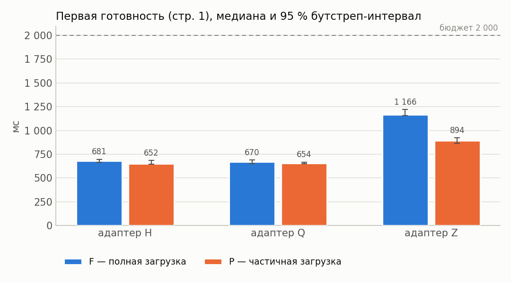

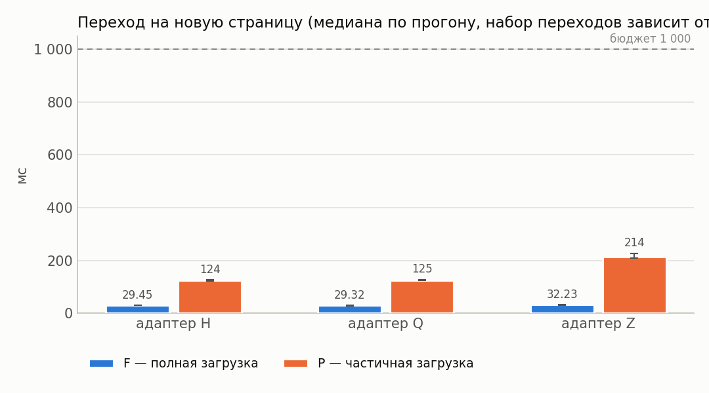

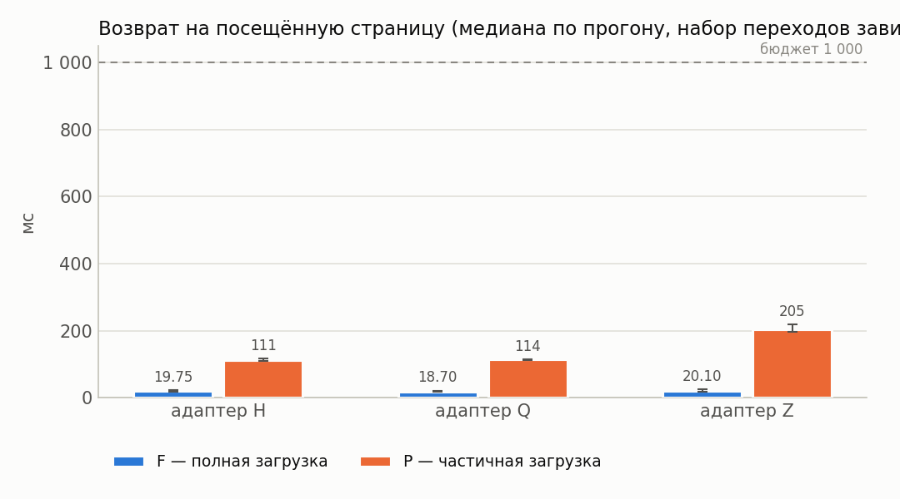

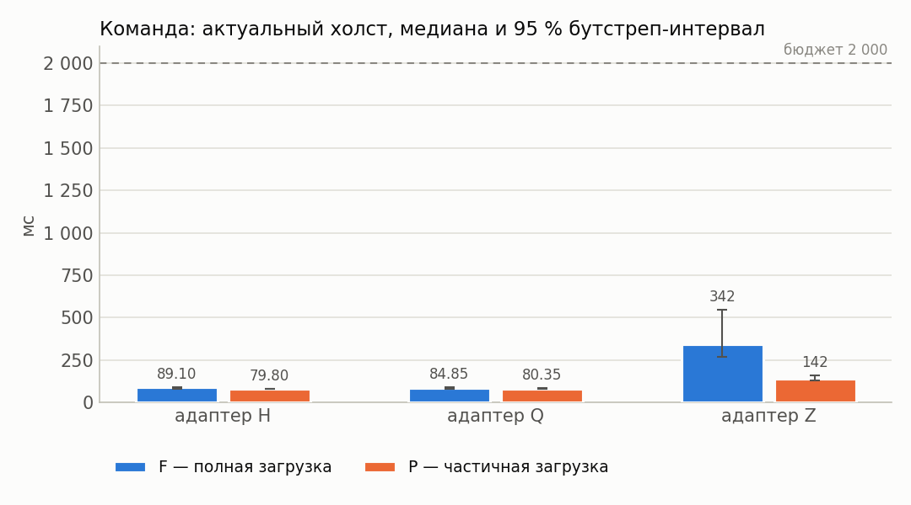

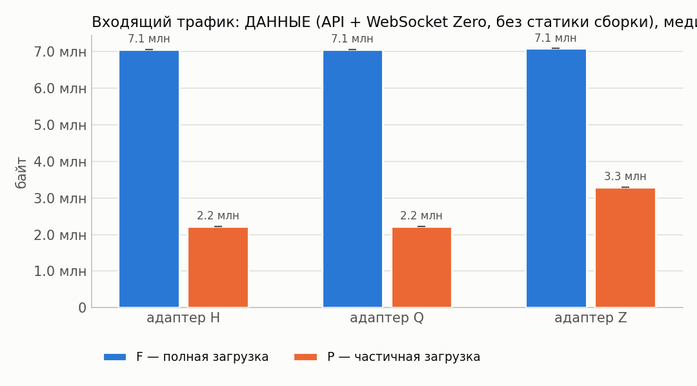

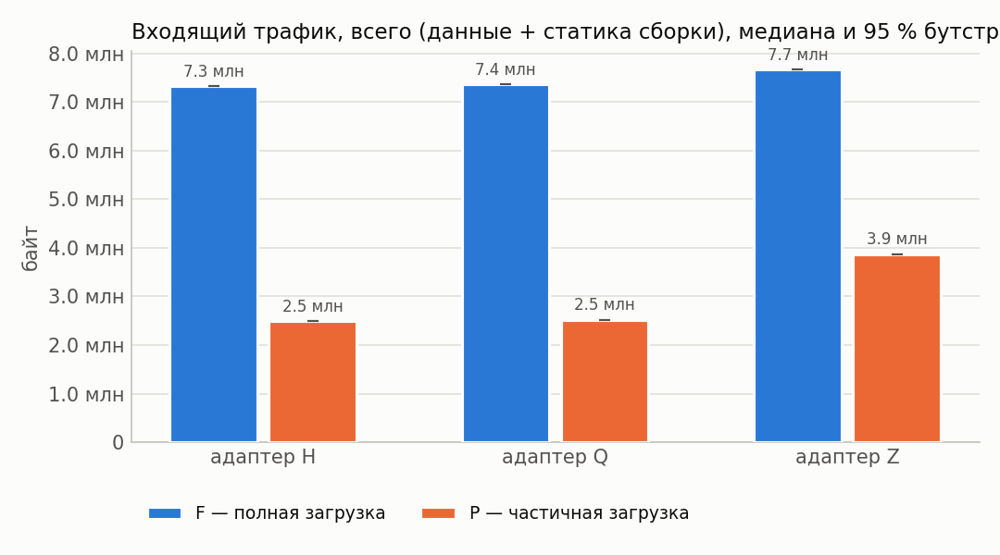

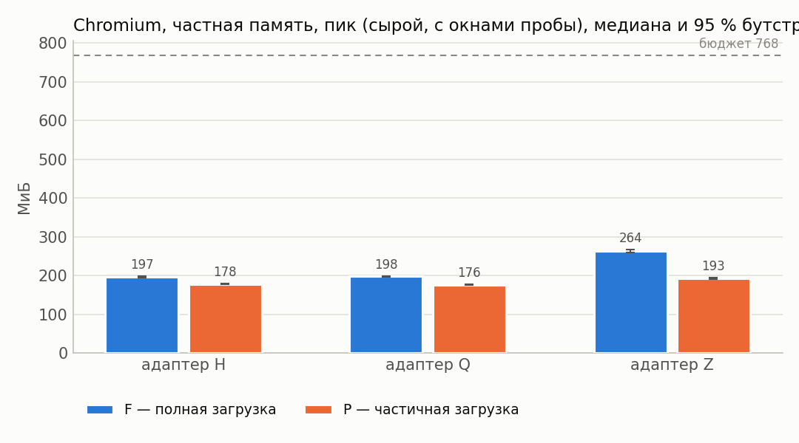

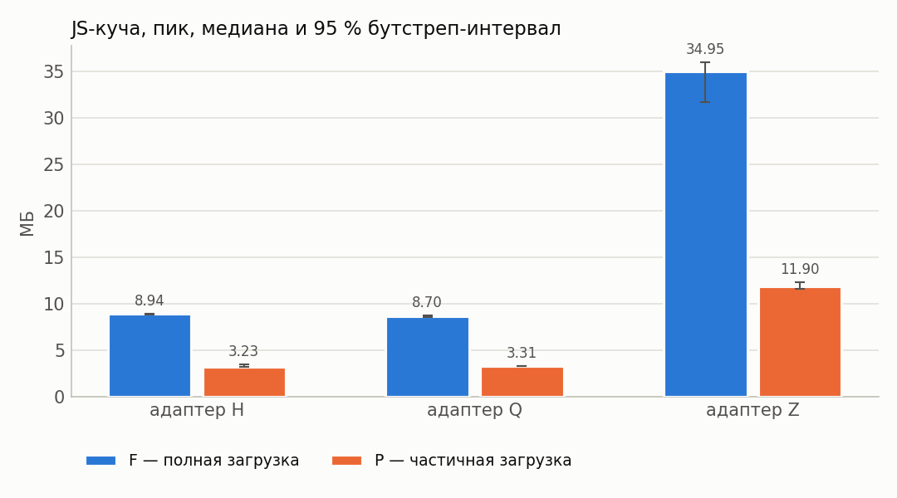

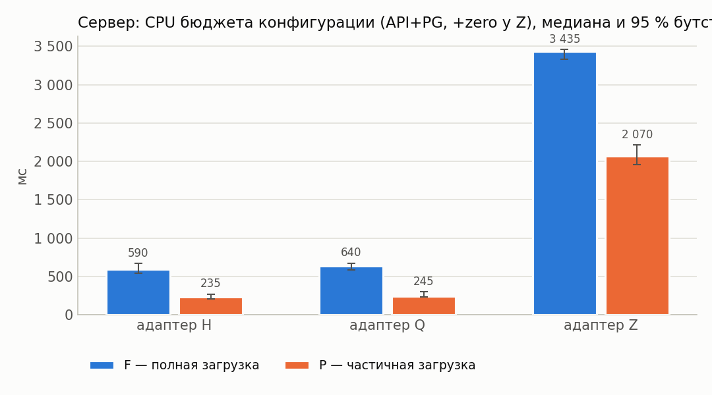

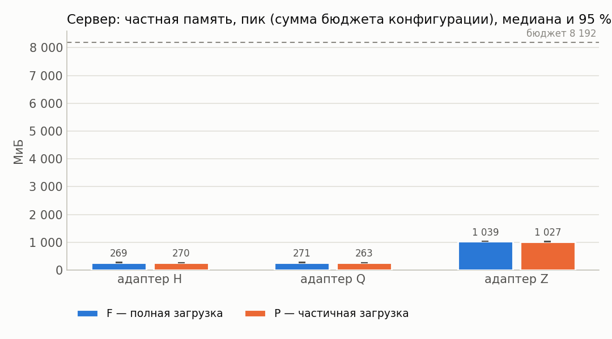

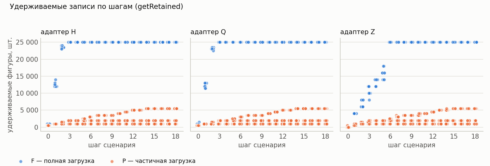

## 12. Выводы

* Оценки изменения P−F ниже — **парные** (медиана поблочных разностей, блок = повторение).
* Все бюджеты §7.4 выполнены для конфигураций: H/F, H/P (cache=1), H/P (cache=3), H/P (cache=10), Q/F, Q/P (cache=1), Q/P (cache=3), Q/P (cache=10), Z/F, Z/P (cache=1), Z/P (cache=3), Z/P (cache=10).
* H, cache=1: в режиме P первая готовность на 4 % меньше, чем в F (P/F = 0.96, 95 % интервал [0.93; 1.03]; интервал Δ содержит 0 — различие не подтверждено).
* H, cache=3: в режиме P первая готовность на 2 % меньше, чем в F (P/F = 0.98, 95 % интервал [0.93; 1.00]; интервал Δ содержит 0 — различие не подтверждено).
* H, cache=10: в режиме P первая готовность на 3 % меньше, чем в F (P/F = 0.97, 95 % интервал [0.93; 0.99]; интервал Δ не содержит 0).
* Q, cache=1: в режиме P первая готовность на 3 % меньше, чем в F (P/F = 0.97, 95 % интервал [0.94; 1.02]; интервал Δ содержит 0 — различие не подтверждено).
* Q, cache=3: в режиме P первая готовность на 2 % меньше, чем в F (P/F = 0.98, 95 % интервал [0.94; 0.99]; интервал Δ не содержит 0).
* Q, cache=10: в режиме P первая готовность на 1 % меньше, чем в F (P/F = 0.99, 95 % интервал [0.96; 1.01]; интервал Δ содержит 0 — различие не подтверждено).
* Z, cache=1: в режиме P первая готовность на 25 % меньше, чем в F (P/F = 0.75, 95 % интервал [0.73; 0.78]; интервал Δ не содержит 0).
* Z, cache=3: в режиме P первая готовность на 24 % меньше, чем в F (P/F = 0.76, 95 % интервал [0.71; 0.82]; интервал Δ не содержит 0).
* Z, cache=10: в режиме P первая готовность на 26 % меньше, чем в F (P/F = 0.74, 95 % интервал [0.73; 0.75]; интервал Δ не содержит 0).
* H, cache=1: в режиме P пик частной памяти Chromium на 9 % меньше, чем в F (P/F = 0.91, 95 % интервал [0.90; 0.91]; интервал Δ не содержит 0).
* H, cache=3: в режиме P пик частной памяти Chromium на 11 % меньше, чем в F (P/F = 0.89, 95 % интервал [0.89; 0.91]; интервал Δ не содержит 0).
* H, cache=10: в режиме P пик частной памяти Chromium на 11 % меньше, чем в F (P/F = 0.89, 95 % интервал [0.89; 0.91]; интервал Δ не содержит 0).
* Q, cache=1: в режиме P пик частной памяти Chromium на 11 % меньше, чем в F (P/F = 0.89, 95 % интервал [0.89; 0.90]; интервал Δ не содержит 0).
* Q, cache=3: в режиме P пик частной памяти Chromium на 11 % меньше, чем в F (P/F = 0.89, 95 % интервал [0.89; 0.90]; интервал Δ не содержит 0).
* Q, cache=10: в режиме P пик частной памяти Chromium на 9 % меньше, чем в F (P/F = 0.91, 95 % интервал [0.89; 0.91]; интервал Δ не содержит 0).
* Z, cache=1: в режиме P пик частной памяти Chromium на 27 % меньше, чем в F (P/F = 0.73, 95 % интервал [0.72; 0.75]; интервал Δ не содержит 0).
* Z, cache=3: в режиме P пик частной памяти Chromium на 26 % меньше, чем в F (P/F = 0.74, 95 % интервал [0.73; 0.76]; интервал Δ не содержит 0).
* Z, cache=10: в режиме P пик частной памяти Chromium на 23 % меньше, чем в F (P/F = 0.77, 95 % интервал [0.75; 0.79]; интервал Δ не содержит 0).
* H, cache=1: в режиме P входящий трафик на 66 % меньше, чем в F (P/F = 0.34, 95 % интервал [0.34; 0.34]; интервал Δ не содержит 0).
* H, cache=3: в режиме P входящий трафик на 71 % меньше, чем в F (P/F = 0.29, 95 % интервал [0.29; 0.29]; интервал Δ не содержит 0).
* H, cache=10: в режиме P входящий трафик на 74 % меньше, чем в F (P/F = 0.26, 95 % интервал [0.26; 0.26]; интервал Δ не содержит 0).
* Q, cache=1: в режиме P входящий трафик на 66 % меньше, чем в F (P/F = 0.34, 95 % интервал [0.34; 0.34]; интервал Δ не содержит 0).
* Q, cache=3: в режиме P входящий трафик на 71 % меньше, чем в F (P/F = 0.29, 95 % интервал [0.29; 0.29]; интервал Δ не содержит 0).
* Q, cache=10: в режиме P входящий трафик на 74 % меньше, чем в F (P/F = 0.26, 95 % интервал [0.26; 0.26]; интервал Δ не содержит 0).
* Z, cache=1: в режиме P входящий трафик на 50 % меньше, чем в F (P/F = 0.50, 95 % интервал [0.50; 0.50]; интервал Δ не содержит 0).
* Z, cache=3: в режиме P входящий трафик на 60 % меньше, чем в F (P/F = 0.40, 95 % интервал [0.40; 0.40]; интервал Δ не содержит 0).
* Z, cache=10: в режиме P входящий трафик на 68 % меньше, чем в F (P/F = 0.32, 95 % интервал [0.32; 0.32]; интервал Δ не содержит 0).
* H, cache=1: в режиме P максимум удерживаемых фигур на 96 % меньше, чем в F (P/F = 0.04, 95 % интервал [0.04; 0.04]; интервал Δ не содержит 0).
* H, cache=3: в режиме P максимум удерживаемых фигур на 92 % меньше, чем в F (P/F = 0.08, 95 % интервал [0.08; 0.08]; интервал Δ не содержит 0).
* H, cache=10: в режиме P максимум удерживаемых фигур на 78 % меньше, чем в F (P/F = 0.22, 95 % интервал [0.22; 0.22]; интервал Δ не содержит 0).
* Q, cache=1: в режиме P максимум удерживаемых фигур на 96 % меньше, чем в F (P/F = 0.04, 95 % интервал [0.04; 0.04]; интервал Δ не содержит 0).
* Q, cache=3: в режиме P максимум удерживаемых фигур на 92 % меньше, чем в F (P/F = 0.08, 95 % интервал [0.08; 0.08]; интервал Δ не содержит 0).
* Q, cache=10: в режиме P максимум удерживаемых фигур на 78 % меньше, чем в F (P/F = 0.22, 95 % интервал [0.22; 0.22]; интервал Δ не содержит 0).
* Z, cache=1: в режиме P максимум удерживаемых фигур на 96 % меньше, чем в F (P/F = 0.04, 95 % интервал [0.04; 0.04]; интервал Δ не содержит 0).
* Z, cache=3: в режиме P максимум удерживаемых фигур на 92 % меньше, чем в F (P/F = 0.08, 95 % интервал [0.08; 0.08]; интервал Δ не содержит 0).
* Z, cache=10: в режиме P максимум удерживаемых фигур на 78 % меньше, чем в F (P/F = 0.22, 95 % интервал [0.22; 0.22]; интервал Δ не содержит 0).
* H, cache=1: в режиме P переход на новую страницу на 314 % больше, чем в F (P/F = 4.14, 95 % интервал [4.01; 4.40]; интервал Δ не содержит 0).
* H, cache=3: в режиме P переход на новую страницу на 314 % больше, чем в F (P/F = 4.14, 95 % интервал [4.03; 4.36]; интервал Δ не содержит 0).
* H, cache=10: в режиме P переход на новую страницу на 322 % больше, чем в F (P/F = 4.22, 95 % интервал [4.00; 4.34]; интервал Δ не содержит 0).
* Q, cache=1: в режиме P переход на новую страницу на 332 % больше, чем в F (P/F = 4.32, 95 % интервал [4.09; 4.49]; интервал Δ не содержит 0).
* Q, cache=3: в режиме P переход на новую страницу на 325 % больше, чем в F (P/F = 4.25, 95 % интервал [4.06; 4.57]; интервал Δ не содержит 0).
* Q, cache=10: в режиме P переход на новую страницу на 333 % больше, чем в F (P/F = 4.33, 95 % интервал [4.04; 4.58]; интервал Δ не содержит 0).
* Z, cache=1: в режиме P переход на новую страницу на 595 % больше, чем в F (P/F = 6.95, 95 % интервал [6.58; 7.47]; интервал Δ не содержит 0).
* Z, cache=3: в режиме P переход на новую страницу на 591 % больше, чем в F (P/F = 6.91, 95 % интервал [6.75; 7.79]; интервал Δ не содержит 0).
* Z, cache=10: в режиме P переход на новую страницу на 509 % больше, чем в F (P/F = 6.09, 95 % интервал [5.74; 6.45]; интервал Δ не содержит 0).
* Перекрёстная проверка обмена сошлась во всех конфигурациях (наибольшее расхождение шейпера и суммы CDP HTTP+WebSocket — 0.1 %).
* У конфигураций Z/F, Z/P (cache=1), Z/P (cache=3), Z/P (cache=10) холст успевает обновиться раньше подтверждения сервера — доставка синхронизацией опережает ответ по HTTP; обе величины приведены отдельно в разделе 4.
* Точечная доля успеха ≥ 95 %: H/F, H/P (cache=1), H/P (cache=3), H/P (cache=10), Q/F, Q/P (cache=1), Q/P (cache=3), Q/P (cache=10), Z/F, Z/P (cache=1), Z/P (cache=3), Z/P (cache=10).
* Нижняя граница интервала Уилсона ниже 95 % для: H/F, H/P (cache=1), H/P (cache=3), H/P (cache=10), Q/F, Q/P (cache=1), Q/P (cache=3), Q/P (cache=10), Z/F, Z/P (cache=1), Z/P (cache=3), Z/P (cache=10). При n < 73 прогонов она не достигает 95 % даже без единого отказа, поэтому здесь это ограничение объёма серии, а не свидетельство ненадёжности; при наличии отказов — см. раздел «Ошибки».
* Условия применимости частичной загрузки: режим P оправдан, когда его выигрыш по первой готовности/памяти/трафику подтверждён интервалом (не содержащим 0) и при этом переходы на новые страницы и команда до холста остаются в бюджете, а удерживаемые записи не выходят за объявленное окно.
