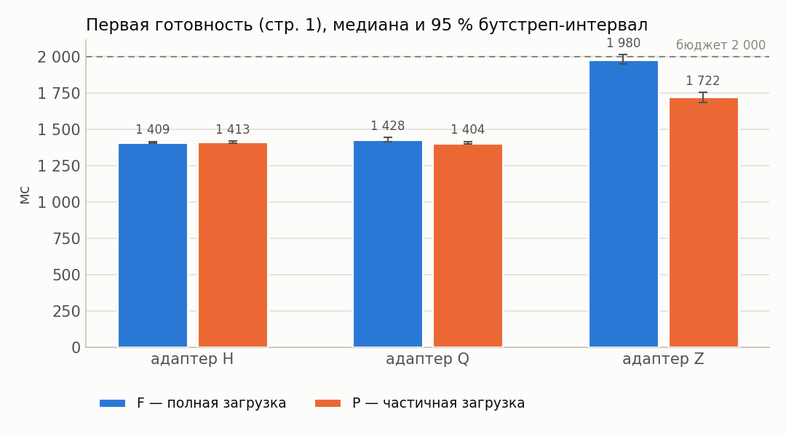
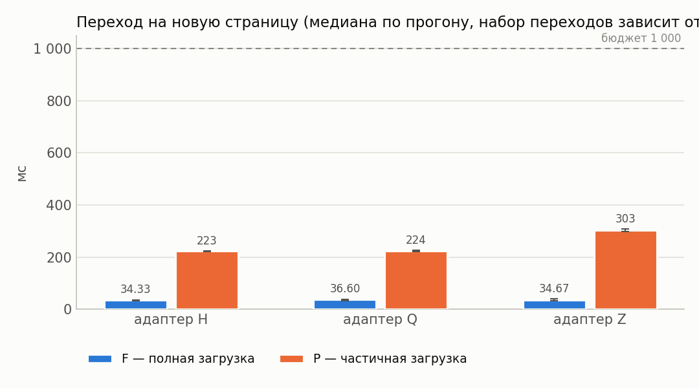
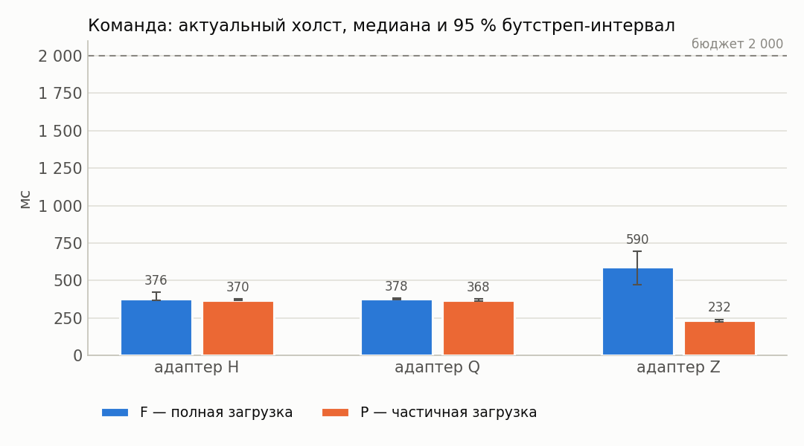
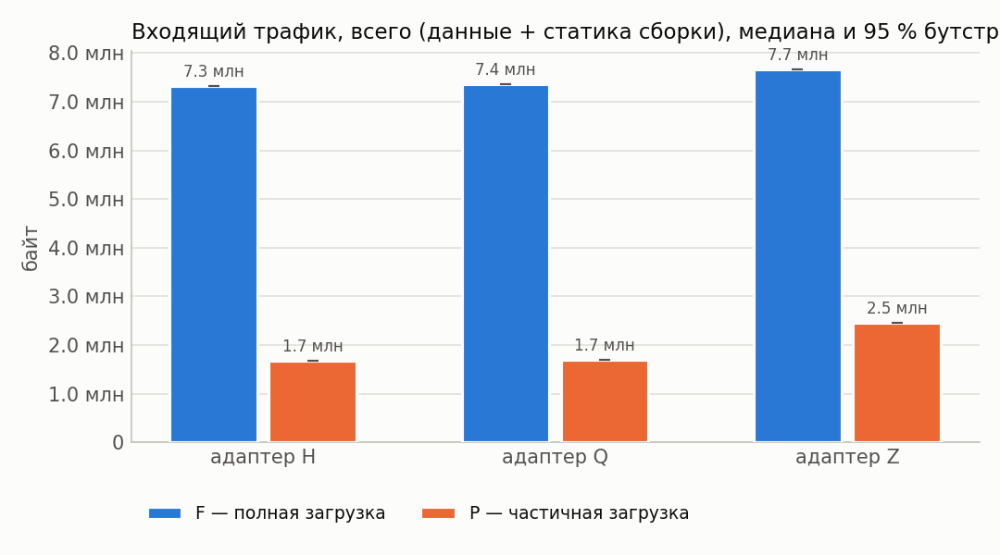
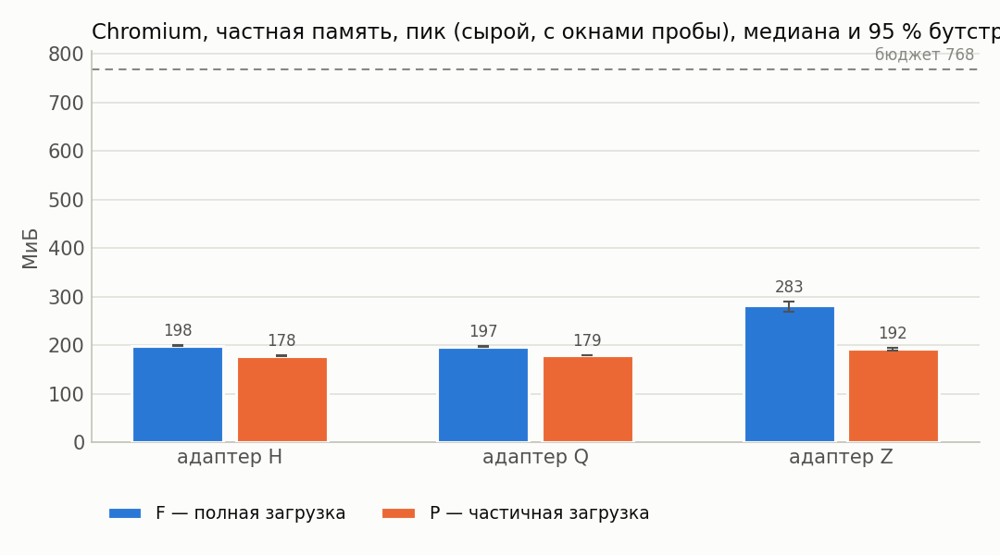
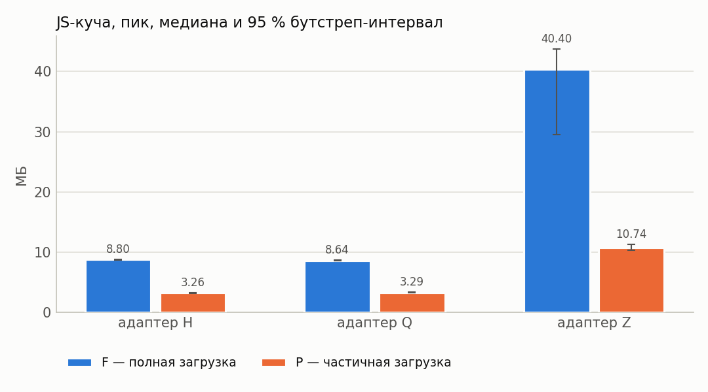
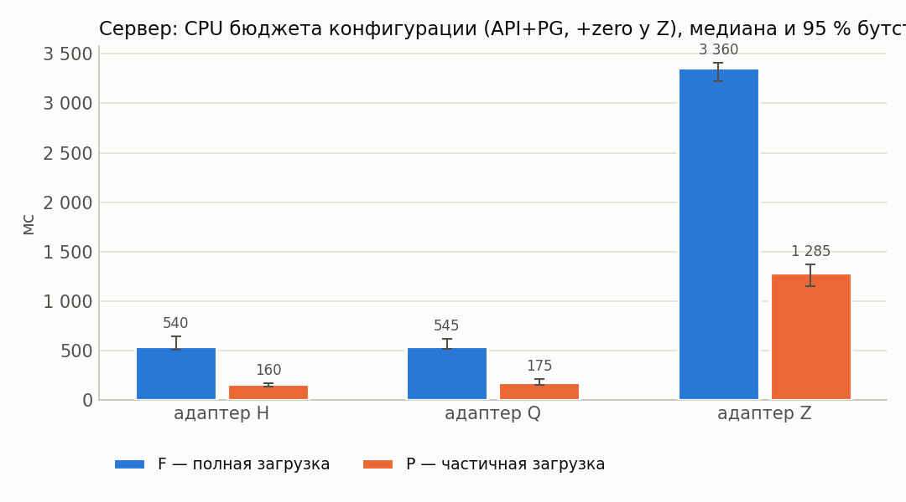
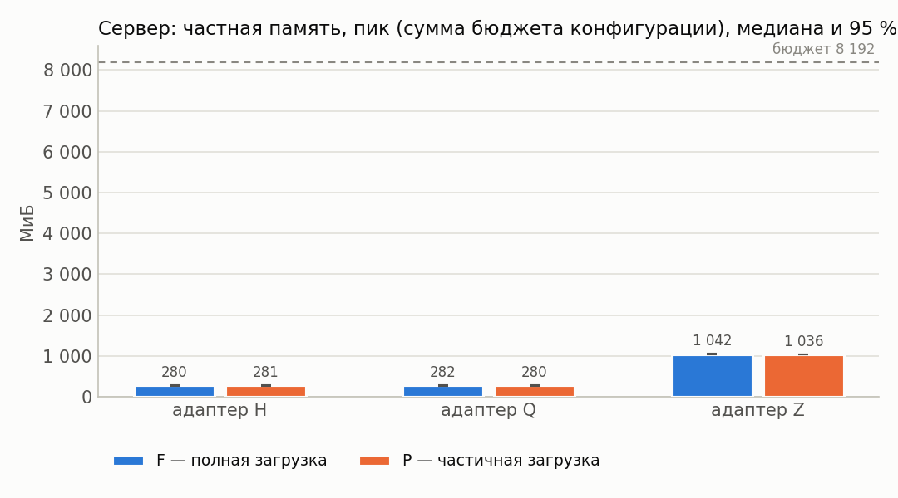
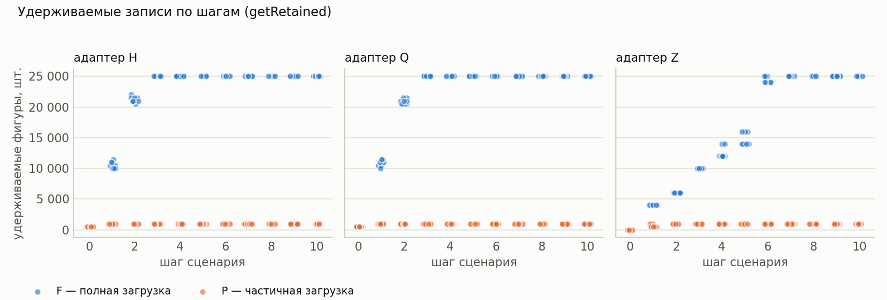

# Результаты серии «rtt150»

Сформировано 2026-09-14 02:48 UTC из `../../results/rtt150/runs.csv` (60 прогонов, 6 конфигураций). Бутстреп: 2000 ресемплов, seed=42, перцентильные 95 % интервалы. Времена и ресурсы считаются по прогонам с `outcome=ok`; доли — по всем начатым прогонам.

**Определения статистик** (одинаковы во всех таблицах): медиана — обычная выборочная; p95 — перцентиль по линейной интерполяции порядковых статистик (`numpy.percentile`, тип 7), при n = 30 это интерполяция между 29‑м и 30‑м значением, поэтому p95 не превышает максимум выборки и при малых n смещён вниз; интервалы медианы и p95 — перцентильный бутстреп по одной матрице ресемплов (согласованы между собой); доли — интервал Уилсона 95 % без поправки на непрерывность; при n < 8 интервалы помечены † как ненадёжные, при n < 2 не строятся.

Проверка схемы: OK — rows=60

## 1. Паспорт серии

| Параметр | Значение |
|---|---|
| `series` | rtt150 |
| `startedAt` | 2026-09-14T00:43:20.959Z |
| `finishedAt` | 2026-09-14T01:01:41.126Z |
| `host` | {"hostname": "vm", "os": "Linux 6.18.44-fc-v24", "platform": "linux", "arch": "x64", "kernel": "6.18.44-fc-v24", "distro": "Ubuntu 24.04.4 LTS", "cpuModel": "Intel(R) Xeon(R) Processor @ 2.80GHz", "cp |
| `versions` | {"node": "v24.21.0", "npm": "11.19.0", "postgres": "psql (PostgreSQL) 16.13 (Ubuntu 16.13-0ubuntu0.24.04.1)", "chromium": "141.0.7390.37", "playwright": "1.56.0", "zero": "1.9.0", "reactQuery": "5.102 |
| `packages` | {"playwright": "1.56.0", "@types/node": "24.13.4", "typescript": "5.9.3", "ws": "8.21.3", "@rocicorp/zero": "1.9.0", "@tanstack/react-query": "5.102.8", "react": "19.3.0", "react-dom": "19.3.0", "@typ |
| `packagesHoistedDifferent` | {"postgres": "3.4.7", "@fastify/cors": "10.1.0"} |
| `workspacePackages` | {"packages/bench": {"playwright": "1.56.0", "@types/node": "24.13.4", "typescript": "5.9.3", "ws": "8.21.3"}, "packages/client": {"@rocicorp/zero": "1.9.0", "@tanstack/react-query": "5.102.8", "react" |
| `lockfileVersion` | 3 |
| `shaper` | {"delayMs": 75, "bandwidthMbit": 20, "handshakeRtt": true, "statsUrl": "http://127.0.0.1:8081", "effective": {"delayMs": 75, "bandwidthMbit": 20, "bucketMs": 20, "segmentBytes": 4096, "bucketBytes": 5 |
| `seed` | 20260911 |
| `repetitions` | 10 |
| `configs` | [{"adapter": "H", "mode": "F", "cache": 1}, {"adapter": "H", "mode": "P", "cache": 1}, {"adapter": "Q", "mode": "F", "cache": 1}, {"adapter": "Q", "mode": "P", "cache": 1}, {"adapter": "Z", "mode": "F |
| `seriesConfig` | {"name": "rtt150", "doc": "doc-acc-50x500", "sourceId": "doc-acc-50x500-src-1", "fill": "#1e90ff", "docJson": "data/acceptance.json", "configs": [{"adapter": "H", "mode": "F", "cache": 1}, {"adapter": |
| `procGroups` | [{"name": "api", "pidFile": "/home/claude/stand/results/logs/api.pid", "exclude": ["netshaper", "zero-cache"]}, {"name": "pg", "patterns": ["(^\|/)postgres .*16/main", "^postgres: 16/main"], "exclude": |
| `browser` | {"channel": "chromium", "args": ["--disable-extensions"], "headless": true, "viewport": {"width": 1280, "height": 800}} |
| `scenario` | {"route": [2, 3, 1, 4, 2, 5, 1, 6, 3, 50], "pauseMs": 1000, "budgets": {"firstReadyMs": 2000, "navMs": 1000, "cmdDrawnMs": 2000, "scenarioMs": 30000}} |
| `plan` | [{"run_id": "rtt150-0000-QP1", "order_index": 0, "repetition": 0, "adapter": "Q", "mode": "P", "cache": 1}, {"run_id": "rtt150-0001-ZP1", "order_index": 1, "repetition": 0, "adapter": "Z", "mode": "P" |
| `client` | {"dist": [{"path": "adapter-settings.json", "bytes": 1004, "mtime": "2026-09-13T19:30:30.755Z", "sha256": "5d7d9af8420141ebb66ea6894d26792039f489306b9ba46bfea9900ef01071b1"}, {"path": "assets/h-BRsLg0 |
| `adapters` | {"available": true, "source": "packages/client/dist/adapter-settings.json", "generatedFrom": ["packages/client/src/adapters/types.ts → ADAPTER_SETTINGS", "packages/client/src/adapters/settings.ts → Z_ |
| `api` | {"url": "http://127.0.0.1:3000", "available": true, "logLevel": "warn", "health": {"status": "ok", "db": "ok", "uptimeSec": 58803, "testHooks": true, "logLevel": "warn", "now": "2026-09-14T00:43:21.20 |
| `zero` | {"config": {"pid": 1025, "env": {"ZERO_QUERY_URL": "http://127.0.0.1:3000/api/zero/query", "NODE_OPTIONS": "--max-old-space-size=8192 --import=/home/claude/stand/scripts/zero-ipv4-shim.mjs", "ZERO_ENA |
| `commit` | None |
| `code` | {"commit": null, "isGitRepo": false, "dirty": null, "codeId": "4bb9e4465904a250bc72d8338d19363855cfe7f827b12662d8600f4f90ee5917", "clientBuildId": "e8d6c0b226b1ac5d27bc8bd39b66d2b5bc2aab491b4d5f8e554c |
| `harness` | {"harnessId": "e9e14ba1b49f4ed75d29c0cf19a21936fc71abb61b6af8a75943d84e85b2dbcb", "harnessIdShort": "e9e14ba1b49f4ed7", "benchId": "8e1bdf1d09f201b6d42ff58f62fccfc4be22cd53ac554a5dd2aeb14ed5a99ccf", " |
| `preSeriesChecks` | {"at": "2026-09-14T00:43:21.248Z", "samplers": {"ok": true, "groups": [{"group": "api", "needed": true, "processes": 1, "pids": [984], "verdict": "ok", "spec": "pidFile=/home/claude/stand/results/logs |
| `runsExecutedNow` | 60 |
| `runsExecutedTotal` | 60 |
| `runsOk` | 60 |
| `runsTotalPlanned` | 60 |

## 2. Состав серии и доля успеха

Успех прогона = `outcome=ok` ∧ `t_scenario ≤ 30 с` ∧ все проверки эталона прошли (SPEC §7.3).

Доли считаются по **всем** начатым прогонам конфигурации (ошибка и таймаут = неуспех); сводки времени и ресурсов ниже — только по прогонам `outcome=ok`.

| Конфигурация | Прогонов | ok | error | timeout | эталон ✓ | ok, но эталон ✗ | успех | Доля успеха [Уилсон 95 %] |
|---|---|---|---|---|---|---|---|---|
| H/F | 10 | 10 | 0 | 0 | 10 | 0 | 10 | 100.0 % [72.2 %; 100.0 %] |
| H/P (cache=1) | 10 | 10 | 0 | 0 | 10 | 0 | 10 | 100.0 % [72.2 %; 100.0 %] |
| Q/F | 10 | 10 | 0 | 0 | 10 | 0 | 10 | 100.0 % [72.2 %; 100.0 %] |
| Q/P (cache=1) | 10 | 10 | 0 | 0 | 10 | 0 | 10 | 100.0 % [72.2 %; 100.0 %] |
| Z/F | 10 | 10 | 0 | 0 | 10 | 0 | 10 | 100.0 % [72.2 %; 100.0 %] |
| Z/P (cache=1) | 10 | 10 | 0 | 0 | 10 | 0 | 10 | 100.0 % [72.2 %; 100.0 %] |

## 3. Сводные показатели по конфигурациям

Для каждого показателя приводятся n, медиана с 95 % перцентильным бутстреп‑интервалом, p95 (линейная интерполяция порядковых статистик) с таким же интервалом, min и max. Знак † — интервал построен по n < 8 наблюдениям и ненадёжен; «—» вместо интервала — n < 2, интервал не определён.

### 3.1 Время

**Первая готовность (стр. 1), мс**

| Конфигурация | n | Медиана | 95 % ИД медианы | p95 | 95 % ИД p95 | min | max |
|---|---|---|---|---|---|---|---|
| H/F | 10 | 1 409 | [1 405; 1 416] | 1 420 | [1 413; 1 421] | 1 403 | 1 421 |
| H/P (cache=1) | 10 | 1 413 | [1 403; 1 418] | 1 834 | [1 415; 2 170] | 1 397 | 2 170 |
| Q/F | 10 | 1 428 | [1 416; 1 444] | 1 474 | [1 433; 1 488] | 1 407 | 1 488 |
| Q/P (cache=1) | 10 | 1 404 | [1 401; 1 416] | 1 425 | [1 410; 1 431] | 1 399 | 1 431 |
| Z/F | 10 | 1 980 | [1 950; 2 014] | 2 064 | [1 993; 2 089] | 1 934 | 2 089 |
| Z/P (cache=1) | 10 | 1 722 | [1 684; 1 752] | 1 786 | [1 741; 1 805] | 1 671 | 1 805 |

**Переход на новую страницу (медиана по прогону, набор переходов зависит от маршрута серии), мс**

| Конфигурация | n | Медиана | 95 % ИД медианы | p95 | 95 % ИД p95 | min | max |
|---|---|---|---|---|---|---|---|
| H/F | 10 | 34 | [32; 36] | 37 | [35; 37] | 32 | 37 |
| H/P (cache=1) | 10 | 223 | [221; 224] | 226 | [224; 227] | 219 | 227 |
| Q/F | 10 | 37 | [34; 39] | 43 | [38; 46] | 30 | 46 |
| Q/P (cache=1) | 10 | 224 | [222; 226] | 227 | [225; 228] | 221 | 228 |
| Z/F | 10 | 35 | [33; 40] | 47 | [36; 48] | 32 | 48 |
| Z/P (cache=1) | 10 | 303 | [299; 308] | 314 | [306; 317] | 296 | 317 |

**Возврат на посещённую страницу (медиана по прогону, набор переходов зависит от маршрута серии), мс**

| Конфигурация | n | Медиана | 95 % ИД медианы | p95 | 95 % ИД p95 | min | max |
|---|---|---|---|---|---|---|---|
| H/F | 10 | 16 | [15; 18] | 19 | [17; 20] | 12 | 20 |
| H/P (cache=1) | 10 | 206 | [204; 212] | 213 | [208; 213] | 203 | 213 |
| Q/F | 10 | 18 | [17; 19] | 21 | [18; 23] | 14 | 23 |
| Q/P (cache=1) | 10 | 207 | [204; 212] | 214 | [210; 215] | 202 | 215 |
| Z/F | 10 | 17 | [16; 19] | 23 | [18; 25] | 14 | 25 |
| Z/P (cache=1) | 10 | 291 | [286; 294] | 299 | [292; 302] | 283 | 302 |

**Команда: подтверждение транспорта (Z — .server, H/Q — ответ POST), мс**

| Конфигурация | n | Медиана | 95 % ИД медианы | p95 | 95 % ИД p95 | min | max |
|---|---|---|---|---|---|---|---|
| H/F | 10 | 166 | [165; 168] | 171 | [167; 173] | 164 | 173 |
| H/P (cache=1) | 10 | 167 | [164; 168] | 169 | [168; 170] | 161 | 170 |
| Q/F | 10 | 166 | [164; 168] | 170 | [168; 171] | 163 | 171 |
| Q/P (cache=1) | 10 | 165 | [164; 168] | 171 | [166; 174] | 162 | 174 |
| Z/F | 10 | 571 | [458; 703] | 901 | [638; 1 014] | 347 | 1 014 |
| Z/P (cache=1) | 10 | 219 | [213; 229] | 249 | [222; 259] | 211 | 259 |

**Команда: подтверждение сервера (результат операции), мс**

| Конфигурация | n | Медиана | 95 % ИД медианы | p95 | 95 % ИД p95 | min | max |
|---|---|---|---|---|---|---|---|
| H/F | 10 | 166 | [165; 168] | 171 | [167; 173] | 164 | 173 |
| H/P (cache=1) | 10 | 167 | [164; 168] | 169 | [168; 170] | 161 | 170 |
| Q/F | 10 | 166 | [165; 168] | 170 | [168; 171] | 164 | 171 |
| Q/P (cache=1) | 10 | 165 | [164; 168] | 172 | [167; 174] | 162 | 174 |
| Z/F | 10 | 810 | [691; 920] | 1 092 | [864; 1 225] | 628 | 1 225 |
| Z/P (cache=1) | 10 | 380 | [374; 391] | 411 | [382; 419] | 371 | 419 |

**Команда: цена протокола подтверждения (ack − транспорт), мс**

| Конфигурация | n | Медиана | 95 % ИД медианы | p95 | 95 % ИД p95 | min | max |
|---|---|---|---|---|---|---|---|
| H/F | 10 | 0 | [0; 0] | 0 | [0; 0] | 0 | 0 |
| H/P (cache=1) | 10 | 0 | [0; 0] | 0 | [0; 0] | 0 | 0 |
| Q/F | 10 | 0 | [0; 0] | 0 | [0; 0] | 0 | 0 |
| Q/P (cache=1) | 10 | 0 | [0; 0] | 0 | [0; 0] | 0 | 0 |
| Z/F | 10 | 201 | [174; 222] | 418 | [213; 572] | 164 | 572 |
| Z/P (cache=1) | 10 | 160 | [160; 162] | 164 | [161; 165] | 159 | 165 |

**Команда: данные в хранилище активной страницы, мс**

| Конфигурация | n | Медиана | 95 % ИД медианы | p95 | 95 % ИД p95 | min | max |
|---|---|---|---|---|---|---|---|
| H/F | 10 | 365 | [358; 409] | 443 | [372; 468] | 356 | 468 |
| H/P (cache=1) | 10 | 359 | [357; 365] | 369 | [361; 371] | 351 | 371 |
| Q/F | 10 | 367 | [364; 369] | 369 | [368; 370] | 361 | 370 |
| Q/P (cache=1) | 10 | 360 | [356; 366] | 371 | [361; 372] | 355 | 372 |
| Z/F | 10 | 570 | [458; 703] | 901 | [638; 1 013] | 347 | 1 013 |
| Z/P (cache=1) | 10 | 219 | [213; 228] | 248 | [222; 258] | 211 | 258 |

**Команда: актуальный холст, мс**

| Конфигурация | n | Медиана | 95 % ИД медианы | p95 | 95 % ИД p95 | min | max |
|---|---|---|---|---|---|---|---|
| H/F | 10 | 376 | [370; 422] | 457 | [385; 482] | 367 | 482 |
| H/P (cache=1) | 10 | 370 | [366; 379] | 382 | [376; 384] | 365 | 384 |
| Q/F | 10 | 378 | [374; 381] | 383 | [380; 385] | 370 | 385 |
| Q/P (cache=1) | 10 | 368 | [364; 378] | 384 | [374; 384] | 362 | 384 |
| Z/F | 10 | 590 | [471; 695] | 911 | [660; 1 025] | 360 | 1 025 |
| Z/P (cache=1) | 10 | 232 | [226; 241] | 260 | [232; 271] | 221 | 271 |

**Переход, медиана всех переходов прогона (маршрут любой длины), мс**

| Конфигурация | n | Медиана | 95 % ИД медианы | p95 | 95 % ИД p95 | min | max |
|---|---|---|---|---|---|---|---|
| H/F | 10 | 30 | [29; 30] | 31 | [30; 31] | 28 | 31 |
| H/P (cache=1) | 10 | 219 | [218; 221] | 222 | [219; 223] | 215 | 223 |
| Q/F | 10 | 30 | [28; 32] | 34 | [31; 34] | 27 | 34 |
| Q/P (cache=1) | 10 | 221 | [218; 222] | 224 | [221; 225] | 215 | 225 |
| Z/F | 10 | 30 | [29; 31] | 33 | [30; 33] | 28 | 33 |
| Z/P (cache=1) | 10 | 297 | [294; 302] | 305 | [299; 305] | 292 | 305 |

**Сценарий целиком (с паузами, без проб оболочки), мс**

| Конфигурация | n | Медиана | 95 % ИД медианы | p95 | 95 % ИД p95 | min | max |
|---|---|---|---|---|---|---|---|
| H/F | 10 | 13 072 | [13 061; 13 108] | 13 160 | [13 090; 13 187] | 13 043 | 13 187 |
| H/P (cache=1) | 10 | 14 980 | [14 942; 14 986] | 15 391 | [14 983; 15 718] | 14 914 | 15 718 |
| Q/F | 10 | 13 101 | [13 078; 13 138] | 13 187 | [13 120; 13 205] | 13 066 | 13 205 |
| Q/P (cache=1) | 10 | 14 962 | [14 953; 14 979] | 14 986 | [14 973; 14 990] | 14 929 | 14 990 |
| Z/F | 10 | 14 077 | [14 007; 14 216] | 14 402 | [14 131; 14 487] | 13 892 | 14 487 |
| Z/P (cache=1) | 10 | 16 106 | [16 089; 16 195] | 16 280 | [16 121; 16 290] | 16 021 | 16 290 |

**Сценарий целиком, сырое время (с пробами оболочки), мс**

| Конфигурация | n | Медиана | 95 % ИД медианы | p95 | 95 % ИД p95 | min | max |
|---|---|---|---|---|---|---|---|
| H/F | 10 | 13 092 | [13 075; 13 128] | 13 176 | [13 107; 13 200] | 13 060 | 13 200 |
| H/P (cache=1) | 10 | 14 992 | [14 963; 15 008] | 15 409 | [14 997; 15 735] | 14 927 | 15 735 |
| Q/F | 10 | 13 113 | [13 097; 13 157] | 13 212 | [13 133; 13 236] | 13 086 | 13 236 |
| Q/P (cache=1) | 10 | 14 978 | [14 974; 15 000] | 15 005 | [14 991; 15 007] | 14 964 | 15 007 |
| Z/F | 10 | 14 456 | [14 374; 14 744] | 14 814 | [14 464; 14 834] | 14 228 | 14 834 |
| Z/P (cache=1) | 10 | 16 131 | [16 106; 16 214] | 16 298 | [16 143; 16 302] | 16 042 | 16 302 |

**Пробы оболочки сверх объявленных пауз, мс**

| Конфигурация | n | Медиана | 95 % ИД медианы | p95 | 95 % ИД p95 | min | max |
|---|---|---|---|---|---|---|---|
| H/F | 10 | 18 | [14; 21] | 23 | [20; 24] | 13 | 24 |
| H/P (cache=1) | 10 | 13 | [11; 21] | 29 | [17; 32] | 10 | 32 |
| Q/F | 10 | 20 | [10; 26] | 29 | [24; 31] | 9 | 31 |
| Q/P (cache=1) | 10 | 22 | [17; 24] | 31 | [23; 36] | 13 | 36 |
| Z/F | 10 | 382 | [185; 522] | 676 | [493; 693] | 123 | 693 |
| Z/P (cache=1) | 10 | 23 | [17; 24] | 25 | [24; 26] | 13 | 26 |

### 3.2 Объём обмена

**Головная величина обмена — «только данные»** (`bytes_in_data`: API + кадры синхронизации Zero). Полный `bytes_in` включает статику сборки — поадаптерную константу, одинаковую в F и в P, поэтому в отношениях P/F она искажает сравнение (`docs/DEVIATIONS.md` §3.1). Оба числа приводятся рядом, разложение — ниже.

**Входящий трафик: ДАННЫЕ (API + WebSocket Zero, без статики сборки), байт**

| Конфигурация | n | Медиана | 95 % ИД медианы | p95 | 95 % ИД p95 | min | max |
|---|---|---|---|---|---|---|---|
| H/F | 10 | 7 066 121 | [7 066 121; 7 066 121] | 7 066 121 | [7 066 121; 7 066 121] | 7 066 121 | 7 066 121 |
| H/P (cache=1) | 10 | 1 408 402 | [1 408 402; 1 408 402] | 1 408 402 | [1 408 402; 1 408 402] | 1 408 402 | 1 408 402 |
| Q/F | 10 | 7 066 121 | [7 066 121; 7 066 121] | 7 066 121 | [7 066 121; 7 066 121] | 7 066 121 | 7 066 121 |
| Q/P (cache=1) | 10 | 1 408 402 | [1 408 402; 1 408 402] | 1 408 402 | [1 408 402; 1 408 402] | 1 408 402 | 1 408 402 |
| Z/F | 10 | 7 095 352 | [7 095 352; 7 095 352] | 7 095 352 | [7 095 352; 7 095 352] | 7 095 352 | 7 095 352 |
| Z/P (cache=1) | 10 | 1 881 586 | [1 881 586; 1 881 586] | 1 881 586 | [1 881 586; 1 881 586] | 1 881 586 | 1 881 586 |

**Входящий трафик, всего (данные + статика сборки), байт**

| Конфигурация | n | Медиана | 95 % ИД медианы | p95 | 95 % ИД p95 | min | max |
|---|---|---|---|---|---|---|---|
| H/F | 10 | 7 326 515 | [7 326 515; 7 326 515] | 7 326 515 | [7 326 515; 7 326 515] | 7 326 515 | 7 326 515 |
| H/P (cache=1) | 10 | 1 668 796 | [1 668 796; 1 668 796] | 1 668 796 | [1 668 796; 1 668 796] | 1 668 796 | 1 668 796 |
| Q/F | 10 | 7 357 527 | [7 357 527; 7 357 527] | 7 357 527 | [7 357 527; 7 357 527] | 7 357 527 | 7 357 527 |
| Q/P (cache=1) | 10 | 1 699 808 | [1 699 808; 1 699 808] | 1 699 808 | [1 699 808; 1 699 808] | 1 699 808 | 1 699 808 |
| Z/F | 10 | 7 667 876 | [7 667 876; 7 667 876] | 7 667 876 | [7 667 876; 7 667 876] | 7 667 876 | 7 667 876 |
| Z/P (cache=1) | 10 | 2 454 110 | [2 454 110; 2 454 110] | 2 454 110 | [2 454 110; 2 454 110] | 2 454 110 | 2 454 110 |

**Статика сборки за прогон (поадаптерная константа), байт**

| Конфигурация | n | Медиана | 95 % ИД медианы | p95 | 95 % ИД p95 | min | max |
|---|---|---|---|---|---|---|---|
| H/F | 10 | 260 394 | [260 394; 260 394] | 260 394 | [260 394; 260 394] | 260 394 | 260 394 |
| H/P (cache=1) | 10 | 260 394 | [260 394; 260 394] | 260 394 | [260 394; 260 394] | 260 394 | 260 394 |
| Q/F | 10 | 291 406 | [291 406; 291 406] | 291 406 | [291 406; 291 406] | 291 406 | 291 406 |
| Q/P (cache=1) | 10 | 291 406 | [291 406; 291 406] | 291 406 | [291 406; 291 406] | 291 406 | 291 406 |
| Z/F | 10 | 572 524 | [572 524; 572 524] | 572 524 | [572 524; 572 524] | 572 524 | 572 524 |
| Z/P (cache=1) | 10 | 572 524 | [572 524; 572 524] | 572 524 | [572 524; 572 524] | 572 524 | 572 524 |

**Исходящий трафик: данные (без статики), байт**

| Конфигурация | n | Медиана | 95 % ИД медианы | p95 | 95 % ИД p95 | min | max |
|---|---|---|---|---|---|---|---|
| H/F | 10 | 51 285 | [51 285; 51 285] | 51 285 | [51 285; 51 285] | 51 285 | 51 285 |
| H/P (cache=1) | 10 | 12 261 | [12 261; 12 261] | 12 261 | [12 261; 12 261] | 12 261 | 12 261 |
| Q/F | 10 | 51 285 | [51 285; 51 285] | 51 285 | [51 285; 51 285] | 51 285 | 51 285 |
| Q/P (cache=1) | 10 | 12 261 | [12 261; 12 261] | 12 261 | [12 261; 12 261] | 12 261 | 12 261 |
| Z/F | 10 | 12 678 | [12 678; 12 679] | 12 679 | [12 679; 12 679] | 12 678 | 12 679 |
| Z/P (cache=1) | 10 | 7 394 | [7 383; 7 395] | 7 395 | [7 394; 7 395] | 7 381 | 7 395 |

**Исходящий трафик, всего (шейпер), байт**

| Конфигурация | n | Медиана | 95 % ИД медианы | p95 | 95 % ИД p95 | min | max |
|---|---|---|---|---|---|---|---|
| H/F | 10 | 55 370 | [55 370; 55 370] | 55 370 | [55 370; 55 370] | 55 370 | 55 370 |
| H/P (cache=1) | 10 | 16 346 | [16 346; 16 346] | 16 346 | [16 346; 16 346] | 16 346 | 16 346 |
| Q/F | 10 | 55 370 | [55 370; 55 370] | 55 370 | [55 370; 55 370] | 55 370 | 55 370 |
| Q/P (cache=1) | 10 | 16 346 | [16 346; 16 346] | 16 346 | [16 346; 16 346] | 16 346 | 16 346 |
| Z/F | 10 | 16 822 | [16 821; 16 822] | 16 822 | [16 822; 16 822] | 16 821 | 16 822 |
| Z/P (cache=1) | 10 | 11 537 | [11 526; 11 538] | 11 538 | [11 537; 11 538] | 11 524 | 11 538 |

**Входящий трафик (CDP, перекрёстная проверка), байт**

| Конфигурация | n | Медиана | 95 % ИД медианы | p95 | 95 % ИД p95 | min | max |
|---|---|---|---|---|---|---|---|
| H/F | 10 | 7 326 515 | [7 326 515; 7 326 515] | 7 326 515 | [7 326 515; 7 326 515] | 7 326 515 | 7 326 515 |
| H/P (cache=1) | 10 | 1 668 796 | [1 668 796; 1 668 796] | 1 668 796 | [1 668 796; 1 668 796] | 1 668 796 | 1 668 796 |
| Q/F | 10 | 7 357 527 | [7 357 527; 7 357 527] | 7 357 527 | [7 357 527; 7 357 527] | 7 357 527 | 7 357 527 |
| Q/P (cache=1) | 10 | 1 699 808 | [1 699 808; 1 699 808] | 1 699 808 | [1 699 808; 1 699 808] | 1 699 808 | 1 699 808 |
| Z/F | 10 | 576 646 | [576 646; 576 646] | 576 646 | [576 646; 576 646] | 576 646 | 576 646 |
| Z/P (cache=1) | 10 | 576 646 | [576 646; 576 646] | 576 646 | [576 646; 576 646] | 576 646 | 576 646 |

**Обмен данными против полного объёма**

Источник разложения: колонки оболочки `bytes_in_api` / `bytes_in_zero` / `bytes_in_static`.

Разброс статики внутри конфигурации обязан быть нулевым — это константа сборки, а не измеряемая величина; ненулевой разброс означал бы, что в статику попало что‑то ещё, и его надо разбирать.

| Конфигурация | n | **Данные (API + WS), байт** | Статика сборки, байт | Всего, байт | Доля статики | Разброс статики |
|---|---|---|---|---|---|---|
| H/F | 10‡ | 7 066 121 | 260 394 | 7 326 515 | 3.6 % | 0 |
| H/P (cache=1) | 10‡ | 1 408 402 | 260 394 | 1 668 796 | 15.6 % | 0 |
| Q/F | 10‡ | 7 066 121 | 291 406 | 7 357 527 | 4.0 % | 0 |
| Q/P (cache=1) | 10‡ | 1 408 402 | 291 406 | 1 699 808 | 17.1 % | 0 |
| Z/F | 10‡ | 7 095 352 | 572 524 | 7 667 876 | 7.5 % | 0 |
| Z/P (cache=1) | 10‡ | 1 881 586 | 572 524 | 2 454 110 | 23.3 % | 0 |

**P/F обмена: по полному трафику и по данным** (парная оценка, блок = повторение)

| Адаптер | Пар | Статика, байт | P/F полный (как публиковалось) | **P/F данные (головное)** | Изменилось |
|---|---|---|---|---|---|
| H (cache=1) | 10‡ | 260 394 | 0.228 [0.228; 0.228] | **0.199** [0.199; 0.199] | да, -0.028 |
| Q (cache=1) | 10‡ | 291 406 | 0.231 [0.231; 0.231] | **0.199** [0.199; 0.199] | да, -0.032 |
| Z (cache=1) | 10‡ | 572 524 | 0.320 [0.320; 0.320] | **0.265** [0.265; 0.265] | да, -0.055 |

Последний столбец отвечает на вопрос «какие опубликованные числа двигает вычитание статики»: величина сдвига = P/F(данные) − P/F(полный).

**Полнота разложения: сумма по маршрутам против итога**

Головное число обмена — `bytes_in_data = bytes_in_api + bytes_in_zero`. Оно осмысленно ровно настолько, насколько разложение полное, поэтому проверка идёт **по каждому прогону**, а не по медианам: столбцы «расхождение» — максимум по прогонам конфигурации от |(api + zero + статика + прочее) − итог|, столбцы «остаток» — максимум собственной контрольной колонки оболочки `bytes_*_route_residual`. Ожидаемое значение всех четырёх — ноль.

| Конфигурация | n | Расхождение вход, Б | Расхождение исход, Б | Остаток вход, Б | Остаток исход, Б | Прочее (вход), Б | Сошлось |
|---|---|---|---|---|---|---|---|
| H/F | 10‡ | 0 | 0 | 0 | 0 | 0 | ✓ |
| H/P (cache=1) | 10‡ | 0 | 0 | 0 | 0 | 0 | ✓ |
| Q/F | 10‡ | 0 | 0 | 0 | 0 | 0 | ✓ |
| Q/P (cache=1) | 10‡ | 0 | 0 | 0 | 0 | 0 | ✓ |
| Z/F | 10‡ | 0 | 0 | 0 | 0 | 0 | ✓ |
| Z/P (cache=1) | 10‡ | 0 | 0 | 0 | 0 | 0 | ✓ |

Все конфигурации сошлись побайтно: «данные + статика + прочее» исчерпывают весь наблюдаемый обмен, и головная величина `bytes_in_data` ничего не теряет.

**Перекрёстная проверка трафика (шейпер vs CDP)**

Шейпер считает байты TCP‑полезной нагрузки всех соединений клиента; CDP даёт их двумя счётчиками — `cdp_bytes_in` (`encodedDataLength` HTTP‑ответов) и `cdp_ws_bytes_in` (кадры WebSocket). У H/Q второй счётчик нулевой, у Z по WebSocket идёт почти весь обмен, поэтому сверять нужно **сумму**: сравнение только с `cdp_bytes_in` давало ложный провал у Z (в прежнем `results/smoke/report.md` — Z/F 92.5 %, Z/P 76.6 %).

| Конфигурация | bytes_in (шейпер) | CDP: HTTP | CDP: WebSocket | CDP: сумма | Расхождение | ≤ 10 % |
|---|---|---|---|---|---|---|
| H/F | 7 326 515 | 7 326 515 | 0 | 7 326 515 | 0.0 % | ✓ |
| H/P (cache=1) | 1 668 796 | 1 668 796 | 0 | 1 668 796 | 0.0 % | ✓ |
| Q/F | 7 357 527 | 7 357 527 | 0 | 7 357 527 | 0.0 % | ✓ |
| Q/P (cache=1) | 1 699 808 | 1 699 808 | 0 | 1 699 808 | 0.0 % | ✓ |
| Z/F | 7 667 876 | 576 646 | 7 088 281 | 7 664 927 | 0.0 % | ✓ |
| Z/P (cache=1) | 2 454 110 | 576 646 | 1 875 371 | 2 452 017 | 0.1 % | ✓ |

**Исходящее направление — справочно.** `cdp_bytes_out` не измеряется, а оценивается по `Network.requestWillBeSent` (стартовая строка + известные CDP заголовки + тело) и систематически занижен на заголовки, которые добавляет сетевой стек браузера, и на рукопожатие WebSocket. Расхождение 20–40 % здесь — свойство оценки, а не признак ошибки измерения; в вердикт конфигурации это направление не входит.

| Конфигурация | bytes_out (шейпер) | CDP: сумма (оценка) | Расхождение | ≤ 50 % |
|---|---|---|---|---|
| H/F | 55 370 | 42 794 | 22.7 % | ✓ |
| H/P (cache=1) | 16 346 | 12 122 | 25.8 % | ✓ |
| Q/F | 55 370 | 42 794 | 22.7 % | ✓ |
| Q/P (cache=1) | 16 346 | 12 122 | 25.8 % | ✓ |
| Z/F | 16 822 | 11 744 | 30.2 % | ✓ |
| Z/P (cache=1) | 11 537 | 7 010 | 39.2 % | ✓ |

### 3.3 Память клиента

**Chromium, частная память, пик без окон пробы, МиБ**

| Конфигурация | n | Медиана | 95 % ИД медианы | p95 | 95 % ИД p95 | min | max |
|---|---|---|---|---|---|---|---|
| H/F | 10 | 197.5 | [196.9; 198.2] | 199.3 | [198.0; 200.2] | 196.6 | 200.2 |
| H/P (cache=1) | 10 | 177.8 | [177.2; 178.1] | 178.5 | [178.0; 178.7] | 177.2 | 178.7 |
| Q/F | 10 | 196.9 | [196.6; 198.3] | 198.7 | [197.2; 199.1] | 195.6 | 199.1 |
| Q/P (cache=1) | 10 | 178.6 | [177.9; 179.1] | 179.3 | [178.9; 179.3] | 177.3 | 179.3 |
| Z/F | 10 | 258.2 | [240.8; 264.3] | 273.5 | [263.1; 280.4] | 222.7 | 280.4 |
| Z/P (cache=1) | 10 | 191.8 | [189.2; 194.2] | 195.2 | [193.4; 195.5] | 187.6 | 195.5 |

**Chromium, частная память, пик (сырой, с окнами пробы), МиБ**

| Конфигурация | n | Медиана | 95 % ИД медианы | p95 | 95 % ИД p95 | min | max |
|---|---|---|---|---|---|---|---|
| H/F | 10 | 198.5 | [197.7; 199.4] | 200.1 | [198.8; 200.2] | 196.8 | 200.2 |
| H/P (cache=1) | 10 | 178.3 | [177.8; 179.0] | 179.3 | [178.7; 179.3] | 177.2 | 179.3 |
| Q/F | 10 | 197.4 | [197.0; 198.5] | 199.5 | [197.7; 200.1] | 196.4 | 200.1 |
| Q/P (cache=1) | 10 | 179.3 | [178.5; 179.5] | 179.7 | [179.3; 179.8] | 177.6 | 179.8 |
| Z/F | 10 | 282.8 | [269.1; 289.7] | 304.6 | [285.4; 311.5] | 249.0 | 311.5 |
| Z/P (cache=1) | 10 | 191.8 | [189.2; 194.2] | 195.2 | [192.9; 195.5] | 187.6 | 195.5 |

**Chromium, частная память, конец, МиБ**

| Конфигурация | n | Медиана | 95 % ИД медианы | p95 | 95 % ИД p95 | min | max |
|---|---|---|---|---|---|---|---|
| H/F | 10 | 196.8 | [196.5; 197.5] | 198.2 | [196.9; 198.4] | 195.5 | 198.4 |
| H/P (cache=1) | 10 | 177.8 | [177.2; 178.1] | 178.5 | [177.9; 178.7] | 177.2 | 178.7 |
| Q/F | 10 | 196.6 | [196.3; 197.1] | 197.5 | [196.9; 197.7] | 195.4 | 197.7 |
| Q/P (cache=1) | 10 | 178.6 | [177.9; 179.1] | 179.3 | [179.0; 179.3] | 177.3 | 179.3 |
| Z/F | 10 | 199.8 | [198.5; 201.0] | 202.3 | [200.0; 202.5] | 197.9 | 202.5 |
| Z/P (cache=1) | 10 | 181.4 | [181.0; 183.4] | 184.1 | [182.2; 184.6] | 180.5 | 184.6 |

**JS‑куча, пик, МБ**

| Конфигурация | n | Медиана | 95 % ИД медианы | p95 | 95 % ИД p95 | min | max |
|---|---|---|---|---|---|---|---|
| H/F | 10 | 8.8 | [8.7; 8.8] | 8.8 | [8.8; 8.8] | 8.7 | 8.8 |
| H/P (cache=1) | 10 | 3.3 | [3.2; 3.3] | 3.3 | [3.3; 3.3] | 3.2 | 3.3 |
| Q/F | 10 | 8.6 | [8.6; 8.7] | 8.7 | [8.6; 8.7] | 8.6 | 8.7 |
| Q/P (cache=1) | 10 | 3.3 | [3.3; 3.3] | 3.6 | [3.3; 3.8] | 3.3 | 3.8 |
| Z/F | 10 | 40.4 | [29.5; 43.7] | 49.6 | [41.7; 53.2] | 27.5 | 53.2 |
| Z/P (cache=1) | 10 | 10.7 | [10.3; 11.3] | 11.6 | [10.9; 11.7] | 9.9 | 11.7 |

**JS‑куча, конец, МБ**

| Конфигурация | n | Медиана | 95 % ИД медианы | p95 | 95 % ИД p95 | min | max |
|---|---|---|---|---|---|---|---|
| H/F | 10 | 7.9 | [7.9; 7.9] | 7.9 | [7.9; 7.9] | 7.9 | 7.9 |
| H/P (cache=1) | 10 | 2.8 | [2.8; 2.8] | 2.8 | [2.8; 2.8] | 2.8 | 2.8 |
| Q/F | 10 | 7.7 | [7.7; 7.7] | 7.7 | [7.7; 7.7] | 7.7 | 7.7 |
| Q/P (cache=1) | 10 | 3.0 | [3.0; 3.0] | 3.0 | [3.0; 3.0] | 3.0 | 3.0 |
| Z/F | 10 | 16.2 | [16.2; 16.2] | 16.2 | [16.2; 16.2] | 16.1 | 16.2 |
| Z/P (cache=1) | 10 | 7.0 | [7.0; 7.4] | 7.6 | [7.2; 7.7] | 6.9 | 7.7 |

**JS‑куча после принудительной сборки (остановка часов), МБ**

| Конфигурация | n | Медиана | 95 % ИД медианы | p95 | 95 % ИД p95 | min | max |
|---|---|---|---|---|---|---|---|
| H/F | 10 | 7.9 | [7.9; 7.9] | 7.9 | [7.9; 7.9] | 7.9 | 7.9 |
| H/P (cache=1) | 10 | 2.8 | [2.8; 2.8] | 2.8 | [2.8; 2.8] | 2.8 | 2.8 |
| Q/F | 10 | 7.7 | [7.7; 7.7] | 7.7 | [7.7; 7.7] | 7.7 | 7.7 |
| Q/P (cache=1) | 10 | 3.0 | [3.0; 3.0] | 3.0 | [3.0; 3.0] | 3.0 | 3.0 |
| Z/F | 10 | 16.2 | [16.2; 16.2] | 16.2 | [16.2; 16.2] | 16.1 | 16.2 |
| Z/P (cache=1) | 10 | 7.2 | [7.0; 7.9] | 8.0 | [7.5; 8.1] | 6.9 | 8.1 |

**Принудительных сборок мусора за прогон, шт.**

| Конфигурация | n | Медиана | 95 % ИД медианы | p95 | 95 % ИД p95 | min | max |
|---|---|---|---|---|---|---|---|
| H/F | 10 | 26 | [26; 26] | 26 | [26; 26] | 26 | 26 |
| H/P (cache=1) | 10 | 26 | [26; 26] | 26 | [26; 26] | 26 | 26 |
| Q/F | 10 | 26 | [26; 26] | 26 | [26; 26] | 26 | 26 |
| Q/P (cache=1) | 10 | 26 | [26; 26] | 26 | [26; 26] | 26 | 26 |
| Z/F | 10 | 26 | [26; 26] | 26 | [26; 26] | 26 | 26 |
| Z/P (cache=1) | 10 | 26 | [26; 26] | 26 | [26; 26] | 26 | 26 |

**Постоянное хранилище клиента, байт**

| Конфигурация | n | Медиана | 95 % ИД медианы | p95 | 95 % ИД p95 | min | max |
|---|---|---|---|---|---|---|---|
| H/F | 10 | 0 | [0; 0] | 0 | [0; 0] | 0 | 0 |
| H/P (cache=1) | 10 | 0 | [0; 0] | 0 | [0; 0] | 0 | 0 |
| Q/F | 10 | 0 | [0; 0] | 0 | [0; 0] | 0 | 0 |
| Q/P (cache=1) | 10 | 0 | [0; 0] | 0 | [0; 0] | 0 | 0 |
| Z/F | 10 | 1 792 515 | [1 790 546; 1 793 321] | 2 785 485 | [1 793 270; 3 597 053] | 1 787 853 | 3 597 053 |
| Z/P (cache=1) | 10 | 154 244 | [150 472; 154 605] | 221 031 | [154 445; 248 643] | 144 081 | 248 643 |

**Окна измерительных проб: паритет политики и цена их исключения**

Число окон проб одинаково во всех конфигурациях серии (14) — политика проб к адаптерам не привязана, и пики памяти между ними сравнимы. Историческая колонка `chromium_private_peak_mib` во всех прогонах совпадает с `chromium_private_peak_raw_mib` — сырой пик доступен под обоими именами, и старые таблицы читаются как «пик с окнами пробы».

Длительность окон у адаптеров различается законно: это измеренное свойство адаптера (точный скан хранилища у Z/F дороже), а не нарушение паритета. «Доля выборок в окнах» показывает, какая часть наблюдений исключена из пика без пробы; «покрытие кучи» — доля времени прогона, покрытая опросом JS‑кучи (сэмплер кучи на время скана приостанавливается, поэтому пик кучи читается только вместе с ним).

| Конфигурация | n | Окон проб | Разброс окон | В окнах, мс | Пик сырой, МиБ | **Пик без проб, МиБ** | Разница, МиБ | Доля выборок в окнах | Покрытие кучи |
|---|---|---|---|---|---|---|---|---|---|
| H/F | 10‡ | 14 | 0 | 1 161 | 198.5 | 197.5 | 1.0 | 9.9 % | 1.000 |
| H/P (cache=1) | 10‡ | 14 | 0 | 695 | 178.3 | 177.8 | 0.5 | 4.8 % | 1.000 |
| Q/F | 10‡ | 14 | 0 | 1 118 | 197.4 | 196.9 | 0.5 | 6.2 % | 1.000 |
| Q/P (cache=1) | 10‡ | 14 | 0 | 668 | 179.3 | 178.6 | 0.7 | 4.8 % | 1.000 |
| Z/F | 10‡ | 14 | 0 | 3 601 | 282.8 | 258.2 | 24.6 | 23.4 % | 0.918 |
| Z/P (cache=1) | 10‡ | 14 | 0 | 1 326 | 191.8 | 191.8 | 0.0 | 7.5 % | 1.000 |

**Паритет давления сборщика мусора**

**Расписание принудительных сборок мусора одинаково у всех конфигураций: 26 вызовов `HeapProfiler.collectGarbage` на прогон.** Точки вызова заданы оболочкой и не зависят ни от адаптера, ни от режима, ни от вида пробы, поэтому `js_heap_peak_mb` и `chromium_private_peak_mib` измерены при одинаковом давлении сборщика и сравнимы между адаптерами (раньше было ≈13 у H/Q против 2–3 у Z/F — дефект N2).

`js_heap_post_gc_mb` — куча сразу после принудительной сборки в фиксированной точке «остановка часов сценария»: величина, не зависящая от момента самопроизвольной сборки, и потому более устойчивая мера удерживаемой памяти, чем пик. `js_heap_suspended_ms` — сколько опрос кучи был приостановлен (два точных скана хранилища и выгрузка снимков); у Z/F больше просто потому, что дороже сам скан.

| Конфигурация | n | `js_heap_gc_count` | `js_heap_peak_mb`, медиана | `js_heap_post_gc_mb`, медиана | `js_heap_suspended_ms`, медиана |
|---|---|---|---|---|---|
| H/F | 10 | 26 | 8.8 | 7.9 | 1 125 |
| H/P (cache=1) | 10 | 26 | 3.3 | 2.8 | 683 |
| Q/F | 10 | 26 | 8.6 | 7.7 | 1 089 |
| Q/P (cache=1) | 10 | 26 | 3.3 | 3.0 | 650 |
| Z/F | 10 | 26 | 40.4 | 16.2 | 3 126 |
| Z/P (cache=1) | 10 | 26 | 10.7 | 7.2 | 1 276 |

### 3.4 Удерживаемые записи

**Удерживаемые фигуры, максимум (дешёвые пробы шагов), шт.**

| Конфигурация | n | Медиана | 95 % ИД медианы | p95 | 95 % ИД p95 | min | max |
|---|---|---|---|---|---|---|---|
| H/F | 10 | 25 000 | [25 000; 25 000] | 25 000 | [25 000; 25 000] | 25 000 | 25 000 |
| H/P (cache=1) | 10 | 1 000 | [1 000; 1 000] | 1 000 | [1 000; 1 000] | 1 000 | 1 000 |
| Q/F | 10 | 25 000 | [25 000; 25 000] | 25 000 | [25 000; 25 000] | 25 000 | 25 000 |
| Q/P (cache=1) | 10 | 1 000 | [1 000; 1 000] | 1 000 | [1 000; 1 000] | 1 000 | 1 000 |
| Z/F | 10 | 25 000 | [25 000; 25 000] | 25 000 | [25 000; 25 000] | 25 000 | 25 000 |
| Z/P (cache=1) | 10 | 1 000 | [1 000; 1 000] | 1 000 | [1 000; 1 000] | 1 000 | 1 000 |

**Удерживаемые фигуры, конец — точный скан, шт.**

| Конфигурация | n | Медиана | 95 % ИД медианы | p95 | 95 % ИД p95 | min | max |
|---|---|---|---|---|---|---|---|
| H/F | 10 | 25 000 | [25 000; 25 000] | 25 000 | [25 000; 25 000] | 25 000 | 25 000 |
| H/P (cache=1) | 10 | 1 000 | [1 000; 1 000] | 1 000 | [1 000; 1 000] | 1 000 | 1 000 |
| Q/F | 10 | 25 000 | [25 000; 25 000] | 25 000 | [25 000; 25 000] | 25 000 | 25 000 |
| Q/P (cache=1) | 10 | 1 000 | [1 000; 1 000] | 1 000 | [1 000; 1 000] | 1 000 | 1 000 |
| Z/F | 10 | 25 000 | [25 000; 25 000] | 25 000 | [25 000; 25 000] | 25 000 | 25 000 |
| Z/P (cache=1) | 10 | 1 000 | [1 000; 1 000] | 1 000 | [1 000; 1 000] | 1 000 | 1 000 |

**Удерживаемые фигуры, конец, шт.**

| Конфигурация | n | Медиана | 95 % ИД медианы | p95 | 95 % ИД p95 | min | max |
|---|---|---|---|---|---|---|---|
| H/F | 10 | 25 000 | [25 000; 25 000] | 25 000 | [25 000; 25 000] | 25 000 | 25 000 |
| H/P (cache=1) | 10 | 1 000 | [1 000; 1 000] | 1 000 | [1 000; 1 000] | 1 000 | 1 000 |
| Q/F | 10 | 25 000 | [25 000; 25 000] | 25 000 | [25 000; 25 000] | 25 000 | 25 000 |
| Q/P (cache=1) | 10 | 1 000 | [1 000; 1 000] | 1 000 | [1 000; 1 000] | 1 000 | 1 000 |
| Z/F | 10 | 25 000 | [25 000; 25 000] | 25 000 | [25 000; 25 000] | 25 000 | 25 000 |
| Z/P (cache=1) | 10 | 1 000 | [1 000; 1 000] | 1 000 | [1 000; 1 000] | 1 000 | 1 000 |

**Удерживаемые страницы, максимум (дешёвые пробы шагов), шт.**

| Конфигурация | n | Медиана | 95 % ИД медианы | p95 | 95 % ИД p95 | min | max |
|---|---|---|---|---|---|---|---|
| H/F | 10 | 50 | [50; 50] | 50 | [50; 50] | 50 | 50 |
| H/P (cache=1) | 10 | 2 | [2; 2] | 2 | [2; 2] | 2 | 2 |
| Q/F | 10 | 50 | [50; 50] | 50 | [50; 50] | 50 | 50 |
| Q/P (cache=1) | 10 | 2 | [2; 2] | 2 | [2; 2] | 2 | 2 |
| Z/F | 10 | 50 | [50; 50] | 50 | [50; 50] | 50 | 50 |
| Z/P (cache=1) | 10 | 2 | [2; 2] | 2 | [2; 2] | 2 | 2 |

**Удерживаемые страницы, конец — точный скан, шт.**

| Конфигурация | n | Медиана | 95 % ИД медианы | p95 | 95 % ИД p95 | min | max |
|---|---|---|---|---|---|---|---|
| H/F | 10 | 50 | [50; 50] | 50 | [50; 50] | 50 | 50 |
| H/P (cache=1) | 10 | 2 | [2; 2] | 2 | [2; 2] | 2 | 2 |
| Q/F | 10 | 50 | [50; 50] | 50 | [50; 50] | 50 | 50 |
| Q/P (cache=1) | 10 | 2 | [2; 2] | 2 | [2; 2] | 2 | 2 |
| Z/F | 10 | 50 | [50; 50] | 50 | [50; 50] | 50 | 50 |
| Z/P (cache=1) | 10 | 2 | [2; 2] | 2 | [2; 2] | 2 | 2 |

**Удерживаемые страницы, конец, шт.**

| Конфигурация | n | Медиана | 95 % ИД медианы | p95 | 95 % ИД p95 | min | max |
|---|---|---|---|---|---|---|---|
| H/F | 10 | 50 | [50; 50] | 50 | [50; 50] | 50 | 50 |
| H/P (cache=1) | 10 | 2 | [2; 2] | 2 | [2; 2] | 2 | 2 |
| Q/F | 10 | 50 | [50; 50] | 50 | [50; 50] | 50 | 50 |
| Q/P (cache=1) | 10 | 2 | [2; 2] | 2 | [2; 2] | 2 | 2 |
| Z/F | 10 | 50 | [50; 50] | 50 | [50; 50] | 50 | 50 |
| Z/P (cache=1) | 10 | 2 | [2; 2] | 2 | [2; 2] | 2 | 2 |

**Загруженные страницы, конец, шт.**

| Конфигурация | n | Медиана | 95 % ИД медианы | p95 | 95 % ИД p95 | min | max |
|---|---|---|---|---|---|---|---|
| H/F | 10 | 50 | [50; 50] | 50 | [50; 50] | 50 | 50 |
| H/P (cache=1) | 10 | 2 | [2; 2] | 2 | [2; 2] | 2 | 2 |
| Q/F | 10 | 50 | [50; 50] | 50 | [50; 50] | 50 | 50 |
| Q/P (cache=1) | 10 | 2 | [2; 2] | 2 | [2; 2] | 2 | 2 |
| Z/F | 10 | 50 | [50; 50] | 50 | [50; 50] | 50 | 50 |
| Z/P (cache=1) | 10 | 2 | [2; 2] | 2 | [2; 2] | 2 | 2 |

### 3.4.1 Маршрут и повторные чтения

`nav_cache_misses` — переходы, при которых страница уже не удерживалась и её пришлось загружать; считается одинаково у H, Q и Z и потому сравним между всеми тремя адаптерами. `api_page_reads` — прямой счётчик HTTP‑чтений страниц; **у Z он равен нулю по устройству адаптера** (страницы приходят синхронизацией), и это измерение, а не пропуск.

**Переходы с промахом окна (страница требовала загрузки), шт.**

| Конфигурация | n | Медиана | 95 % ИД медианы | p95 | 95 % ИД p95 | min | max |
|---|---|---|---|---|---|---|---|
| H/F | 10 | 1 | [1; 1] | 1 | [1; 1] | 1 | 1 |
| H/P (cache=1) | 10 | 10 | [10; 10] | 10 | [10; 10] | 10 | 10 |
| Q/F | 10 | 1 | [1; 1] | 1 | [1; 1] | 1 | 1 |
| Q/P (cache=1) | 10 | 10 | [10; 10] | 10 | [10; 10] | 10 | 10 |
| Z/F | 10 | 0 | [0; 0] | 0 | [0; 0] | 0 | 0 |
| Z/P (cache=1) | 10 | 10 | [10; 10] | 10 | [10; 10] | 10 | 10 |

**Переходы с попаданием в окно (страница удерживалась), шт.**

| Конфигурация | n | Медиана | 95 % ИД медианы | p95 | 95 % ИД p95 | min | max |
|---|---|---|---|---|---|---|---|
| H/F | 10 | 9 | [9; 9] | 9 | [9; 9] | 9 | 9 |
| H/P (cache=1) | 10 | 0 | [0; 0] | 0 | [0; 0] | 0 | 0 |
| Q/F | 10 | 9 | [9; 9] | 9 | [9; 9] | 9 | 9 |
| Q/P (cache=1) | 10 | 0 | [0; 0] | 0 | [0; 0] | 0 | 0 |
| Z/F | 10 | 10 | [10; 10] | 10 | [10; 10] | 10 | 10 |
| Z/P (cache=1) | 10 | 0 | [0; 0] | 0 | [0; 0] | 0 | 0 |

**Загрузок страниц за прогон (промахи + открытие), шт.**

| Конфигурация | n | Медиана | 95 % ИД медианы | p95 | 95 % ИД p95 | min | max |
|---|---|---|---|---|---|---|---|
| H/F | 10 | 2 | [2; 2] | 2 | [2; 2] | 2 | 2 |
| H/P (cache=1) | 10 | 11 | [11; 11] | 11 | [11; 11] | 11 | 11 |
| Q/F | 10 | 2 | [2; 2] | 2 | [2; 2] | 2 | 2 |
| Q/P (cache=1) | 10 | 11 | [11; 11] | 11 | [11; 11] | 11 | 11 |
| Z/F | 10 | 1 | [1; 1] | 1 | [1; 1] | 1 | 1 |
| Z/P (cache=1) | 10 | 11 | [11; 11] | 11 | [11; 11] | 11 | 11 |

**HTTP‑чтений страниц `GET /api/…/pages/*` (у Z — 0 по устройству), шт.**

| Конфигурация | n | Медиана | 95 % ИД медианы | p95 | 95 % ИД p95 | min | max |
|---|---|---|---|---|---|---|---|
| H/F | 10 | 60 | [60; 60] | 60 | [60; 60] | 60 | 60 |
| H/P (cache=1) | 10 | 12 | [12; 12] | 12 | [12; 12] | 12 | 12 |
| Q/F | 10 | 60 | [60; 60] | 60 | [60; 60] | 60 | 60 |
| Q/P (cache=1) | 10 | 12 | [12; 12] | 12 | [12; 12] | 12 | 12 |
| Z/F | 10 | 0 | [0; 0] | 0 | [0; 0] | 0 | 0 |
| Z/P (cache=1) | 10 | 0 | [0; 0] | 0 | [0; 0] | 0 | 0 |

**Разных страниц среди HTTP‑чтений, шт.**

| Конфигурация | n | Медиана | 95 % ИД медианы | p95 | 95 % ИД p95 | min | max |
|---|---|---|---|---|---|---|---|
| H/F | 10 | 50 | [50; 50] | 50 | [50; 50] | 50 | 50 |
| H/P (cache=1) | 10 | 7 | [7; 7] | 7 | [7; 7] | 7 | 7 |
| Q/F | 10 | 50 | [50; 50] | 50 | [50; 50] | 50 | 50 |
| Q/P (cache=1) | 10 | 7 | [7; 7] | 7 | [7; 7] | 7 | 7 |
| Z/F | 10 | 0 | [0; 0] | 0 | [0; 0] | 0 | 0 |
| Z/P (cache=1) | 10 | 0 | [0; 0] | 0 | [0; 0] | 0 | 0 |

**Байт в ответах на HTTP‑чтения страниц, байт**

| Конфигурация | n | Медиана | 95 % ИД медианы | p95 | 95 % ИД p95 | min | max |
|---|---|---|---|---|---|---|---|
| H/F | 10 | 7 062 020 | [7 062 020; 7 062 020] | 7 062 020 | [7 062 020; 7 062 020] | 7 062 020 | 7 062 020 |
| H/P (cache=1) | 10 | 1 404 301 | [1 404 301; 1 404 301] | 1 404 301 | [1 404 301; 1 404 301] | 1 404 301 | 1 404 301 |
| Q/F | 10 | 7 062 020 | [7 062 020; 7 062 020] | 7 062 020 | [7 062 020; 7 062 020] | 7 062 020 | 7 062 020 |
| Q/P (cache=1) | 10 | 1 404 301 | [1 404 301; 1 404 301] | 1 404 301 | [1 404 301; 1 404 301] | 1 404 301 | 1 404 301 |
| Z/F | 10 | 0 | [0; 0] | 0 | [0; 0] | 0 | 0 |
| Z/P (cache=1) | 10 | 0 | [0; 0] | 0 | [0; 0] | 0 | 0 |

### 3.5 Сервер

**Сервер: CPU бюджета конфигурации (API+PG, +zero у Z), мс**

| Конфигурация | n | Медиана | 95 % ИД медианы | p95 | 95 % ИД p95 | min | max |
|---|---|---|---|---|---|---|---|
| H/F | 10 | 540 | [510; 640] | 651 | [595; 660] | 470 | 660 |
| H/P (cache=1) | 10 | 160 | [140; 170] | 224 | [160; 260] | 110 | 260 |
| Q/F | 10 | 545 | [515; 615] | 693 | [570; 720] | 470 | 720 |
| Q/P (cache=1) | 10 | 175 | [155; 210] | 230 | [196; 230] | 130 | 230 |
| Z/F | 10 | 3 360 | [3 225; 3 410] | 3 463 | [3 390; 3 490] | 2 970 | 3 490 |
| Z/P (cache=1) | 10 | 1 285 | [1 150; 1 370] | 1 411 | [1 340; 1 420] | 1 030 | 1 420 |

**Сервер: CPU API, мс**

| Конфигурация | n | Медиана | 95 % ИД медианы | p95 | 95 % ИД p95 | min | max |
|---|---|---|---|---|---|---|---|
| H/F | 10 | 390 | [380; 490] | 516 | [445; 530] | 340 | 530 |
| H/P (cache=1) | 10 | 110 | [100; 125] | 157 | [115; 180] | 100 | 180 |
| Q/F | 10 | 400 | [380; 465] | 552 | [420; 570] | 360 | 570 |
| Q/P (cache=1) | 10 | 120 | [105; 170] | 170 | [140; 170] | 100 | 170 |
| Z/F | 10 | 80 | [75; 85] | 101 | [80; 110] | 70 | 110 |
| Z/P (cache=1) | 10 | 75 | [65; 80] | 118 | [80; 150] | 60 | 150 |

**Сервер: CPU PostgreSQL, мс**

| Конфигурация | n | Медиана | 95 % ИД медианы | p95 | 95 % ИД p95 | min | max |
|---|---|---|---|---|---|---|---|
| H/F | 10 | 135 | [130; 150] | 156 | [141; 160] | 120 | 160 |
| H/P (cache=1) | 10 | 50 | [30; 60] | 71 | [50; 80] | 10 | 80 |
| Q/F | 10 | 140 | [120; 150] | 171 | [140; 180] | 110 | 180 |
| Q/P (cache=1) | 10 | 55 | [40; 60] | 65 | [60; 70] | 20 | 70 |
| Z/F | 10 | 1 120 | [1 080; 1 150] | 1 156 | [1 140; 1 160] | 1 060 | 1 160 |
| Z/P (cache=1) | 10 | 430 | [410; 470] | 501 | [447; 510] | 400 | 510 |

**Сервер: CPU zero‑cache (у H/Q — измеренный фон, не их бюджет), мс**

| Конфигурация | n | Медиана | 95 % ИД медианы | p95 | 95 % ИД p95 | min | max |
|---|---|---|---|---|---|---|---|
| H/F | 10 | 40 | [40; 50] | 55 | [45; 60] | 20 | 60 |
| H/P (cache=1) | 10 | 45 | [35; 65] | 86 | [55; 100] | 30 | 100 |
| Q/F | 10 | 50 | [40; 50] | 55 | [50; 60] | 40 | 60 |
| Q/P (cache=1) | 10 | 45 | [40; 80] | 115 | [50; 120] | 30 | 120 |
| Z/F | 10 | 2 160 | [2 010; 2 210] | 2 270 | [2 188; 2 320] | 1 780 | 2 320 |
| Z/P (cache=1) | 10 | 755 | [670; 830] | 858 | [810; 880] | 530 | 880 |

**Сервер: частная память, пик (сумма бюджета конфигурации), МиБ**

| Конфигурация | n | Медиана | 95 % ИД медианы | p95 | 95 % ИД p95 | min | max |
|---|---|---|---|---|---|---|---|
| H/F | 10 | 280.4 | [271.9; 283.9] | 287.6 | [282.3; 290.6] | 263.7 | 290.6 |
| H/P (cache=1) | 10 | 280.5 | [270.9; 288.6] | 291.0 | [280.8; 291.3] | 261.6 | 291.3 |
| Q/F | 10 | 282.5 | [271.9; 289.9] | 290.3 | [284.6; 290.6] | 261.7 | 290.6 |
| Q/P (cache=1) | 10 | 280.2 | [269.5; 284.3] | 287.4 | [282.3; 289.9] | 248.5 | 289.9 |
| Z/F | 10 | 1 042.4 | [1 040.3; 1 057.1] | 1 057.4 | [1 045.0; 1 057.4] | 1 033.0 | 1 057.4 |
| Z/P (cache=1) | 10 | 1 036.3 | [1 030.5; 1 043.9] | 1 048.5 | [1 040.0; 1 050.3] | 1 018.5 | 1 050.3 |

**Сервер: интеграл частной памяти (сумма бюджета конфигурации), МиБ·с**

| Конфигурация | n | Медиана | 95 % ИД медианы | p95 | 95 % ИД p95 | min | max |
|---|---|---|---|---|---|---|---|
| H/F | 10 | 3 839 | [3 731; 3 905] | 3 946 | [3 873; 3 979] | 3 576 | 3 979 |
| H/P (cache=1) | 10 | 4 295 | [4 099; 4 371] | 4 441 | [4 302; 4 443] | 3 995 | 4 443 |
| Q/F | 10 | 3 835 | [3 742; 3 932] | 3 990 | [3 895; 4 012] | 3 590 | 4 012 |
| Q/P (cache=1) | 10 | 4 287 | [4 161; 4 352] | 4 432 | [4 294; 4 472] | 3 797 | 4 472 |
| Z/F | 10 | 16 243 | [16 058; 16 489] | 16 658 | [16 390; 16 659] | 15 928 | 16 659 |
| Z/P (cache=1) | 10 | 17 252 | [17 118; 17 377] | 17 455 | [17 335; 17 502] | 16 763 | 17 502 |

**Диск реплики zero‑cache, байт**

| Конфигурация | n | Медиана | 95 % ИД медианы | p95 | 95 % ИД p95 | min | max |
|---|---|---|---|---|---|---|---|
| H/F | 10 | 90 037 240 | [90 035 192; 90 041 336] | 90 043 384 | [90 039 288; 90 043 384] | 90 035 192 | 90 043 384 |
| H/P (cache=1) | 10 | 90 037 240 | [90 035 192; 90 043 384] | 90 043 384 | [90 039 288; 90 043 384] | 90 035 192 | 90 043 384 |
| Q/F | 10 | 90 035 192 | [90 035 192; 90 043 384] | 90 043 384 | [90 039 288; 90 043 384] | 90 035 192 | 90 043 384 |
| Q/P (cache=1) | 10 | 90 035 192 | [90 035 192; 90 043 384] | 90 043 384 | [90 039 288; 90 043 384] | 90 035 192 | 90 043 384 |
| Z/F | 10 | 90 035 192 | [90 035 192; 90 041 336] | 90 043 384 | [90 037 445; 90 043 384] | 90 035 192 | 90 043 384 |
| Z/P (cache=1) | 10 | 90 037 240 | [90 035 192; 90 041 336] | 90 043 384 | [90 039 288; 90 043 384] | 90 035 192 | 90 043 384 |

**zero‑cache: бюджет профиля Z и измеренный фон у H/Q**

zero‑cache работает на стенде постоянно и с 2026-09-13 сэмплируется в **каждом** прогоне, а не только в прогонах Z (§1.2, дефект A8: раньше `server_zero_*` были нулями «по построению», и оценка фона ничем не проверялась). Поэтому у H/Q здесь не ноль, а измеренная величина — **фон простоя компонента, который нужен только профилю Z**. Прибавлять его к серверному бюджету H/Q нельзя (они этот компонент не используют), скрывать тоже нельзя (это измеренная цена того, что стенд держит zero‑cache постоянно): различие несёт колонка `server_zero_applicable`.

Суммы `server_cpu_ms_total` / `server_mem_peak_mib_total` выше и бюджеты §7.4 ниже считаются как **бюджет конфигурации**: слагаемое zero‑cache входит в них только там, где `server_zero_applicable = true`. Пустая ячейка `server_zero_*` означала бы, что сэмплер не нашёл процесса, то есть измерения не было (`sampling_incomplete`), — нуля вместо неизмеренной величины не бывает.

| Конфигурация | n | CPU zero‑cache, мс | Память zero‑cache, МиБ | Реплика, байт | `server_zero_applicable` |
|---|---|---|---|---|---|
| H/F | 10 | 40 | 759.0 | 90 037 240 | фон (не в бюджете) |
| H/P (cache=1) | 10 | 45 | 758.7 | 90 037 240 | фон (не в бюджете) |
| Q/F | 10 | 50 | 759.0 | 90 035 192 | фон (не в бюджете) |
| Q/P (cache=1) | 10 | 45 | 758.8 | 90 035 192 | фон (не в бюджете) |
| Z/F | 10 | 2 160 | 760.2 | 90 035 192 | бюджет конфигурации |
| Z/P (cache=1) | 10 | 755 | 759.5 | 90 037 240 | бюджет конфигурации |

## 4. Моменты команды: подтверждение сервера и актуальный холст

§1.8 требует отсчитывать время **до фактического обновления холста**, а подтверждение сервера регистрировать отдельно. Поэтому `t_cmd_ack` (событие `command-acked`) и `t_cmd_drawn` (`command-drawn`) приводятся как две независимые величины, а их разность считается **внутри одного прогона** (настоящая пара) и может быть любого знака: у HTTP‑адаптеров холст обновляется после ответа сервера и перечитывания страницы (разность > 0), у Z данные приходят синхронизацией и могут опередить подтверждение (разность < 0). Бюджет §1.2 «команда до актуального холста ≤ 2 с» проверяется по `t_cmd_drawn`.

> Разность, равная нулю с точностью до 0.1 мс, — не результат, а признак того, что одно событие выпускается из обработчика другого; доля таких прогонов вынесена в отдельную колонку, её ненулевое значение требует объяснения.

| Конфигурация | n | `t_cmd_ack`: медиана [95 %] / p95, мс | `t_cmd_drawn`: медиана [95 %] / p95, мс | drawn − ack: медиана [95 %], мс | Доля прогонов drawn < ack | Доля drawn = ack (±0.5 мс) |
|---|---|---|---|---|---|---|
| H/F | 10 | 166.5 [164.9; 168.3] / 170.9 | 375.5 [369.9; 421.6] / 456.5 | 209.3 [203.8; 254.2] | 0.0 % | 0.0 % |
| H/P (cache=1) | 10 | 167.1 [164.0; 167.9] / 169.0 | 369.5 [366.3; 378.8] / 382.3 | 205.2 [200.4; 210.8] | 0.0 % | 0.0 % |
| Q/F | 10 | 166.0 [164.6; 168.3] / 170.1 | 378.4 [374.0; 381.1] / 383.3 | 211.9 [206.3; 214.2] | 0.0 % | 0.0 % |
| Q/P (cache=1) | 10 | 165.3 [164.2; 167.9] / 171.6 | 368.1 [364.0; 378.4] / 383.6 | 202.1 [200.2; 209.6] | 0.0 % | 0.0 % |
| Z/F | 10 | 810.2 [691.2; 919.6] / 1 091.9 | 590.0 [470.9; 695.0] / 911.4 | -187.6 [-209.9; -156.6] | 100.0 % | 0.0 % |
| Z/P (cache=1) | 10 | 379.8 [373.9; 391.2] / 410.7 | 231.9 [226.5; 241.3] / 259.9 | -148.8 [-150.5; -147.3] | 100.0 % | 0.0 % |

**Разложение времени команды у Z** (колонки пишутся оболочкой, если доступны): `t_cmd_server_ms` — момент разрешения серверной части мутатора (`.server`), `t_cmd_synced_ms` — момент, когда клиент увидел синхронизированную ревизию, `t_cmd_opget_ms` — стоимость дополнительного `GET /api/operations/:opId`, который нужен только для получения `revision`/`affectedPages` (DEVIATIONS 2.2).

**Команда: подтверждение транспорта (Z — .server, H/Q — ответ POST), мс**

| Конфигурация | n | Медиана | 95 % ИД медианы | p95 | 95 % ИД p95 | min | max |
|---|---|---|---|---|---|---|---|
| H/F | 10 | 166 | [165; 168] | 171 | [167; 173] | 164 | 173 |
| H/P (cache=1) | 10 | 167 | [164; 168] | 169 | [168; 170] | 161 | 170 |
| Q/F | 10 | 166 | [164; 168] | 170 | [168; 171] | 163 | 171 |
| Q/P (cache=1) | 10 | 165 | [164; 168] | 171 | [166; 174] | 162 | 174 |
| Z/F | 10 | 571 | [458; 703] | 901 | [638; 1 014] | 347 | 1 014 |
| Z/P (cache=1) | 10 | 219 | [213; 229] | 249 | [222; 259] | 211 | 259 |

**Команда: данные в хранилище активной страницы, мс**

| Конфигурация | n | Медиана | 95 % ИД медианы | p95 | 95 % ИД p95 | min | max |
|---|---|---|---|---|---|---|---|
| H/F | 10 | 365 | [358; 409] | 443 | [372; 468] | 356 | 468 |
| H/P (cache=1) | 10 | 359 | [357; 365] | 369 | [361; 371] | 351 | 371 |
| Q/F | 10 | 367 | [364; 369] | 369 | [368; 370] | 361 | 370 |
| Q/P (cache=1) | 10 | 360 | [356; 366] | 371 | [361; 372] | 355 | 372 |
| Z/F | 10 | 570 | [458; 703] | 901 | [638; 1 013] | 347 | 1 013 |
| Z/P (cache=1) | 10 | 219 | [213; 228] | 248 | [222; 258] | 211 | 258 |

**Команда: цена протокола подтверждения (ack − транспорт), мс**

| Конфигурация | n | Медиана | 95 % ИД медианы | p95 | 95 % ИД p95 | min | max |
|---|---|---|---|---|---|---|---|
| H/F | 10 | 0 | [0; 0] | 0 | [0; 0] | 0 | 0 |
| H/P (cache=1) | 10 | 0 | [0; 0] | 0 | [0; 0] | 0 | 0 |
| Q/F | 10 | 0 | [0; 0] | 0 | [0; 0] | 0 | 0 |
| Q/P (cache=1) | 10 | 0 | [0; 0] | 0 | [0; 0] | 0 | 0 |
| Z/F | 10 | 201 | [174; 222] | 418 | [213; 572] | 164 | 572 |
| Z/P (cache=1) | 10 | 160 | [160; 162] | 164 | [161; 165] | 159 | 165 |

## 5. Бюджеты (§1.2 / SPEC §7.4)

Бюджеты §1.2: первая готовность ≤ 2 с, переход ≤ 1 с, команда до **актуального холста** ≤ 2 с (всё — медианы); сценарий с объявленными паузами ≤ 30 с не менее чем в 95 % **начатых** прогонов (с интервалом Уилсона); пиковая суммарная частная память выделенного Chromium ≤ 768 МиБ; серверная конфигурация целиком (API + PostgreSQL + zero‑cache) ≤ 4 vCPU, ≤ 8 ГиБ памяти, ≤ 40 ГиБ диска.

Как считается: времена — медианы по прогонам `outcome=ok`; доля сценариев ≤ 30 с — по всем прогонам (ошибка/таймаут = не уложился), в скобках интервал Уилсона 95 %; Chromium — медиана и максимум пика; сервер — медиана загрузки (сумма CPU‑мс групп api+pg+zero / мс сценария) и медиана пика суммарной памяти; диск — максимум по прогонам; эталон — доля прогонов с `reference_ok=true` среди проверенных.

Объём выборки и интервалы для каждой медианы этой матрицы — в разделе 3 (там же p95 и его интервал); n для медиан равен числу прогонов `ok` из раздела 2, n для долей — числу начатых прогонов. 

**Как читать отметки.** `✓`/`✗` относятся к ТОЧЕЧНОЙ оценке (медиане, доле). Рядом стоит знак вердикта по интервалу: пусто — интервал целиком по нужную сторону порога (выполнение или нарушение подтверждено), `≈` — интервал порог накрывает и данные вопрос не решают, `!` — интервал порог исключает, то есть **нарушение подтверждено**. Утверждать «бюджет §1.2 нарушен» допустимо только при `!`: медиана 2 007 мс при пороге 2 000 с интервалом [1 962; 2 058] — это «точечная оценка вне бюджета», а не нарушение. Для доли сценариев интервал — Уилсона, и выполнение подтверждено только при нижней границе не ниже 95 %.

**К какой серии §1.2 применим.** Глава 1 говорит: «Приёмочные требования проверяются на контрольном сценарии, а дополнительные нагрузки выявляют границы применимости». Формальный вердикт §1.2 поэтому относится к приёмочной серии (`main`: документ 50×500, маршрут §7.2, команда на 81 фигуру, RTT 50 мс); в сериях другого документа, маршрута, команды или канала те же пороги — **ориентир**, и превышение называется превышением ориентира при нагрузке вне приёмочного сценария, а не нарушением требования.

Столбец «Худший переход» — справочный: §1.2 задаёт бюджет перехода **медианой**, поэтому отдельный длинный переход нарушением не считается; но если в конфигурации есть прогоны, где хотя бы один переход вышел за секунду (`within_budget_nav=false`), их число печатается тут же — умолчание о них противоречило бы §1.7.

> Оговорки к бюджетам, которые нельзя опускать при чтении отметок: (1) бюджет команды проверяется по `t_cmd_drawn_ms`, поэтому он зависит от того, как оболочка определяет момент отрисовки — см. раздел о моментах команды; (2) бюджет диска проверяется по реплике zero‑cache, а полная занятость серверного диска (PostgreSQL + WAL + реплика + журналы) попадает в отметку `Диск сервера` только если оболочка пишет соответствующую колонку, иначе там «—»; (3) «сервер ≤ 4 vCPU» на машине с 2 vCPU означает загрузку не более 2 фактически доступных ядер (`docs/DEVIATIONS.md` 1.3).

| Конфигурация | Первая готовность, мс (≤ 2 000) | Переход, мс (≤ 1 000) | Команда до холста, мс (≤ 2 000) | Сценарий ≤ 30 с (≥ 95 %) | Худший переход, мс (справочно) | Chromium, МиБ, медиана (≤ 768) | Chromium, МиБ, максимум | Сервер, vCPU (≤ 4) | Сервер, МиБ (≤ 8 192) | Реплика, байт (≤ 40 ГиБ) | Диск сервера, байт (≤ 40 ГиБ) | Эталон (100 %) |
|---|---|---|---|---|---|---|---|---|---|---|---|---|
| H/F | 1 409 [1 405; 1 416] (n=10) ✓ | 30 [28; 32] (n=100) ✓ | 376 [370; 422] (n=10) ✓ | 100.0 % [72.2 %; 100.0 %] (n=10) ✓≈ | 50 (n=100) | 197.5 [196.9; 198.3] (n=10) ✓ | 200.2 (n=10) ✓ | 0.04 [0.04; 0.05] (n=10) ✓ | 280.4 [271.9; 283.9] (n=10) ✓ | 90 043 384 ✓ | 5 378 073 439 ✓ | 100.0 % (n=10) ✓ |
| H/P (cache=1) | 1 413 [1 406; 1 419] (n=10) ✓ | 219 [217; 222] (n=100) ✓ | 370 [366; 379] (n=10) ✓ | 100.0 % [72.2 %; 100.0 %] (n=10) ✓≈ | 249 (n=100) | 177.8 [177.2; 178.1] (n=10) ✓ | 178.7 (n=10) ✓ | 0.01 [0.01; 0.01] (n=10) ✓ | 280.5 [270.9; 288.6] (n=10) ✓ | 90 043 384 ✓ | 5 367 818 955 ✓ | 100.0 % (n=10) ✓ |
| Q/F | 1 428 [1 416; 1 443] (n=10) ✓ | 29 [26; 33] (n=100) ✓ | 378 [372; 381] (n=10) ✓ | 100.0 % [72.2 %; 100.0 %] (n=10) ✓≈ | 67 (n=100) | 196.9 [196.6; 198.3] (n=10) ✓ | 199.1 (n=10) ✓ | 0.04 [0.04; 0.05] (n=10) ✓ | 282.5 [271.9; 289.9] (n=10) ✓ | 90 043 384 ✓ | 5 378 147 023 ✓ | 100.0 % (n=10) ✓ |
| Q/P (cache=1) | 1 404 [1 400; 1 414] (n=10) ✓ | 221 [219; 222] (n=100) ✓ | 368 [364; 378] (n=10) ✓ | 100.0 % [72.2 %; 100.0 %] (n=10) ✓≈ | 244 (n=100) | 178.6 [177.9; 179.1] (n=10) ✓ | 179.3 (n=10) ✓ | 0.01 [0.01; 0.01] (n=10) ✓ | 280.2 [271.4; 284.3] (n=10) ✓ | 90 043 384 ✓ | 5 376 147 887 ✓ | 100.0 % (n=10) ✓ |
| Z/F | 1 980 [1 950; 2 014] (n=10) ✓≈ | 30 [28; 33] (n=100) ✓ | 590 [475; 713] (n=10) ✓ | 100.0 % [72.2 %; 100.0 %] (n=10) ✓≈ | 78 (n=100) | 258.2 [245.5; 264.3] (n=10) ✓ | 280.4 (n=10) ✓ | 0.24 [0.23; 0.24] (n=10) ✓ | 1 042.4 [1 040.3; 1 056.8] (n=10) ✓ | 90 043 384 ✓ | 5 376 109 403 ✓ | 100.0 % (n=10) ✓ |
| Z/P (cache=1) | 1 722 [1 686; 1 752] (n=10) ✓ | 298 [295; 302] (n=100) ✓ | 232 [225; 239] (n=10) ✓ | 100.0 % [72.2 %; 100.0 %] (n=10) ✓≈ | 402 (n=100) | 191.8 [189.2; 194.2] (n=10) ✓ | 195.5 (n=10) ✓ | 0.08 [0.07; 0.09] (n=10) ✓ | 1 036.3 [1 030.3; 1 043.2] (n=10) ✓ | 90 043 384 ✓ | 5 378 146 879 ✓ | 100.0 % (n=10) ✓ |

**Итог по конфигурациям**

| Конфигурация | Все бюджеты выполнены (точечно) | Точечная оценка вне бюджета | **Нарушение подтверждено интервалом** | Интервал накрывает порог (не решено) |
|---|---|---|---|---|
| H/F | ✓ | — | — | Сценарий в бюджете серии, доля ≥ 95 % |
| H/P (cache=1) | ✓ | — | — | Сценарий в бюджете серии, доля ≥ 95 % |
| Q/F | ✓ | — | — | Сценарий в бюджете серии, доля ≥ 95 % |
| Q/P (cache=1) | ✓ | — | — | Сценарий в бюджете серии, доля ≥ 95 % |
| Z/F | ✓ | — | — | Первая готовность, медиана ≤ 2 000 мс, Сценарий в бюджете серии, доля ≥ 95 % |
| Z/P (cache=1) | ✓ | — | — | Сценарий в бюджете серии, доля ≥ 95 % |

## 6. Изменение внутри адаптера: P − F и P / F

### 6.1 Парный (блочный) анализ — основной

Парность возможна: блок = `repetition` (в одном повторении по одному прогону каждой конфигурации), пар до 10. Раннер выполняет каждое повторение как блок — по одному прогону каждой конфигурации, порядок внутри блока перемешан, перед каждым прогоном сброс документа и новый процесс Chromium. Поэтому разность P − F берётся внутри блока: медленный дрейф машины между блоками (прогрев, фоновая нагрузка, рост реплики) сокращается. Точечная оценка — **медиана поблочных разностей** (и поблочных отношений), а не разность медиан; интервал — перцентильный бутстреп по блокам.

Чего парность не делает: прогоны блока разнесены во времени и идут в разном порядке, поэтому это блок, а не одновременное измерение; эффект позиции внутри блока не снимается. Пара, в которой хотя бы один прогон не `ok`, отбрасывается целиком (колонка «Отброшено прогонов»), поэтому при несимметричных отказах парная и непарная оценки считаются по разным подмножествам — расхождение между ними и есть мера этой чувствительности.

Пометки объёма выборки: `†` — n < 8, перцентильный интервал ненадёжен; `‡` — n < 30, то есть меньше, чем требует §1.8 («первоначально планируется не менее 30 повторений»); объём выборки указан при каждом числе.

Столбец «знаковый критерий» — точный двусторонний критерий знаков по поблочным разностям: он не зависит ни от формы распределения, ни от величины выбросов, и именно он держит выводы на тонких ячейках (при 6 парах одного знака p = 0.031 — меньше, чем может дать бутстреп по шести точкам).

**Первая готовность (стр. 1), мс**

| Адаптер | Пар (блоков) | Отброшено прогонов | med(P − F) [95 %] | med(P / F) [95 %] | Знаковый критерий |
|---|---|---|---|---|---|
| H (cache=1) | 10‡ | 0 | 3 [-7; 7] | 1.00 [0.99; 1.00] | 6/10 +, p = 0.754 |
| Q (cache=1) | 10‡ | 0 | -15 [-38; -4] | 0.99 [0.98; 1.00] | 9/10 −, p = 0.021 |
| Z (cache=1) | 10‡ | 0 | -266 [-295; -246] | 0.87 [0.85; 0.87] | 10/10 −, p = 0.002 |

**Переход на новую страницу (медиана по прогону, набор переходов зависит от маршрута серии), мс**

| Адаптер | Пар (блоков) | Отброшено прогонов | med(P − F) [95 %] | med(P / F) [95 %] | Знаковый критерий |
|---|---|---|---|---|---|
| H (cache=1) | 10‡ | 0 | 189 [186; 191] | 6.48 [6.20; 6.95] | 10/10 +, p = 0.002 |
| Q (cache=1) | 10‡ | 0 | 188 [187; 191] | 6.15 [5.87; 6.69] | 10/10 +, p = 0.002 |
| Z (cache=1) | 10‡ | 0 | 270 [261; 273] | 8.84 [7.60; 9.17] | 10/10 +, p = 0.002 |

**Возврат на посещённую страницу (медиана по прогону, набор переходов зависит от маршрута серии), мс**

| Адаптер | Пар (блоков) | Отброшено прогонов | med(P − F) [95 %] | med(P / F) [95 %] | Знаковый критерий |
|---|---|---|---|---|---|
| H (cache=1) | 10‡ | 0 | 192 [188; 194] | 12.61 [11.56; 13.97] | 10/10 +, p = 0.002 |
| Q (cache=1) | 10‡ | 0 | 190 [186; 194] | 11.68 [10.84; 12.70] | 10/10 +, p = 0.002 |
| Z (cache=1) | 10‡ | 0 | 271 [267; 278] | 17.09 [14.96; 18.83] | 10/10 +, p = 0.002 |

**Команда: актуальный холст, мс**

| Адаптер | Пар (блоков) | Отброшено прогонов | med(P − F) [95 %] | med(P / F) [95 %] | Знаковый критерий |
|---|---|---|---|---|---|
| H (cache=1) | 10‡ | 0 | -7 [-45; 3] | 0.98 [0.89; 1.01] | 7/10 −, p = 0.344 |
| Q (cache=1) | 10‡ | 0 | -8 [-13; -2] | 0.98 [0.97; 1.00] | 9/10 −, p = 0.021 |
| Z (cache=1) | 10‡ | 0 | -331 [-479; -246] | 0.42 [0.33; 0.50] | 10/10 −, p = 0.002 |

**Сценарий целиком (с паузами, без проб оболочки), мс**

| Адаптер | Пар (блоков) | Отброшено прогонов | med(P − F) [95 %] | med(P / F) [95 %] | Знаковый критерий |
|---|---|---|---|---|---|
| H (cache=1) | 10‡ | 0 | 1 881 [1 849; 1 901] | 1.14 [1.14; 1.15] | 10/10 +, p = 0.002 |
| Q (cache=1) | 10‡ | 0 | 1 862 [1 824; 1 871] | 1.14 [1.14; 1.14] | 10/10 +, p = 0.002 |
| Z (cache=1) | 10‡ | 0 | 2 038 [1 895; 2 235] | 1.14 [1.13; 1.16] | 10/10 +, p = 0.002 |

**Входящий трафик: ДАННЫЕ (API + WebSocket Zero, без статики сборки), байт**

| Адаптер | Пар (блоков) | Отброшено прогонов | med(P − F) [95 %] | med(P / F) [95 %] | Знаковый критерий |
|---|---|---|---|---|---|
| H (cache=1) | 10‡ | 0 | -5 657 719 [-5 657 719; -5 657 719] | 0.20 [0.20; 0.20] | 10/10 −, p = 0.002 |
| Q (cache=1) | 10‡ | 0 | -5 657 719 [-5 657 719; -5 657 719] | 0.20 [0.20; 0.20] | 10/10 −, p = 0.002 |
| Z (cache=1) | 10‡ | 0 | -5 213 766 [-5 213 766; -5 213 766] | 0.27 [0.27; 0.27] | 10/10 −, p = 0.002 |

**Входящий трафик, всего (данные + статика сборки), байт**

| Адаптер | Пар (блоков) | Отброшено прогонов | med(P − F) [95 %] | med(P / F) [95 %] | Знаковый критерий |
|---|---|---|---|---|---|
| H (cache=1) | 10‡ | 0 | -5 657 719 [-5 657 719; -5 657 719] | 0.23 [0.23; 0.23] | 10/10 −, p = 0.002 |
| Q (cache=1) | 10‡ | 0 | -5 657 719 [-5 657 719; -5 657 719] | 0.23 [0.23; 0.23] | 10/10 −, p = 0.002 |
| Z (cache=1) | 10‡ | 0 | -5 213 766 [-5 213 766; -5 213 766] | 0.32 [0.32; 0.32] | 10/10 −, p = 0.002 |

**Chromium, частная память, пик без окон пробы, МиБ**

| Адаптер | Пар (блоков) | Отброшено прогонов | med(P − F) [95 %] | med(P / F) [95 %] | Знаковый критерий |
|---|---|---|---|---|---|
| H (cache=1) | 10‡ | 0 | -19.8 [-20.7; -19.3] | 0.90 [0.90; 0.90] | 10/10 −, p = 0.002 |
| Q (cache=1) | 10‡ | 0 | -18.4 [-19.6; -17.8] | 0.91 [0.90; 0.91] | 10/10 −, p = 0.002 |
| Z (cache=1) | 10‡ | 0 | -68.0 [-74.4; -48.8] | 0.74 [0.72; 0.80] | 10/10 −, p = 0.002 |

**Chromium, частная память, пик (сырой, с окнами пробы), МиБ**

| Адаптер | Пар (блоков) | Отброшено прогонов | med(P − F) [95 %] | med(P / F) [95 %] | Знаковый критерий |
|---|---|---|---|---|---|
| H (cache=1) | 10‡ | 0 | -20.5 [-21.0; -18.9] | 0.90 [0.89; 0.90] | 10/10 −, p = 0.002 |
| Q (cache=1) | 10‡ | 0 | -18.8 [-19.4; -18.1] | 0.90 [0.90; 0.91] | 10/10 −, p = 0.002 |
| Z (cache=1) | 10‡ | 0 | -94.5 [-98.3; -77.0] | 0.67 [0.66; 0.72] | 10/10 −, p = 0.002 |

**JS‑куча, пик, МБ**

| Адаптер | Пар (блоков) | Отброшено прогонов | med(P − F) [95 %] | med(P / F) [95 %] | Знаковый критерий |
|---|---|---|---|---|---|
| H (cache=1) | 10‡ | 0 | -5.5 [-5.6; -5.4] | 0.37 [0.37; 0.37] | 10/10 −, p = 0.002 |
| Q (cache=1) | 10‡ | 0 | -5.3 [-5.4; -5.3] | 0.38 [0.38; 0.39] | 10/10 −, p = 0.002 |
| Z (cache=1) | 10‡ | 0 | -29.9 [-33.5; -18.5] | 0.26 [0.24; 0.37] | 10/10 −, p = 0.002 |

**Удерживаемые фигуры, максимум (дешёвые пробы шагов), шт.**

| Адаптер | Пар (блоков) | Отброшено прогонов | med(P − F) [95 %] | med(P / F) [95 %] | Знаковый критерий |
|---|---|---|---|---|---|
| H (cache=1) | 10‡ | 0 | -24 000 [-24 000; -24 000] | 0.04 [0.04; 0.04] | 10/10 −, p = 0.002 |
| Q (cache=1) | 10‡ | 0 | -24 000 [-24 000; -24 000] | 0.04 [0.04; 0.04] | 10/10 −, p = 0.002 |
| Z (cache=1) | 10‡ | 0 | -24 000 [-24 000; -24 000] | 0.04 [0.04; 0.04] | 10/10 −, p = 0.002 |

**Сервер: CPU бюджета конфигурации (API+PG, +zero у Z), мс**

| Адаптер | Пар (блоков) | Отброшено прогонов | med(P − F) [95 %] | med(P / F) [95 %] | Знаковый критерий |
|---|---|---|---|---|---|
| H (cache=1) | 10‡ | 0 | -385 [-480; -350] | 0.29 [0.24; 0.33] | 10/10 −, p = 0.002 |
| Q (cache=1) | 10‡ | 0 | -375 [-450; -315] | 0.32 [0.27; 0.38] | 10/10 −, p = 0.002 |
| Z (cache=1) | 10‡ | 0 | -2 100 [-2 190; -1 880] | 0.39 [0.34; 0.42] | 10/10 −, p = 0.002 |

**Сервер: частная память, пик (сумма бюджета конфигурации), МиБ**

| Адаптер | Пар (блоков) | Отброшено прогонов | med(P − F) [95 %] | med(P / F) [95 %] | Знаковый критерий |
|---|---|---|---|---|---|
| H (cache=1) | 10‡ | 0 | 0.1 [-1.2; 4.7] | 1.00 [1.00; 1.02] | 5/9 +, p = 1.000 |
| Q (cache=1) | 10‡ | 0 | -0.0 [-15.4; 5.1] | 1.00 [0.97; 1.02] | 5/7 −, p = 0.453 |
| Z (cache=1) | 10‡ | 0 | -10.0 [-14.5; -4.2] | 0.99 [0.99; 1.00] | 9/10 −, p = 0.021 |

### 6.2 Непарная оценка (независимый ресемплинг F и P)

Разность и отношение **медиан** при независимом ресемплинге двух выборок. Не использует блоки повторений, поэтому включает все прогоны `outcome=ok`, но не снимает дрейф между блоками.

**Первая готовность (стр. 1), мс**

| Адаптер | n (F/P) | Медиана F | Медиана P | P − F [95 %] | P / F [95 %] |
|---|---|---|---|---|---|
| H (cache=1) | 10/10 | 1 409 | 1 413 | 3 [-8; 10] | 1.00 [0.99; 1.01] |
| Q (cache=1) | 10/10 | 1 428 | 1 404 | -24 [-38; -8] | 0.98 [0.97; 0.99] |
| Z (cache=1) | 10/10 | 1 980 | 1 722 | -258 [-311; -216] | 0.87 [0.85; 0.89] |

**Переход на новую страницу (медиана по прогону, набор переходов зависит от маршрута серии), мс**

| Адаптер | n (F/P) | Медиана F | Медиана P | P − F [95 %] | P / F [95 %] |
|---|---|---|---|---|---|
| H (cache=1) | 10/10 | 34 | 223 | 189 [186; 191] | 6.50 [6.22; 6.91] |
| Q (cache=1) | 10/10 | 37 | 224 | 188 [184; 192] | 6.13 [5.76; 6.71] |
| Z (cache=1) | 10/10 | 35 | 303 | 268 [263; 273] | 8.74 [7.48; 9.12] |

**Возврат на посещённую страницу (медиана по прогону, набор переходов зависит от маршрута серии), мс**

| Адаптер | n (F/P) | Медиана F | Медиана P | P − F [95 %] | P / F [95 %] |
|---|---|---|---|---|---|
| H (cache=1) | 10/10 | 16 | 206 | 190 [186; 196] | 12.67 [11.09; 14.04] |
| Q (cache=1) | 10/10 | 18 | 207 | 190 [187; 195] | 11.77 [10.93; 12.39] |
| Z (cache=1) | 10/10 | 17 | 291 | 274 [268; 277] | 17.21 [14.77; 18.52] |

**Команда: актуальный холст, мс**

| Адаптер | n (F/P) | Медиана F | Медиана P | P − F [95 %] | P / F [95 %] |
|---|---|---|---|---|---|
| H (cache=1) | 10/10 | 376 | 370 | -6 [-50; 5] | 0.98 [0.88; 1.01] |
| Q (cache=1) | 10/10 | 378 | 368 | -10 [-15; 2] | 0.97 [0.96; 1.01] |
| Z (cache=1) | 10/10 | 590 | 232 | -358 [-481; -241] | 0.39 [0.32; 0.49] |

**Сценарий целиком (с паузами, без проб оболочки), мс**

| Адаптер | n (F/P) | Медиана F | Медиана P | P − F [95 %] | P / F [95 %] |
|---|---|---|---|---|---|
| H (cache=1) | 10/10 | 13 072 | 14 980 | 1 908 [1 851; 1 921] | 1.15 [1.14; 1.15] |
| Q (cache=1) | 10/10 | 13 101 | 14 962 | 1 861 [1 827; 1 893] | 1.14 [1.14; 1.14] |
| Z (cache=1) | 10/10 | 14 077 | 16 106 | 2 028 [1 893; 2 124] | 1.14 [1.13; 1.15] |

**Входящий трафик: ДАННЫЕ (API + WebSocket Zero, без статики сборки), байт**

| Адаптер | n (F/P) | Медиана F | Медиана P | P − F [95 %] | P / F [95 %] |
|---|---|---|---|---|---|
| H (cache=1) | 10/10 | 7 066 121 | 1 408 402 | -5 657 719 [-5 657 719; -5 657 719] | 0.20 [0.20; 0.20] |
| Q (cache=1) | 10/10 | 7 066 121 | 1 408 402 | -5 657 719 [-5 657 719; -5 657 719] | 0.20 [0.20; 0.20] |
| Z (cache=1) | 10/10 | 7 095 352 | 1 881 586 | -5 213 766 [-5 213 766; -5 213 766] | 0.27 [0.27; 0.27] |

**Входящий трафик, всего (данные + статика сборки), байт**

| Адаптер | n (F/P) | Медиана F | Медиана P | P − F [95 %] | P / F [95 %] |
|---|---|---|---|---|---|
| H (cache=1) | 10/10 | 7 326 515 | 1 668 796 | -5 657 719 [-5 657 719; -5 657 719] | 0.23 [0.23; 0.23] |
| Q (cache=1) | 10/10 | 7 357 527 | 1 699 808 | -5 657 719 [-5 657 719; -5 657 719] | 0.23 [0.23; 0.23] |
| Z (cache=1) | 10/10 | 7 667 876 | 2 454 110 | -5 213 766 [-5 213 766; -5 213 766] | 0.32 [0.32; 0.32] |

**Chromium, частная память, пик без окон пробы, МиБ**

| Адаптер | n (F/P) | Медиана F | Медиана P | P − F [95 %] | P / F [95 %] |
|---|---|---|---|---|---|
| H (cache=1) | 10/10 | 197.5 | 177.8 | -19.7 [-20.8; -19.0] | 0.90 [0.90; 0.90] |
| Q (cache=1) | 10/10 | 196.9 | 178.6 | -18.3 [-19.7; -17.7] | 0.91 [0.90; 0.91] |
| Z (cache=1) | 10/10 | 258.2 | 191.8 | -66.4 [-73.7; -48.6] | 0.74 [0.72; 0.80] |

**Chromium, частная память, пик (сырой, с окнами пробы), МиБ**

| Адаптер | n (F/P) | Медиана F | Медиана P | P − F [95 %] | P / F [95 %] |
|---|---|---|---|---|---|
| H (cache=1) | 10/10 | 198.5 | 178.3 | -20.2 [-21.4; -19.0] | 0.90 [0.89; 0.90] |
| Q (cache=1) | 10/10 | 197.4 | 179.3 | -18.2 [-19.5; -17.8] | 0.91 [0.90; 0.91] |
| Z (cache=1) | 10/10 | 282.8 | 191.8 | -91.1 [-99.9; -76.4] | 0.68 [0.66; 0.71] |

**JS‑куча, пик, МБ**

| Адаптер | n (F/P) | Медиана F | Медиана P | P − F [95 %] | P / F [95 %] |
|---|---|---|---|---|---|
| H (cache=1) | 10/10 | 8.8 | 3.3 | -5.5 [-5.6; -5.4] | 0.37 [0.37; 0.38] |
| Q (cache=1) | 10/10 | 8.6 | 3.3 | -5.3 [-5.4; -5.3] | 0.38 [0.38; 0.39] |
| Z (cache=1) | 10/10 | 40.4 | 10.7 | -29.7 [-33.1; -18.7] | 0.27 [0.24; 0.37] |

**Удерживаемые фигуры, максимум (дешёвые пробы шагов), шт.**

| Адаптер | n (F/P) | Медиана F | Медиана P | P − F [95 %] | P / F [95 %] |
|---|---|---|---|---|---|
| H (cache=1) | 10/10 | 25 000 | 1 000 | -24 000 [-24 000; -24 000] | 0.04 [0.04; 0.04] |
| Q (cache=1) | 10/10 | 25 000 | 1 000 | -24 000 [-24 000; -24 000] | 0.04 [0.04; 0.04] |
| Z (cache=1) | 10/10 | 25 000 | 1 000 | -24 000 [-24 000; -24 000] | 0.04 [0.04; 0.04] |

**Сервер: CPU бюджета конфигурации (API+PG, +zero у Z), мс**

| Адаптер | n (F/P) | Медиана F | Медиана P | P − F [95 %] | P / F [95 %] |
|---|---|---|---|---|---|
| H (cache=1) | 10/10 | 540 | 160 | -380 [-480; -350] | 0.30 [0.24; 0.32] |
| Q (cache=1) | 10/10 | 545 | 175 | -370 [-435; -320] | 0.32 [0.27; 0.40] |
| Z (cache=1) | 10/10 | 3 360 | 1 285 | -2 075 [-2 225; -1 910] | 0.38 [0.34; 0.41] |

**Сервер: частная память, пик (сумма бюджета конфигурации), МиБ**

| Адаптер | n (F/P) | Медиана F | Медиана P | P − F [95 %] | P / F [95 %] |
|---|---|---|---|---|---|
| H (cache=1) | 10/10 | 280.4 | 280.5 | 0.1 [-9.5; 10.8] | 1.00 [0.97; 1.04] |
| Q (cache=1) | 10/10 | 282.5 | 280.2 | -2.3 [-13.1; 8.5] | 0.99 [0.95; 1.03] |
| Z (cache=1) | 10/10 | 1 042.4 | 1 036.3 | -6.1 [-21.1; 1.1] | 0.99 [0.98; 1.00] |

## 7. Сопоставление изменения между адаптерами (§1.8)

### 7.1 Парное сопоставление на общих блоках — основное

Для каждого блока считаются d_A = P_A − F_A и d_B = P_B − F_B, затем сравниваются на **одних и тех же** блоках: общий для обоих адаптеров дрейф машины сокращается. Интервал, не содержащий 0 (для отношения отношений — 1), означает, что частичная загрузка влияет на адаптеры по‑разному.

**Первая готовность (стр. 1), мс**

| Пара адаптеров | Блоков | med Δ_A | med Δ_B | med(Δ_A − Δ_B) [95 %] | med((P/F)_A / (P/F)_B) [95 %] | Знаковый критерий |
|---|---|---|---|---|---|---|
| H vs Q (cache=1) | 10‡ | 3 | -15 | 18 [1; 62] | 1.01 [1.00; 1.04] | 8/10 +, p = 0.109 |
| H vs Z (cache=1) | 10‡ | 3 | -266 | 271 [240; 300] | 1.16 [1.14; 1.18] | 10/10 +, p = 0.002 |
| Q vs Z (cache=1) | 10‡ | -15 | -266 | 253 [199; 288] | 1.15 [1.11; 1.17] | 10/10 +, p = 0.002 |

**Переход на новую страницу (медиана по прогону, набор переходов зависит от маршрута серии), мс**

| Пара адаптеров | Блоков | med Δ_A | med Δ_B | med(Δ_A − Δ_B) [95 %] | med((P/F)_A / (P/F)_B) [95 %] | Знаковый критерий |
|---|---|---|---|---|---|---|
| H vs Q (cache=1) | 10‡ | 189 | 188 | -0 [-2; 3] | 1.06 [0.96; 1.14] | 5/10 +, p = 1.000 |
| H vs Z (cache=1) | 10‡ | 189 | 270 | -83 [-87; -68] | 0.73 [0.69; 0.90] | 10/10 −, p = 0.002 |
| Q vs Z (cache=1) | 10‡ | 188 | 270 | -80 [-85; -71] | 0.74 [0.67; 0.83] | 10/10 −, p = 0.002 |

**Возврат на посещённую страницу (медиана по прогону, набор переходов зависит от маршрута серии), мс**

| Пара адаптеров | Блоков | med Δ_A | med Δ_B | med(Δ_A − Δ_B) [95 %] | med((P/F)_A / (P/F)_B) [95 %] | Знаковый критерий |
|---|---|---|---|---|---|---|
| H vs Q (cache=1) | 10‡ | 192 | 190 | -1 [-5; 4] | 0.99 [0.95; 1.30] | 5/10 +, p = 1.000 |
| H vs Z (cache=1) | 10‡ | 192 | 271 | -82 [-87; -77] | 0.79 [0.65; 0.90] | 10/10 −, p = 0.002 |
| Q vs Z (cache=1) | 10‡ | 190 | 271 | -81 [-87; -79] | 0.68 [0.62; 0.87] | 10/10 −, p = 0.002 |

**Команда: актуальный холст, мс**

| Пара адаптеров | Блоков | med Δ_A | med Δ_B | med(Δ_A − Δ_B) [95 %] | med((P/F)_A / (P/F)_B) [95 %] | Знаковый критерий |
|---|---|---|---|---|---|---|
| H vs Q (cache=1) | 10‡ | -7 | -8 | -7 [-28; 9] | 0.98 [0.93; 1.02] | 7/10 −, p = 0.344 |
| H vs Z (cache=1) | 10‡ | -7 | -331 | 304 [216; 475] | 2.13 [1.93; 3.22] | 10/10 +, p = 0.002 |
| Q vs Z (cache=1) | 10‡ | -8 | -331 | 319 [248; 456] | 2.30 [1.97; 3.05] | 10/10 +, p = 0.002 |

**Сценарий целиком (с паузами, без проб оболочки), мс**

| Пара адаптеров | Блоков | med Δ_A | med Δ_B | med(Δ_A − Δ_B) [95 %] | med((P/F)_A / (P/F)_B) [95 %] | Знаковый критерий |
|---|---|---|---|---|---|---|
| H vs Q (cache=1) | 10‡ | 1 881 | 1 862 | 23 [-13; 68] | 1.00 [1.00; 1.01] | 7/10 +, p = 0.344 |
| H vs Z (cache=1) | 10‡ | 1 881 | 2 038 | -158 [-322; 135] | 1.00 [0.99; 1.02] | 8/10 −, p = 0.109 |
| Q vs Z (cache=1) | 10‡ | 1 862 | 2 038 | -189 [-342; -48] | 1.00 [0.99; 1.01] | 8/10 −, p = 0.109 |

**Входящий трафик: ДАННЫЕ (API + WebSocket Zero, без статики сборки), байт**

| Пара адаптеров | Блоков | med Δ_A | med Δ_B | med(Δ_A − Δ_B) [95 %] | med((P/F)_A / (P/F)_B) [95 %] | Знаковый критерий |
|---|---|---|---|---|---|---|
| H vs Q (cache=1) | 10‡ | -5 657 719 | -5 657 719 | 0 [0; 0] | 1.00 [1.00; 1.00] | — |
| H vs Z (cache=1) | 10‡ | -5 657 719 | -5 213 766 | -443 953 [-443 953; -443 953] | 0.75 [0.75; 0.75] | 10/10 −, p = 0.002 |
| Q vs Z (cache=1) | 10‡ | -5 657 719 | -5 213 766 | -443 953 [-443 953; -443 953] | 0.75 [0.75; 0.75] | 10/10 −, p = 0.002 |

**Входящий трафик, всего (данные + статика сборки), байт**

| Пара адаптеров | Блоков | med Δ_A | med Δ_B | med(Δ_A − Δ_B) [95 %] | med((P/F)_A / (P/F)_B) [95 %] | Знаковый критерий |
|---|---|---|---|---|---|---|
| H vs Q (cache=1) | 10‡ | -5 657 719 | -5 657 719 | 0 [0; 0] | 0.99 [0.99; 0.99] | — |
| H vs Z (cache=1) | 10‡ | -5 657 719 | -5 213 766 | -443 953 [-443 953; -443 953] | 0.71 [0.71; 0.71] | 10/10 −, p = 0.002 |
| Q vs Z (cache=1) | 10‡ | -5 657 719 | -5 213 766 | -443 953 [-443 953; -443 953] | 0.72 [0.72; 0.72] | 10/10 −, p = 0.002 |

**Chromium, частная память, пик без окон пробы, МиБ**

| Пара адаптеров | Блоков | med Δ_A | med Δ_B | med(Δ_A − Δ_B) [95 %] | med((P/F)_A / (P/F)_B) [95 %] | Знаковый критерий |
|---|---|---|---|---|---|---|
| H vs Q (cache=1) | 10‡ | -19.8 | -18.4 | -1.6 [-2.3; 0.3] | 0.99 [0.99; 1.00] | 7/10 −, p = 0.344 |
| H vs Z (cache=1) | 10‡ | -19.8 | -68.0 | 46.9 [30.5; 54.4] | 1.21 [1.13; 1.25] | 10/10 +, p = 0.002 |
| Q vs Z (cache=1) | 10‡ | -18.4 | -68.0 | 48.1 [32.8; 56.0] | 1.22 [1.14; 1.26] | 10/10 +, p = 0.002 |

**Chromium, частная память, пик (сырой, с окнами пробы), МиБ**

| Пара адаптеров | Блоков | med Δ_A | med Δ_B | med(Δ_A − Δ_B) [95 %] | med((P/F)_A / (P/F)_B) [95 %] | Знаковый критерий |
|---|---|---|---|---|---|---|
| H vs Q (cache=1) | 10‡ | -20.5 | -18.8 | -1.0 [-2.6; -0.3] | 1.00 [0.99; 1.00] | 9/10 −, p = 0.021 |
| H vs Z (cache=1) | 10‡ | -20.5 | -94.5 | 73.0 [57.6; 77.9] | 1.34 [1.26; 1.36] | 10/10 +, p = 0.002 |
| Q vs Z (cache=1) | 10‡ | -18.8 | -94.5 | 75.5 [58.4; 80.1] | 1.35 [1.26; 1.37] | 10/10 +, p = 0.002 |

**JS‑куча, пик, МБ**

| Пара адаптеров | Блоков | med Δ_A | med Δ_B | med(Δ_A − Δ_B) [95 %] | med((P/F)_A / (P/F)_B) [95 %] | Знаковый критерий |
|---|---|---|---|---|---|---|
| H vs Q (cache=1) | 10‡ | -5.5 | -5.3 | -0.2 [-0.3; -0.1] | 0.97 [0.95; 0.98] | 10/10 −, p = 0.002 |
| H vs Z (cache=1) | 10‡ | -5.5 | -29.9 | 24.3 [12.9; 27.2] | 1.40 [1.01; 1.63] | 10/10 +, p = 0.002 |
| Q vs Z (cache=1) | 10‡ | -5.3 | -29.9 | 24.6 [13.1; 27.4] | 1.47 [1.04; 1.62] | 10/10 +, p = 0.002 |

**Удерживаемые фигуры, максимум (дешёвые пробы шагов), шт.**

| Пара адаптеров | Блоков | med Δ_A | med Δ_B | med(Δ_A − Δ_B) [95 %] | med((P/F)_A / (P/F)_B) [95 %] | Знаковый критерий |
|---|---|---|---|---|---|---|
| H vs Q (cache=1) | 10‡ | -24 000 | -24 000 | 0 [0; 0] | 1.00 [1.00; 1.00] | — |
| H vs Z (cache=1) | 10‡ | -24 000 | -24 000 | 0 [0; 0] | 1.00 [1.00; 1.00] | — |
| Q vs Z (cache=1) | 10‡ | -24 000 | -24 000 | 0 [0; 0] | 1.00 [1.00; 1.00] | — |

**Сервер: CPU бюджета конфигурации (API+PG, +zero у Z), мс**

| Пара адаптеров | Блоков | med Δ_A | med Δ_B | med(Δ_A − Δ_B) [95 %] | med((P/F)_A / (P/F)_B) [95 %] | Знаковый критерий |
|---|---|---|---|---|---|---|
| H vs Q (cache=1) | 10‡ | -385 | -375 | 10 [-110; 75] | 1.01 [0.64; 1.09] | 5/10 +, p = 1.000 |
| H vs Z (cache=1) | 10‡ | -385 | -2 100 | 1 655 [1 510; 1 830] | 0.78 [0.63; 0.88] | 10/10 +, p = 0.002 |
| Q vs Z (cache=1) | 10‡ | -375 | -2 100 | 1 710 [1 525; 1 780] | 0.85 [0.73; 0.95] | 10/10 +, p = 0.002 |

**Сервер: частная память, пик (сумма бюджета конфигурации), МиБ**

| Пара адаптеров | Блоков | med Δ_A | med Δ_B | med(Δ_A − Δ_B) [95 %] | med((P/F)_A / (P/F)_B) [95 %] | Знаковый критерий |
|---|---|---|---|---|---|---|
| H vs Q (cache=1) | 10‡ | 0.1 | -0.0 | 0.2 [-1.9; 9.9] | 1.00 [0.99; 1.05] | 6/10 +, p = 0.754 |
| H vs Z (cache=1) | 10‡ | 0.1 | -10.0 | 7.8 [0.1; 18.4] | 1.01 [1.00; 1.03] | 8/10 +, p = 0.109 |
| Q vs Z (cache=1) | 10‡ | -0.0 | -10.0 | 2.2 [-6.4; 14.0] | 1.00 [0.97; 1.03] | 6/10 +, p = 0.754 |

### 7.2 Непарное сопоставление

Δ_A − Δ_B — разность изменений P−F двух адаптеров; отношение отношений — (P/F)_A / (P/F)_B, при независимом ресемплинге четырёх групп.

**Первая готовность (стр. 1), мс**

| Пара адаптеров | Δ_A = P−F (A) | Δ_B = P−F (B) | Δ_A − Δ_B [95 %] | (P/F)_A / (P/F)_B [95 %] |
|---|---|---|---|---|
| H vs Q (cache=1) | 3 | -24 | 27 [7; 42] | 1.02 [1.00; 1.03] |
| H vs Z (cache=1) | 3 | -258 | 261 [215; 314] | 1.15 [1.12; 1.19] |
| Q vs Z (cache=1) | -24 | -258 | 234 [191; 288] | 1.13 [1.10; 1.17] |

**Переход на новую страницу (медиана по прогону, набор переходов зависит от маршрута серии), мс**

| Пара адаптеров | Δ_A = P−F (A) | Δ_B = P−F (B) | Δ_A − Δ_B [95 %] | (P/F)_A / (P/F)_B [95 %] |
|---|---|---|---|---|
| H vs Q (cache=1) | 189 | 188 | 1 [-4; 5] | 1.06 [0.95; 1.16] |
| H vs Z (cache=1) | 189 | 268 | -80 [-85; -74] | 0.74 [0.70; 0.85] |
| Q vs Z (cache=1) | 188 | 268 | -81 [-87; -74] | 0.70 [0.65; 0.81] |

**Возврат на посещённую страницу (медиана по прогону, набор переходов зависит от маршрута серии), мс**

| Пара адаптеров | Δ_A = P−F (A) | Δ_B = P−F (B) | Δ_A − Δ_B [95 %] | (P/F)_A / (P/F)_B [95 %] |
|---|---|---|---|---|
| H vs Q (cache=1) | 190 | 190 | 0 [-6; 6] | 1.08 [0.94; 1.22] |
| H vs Z (cache=1) | 190 | 274 | -85 [-89; -76] | 0.74 [0.64; 0.88] |
| Q vs Z (cache=1) | 190 | 274 | -85 [-89; -77] | 0.68 [0.62; 0.80] |

**Команда: актуальный холст, мс**

| Пара адаптеров | Δ_A = P−F (A) | Δ_B = P−F (B) | Δ_A − Δ_B [95 %] | (P/F)_A / (P/F)_B [95 %] |
|---|---|---|---|---|
| H vs Q (cache=1) | -6 | -10 | 4 [-44; 16] | 1.01 [0.90; 1.04] |
| H vs Z (cache=1) | -6 | -358 | 352 [220; 468] | 2.50 [1.94; 3.04] |
| Q vs Z (cache=1) | -10 | -358 | 348 [228; 471] | 2.47 [1.96; 3.02] |

**Сценарий целиком (с паузами, без проб оболочки), мс**

| Пара адаптеров | Δ_A = P−F (A) | Δ_B = P−F (B) | Δ_A − Δ_B [95 %] | (P/F)_A / (P/F)_B [95 %] |
|---|---|---|---|---|
| H vs Q (cache=1) | 1 908 | 1 861 | 47 [-18; 80] | 1.00 [1.00; 1.01] |
| H vs Z (cache=1) | 1 908 | 2 028 | -121 [-227; 5] | 1.00 [0.99; 1.01] |
| Q vs Z (cache=1) | 1 861 | 2 028 | -168 [-263; -41] | 1.00 [0.99; 1.01] |

**Входящий трафик: ДАННЫЕ (API + WebSocket Zero, без статики сборки), байт**

| Пара адаптеров | Δ_A = P−F (A) | Δ_B = P−F (B) | Δ_A − Δ_B [95 %] | (P/F)_A / (P/F)_B [95 %] |
|---|---|---|---|---|
| H vs Q (cache=1) | -5 657 719 | -5 657 719 | 0 [0; 0] | 1.00 [1.00; 1.00] |
| H vs Z (cache=1) | -5 657 719 | -5 213 766 | -443 953 [-443 953; -443 953] | 0.75 [0.75; 0.75] |
| Q vs Z (cache=1) | -5 657 719 | -5 213 766 | -443 953 [-443 953; -443 953] | 0.75 [0.75; 0.75] |

**Входящий трафик, всего (данные + статика сборки), байт**

| Пара адаптеров | Δ_A = P−F (A) | Δ_B = P−F (B) | Δ_A − Δ_B [95 %] | (P/F)_A / (P/F)_B [95 %] |
|---|---|---|---|---|
| H vs Q (cache=1) | -5 657 719 | -5 657 719 | 0 [0; 0] | 0.99 [0.99; 0.99] |
| H vs Z (cache=1) | -5 657 719 | -5 213 766 | -443 953 [-443 953; -443 953] | 0.71 [0.71; 0.71] |
| Q vs Z (cache=1) | -5 657 719 | -5 213 766 | -443 953 [-443 953; -443 953] | 0.72 [0.72; 0.72] |

**Chromium, частная память, пик без окон пробы, МиБ**

| Пара адаптеров | Δ_A = P−F (A) | Δ_B = P−F (B) | Δ_A − Δ_B [95 %] | (P/F)_A / (P/F)_B [95 %] |
|---|---|---|---|---|
| H vs Q (cache=1) | -19.7 | -18.3 | -1.4 [-2.7; 0.2] | 0.99 [0.99; 1.00] |
| H vs Z (cache=1) | -19.7 | -66.4 | 46.7 [31.9; 54.2] | 1.21 [1.14; 1.25] |
| Q vs Z (cache=1) | -18.3 | -66.4 | 48.1 [29.9; 55.6] | 1.22 [1.14; 1.26] |

**Chromium, частная память, пик (сырой, с окнами пробы), МиБ**

| Пара адаптеров | Δ_A = P−F (A) | Δ_B = P−F (B) | Δ_A − Δ_B [95 %] | (P/F)_A / (P/F)_B [95 %] |
|---|---|---|---|---|
| H vs Q (cache=1) | -20.2 | -18.2 | -2.0 [-3.2; -0.2] | 0.99 [0.98; 1.00] |
| H vs Z (cache=1) | -20.2 | -91.1 | 70.8 [56.9; 78.3] | 1.32 [1.26; 1.36] |
| Q vs Z (cache=1) | -18.2 | -91.1 | 72.9 [58.7; 79.8] | 1.34 [1.27; 1.37] |

**JS‑куча, пик, МБ**

| Пара адаптеров | Δ_A = P−F (A) | Δ_B = P−F (B) | Δ_A − Δ_B [95 %] | (P/F)_A / (P/F)_B [95 %] |
|---|---|---|---|---|
| H vs Q (cache=1) | -5.5 | -5.3 | -0.2 [-0.3; -0.1] | 0.97 [0.95; 0.98] |
| H vs Z (cache=1) | -5.5 | -29.7 | 24.1 [13.1; 27.7] | 1.39 [1.01; 1.53] |
| Q vs Z (cache=1) | -5.3 | -29.7 | 24.3 [13.3; 27.7] | 1.43 [1.04; 1.57] |

**Удерживаемые фигуры, максимум (дешёвые пробы шагов), шт.**

| Пара адаптеров | Δ_A = P−F (A) | Δ_B = P−F (B) | Δ_A − Δ_B [95 %] | (P/F)_A / (P/F)_B [95 %] |
|---|---|---|---|---|
| H vs Q (cache=1) | -24 000 | -24 000 | 0 [0; 0] | 1.00 [1.00; 1.00] |
| H vs Z (cache=1) | -24 000 | -24 000 | 0 [0; 0] | 1.00 [1.00; 1.00] |
| Q vs Z (cache=1) | -24 000 | -24 000 | 0 [0; 0] | 1.00 [1.00; 1.00] |

**Сервер: CPU бюджета конфигурации (API+PG, +zero у Z), мс**

| Пара адаптеров | Δ_A = P−F (A) | Δ_B = P−F (B) | Δ_A − Δ_B [95 %] | (P/F)_A / (P/F)_B [95 %] |
|---|---|---|---|---|
| H vs Q (cache=1) | -380 | -370 | -10 [-130; 70] | 0.92 [0.68; 1.09] |
| H vs Z (cache=1) | -380 | -2 075 | 1 695 [1 490; 1 835] | 0.77 [0.62; 0.88] |
| Q vs Z (cache=1) | -370 | -2 075 | 1 705 [1 545; 1 860] | 0.84 [0.70; 1.07] |

**Сервер: частная память, пик (сумма бюджета конфигурации), МиБ**

| Пара адаптеров | Δ_A = P−F (A) | Δ_B = P−F (B) | Δ_A − Δ_B [95 %] | (P/F)_A / (P/F)_B [95 %] |
|---|---|---|---|---|
| H vs Q (cache=1) | 0.1 | -2.3 | 2.4 [-10.6; 18.0] | 1.01 [0.96; 1.07] |
| H vs Z (cache=1) | 0.1 | -6.1 | 6.2 [-4.7; 24.5] | 1.01 [0.97; 1.05] |
| Q vs Z (cache=1) | -2.3 | -6.1 | 3.8 [-10.0; 21.0] | 1.00 [0.96; 1.04] |

## 8. Удерживаемые записи и объявленное окно кеша

В режиме P допустимо не более `cache + 1` страниц (активная + окно); в F ожидается удержание всех страниц документа (если `doc_pages` известно).

**Конец прогона — точный скан хранилища** (`retained_pages_end_exact` / `retained_shapes_end_exact`): один и тот же скан в одной и той же точке у всех адаптеров, поэтому именно он сравним между ними и именно по нему делается вывод об окне кеша (§3.2 `packages/bench/README.md`).

Колонки `retained_*_max` — максимум по ДЕШЁВЫМ шаговым пробам, то есть по собственному значению адаптера (у H/Q — точный размер `Map`/`queryCache`, у Z — кеш, обновляемый асинхронно после `complete`/вытеснения). Расписание проб одинаково у всех конфигураций (`retained_probe_mode = cached-steps+exact-after-cmd-and-end`), но сами величины отвечают на другой вопрос — «что адаптер сам считает удержанным», — и приводятся как диагностика.

| Конфигурация | n | Объявленное окно (страниц, вкл. активную) | Конец, страниц (точный скан) | Конец, фигур (точный скан) | Предел фигур | retained_pages_max, медиана | retained_pages_max, максимум | retained_shapes_max, медиана | Доля прогонов в окне | Соответствие |
|---|---|---|---|---|---|---|---|---|---|---|
| H/F | 10 | 50 | 50 | 25 000 | — | 50 | 50 | 25 000 | 100.0 % | ✓ |
| H/P (cache=1) | 10 | 2 | 2 | 1 000 | 1 000 | 2 | 2 | 1 000 | 100.0 % | ✓ |
| Q/F | 10 | 50 | 50 | 25 000 | — | 50 | 50 | 25 000 | 100.0 % | ✓ |
| Q/P (cache=1) | 10 | 2 | 2 | 1 000 | 1 000 | 2 | 2 | 1 000 | 100.0 % | ✓ |
| Z/F | 10 | 50 | 50 | 25 000 | — | 50 | 50 | 25 000 | 100.0 % | ✓ |
| Z/P (cache=1) | 10 | 2 | 2 | 1 000 | 1 000 | 2 | 2 | 1 000 | 100.0 % | ✓ |

## 9. Ошибки, прерывания и выбросы

Ошибок и прерываний не зафиксировано.

**Выбросы и их вклад**

Выброс — прогон за границей `Q3 + 3·IQR` (или `Q1 − 3·IQR`) внутри своей конфигурации. **Ни один такой прогон не отброшен**: он входит во все таблицы отчёта, в долю успеха и в p95. Таблица показывает обратное — насколько сдвинулись бы медиана и p95, если бы его отбросили, чтобы вклад одного прогона был виден явно (§1.7: ошибочные и аномальные прогоны не подменяются).

| Конфигурация | Показатель | Прогон | Значение | n | Медиана с ним → без него | p95 с ним → без него |
|---|---|---|---|---|---|---|
| H/P (cache=1) | Сервер: CPU бюджета конфигурации (API+PG, +zero у Z) | rtt150-0028-HP1 | 110 | 10‡ | 160 → 160 | 224 → 173 |
| H/P (cache=1) | Сервер: CPU бюджета конфигурации (API+PG, +zero у Z) | rtt150-0046-HP1 | 260 | 10‡ | 160 → 160 | 224 → 173 |
| H/P (cache=1) | Первая готовность (стр. 1) | rtt150-0003-HP1 | 2 170 | 10‡ | 1 413 → 1 412 | 1 834 → 1 420 |
| Z/P (cache=1) | Команда: актуальный холст | rtt150-0012-ZP1 | 271 | 10‡ | 232 → 232 | 260 → 242 |
| H/P (cache=1) | Сценарий целиком (с паузами, без проб оболочки) | rtt150-0003-HP1 | 15 718 | 10‡ | 14 980 → 14 979 | 15 391 → 14 988 |
| Z/P (cache=1) | Сценарий целиком (с паузами, без проб оболочки) | rtt150-0009-ZP1 | 16 290 | 10‡ | 16 106 → 16 103 | 16 280 → 16 221 |

## 10. Полнота данных: необязательные и новые колонки

Анализ рассчитан на то, что оболочка может добавлять колонки (новая семантика моментов команды, учёт накладных расходов пробы) и может какие‑то ещё не писать. Отсутствующие необязательные колонки пропускаются, присутствующие попадают в соответствующие разделы; и те и другие перечислены здесь.

| Колонка | Смысл | Есть в серии | Значений |
|---|---|---|---|
| `t_cmd_server_ms` | Команда: разрешение мутатора на сервере (Z, `.server`) | ✓ | 60 |
| `t_cmd_synced_ms` | Команда: синхронизированная ревизия у клиента (Z) | ✓ | 60 |
| `t_cmd_opget_ms` | Команда: чтение результата операции `GET /api/operations` (Z) | ✓ | 60 |
| `t_scenario_wall_ms` | Сценарий: настенное время оболочки (с пробами) | ✓ | 60 |
| `t_scenario_model_ms` | Сценарий: независимая модель по журналу событий страницы | ✓ | 60 |
| `probe_overrun_ms` | Превышение объявленной паузы измерительной пробой | ✓ | 60 |
| `probe_total_ms` | Суммарное время измерительных проб за прогон | ✓ | 60 |
| `js_heap_samples` | Число проб JS‑кучи за прогон | ✓ | 60 |
| `js_heap_sample_interval_ms` | Интервал опроса JS‑кучи | ✓ | 60 |
| `t_scenario_model_residual_ms` | Сценарий: остаток модели (`t_scenario` − модель по журналу) | ✓ | 60 |
| `retained_pages_end_exact` | Удерживаемые страницы, конец — точный скан | ✓ | 60 |
| `retained_shapes_end_exact` | Удерживаемые фигуры, конец — точный скан | ✓ | 60 |
| `js_heap_gc_count` | Принудительных сборок мусора за прогон | ✓ | 60 |
| `js_heap_post_gc_mb` | JS‑куча после принудительной сборки (остановка часов) | ✓ | 60 |
| `js_heap_suspended_ms` | Опрос JS‑кучи приостановлен (сканы + выгрузка снимков) | ✓ | 60 |
| `chromium_private_peak_raw_mib` | Chromium, пик частной памяти, сырой (все выборки) | ✓ | 60 |
| `chromium_samples` | Выборок `procfs` Chromium за прогон | ✓ | 60 |
| `chromium_probe_ticks` | Из них попавших в окна измерительных проб | ✓ | 60 |
| `probe_window_count` | Окон измерительных проб за прогон (паритет политики проб) | ✓ | 60 |
| `probe_window_ms` | Время в окнах измерительных проб | ✓ | 60 |
| `js_heap_sampler_coverage` | Покрытие сэмплера JS‑кучи (доля времени прогона) | ✓ | 60 |
| `server_api_mem_peak_excl_probe_mib` | Сервер api: пик памяти без окон проб | ✓ | 60 |
| `server_pg_mem_peak_excl_probe_mib` | Сервер postgres: пик памяти без окон проб | ✓ | 60 |
| `server_zero_mem_peak_excl_probe_mib` | Сервер zero‑cache: пик памяти без окон проб | ✓ | 60 |

Колонки, которых нет ни в обязательной, ни в необязательной части схемы (`packages/analysis/analysis/schema.py`). Анализ их не использует, но и не отбрасывает молча: если это новая метрика оболочки, её нужно описать в схеме и `COLUMNS.md`.

| Колонка | Значений |
|---|---|
| `traffic_split_source` | 60 |

## 11. Графики

## 12. Выводы

* Оценки изменения P−F ниже — **парные** (медиана поблочных разностей, блок = повторение).
* Все бюджеты §7.4 выполнены для конфигураций: H/F, H/P (cache=1), Q/F, Q/P (cache=1), Z/F, Z/P (cache=1).
* H, cache=1: в режиме P первая готовность на 0 % больше, чем в F (P/F = 1.00, 95 % интервал [0.99; 1.00]; интервал Δ содержит 0 — различие не подтверждено).
* Q, cache=1: в режиме P первая готовность на 1 % меньше, чем в F (P/F = 0.99, 95 % интервал [0.98; 1.00]; интервал Δ не содержит 0).
* Z, cache=1: в режиме P первая готовность на 13 % меньше, чем в F (P/F = 0.87, 95 % интервал [0.85; 0.87]; интервал Δ не содержит 0).
* H, cache=1: в режиме P пик частной памяти Chromium на 10 % меньше, чем в F (P/F = 0.90, 95 % интервал [0.89; 0.90]; интервал Δ не содержит 0).
* Q, cache=1: в режиме P пик частной памяти Chromium на 10 % меньше, чем в F (P/F = 0.90, 95 % интервал [0.90; 0.91]; интервал Δ не содержит 0).
* Z, cache=1: в режиме P пик частной памяти Chromium на 33 % меньше, чем в F (P/F = 0.67, 95 % интервал [0.66; 0.72]; интервал Δ не содержит 0).
* H, cache=1: в режиме P входящий трафик на 77 % меньше, чем в F (P/F = 0.23, 95 % интервал [0.23; 0.23]; интервал Δ не содержит 0).
* Q, cache=1: в режиме P входящий трафик на 77 % меньше, чем в F (P/F = 0.23, 95 % интервал [0.23; 0.23]; интервал Δ не содержит 0).
* Z, cache=1: в режиме P входящий трафик на 68 % меньше, чем в F (P/F = 0.32, 95 % интервал [0.32; 0.32]; интервал Δ не содержит 0).
* H, cache=1: в режиме P максимум удерживаемых фигур на 96 % меньше, чем в F (P/F = 0.04, 95 % интервал [0.04; 0.04]; интервал Δ не содержит 0).
* Q, cache=1: в режиме P максимум удерживаемых фигур на 96 % меньше, чем в F (P/F = 0.04, 95 % интервал [0.04; 0.04]; интервал Δ не содержит 0).
* Z, cache=1: в режиме P максимум удерживаемых фигур на 96 % меньше, чем в F (P/F = 0.04, 95 % интервал [0.04; 0.04]; интервал Δ не содержит 0).
* H, cache=1: в режиме P переход на новую страницу на 548 % больше, чем в F (P/F = 6.48, 95 % интервал [6.20; 6.95]; интервал Δ не содержит 0).
* Q, cache=1: в режиме P переход на новую страницу на 515 % больше, чем в F (P/F = 6.15, 95 % интервал [5.87; 6.69]; интервал Δ не содержит 0).
* Z, cache=1: в режиме P переход на новую страницу на 784 % больше, чем в F (P/F = 8.84, 95 % интервал [7.60; 9.17]; интервал Δ не содержит 0).
* Перекрёстная проверка обмена сошлась во всех конфигурациях (наибольшее расхождение шейпера и суммы CDP HTTP+WebSocket — 0.1 %).
* У конфигураций Z/F, Z/P (cache=1) холст успевает обновиться раньше подтверждения сервера — доставка синхронизацией опережает ответ по HTTP; обе величины приведены отдельно в разделе 4.
* Точечная доля успеха ≥ 95 %: H/F, H/P (cache=1), Q/F, Q/P (cache=1), Z/F, Z/P (cache=1).
* Нижняя граница интервала Уилсона ниже 95 % для: H/F, H/P (cache=1), Q/F, Q/P (cache=1), Z/F, Z/P (cache=1). При n < 73 прогонов она не достигает 95 % даже без единого отказа, поэтому здесь это ограничение объёма серии, а не свидетельство ненадёжности; при наличии отказов — см. раздел «Ошибки».
* Условия применимости частичной загрузки: режим P оправдан, когда его выигрыш по первой готовности/памяти/трафику подтверждён интервалом (не содержащим 0) и при этом переходы на новые страницы и команда до холста остаются в бюджете, а удерживаемые записи не выходят за объявленное окно.
