# Результаты серии «size-fraction-100x500»

Сформировано 2026-09-14 02:48 UTC из `../../results/size-fraction-100x500/runs.csv` (90 прогонов, 6 конфигураций). Бутстреп: 2000 ресемплов, seed=42, перцентильные 95 % интервалы. Времена и ресурсы считаются по прогонам с `outcome=ok`; доли — по всем начатым прогонам.

**Определения статистик** (одинаковы во всех таблицах): медиана — обычная выборочная; p95 — перцентиль по линейной интерполяции порядковых статистик (`numpy.percentile`, тип 7), при n = 30 это интерполяция между 29‑м и 30‑м значением, поэтому p95 не превышает максимум выборки и при малых n смещён вниз; интервалы медианы и p95 — перцентильный бутстреп по одной матрице ресемплов (согласованы между собой); доли — интервал Уилсона 95 % без поправки на непрерывность; при n < 8 интервалы помечены † как ненадёжные, при n < 2 не строятся.

Проверка схемы: OK — rows=90

## 1. Паспорт серии

| Параметр | Значение |
|---|---|
| `series` | size-fraction-100x500 |
| `startedAt` | 2026-09-13T21:20:58.172Z |
| `finishedAt` | 2026-09-13T22:09:53.675Z |
| `host` | {"hostname": "vm", "os": "Linux 6.18.44-fc-v24", "platform": "linux", "arch": "x64", "kernel": "6.18.44-fc-v24", "distro": "Ubuntu 24.04.4 LTS", "cpuModel": "Intel(R) Xeon(R) Processor @ 2.80GHz", "cp |
| `versions` | {"node": "v24.21.0", "npm": "11.19.0", "postgres": "psql (PostgreSQL) 16.13 (Ubuntu 16.13-0ubuntu0.24.04.1)", "chromium": "141.0.7390.37", "playwright": "1.56.0", "zero": "1.9.0", "reactQuery": "5.102 |
| `packages` | {"playwright": "1.56.0", "@types/node": "24.13.4", "typescript": "5.9.3", "ws": "8.21.3", "@rocicorp/zero": "1.9.0", "@tanstack/react-query": "5.102.8", "react": "19.3.0", "react-dom": "19.3.0", "@typ |
| `packagesHoistedDifferent` | {"postgres": "3.4.7", "@fastify/cors": "10.1.0"} |
| `workspacePackages` | {"packages/bench": {"playwright": "1.56.0", "@types/node": "24.13.4", "typescript": "5.9.3", "ws": "8.21.3"}, "packages/client": {"@rocicorp/zero": "1.9.0", "@tanstack/react-query": "5.102.8", "react" |
| `lockfileVersion` | 3 |
| `shaper` | {"delayMs": 25, "bandwidthMbit": 20, "handshakeRtt": true, "statsUrl": "http://127.0.0.1:8081", "effective": {"delayMs": 25, "bandwidthMbit": 20, "bucketMs": 20, "segmentBytes": 4096, "bucketBytes": 5 |
| `seed` | 20260911 |
| `repetitions` | 15 |
| `configs` | [{"adapter": "H", "mode": "F", "cache": 1}, {"adapter": "H", "mode": "P", "cache": 1}, {"adapter": "Q", "mode": "F", "cache": 1}, {"adapter": "Q", "mode": "P", "cache": 1}, {"adapter": "Z", "mode": "F |
| `seriesConfig` | {"name": "size-fraction-100x500", "doc": "doc-frac-100x500", "sourceId": "doc-frac-100x500-src-1", "fill": "#1e90ff", "docJson": "data/frac-100x500.json", "configs": [{"adapter": "H", "mode": "F", "ca |
| `procGroups` | [{"name": "api", "pidFile": "/home/claude/stand/results/logs/api.pid", "exclude": ["netshaper", "zero-cache"]}, {"name": "pg", "patterns": ["(^\|/)postgres .*16/main", "^postgres: 16/main"], "exclude": |
| `browser` | {"channel": "chromium", "args": ["--disable-extensions"], "headless": true, "viewport": {"width": 1280, "height": 800}} |
| `scenario` | {"route": [2, 3, 4, 5, 6, 7, 8, 9, 10, 11, 12, 1, 2, 3, 4, 5, 6, 7, 8, 9, 10, 11, 12], "pauseMs": 1000, "budgets": {"firstReadyMs": 2000, "navMs": 1000, "cmdDrawnMs": 2000, "scenarioMs": 56600}} |
| `plan` | [{"run_id": "size-fraction-100x500-0000-QP1", "order_index": 0, "repetition": 0, "adapter": "Q", "mode": "P", "cache": 1}, {"run_id": "size-fraction-100x500-0001-ZP1", "order_index": 1, "repetition":  |
| `client` | {"dist": [{"path": "adapter-settings.json", "bytes": 1004, "mtime": "2026-09-13T19:30:30.755Z", "sha256": "5d7d9af8420141ebb66ea6894d26792039f489306b9ba46bfea9900ef01071b1"}, {"path": "assets/h-BRsLg0 |
| `adapters` | {"available": true, "source": "packages/client/dist/adapter-settings.json", "generatedFrom": ["packages/client/src/adapters/types.ts → ADAPTER_SETTINGS", "packages/client/src/adapters/settings.ts → Z_ |
| `api` | {"url": "http://127.0.0.1:3000", "available": true, "logLevel": "warn", "health": {"status": "ok", "db": "ok", "uptimeSec": 46661, "testHooks": true, "logLevel": "warn", "now": "2026-09-13T21:20:58.42 |
| `zero` | {"config": {"pid": 1025, "env": {"ZERO_QUERY_URL": "http://127.0.0.1:3000/api/zero/query", "NODE_OPTIONS": "--max-old-space-size=8192 --import=/home/claude/stand/scripts/zero-ipv4-shim.mjs", "ZERO_ENA |
| `commit` | None |
| `code` | {"commit": null, "isGitRepo": false, "dirty": null, "codeId": "4bb9e4465904a250bc72d8338d19363855cfe7f827b12662d8600f4f90ee5917", "clientBuildId": "e8d6c0b226b1ac5d27bc8bd39b66d2b5bc2aab491b4d5f8e554c |
| `harness` | {"harnessId": "880d91fa32081b62c23b2d7a02492e3a9d17d23ff868e447149e9145075e85c0", "harnessIdShort": "880d91fa32081b62", "benchId": "8e1bdf1d09f201b6d42ff58f62fccfc4be22cd53ac554a5dd2aeb14ed5a99ccf", " |
| `preSeriesChecks` | {"at": "2026-09-13T21:20:58.460Z", "samplers": {"ok": true, "groups": [{"group": "api", "needed": true, "processes": 1, "pids": [984], "verdict": "ok", "spec": "pidFile=/home/claude/stand/results/logs |
| `runsExecutedNow` | 90 |
| `runsExecutedTotal` | 90 |
| `runsOk` | 90 |
| `runsTotalPlanned` | 90 |

## 2. Состав серии и доля успеха

Успех прогона = `outcome=ok` ∧ `t_scenario ≤ 56.6 с (бюджет серии, объявлен в паспорте; §1.2 задаёт 30 с для маршрута §7.2 из 11 действий)` ∧ все проверки эталона прошли (SPEC §7.3).

Доли считаются по **всем** начатым прогонам конфигурации (ошибка и таймаут = неуспех); сводки времени и ресурсов ниже — только по прогонам `outcome=ok`.

| Конфигурация | Прогонов | ok | error | timeout | эталон ✓ | ok, но эталон ✗ | успех | Доля успеха [Уилсон 95 %] |
|---|---|---|---|---|---|---|---|---|
| H/F | 15 | 15 | 0 | 0 | 15 | 0 | 15 | 100.0 % [79.6 %; 100.0 %] |
| H/P (cache=1) | 15 | 15 | 0 | 0 | 15 | 0 | 15 | 100.0 % [79.6 %; 100.0 %] |
| Q/F | 15 | 15 | 0 | 0 | 15 | 0 | 15 | 100.0 % [79.6 %; 100.0 %] |
| Q/P (cache=1) | 15 | 15 | 0 | 0 | 15 | 0 | 15 | 100.0 % [79.6 %; 100.0 %] |
| Z/F | 15 | 15 | 0 | 0 | 15 | 0 | 15 | 100.0 % [79.6 %; 100.0 %] |
| Z/P (cache=1) | 15 | 15 | 0 | 0 | 15 | 0 | 15 | 100.0 % [79.6 %; 100.0 %] |

## 3. Сводные показатели по конфигурациям

Для каждого показателя приводятся n, медиана с 95 % перцентильным бутстреп‑интервалом, p95 (линейная интерполяция порядковых статистик) с таким же интервалом, min и max. Знак † — интервал построен по n < 8 наблюдениям и ненадёжен; «—» вместо интервала — n < 2, интервал не определён.

### 3.1 Время

**Первая готовность (стр. 1), мс**

| Конфигурация | n | Медиана | 95 % ИД медианы | p95 | 95 % ИД p95 | min | max |
|---|---|---|---|---|---|---|---|
| H/F | 15 | 679 | [664; 691] | 705 | [691; 718] | 652 | 718 |
| H/P (cache=1) | 15 | 659 | [648; 679] | 686 | [678; 697] | 644 | 697 |
| Q/F | 15 | 687 | [664; 693] | 707 | [695; 720] | 660 | 720 |
| Q/P (cache=1) | 15 | 664 | [658; 672] | 699 | [673; 734] | 647 | 734 |
| Z/F | 15 | 1 230 | [1 176; 1 278] | 1 371 | [1 282; 1 392] | 1 148 | 1 392 |
| Z/P (cache=1) | 15 | 946 | [920; 958] | 1 048 | [960; 1 048] | 858 | 1 048 |

**Переход на новую страницу (медиана по прогону, набор переходов зависит от маршрута серии), мс**

| Конфигурация | n | Медиана | 95 % ИД медианы | p95 | 95 % ИД p95 | min | max |
|---|---|---|---|---|---|---|---|
| H/F | 15 | 31 | [29; 31] | 34 | [32; 35] | 27 | 35 |
| H/P (cache=1) | 15 | 125 | [123; 130] | 133 | [130; 137] | 120 | 137 |
| Q/F | 15 | 30 | [30; 31] | 32 | [31; 32] | 27 | 32 |
| Q/P (cache=1) | 15 | 125 | [123; 128] | 134 | [128; 134] | 121 | 134 |
| Z/F | 15 | 35 | [34; 37] | 40 | [37; 44] | 32 | 44 |
| Z/P (cache=1) | 15 | 233 | [223; 240] | 269 | [240; 283] | 213 | 283 |

**Возврат на посещённую страницу (медиана по прогону, набор переходов зависит от маршрута серии), мс**

| Конфигурация | n | Медиана | 95 % ИД медианы | p95 | 95 % ИД p95 | min | max |
|---|---|---|---|---|---|---|---|
| H/F | 15 | 29 | [28; 29] | 30 | [29; 32] | 27 | 32 |
| H/P (cache=1) | 15 | 123 | [122; 124] | 129 | [124; 130] | 120 | 130 |
| Q/F | 15 | 29 | [28; 30] | 31 | [30; 36] | 27 | 36 |
| Q/P (cache=1) | 15 | 124 | [122; 125] | 129 | [126; 132] | 121 | 132 |
| Z/F | 15 | 29 | [29; 30] | 32 | [30; 35] | 27 | 35 |
| Z/P (cache=1) | 15 | 231 | [227; 232] | 244 | [233; 245] | 217 | 245 |

**Команда: подтверждение транспорта (Z — .server, H/Q — ответ POST), мс**

| Конфигурация | n | Медиана | 95 % ИД медианы | p95 | 95 % ИД p95 | min | max |
|---|---|---|---|---|---|---|---|
| H/F | 15 | 236 | [214; 246] | 247 | [243; 247] | 148 | 247 |
| H/P (cache=1) | 15 | 75 | [66; 78] | 106 | [84; 113] | 63 | 113 |
| Q/F | 15 | 234 | [208; 238] | 243 | [238; 247] | 153 | 247 |
| Q/P (cache=1) | 15 | 73 | [70; 78] | 87 | [77; 94] | 66 | 94 |
| Z/F | 15 | 324 | [224; 534] | 846 | [534; 965] | 166 | 965 |
| Z/P (cache=1) | 15 | 135 | [125; 143] | 173 | [145; 193] | 101 | 193 |

**Команда: подтверждение сервера (результат операции), мс**

| Конфигурация | n | Медиана | 95 % ИД медианы | p95 | 95 % ИД p95 | min | max |
|---|---|---|---|---|---|---|---|
| H/F | 15 | 236 | [215; 242] | 247 | [243; 247] | 148 | 247 |
| H/P (cache=1) | 15 | 76 | [66; 88] | 106 | [81; 113] | 63 | 113 |
| Q/F | 15 | 234 | [225; 238] | 243 | [238; 247] | 153 | 247 |
| Q/P (cache=1) | 15 | 73 | [69; 78] | 87 | [77; 95] | 66 | 95 |
| Z/F | 15 | 393 | [337; 683] | 936 | [629; 1 028] | 237 | 1 028 |
| Z/P (cache=1) | 15 | 198 | [186; 207] | 236 | [207; 262] | 160 | 262 |

**Команда: цена протокола подтверждения (ack − транспорт), мс**

| Конфигурация | n | Медиана | 95 % ИД медианы | p95 | 95 % ИД p95 | min | max |
|---|---|---|---|---|---|---|---|
| H/F | 15 | 0 | [0; 0] | 0 | [0; 0] | 0 | 0 |
| H/P (cache=1) | 15 | 0 | [0; 0] | 1 | [0; 1] | 0 | 1 |
| Q/F | 15 | 0 | [0; 0] | 0 | [0; 0] | 0 | 0 |
| Q/P (cache=1) | 15 | 0 | [0; 0] | 0 | [0; 0] | 0 | 0 |
| Z/F | 15 | 76 | [71; 100] | 112 | [101; 132] | 63 | 132 |
| Z/P (cache=1) | 15 | 60 | [58; 62] | 70 | [62; 75] | 57 | 75 |

**Команда: данные в хранилище активной страницы, мс**

| Конфигурация | n | Медиана | 95 % ИД медианы | p95 | 95 % ИД p95 | min | max |
|---|---|---|---|---|---|---|---|
| H/F | 15 | 474 | [454; 480] | 485 | [480; 486] | 388 | 486 |
| H/P (cache=1) | 15 | 174 | [162; 198] | 211 | [194; 211] | 158 | 211 |
| Q/F | 15 | 475 | [449; 479] | 486 | [480; 487] | 391 | 487 |
| Q/P (cache=1) | 15 | 175 | [171; 179] | 195 | [182; 195] | 160 | 195 |
| Z/F | 15 | 324 | [235; 534] | 846 | [554; 964] | 166 | 964 |
| Z/P (cache=1) | 15 | 135 | [124; 148] | 173 | [145; 193] | 101 | 193 |

**Команда: актуальный холст, мс**

| Конфигурация | n | Медиана | 95 % ИД медианы | p95 | 95 % ИД p95 | min | max |
|---|---|---|---|---|---|---|---|
| H/F | 15 | 486 | [466; 489] | 495 | [490; 499] | 400 | 499 |
| H/P (cache=1) | 15 | 184 | [175; 202] | 221 | [202; 225] | 170 | 225 |
| Q/F | 15 | 485 | [461; 490] | 496 | [491; 498] | 403 | 498 |
| Q/P (cache=1) | 15 | 185 | [183; 188] | 207 | [192; 210] | 168 | 210 |
| Z/F | 15 | 345 | [238; 627] | 872 | [570; 976] | 187 | 976 |
| Z/P (cache=1) | 15 | 147 | [141; 154] | 190 | [156; 215] | 111 | 215 |

**Переход, медиана всех переходов прогона (маршрут любой длины), мс**

| Конфигурация | n | Медиана | 95 % ИД медианы | p95 | 95 % ИД p95 | min | max |
|---|---|---|---|---|---|---|---|
| H/F | 15 | 30 | [29; 30] | 31 | [30; 31] | 28 | 31 |
| H/P (cache=1) | 15 | 125 | [123; 125] | 131 | [126; 134] | 121 | 134 |
| Q/F | 15 | 29 | [29; 30] | 31 | [30; 34] | 28 | 34 |
| Q/P (cache=1) | 15 | 125 | [123; 127] | 128 | [127; 128] | 121 | 128 |
| Z/F | 15 | 32 | [31; 32] | 34 | [32; 35] | 30 | 35 |
| Z/P (cache=1) | 15 | 232 | [224; 236] | 254 | [237; 264] | 217 | 264 |

**Сценарий целиком (с паузами, без проб оболочки), мс**

| Конфигурация | n | Медиана | 95 % ИД медианы | p95 | 95 % ИД p95 | min | max |
|---|---|---|---|---|---|---|---|
| H/F | 15 | 25 900 | [25 867; 25 916] | 25 971 | [25 923; 25 980] | 25 810 | 25 980 |
| H/P (cache=1) | 15 | 27 768 | [27 735; 27 830] | 27 904 | [27 798; 28 017] | 27 650 | 28 017 |
| Q/F | 15 | 25 890 | [25 864; 25 908] | 25 964 | [25 913; 26 008] | 25 828 | 26 008 |
| Q/P (cache=1) | 15 | 27 775 | [27 748; 27 804] | 27 850 | [27 802; 27 861] | 27 715 | 27 861 |
| Z/F | 15 | 26 550 | [26 365; 26 699] | 26 948 | [26 674; 27 029] | 26 232 | 27 029 |
| Z/P (cache=1) | 15 | 30 587 | [30 390; 30 615] | 31 038 | [30 659; 31 608] | 30 283 | 31 608 |

**Сценарий целиком, сырое время (с пробами оболочки), мс**

| Конфигурация | n | Медиана | 95 % ИД медианы | p95 | 95 % ИД p95 | min | max |
|---|---|---|---|---|---|---|---|
| H/F | 15 | 25 941 | [25 885; 25 964] | 26 011 | [25 966; 26 012] | 25 867 | 26 012 |
| H/P (cache=1) | 15 | 27 818 | [27 776; 27 829] | 27 939 | [27 839; 28 053] | 27 688 | 28 053 |
| Q/F | 15 | 25 941 | [25 912; 25 970] | 26 017 | [25 959; 26 068] | 25 870 | 26 068 |
| Q/P (cache=1) | 15 | 27 808 | [27 776; 27 846] | 27 895 | [27 844; 27 904] | 27 755 | 27 904 |
| Z/F | 15 | 27 649 | [27 431; 27 897] | 28 716 | [27 969; 29 531] | 26 613 | 29 531 |
| Z/P (cache=1) | 15 | 30 632 | [30 433; 30 804] | 33 202 | [30 697; 38 726] | 30 324 | 38 726 |

**Пробы оболочки сверх объявленных пауз, мс**

| Конфигурация | n | Медиана | 95 % ИД медианы | p95 | 95 % ИД p95 | min | max |
|---|---|---|---|---|---|---|---|
| H/F | 15 | 43 | [39; 48] | 57 | [48; 58] | 30 | 58 |
| H/P (cache=1) | 15 | 41 | [38; 45] | 55 | [46; 60] | 27 | 60 |
| Q/F | 15 | 47 | [43; 50] | 61 | [50; 61] | 37 | 61 |
| Q/P (cache=1) | 15 | 44 | [33; 50] | 53 | [50; 54] | 22 | 54 |
| Z/F | 15 | 1 137 | [950; 1 402] | 2 032 | [1 358; 2 638] | 172 | 2 638 |
| Z/P (cache=1) | 15 | 42 | [33; 43] | 2 178 | [44; 7 118] | 23 | 7 118 |

### 3.2 Объём обмена

**Головная величина обмена — «только данные»** (`bytes_in_data`: API + кадры синхронизации Zero). Полный `bytes_in` включает статику сборки — поадаптерную константу, одинаковую в F и в P, поэтому в отношениях P/F она искажает сравнение (`docs/DEVIATIONS.md` §3.1). Оба числа приводятся рядом, разложение — ниже.

**Входящий трафик: ДАННЫЕ (API + WebSocket Zero, без статики сборки), байт**

| Конфигурация | n | Медиана | 95 % ИД медианы | p95 | 95 % ИД p95 | min | max |
|---|---|---|---|---|---|---|---|
| H/F | 15 | 12 679 017 | [12 679 017; 12 679 017] | 12 679 017 | [12 679 017; 12 679 017] | 12 679 017 | 12 679 017 |
| H/P (cache=1) | 15 | 3 008 109 | [3 008 109; 3 008 109] | 3 008 109 | [3 008 109; 3 008 109] | 3 008 109 | 3 008 109 |
| Q/F | 15 | 12 679 017 | [12 679 017; 12 679 017] | 12 679 017 | [12 679 017; 12 679 017] | 12 679 017 | 12 679 017 |
| Q/P (cache=1) | 15 | 3 008 109 | [3 008 109; 3 008 109] | 3 008 109 | [3 008 109; 3 008 109] | 3 008 109 | 3 008 109 |
| Z/F | 15 | 14 447 762 | [14 447 762; 14 450 176] | 14 450 176 | [14 450 176; 14 450 176] | 14 447 762 | 14 450 176 |
| Z/P (cache=1) | 15 | 4 278 708 | [4 278 708; 4 278 708] | 4 278 712 | [4 278 708; 4 278 721] | 4 278 708 | 4 278 721 |

**Входящий трафик, всего (данные + статика сборки), байт**

| Конфигурация | n | Медиана | 95 % ИД медианы | p95 | 95 % ИД p95 | min | max |
|---|---|---|---|---|---|---|---|
| H/F | 15 | 12 939 411 | [12 939 411; 12 939 411] | 12 939 411 | [12 939 411; 12 939 411] | 12 939 411 | 12 939 411 |
| H/P (cache=1) | 15 | 3 268 503 | [3 268 503; 3 268 503] | 3 268 503 | [3 268 503; 3 268 503] | 3 268 503 | 3 268 503 |
| Q/F | 15 | 12 970 423 | [12 970 423; 12 970 423] | 12 970 423 | [12 970 423; 12 970 423] | 12 970 423 | 12 970 423 |
| Q/P (cache=1) | 15 | 3 299 515 | [3 299 515; 3 299 515] | 3 299 515 | [3 299 515; 3 299 515] | 3 299 515 | 3 299 515 |
| Z/F | 15 | 15 020 286 | [15 020 286; 15 022 700] | 15 022 700 | [15 022 700; 15 022 700] | 15 020 286 | 15 022 700 |
| Z/P (cache=1) | 15 | 4 851 232 | [4 851 232; 4 851 232] | 4 851 236 | [4 851 232; 4 851 245] | 4 851 232 | 4 851 245 |

**Статика сборки за прогон (поадаптерная константа), байт**

| Конфигурация | n | Медиана | 95 % ИД медианы | p95 | 95 % ИД p95 | min | max |
|---|---|---|---|---|---|---|---|
| H/F | 15 | 260 394 | [260 394; 260 394] | 260 394 | [260 394; 260 394] | 260 394 | 260 394 |
| H/P (cache=1) | 15 | 260 394 | [260 394; 260 394] | 260 394 | [260 394; 260 394] | 260 394 | 260 394 |
| Q/F | 15 | 291 406 | [291 406; 291 406] | 291 406 | [291 406; 291 406] | 291 406 | 291 406 |
| Q/P (cache=1) | 15 | 291 406 | [291 406; 291 406] | 291 406 | [291 406; 291 406] | 291 406 | 291 406 |
| Z/F | 15 | 572 524 | [572 524; 572 524] | 572 524 | [572 524; 572 524] | 572 524 | 572 524 |
| Z/P (cache=1) | 15 | 572 524 | [572 524; 572 524] | 572 524 | [572 524; 572 524] | 572 524 | 572 524 |

**Исходящий трафик: данные (без статики), байт**

| Конфигурация | n | Медиана | 95 % ИД медианы | p95 | 95 % ИД p95 | min | max |
|---|---|---|---|---|---|---|---|
| H/F | 15 | 88 514 | [88 514; 88 514] | 88 514 | [88 514; 88 514] | 88 514 | 88 514 |
| H/P (cache=1) | 15 | 22 984 | [22 984; 22 984] | 22 984 | [22 984; 22 984] | 22 984 | 22 984 |
| Q/F | 15 | 88 514 | [88 514; 88 514] | 88 514 | [88 514; 88 514] | 88 514 | 88 514 |
| Q/P (cache=1) | 15 | 22 984 | [22 984; 22 984] | 22 984 | [22 984; 22 984] | 22 984 | 22 984 |
| Z/F | 15 | 20 645 | [20 644; 20 645] | 20 645 | [20 645; 20 645] | 20 630 | 20 645 |
| Z/P (cache=1) | 15 | 10 495 | [10 483; 10 495] | 10 500 | [10 495; 10 510] | 10 480 | 10 510 |

**Исходящий трафик, всего (шейпер), байт**

| Конфигурация | n | Медиана | 95 % ИД медианы | p95 | 95 % ИД p95 | min | max |
|---|---|---|---|---|---|---|---|
| H/F | 15 | 92 607 | [92 607; 92 607] | 92 607 | [92 607; 92 607] | 92 607 | 92 607 |
| H/P (cache=1) | 15 | 27 077 | [27 077; 27 077] | 27 077 | [27 077; 27 077] | 27 077 | 27 077 |
| Q/F | 15 | 92 607 | [92 607; 92 607] | 92 607 | [92 607; 92 607] | 92 607 | 92 607 |
| Q/P (cache=1) | 15 | 27 077 | [27 077; 27 077] | 27 077 | [27 077; 27 077] | 27 077 | 27 077 |
| Z/F | 15 | 24 796 | [24 795; 24 796] | 24 796 | [24 796; 24 796] | 24 781 | 24 796 |
| Z/P (cache=1) | 15 | 14 646 | [14 645; 14 646] | 14 650 | [14 646; 14 661] | 14 631 | 14 661 |

**Входящий трафик (CDP, перекрёстная проверка), байт**

| Конфигурация | n | Медиана | 95 % ИД медианы | p95 | 95 % ИД p95 | min | max |
|---|---|---|---|---|---|---|---|
| H/F | 15 | 12 939 411 | [12 939 411; 12 939 411] | 12 939 411 | [12 939 411; 12 939 411] | 12 939 411 | 12 939 411 |
| H/P (cache=1) | 15 | 3 268 503 | [3 268 503; 3 268 503] | 3 268 503 | [3 268 503; 3 268 503] | 3 268 503 | 3 268 503 |
| Q/F | 15 | 12 970 423 | [12 970 423; 12 970 423] | 12 970 423 | [12 970 423; 12 970 423] | 12 970 423 | 12 970 423 |
| Q/P (cache=1) | 15 | 3 299 515 | [3 299 515; 3 299 515] | 3 299 515 | [3 299 515; 3 299 515] | 3 299 515 | 3 299 515 |
| Z/F | 15 | 579 674 | [579 674; 579 674] | 579 674 | [579 674; 579 674] | 579 674 | 579 674 |
| Z/P (cache=1) | 15 | 579 674 | [579 674; 579 674] | 579 674 | [579 674; 579 674] | 579 674 | 579 674 |

**Обмен данными против полного объёма**

Источник разложения: колонки оболочки `bytes_in_api` / `bytes_in_zero` / `bytes_in_static`.

Разброс статики внутри конфигурации обязан быть нулевым — это константа сборки, а не измеряемая величина; ненулевой разброс означал бы, что в статику попало что‑то ещё, и его надо разбирать.

| Конфигурация | n | **Данные (API + WS), байт** | Статика сборки, байт | Всего, байт | Доля статики | Разброс статики |
|---|---|---|---|---|---|---|
| H/F | 15‡ | 12 679 017 | 260 394 | 12 939 411 | 2.0 % | 0 |
| H/P (cache=1) | 15‡ | 3 008 109 | 260 394 | 3 268 503 | 8.0 % | 0 |
| Q/F | 15‡ | 12 679 017 | 291 406 | 12 970 423 | 2.2 % | 0 |
| Q/P (cache=1) | 15‡ | 3 008 109 | 291 406 | 3 299 515 | 8.8 % | 0 |
| Z/F | 15‡ | 14 447 762 | 572 524 | 15 020 286 | 3.8 % | 0 |
| Z/P (cache=1) | 15‡ | 4 278 708 | 572 524 | 4 851 232 | 11.8 % | 0 |

**P/F обмена: по полному трафику и по данным** (парная оценка, блок = повторение)

| Адаптер | Пар | Статика, байт | P/F полный (как публиковалось) | **P/F данные (головное)** | Изменилось |
|---|---|---|---|---|---|
| H (cache=1) | 15‡ | 260 394 | 0.253 [0.253; 0.253] | **0.237** [0.237; 0.237] | да, -0.015 |
| Q (cache=1) | 15‡ | 291 406 | 0.254 [0.254; 0.254] | **0.237** [0.237; 0.237] | да, -0.017 |
| Z (cache=1) | 15‡ | 572 524 | 0.323 [0.323; 0.323] | **0.296** [0.296; 0.296] | да, -0.027 |

Последний столбец отвечает на вопрос «какие опубликованные числа двигает вычитание статики»: величина сдвига = P/F(данные) − P/F(полный).

**Полнота разложения: сумма по маршрутам против итога**

Головное число обмена — `bytes_in_data = bytes_in_api + bytes_in_zero`. Оно осмысленно ровно настолько, насколько разложение полное, поэтому проверка идёт **по каждому прогону**, а не по медианам: столбцы «расхождение» — максимум по прогонам конфигурации от |(api + zero + статика + прочее) − итог|, столбцы «остаток» — максимум собственной контрольной колонки оболочки `bytes_*_route_residual`. Ожидаемое значение всех четырёх — ноль.

| Конфигурация | n | Расхождение вход, Б | Расхождение исход, Б | Остаток вход, Б | Остаток исход, Б | Прочее (вход), Б | Сошлось |
|---|---|---|---|---|---|---|---|
| H/F | 15‡ | 0 | 0 | 0 | 0 | 0 | ✓ |
| H/P (cache=1) | 15‡ | 0 | 0 | 0 | 0 | 0 | ✓ |
| Q/F | 15‡ | 0 | 0 | 0 | 0 | 0 | ✓ |
| Q/P (cache=1) | 15‡ | 0 | 0 | 0 | 0 | 0 | ✓ |
| Z/F | 15‡ | 0 | 0 | 0 | 0 | 0 | ✓ |
| Z/P (cache=1) | 15‡ | 0 | 0 | 0 | 0 | 0 | ✓ |

Все конфигурации сошлись побайтно: «данные + статика + прочее» исчерпывают весь наблюдаемый обмен, и головная величина `bytes_in_data` ничего не теряет.

**Перекрёстная проверка трафика (шейпер vs CDP)**

Шейпер считает байты TCP‑полезной нагрузки всех соединений клиента; CDP даёт их двумя счётчиками — `cdp_bytes_in` (`encodedDataLength` HTTP‑ответов) и `cdp_ws_bytes_in` (кадры WebSocket). У H/Q второй счётчик нулевой, у Z по WebSocket идёт почти весь обмен, поэтому сверять нужно **сумму**: сравнение только с `cdp_bytes_in` давало ложный провал у Z (в прежнем `results/smoke/report.md` — Z/F 92.5 %, Z/P 76.6 %).

| Конфигурация | bytes_in (шейпер) | CDP: HTTP | CDP: WebSocket | CDP: сумма | Расхождение | ≤ 10 % |
|---|---|---|---|---|---|---|
| H/F | 12 939 411 | 12 939 411 | 0 | 12 939 411 | 0.0 % | ✓ |
| H/P (cache=1) | 3 268 503 | 3 268 503 | 0 | 3 268 503 | 0.0 % | ✓ |
| Q/F | 12 970 423 | 12 970 423 | 0 | 12 970 423 | 0.0 % | ✓ |
| Q/P (cache=1) | 3 299 515 | 3 299 515 | 0 | 3 299 515 | 0.0 % | ✓ |
| Z/F | 15 020 286 | 579 674 | 14 437 087 | 15 016 761 | 0.0 % | ✓ |
| Z/P (cache=1) | 4 851 232 | 579 674 | 4 269 139 | 4 848 813 | 0.0 % | ✓ |

**Исходящее направление — справочно.** `cdp_bytes_out` не измеряется, а оценивается по `Network.requestWillBeSent` (стартовая строка + известные CDP заголовки + тело) и систематически занижен на заголовки, которые добавляет сетевой стек браузера, и на рукопожатие WebSocket. Расхождение 20–40 % здесь — свойство оценки, а не признак ошибки измерения; в вердикт конфигурации это направление не входит.

| Конфигурация | bytes_out (шейпер) | CDP: сумма (оценка) | Расхождение | ≤ 50 % |
|---|---|---|---|---|
| H/F | 92 607 | 72 201 | 22.0 % | ✓ |
| H/P (cache=1) | 27 077 | 20 591 | 24.0 % | ✓ |
| Q/F | 92 607 | 72 201 | 22.0 % | ✓ |
| Q/P (cache=1) | 27 077 | 20 591 | 24.0 % | ✓ |
| Z/F | 24 796 | 19 668 | 20.7 % | ✓ |
| Z/P (cache=1) | 14 646 | 10 080 | 31.2 % | ✓ |

### 3.3 Память клиента

**Chromium, частная память, пик без окон пробы, МиБ**

| Конфигурация | n | Медиана | 95 % ИД медианы | p95 | 95 % ИД p95 | min | max |
|---|---|---|---|---|---|---|---|
| H/F | 15 | 213.2 | [212.8; 214.4] | 217.4 | [214.2; 218.4] | 210.7 | 218.4 |
| H/P (cache=1) | 15 | 181.1 | [179.9; 181.9] | 183.1 | [182.0; 183.1] | 178.4 | 183.1 |
| Q/F | 15 | 213.5 | [212.6; 215.9] | 216.9 | [215.5; 217.0] | 212.3 | 217.0 |
| Q/P (cache=1) | 15 | 180.4 | [178.8; 180.7] | 181.4 | [180.5; 181.5] | 177.0 | 181.5 |
| Z/F | 15 | 255.3 | [248.5; 257.7] | 261.5 | [258.0; 264.7] | 241.9 | 264.7 |
| Z/P (cache=1) | 15 | 195.7 | [193.6; 198.0] | 199.4 | [197.7; 199.9] | 190.4 | 199.9 |

**Chromium, частная память, пик (сырой, с окнами пробы), МиБ**

| Конфигурация | n | Медиана | 95 % ИД медианы | p95 | 95 % ИД p95 | min | max |
|---|---|---|---|---|---|---|---|
| H/F | 15 | 215.5 | [214.6; 216.8] | 219.8 | [216.9; 220.2] | 213.6 | 220.2 |
| H/P (cache=1) | 15 | 181.6 | [180.4; 182.3] | 183.7 | [182.1; 185.2] | 178.5 | 185.2 |
| Q/F | 15 | 216.0 | [215.5; 216.8] | 219.9 | [217.2; 219.9] | 215.0 | 219.9 |
| Q/P (cache=1) | 15 | 180.4 | [179.8; 180.6] | 181.4 | [180.7; 181.5] | 177.4 | 181.5 |
| Z/F | 15 | 266.9 | [264.1; 270.3] | 272.2 | [270.1; 272.6] | 257.7 | 272.6 |
| Z/P (cache=1) | 15 | 195.7 | [193.6; 197.4] | 199.4 | [197.6; 199.9] | 190.4 | 199.9 |

**Chromium, частная память, конец, МиБ**

| Конфигурация | n | Медиана | 95 % ИД медианы | p95 | 95 % ИД p95 | min | max |
|---|---|---|---|---|---|---|---|
| H/F | 15 | 213.2 | [212.8; 214.4] | 217.1 | [214.3; 218.4] | 210.7 | 218.4 |
| H/P (cache=1) | 15 | 181.1 | [180.4; 181.9] | 183.1 | [182.0; 183.1] | 178.4 | 183.1 |
| Q/F | 15 | 213.5 | [212.6; 215.3] | 216.9 | [215.5; 217.0] | 212.3 | 217.0 |
| Q/P (cache=1) | 15 | 180.4 | [178.8; 180.4] | 181.4 | [180.6; 181.5] | 177.0 | 181.5 |
| Z/F | 15 | 217.9 | [216.8; 218.1] | 220.4 | [218.5; 221.4] | 215.6 | 221.4 |
| Z/P (cache=1) | 15 | 186.4 | [186.0; 187.4] | 188.3 | [187.3; 189.6] | 184.6 | 189.6 |

**JS‑куча, пик, МБ**

| Конфигурация | n | Медиана | 95 % ИД медианы | p95 | 95 % ИД p95 | min | max |
|---|---|---|---|---|---|---|---|
| H/F | 15 | 13.7 | [13.6; 13.7] | 13.7 | [13.7; 13.7] | 13.6 | 13.7 |
| H/P (cache=1) | 15 | 3.3 | [3.3; 3.4] | 3.5 | [3.4; 3.5] | 3.3 | 3.5 |
| Q/F | 15 | 13.3 | [13.2; 13.3] | 13.3 | [13.3; 13.3] | 13.1 | 13.3 |
| Q/P (cache=1) | 15 | 3.5 | [3.5; 3.5] | 3.7 | [3.5; 3.8] | 3.5 | 3.8 |
| Z/F | 15 | 48.9 | [47.3; 52.0] | 56.5 | [51.5; 59.4] | 45.4 | 59.4 |
| Z/P (cache=1) | 15 | 13.1 | [12.5; 13.4] | 14.0 | [13.5; 14.2] | 11.6 | 14.2 |

**JS‑куча, конец, МБ**

| Конфигурация | n | Медиана | 95 % ИД медианы | p95 | 95 % ИД p95 | min | max |
|---|---|---|---|---|---|---|---|
| H/F | 15 | 13.5 | [13.5; 13.5] | 13.5 | [13.5; 13.5] | 13.5 | 13.5 |
| H/P (cache=1) | 15 | 3.0 | [3.0; 3.0] | 3.0 | [3.0; 3.0] | 3.0 | 3.0 |
| Q/F | 15 | 12.8 | [12.8; 12.8] | 12.8 | [12.8; 12.8] | 12.8 | 12.8 |
| Q/P (cache=1) | 15 | 3.1 | [3.1; 3.1] | 3.2 | [3.1; 3.2] | 3.1 | 3.2 |
| Z/F | 15 | 27.7 | [27.7; 27.7] | 27.8 | [27.7; 27.8] | 27.6 | 27.8 |
| Z/P (cache=1) | 15 | 8.7 | [8.7; 9.0] | 9.7 | [8.9; 10.2] | 8.7 | 10.2 |

**JS‑куча после принудительной сборки (остановка часов), МБ**

| Конфигурация | n | Медиана | 95 % ИД медианы | p95 | 95 % ИД p95 | min | max |
|---|---|---|---|---|---|---|---|
| H/F | 15 | 13.5 | [13.5; 13.5] | 13.5 | [13.5; 13.5] | 13.5 | 13.5 |
| H/P (cache=1) | 15 | 3.0 | [3.0; 3.0] | 3.0 | [3.0; 3.0] | 3.0 | 3.0 |
| Q/F | 15 | 12.8 | [12.8; 12.8] | 12.8 | [12.8; 12.8] | 12.8 | 12.8 |
| Q/P (cache=1) | 15 | 3.1 | [3.1; 3.1] | 3.2 | [3.1; 3.2] | 3.1 | 3.2 |
| Z/F | 15 | 27.7 | [27.7; 27.7] | 27.8 | [27.7; 27.8] | 27.6 | 27.8 |
| Z/P (cache=1) | 15 | 8.7 | [8.7; 8.8] | 9.4 | [8.8; 9.4] | 8.7 | 9.4 |

**Принудительных сборок мусора за прогон, шт.**

| Конфигурация | n | Медиана | 95 % ИД медианы | p95 | 95 % ИД p95 | min | max |
|---|---|---|---|---|---|---|---|
| H/F | 15 | 52 | [52; 52] | 52 | [52; 52] | 52 | 52 |
| H/P (cache=1) | 15 | 52 | [52; 52] | 52 | [52; 52] | 52 | 52 |
| Q/F | 15 | 52 | [52; 52] | 52 | [52; 52] | 52 | 52 |
| Q/P (cache=1) | 15 | 52 | [52; 52] | 52 | [52; 52] | 52 | 52 |
| Z/F | 15 | 52 | [52; 52] | 52 | [52; 52] | 52 | 52 |
| Z/P (cache=1) | 15 | 52 | [52; 52] | 52 | [52; 52] | 52 | 52 |

**Постоянное хранилище клиента, байт**

| Конфигурация | n | Медиана | 95 % ИД медианы | p95 | 95 % ИД p95 | min | max |
|---|---|---|---|---|---|---|---|
| H/F | 15 | 0 | [0; 0] | 0 | [0; 0] | 0 | 0 |
| H/P (cache=1) | 15 | 0 | [0; 0] | 0 | [0; 0] | 0 | 0 |
| Q/F | 15 | 0 | [0; 0] | 0 | [0; 0] | 0 | 0 |
| Q/P (cache=1) | 15 | 0 | [0; 0] | 0 | [0; 0] | 0 | 0 |
| Z/F | 15 | 3 674 196 | [3 664 544; 3 678 649] | 4 797 764 | [3 678 761; 7 395 356] | 3 652 843 | 7 395 356 |
| Z/P (cache=1) | 15 | 217 004 | [190 727; 221 273] | 371 114 | [221 464; 388 512] | 112 634 | 388 512 |

**Окна измерительных проб: паритет политики и цена их исключения**

Число окон проб одинаково во всех конфигурациях серии (27) — политика проб к адаптерам не привязана, и пики памяти между ними сравнимы. Историческая колонка `chromium_private_peak_mib` во всех прогонах совпадает с `chromium_private_peak_raw_mib` — сырой пик доступен под обоими именами, и старые таблицы читаются как «пик с окнами пробы».

Длительность окон у адаптеров различается законно: это измеренное свойство адаптера (точный скан хранилища у Z/F дороже), а не нарушение паритета. «Доля выборок в окнах» показывает, какая часть наблюдений исключена из пика без пробы; «покрытие кучи» — доля времени прогона, покрытая опросом JS‑кучи (сэмплер кучи на время скана приостанавливается, поэтому пик кучи читается только вместе с ним).

| Конфигурация | n | Окон проб | Разброс окон | В окнах, мс | Пик сырой, МиБ | **Пик без проб, МиБ** | Разница, МиБ | Доля выборок в окнах | Покрытие кучи |
|---|---|---|---|---|---|---|---|---|---|
| H/F | 15‡ | 27 | 0 | 2 859 | 215.5 | 213.2 | 2.3 | 11.2 % | 1.000 |
| H/P (cache=1) | 15‡ | 27 | 0 | 1 475 | 181.6 | 181.1 | 0.5 | 5.3 % | 1.000 |
| Q/F | 15‡ | 27 | 0 | 2 718 | 216.0 | 213.5 | 2.5 | 10.3 % | 1.000 |
| Q/P (cache=1) | 15‡ | 27 | 0 | 1 464 | 180.4 | 180.4 | 0.0 | 5.3 % | 1.000 |
| Z/F | 15‡ | 27 | 0 | 8 335 | 266.9 | 255.3 | 11.6 | 26.1 % | 0.819 |
| Z/P (cache=1) | 15‡ | 27 | 0 | 2 571 | 195.7 | 195.7 | 0.0 | 8.0 % | 1.000 |

**Паритет давления сборщика мусора**

**Расписание принудительных сборок мусора одинаково у всех конфигураций: 52 вызовов `HeapProfiler.collectGarbage` на прогон.** Точки вызова заданы оболочкой и не зависят ни от адаптера, ни от режима, ни от вида пробы, поэтому `js_heap_peak_mb` и `chromium_private_peak_mib` измерены при одинаковом давлении сборщика и сравнимы между адаптерами (раньше было ≈13 у H/Q против 2–3 у Z/F — дефект N2).

`js_heap_post_gc_mb` — куча сразу после принудительной сборки в фиксированной точке «остановка часов сценария»: величина, не зависящая от момента самопроизвольной сборки, и потому более устойчивая мера удерживаемой памяти, чем пик. `js_heap_suspended_ms` — сколько опрос кучи был приостановлен (два точных скана хранилища и выгрузка снимков); у Z/F больше просто потому, что дороже сам скан.

| Конфигурация | n | `js_heap_gc_count` | `js_heap_peak_mb`, медиана | `js_heap_post_gc_mb`, медиана | `js_heap_suspended_ms`, медиана |
|---|---|---|---|---|---|
| H/F | 15 | 52 | 13.7 | 13.5 | 2 795 |
| H/P (cache=1) | 15 | 52 | 3.3 | 3.0 | 1 462 |
| Q/F | 15 | 52 | 13.3 | 12.8 | 2 684 |
| Q/P (cache=1) | 15 | 52 | 3.5 | 3.1 | 1 451 |
| Z/F | 15 | 52 | 48.9 | 27.7 | 7 274 |
| Z/P (cache=1) | 15 | 52 | 13.1 | 8.7 | 2 499 |

### 3.4 Удерживаемые записи

**Удерживаемые фигуры, максимум (дешёвые пробы шагов), шт.**

| Конфигурация | n | Медиана | 95 % ИД медианы | p95 | 95 % ИД p95 | min | max |
|---|---|---|---|---|---|---|---|
| H/F | 15 | 50 000 | [50 000; 50 000] | 50 000 | [50 000; 50 000] | 50 000 | 50 000 |
| H/P (cache=1) | 15 | 1 000 | [1 000; 1 000] | 1 000 | [1 000; 1 000] | 1 000 | 1 000 |
| Q/F | 15 | 50 000 | [50 000; 50 000] | 50 000 | [50 000; 50 000] | 50 000 | 50 000 |
| Q/P (cache=1) | 15 | 1 000 | [1 000; 1 000] | 1 000 | [1 000; 1 000] | 1 000 | 1 000 |
| Z/F | 15 | 50 000 | [50 000; 50 000] | 50 000 | [50 000; 50 000] | 50 000 | 50 000 |
| Z/P (cache=1) | 15 | 1 000 | [1 000; 1 000] | 1 000 | [1 000; 1 000] | 1 000 | 1 000 |

**Удерживаемые фигуры, конец — точный скан, шт.**

| Конфигурация | n | Медиана | 95 % ИД медианы | p95 | 95 % ИД p95 | min | max |
|---|---|---|---|---|---|---|---|
| H/F | 15 | 50 000 | [50 000; 50 000] | 50 000 | [50 000; 50 000] | 50 000 | 50 000 |
| H/P (cache=1) | 15 | 1 000 | [1 000; 1 000] | 1 000 | [1 000; 1 000] | 1 000 | 1 000 |
| Q/F | 15 | 50 000 | [50 000; 50 000] | 50 000 | [50 000; 50 000] | 50 000 | 50 000 |
| Q/P (cache=1) | 15 | 1 000 | [1 000; 1 000] | 1 000 | [1 000; 1 000] | 1 000 | 1 000 |
| Z/F | 15 | 50 000 | [50 000; 50 000] | 50 000 | [50 000; 50 000] | 50 000 | 50 000 |
| Z/P (cache=1) | 15 | 1 000 | [1 000; 1 000] | 1 000 | [1 000; 1 000] | 1 000 | 1 000 |

**Удерживаемые фигуры, конец, шт.**

| Конфигурация | n | Медиана | 95 % ИД медианы | p95 | 95 % ИД p95 | min | max |
|---|---|---|---|---|---|---|---|
| H/F | 15 | 50 000 | [50 000; 50 000] | 50 000 | [50 000; 50 000] | 50 000 | 50 000 |
| H/P (cache=1) | 15 | 1 000 | [1 000; 1 000] | 1 000 | [1 000; 1 000] | 1 000 | 1 000 |
| Q/F | 15 | 50 000 | [50 000; 50 000] | 50 000 | [50 000; 50 000] | 50 000 | 50 000 |
| Q/P (cache=1) | 15 | 1 000 | [1 000; 1 000] | 1 000 | [1 000; 1 000] | 1 000 | 1 000 |
| Z/F | 15 | 50 000 | [50 000; 50 000] | 50 000 | [50 000; 50 000] | 50 000 | 50 000 |
| Z/P (cache=1) | 15 | 1 000 | [1 000; 1 000] | 1 000 | [1 000; 1 000] | 1 000 | 1 000 |

**Удерживаемые страницы, максимум (дешёвые пробы шагов), шт.**

| Конфигурация | n | Медиана | 95 % ИД медианы | p95 | 95 % ИД p95 | min | max |
|---|---|---|---|---|---|---|---|
| H/F | 15 | 100 | [100; 100] | 100 | [100; 100] | 100 | 100 |
| H/P (cache=1) | 15 | 2 | [2; 2] | 2 | [2; 2] | 2 | 2 |
| Q/F | 15 | 100 | [100; 100] | 100 | [100; 100] | 100 | 100 |
| Q/P (cache=1) | 15 | 2 | [2; 2] | 2 | [2; 2] | 2 | 2 |
| Z/F | 15 | 100 | [100; 100] | 100 | [100; 100] | 100 | 100 |
| Z/P (cache=1) | 15 | 2 | [2; 2] | 2 | [2; 2] | 2 | 2 |

**Удерживаемые страницы, конец — точный скан, шт.**

| Конфигурация | n | Медиана | 95 % ИД медианы | p95 | 95 % ИД p95 | min | max |
|---|---|---|---|---|---|---|---|
| H/F | 15 | 100 | [100; 100] | 100 | [100; 100] | 100 | 100 |
| H/P (cache=1) | 15 | 2 | [2; 2] | 2 | [2; 2] | 2 | 2 |
| Q/F | 15 | 100 | [100; 100] | 100 | [100; 100] | 100 | 100 |
| Q/P (cache=1) | 15 | 2 | [2; 2] | 2 | [2; 2] | 2 | 2 |
| Z/F | 15 | 100 | [100; 100] | 100 | [100; 100] | 100 | 100 |
| Z/P (cache=1) | 15 | 2 | [2; 2] | 2 | [2; 2] | 2 | 2 |

**Удерживаемые страницы, конец, шт.**

| Конфигурация | n | Медиана | 95 % ИД медианы | p95 | 95 % ИД p95 | min | max |
|---|---|---|---|---|---|---|---|
| H/F | 15 | 100 | [100; 100] | 100 | [100; 100] | 100 | 100 |
| H/P (cache=1) | 15 | 2 | [2; 2] | 2 | [2; 2] | 2 | 2 |
| Q/F | 15 | 100 | [100; 100] | 100 | [100; 100] | 100 | 100 |
| Q/P (cache=1) | 15 | 2 | [2; 2] | 2 | [2; 2] | 2 | 2 |
| Z/F | 15 | 100 | [100; 100] | 100 | [100; 100] | 100 | 100 |
| Z/P (cache=1) | 15 | 2 | [2; 2] | 2 | [2; 2] | 2 | 2 |

**Загруженные страницы, конец, шт.**

| Конфигурация | n | Медиана | 95 % ИД медианы | p95 | 95 % ИД p95 | min | max |
|---|---|---|---|---|---|---|---|
| H/F | 15 | 100 | [100; 100] | 100 | [100; 100] | 100 | 100 |
| H/P (cache=1) | 15 | 2 | [2; 2] | 2 | [2; 2] | 2 | 2 |
| Q/F | 15 | 100 | [100; 100] | 100 | [100; 100] | 100 | 100 |
| Q/P (cache=1) | 15 | 2 | [2; 2] | 2 | [2; 2] | 2 | 2 |
| Z/F | 15 | 100 | [100; 100] | 100 | [100; 100] | 100 | 100 |
| Z/P (cache=1) | 15 | 2 | [2; 2] | 2 | [2; 2] | 2 | 2 |

### 3.4.1 Маршрут и повторные чтения

`nav_cache_misses` — переходы, при которых страница уже не удерживалась и её пришлось загружать; считается одинаково у H, Q и Z и потому сравним между всеми тремя адаптерами. `api_page_reads` — прямой счётчик HTTP‑чтений страниц; **у Z он равен нулю по устройству адаптера** (страницы приходят синхронизацией), и это измерение, а не пропуск.

**Переходы с промахом окна (страница требовала загрузки), шт.**

| Конфигурация | n | Медиана | 95 % ИД медианы | p95 | 95 % ИД p95 | min | max |
|---|---|---|---|---|---|---|---|
| H/F | 15 | 1 | [0; 1] | 1 | [1; 1] | 0 | 1 |
| H/P (cache=1) | 15 | 23 | [23; 23] | 23 | [23; 23] | 23 | 23 |
| Q/F | 15 | 0 | [0; 1] | 1 | [1; 1] | 0 | 1 |
| Q/P (cache=1) | 15 | 23 | [23; 23] | 23 | [23; 23] | 23 | 23 |
| Z/F | 15 | 0 | [0; 0] | 0 | [0; 0] | 0 | 0 |
| Z/P (cache=1) | 15 | 23 | [23; 23] | 23 | [23; 23] | 23 | 23 |

**Переходы с попаданием в окно (страница удерживалась), шт.**

| Конфигурация | n | Медиана | 95 % ИД медианы | p95 | 95 % ИД p95 | min | max |
|---|---|---|---|---|---|---|---|
| H/F | 15 | 22 | [22; 23] | 23 | [23; 23] | 22 | 23 |
| H/P (cache=1) | 15 | 0 | [0; 0] | 0 | [0; 0] | 0 | 0 |
| Q/F | 15 | 23 | [22; 23] | 23 | [23; 23] | 22 | 23 |
| Q/P (cache=1) | 15 | 0 | [0; 0] | 0 | [0; 0] | 0 | 0 |
| Z/F | 15 | 23 | [23; 23] | 23 | [23; 23] | 23 | 23 |
| Z/P (cache=1) | 15 | 0 | [0; 0] | 0 | [0; 0] | 0 | 0 |

**Загрузок страниц за прогон (промахи + открытие), шт.**

| Конфигурация | n | Медиана | 95 % ИД медианы | p95 | 95 % ИД p95 | min | max |
|---|---|---|---|---|---|---|---|
| H/F | 15 | 2 | [1; 2] | 2 | [2; 2] | 1 | 2 |
| H/P (cache=1) | 15 | 24 | [24; 24] | 24 | [24; 24] | 24 | 24 |
| Q/F | 15 | 1 | [1; 2] | 2 | [2; 2] | 1 | 2 |
| Q/P (cache=1) | 15 | 24 | [24; 24] | 24 | [24; 24] | 24 | 24 |
| Z/F | 15 | 1 | [1; 1] | 1 | [1; 1] | 1 | 1 |
| Z/P (cache=1) | 15 | 24 | [24; 24] | 24 | [24; 24] | 24 | 24 |

**HTTP‑чтений страниц `GET /api/…/pages/*` (у Z — 0 по устройству), шт.**

| Конфигурация | n | Медиана | 95 % ИД медианы | p95 | 95 % ИД p95 | min | max |
|---|---|---|---|---|---|---|---|
| H/F | 15 | 105 | [105; 105] | 105 | [105; 105] | 105 | 105 |
| H/P (cache=1) | 15 | 25 | [25; 25] | 25 | [25; 25] | 25 | 25 |
| Q/F | 15 | 105 | [105; 105] | 105 | [105; 105] | 105 | 105 |
| Q/P (cache=1) | 15 | 25 | [25; 25] | 25 | [25; 25] | 25 | 25 |
| Z/F | 15 | 0 | [0; 0] | 0 | [0; 0] | 0 | 0 |
| Z/P (cache=1) | 15 | 0 | [0; 0] | 0 | [0; 0] | 0 | 0 |

**Разных страниц среди HTTP‑чтений, шт.**

| Конфигурация | n | Медиана | 95 % ИД медианы | p95 | 95 % ИД p95 | min | max |
|---|---|---|---|---|---|---|---|
| H/F | 15 | 100 | [100; 100] | 100 | [100; 100] | 100 | 100 |
| H/P (cache=1) | 15 | 12 | [12; 12] | 12 | [12; 12] | 12 | 12 |
| Q/F | 15 | 100 | [100; 100] | 100 | [100; 100] | 100 | 100 |
| Q/P (cache=1) | 15 | 12 | [12; 12] | 12 | [12; 12] | 12 | 12 |
| Z/F | 15 | 0 | [0; 0] | 0 | [0; 0] | 0 | 0 |
| Z/P (cache=1) | 15 | 0 | [0; 0] | 0 | [0; 0] | 0 | 0 |

**Байт в ответах на HTTP‑чтения страниц, байт**

| Конфигурация | n | Медиана | 95 % ИД медианы | p95 | 95 % ИД p95 | min | max |
|---|---|---|---|---|---|---|---|
| H/F | 15 | 12 671 888 | [12 671 888; 12 671 888] | 12 671 888 | [12 671 888; 12 671 888] | 12 671 888 | 12 671 888 |
| H/P (cache=1) | 15 | 3 000 980 | [3 000 980; 3 000 980] | 3 000 980 | [3 000 980; 3 000 980] | 3 000 980 | 3 000 980 |
| Q/F | 15 | 12 671 888 | [12 671 888; 12 671 888] | 12 671 888 | [12 671 888; 12 671 888] | 12 671 888 | 12 671 888 |
| Q/P (cache=1) | 15 | 3 000 980 | [3 000 980; 3 000 980] | 3 000 980 | [3 000 980; 3 000 980] | 3 000 980 | 3 000 980 |
| Z/F | 15 | 0 | [0; 0] | 0 | [0; 0] | 0 | 0 |
| Z/P (cache=1) | 15 | 0 | [0; 0] | 0 | [0; 0] | 0 | 0 |

### 3.5 Сервер

**Сервер: CPU бюджета конфигурации (API+PG, +zero у Z), мс**

| Конфигурация | n | Медиана | 95 % ИД медианы | p95 | 95 % ИД p95 | min | max |
|---|---|---|---|---|---|---|---|
| H/F | 15 | 980 | [970; 990] | 1 035 | [993; 1 070] | 890 | 1 070 |
| H/P (cache=1) | 15 | 300 | [280; 360] | 645 | [353; 1 170] | 250 | 1 170 |
| Q/F | 15 | 940 | [910; 960] | 1 036 | [980; 1 050] | 860 | 1 050 |
| Q/P (cache=1) | 15 | 340 | [320; 350] | 451 | [359; 500] | 280 | 500 |
| Z/F | 15 | 7 550 | [7 380; 7 650] | 7 905 | [7 650; 7 940] | 7 050 | 7 940 |
| Z/P (cache=1) | 15 | 2 730 | [2 630; 2 940] | 3 538 | [2 940; 4 840] | 2 470 | 4 840 |

**Сервер: CPU API, мс**

| Конфигурация | n | Медиана | 95 % ИД медианы | p95 | 95 % ИД p95 | min | max |
|---|---|---|---|---|---|---|---|
| H/F | 15 | 670 | [650; 690] | 733 | [690; 740] | 590 | 740 |
| H/P (cache=1) | 15 | 180 | [170; 240] | 256 | [240; 270] | 150 | 270 |
| Q/F | 15 | 640 | [610; 710] | 713 | [668; 720] | 580 | 720 |
| Q/P (cache=1) | 15 | 250 | [190; 250] | 294 | [253; 350] | 170 | 350 |
| Z/F | 15 | 100 | [100; 110] | 131 | [110; 180] | 90 | 180 |
| Z/P (cache=1) | 15 | 90 | [90; 100] | 199 | [118; 290] | 80 | 290 |

**Сервер: CPU PostgreSQL, мс**

| Конфигурация | n | Медиана | 95 % ИД медианы | p95 | 95 % ИД p95 | min | max |
|---|---|---|---|---|---|---|---|
| H/F | 15 | 310 | [290; 330] | 330 | [330; 330] | 270 | 330 |
| H/P (cache=1) | 15 | 110 | [100; 120] | 439 | [120; 1 020] | 90 | 1 020 |
| Q/F | 15 | 300 | [300; 320] | 323 | [320; 330] | 260 | 330 |
| Q/P (cache=1) | 15 | 110 | [90; 130] | 166 | [133; 180] | 80 | 180 |
| Z/F | 15 | 2 300 | [2 270; 2 350] | 2 399 | [2 362; 2 420] | 2 120 | 2 420 |
| Z/P (cache=1) | 15 | 1 030 | [990; 1 040] | 1 368 | [1 049; 1 970] | 950 | 1 970 |

**Сервер: CPU zero‑cache (у H/Q — измеренный фон, не их бюджет), мс**

| Конфигурация | n | Медиана | 95 % ИД медианы | p95 | 95 % ИД p95 | min | max |
|---|---|---|---|---|---|---|---|
| H/F | 15 | 50 | [40; 50] | 82 | [56; 110] | 40 | 110 |
| H/P (cache=1) | 15 | 50 | [40; 60] | 81 | [60; 130] | 40 | 130 |
| Q/F | 15 | 50 | [50; 60] | 84 | [60; 140] | 40 | 140 |
| Q/P (cache=1) | 15 | 50 | [50; 60] | 70 | [53; 70] | 40 | 70 |
| Z/F | 15 | 5 170 | [4 930; 5 250] | 5 440 | [5 250; 5 440] | 4 610 | 5 440 |
| Z/P (cache=1) | 15 | 1 600 | [1 530; 1 760] | 2 055 | [1 768; 2 580] | 1 320 | 2 580 |

**Сервер: частная память, пик (сумма бюджета конфигурации), МиБ**

| Конфигурация | n | Медиана | 95 % ИД медианы | p95 | 95 % ИД p95 | min | max |
|---|---|---|---|---|---|---|---|
| H/F | 15 | 271.0 | [260.7; 277.4] | 288.9 | [274.6; 294.2] | 258.4 | 294.2 |
| H/P (cache=1) | 15 | 269.5 | [264.0; 275.0] | 286.8 | [276.2; 297.9] | 258.5 | 297.9 |
| Q/F | 15 | 275.9 | [269.7; 282.5] | 292.0 | [283.9; 293.1] | 259.3 | 293.1 |
| Q/P (cache=1) | 15 | 271.9 | [269.2; 286.6] | 289.4 | [283.7; 289.8] | 258.9 | 289.8 |
| Z/F | 15 | 1 047.5 | [1 034.8; 1 060.0] | 1 061.9 | [1 056.0; 1 062.9] | 1 033.8 | 1 062.9 |
| Z/P (cache=1) | 15 | 1 034.8 | [1 025.4; 1 040.9] | 1 052.1 | [1 040.9; 1 052.9] | 1 020.4 | 1 052.9 |

**Сервер: интеграл частной памяти (сумма бюджета конфигурации), МиБ·с**

| Конфигурация | n | Медиана | 95 % ИД медианы | p95 | 95 % ИД p95 | min | max |
|---|---|---|---|---|---|---|---|
| H/F | 15 | 7 260 | [6 952; 7 363] | 7 638 | [7 333; 7 782] | 6 902 | 7 782 |
| H/P (cache=1) | 15 | 7 640 | [7 443; 7 700] | 7 830 | [7 683; 8 114] | 7 231 | 8 114 |
| Q/F | 15 | 7 302 | [7 159; 7 541] | 7 817 | [7 549; 7 863] | 6 934 | 7 863 |
| Q/P (cache=1) | 15 | 7 661 | [7 589; 7 898] | 8 109 | [7 880; 8 147] | 7 284 | 8 147 |
| Z/F | 15 | 31 016 | [30 112; 31 271] | 31 900 | [31 279; 32 674] | 29 244 | 32 674 |
| Z/P (cache=1) | 15 | 32 183 | [31 929; 32 369] | 35 019 | [32 471; 40 413] | 31 377 | 40 413 |

**Диск реплики zero‑cache, байт**

| Конфигурация | n | Медиана | 95 % ИД медианы | p95 | 95 % ИД p95 | min | max |
|---|---|---|---|---|---|---|---|
| H/F | 15 | 90 002 424 | [89 994 232; 90 002 424] | 90 002 424 | [90 002 424; 90 002 424] | 89 994 232 | 90 002 424 |
| H/P (cache=1) | 15 | 90 002 424 | [89 994 232; 90 002 424] | 90 003 653 | [90 002 424; 90 006 520] | 89 994 232 | 90 006 520 |
| Q/F | 15 | 90 002 424 | [89 994 232; 90 002 424] | 90 003 653 | [90 002 424; 90 006 520] | 89 994 232 | 90 006 520 |
| Q/P (cache=1) | 15 | 90 002 424 | [89 994 232; 90 002 424] | 90 002 424 | [90 002 424; 90 002 424] | 89 994 232 | 90 002 424 |
| Z/F | 15 | 90 002 424 | [89 994 232; 90 002 424] | 90 003 653 | [90 002 424; 90 006 520] | 89 994 232 | 90 006 520 |
| Z/P (cache=1) | 15 | 90 002 424 | [89 994 232; 90 002 424] | 90 003 653 | [90 002 424; 90 006 520] | 89 994 232 | 90 006 520 |

**zero‑cache: бюджет профиля Z и измеренный фон у H/Q**

zero‑cache работает на стенде постоянно и с 2026-09-13 сэмплируется в **каждом** прогоне, а не только в прогонах Z (§1.2, дефект A8: раньше `server_zero_*` были нулями «по построению», и оценка фона ничем не проверялась). Поэтому у H/Q здесь не ноль, а измеренная величина — **фон простоя компонента, который нужен только профилю Z**. Прибавлять его к серверному бюджету H/Q нельзя (они этот компонент не используют), скрывать тоже нельзя (это измеренная цена того, что стенд держит zero‑cache постоянно): различие несёт колонка `server_zero_applicable`.

Суммы `server_cpu_ms_total` / `server_mem_peak_mib_total` выше и бюджеты §7.4 ниже считаются как **бюджет конфигурации**: слагаемое zero‑cache входит в них только там, где `server_zero_applicable = true`. Пустая ячейка `server_zero_*` означала бы, что сэмплер не нашёл процесса, то есть измерения не было (`sampling_incomplete`), — нуля вместо неизмеренной величины не бывает.

| Конфигурация | n | CPU zero‑cache, мс | Память zero‑cache, МиБ | Реплика, байт | `server_zero_applicable` |
|---|---|---|---|---|---|
| H/F | 15 | 50 | 756.0 | 90 002 424 | фон (не в бюджете) |
| H/P (cache=1) | 15 | 50 | 755.9 | 90 002 424 | фон (не в бюджете) |
| Q/F | 15 | 50 | 756.5 | 90 002 424 | фон (не в бюджете) |
| Q/P (cache=1) | 15 | 50 | 756.2 | 90 002 424 | фон (не в бюджете) |
| Z/F | 15 | 5 170 | 758.8 | 90 002 424 | бюджет конфигурации |
| Z/P (cache=1) | 15 | 1 600 | 757.8 | 90 002 424 | бюджет конфигурации |

## 4. Моменты команды: подтверждение сервера и актуальный холст

§1.8 требует отсчитывать время **до фактического обновления холста**, а подтверждение сервера регистрировать отдельно. Поэтому `t_cmd_ack` (событие `command-acked`) и `t_cmd_drawn` (`command-drawn`) приводятся как две независимые величины, а их разность считается **внутри одного прогона** (настоящая пара) и может быть любого знака: у HTTP‑адаптеров холст обновляется после ответа сервера и перечитывания страницы (разность > 0), у Z данные приходят синхронизацией и могут опередить подтверждение (разность < 0). Бюджет §1.2 «команда до актуального холста ≤ 2 с» проверяется по `t_cmd_drawn`.

> Разность, равная нулю с точностью до 0.1 мс, — не результат, а признак того, что одно событие выпускается из обработчика другого; доля таких прогонов вынесена в отдельную колонку, её ненулевое значение требует объяснения.

| Конфигурация | n | `t_cmd_ack`: медиана [95 %] / p95, мс | `t_cmd_drawn`: медиана [95 %] / p95, мс | drawn − ack: медиана [95 %], мс | Доля прогонов drawn < ack | Доля drawn = ack (±0.5 мс) |
|---|---|---|---|---|---|---|
| H/F | 15 | 236.2 [215.1; 242.3] / 246.9 | 485.8 [466.3; 489.4] / 495.2 | 252.2 [247.8; 254.3] | 0.0 % | 0.0 % |
| H/P (cache=1) | 15 | 75.5 [66.0; 87.8] / 106.1 | 184.1 [174.9; 201.9] / 221.4 | 110.2 [108.6; 115.6] | 0.0 % | 0.0 % |
| Q/F | 15 | 234.0 [224.9; 238.1] / 243.4 | 484.9 [460.8; 490.5] / 495.6 | 252.4 [250.9; 255.0] | 0.0 % | 0.0 % |
| Q/P (cache=1) | 15 | 73.3 [69.1; 78.4] / 86.9 | 185.0 [182.6; 188.5] / 206.7 | 112.9 [111.4; 114.9] | 0.0 % | 0.0 % |
| Z/F | 15 | 392.6 [337.3; 682.7] / 936.1 | 345.4 [237.5; 627.2] / 871.7 | -59.7 [-70.9; -53.6] | 100.0 % | 0.0 % |
| Z/P (cache=1) | 15 | 198.2 [185.7; 207.2] / 235.9 | 147.2 [141.4; 153.5] / 189.6 | -47.2 [-50.0; -46.5] | 100.0 % | 0.0 % |

**Разложение времени команды у Z** (колонки пишутся оболочкой, если доступны): `t_cmd_server_ms` — момент разрешения серверной части мутатора (`.server`), `t_cmd_synced_ms` — момент, когда клиент увидел синхронизированную ревизию, `t_cmd_opget_ms` — стоимость дополнительного `GET /api/operations/:opId`, который нужен только для получения `revision`/`affectedPages` (DEVIATIONS 2.2).

**Команда: подтверждение транспорта (Z — .server, H/Q — ответ POST), мс**

| Конфигурация | n | Медиана | 95 % ИД медианы | p95 | 95 % ИД p95 | min | max |
|---|---|---|---|---|---|---|---|
| H/F | 15 | 236 | [214; 246] | 247 | [243; 247] | 148 | 247 |
| H/P (cache=1) | 15 | 75 | [66; 78] | 106 | [84; 113] | 63 | 113 |
| Q/F | 15 | 234 | [208; 238] | 243 | [238; 247] | 153 | 247 |
| Q/P (cache=1) | 15 | 73 | [70; 78] | 87 | [77; 94] | 66 | 94 |
| Z/F | 15 | 324 | [224; 534] | 846 | [534; 965] | 166 | 965 |
| Z/P (cache=1) | 15 | 135 | [125; 143] | 173 | [145; 193] | 101 | 193 |

**Команда: данные в хранилище активной страницы, мс**

| Конфигурация | n | Медиана | 95 % ИД медианы | p95 | 95 % ИД p95 | min | max |
|---|---|---|---|---|---|---|---|
| H/F | 15 | 474 | [454; 480] | 485 | [480; 486] | 388 | 486 |
| H/P (cache=1) | 15 | 174 | [162; 198] | 211 | [194; 211] | 158 | 211 |
| Q/F | 15 | 475 | [449; 479] | 486 | [480; 487] | 391 | 487 |
| Q/P (cache=1) | 15 | 175 | [171; 179] | 195 | [182; 195] | 160 | 195 |
| Z/F | 15 | 324 | [235; 534] | 846 | [554; 964] | 166 | 964 |
| Z/P (cache=1) | 15 | 135 | [124; 148] | 173 | [145; 193] | 101 | 193 |

**Команда: цена протокола подтверждения (ack − транспорт), мс**

| Конфигурация | n | Медиана | 95 % ИД медианы | p95 | 95 % ИД p95 | min | max |
|---|---|---|---|---|---|---|---|
| H/F | 15 | 0 | [0; 0] | 0 | [0; 0] | 0 | 0 |
| H/P (cache=1) | 15 | 0 | [0; 0] | 1 | [0; 1] | 0 | 1 |
| Q/F | 15 | 0 | [0; 0] | 0 | [0; 0] | 0 | 0 |
| Q/P (cache=1) | 15 | 0 | [0; 0] | 0 | [0; 0] | 0 | 0 |
| Z/F | 15 | 76 | [71; 100] | 112 | [101; 132] | 63 | 132 |
| Z/P (cache=1) | 15 | 60 | [58; 62] | 70 | [62; 75] | 57 | 75 |

## 5. Бюджеты (§1.2 / SPEC §7.4)

Бюджеты §1.2: первая готовность ≤ 2 с, переход ≤ 1 с, команда до **актуального холста** ≤ 2 с (всё — медианы); сценарий с объявленными паузами ≤ 56.6 с (бюджет серии, объявлен в паспорте; §1.2 задаёт 30 с для маршрута §7.2 из 11 действий) не менее чем в 95 % **начатых** прогонов (с интервалом Уилсона); пиковая суммарная частная память выделенного Chromium ≤ 768 МиБ; серверная конфигурация целиком (API + PostgreSQL + zero‑cache) ≤ 4 vCPU, ≤ 8 ГиБ памяти, ≤ 40 ГиБ диска.

Как считается: времена — медианы по прогонам `outcome=ok`; доля сценариев ≤ 56.6 с — по всем прогонам (ошибка/таймаут = не уложился), в скобках интервал Уилсона 95 %; Chromium — медиана и максимум пика; сервер — медиана загрузки (сумма CPU‑мс групп api+pg+zero / мс сценария) и медиана пика суммарной памяти; диск — максимум по прогонам; эталон — доля прогонов с `reference_ok=true` среди проверенных.

Объём выборки и интервалы для каждой медианы этой матрицы — в разделе 3 (там же p95 и его интервал); n для медиан равен числу прогонов `ok` из раздела 2, n для долей — числу начатых прогонов. 

**Как читать отметки.** `✓`/`✗` относятся к ТОЧЕЧНОЙ оценке (медиане, доле). Рядом стоит знак вердикта по интервалу: пусто — интервал целиком по нужную сторону порога (выполнение или нарушение подтверждено), `≈` — интервал порог накрывает и данные вопрос не решают, `!` — интервал порог исключает, то есть **нарушение подтверждено**. Утверждать «бюджет §1.2 нарушен» допустимо только при `!`: медиана 2 007 мс при пороге 2 000 с интервалом [1 962; 2 058] — это «точечная оценка вне бюджета», а не нарушение. Для доли сценариев интервал — Уилсона, и выполнение подтверждено только при нижней границе не ниже 95 %.

**К какой серии §1.2 применим.** Глава 1 говорит: «Приёмочные требования проверяются на контрольном сценарии, а дополнительные нагрузки выявляют границы применимости». Формальный вердикт §1.2 поэтому относится к приёмочной серии (`main`: документ 50×500, маршрут §7.2, команда на 81 фигуру, RTT 50 мс); в сериях другого документа, маршрута, команды или канала те же пороги — **ориентир**, и превышение называется превышением ориентира при нагрузке вне приёмочного сценария, а не нарушением требования.

Столбец «Худший переход» — справочный: §1.2 задаёт бюджет перехода **медианой**, поэтому отдельный длинный переход нарушением не считается; но если в конфигурации есть прогоны, где хотя бы один переход вышел за секунду (`within_budget_nav=false`), их число печатается тут же — умолчание о них противоречило бы §1.7.

> Оговорки к бюджетам, которые нельзя опускать при чтении отметок: (1) бюджет команды проверяется по `t_cmd_drawn_ms`, поэтому он зависит от того, как оболочка определяет момент отрисовки — см. раздел о моментах команды; (2) бюджет диска проверяется по реплике zero‑cache, а полная занятость серверного диска (PostgreSQL + WAL + реплика + журналы) попадает в отметку `Диск сервера` только если оболочка пишет соответствующую колонку, иначе там «—»; (3) «сервер ≤ 4 vCPU» на машине с 2 vCPU означает загрузку не более 2 фактически доступных ядер (`docs/DEVIATIONS.md` 1.3).

| Конфигурация | Первая готовность, мс (≤ 2 000) | Переход, мс (≤ 1 000) | Команда до холста, мс (≤ 2 000) | Сценарий ≤ 56.6 с (≥ 95 %) | Худший переход, мс (справочно) | Chromium, МиБ, медиана (≤ 768) | Chromium, МиБ, максимум | Сервер, vCPU (≤ 4) | Сервер, МиБ (≤ 8 192) | Реплика, байт (≤ 40 ГиБ) | Диск сервера, байт (≤ 40 ГиБ) | Эталон (100 %) |
|---|---|---|---|---|---|---|---|---|---|---|---|---|
| H/F | 679 [664; 691] (n=15) ✓ | 30 [29; 30] (n=345) ✓ | 486 [466; 490] (n=15) ✓ | 100.0 % [79.6 %; 100.0 %] (n=15) ✓≈ | 71 (n=345) | 213.2 [212.8; 213.9] (n=15) ✓ | 218.4 (n=15) ✓ | 0.04 [0.04; 0.04] (n=15) ✓ | 271.0 [263.5; 277.4] (n=15) ✓ | 90 002 424 ✓ | 4 780 541 347 ✓ | 100.0 % (n=15) ✓ |
| H/P (cache=1) | 659 [648; 679] (n=15) ✓ | 124 [124; 126] (n=345) ✓ | 184 [176; 202] (n=15) ✓ | 100.0 % [79.6 %; 100.0 %] (n=15) ✓≈ | 172 (n=345) | 181.1 [179.9; 182.0] (n=15) ✓ | 183.1 (n=15) ✓ | 0.01 [0.01; 0.01] (n=15) ✓ | 269.5 [268.2; 275.0] (n=15) ✓ | 90 006 520 ✓ | 4 801 976 891 ✓ | 100.0 % (n=15) ✓ |
| Q/F | 687 [675; 700] (n=15) ✓ | 29 [29; 30] (n=345) ✓ | 485 [464; 490] (n=15) ✓ | 100.0 % [79.6 %; 100.0 %] (n=15) ✓≈ | 81 (n=345) | 213.5 [212.6; 215.9] (n=15) ✓ | 217.0 (n=15) ✓ | 0.04 [0.04; 0.04] (n=15) ✓ | 275.9 [269.0; 282.4] (n=15) ✓ | 90 006 520 ✓ | 4 797 569 003 ✓ | 100.0 % (n=15) ✓ |
| Q/P (cache=1) | 664 [657; 672] (n=15) ✓ | 124 [124; 125] (n=345) ✓ | 185 [183; 188] (n=15) ✓ | 100.0 % [79.6 %; 100.0 %] (n=15) ✓≈ | 158 (n=345) | 180.4 [178.8; 180.4] (n=15) ✓ | 181.5 (n=15) ✓ | 0.01 [0.01; 0.01] (n=15) ✓ | 271.9 [271.0; 286.6] (n=15) ✓ | 90 002 424 ✓ | 4 780 442 755 ✓ | 100.0 % (n=15) ✓ |
| Z/F | 1 230 [1 177; 1 291] (n=15) ✓ | 32 [31; 32] (n=345) ✓ | 345 [249; 627] (n=15) ✓ | 100.0 % [79.6 %; 100.0 %] (n=15) ✓≈ | 187 (n=345) | 255.3 [248.5; 258.7] (n=15) ✓ | 264.7 (n=15) ✓ | 0.28 [0.28; 0.29] (n=15) ✓ | 1 047.5 [1 044.4; 1 060.0] (n=15) ✓ | 90 006 520 ✓ | 4 797 642 587 ✓ | 100.0 % (n=15) ✓ |
| Z/P (cache=1) | 946 [924; 962] (n=15) ✓ | 232 [228; 234] (n=345) ✓ | 147 [142; 154] (n=15) ✓ | 100.0 % [79.6 %; 100.0 %] (n=15) ✓≈ | 618 (n=345) | 195.7 [193.6; 197.4] (n=15) ✓ | 199.9 (n=15) ✓ | 0.09 [0.09; 0.10] (n=15) ✓ | 1 034.8 [1 025.4; 1 040.9] (n=15) ✓ | 90 006 520 ✓ | 4 801 903 015 ✓ | 100.0 % (n=15) ✓ |

**Итог по конфигурациям**

| Конфигурация | Все бюджеты выполнены (точечно) | Точечная оценка вне бюджета | **Нарушение подтверждено интервалом** | Интервал накрывает порог (не решено) |
|---|---|---|---|---|
| H/F | ✓ | — | — | Сценарий в бюджете серии, доля ≥ 95 % |
| H/P (cache=1) | ✓ | — | — | Сценарий в бюджете серии, доля ≥ 95 % |
| Q/F | ✓ | — | — | Сценарий в бюджете серии, доля ≥ 95 % |
| Q/P (cache=1) | ✓ | — | — | Сценарий в бюджете серии, доля ≥ 95 % |
| Z/F | ✓ | — | — | Сценарий в бюджете серии, доля ≥ 95 % |
| Z/P (cache=1) | ✓ | — | — | Сценарий в бюджете серии, доля ≥ 95 % |

## 6. Изменение внутри адаптера: P − F и P / F

### 6.1 Парный (блочный) анализ — основной

Парность возможна: блок = `repetition` (в одном повторении по одному прогону каждой конфигурации), пар до 15. Раннер выполняет каждое повторение как блок — по одному прогону каждой конфигурации, порядок внутри блока перемешан, перед каждым прогоном сброс документа и новый процесс Chromium. Поэтому разность P − F берётся внутри блока: медленный дрейф машины между блоками (прогрев, фоновая нагрузка, рост реплики) сокращается. Точечная оценка — **медиана поблочных разностей** (и поблочных отношений), а не разность медиан; интервал — перцентильный бутстреп по блокам.

Чего парность не делает: прогоны блока разнесены во времени и идут в разном порядке, поэтому это блок, а не одновременное измерение; эффект позиции внутри блока не снимается. Пара, в которой хотя бы один прогон не `ok`, отбрасывается целиком (колонка «Отброшено прогонов»), поэтому при несимметричных отказах парная и непарная оценки считаются по разным подмножествам — расхождение между ними и есть мера этой чувствительности.

Пометки объёма выборки: `†` — n < 8, перцентильный интервал ненадёжен; `‡` — n < 30, то есть меньше, чем требует §1.8 («первоначально планируется не менее 30 повторений»); объём выборки указан при каждом числе.

Столбец «знаковый критерий» — точный двусторонний критерий знаков по поблочным разностям: он не зависит ни от формы распределения, ни от величины выбросов, и именно он держит выводы на тонких ячейках (при 6 парах одного знака p = 0.031 — меньше, чем может дать бутстреп по шести точкам).

**Первая готовность (стр. 1), мс**

| Адаптер | Пар (блоков) | Отброшено прогонов | med(P − F) [95 %] | med(P / F) [95 %] | Знаковый критерий |
|---|---|---|---|---|---|
| H (cache=1) | 15‡ | 0 | -18 [-31; 0] | 0.97 [0.95; 1.00] | 11/15 −, p = 0.118 |
| Q (cache=1) | 15‡ | 0 | -23 [-28; 3] | 0.97 [0.96; 1.00] | 11/15 −, p = 0.118 |
| Z (cache=1) | 15‡ | 0 | -305 [-354; -230] | 0.76 [0.71; 0.80] | 15/15 −, p < 0.001 |

**Переход на новую страницу (медиана по прогону, набор переходов зависит от маршрута серии), мс**

| Адаптер | Пар (блоков) | Отброшено прогонов | med(P − F) [95 %] | med(P / F) [95 %] | Знаковый критерий |
|---|---|---|---|---|---|
| H (cache=1) | 15‡ | 0 | 95 [92; 100] | 4.06 [4.02; 4.32] | 15/15 +, p < 0.001 |
| Q (cache=1) | 15‡ | 0 | 94 [93; 98] | 4.16 [4.07; 4.30] | 15/15 +, p < 0.001 |
| Z (cache=1) | 15‡ | 0 | 194 [190; 204] | 6.52 [6.09; 6.78] | 15/15 +, p < 0.001 |

**Возврат на посещённую страницу (медиана по прогону, набор переходов зависит от маршрута серии), мс**

| Адаптер | Пар (блоков) | Отброшено прогонов | med(P − F) [95 %] | med(P / F) [95 %] | Знаковый критерий |
|---|---|---|---|---|---|
| H (cache=1) | 15‡ | 0 | 93 [93; 96] | 4.26 [4.17; 4.38] | 15/15 +, p < 0.001 |
| Q (cache=1) | 15‡ | 0 | 95 [92; 96] | 4.28 [4.14; 4.33] | 15/15 +, p < 0.001 |
| Z (cache=1) | 15‡ | 0 | 202 [196; 204] | 7.81 [7.69; 8.03] | 15/15 +, p < 0.001 |

**Команда: актуальный холст, мс**

| Адаптер | Пар (блоков) | Отброшено прогонов | med(P − F) [95 %] | med(P / F) [95 %] | Знаковый критерий |
|---|---|---|---|---|---|
| H (cache=1) | 15‡ | 0 | -296 [-312; -268] | 0.40 [0.36; 0.44] | 15/15 −, p < 0.001 |
| Q (cache=1) | 15‡ | 0 | -295 [-306; -266] | 0.38 [0.37; 0.42] | 15/15 −, p < 0.001 |
| Z (cache=1) | 15‡ | 0 | -200 [-330; -96] | 0.40 [0.38; 0.60] | 15/15 −, p < 0.001 |

**Сценарий целиком (с паузами, без проб оболочки), мс**

| Адаптер | Пар (блоков) | Отброшено прогонов | med(P − F) [95 %] | med(P / F) [95 %] | Знаковый критерий |
|---|---|---|---|---|---|
| H (cache=1) | 15‡ | 0 | 1 861 [1 788; 1 945] | 1.07 [1.07; 1.07] | 15/15 +, p < 0.001 |
| Q (cache=1) | 15‡ | 0 | 1 879 [1 856; 1 940] | 1.07 [1.07; 1.08] | 15/15 +, p < 0.001 |
| Z (cache=1) | 15‡ | 0 | 3 954 [3 879; 4 054] | 1.15 [1.14; 1.15] | 15/15 +, p < 0.001 |

**Входящий трафик: ДАННЫЕ (API + WebSocket Zero, без статики сборки), байт**

| Адаптер | Пар (блоков) | Отброшено прогонов | med(P − F) [95 %] | med(P / F) [95 %] | Знаковый критерий |
|---|---|---|---|---|---|
| H (cache=1) | 15‡ | 0 | -9 670 908 [-9 670 908; -9 670 908] | 0.24 [0.24; 0.24] | 15/15 −, p < 0.001 |
| Q (cache=1) | 15‡ | 0 | -9 670 908 [-9 670 908; -9 670 908] | 0.24 [0.24; 0.24] | 15/15 −, p < 0.001 |
| Z (cache=1) | 15‡ | 0 | -10 169 054 [-10 171 468; -10 169 054] | 0.30 [0.30; 0.30] | 15/15 −, p < 0.001 |

**Входящий трафик, всего (данные + статика сборки), байт**

| Адаптер | Пар (блоков) | Отброшено прогонов | med(P − F) [95 %] | med(P / F) [95 %] | Знаковый критерий |
|---|---|---|---|---|---|
| H (cache=1) | 15‡ | 0 | -9 670 908 [-9 670 908; -9 670 908] | 0.25 [0.25; 0.25] | 15/15 −, p < 0.001 |
| Q (cache=1) | 15‡ | 0 | -9 670 908 [-9 670 908; -9 670 908] | 0.25 [0.25; 0.25] | 15/15 −, p < 0.001 |
| Z (cache=1) | 15‡ | 0 | -10 169 054 [-10 171 468; -10 169 054] | 0.32 [0.32; 0.32] | 15/15 −, p < 0.001 |

**Chromium, частная память, пик без окон пробы, МиБ**

| Адаптер | Пар (блоков) | Отброшено прогонов | med(P − F) [95 %] | med(P / F) [95 %] | Знаковый критерий |
|---|---|---|---|---|---|
| H (cache=1) | 15‡ | 0 | -32.9 [-33.4; -31.9] | 0.85 [0.84; 0.85] | 15/15 −, p < 0.001 |
| Q (cache=1) | 15‡ | 0 | -34.9 [-35.5; -33.0] | 0.84 [0.84; 0.85] | 15/15 −, p < 0.001 |
| Z (cache=1) | 15‡ | 0 | -57.1 [-62.2; -52.6] | 0.78 [0.75; 0.79] | 15/15 −, p < 0.001 |

**Chromium, частная память, пик (сырой, с окнами пробы), МиБ**

| Адаптер | Пар (блоков) | Отброшено прогонов | med(P − F) [95 %] | med(P / F) [95 %] | Знаковый критерий |
|---|---|---|---|---|---|
| H (cache=1) | 15‡ | 0 | -34.7 [-35.6; -33.1] | 0.84 [0.84; 0.85] | 15/15 −, p < 0.001 |
| Q (cache=1) | 15‡ | 0 | -36.7 [-38.3; -35.1] | 0.83 [0.82; 0.84] | 15/15 −, p < 0.001 |
| Z (cache=1) | 15‡ | 0 | -71.6 [-73.8; -69.3] | 0.73 [0.72; 0.74] | 15/15 −, p < 0.001 |

**JS‑куча, пик, МБ**

| Адаптер | Пар (блоков) | Отброшено прогонов | med(P − F) [95 %] | med(P / F) [95 %] | Знаковый критерий |
|---|---|---|---|---|---|
| H (cache=1) | 15‡ | 0 | -10.3 [-10.4; -10.3] | 0.24 [0.24; 0.25] | 15/15 −, p < 0.001 |
| Q (cache=1) | 15‡ | 0 | -9.8 [-9.8; -9.6] | 0.26 [0.26; 0.27] | 15/15 −, p < 0.001 |
| Z (cache=1) | 15‡ | 0 | -35.8 [-38.5; -34.0] | 0.27 [0.25; 0.28] | 15/15 −, p < 0.001 |

**Удерживаемые фигуры, максимум (дешёвые пробы шагов), шт.**

| Адаптер | Пар (блоков) | Отброшено прогонов | med(P − F) [95 %] | med(P / F) [95 %] | Знаковый критерий |
|---|---|---|---|---|---|
| H (cache=1) | 15‡ | 0 | -49 000 [-49 000; -49 000] | 0.02 [0.02; 0.02] | 15/15 −, p < 0.001 |
| Q (cache=1) | 15‡ | 0 | -49 000 [-49 000; -49 000] | 0.02 [0.02; 0.02] | 15/15 −, p < 0.001 |
| Z (cache=1) | 15‡ | 0 | -49 000 [-49 000; -49 000] | 0.02 [0.02; 0.02] | 15/15 −, p < 0.001 |

**Сервер: CPU бюджета конфигурации (API+PG, +zero у Z), мс**

| Адаптер | Пар (блоков) | Отброшено прогонов | med(P − F) [95 %] | med(P / F) [95 %] | Знаковый критерий |
|---|---|---|---|---|---|
| H (cache=1) | 15‡ | 0 | -680 [-710; -620] | 0.31 [0.27; 0.37] | 14/15 −, p = 0.001 |
| Q (cache=1) | 15‡ | 0 | -580 [-621; -530] | 0.37 [0.32; 0.40] | 15/15 −, p < 0.001 |
| Z (cache=1) | 15‡ | 0 | -4 700 [-4 960; -4 600] | 0.36 [0.35; 0.39] | 15/15 −, p < 0.001 |

**Сервер: частная память, пик (сумма бюджета конфигурации), МиБ**

| Адаптер | Пар (блоков) | Отброшено прогонов | med(P − F) [95 %] | med(P / F) [95 %] | Знаковый критерий |
|---|---|---|---|---|---|
| H (cache=1) | 15‡ | 0 | 0.1 [-2.0; 3.3] | 1.00 [0.99; 1.02] | 9/15 +, p = 0.607 |
| Q (cache=1) | 15‡ | 0 | -0.1 [-2.4; 0.1] | 1.00 [0.99; 1.00] | 9/14 −, p = 0.424 |
| Z (cache=1) | 15‡ | 0 | -12.0 [-14.4; -9.6] | 0.99 [0.99; 0.99] | 13/15 −, p = 0.007 |

### 6.2 Непарная оценка (независимый ресемплинг F и P)

Разность и отношение **медиан** при независимом ресемплинге двух выборок. Не использует блоки повторений, поэтому включает все прогоны `outcome=ok`, но не снимает дрейф между блоками.

**Первая готовность (стр. 1), мс**

| Адаптер | n (F/P) | Медиана F | Медиана P | P − F [95 %] | P / F [95 %] |
|---|---|---|---|---|---|
| H (cache=1) | 15/15 | 679 | 659 | -20 [-38; 2] | 0.97 [0.94; 1.00] |
| Q (cache=1) | 15/15 | 687 | 664 | -22 [-34; -0] | 0.97 [0.95; 1.00] |
| Z (cache=1) | 15/15 | 1 230 | 946 | -284 [-350; -228] | 0.77 [0.73; 0.80] |

**Переход на новую страницу (медиана по прогону, набор переходов зависит от маршрута серии), мс**

| Адаптер | n (F/P) | Медиана F | Медиана P | P − F [95 %] | P / F [95 %] |
|---|---|---|---|---|---|
| H (cache=1) | 15/15 | 31 | 125 | 95 [93; 100] | 4.09 [3.99; 4.29] |
| Q (cache=1) | 15/15 | 30 | 125 | 95 [93; 98] | 4.15 [3.97; 4.28] |
| Z (cache=1) | 15/15 | 35 | 233 | 198 [186; 206] | 6.65 [6.09; 6.96] |

**Возврат на посещённую страницу (медиана по прогону, набор переходов зависит от маршрута серии), мс**

| Адаптер | n (F/P) | Медиана F | Медиана P | P − F [95 %] | P / F [95 %] |
|---|---|---|---|---|---|
| H (cache=1) | 15/15 | 29 | 123 | 94 [93; 95] | 4.24 [4.16; 4.34] |
| Q (cache=1) | 15/15 | 29 | 124 | 95 [93; 97] | 4.25 [4.14; 4.39] |
| Z (cache=1) | 15/15 | 29 | 231 | 201 [196; 204] | 7.86 [7.64; 8.11] |

**Команда: актуальный холст, мс**

| Адаптер | n (F/P) | Медиана F | Медиана P | P − F [95 %] | P / F [95 %] |
|---|---|---|---|---|---|
| H (cache=1) | 15/15 | 486 | 184 | -302 [-313; -275] | 0.38 [0.36; 0.43] |
| Q (cache=1) | 15/15 | 485 | 185 | -300 [-307; -276] | 0.38 [0.37; 0.41] |
| Z (cache=1) | 15/15 | 345 | 147 | -198 [-474; -93] | 0.43 [0.24; 0.62] |

**Сценарий целиком (с паузами, без проб оболочки), мс**

| Адаптер | n (F/P) | Медиана F | Медиана P | P − F [95 %] | P / F [95 %] |
|---|---|---|---|---|---|
| H (cache=1) | 15/15 | 25 900 | 27 768 | 1 868 [1 828; 1 930] | 1.07 [1.07; 1.07] |
| Q (cache=1) | 15/15 | 25 890 | 27 775 | 1 885 [1 842; 1 920] | 1.07 [1.07; 1.07] |
| Z (cache=1) | 15/15 | 26 550 | 30 587 | 4 037 [3 749; 4 247] | 1.15 [1.14; 1.16] |

**Входящий трафик: ДАННЫЕ (API + WebSocket Zero, без статики сборки), байт**

| Адаптер | n (F/P) | Медиана F | Медиана P | P − F [95 %] | P / F [95 %] |
|---|---|---|---|---|---|
| H (cache=1) | 15/15 | 12 679 017 | 3 008 109 | -9 670 908 [-9 670 908; -9 670 908] | 0.24 [0.24; 0.24] |
| Q (cache=1) | 15/15 | 12 679 017 | 3 008 109 | -9 670 908 [-9 670 908; -9 670 908] | 0.24 [0.24; 0.24] |
| Z (cache=1) | 15/15 | 14 447 762 | 4 278 708 | -10 169 054 [-10 171 468; -10 169 054] | 0.30 [0.30; 0.30] |

**Входящий трафик, всего (данные + статика сборки), байт**

| Адаптер | n (F/P) | Медиана F | Медиана P | P − F [95 %] | P / F [95 %] |
|---|---|---|---|---|---|
| H (cache=1) | 15/15 | 12 939 411 | 3 268 503 | -9 670 908 [-9 670 908; -9 670 908] | 0.25 [0.25; 0.25] |
| Q (cache=1) | 15/15 | 12 970 423 | 3 299 515 | -9 670 908 [-9 670 908; -9 670 908] | 0.25 [0.25; 0.25] |
| Z (cache=1) | 15/15 | 15 020 286 | 4 851 232 | -10 169 054 [-10 171 468; -10 169 054] | 0.32 [0.32; 0.32] |

**Chromium, частная память, пик без окон пробы, МиБ**

| Адаптер | n (F/P) | Медиана F | Медиана P | P − F [95 %] | P / F [95 %] |
|---|---|---|---|---|---|
| H (cache=1) | 15/15 | 213.2 | 181.1 | -32.0 [-33.4; -30.9] | 0.85 [0.84; 0.85] |
| Q (cache=1) | 15/15 | 213.5 | 180.4 | -33.1 [-35.5; -32.3] | 0.85 [0.84; 0.85] |
| Z (cache=1) | 15/15 | 255.3 | 195.7 | -59.6 [-63.2; -52.0] | 0.77 [0.76; 0.79] |

**Chromium, частная память, пик (сырой, с окнами пробы), МиБ**

| Адаптер | n (F/P) | Медиана F | Медиана P | P − F [95 %] | P / F [95 %] |
|---|---|---|---|---|---|
| H (cache=1) | 15/15 | 215.5 | 181.6 | -33.9 [-35.9; -32.9] | 0.84 [0.83; 0.85] |
| Q (cache=1) | 15/15 | 216.0 | 180.4 | -35.6 [-37.7; -35.1] | 0.84 [0.83; 0.84] |
| Z (cache=1) | 15/15 | 266.9 | 195.7 | -71.2 [-74.8; -67.1] | 0.73 [0.72; 0.75] |

**JS‑куча, пик, МБ**

| Адаптер | n (F/P) | Медиана F | Медиана P | P − F [95 %] | P / F [95 %] |
|---|---|---|---|---|---|
| H (cache=1) | 15/15 | 13.7 | 3.3 | -10.4 [-10.4; -10.3] | 0.24 [0.24; 0.25] |
| Q (cache=1) | 15/15 | 13.3 | 3.5 | -9.8 [-9.8; -9.7] | 0.26 [0.26; 0.27] |
| Z (cache=1) | 15/15 | 48.9 | 13.1 | -35.8 [-38.5; -33.9] | 0.27 [0.25; 0.28] |

**Удерживаемые фигуры, максимум (дешёвые пробы шагов), шт.**

| Адаптер | n (F/P) | Медиана F | Медиана P | P − F [95 %] | P / F [95 %] |
|---|---|---|---|---|---|
| H (cache=1) | 15/15 | 50 000 | 1 000 | -49 000 [-49 000; -49 000] | 0.02 [0.02; 0.02] |
| Q (cache=1) | 15/15 | 50 000 | 1 000 | -49 000 [-49 000; -49 000] | 0.02 [0.02; 0.02] |
| Z (cache=1) | 15/15 | 50 000 | 1 000 | -49 000 [-49 000; -49 000] | 0.02 [0.02; 0.02] |

**Сервер: CPU бюджета конфигурации (API+PG, +zero у Z), мс**

| Адаптер | n (F/P) | Медиана F | Медиана P | P − F [95 %] | P / F [95 %] |
|---|---|---|---|---|---|
| H (cache=1) | 15/15 | 980 | 300 | -680 [-710; -620] | 0.31 [0.28; 0.36] |
| Q (cache=1) | 15/15 | 940 | 340 | -600 [-680; -550] | 0.36 [0.34; 0.39] |
| Z (cache=1) | 15/15 | 7 550 | 2 730 | -4 820 [-4 990; -4 520] | 0.36 [0.35; 0.39] |

**Сервер: частная память, пик (сумма бюджета конфигурации), МиБ**

| Адаптер | n (F/P) | Медиана F | Медиана P | P − F [95 %] | P / F [95 %] |
|---|---|---|---|---|---|
| H (cache=1) | 15/15 | 271.0 | 269.5 | -1.5 [-7.0; 8.9] | 0.99 [0.97; 1.03] |
| Q (cache=1) | 15/15 | 275.9 | 271.9 | -3.9 [-13.4; 11.0] | 0.99 [0.95; 1.05] |
| Z (cache=1) | 15/15 | 1 047.5 | 1 034.8 | -12.6 [-25.1; 0.0] | 0.99 [0.98; 1.00] |

## 7. Сопоставление изменения между адаптерами (§1.8)

### 7.1 Парное сопоставление на общих блоках — основное

Для каждого блока считаются d_A = P_A − F_A и d_B = P_B − F_B, затем сравниваются на **одних и тех же** блоках: общий для обоих адаптеров дрейф машины сокращается. Интервал, не содержащий 0 (для отношения отношений — 1), означает, что частичная загрузка влияет на адаптеры по‑разному.

**Первая готовность (стр. 1), мс**

| Пара адаптеров | Блоков | med Δ_A | med Δ_B | med(Δ_A − Δ_B) [95 %] | med((P/F)_A / (P/F)_B) [95 %] | Знаковый критерий |
|---|---|---|---|---|---|---|
| H vs Q (cache=1) | 15‡ | -18 | -23 | -6 [-18; 15] | 0.99 [0.97; 1.02] | 9/15 −, p = 0.607 |
| H vs Z (cache=1) | 15‡ | -18 | -305 | 309 [230; 336] | 1.29 [1.23; 1.38] | 15/15 +, p < 0.001 |
| Q vs Z (cache=1) | 15‡ | -23 | -305 | 290 [249; 319] | 1.29 [1.25; 1.36] | 15/15 +, p < 0.001 |

**Переход на новую страницу (медиана по прогону, набор переходов зависит от маршрута серии), мс**

| Пара адаптеров | Блоков | med Δ_A | med Δ_B | med(Δ_A − Δ_B) [95 %] | med((P/F)_A / (P/F)_B) [95 %] | Знаковый критерий |
|---|---|---|---|---|---|---|
| H vs Q (cache=1) | 15‡ | 95 | 94 | -1 [-4; 3] | 0.99 [0.96; 1.02] | 9/15 −, p = 0.607 |
| H vs Z (cache=1) | 15‡ | 95 | 194 | -98 [-112; -95] | 0.63 [0.57; 0.70] | 15/15 −, p < 0.001 |
| Q vs Z (cache=1) | 15‡ | 94 | 194 | -97 [-110; -95] | 0.62 [0.61; 0.69] | 15/15 −, p < 0.001 |

**Возврат на посещённую страницу (медиана по прогону, набор переходов зависит от маршрута серии), мс**

| Пара адаптеров | Блоков | med Δ_A | med Δ_B | med(Δ_A − Δ_B) [95 %] | med((P/F)_A / (P/F)_B) [95 %] | Знаковый критерий |
|---|---|---|---|---|---|---|
| H vs Q (cache=1) | 15‡ | 93 | 95 | -1 [-3; 2] | 1.01 [0.95; 1.02] | 8/15 −, p = 1.000 |
| H vs Z (cache=1) | 15‡ | 93 | 202 | -104 [-111; -101] | 0.54 [0.52; 0.56] | 15/15 −, p < 0.001 |
| Q vs Z (cache=1) | 15‡ | 95 | 202 | -106 [-111; -101] | 0.54 [0.53; 0.56] | 15/15 −, p < 0.001 |

**Команда: актуальный холст, мс**

| Пара адаптеров | Блоков | med Δ_A | med Δ_B | med(Δ_A − Δ_B) [95 %] | med((P/F)_A / (P/F)_B) [95 %] | Знаковый критерий |
|---|---|---|---|---|---|---|
| H vs Q (cache=1) | 15‡ | -296 | -295 | 5 [-29; 35] | 0.98 [0.88; 1.16] | 9/15 +, p = 0.607 |
| H vs Z (cache=1) | 15‡ | -296 | -200 | -119 [-172; 194] | 0.87 [0.60; 1.50] | 10/15 −, p = 0.302 |
| Q vs Z (cache=1) | 15‡ | -295 | -200 | -90 [-160; 52] | 0.98 [0.75; 1.75] | 10/15 −, p = 0.302 |

**Сценарий целиком (с паузами, без проб оболочки), мс**

| Пара адаптеров | Блоков | med Δ_A | med Δ_B | med(Δ_A − Δ_B) [95 %] | med((P/F)_A / (P/F)_B) [95 %] | Знаковый критерий |
|---|---|---|---|---|---|---|
| H vs Q (cache=1) | 15‡ | 1 861 | 1 879 | -16 [-71; 25] | 1.00 [1.00; 1.00] | 10/15 −, p = 0.302 |
| H vs Z (cache=1) | 15‡ | 1 861 | 3 954 | -2 173 [-2 192; -2 078] | 0.93 [0.93; 0.93] | 15/15 −, p < 0.001 |
| Q vs Z (cache=1) | 15‡ | 1 879 | 3 954 | -2 114 [-2 158; -1 950] | 0.93 [0.93; 0.94] | 15/15 −, p < 0.001 |

**Входящий трафик: ДАННЫЕ (API + WebSocket Zero, без статики сборки), байт**

| Пара адаптеров | Блоков | med Δ_A | med Δ_B | med(Δ_A − Δ_B) [95 %] | med((P/F)_A / (P/F)_B) [95 %] | Знаковый критерий |
|---|---|---|---|---|---|---|
| H vs Q (cache=1) | 15‡ | -9 670 908 | -9 670 908 | 0 [0; 0] | 1.00 [1.00; 1.00] | — |
| H vs Z (cache=1) | 15‡ | -9 670 908 | -10 169 054 | 498 146 [498 146; 500 547] | 0.80 [0.80; 0.80] | 15/15 +, p < 0.001 |
| Q vs Z (cache=1) | 15‡ | -9 670 908 | -10 169 054 | 498 146 [498 146; 500 560] | 0.80 [0.80; 0.80] | 15/15 +, p < 0.001 |

**Входящий трафик, всего (данные + статика сборки), байт**

| Пара адаптеров | Блоков | med Δ_A | med Δ_B | med(Δ_A − Δ_B) [95 %] | med((P/F)_A / (P/F)_B) [95 %] | Знаковый критерий |
|---|---|---|---|---|---|---|
| H vs Q (cache=1) | 15‡ | -9 670 908 | -9 670 908 | 0 [0; 0] | 0.99 [0.99; 0.99] | — |
| H vs Z (cache=1) | 15‡ | -9 670 908 | -10 169 054 | 498 146 [498 146; 500 560] | 0.78 [0.78; 0.78] | 15/15 +, p < 0.001 |
| Q vs Z (cache=1) | 15‡ | -9 670 908 | -10 169 054 | 498 146 [498 146; 500 547] | 0.79 [0.79; 0.79] | 15/15 +, p < 0.001 |

**Chromium, частная память, пик без окон пробы, МиБ**

| Пара адаптеров | Блоков | med Δ_A | med Δ_B | med(Δ_A − Δ_B) [95 %] | med((P/F)_A / (P/F)_B) [95 %] | Знаковый критерий |
|---|---|---|---|---|---|---|
| H vs Q (cache=1) | 15‡ | -32.9 | -34.9 | 1.6 [-0.5; 3.7] | 1.01 [1.00; 1.02] | 10/15 +, p = 0.302 |
| H vs Z (cache=1) | 15‡ | -32.9 | -57.1 | 27.4 [19.5; 30.7] | 1.11 [1.06; 1.12] | 15/15 +, p < 0.001 |
| Q vs Z (cache=1) | 15‡ | -34.9 | -57.1 | 24.8 [17.4; 26.9] | 1.09 [1.06; 1.10] | 15/15 +, p < 0.001 |

**Chromium, частная память, пик (сырой, с окнами пробы), МиБ**

| Пара адаптеров | Блоков | med Δ_A | med Δ_B | med(Δ_A − Δ_B) [95 %] | med((P/F)_A / (P/F)_B) [95 %] | Знаковый критерий |
|---|---|---|---|---|---|---|
| H vs Q (cache=1) | 15‡ | -34.7 | -36.7 | 3.1 [0.0; 3.8] | 1.02 [1.00; 1.02] | 11/15 +, p = 0.118 |
| H vs Z (cache=1) | 15‡ | -34.7 | -71.6 | 37.7 [32.1; 39.8] | 1.15 [1.13; 1.16] | 15/15 +, p < 0.001 |
| Q vs Z (cache=1) | 15‡ | -36.7 | -71.6 | 35.1 [32.9; 38.1] | 1.13 [1.13; 1.15] | 15/15 +, p < 0.001 |

**JS‑куча, пик, МБ**

| Пара адаптеров | Блоков | med Δ_A | med Δ_B | med(Δ_A − Δ_B) [95 %] | med((P/F)_A / (P/F)_B) [95 %] | Знаковый критерий |
|---|---|---|---|---|---|---|
| H vs Q (cache=1) | 15‡ | -10.3 | -9.8 | -0.6 [-0.7; -0.5] | 0.92 [0.91; 0.93] | 15/15 −, p < 0.001 |
| H vs Z (cache=1) | 15‡ | -10.3 | -35.8 | 25.5 [23.6; 28.1] | 0.92 [0.87; 1.01] | 15/15 +, p < 0.001 |
| Q vs Z (cache=1) | 15‡ | -9.8 | -35.8 | 25.9 [24.1; 29.0] | 1.00 [0.97; 1.09] | 15/15 +, p < 0.001 |

**Удерживаемые фигуры, максимум (дешёвые пробы шагов), шт.**

| Пара адаптеров | Блоков | med Δ_A | med Δ_B | med(Δ_A − Δ_B) [95 %] | med((P/F)_A / (P/F)_B) [95 %] | Знаковый критерий |
|---|---|---|---|---|---|---|
| H vs Q (cache=1) | 15‡ | -49 000 | -49 000 | 0 [0; 0] | 1.00 [1.00; 1.00] | — |
| H vs Z (cache=1) | 15‡ | -49 000 | -49 000 | 0 [0; 0] | 1.00 [1.00; 1.00] | — |
| Q vs Z (cache=1) | 15‡ | -49 000 | -49 000 | 0 [0; 0] | 1.00 [1.00; 1.00] | — |

**Сервер: CPU бюджета конфигурации (API+PG, +zero у Z), мс**

| Пара адаптеров | Блоков | med Δ_A | med Δ_B | med(Δ_A − Δ_B) [95 %] | med((P/F)_A / (P/F)_B) [95 %] | Знаковый критерий |
|---|---|---|---|---|---|---|
| H vs Q (cache=1) | 15‡ | -680 | -580 | -90 [-140; 30] | 0.89 [0.71; 1.07] | 9/14 −, p = 0.424 |
| H vs Z (cache=1) | 15‡ | -680 | -4 700 | 4 110 [3 840; 4 380] | 0.84 [0.77; 0.99] | 15/15 +, p < 0.001 |
| Q vs Z (cache=1) | 15‡ | -580 | -4 700 | 4 050 [3 990; 4 430] | 0.96 [0.88; 1.20] | 15/15 +, p < 0.001 |

**Сервер: частная память, пик (сумма бюджета конфигурации), МиБ**

| Пара адаптеров | Блоков | med Δ_A | med Δ_B | med(Δ_A − Δ_B) [95 %] | med((P/F)_A / (P/F)_B) [95 %] | Знаковый критерий |
|---|---|---|---|---|---|---|
| H vs Q (cache=1) | 15‡ | 0.1 | -0.1 | 0.1 [-2.3; 8.5] | 1.00 [0.99; 1.03] | 8/15 +, p = 1.000 |
| H vs Z (cache=1) | 15‡ | 0.1 | -12.0 | 15.0 [8.6; 21.4] | 1.02 [0.99; 1.03] | 12/15 +, p = 0.035 |
| Q vs Z (cache=1) | 15‡ | -0.1 | -12.0 | 9.0 [6.0; 18.0] | 1.00 [1.00; 1.02] | 13/15 +, p = 0.007 |

### 7.2 Непарное сопоставление

Δ_A − Δ_B — разность изменений P−F двух адаптеров; отношение отношений — (P/F)_A / (P/F)_B, при независимом ресемплинге четырёх групп.

**Первая готовность (стр. 1), мс**

| Пара адаптеров | Δ_A = P−F (A) | Δ_B = P−F (B) | Δ_A − Δ_B [95 %] | (P/F)_A / (P/F)_B [95 %] |
|---|---|---|---|---|
| H vs Q (cache=1) | -20 | -22 | 2 [-27; 26] | 1.00 [0.96; 1.04] |
| H vs Z (cache=1) | -20 | -284 | 264 [205; 330] | 1.26 [1.19; 1.34] |
| Q vs Z (cache=1) | -22 | -284 | 262 [206; 333] | 1.26 [1.20; 1.34] |

**Переход на новую страницу (медиана по прогону, набор переходов зависит от маршрута серии), мс**

| Пара адаптеров | Δ_A = P−F (A) | Δ_B = P−F (B) | Δ_A − Δ_B [95 %] | (P/F)_A / (P/F)_B [95 %] |
|---|---|---|---|---|
| H vs Q (cache=1) | 95 | 95 | -0 [-4; 6] | 0.99 [0.94; 1.06] |
| H vs Z (cache=1) | 95 | 198 | -103 [-111; -91] | 0.62 [0.58; 0.68] |
| Q vs Z (cache=1) | 95 | 198 | -103 [-112; -91] | 0.62 [0.58; 0.68] |

**Возврат на посещённую страницу (медиана по прогону, набор переходов зависит от маршрута серии), мс**

| Пара адаптеров | Δ_A = P−F (A) | Δ_B = P−F (B) | Δ_A − Δ_B [95 %] | (P/F)_A / (P/F)_B [95 %] |
|---|---|---|---|---|
| H vs Q (cache=1) | 94 | 95 | -1 [-3; 1] | 1.00 [0.96; 1.03] |
| H vs Z (cache=1) | 94 | 201 | -108 [-110; -102] | 0.54 [0.52; 0.56] |
| Q vs Z (cache=1) | 95 | 201 | -107 [-110; -101] | 0.54 [0.52; 0.57] |

**Команда: актуальный холст, мс**

| Пара адаптеров | Δ_A = P−F (A) | Δ_B = P−F (B) | Δ_A − Δ_B [95 %] | (P/F)_A / (P/F)_B [95 %] |
|---|---|---|---|---|
| H vs Q (cache=1) | -302 | -300 | -2 [-26; 25] | 0.99 [0.92; 1.11] |
| H vs Z (cache=1) | -302 | -198 | -104 [-209; 125] | 0.89 [0.61; 1.56] |
| Q vs Z (cache=1) | -300 | -198 | -102 [-207; 177] | 0.90 [0.62; 1.59] |

**Сценарий целиком (с паузами, без проб оболочки), мс**

| Пара адаптеров | Δ_A = P−F (A) | Δ_B = P−F (B) | Δ_A − Δ_B [95 %] | (P/F)_A / (P/F)_B [95 %] |
|---|---|---|---|---|
| H vs Q (cache=1) | 1 868 | 1 885 | -17 [-75; 50] | 1.00 [1.00; 1.00] |
| H vs Z (cache=1) | 1 868 | 4 037 | -2 169 [-2 385; -1 895] | 0.93 [0.92; 0.94] |
| Q vs Z (cache=1) | 1 885 | 4 037 | -2 152 [-2 369; -1 863] | 0.93 [0.92; 0.94] |

**Входящий трафик: ДАННЫЕ (API + WebSocket Zero, без статики сборки), байт**

| Пара адаптеров | Δ_A = P−F (A) | Δ_B = P−F (B) | Δ_A − Δ_B [95 %] | (P/F)_A / (P/F)_B [95 %] |
|---|---|---|---|---|
| H vs Q (cache=1) | -9 670 908 | -9 670 908 | 0 [0; 0] | 1.00 [1.00; 1.00] |
| H vs Z (cache=1) | -9 670 908 | -10 169 054 | 498 146 [498 146; 500 560] | 0.80 [0.80; 0.80] |
| Q vs Z (cache=1) | -9 670 908 | -10 169 054 | 498 146 [498 146; 500 560] | 0.80 [0.80; 0.80] |

**Входящий трафик, всего (данные + статика сборки), байт**

| Пара адаптеров | Δ_A = P−F (A) | Δ_B = P−F (B) | Δ_A − Δ_B [95 %] | (P/F)_A / (P/F)_B [95 %] |
|---|---|---|---|---|
| H vs Q (cache=1) | -9 670 908 | -9 670 908 | 0 [0; 0] | 0.99 [0.99; 0.99] |
| H vs Z (cache=1) | -9 670 908 | -10 169 054 | 498 146 [498 146; 500 560] | 0.78 [0.78; 0.78] |
| Q vs Z (cache=1) | -9 670 908 | -10 169 054 | 498 146 [498 146; 500 560] | 0.79 [0.79; 0.79] |

**Chromium, частная память, пик без окон пробы, МиБ**

| Пара адаптеров | Δ_A = P−F (A) | Δ_B = P−F (B) | Δ_A − Δ_B [95 %] | (P/F)_A / (P/F)_B [95 %] |
|---|---|---|---|---|
| H vs Q (cache=1) | -32.0 | -33.1 | 1.0 [-0.6; 3.6] | 1.01 [1.00; 1.02] |
| H vs Z (cache=1) | -32.0 | -59.6 | 27.6 [19.3; 31.1] | 1.11 [1.07; 1.13] |
| Q vs Z (cache=1) | -33.1 | -59.6 | 26.6 [18.2; 30.1] | 1.10 [1.06; 1.12] |

**Chromium, частная память, пик (сырой, с окнами пробы), МиБ**

| Пара адаптеров | Δ_A = P−F (A) | Δ_B = P−F (B) | Δ_A − Δ_B [95 %] | (P/F)_A / (P/F)_B [95 %] |
|---|---|---|---|---|
| H vs Q (cache=1) | -33.9 | -35.6 | 1.7 [-0.4; 3.8] | 1.01 [1.00; 1.02] |
| H vs Z (cache=1) | -33.9 | -71.2 | 37.3 [32.7; 41.0] | 1.15 [1.13; 1.17] |
| Q vs Z (cache=1) | -35.6 | -71.2 | 35.6 [31.2; 39.2] | 1.14 [1.12; 1.16] |

**JS‑куча, пик, МБ**

| Пара адаптеров | Δ_A = P−F (A) | Δ_B = P−F (B) | Δ_A − Δ_B [95 %] | (P/F)_A / (P/F)_B [95 %] |
|---|---|---|---|---|
| H vs Q (cache=1) | -10.4 | -9.8 | -0.6 [-0.7; -0.5] | 0.93 [0.91; 0.94] |
| H vs Z (cache=1) | -10.4 | -35.8 | 25.4 [23.0; 28.3] | 0.90 [0.86; 0.97] |
| Q vs Z (cache=1) | -9.8 | -35.8 | 26.0 [24.1; 28.9] | 0.97 [0.93; 1.05] |

**Удерживаемые фигуры, максимум (дешёвые пробы шагов), шт.**

| Пара адаптеров | Δ_A = P−F (A) | Δ_B = P−F (B) | Δ_A − Δ_B [95 %] | (P/F)_A / (P/F)_B [95 %] |
|---|---|---|---|---|
| H vs Q (cache=1) | -49 000 | -49 000 | 0 [0; 0] | 1.00 [1.00; 1.00] |
| H vs Z (cache=1) | -49 000 | -49 000 | 0 [0; 0] | 1.00 [1.00; 1.00] |
| Q vs Z (cache=1) | -49 000 | -49 000 | 0 [0; 0] | 1.00 [1.00; 1.00] |

**Сервер: CPU бюджета конфигурации (API+PG, +zero у Z), мс**

| Пара адаптеров | Δ_A = P−F (A) | Δ_B = P−F (B) | Δ_A − Δ_B [95 %] | (P/F)_A / (P/F)_B [95 %] |
|---|---|---|---|---|
| H vs Q (cache=1) | -680 | -600 | -80 [-140; 0] | 0.85 [0.73; 1.03] |
| H vs Z (cache=1) | -680 | -4 820 | 4 140 [3 830; 4 330] | 0.85 [0.73; 1.02] |
| Q vs Z (cache=1) | -600 | -4 820 | 4 220 [3 920; 4 410] | 1.00 [0.90; 1.10] |

**Сервер: частная память, пик (сумма бюджета конфигурации), МиБ**

| Пара адаптеров | Δ_A = P−F (A) | Δ_B = P−F (B) | Δ_A − Δ_B [95 %] | (P/F)_A / (P/F)_B [95 %] |
|---|---|---|---|---|
| H vs Q (cache=1) | -1.5 | -3.9 | 2.5 [-12.7; 15.1] | 1.01 [0.96; 1.06] |
| H vs Z (cache=1) | -1.5 | -12.6 | 11.2 [-1.1; 25.4] | 1.01 [0.98; 1.05] |
| Q vs Z (cache=1) | -3.9 | -12.6 | 8.7 [-4.1; 25.7] | 1.00 [0.96; 1.05] |

## 8. Удерживаемые записи и объявленное окно кеша

В режиме P допустимо не более `cache + 1` страниц (активная + окно); в F ожидается удержание всех страниц документа (если `doc_pages` известно).

**Конец прогона — точный скан хранилища** (`retained_pages_end_exact` / `retained_shapes_end_exact`): один и тот же скан в одной и той же точке у всех адаптеров, поэтому именно он сравним между ними и именно по нему делается вывод об окне кеша (§3.2 `packages/bench/README.md`).

Колонки `retained_*_max` — максимум по ДЕШЁВЫМ шаговым пробам, то есть по собственному значению адаптера (у H/Q — точный размер `Map`/`queryCache`, у Z — кеш, обновляемый асинхронно после `complete`/вытеснения). Расписание проб одинаково у всех конфигураций (`retained_probe_mode = cached-steps+exact-after-cmd-and-end`), но сами величины отвечают на другой вопрос — «что адаптер сам считает удержанным», — и приводятся как диагностика.

| Конфигурация | n | Объявленное окно (страниц, вкл. активную) | Конец, страниц (точный скан) | Конец, фигур (точный скан) | Предел фигур | retained_pages_max, медиана | retained_pages_max, максимум | retained_shapes_max, медиана | Доля прогонов в окне | Соответствие |
|---|---|---|---|---|---|---|---|---|---|---|
| H/F | 15 | 100 | 100 | 50 000 | — | 100 | 100 | 50 000 | 100.0 % | ✓ |
| H/P (cache=1) | 15 | 2 | 2 | 1 000 | 1 000 | 2 | 2 | 1 000 | 100.0 % | ✓ |
| Q/F | 15 | 100 | 100 | 50 000 | — | 100 | 100 | 50 000 | 100.0 % | ✓ |
| Q/P (cache=1) | 15 | 2 | 2 | 1 000 | 1 000 | 2 | 2 | 1 000 | 100.0 % | ✓ |
| Z/F | 15 | 100 | 100 | 50 000 | — | 100 | 100 | 50 000 | 100.0 % | ✓ |
| Z/P (cache=1) | 15 | 2 | 2 | 1 000 | 1 000 | 2 | 2 | 1 000 | 100.0 % | ✓ |

## 9. Ошибки, прерывания и выбросы

Ошибок и прерываний не зафиксировано.

**Выбросы и их вклад**

Выброс — прогон за границей `Q3 + 3·IQR` (или `Q1 − 3·IQR`) внутри своей конфигурации. **Ни один такой прогон не отброшен**: он входит во все таблицы отчёта, в долю успеха и в p95. Таблица показывает обратное — насколько сдвинулись бы медиана и p95, если бы его отбросили, чтобы вклад одного прогона был виден явно (§1.7: ошибочные и аномальные прогоны не подменяются).

| Конфигурация | Показатель | Прогон | Значение | n | Медиана с ним → без него | p95 с ним → без него |
|---|---|---|---|---|---|---|
| H/F | Сервер: CPU бюджета конфигурации (API+PG, +zero у Z) | size-fraction-100x500-0079-HF1 | 890 | 15‡ | 980 → 980 | 1 035 → 1 038 |
| H/P (cache=1) | Сервер: CPU бюджета конфигурации (API+PG, +zero у Z) | size-fraction-100x500-0089-HP1 | 1 170 | 15‡ | 300 → 290 | 645 → 400 |
| Q/P (cache=1) | Сервер: CPU бюджета конфигурации (API+PG, +zero у Z) | size-fraction-100x500-0039-QP1 | 500 | 15‡ | 340 → 340 | 451 → 398 |
| Z/P (cache=1) | Сервер: CPU бюджета конфигурации (API+PG, +zero у Z) | size-fraction-100x500-0038-ZP1 | 4 840 | 15‡ | 2 730 → 2 705 | 3 538 → 2 960 |
| Q/P (cache=1) | Первая готовность (стр. 1) | size-fraction-100x500-0000-QP1 | 734 | 15‡ | 664 → 664 | 699 → 683 |
| Z/P (cache=1) | Команда: актуальный холст | size-fraction-100x500-0038-ZP1 | 215 | 15‡ | 147 → 146 | 190 → 168 |
| Z/P (cache=1) | Сценарий целиком (с паузами, без проб оболочки) | size-fraction-100x500-0038-ZP1 | 31 608 | 15‡ | 30 587 → 30 574 | 31 038 → 30 784 |

## 10. Полнота данных: необязательные и новые колонки

Анализ рассчитан на то, что оболочка может добавлять колонки (новая семантика моментов команды, учёт накладных расходов пробы) и может какие‑то ещё не писать. Отсутствующие необязательные колонки пропускаются, присутствующие попадают в соответствующие разделы; и те и другие перечислены здесь.

| Колонка | Смысл | Есть в серии | Значений |
|---|---|---|---|
| `t_cmd_server_ms` | Команда: разрешение мутатора на сервере (Z, `.server`) | ✓ | 90 |
| `t_cmd_synced_ms` | Команда: синхронизированная ревизия у клиента (Z) | ✓ | 90 |
| `t_cmd_opget_ms` | Команда: чтение результата операции `GET /api/operations` (Z) | ✓ | 90 |
| `t_scenario_wall_ms` | Сценарий: настенное время оболочки (с пробами) | ✓ | 90 |
| `t_scenario_model_ms` | Сценарий: независимая модель по журналу событий страницы | ✓ | 90 |
| `probe_overrun_ms` | Превышение объявленной паузы измерительной пробой | ✓ | 90 |
| `probe_total_ms` | Суммарное время измерительных проб за прогон | ✓ | 90 |
| `js_heap_samples` | Число проб JS‑кучи за прогон | ✓ | 90 |
| `js_heap_sample_interval_ms` | Интервал опроса JS‑кучи | ✓ | 90 |
| `t_scenario_model_residual_ms` | Сценарий: остаток модели (`t_scenario` − модель по журналу) | ✓ | 90 |
| `retained_pages_end_exact` | Удерживаемые страницы, конец — точный скан | ✓ | 90 |
| `retained_shapes_end_exact` | Удерживаемые фигуры, конец — точный скан | ✓ | 90 |
| `js_heap_gc_count` | Принудительных сборок мусора за прогон | ✓ | 90 |
| `js_heap_post_gc_mb` | JS‑куча после принудительной сборки (остановка часов) | ✓ | 90 |
| `js_heap_suspended_ms` | Опрос JS‑кучи приостановлен (сканы + выгрузка снимков) | ✓ | 90 |
| `chromium_private_peak_raw_mib` | Chromium, пик частной памяти, сырой (все выборки) | ✓ | 90 |
| `chromium_samples` | Выборок `procfs` Chromium за прогон | ✓ | 90 |
| `chromium_probe_ticks` | Из них попавших в окна измерительных проб | ✓ | 90 |
| `probe_window_count` | Окон измерительных проб за прогон (паритет политики проб) | ✓ | 90 |
| `probe_window_ms` | Время в окнах измерительных проб | ✓ | 90 |
| `js_heap_sampler_coverage` | Покрытие сэмплера JS‑кучи (доля времени прогона) | ✓ | 90 |
| `server_api_mem_peak_excl_probe_mib` | Сервер api: пик памяти без окон проб | ✓ | 90 |
| `server_pg_mem_peak_excl_probe_mib` | Сервер postgres: пик памяти без окон проб | ✓ | 90 |
| `server_zero_mem_peak_excl_probe_mib` | Сервер zero‑cache: пик памяти без окон проб | ✓ | 90 |

Колонки, которых нет ни в обязательной, ни в необязательной части схемы (`packages/analysis/analysis/schema.py`). Анализ их не использует, но и не отбрасывает молча: если это новая метрика оболочки, её нужно описать в схеме и `COLUMNS.md`.

| Колонка | Значений |
|---|---|
| `traffic_split_source` | 90 |

## 11. Графики

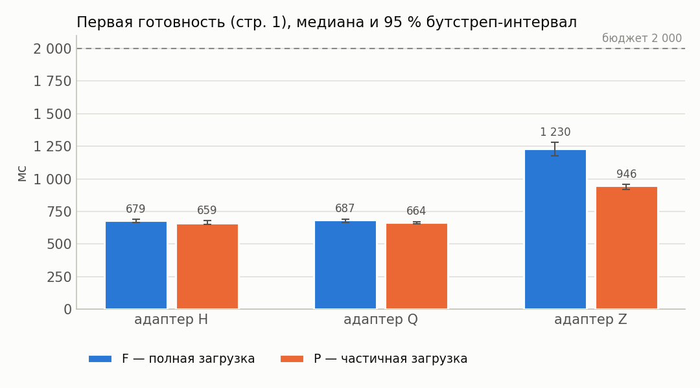

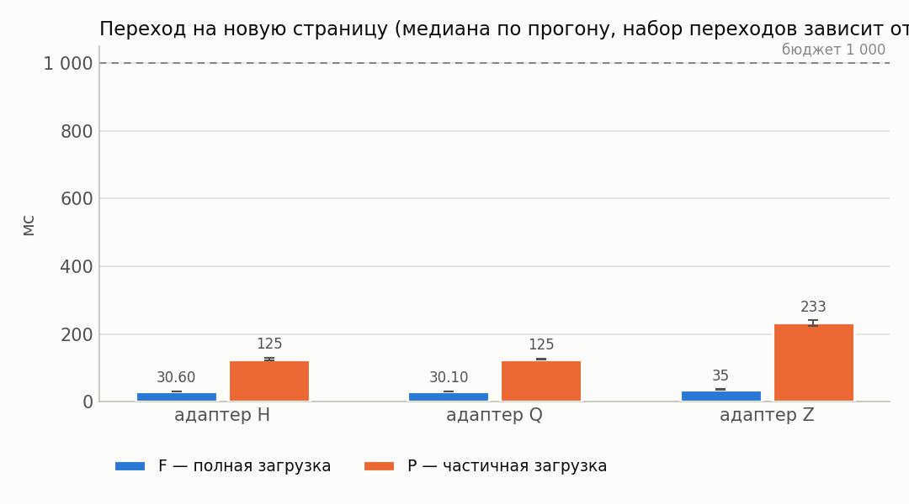

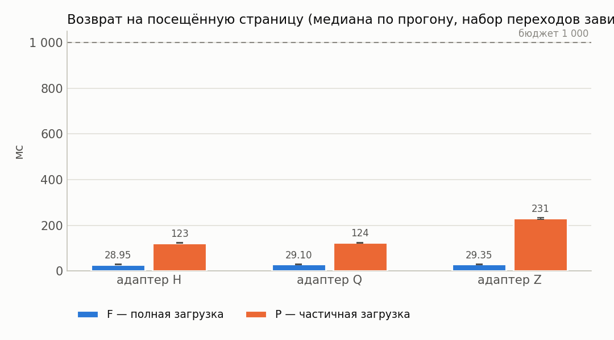

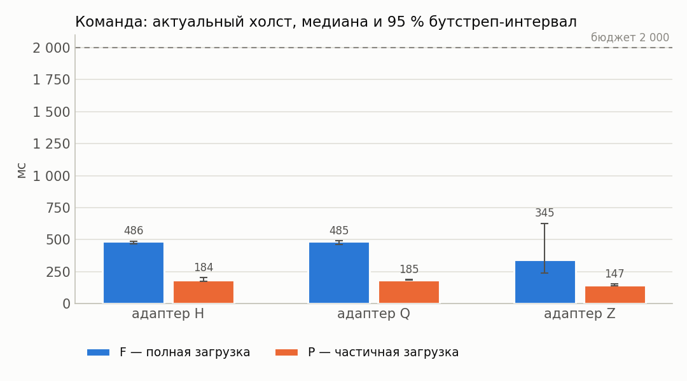

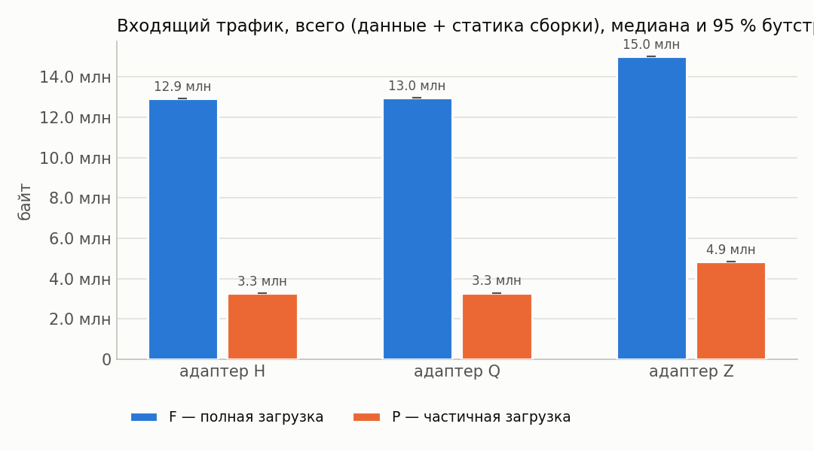

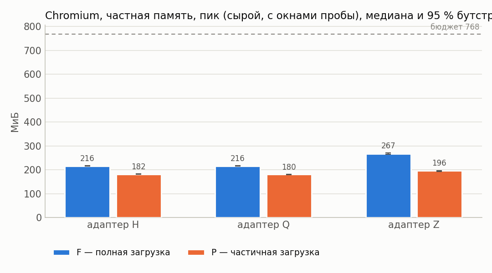

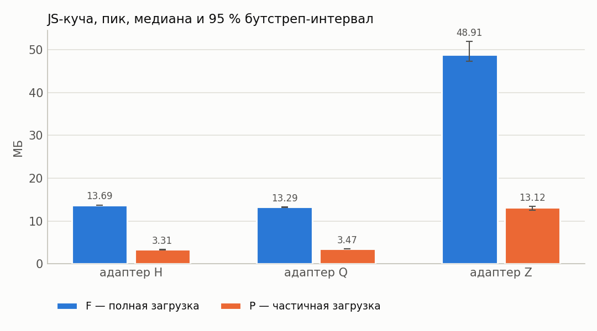

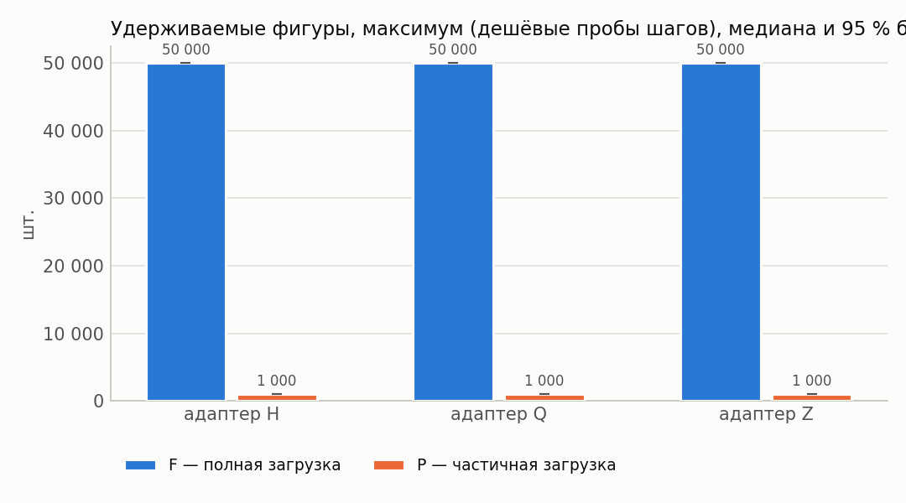

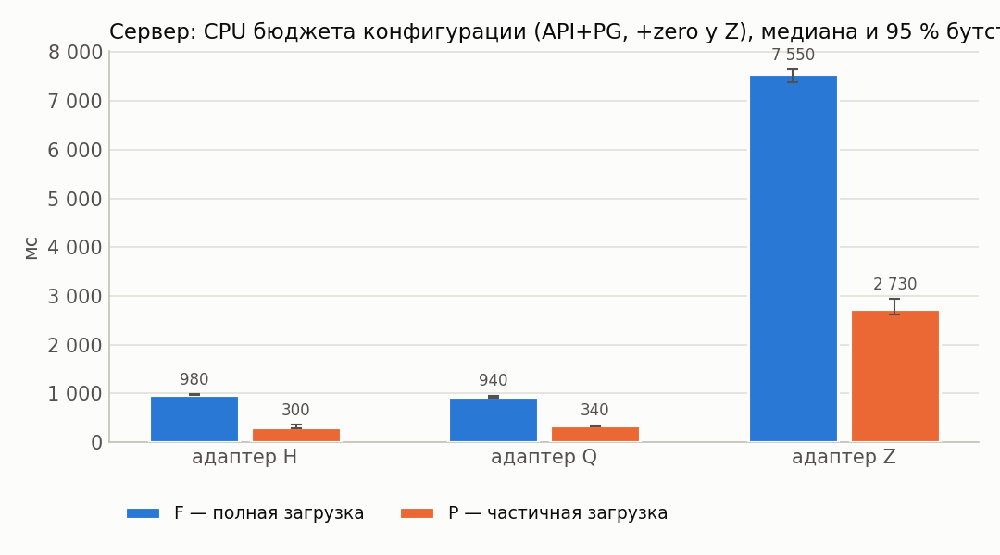

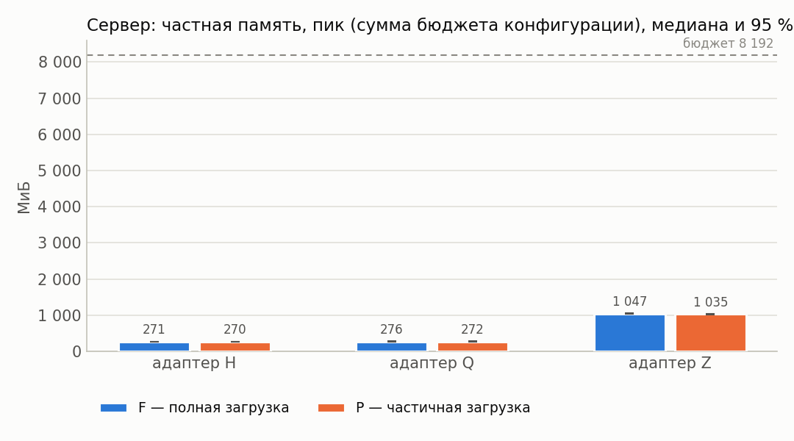

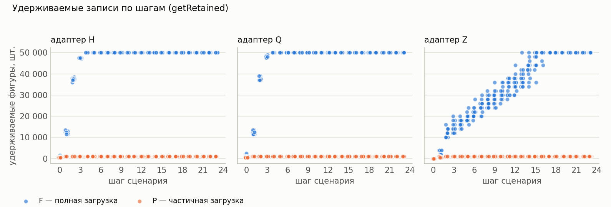

## 12. Выводы

* Оценки изменения P−F ниже — **парные** (медиана поблочных разностей, блок = повторение).
* Все бюджеты §7.4 выполнены для конфигураций: H/F, H/P (cache=1), Q/F, Q/P (cache=1), Z/F, Z/P (cache=1).
* H, cache=1: в режиме P первая готовность на 3 % меньше, чем в F (P/F = 0.97, 95 % интервал [0.95; 1.00]; интервал Δ содержит 0 — различие не подтверждено).
* Q, cache=1: в режиме P первая готовность на 3 % меньше, чем в F (P/F = 0.97, 95 % интервал [0.96; 1.00]; интервал Δ содержит 0 — различие не подтверждено).
* Z, cache=1: в режиме P первая готовность на 24 % меньше, чем в F (P/F = 0.76, 95 % интервал [0.71; 0.80]; интервал Δ не содержит 0).
* H, cache=1: в режиме P пик частной памяти Chromium на 16 % меньше, чем в F (P/F = 0.84, 95 % интервал [0.84; 0.85]; интервал Δ не содержит 0).
* Q, cache=1: в режиме P пик частной памяти Chromium на 17 % меньше, чем в F (P/F = 0.83, 95 % интервал [0.82; 0.84]; интервал Δ не содержит 0).
* Z, cache=1: в режиме P пик частной памяти Chromium на 27 % меньше, чем в F (P/F = 0.73, 95 % интервал [0.72; 0.74]; интервал Δ не содержит 0).
* H, cache=1: в режиме P входящий трафик на 75 % меньше, чем в F (P/F = 0.25, 95 % интервал [0.25; 0.25]; интервал Δ не содержит 0).
* Q, cache=1: в режиме P входящий трафик на 75 % меньше, чем в F (P/F = 0.25, 95 % интервал [0.25; 0.25]; интервал Δ не содержит 0).
* Z, cache=1: в режиме P входящий трафик на 68 % меньше, чем в F (P/F = 0.32, 95 % интервал [0.32; 0.32]; интервал Δ не содержит 0).
* H, cache=1: в режиме P максимум удерживаемых фигур на 98 % меньше, чем в F (P/F = 0.02, 95 % интервал [0.02; 0.02]; интервал Δ не содержит 0).
* Q, cache=1: в режиме P максимум удерживаемых фигур на 98 % меньше, чем в F (P/F = 0.02, 95 % интервал [0.02; 0.02]; интервал Δ не содержит 0).
* Z, cache=1: в режиме P максимум удерживаемых фигур на 98 % меньше, чем в F (P/F = 0.02, 95 % интервал [0.02; 0.02]; интервал Δ не содержит 0).
* H, cache=1: в режиме P переход на новую страницу на 306 % больше, чем в F (P/F = 4.06, 95 % интервал [4.02; 4.32]; интервал Δ не содержит 0).
* Q, cache=1: в режиме P переход на новую страницу на 316 % больше, чем в F (P/F = 4.16, 95 % интервал [4.07; 4.30]; интервал Δ не содержит 0).
* Z, cache=1: в режиме P переход на новую страницу на 552 % больше, чем в F (P/F = 6.52, 95 % интервал [6.09; 6.78]; интервал Δ не содержит 0).
* Перекрёстная проверка обмена сошлась во всех конфигурациях (наибольшее расхождение шейпера и суммы CDP HTTP+WebSocket — 0.0 %).
* У конфигураций Z/F, Z/P (cache=1) холст успевает обновиться раньше подтверждения сервера — доставка синхронизацией опережает ответ по HTTP; обе величины приведены отдельно в разделе 4.
* Точечная доля успеха ≥ 95 %: H/F, H/P (cache=1), Q/F, Q/P (cache=1), Z/F, Z/P (cache=1).
* Нижняя граница интервала Уилсона ниже 95 % для: H/F, H/P (cache=1), Q/F, Q/P (cache=1), Z/F, Z/P (cache=1). При n < 73 прогонов она не достигает 95 % даже без единого отказа, поэтому здесь это ограничение объёма серии, а не свидетельство ненадёжности; при наличии отказов — см. раздел «Ошибки».
* Условия применимости частичной загрузки: режим P оправдан, когда его выигрыш по первой готовности/памяти/трафику подтверждён интервалом (не содержащим 0) и при этом переходы на новые страницы и команда до холста остаются в бюджете, а удерживаемые записи не выходят за объявленное окно.
