# Результаты серии «size-fraction-25x500»

Сформировано 2026-09-14 02:47 UTC из `../../results/size-fraction-25x500/runs.csv` (90 прогонов, 6 конфигураций). Бутстреп: 2000 ресемплов, seed=42, перцентильные 95 % интервалы. Времена и ресурсы считаются по прогонам с `outcome=ok`; доли — по всем начатым прогонам.

**Определения статистик** (одинаковы во всех таблицах): медиана — обычная выборочная; p95 — перцентиль по линейной интерполяции порядковых статистик (`numpy.percentile`, тип 7), при n = 30 это интерполяция между 29‑м и 30‑м значением, поэтому p95 не превышает максимум выборки и при малых n смещён вниз; интервалы медианы и p95 — перцентильный бутстреп по одной матрице ресемплов (согласованы между собой); доли — интервал Уилсона 95 % без поправки на непрерывность; при n < 8 интервалы помечены † как ненадёжные, при n < 2 не строятся.

Проверка схемы: OK — rows=90

## 1. Паспорт серии

| Параметр | Значение |
|---|---|
| `series` | size-fraction-25x500 |
| `startedAt` | 2026-09-13T20:37:36.545Z |
| `finishedAt` | 2026-09-13T20:53:41.831Z |
| `host` | {"hostname": "vm", "os": "Linux 6.18.44-fc-v24", "platform": "linux", "arch": "x64", "kernel": "6.18.44-fc-v24", "distro": "Ubuntu 24.04.4 LTS", "cpuModel": "Intel(R) Xeon(R) Processor @ 2.80GHz", "cp |
| `versions` | {"node": "v24.21.0", "npm": "11.19.0", "postgres": "psql (PostgreSQL) 16.13 (Ubuntu 16.13-0ubuntu0.24.04.1)", "chromium": "141.0.7390.37", "playwright": "1.56.0", "zero": "1.9.0", "reactQuery": "5.102 |
| `packages` | {"playwright": "1.56.0", "@types/node": "24.13.4", "typescript": "5.9.3", "ws": "8.21.3", "@rocicorp/zero": "1.9.0", "@tanstack/react-query": "5.102.8", "react": "19.3.0", "react-dom": "19.3.0", "@typ |
| `packagesHoistedDifferent` | {"postgres": "3.4.7", "@fastify/cors": "10.1.0"} |
| `workspacePackages` | {"packages/bench": {"playwright": "1.56.0", "@types/node": "24.13.4", "typescript": "5.9.3", "ws": "8.21.3"}, "packages/client": {"@rocicorp/zero": "1.9.0", "@tanstack/react-query": "5.102.8", "react" |
| `lockfileVersion` | 3 |
| `shaper` | {"delayMs": 25, "bandwidthMbit": 20, "handshakeRtt": true, "statsUrl": "http://127.0.0.1:8081", "effective": {"delayMs": 25, "bandwidthMbit": 20, "bucketMs": 20, "segmentBytes": 4096, "bucketBytes": 5 |
| `seed` | 20260911 |
| `repetitions` | 15 |
| `configs` | [{"adapter": "H", "mode": "F", "cache": 1}, {"adapter": "H", "mode": "P", "cache": 1}, {"adapter": "Q", "mode": "F", "cache": 1}, {"adapter": "Q", "mode": "P", "cache": 1}, {"adapter": "Z", "mode": "F |
| `seriesConfig` | {"name": "size-fraction-25x500", "doc": "doc-frac-25x500", "sourceId": "doc-frac-25x500-src-1", "fill": "#1e90ff", "docJson": "data/frac-25x500.json", "configs": [{"adapter": "H", "mode": "F", "cache" |
| `procGroups` | [{"name": "api", "pidFile": "/home/claude/stand/results/logs/api.pid", "exclude": ["netshaper", "zero-cache"]}, {"name": "pg", "patterns": ["(^\|/)postgres .*16/main", "^postgres: 16/main"], "exclude": |
| `browser` | {"channel": "chromium", "args": ["--disable-extensions"], "headless": true, "viewport": {"width": 1280, "height": 800}} |
| `scenario` | {"route": [2, 3, 1, 2, 3], "pauseMs": 1000, "budgets": {"firstReadyMs": 2000, "navMs": 1000, "cmdDrawnMs": 2000, "scenarioMs": 30000}} |
| `plan` | [{"run_id": "size-fraction-25x500-0000-QP1", "order_index": 0, "repetition": 0, "adapter": "Q", "mode": "P", "cache": 1}, {"run_id": "size-fraction-25x500-0001-ZP1", "order_index": 1, "repetition": 0, |
| `client` | {"dist": [{"path": "adapter-settings.json", "bytes": 1004, "mtime": "2026-09-13T19:30:30.755Z", "sha256": "5d7d9af8420141ebb66ea6894d26792039f489306b9ba46bfea9900ef01071b1"}, {"path": "assets/h-BRsLg0 |
| `adapters` | {"available": true, "source": "packages/client/dist/adapter-settings.json", "generatedFrom": ["packages/client/src/adapters/types.ts → ADAPTER_SETTINGS", "packages/client/src/adapters/settings.ts → Z_ |
| `api` | {"url": "http://127.0.0.1:3000", "available": true, "logLevel": "warn", "health": {"status": "ok", "db": "ok", "uptimeSec": 44059, "testHooks": true, "logLevel": "warn", "now": "2026-09-13T20:37:36.80 |
| `zero` | {"config": {"pid": 1025, "env": {"ZERO_QUERY_URL": "http://127.0.0.1:3000/api/zero/query", "NODE_OPTIONS": "--max-old-space-size=8192 --import=/home/claude/stand/scripts/zero-ipv4-shim.mjs", "ZERO_ENA |
| `commit` | None |
| `code` | {"commit": null, "isGitRepo": false, "dirty": null, "codeId": "4bb9e4465904a250bc72d8338d19363855cfe7f827b12662d8600f4f90ee5917", "clientBuildId": "e8d6c0b226b1ac5d27bc8bd39b66d2b5bc2aab491b4d5f8e554c |
| `harness` | {"harnessId": "592d84bd54df6a1a60380e5e25ada2dcbd88685e9aa07d10508ced0093472ada", "harnessIdShort": "592d84bd54df6a1a", "benchId": "8e1bdf1d09f201b6d42ff58f62fccfc4be22cd53ac554a5dd2aeb14ed5a99ccf", " |
| `preSeriesChecks` | {"at": "2026-09-13T20:37:36.846Z", "samplers": {"ok": true, "groups": [{"group": "api", "needed": true, "processes": 1, "pids": [984], "verdict": "ok", "spec": "pidFile=/home/claude/stand/results/logs |
| `runsExecutedNow` | 90 |
| `runsExecutedTotal` | 90 |
| `runsOk` | 90 |
| `runsTotalPlanned` | 90 |

## 2. Состав серии и доля успеха

Успех прогона = `outcome=ok` ∧ `t_scenario ≤ 30 с` ∧ все проверки эталона прошли (SPEC §7.3).

Доли считаются по **всем** начатым прогонам конфигурации (ошибка и таймаут = неуспех); сводки времени и ресурсов ниже — только по прогонам `outcome=ok`.

| Конфигурация | Прогонов | ok | error | timeout | эталон ✓ | ok, но эталон ✗ | успех | Доля успеха [Уилсон 95 %] |
|---|---|---|---|---|---|---|---|---|
| H/F | 15 | 15 | 0 | 0 | 15 | 0 | 15 | 100.0 % [79.6 %; 100.0 %] |
| H/P (cache=1) | 15 | 15 | 0 | 0 | 15 | 0 | 15 | 100.0 % [79.6 %; 100.0 %] |
| Q/F | 15 | 15 | 0 | 0 | 15 | 0 | 15 | 100.0 % [79.6 %; 100.0 %] |
| Q/P (cache=1) | 15 | 15 | 0 | 0 | 15 | 0 | 15 | 100.0 % [79.6 %; 100.0 %] |
| Z/F | 15 | 15 | 0 | 0 | 15 | 0 | 15 | 100.0 % [79.6 %; 100.0 %] |
| Z/P (cache=1) | 15 | 15 | 0 | 0 | 15 | 0 | 15 | 100.0 % [79.6 %; 100.0 %] |

## 3. Сводные показатели по конфигурациям

Для каждого показателя приводятся n, медиана с 95 % перцентильным бутстреп‑интервалом, p95 (линейная интерполяция порядковых статистик) с таким же интервалом, min и max. Знак † — интервал построен по n < 8 наблюдениям и ненадёжен; «—» вместо интервала — n < 2, интервал не определён.

### 3.1 Время

**Первая готовность (стр. 1), мс**

| Конфигурация | n | Медиана | 95 % ИД медианы | p95 | 95 % ИД p95 | min | max |
|---|---|---|---|---|---|---|---|
| H/F | 15 | 671 | [660; 684] | 715 | [688; 719] | 649 | 719 |
| H/P (cache=1) | 15 | 655 | [642; 671] | 695 | [666; 722] | 640 | 722 |
| Q/F | 15 | 662 | [651; 683] | 718 | [680; 741] | 636 | 741 |
| Q/P (cache=1) | 15 | 664 | [657; 680] | 694 | [677; 708] | 626 | 708 |
| Z/F | 15 | 1 150 | [1 134; 1 194] | 1 237 | [1 185; 1 252] | 1 109 | 1 252 |
| Z/P (cache=1) | 15 | 896 | [855; 913] | 952 | [914; 957] | 835 | 957 |

**Переход на новую страницу (медиана по прогону, набор переходов зависит от маршрута серии), мс**

| Конфигурация | n | Медиана | 95 % ИД медианы | p95 | 95 % ИД p95 | min | max |
|---|---|---|---|---|---|---|---|
| H/F | 15 | 34 | [30; 41] | 43 | [40; 46] | 28 | 46 |
| H/P (cache=1) | 15 | 128 | [123; 133] | 136 | [131; 137] | 121 | 137 |
| Q/F | 15 | 34 | [32; 40] | 43 | [40; 46] | 29 | 46 |
| Q/P (cache=1) | 15 | 126 | [126; 131] | 136 | [131; 142] | 122 | 142 |
| Z/F | 15 | 34 | [32; 37] | 43 | [37; 47] | 29 | 47 |
| Z/P (cache=1) | 15 | 221 | [204; 240] | 252 | [237; 263] | 197 | 263 |

**Возврат на посещённую страницу (медиана по прогону, набор переходов зависит от маршрута серии), мс**

| Конфигурация | n | Медиана | 95 % ИД медианы | p95 | 95 % ИД p95 | min | max |
|---|---|---|---|---|---|---|---|
| H/F | 15 | 13 | [12; 13] | 16 | [13; 16] | 10 | 16 |
| H/P (cache=1) | 15 | 107 | [106; 109] | 111 | [109; 112] | 99 | 112 |
| Q/F | 15 | 15 | [13; 16] | 17 | [16; 17] | 11 | 17 |
| Q/P (cache=1) | 15 | 108 | [106; 110] | 112 | [110; 113] | 103 | 113 |
| Z/F | 15 | 15 | [14; 16] | 18 | [16; 18] | 11 | 18 |
| Z/P (cache=1) | 15 | 200 | [194; 222] | 236 | [215; 236] | 179 | 236 |

**Команда: подтверждение транспорта (Z — .server, H/Q — ответ POST), мс**

| Конфигурация | n | Медиана | 95 % ИД медианы | p95 | 95 % ИД p95 | min | max |
|---|---|---|---|---|---|---|---|
| H/F | 15 | 68 | [67; 69] | 73 | [70; 73] | 64 | 73 |
| H/P (cache=1) | 15 | 73 | [68; 78] | 85 | [77; 95] | 64 | 95 |
| Q/F | 15 | 68 | [66; 73] | 77 | [72; 82] | 63 | 82 |
| Q/P (cache=1) | 15 | 71 | [67; 81] | 90 | [77; 93] | 62 | 93 |
| Z/F | 15 | 586 | [499; 595] | 746 | [612; 764] | 224 | 764 |
| Z/P (cache=1) | 15 | 118 | [115; 143] | 162 | [136; 178] | 109 | 178 |

**Команда: подтверждение сервера (результат операции), мс**

| Конфигурация | n | Медиана | 95 % ИД медианы | p95 | 95 % ИД p95 | min | max |
|---|---|---|---|---|---|---|---|
| H/F | 15 | 68 | [65; 70] | 73 | [70; 73] | 64 | 73 |
| H/P (cache=1) | 15 | 73 | [70; 78] | 85 | [77; 95] | 64 | 95 |
| Q/F | 15 | 68 | [66; 73] | 77 | [73; 82] | 63 | 82 |
| Q/P (cache=1) | 15 | 71 | [68; 76] | 90 | [78; 94] | 63 | 94 |
| Z/F | 15 | 662 | [597; 751] | 820 | [744; 874] | 332 | 874 |
| Z/P (cache=1) | 15 | 186 | [177; 198] | 225 | [201; 236] | 167 | 236 |

**Команда: цена протокола подтверждения (ack − транспорт), мс**

| Конфигурация | n | Медиана | 95 % ИД медианы | p95 | 95 % ИД p95 | min | max |
|---|---|---|---|---|---|---|---|
| H/F | 15 | 0 | [0; 0] | 0 | [0; 0] | 0 | 0 |
| H/P (cache=1) | 15 | 0 | [0; 0] | 0 | [0; 1] | 0 | 1 |
| Q/F | 15 | 0 | [0; 0] | 0 | [0; 0] | 0 | 0 |
| Q/P (cache=1) | 15 | 0 | [0; 0] | 0 | [0; 0] | 0 | 0 |
| Z/F | 15 | 76 | [69; 111] | 148 | [110; 190] | 59 | 190 |
| Z/P (cache=1) | 15 | 59 | [58; 64] | 70 | [64; 71] | 58 | 71 |

**Команда: данные в хранилище активной страницы, мс**

| Конфигурация | n | Медиана | 95 % ИД медианы | p95 | 95 % ИД p95 | min | max |
|---|---|---|---|---|---|---|---|
| H/F | 15 | 176 | [165; 216] | 269 | [216; 271] | 159 | 271 |
| H/P (cache=1) | 15 | 168 | [167; 175] | 191 | [177; 192] | 160 | 192 |
| Q/F | 15 | 168 | [165; 172] | 180 | [173; 180] | 157 | 180 |
| Q/P (cache=1) | 15 | 173 | [170; 177] | 200 | [178; 215] | 158 | 215 |
| Z/F | 15 | 586 | [513; 595] | 743 | [600; 764] | 224 | 764 |
| Z/P (cache=1) | 15 | 118 | [112; 133] | 161 | [136; 178] | 109 | 178 |

**Команда: актуальный холст, мс**

| Конфигурация | n | Медиана | 95 % ИД медианы | p95 | 95 % ИД p95 | min | max |
|---|---|---|---|---|---|---|---|
| H/F | 15 | 191 | [180; 230] | 281 | [230; 283] | 174 | 283 |
| H/P (cache=1) | 15 | 180 | [177; 194] | 199 | [192; 200] | 169 | 200 |
| Q/F | 15 | 181 | [176; 185] | 189 | [184; 190] | 169 | 190 |
| Q/P (cache=1) | 15 | 184 | [180; 191] | 212 | [192; 226] | 167 | 226 |
| Z/F | 15 | 598 | [530; 616] | 766 | [619; 785] | 251 | 785 |
| Z/P (cache=1) | 15 | 134 | [128; 158] | 175 | [150; 195] | 120 | 195 |

**Переход, медиана всех переходов прогона (маршрут любой длины), мс**

| Конфигурация | n | Медиана | 95 % ИД медианы | p95 | 95 % ИД p95 | min | max |
|---|---|---|---|---|---|---|---|
| H/F | 15 | 16 | [14; 17] | 19 | [17; 20] | 13 | 20 |
| H/P (cache=1) | 15 | 112 | [110; 114] | 119 | [114; 123] | 108 | 123 |
| Q/F | 15 | 17 | [14; 19] | 24 | [19; 34] | 11 | 34 |
| Q/P (cache=1) | 15 | 113 | [112; 116] | 122 | [116; 123] | 107 | 123 |
| Z/F | 15 | 17 | [16; 20] | 25 | [21; 27] | 13 | 27 |
| Z/P (cache=1) | 15 | 204 | [198; 210] | 234 | [213; 236] | 183 | 236 |

**Сценарий целиком (с паузами, без проб оболочки), мс**

| Конфигурация | n | Медиана | 95 % ИД медианы | p95 | 95 % ИД p95 | min | max |
|---|---|---|---|---|---|---|---|
| H/F | 15 | 6 984 | [6 960; 7 035] | 7 069 | [7 027; 7 118] | 6 925 | 7 118 |
| H/P (cache=1) | 15 | 7 419 | [7 403; 7 435] | 7 462 | [7 438; 7 505] | 7 386 | 7 505 |
| Q/F | 15 | 6 957 | [6 943; 6 979] | 7 019 | [6 983; 7 034] | 6 926 | 7 034 |
| Q/P (cache=1) | 15 | 7 442 | [7 418; 7 454] | 7 480 | [7 454; 7 482] | 7 378 | 7 482 |
| Z/F | 15 | 7 928 | [7 910; 7 999] | 8 131 | [8 007; 8 188] | 7 626 | 8 188 |
| Z/P (cache=1) | 15 | 8 149 | [8 120; 8 180] | 8 226 | [8 180; 8 270] | 8 019 | 8 270 |

**Сценарий целиком, сырое время (с пробами оболочки), мс**

| Конфигурация | n | Медиана | 95 % ИД медианы | p95 | 95 % ИД p95 | min | max |
|---|---|---|---|---|---|---|---|
| H/F | 15 | 6 992 | [6 966; 7 033] | 7 082 | [7 034; 7 126] | 6 938 | 7 126 |
| H/P (cache=1) | 15 | 7 424 | [7 416; 7 448] | 7 477 | [7 449; 7 511] | 7 398 | 7 511 |
| Q/F | 15 | 6 973 | [6 955; 7 002] | 7 024 | [6 990; 7 039] | 6 942 | 7 039 |
| Q/P (cache=1) | 15 | 7 454 | [7 430; 7 460] | 7 497 | [7 464; 7 504] | 7 393 | 7 504 |
| Z/F | 15 | 7 967 | [7 873; 8 022] | 8 203 | [8 044; 8 244] | 7 719 | 8 244 |
| Z/P (cache=1) | 15 | 8 164 | [8 126; 8 185] | 8 234 | [8 187; 8 286] | 8 035 | 8 286 |

**Пробы оболочки сверх объявленных пауз, мс**

| Конфигурация | n | Медиана | 95 % ИД медианы | p95 | 95 % ИД p95 | min | max |
|---|---|---|---|---|---|---|---|
| H/F | 15 | 8 | [8; 12] | 15 | [12; 16] | 1 | 16 |
| H/P (cache=1) | 15 | 9 | [5; 12] | 18 | [12; 20] | 4 | 20 |
| Q/F | 15 | 14 | [8; 16] | 20 | [17; 20] | 5 | 20 |
| Q/P (cache=1) | 15 | 13 | [12; 15] | 18 | [15; 22] | 1 | 22 |
| Z/F | 15 | 39 | [9; 77] | 125 | [77; 135] | 5 | 135 |
| Z/P (cache=1) | 15 | 9 | [6; 16] | 17 | [13; 20] | 4 | 20 |

### 3.2 Объём обмена

**Головная величина обмена — «только данные»** (`bytes_in_data`: API + кадры синхронизации Zero). Полный `bytes_in` включает статику сборки — поадаптерную константу, одинаковую в F и в P, поэтому в отношениях P/F она искажает сравнение (`docs/DEVIATIONS.md` §3.1). Оба числа приводятся рядом, разложение — ниже.

**Входящий трафик: ДАННЫЕ (API + WebSocket Zero, без статики сборки), байт**

| Конфигурация | n | Медиана | 95 % ИД медианы | p95 | 95 % ИД p95 | min | max |
|---|---|---|---|---|---|---|---|
| H/F | 15 | 4 175 363 | [4 175 363; 4 175 363] | 4 175 363 | [4 175 363; 4 175 363] | 4 175 363 | 4 175 363 |
| H/P (cache=1) | 15 | 834 145 | [834 145; 834 145] | 834 145 | [834 145; 834 145] | 834 145 | 834 145 |
| Q/F | 15 | 4 175 363 | [4 175 363; 4 175 363] | 4 175 363 | [4 175 363; 4 175 363] | 4 175 363 | 4 175 363 |
| Q/P (cache=1) | 15 | 834 145 | [834 145; 834 145] | 834 145 | [834 145; 834 145] | 834 145 | 834 145 |
| Z/F | 15 | 3 599 581 | [3 599 581; 3 599 581] | 3 599 581 | [3 599 581; 3 599 581] | 3 597 170 | 3 599 581 |
| Z/P (cache=1) | 15 | 1 009 062 | [1 009 062; 1 009 062] | 1 009 062 | [1 009 062; 1 009 062] | 1 009 062 | 1 009 062 |

**Входящий трафик, всего (данные + статика сборки), байт**

| Конфигурация | n | Медиана | 95 % ИД медианы | p95 | 95 % ИД p95 | min | max |
|---|---|---|---|---|---|---|---|
| H/F | 15 | 4 435 757 | [4 435 757; 4 435 757] | 4 435 757 | [4 435 757; 4 435 757] | 4 435 757 | 4 435 757 |
| H/P (cache=1) | 15 | 1 094 539 | [1 094 539; 1 094 539] | 1 094 539 | [1 094 539; 1 094 539] | 1 094 539 | 1 094 539 |
| Q/F | 15 | 4 466 769 | [4 466 769; 4 466 769] | 4 466 769 | [4 466 769; 4 466 769] | 4 466 769 | 4 466 769 |
| Q/P (cache=1) | 15 | 1 125 551 | [1 125 551; 1 125 551] | 1 125 551 | [1 125 551; 1 125 551] | 1 125 551 | 1 125 551 |
| Z/F | 15 | 4 172 105 | [4 172 105; 4 172 105] | 4 172 105 | [4 172 105; 4 172 105] | 4 169 694 | 4 172 105 |
| Z/P (cache=1) | 15 | 1 581 586 | [1 581 586; 1 581 586] | 1 581 586 | [1 581 586; 1 581 586] | 1 581 586 | 1 581 586 |

**Статика сборки за прогон (поадаптерная константа), байт**

| Конфигурация | n | Медиана | 95 % ИД медианы | p95 | 95 % ИД p95 | min | max |
|---|---|---|---|---|---|---|---|
| H/F | 15 | 260 394 | [260 394; 260 394] | 260 394 | [260 394; 260 394] | 260 394 | 260 394 |
| H/P (cache=1) | 15 | 260 394 | [260 394; 260 394] | 260 394 | [260 394; 260 394] | 260 394 | 260 394 |
| Q/F | 15 | 291 406 | [291 406; 291 406] | 291 406 | [291 406; 291 406] | 291 406 | 291 406 |
| Q/P (cache=1) | 15 | 291 406 | [291 406; 291 406] | 291 406 | [291 406; 291 406] | 291 406 | 291 406 |
| Z/F | 15 | 572 524 | [572 524; 572 524] | 572 524 | [572 524; 572 524] | 572 524 | 572 524 |
| Z/P (cache=1) | 15 | 572 524 | [572 524; 572 524] | 572 524 | [572 524; 572 524] | 572 524 | 572 524 |

**Исходящий трафик: данные (без статики), байт**

| Конфигурация | n | Медиана | 95 % ИД медианы | p95 | 95 % ИД p95 | min | max |
|---|---|---|---|---|---|---|---|
| H/F | 15 | 31 069 | [31 069; 31 069] | 31 069 | [31 069; 31 069] | 31 069 | 31 069 |
| H/P (cache=1) | 15 | 8 227 | [8 227; 8 227] | 8 227 | [8 227; 8 227] | 8 227 | 8 227 |
| Q/F | 15 | 31 069 | [31 069; 31 069] | 31 069 | [31 069; 31 069] | 31 069 | 31 069 |
| Q/P (cache=1) | 15 | 8 227 | [8 227; 8 227] | 8 227 | [8 227; 8 227] | 8 227 | 8 227 |
| Z/F | 15 | 8 952 | [8 951; 8 952] | 8 952 | [8 952; 8 952] | 8 938 | 8 952 |
| Z/P (cache=1) | 15 | 6 272 | [6 271; 6 272] | 6 272 | [6 272; 6 272] | 6 258 | 6 272 |

**Исходящий трафик, всего (шейпер), байт**

| Конфигурация | n | Медиана | 95 % ИД медианы | p95 | 95 % ИД p95 | min | max |
|---|---|---|---|---|---|---|---|
| H/F | 15 | 35 158 | [35 158; 35 158] | 35 158 | [35 158; 35 158] | 35 158 | 35 158 |
| H/P (cache=1) | 15 | 12 316 | [12 316; 12 316] | 12 316 | [12 316; 12 316] | 12 316 | 12 316 |
| Q/F | 15 | 35 158 | [35 158; 35 158] | 35 158 | [35 158; 35 158] | 35 158 | 35 158 |
| Q/P (cache=1) | 15 | 12 316 | [12 316; 12 316] | 12 316 | [12 316; 12 316] | 12 316 | 12 316 |
| Z/F | 15 | 13 099 | [13 098; 13 099] | 13 099 | [13 099; 13 099] | 13 085 | 13 099 |
| Z/P (cache=1) | 15 | 10 419 | [10 418; 10 419] | 10 419 | [10 419; 10 419] | 10 405 | 10 419 |

**Входящий трафик (CDP, перекрёстная проверка), байт**

| Конфигурация | n | Медиана | 95 % ИД медианы | p95 | 95 % ИД p95 | min | max |
|---|---|---|---|---|---|---|---|
| H/F | 15 | 4 435 757 | [4 435 757; 4 435 757] | 4 435 757 | [4 435 757; 4 435 757] | 4 435 757 | 4 435 757 |
| H/P (cache=1) | 15 | 1 094 539 | [1 094 539; 1 094 539] | 1 094 539 | [1 094 539; 1 094 539] | 1 094 539 | 1 094 539 |
| Q/F | 15 | 4 466 769 | [4 466 769; 4 466 769] | 4 466 769 | [4 466 769; 4 466 769] | 4 466 769 | 4 466 769 |
| Q/P (cache=1) | 15 | 1 125 551 | [1 125 551; 1 125 551] | 1 125 551 | [1 125 551; 1 125 551] | 1 125 551 | 1 125 551 |
| Z/F | 15 | 575 281 | [575 281; 575 281] | 575 281 | [575 281; 575 281] | 575 281 | 575 281 |
| Z/P (cache=1) | 15 | 575 281 | [575 281; 575 281] | 575 281 | [575 281; 575 281] | 575 281 | 575 281 |

**Обмен данными против полного объёма**

Источник разложения: колонки оболочки `bytes_in_api` / `bytes_in_zero` / `bytes_in_static`.

Разброс статики внутри конфигурации обязан быть нулевым — это константа сборки, а не измеряемая величина; ненулевой разброс означал бы, что в статику попало что‑то ещё, и его надо разбирать.

| Конфигурация | n | **Данные (API + WS), байт** | Статика сборки, байт | Всего, байт | Доля статики | Разброс статики |
|---|---|---|---|---|---|---|
| H/F | 15‡ | 4 175 363 | 260 394 | 4 435 757 | 5.9 % | 0 |
| H/P (cache=1) | 15‡ | 834 145 | 260 394 | 1 094 539 | 23.8 % | 0 |
| Q/F | 15‡ | 4 175 363 | 291 406 | 4 466 769 | 6.5 % | 0 |
| Q/P (cache=1) | 15‡ | 834 145 | 291 406 | 1 125 551 | 25.9 % | 0 |
| Z/F | 15‡ | 3 599 581 | 572 524 | 4 172 105 | 13.7 % | 0 |
| Z/P (cache=1) | 15‡ | 1 009 062 | 572 524 | 1 581 586 | 36.2 % | 0 |

**P/F обмена: по полному трафику и по данным** (парная оценка, блок = повторение)

| Адаптер | Пар | Статика, байт | P/F полный (как публиковалось) | **P/F данные (головное)** | Изменилось |
|---|---|---|---|---|---|
| H (cache=1) | 15‡ | 260 394 | 0.247 [0.247; 0.247] | **0.200** [0.200; 0.200] | да, -0.047 |
| Q (cache=1) | 15‡ | 291 406 | 0.252 [0.252; 0.252] | **0.200** [0.200; 0.200] | да, -0.052 |
| Z (cache=1) | 15‡ | 572 524 | 0.379 [0.379; 0.379] | **0.280** [0.280; 0.280] | да, -0.099 |

Последний столбец отвечает на вопрос «какие опубликованные числа двигает вычитание статики»: величина сдвига = P/F(данные) − P/F(полный).

**Полнота разложения: сумма по маршрутам против итога**

Головное число обмена — `bytes_in_data = bytes_in_api + bytes_in_zero`. Оно осмысленно ровно настолько, насколько разложение полное, поэтому проверка идёт **по каждому прогону**, а не по медианам: столбцы «расхождение» — максимум по прогонам конфигурации от |(api + zero + статика + прочее) − итог|, столбцы «остаток» — максимум собственной контрольной колонки оболочки `bytes_*_route_residual`. Ожидаемое значение всех четырёх — ноль.

| Конфигурация | n | Расхождение вход, Б | Расхождение исход, Б | Остаток вход, Б | Остаток исход, Б | Прочее (вход), Б | Сошлось |
|---|---|---|---|---|---|---|---|
| H/F | 15‡ | 0 | 0 | 0 | 0 | 0 | ✓ |
| H/P (cache=1) | 15‡ | 0 | 0 | 0 | 0 | 0 | ✓ |
| Q/F | 15‡ | 0 | 0 | 0 | 0 | 0 | ✓ |
| Q/P (cache=1) | 15‡ | 0 | 0 | 0 | 0 | 0 | ✓ |
| Z/F | 15‡ | 0 | 0 | 0 | 0 | 0 | ✓ |
| Z/P (cache=1) | 15‡ | 0 | 0 | 0 | 0 | 0 | ✓ |

Все конфигурации сошлись побайтно: «данные + статика + прочее» исчерпывают весь наблюдаемый обмен, и головная величина `bytes_in_data` ничего не теряет.

**Перекрёстная проверка трафика (шейпер vs CDP)**

Шейпер считает байты TCP‑полезной нагрузки всех соединений клиента; CDP даёт их двумя счётчиками — `cdp_bytes_in` (`encodedDataLength` HTTP‑ответов) и `cdp_ws_bytes_in` (кадры WebSocket). У H/Q второй счётчик нулевой, у Z по WebSocket идёт почти весь обмен, поэтому сверять нужно **сумму**: сравнение только с `cdp_bytes_in` давало ложный провал у Z (в прежнем `results/smoke/report.md` — Z/F 92.5 %, Z/P 76.6 %).

| Конфигурация | bytes_in (шейпер) | CDP: HTTP | CDP: WebSocket | CDP: сумма | Расхождение | ≤ 10 % |
|---|---|---|---|---|---|---|
| H/F | 4 435 757 | 4 435 757 | 0 | 4 435 757 | 0.0 % | ✓ |
| H/P (cache=1) | 1 094 539 | 1 094 539 | 0 | 1 094 539 | 0.0 % | ✓ |
| Q/F | 4 466 769 | 4 466 769 | 0 | 4 466 769 | 0.0 % | ✓ |
| Q/P (cache=1) | 1 125 551 | 1 125 551 | 0 | 1 125 551 | 0.0 % | ✓ |
| Z/F | 4 172 105 | 575 281 | 3 594 143 | 4 169 424 | 0.1 % | ✓ |
| Z/P (cache=1) | 1 581 586 | 575 281 | 1 004 322 | 1 579 603 | 0.1 % | ✓ |

**Исходящее направление — справочно.** `cdp_bytes_out` не измеряется, а оценивается по `Network.requestWillBeSent` (стартовая строка + известные CDP заголовки + тело) и систематически занижен на заголовки, которые добавляет сетевой стек браузера, и на рукопожатие WebSocket. Расхождение 20–40 % здесь — свойство оценки, а не признак ошибки измерения; в вердикт конфигурации это направление не входит.

| Конфигурация | bytes_out (шейпер) | CDP: сумма (оценка) | Расхождение | ≤ 50 % |
|---|---|---|---|---|
| H/F | 35 158 | 26 932 | 23.4 % | ✓ |
| H/P (cache=1) | 12 316 | 8 962 | 27.2 % | ✓ |
| Q/F | 35 158 | 26 932 | 23.4 % | ✓ |
| Q/P (cache=1) | 12 316 | 8 962 | 27.2 % | ✓ |
| Z/F | 13 099 | 8 027 | 38.7 % | ✓ |
| Z/P (cache=1) | 10 419 | 5 893 | 43.4 % | ✓ |

### 3.3 Память клиента

**Chromium, частная память, пик без окон пробы, МиБ**

| Конфигурация | n | Медиана | 95 % ИД медианы | p95 | 95 % ИД p95 | min | max |
|---|---|---|---|---|---|---|---|
| H/F | 15 | 181.8 | [180.9; 182.8] | 185.5 | [183.1; 185.5] | 177.5 | 185.5 |
| H/P (cache=1) | 15 | 169.8 | [169.1; 170.8] | 173.5 | [170.8; 174.0] | 168.3 | 174.0 |
| Q/F | 15 | 181.8 | [181.1; 182.5] | 184.9 | [182.6; 185.3] | 180.2 | 185.3 |
| Q/P (cache=1) | 15 | 170.9 | [170.7; 172.0] | 175.0 | [172.6; 175.5] | 169.5 | 175.5 |
| Z/F | 15 | 215.9 | [208.3; 222.6] | 230.2 | [223.8; 231.1] | 199.5 | 231.1 |
| Z/P (cache=1) | 15 | 184.3 | [183.3; 185.4] | 189.0 | [185.8; 189.6] | 179.4 | 189.6 |

**Chromium, частная память, пик (сырой, с окнами пробы), МиБ**

| Конфигурация | n | Медиана | 95 % ИД медианы | p95 | 95 % ИД p95 | min | max |
|---|---|---|---|---|---|---|---|
| H/F | 15 | 182.6 | [181.5; 183.7] | 185.8 | [183.5; 186.3] | 178.0 | 186.3 |
| H/P (cache=1) | 15 | 169.9 | [169.5; 171.4] | 174.6 | [171.9; 174.7] | 168.9 | 174.7 |
| Q/F | 15 | 182.4 | [181.4; 183.0] | 185.4 | [182.7; 185.6] | 180.2 | 185.6 |
| Q/P (cache=1) | 15 | 171.6 | [170.9; 173.1] | 175.1 | [173.3; 175.5] | 169.8 | 175.5 |
| Z/F | 15 | 230.2 | [227.4; 232.0] | 239.2 | [231.9; 246.1] | 208.1 | 246.1 |
| Z/P (cache=1) | 15 | 184.3 | [182.6; 185.4] | 189.0 | [185.8; 189.6] | 179.4 | 189.6 |

**Chromium, частная память, конец, МиБ**

| Конфигурация | n | Медиана | 95 % ИД медианы | p95 | 95 % ИД p95 | min | max |
|---|---|---|---|---|---|---|---|
| H/F | 15 | 181.6 | [180.9; 183.7] | 185.5 | [183.2; 185.5] | 177.5 | 185.5 |
| H/P (cache=1) | 15 | 169.7 | [169.2; 170.7] | 173.5 | [170.7; 173.8] | 168.3 | 173.8 |
| Q/F | 15 | 181.8 | [181.1; 182.5] | 184.9 | [182.6; 185.3] | 180.2 | 185.3 |
| Q/P (cache=1) | 15 | 170.9 | [170.7; 172.0] | 175.0 | [172.3; 175.5] | 169.2 | 175.5 |
| Z/F | 15 | 185.9 | [184.5; 187.1] | 188.4 | [187.4; 188.8] | 184.1 | 188.8 |
| Z/P (cache=1) | 15 | 176.4 | [176.0; 179.5] | 180.1 | [178.3; 180.3] | 175.1 | 180.3 |

**JS‑куча, пик, МБ**

| Конфигурация | n | Медиана | 95 % ИД медианы | p95 | 95 % ИД p95 | min | max |
|---|---|---|---|---|---|---|---|
| H/F | 15 | 6.4 | [6.4; 6.5] | 6.5 | [6.5; 6.5] | 6.3 | 6.5 |
| H/P (cache=1) | 15 | 3.1 | [3.1; 3.2] | 3.5 | [3.2; 3.7] | 3.1 | 3.7 |
| Q/F | 15 | 6.1 | [6.0; 6.1] | 6.1 | [6.1; 6.1] | 6.0 | 6.1 |
| Q/P (cache=1) | 15 | 3.2 | [3.2; 3.3] | 4.0 | [3.3; 4.7] | 3.2 | 4.7 |
| Z/F | 15 | 27.3 | [22.1; 29.3] | 33.1 | [29.3; 36.7] | 16.9 | 36.7 |
| Z/P (cache=1) | 15 | 10.2 | [9.6; 10.7] | 10.8 | [10.7; 10.9] | 8.3 | 10.9 |

**JS‑куча, конец, МБ**

| Конфигурация | n | Медиана | 95 % ИД медианы | p95 | 95 % ИД p95 | min | max |
|---|---|---|---|---|---|---|---|
| H/F | 15 | 5.4 | [5.4; 5.4] | 5.4 | [5.4; 5.4] | 5.4 | 5.4 |
| H/P (cache=1) | 15 | 2.7 | [2.7; 2.7] | 2.7 | [2.7; 2.7] | 2.7 | 2.7 |
| Q/F | 15 | 5.2 | [5.2; 5.2] | 5.2 | [5.2; 5.2] | 5.1 | 5.2 |
| Q/P (cache=1) | 15 | 2.9 | [2.9; 2.9] | 2.9 | [2.9; 2.9] | 2.8 | 2.9 |
| Z/F | 15 | 10.7 | [10.7; 10.7] | 10.8 | [10.7; 10.8] | 10.6 | 10.8 |
| Z/P (cache=1) | 15 | 6.4 | [6.0; 6.8] | 6.9 | [6.6; 6.9] | 6.0 | 6.9 |

**JS‑куча после принудительной сборки (остановка часов), МБ**

| Конфигурация | n | Медиана | 95 % ИД медианы | p95 | 95 % ИД p95 | min | max |
|---|---|---|---|---|---|---|---|
| H/F | 15 | 5.4 | [5.4; 5.4] | 5.4 | [5.4; 5.4] | 5.4 | 5.4 |
| H/P (cache=1) | 15 | 2.7 | [2.7; 2.7] | 2.7 | [2.7; 2.7] | 2.7 | 2.7 |
| Q/F | 15 | 5.2 | [5.2; 5.2] | 5.2 | [5.2; 5.2] | 5.1 | 5.2 |
| Q/P (cache=1) | 15 | 2.9 | [2.9; 2.9] | 2.9 | [2.9; 2.9] | 2.8 | 2.9 |
| Z/F | 15 | 10.7 | [10.7; 10.7] | 10.8 | [10.7; 10.8] | 10.6 | 10.8 |
| Z/P (cache=1) | 15 | 6.0 | [6.0; 6.2] | 6.5 | [6.2; 6.5] | 6.0 | 6.5 |

**Принудительных сборок мусора за прогон, шт.**

| Конфигурация | n | Медиана | 95 % ИД медианы | p95 | 95 % ИД p95 | min | max |
|---|---|---|---|---|---|---|---|
| H/F | 15 | 16 | [16; 16] | 16 | [16; 16] | 16 | 16 |
| H/P (cache=1) | 15 | 16 | [16; 16] | 16 | [16; 16] | 16 | 16 |
| Q/F | 15 | 16 | [16; 16] | 16 | [16; 16] | 16 | 16 |
| Q/P (cache=1) | 15 | 16 | [16; 16] | 16 | [16; 16] | 16 | 16 |
| Z/F | 15 | 16 | [16; 16] | 16 | [16; 16] | 16 | 16 |
| Z/P (cache=1) | 15 | 16 | [16; 16] | 16 | [16; 16] | 16 | 16 |

**Постоянное хранилище клиента, байт**

| Конфигурация | n | Медиана | 95 % ИД медианы | p95 | 95 % ИД p95 | min | max |
|---|---|---|---|---|---|---|---|
| H/F | 15 | 0 | [0; 0] | 0 | [0; 0] | 0 | 0 |
| H/P (cache=1) | 15 | 0 | [0; 0] | 0 | [0; 0] | 0 | 0 |
| Q/F | 15 | 0 | [0; 0] | 0 | [0; 0] | 0 | 0 |
| Q/P (cache=1) | 15 | 0 | [0; 0] | 0 | [0; 0] | 0 | 0 |
| Z/F | 15 | 886 407 | [883 207; 905 401] | 906 598 | [903 661; 907 296] | 880 579 | 907 296 |
| Z/P (cache=1) | 15 | 166 971 | [145 270; 174 075] | 174 285 | [174 075; 174 375] | 141 393 | 174 375 |

**Окна измерительных проб: паритет политики и цена их исключения**

Число окон проб одинаково во всех конфигурациях серии (9) — политика проб к адаптерам не привязана, и пики памяти между ними сравнимы. Историческая колонка `chromium_private_peak_mib` во всех прогонах совпадает с `chromium_private_peak_raw_mib` — сырой пик доступен под обоими именами, и старые таблицы читаются как «пик с окнами пробы».

Длительность окон у адаптеров различается законно: это измеренное свойство адаптера (точный скан хранилища у Z/F дороже), а не нарушение паритета. «Доля выборок в окнах» показывает, какая часть наблюдений исключена из пика без пробы; «покрытие кучи» — доля времени прогона, покрытая опросом JS‑кучи (сэмплер кучи на время скана приостанавливается, поэтому пик кучи читается только вместе с ним).

| Конфигурация | n | Окон проб | Разброс окон | В окнах, мс | Пик сырой, МиБ | **Пик без проб, МиБ** | Разница, МиБ | Доля выборок в окнах | Покрытие кучи |
|---|---|---|---|---|---|---|---|---|---|
| H/F | 15‡ | 9 | 0 | 611 | 182.6 | 181.8 | 0.8 | 12.9 % | 1.000 |
| H/P (cache=1) | 15‡ | 9 | 0 | 430 | 169.9 | 169.8 | 0.1 | 6.2 % | 1.000 |
| Q/F | 15‡ | 9 | 0 | 672 | 182.4 | 181.8 | 0.5 | 12.9 % | 1.000 |
| Q/P (cache=1) | 15‡ | 9 | 0 | 425 | 171.6 | 170.9 | 0.7 | 6.2 % | 1.000 |
| Z/F | 15‡ | 9 | 0 | 1 841 | 230.2 | 215.9 | 14.4 | 20.0 % | 0.997 |
| Z/P (cache=1) | 15‡ | 9 | 0 | 693 | 184.3 | 184.3 | 0.0 | 5.7 % | 1.000 |

**Паритет давления сборщика мусора**

**Расписание принудительных сборок мусора одинаково у всех конфигураций: 16 вызовов `HeapProfiler.collectGarbage` на прогон.** Точки вызова заданы оболочкой и не зависят ни от адаптера, ни от режима, ни от вида пробы, поэтому `js_heap_peak_mb` и `chromium_private_peak_mib` измерены при одинаковом давлении сборщика и сравнимы между адаптерами (раньше было ≈13 у H/Q против 2–3 у Z/F — дефект N2).

`js_heap_post_gc_mb` — куча сразу после принудительной сборки в фиксированной точке «остановка часов сценария»: величина, не зависящая от момента самопроизвольной сборки, и потому более устойчивая мера удерживаемой памяти, чем пик. `js_heap_suspended_ms` — сколько опрос кучи был приостановлен (два точных скана хранилища и выгрузка снимков); у Z/F больше просто потому, что дороже сам скан.

| Конфигурация | n | `js_heap_gc_count` | `js_heap_peak_mb`, медиана | `js_heap_post_gc_mb`, медиана | `js_heap_suspended_ms`, медиана |
|---|---|---|---|---|---|
| H/F | 15 | 16 | 6.4 | 5.4 | 592 |
| H/P (cache=1) | 15 | 16 | 3.1 | 2.7 | 409 |
| Q/F | 15 | 16 | 6.1 | 5.2 | 655 |
| Q/P (cache=1) | 15 | 16 | 3.2 | 2.9 | 412 |
| Z/F | 15 | 16 | 27.3 | 10.7 | 1 561 |
| Z/P (cache=1) | 15 | 16 | 10.2 | 6.0 | 622 |

### 3.4 Удерживаемые записи

**Удерживаемые фигуры, максимум (дешёвые пробы шагов), шт.**

| Конфигурация | n | Медиана | 95 % ИД медианы | p95 | 95 % ИД p95 | min | max |
|---|---|---|---|---|---|---|---|
| H/F | 15 | 12 500 | [12 500; 12 500] | 12 500 | [12 500; 12 500] | 12 500 | 12 500 |
| H/P (cache=1) | 15 | 1 000 | [1 000; 1 000] | 1 000 | [1 000; 1 000] | 1 000 | 1 000 |
| Q/F | 15 | 12 500 | [12 500; 12 500] | 12 500 | [12 500; 12 500] | 12 500 | 12 500 |
| Q/P (cache=1) | 15 | 1 000 | [1 000; 1 000] | 1 000 | [1 000; 1 000] | 1 000 | 1 000 |
| Z/F | 15 | 12 500 | [12 500; 12 500] | 12 500 | [12 500; 12 500] | 12 500 | 12 500 |
| Z/P (cache=1) | 15 | 1 000 | [1 000; 1 000] | 1 000 | [1 000; 1 000] | 1 000 | 1 000 |

**Удерживаемые фигуры, конец — точный скан, шт.**

| Конфигурация | n | Медиана | 95 % ИД медианы | p95 | 95 % ИД p95 | min | max |
|---|---|---|---|---|---|---|---|
| H/F | 15 | 12 500 | [12 500; 12 500] | 12 500 | [12 500; 12 500] | 12 500 | 12 500 |
| H/P (cache=1) | 15 | 1 000 | [1 000; 1 000] | 1 000 | [1 000; 1 000] | 1 000 | 1 000 |
| Q/F | 15 | 12 500 | [12 500; 12 500] | 12 500 | [12 500; 12 500] | 12 500 | 12 500 |
| Q/P (cache=1) | 15 | 1 000 | [1 000; 1 000] | 1 000 | [1 000; 1 000] | 1 000 | 1 000 |
| Z/F | 15 | 12 500 | [12 500; 12 500] | 12 500 | [12 500; 12 500] | 12 500 | 12 500 |
| Z/P (cache=1) | 15 | 1 000 | [1 000; 1 000] | 1 000 | [1 000; 1 000] | 1 000 | 1 000 |

**Удерживаемые фигуры, конец, шт.**

| Конфигурация | n | Медиана | 95 % ИД медианы | p95 | 95 % ИД p95 | min | max |
|---|---|---|---|---|---|---|---|
| H/F | 15 | 12 500 | [12 500; 12 500] | 12 500 | [12 500; 12 500] | 12 500 | 12 500 |
| H/P (cache=1) | 15 | 1 000 | [1 000; 1 000] | 1 000 | [1 000; 1 000] | 1 000 | 1 000 |
| Q/F | 15 | 12 500 | [12 500; 12 500] | 12 500 | [12 500; 12 500] | 12 500 | 12 500 |
| Q/P (cache=1) | 15 | 1 000 | [1 000; 1 000] | 1 000 | [1 000; 1 000] | 1 000 | 1 000 |
| Z/F | 15 | 12 500 | [12 500; 12 500] | 12 500 | [12 500; 12 500] | 12 500 | 12 500 |
| Z/P (cache=1) | 15 | 1 000 | [1 000; 1 000] | 1 000 | [1 000; 1 000] | 1 000 | 1 000 |

**Удерживаемые страницы, максимум (дешёвые пробы шагов), шт.**

| Конфигурация | n | Медиана | 95 % ИД медианы | p95 | 95 % ИД p95 | min | max |
|---|---|---|---|---|---|---|---|
| H/F | 15 | 25 | [25; 25] | 25 | [25; 25] | 25 | 25 |
| H/P (cache=1) | 15 | 2 | [2; 2] | 2 | [2; 2] | 2 | 2 |
| Q/F | 15 | 25 | [25; 25] | 25 | [25; 25] | 25 | 25 |
| Q/P (cache=1) | 15 | 2 | [2; 2] | 2 | [2; 2] | 2 | 2 |
| Z/F | 15 | 25 | [25; 25] | 25 | [25; 25] | 25 | 25 |
| Z/P (cache=1) | 15 | 2 | [2; 2] | 2 | [2; 2] | 2 | 2 |

**Удерживаемые страницы, конец — точный скан, шт.**

| Конфигурация | n | Медиана | 95 % ИД медианы | p95 | 95 % ИД p95 | min | max |
|---|---|---|---|---|---|---|---|
| H/F | 15 | 25 | [25; 25] | 25 | [25; 25] | 25 | 25 |
| H/P (cache=1) | 15 | 2 | [2; 2] | 2 | [2; 2] | 2 | 2 |
| Q/F | 15 | 25 | [25; 25] | 25 | [25; 25] | 25 | 25 |
| Q/P (cache=1) | 15 | 2 | [2; 2] | 2 | [2; 2] | 2 | 2 |
| Z/F | 15 | 25 | [25; 25] | 25 | [25; 25] | 25 | 25 |
| Z/P (cache=1) | 15 | 2 | [2; 2] | 2 | [2; 2] | 2 | 2 |

**Удерживаемые страницы, конец, шт.**

| Конфигурация | n | Медиана | 95 % ИД медианы | p95 | 95 % ИД p95 | min | max |
|---|---|---|---|---|---|---|---|
| H/F | 15 | 25 | [25; 25] | 25 | [25; 25] | 25 | 25 |
| H/P (cache=1) | 15 | 2 | [2; 2] | 2 | [2; 2] | 2 | 2 |
| Q/F | 15 | 25 | [25; 25] | 25 | [25; 25] | 25 | 25 |
| Q/P (cache=1) | 15 | 2 | [2; 2] | 2 | [2; 2] | 2 | 2 |
| Z/F | 15 | 25 | [25; 25] | 25 | [25; 25] | 25 | 25 |
| Z/P (cache=1) | 15 | 2 | [2; 2] | 2 | [2; 2] | 2 | 2 |

**Загруженные страницы, конец, шт.**

| Конфигурация | n | Медиана | 95 % ИД медианы | p95 | 95 % ИД p95 | min | max |
|---|---|---|---|---|---|---|---|
| H/F | 15 | 25 | [25; 25] | 25 | [25; 25] | 25 | 25 |
| H/P (cache=1) | 15 | 2 | [2; 2] | 2 | [2; 2] | 2 | 2 |
| Q/F | 15 | 25 | [25; 25] | 25 | [25; 25] | 25 | 25 |
| Q/P (cache=1) | 15 | 2 | [2; 2] | 2 | [2; 2] | 2 | 2 |
| Z/F | 15 | 25 | [25; 25] | 25 | [25; 25] | 25 | 25 |
| Z/P (cache=1) | 15 | 2 | [2; 2] | 2 | [2; 2] | 2 | 2 |

### 3.4.1 Маршрут и повторные чтения

`nav_cache_misses` — переходы, при которых страница уже не удерживалась и её пришлось загружать; считается одинаково у H, Q и Z и потому сравним между всеми тремя адаптерами. `api_page_reads` — прямой счётчик HTTP‑чтений страниц; **у Z он равен нулю по устройству адаптера** (страницы приходят синхронизацией), и это измерение, а не пропуск.

**Переходы с промахом окна (страница требовала загрузки), шт.**

| Конфигурация | n | Медиана | 95 % ИД медианы | p95 | 95 % ИД p95 | min | max |
|---|---|---|---|---|---|---|---|
| H/F | 15 | 1 | [1; 1] | 1 | [1; 1] | 0 | 1 |
| H/P (cache=1) | 15 | 5 | [5; 5] | 5 | [5; 5] | 5 | 5 |
| Q/F | 15 | 1 | [1; 1] | 1 | [1; 1] | 0 | 1 |
| Q/P (cache=1) | 15 | 5 | [5; 5] | 5 | [5; 5] | 5 | 5 |
| Z/F | 15 | 0 | [0; 0] | 0 | [0; 0] | 0 | 0 |
| Z/P (cache=1) | 15 | 5 | [5; 5] | 5 | [5; 5] | 5 | 5 |

**Переходы с попаданием в окно (страница удерживалась), шт.**

| Конфигурация | n | Медиана | 95 % ИД медианы | p95 | 95 % ИД p95 | min | max |
|---|---|---|---|---|---|---|---|
| H/F | 15 | 4 | [4; 4] | 5 | [4; 5] | 4 | 5 |
| H/P (cache=1) | 15 | 0 | [0; 0] | 0 | [0; 0] | 0 | 0 |
| Q/F | 15 | 4 | [4; 4] | 5 | [4; 5] | 4 | 5 |
| Q/P (cache=1) | 15 | 0 | [0; 0] | 0 | [0; 0] | 0 | 0 |
| Z/F | 15 | 5 | [5; 5] | 5 | [5; 5] | 5 | 5 |
| Z/P (cache=1) | 15 | 0 | [0; 0] | 0 | [0; 0] | 0 | 0 |

**Загрузок страниц за прогон (промахи + открытие), шт.**

| Конфигурация | n | Медиана | 95 % ИД медианы | p95 | 95 % ИД p95 | min | max |
|---|---|---|---|---|---|---|---|
| H/F | 15 | 2 | [2; 2] | 2 | [2; 2] | 1 | 2 |
| H/P (cache=1) | 15 | 6 | [6; 6] | 6 | [6; 6] | 6 | 6 |
| Q/F | 15 | 2 | [1; 2] | 2 | [2; 2] | 1 | 2 |
| Q/P (cache=1) | 15 | 6 | [6; 6] | 6 | [6; 6] | 6 | 6 |
| Z/F | 15 | 1 | [1; 1] | 1 | [1; 1] | 1 | 1 |
| Z/P (cache=1) | 15 | 6 | [6; 6] | 6 | [6; 6] | 6 | 6 |

**HTTP‑чтений страниц `GET /api/…/pages/*` (у Z — 0 по устройству), шт.**

| Конфигурация | n | Медиана | 95 % ИД медианы | p95 | 95 % ИД p95 | min | max |
|---|---|---|---|---|---|---|---|
| H/F | 15 | 35 | [35; 35] | 35 | [35; 35] | 35 | 35 |
| H/P (cache=1) | 15 | 7 | [7; 7] | 7 | [7; 7] | 7 | 7 |
| Q/F | 15 | 35 | [35; 35] | 35 | [35; 35] | 35 | 35 |
| Q/P (cache=1) | 15 | 7 | [7; 7] | 7 | [7; 7] | 7 | 7 |
| Z/F | 15 | 0 | [0; 0] | 0 | [0; 0] | 0 | 0 |
| Z/P (cache=1) | 15 | 0 | [0; 0] | 0 | [0; 0] | 0 | 0 |

**Разных страниц среди HTTP‑чтений, шт.**

| Конфигурация | n | Медиана | 95 % ИД медианы | p95 | 95 % ИД p95 | min | max |
|---|---|---|---|---|---|---|---|
| H/F | 15 | 25 | [25; 25] | 25 | [25; 25] | 25 | 25 |
| H/P (cache=1) | 15 | 3 | [3; 3] | 3 | [3; 3] | 3 | 3 |
| Q/F | 15 | 25 | [25; 25] | 25 | [25; 25] | 25 | 25 |
| Q/P (cache=1) | 15 | 3 | [3; 3] | 3 | [3; 3] | 3 | 3 |
| Z/F | 15 | 0 | [0; 0] | 0 | [0; 0] | 0 | 0 |
| Z/P (cache=1) | 15 | 0 | [0; 0] | 0 | [0; 0] | 0 | 0 |

**Байт в ответах на HTTP‑чтения страниц, байт**

| Конфигурация | n | Медиана | 95 % ИД медианы | p95 | 95 % ИД p95 | min | max |
|---|---|---|---|---|---|---|---|
| H/F | 15 | 4 172 627 | [4 172 627; 4 172 627] | 4 172 627 | [4 172 627; 4 172 627] | 4 172 627 | 4 172 627 |
| H/P (cache=1) | 15 | 831 409 | [831 409; 831 409] | 831 409 | [831 409; 831 409] | 831 409 | 831 409 |
| Q/F | 15 | 4 172 627 | [4 172 627; 4 172 627] | 4 172 627 | [4 172 627; 4 172 627] | 4 172 627 | 4 172 627 |
| Q/P (cache=1) | 15 | 831 409 | [831 409; 831 409] | 831 409 | [831 409; 831 409] | 831 409 | 831 409 |
| Z/F | 15 | 0 | [0; 0] | 0 | [0; 0] | 0 | 0 |
| Z/P (cache=1) | 15 | 0 | [0; 0] | 0 | [0; 0] | 0 | 0 |

### 3.5 Сервер

**Сервер: CPU бюджета конфигурации (API+PG, +zero у Z), мс**

| Конфигурация | n | Медиана | 95 % ИД медианы | p95 | 95 % ИД p95 | min | max |
|---|---|---|---|---|---|---|---|
| H/F | 15 | 330 | [320; 340] | 370 | [346; 370] | 280 | 370 |
| H/P (cache=1) | 15 | 130 | [100; 150] | 196 | [150; 210] | 90 | 210 |
| Q/F | 15 | 340 | [320; 370] | 386 | [370; 400] | 240 | 400 |
| Q/P (cache=1) | 15 | 120 | [100; 120] | 166 | [120; 180] | 90 | 180 |
| Z/F | 15 | 1 730 | [1 640; 1 810] | 2 023 | [1 782; 2 100] | 1 600 | 2 100 |
| Z/P (cache=1) | 15 | 710 | [650; 780] | 816 | [780; 830] | 550 | 830 |

**Сервер: CPU API, мс**

| Конфигурация | n | Медиана | 95 % ИД медианы | p95 | 95 % ИД p95 | min | max |
|---|---|---|---|---|---|---|---|
| H/F | 15 | 270 | [260; 280] | 286 | [273; 300] | 210 | 300 |
| H/P (cache=1) | 15 | 90 | [80; 100] | 170 | [100; 170] | 80 | 170 |
| Q/F | 15 | 280 | [250; 280] | 313 | [280; 320] | 190 | 320 |
| Q/P (cache=1) | 15 | 90 | [80; 90] | 156 | [90; 170] | 80 | 170 |
| Z/F | 15 | 70 | [70; 80] | 95 | [80; 130] | 60 | 130 |
| Z/P (cache=1) | 15 | 60 | [60; 60] | 70 | [63; 70] | 50 | 70 |

**Сервер: CPU PostgreSQL, мс**

| Конфигурация | n | Медиана | 95 % ИД медианы | p95 | 95 % ИД p95 | min | max |
|---|---|---|---|---|---|---|---|
| H/F | 15 | 70 | [60; 70] | 96 | [70; 110] | 50 | 110 |
| H/P (cache=1) | 15 | 30 | [20; 50] | 53 | [50; 60] | 10 | 60 |
| Q/F | 15 | 70 | [60; 80] | 93 | [83; 100] | 50 | 100 |
| Q/P (cache=1) | 15 | 20 | [10; 30] | 43 | [30; 50] | 0 | 50 |
| Z/F | 15 | 570 | [550; 570] | 606 | [570; 620] | 530 | 620 |
| Z/P (cache=1) | 15 | 230 | [220; 240] | 272 | [240; 300] | 190 | 300 |

**Сервер: CPU zero‑cache (у H/Q — измеренный фон, не их бюджет), мс**

| Конфигурация | n | Медиана | 95 % ИД медианы | p95 | 95 % ИД p95 | min | max |
|---|---|---|---|---|---|---|---|
| H/F | 15 | 40 | [40; 50] | 53 | [43; 60] | 30 | 60 |
| H/P (cache=1) | 15 | 40 | [30; 50] | 60 | [50; 60] | 30 | 60 |
| Q/F | 15 | 40 | [30; 50] | 53 | [46; 60] | 20 | 60 |
| Q/P (cache=1) | 15 | 40 | [30; 50] | 50 | [43; 50] | 20 | 50 |
| Z/F | 15 | 1 100 | [1 010; 1 190] | 1 326 | [1 155; 1 410] | 940 | 1 410 |
| Z/P (cache=1) | 15 | 430 | [350; 490] | 519 | [476; 540] | 260 | 540 |

**Сервер: частная память, пик (сумма бюджета конфигурации), МиБ**

| Конфигурация | n | Медиана | 95 % ИД медианы | p95 | 95 % ИД p95 | min | max |
|---|---|---|---|---|---|---|---|
| H/F | 15 | 267.6 | [264.7; 274.4] | 276.9 | [272.3; 280.0] | 263.4 | 280.0 |
| H/P (cache=1) | 15 | 269.3 | [263.6; 275.6] | 280.0 | [275.3; 280.0] | 260.4 | 280.0 |
| Q/F | 15 | 268.3 | [264.9; 275.6] | 280.1 | [275.4; 280.2] | 260.0 | 280.2 |
| Q/P (cache=1) | 15 | 267.0 | [261.5; 274.4] | 278.7 | [273.9; 280.2] | 258.4 | 280.2 |
| Z/F | 15 | 1 032.0 | [1 027.9; 1 042.0] | 1 044.8 | [1 042.4; 1 045.6] | 1 024.4 | 1 045.6 |
| Z/P (cache=1) | 15 | 1 028.5 | [1 024.6; 1 033.5] | 1 036.8 | [1 033.8; 1 039.6] | 1 017.2 | 1 039.6 |

**Сервер: интеграл частной памяти (сумма бюджета конфигурации), МиБ·с**

| Конфигурация | n | Медиана | 95 % ИД медианы | p95 | 95 % ИД p95 | min | max |
|---|---|---|---|---|---|---|---|
| H/F | 15 | 2 002 | [1 969; 2 022] | 2 057 | [2 025; 2 087] | 1 930 | 2 087 |
| H/P (cache=1) | 15 | 2 086 | [2 056; 2 148] | 2 170 | [2 137; 2 173] | 2 030 | 2 173 |
| Q/F | 15 | 1 981 | [1 953; 2 053] | 2 095 | [2 055; 2 103] | 1 902 | 2 103 |
| Q/P (cache=1) | 15 | 2 065 | [2 040; 2 135] | 2 164 | [2 122; 2 184] | 1 995 | 2 184 |
| Z/F | 15 | 9 002 | [8 912; 9 103] | 9 312 | [9 093; 9 323] | 8 653 | 9 323 |
| Z/P (cache=1) | 15 | 8 873 | [8 812; 8 955] | 8 997 | [8 964; 9 000] | 8 745 | 9 000 |

**Диск реплики zero‑cache, байт**

| Конфигурация | n | Медиана | 95 % ИД медианы | p95 | 95 % ИД p95 | min | max |
|---|---|---|---|---|---|---|---|
| H/F | 15 | 89 977 848 | [89 977 848; 89 977 848] | 89 977 848 | [89 977 848; 89 977 848] | 89 977 848 | 89 977 848 |
| H/P (cache=1) | 15 | 89 977 848 | [89 977 848; 89 977 848] | 89 977 848 | [89 977 848; 89 977 848] | 89 977 848 | 89 977 848 |
| Q/F | 15 | 89 977 848 | [89 977 848; 89 977 848] | 89 977 848 | [89 977 848; 89 977 848] | 89 977 848 | 89 977 848 |
| Q/P (cache=1) | 15 | 89 977 848 | [89 977 848; 89 977 848] | 89 977 848 | [89 977 848; 89 977 848] | 89 973 752 | 89 977 848 |
| Z/F | 15 | 89 977 848 | [89 977 848; 89 977 848] | 89 977 848 | [89 977 848; 89 977 848] | 89 973 752 | 89 977 848 |
| Z/P (cache=1) | 15 | 89 977 848 | [89 977 848; 89 977 848] | 89 977 848 | [89 977 848; 89 977 848] | 89 973 752 | 89 977 848 |

**zero‑cache: бюджет профиля Z и измеренный фон у H/Q**

zero‑cache работает на стенде постоянно и с 2026-09-13 сэмплируется в **каждом** прогоне, а не только в прогонах Z (§1.2, дефект A8: раньше `server_zero_*` были нулями «по построению», и оценка фона ничем не проверялась). Поэтому у H/Q здесь не ноль, а измеренная величина — **фон простоя компонента, который нужен только профилю Z**. Прибавлять его к серверному бюджету H/Q нельзя (они этот компонент не используют), скрывать тоже нельзя (это измеренная цена того, что стенд держит zero‑cache постоянно): различие несёт колонка `server_zero_applicable`.

Суммы `server_cpu_ms_total` / `server_mem_peak_mib_total` выше и бюджеты §7.4 ниже считаются как **бюджет конфигурации**: слагаемое zero‑cache входит в них только там, где `server_zero_applicable = true`. Пустая ячейка `server_zero_*` означала бы, что сэмплер не нашёл процесса, то есть измерения не было (`sampling_incomplete`), — нуля вместо неизмеренной величины не бывает.

| Конфигурация | n | CPU zero‑cache, мс | Память zero‑cache, МиБ | Реплика, байт | `server_zero_applicable` |
|---|---|---|---|---|---|
| H/F | 15 | 40 | 755.0 | 89 977 848 | фон (не в бюджете) |
| H/P (cache=1) | 15 | 40 | 754.3 | 89 977 848 | фон (не в бюджете) |
| Q/F | 15 | 40 | 754.9 | 89 977 848 | фон (не в бюджете) |
| Q/P (cache=1) | 15 | 40 | 754.8 | 89 977 848 | фон (не в бюджете) |
| Z/F | 15 | 1 100 | 755.6 | 89 977 848 | бюджет конфигурации |
| Z/P (cache=1) | 15 | 430 | 755.5 | 89 977 848 | бюджет конфигурации |

## 4. Моменты команды: подтверждение сервера и актуальный холст

§1.8 требует отсчитывать время **до фактического обновления холста**, а подтверждение сервера регистрировать отдельно. Поэтому `t_cmd_ack` (событие `command-acked`) и `t_cmd_drawn` (`command-drawn`) приводятся как две независимые величины, а их разность считается **внутри одного прогона** (настоящая пара) и может быть любого знака: у HTTP‑адаптеров холст обновляется после ответа сервера и перечитывания страницы (разность > 0), у Z данные приходят синхронизацией и могут опередить подтверждение (разность < 0). Бюджет §1.2 «команда до актуального холста ≤ 2 с» проверяется по `t_cmd_drawn`.

> Разность, равная нулю с точностью до 0.1 мс, — не результат, а признак того, что одно событие выпускается из обработчика другого; доля таких прогонов вынесена в отдельную колонку, её ненулевое значение требует объяснения.

| Конфигурация | n | `t_cmd_ack`: медиана [95 %] / p95, мс | `t_cmd_drawn`: медиана [95 %] / p95, мс | drawn − ack: медиана [95 %], мс | Доля прогонов drawn < ack | Доля drawn = ack (±0.5 мс) |
|---|---|---|---|---|---|---|
| H/F | 15 | 68.4 [65.3; 70.4] / 72.7 | 190.8 [180.0; 229.5] / 281.5 | 125.1 [111.1; 161.1] | 0.0 % | 0.0 % |
| H/P (cache=1) | 15 | 73.1 [69.7; 78.0] / 85.2 | 179.8 [176.9; 194.2] / 198.8 | 108.4 [103.2; 113.3] | 0.0 % | 0.0 % |
| Q/F | 15 | 68.1 [65.7; 73.3] / 76.6 | 180.9 [175.5; 185.3] / 188.8 | 109.1 [107.6; 112.1] | 0.0 % | 0.0 % |
| Q/P (cache=1) | 15 | 71.1 [68.1; 75.9] / 90.0 | 184.2 [180.5; 191.2] / 212.5 | 113.2 [111.4; 115.3] | 0.0 % | 0.0 % |
| Z/F | 15 | 662.4 [597.3; 751.3] / 820.1 | 597.5 [530.3; 615.6] / 766.4 | -64.9 [-89.2; -56.5] | 100.0 % | 0.0 % |
| Z/P (cache=1) | 15 | 185.5 [176.7; 198.0] / 225.2 | 133.5 [128.5; 157.7] / 175.2 | -46.7 [-48.8; -45.7] | 100.0 % | 0.0 % |

**Разложение времени команды у Z** (колонки пишутся оболочкой, если доступны): `t_cmd_server_ms` — момент разрешения серверной части мутатора (`.server`), `t_cmd_synced_ms` — момент, когда клиент увидел синхронизированную ревизию, `t_cmd_opget_ms` — стоимость дополнительного `GET /api/operations/:opId`, который нужен только для получения `revision`/`affectedPages` (DEVIATIONS 2.2).

**Команда: подтверждение транспорта (Z — .server, H/Q — ответ POST), мс**

| Конфигурация | n | Медиана | 95 % ИД медианы | p95 | 95 % ИД p95 | min | max |
|---|---|---|---|---|---|---|---|
| H/F | 15 | 68 | [67; 69] | 73 | [70; 73] | 64 | 73 |
| H/P (cache=1) | 15 | 73 | [68; 78] | 85 | [77; 95] | 64 | 95 |
| Q/F | 15 | 68 | [66; 73] | 77 | [72; 82] | 63 | 82 |
| Q/P (cache=1) | 15 | 71 | [67; 81] | 90 | [77; 93] | 62 | 93 |
| Z/F | 15 | 586 | [499; 595] | 746 | [612; 764] | 224 | 764 |
| Z/P (cache=1) | 15 | 118 | [115; 143] | 162 | [136; 178] | 109 | 178 |

**Команда: данные в хранилище активной страницы, мс**

| Конфигурация | n | Медиана | 95 % ИД медианы | p95 | 95 % ИД p95 | min | max |
|---|---|---|---|---|---|---|---|
| H/F | 15 | 176 | [165; 216] | 269 | [216; 271] | 159 | 271 |
| H/P (cache=1) | 15 | 168 | [167; 175] | 191 | [177; 192] | 160 | 192 |
| Q/F | 15 | 168 | [165; 172] | 180 | [173; 180] | 157 | 180 |
| Q/P (cache=1) | 15 | 173 | [170; 177] | 200 | [178; 215] | 158 | 215 |
| Z/F | 15 | 586 | [513; 595] | 743 | [600; 764] | 224 | 764 |
| Z/P (cache=1) | 15 | 118 | [112; 133] | 161 | [136; 178] | 109 | 178 |

**Команда: цена протокола подтверждения (ack − транспорт), мс**

| Конфигурация | n | Медиана | 95 % ИД медианы | p95 | 95 % ИД p95 | min | max |
|---|---|---|---|---|---|---|---|
| H/F | 15 | 0 | [0; 0] | 0 | [0; 0] | 0 | 0 |
| H/P (cache=1) | 15 | 0 | [0; 0] | 0 | [0; 1] | 0 | 1 |
| Q/F | 15 | 0 | [0; 0] | 0 | [0; 0] | 0 | 0 |
| Q/P (cache=1) | 15 | 0 | [0; 0] | 0 | [0; 0] | 0 | 0 |
| Z/F | 15 | 76 | [69; 111] | 148 | [110; 190] | 59 | 190 |
| Z/P (cache=1) | 15 | 59 | [58; 64] | 70 | [64; 71] | 58 | 71 |

## 5. Бюджеты (§1.2 / SPEC §7.4)

Бюджеты §1.2: первая готовность ≤ 2 с, переход ≤ 1 с, команда до **актуального холста** ≤ 2 с (всё — медианы); сценарий с объявленными паузами ≤ 30 с не менее чем в 95 % **начатых** прогонов (с интервалом Уилсона); пиковая суммарная частная память выделенного Chromium ≤ 768 МиБ; серверная конфигурация целиком (API + PostgreSQL + zero‑cache) ≤ 4 vCPU, ≤ 8 ГиБ памяти, ≤ 40 ГиБ диска.

Как считается: времена — медианы по прогонам `outcome=ok`; доля сценариев ≤ 30 с — по всем прогонам (ошибка/таймаут = не уложился), в скобках интервал Уилсона 95 %; Chromium — медиана и максимум пика; сервер — медиана загрузки (сумма CPU‑мс групп api+pg+zero / мс сценария) и медиана пика суммарной памяти; диск — максимум по прогонам; эталон — доля прогонов с `reference_ok=true` среди проверенных.

Объём выборки и интервалы для каждой медианы этой матрицы — в разделе 3 (там же p95 и его интервал); n для медиан равен числу прогонов `ok` из раздела 2, n для долей — числу начатых прогонов. 

**Как читать отметки.** `✓`/`✗` относятся к ТОЧЕЧНОЙ оценке (медиане, доле). Рядом стоит знак вердикта по интервалу: пусто — интервал целиком по нужную сторону порога (выполнение или нарушение подтверждено), `≈` — интервал порог накрывает и данные вопрос не решают, `!` — интервал порог исключает, то есть **нарушение подтверждено**. Утверждать «бюджет §1.2 нарушен» допустимо только при `!`: медиана 2 007 мс при пороге 2 000 с интервалом [1 962; 2 058] — это «точечная оценка вне бюджета», а не нарушение. Для доли сценариев интервал — Уилсона, и выполнение подтверждено только при нижней границе не ниже 95 %.

**К какой серии §1.2 применим.** Глава 1 говорит: «Приёмочные требования проверяются на контрольном сценарии, а дополнительные нагрузки выявляют границы применимости». Формальный вердикт §1.2 поэтому относится к приёмочной серии (`main`: документ 50×500, маршрут §7.2, команда на 81 фигуру, RTT 50 мс); в сериях другого документа, маршрута, команды или канала те же пороги — **ориентир**, и превышение называется превышением ориентира при нагрузке вне приёмочного сценария, а не нарушением требования.

Столбец «Худший переход» — справочный: §1.2 задаёт бюджет перехода **медианой**, поэтому отдельный длинный переход нарушением не считается; но если в конфигурации есть прогоны, где хотя бы один переход вышел за секунду (`within_budget_nav=false`), их число печатается тут же — умолчание о них противоречило бы §1.7.

> Оговорки к бюджетам, которые нельзя опускать при чтении отметок: (1) бюджет команды проверяется по `t_cmd_drawn_ms`, поэтому он зависит от того, как оболочка определяет момент отрисовки — см. раздел о моментах команды; (2) бюджет диска проверяется по реплике zero‑cache, а полная занятость серверного диска (PostgreSQL + WAL + реплика + журналы) попадает в отметку `Диск сервера` только если оболочка пишет соответствующую колонку, иначе там «—»; (3) «сервер ≤ 4 vCPU» на машине с 2 vCPU означает загрузку не более 2 фактически доступных ядер (`docs/DEVIATIONS.md` 1.3).

| Конфигурация | Первая готовность, мс (≤ 2 000) | Переход, мс (≤ 1 000) | Команда до холста, мс (≤ 2 000) | Сценарий ≤ 30 с (≥ 95 %) | Худший переход, мс (справочно) | Chromium, МиБ, медиана (≤ 768) | Chromium, МиБ, максимум | Сервер, vCPU (≤ 4) | Сервер, МиБ (≤ 8 192) | Реплика, байт (≤ 40 ГиБ) | Диск сервера, байт (≤ 40 ГиБ) | Эталон (100 %) |
|---|---|---|---|---|---|---|---|---|---|---|---|---|
| H/F | 671 [660; 684] (n=15) ✓ | 16 [14; 26] (n=75) ✓ | 191 [183; 230] (n=15) ✓ | 100.0 % [79.6 %; 100.0 %] (n=15) ✓≈ | 62 (n=75) | 181.8 [180.9; 183.7] (n=15) ✓ | 185.5 (n=15) ✓ | 0.05 [0.05; 0.05] (n=15) ✓ | 267.6 [266.1; 271.5] (n=15) ✓ | 89 977 848 ✓ | 4 551 911 559 ✓ | 100.0 % (n=15) ✓ |
| H/P (cache=1) | 655 [647; 664] (n=15) ✓ | 112 [110; 120] (n=75) ✓ | 180 [176; 194] (n=15) ✓ | 100.0 % [79.6 %; 100.0 %] (n=15) ✓≈ | 148 (n=75) | 169.8 [169.2; 170.8] (n=15) ✓ | 174.0 (n=15) ✓ | 0.02 [0.01; 0.02] (n=15) ✓ | 269.3 [263.9; 275.6] (n=15) ✓ | 89 977 848 ✓ | 4 551 911 703 ✓ | 100.0 % (n=15) ✓ |
| Q/F | 662 [652; 678] (n=15) ✓ | 17 [15; 27] (n=75) ✓ | 181 [176; 183] (n=15) ✓ | 100.0 % [79.6 %; 100.0 %] (n=15) ✓≈ | 58 (n=75) | 181.8 [181.1; 182.6] (n=15) ✓ | 185.3 (n=15) ✓ | 0.05 [0.05; 0.05] (n=15) ✓ | 268.3 [264.9; 274.4] (n=15) ✓ | 89 977 848 ✓ | 4 551 911 559 ✓ | 100.0 % (n=15) ✓ |
| Q/P (cache=1) | 664 [657; 673] (n=15) ✓ | 113 [110; 120] (n=75) ✓ | 184 [181; 192] (n=15) ✓ | 100.0 % [79.6 %; 100.0 %] (n=15) ✓≈ | 145 (n=75) | 170.9 [170.4; 172.0] (n=15) ✓ | 175.5 (n=15) ✓ | 0.02 [0.01; 0.02] (n=15) ✓ | 267.0 [263.5; 274.4] (n=15) ✓ | 89 977 848 ✓ | 4 552 280 495 ✓ | 100.0 % (n=15) ✓ |
| Z/F | 1 150 [1 132; 1 194] (n=15) ✓ | 18 [16; 27] (n=75) ✓ | 598 [520; 626] (n=15) ✓ | 100.0 % [79.6 %; 100.0 %] (n=15) ✓≈ | 62 (n=75) | 215.9 [208.3; 222.6] (n=15) ✓ | 231.1 (n=15) ✓ | 0.22 [0.21; 0.22] (n=15) ✓ | 1 032.0 [1 027.9; 1 043.4] (n=15) ✓ | 89 977 848 ✓ | 4 554 435 135 ✓ | 100.0 % (n=15) ✓ |
| Z/P (cache=1) | 896 [855; 913] (n=15) ✓ | 206 [197; 209] (n=75) ✓ | 134 [128; 158] (n=15) ✓ | 100.0 % [79.6 %; 100.0 %] (n=15) ✓≈ | 348 (n=75) | 184.3 [182.6; 185.4] (n=15) ✓ | 189.6 (n=15) ✓ | 0.09 [0.08; 0.10] (n=15) ✓ | 1 028.5 [1 025.0; 1 034.7] (n=15) ✓ | 89 977 848 ✓ | 4 552 280 495 ✓ | 100.0 % (n=15) ✓ |

**Итог по конфигурациям**

| Конфигурация | Все бюджеты выполнены (точечно) | Точечная оценка вне бюджета | **Нарушение подтверждено интервалом** | Интервал накрывает порог (не решено) |
|---|---|---|---|---|
| H/F | ✓ | — | — | Сценарий в бюджете серии, доля ≥ 95 % |
| H/P (cache=1) | ✓ | — | — | Сценарий в бюджете серии, доля ≥ 95 % |
| Q/F | ✓ | — | — | Сценарий в бюджете серии, доля ≥ 95 % |
| Q/P (cache=1) | ✓ | — | — | Сценарий в бюджете серии, доля ≥ 95 % |
| Z/F | ✓ | — | — | Сценарий в бюджете серии, доля ≥ 95 % |
| Z/P (cache=1) | ✓ | — | — | Сценарий в бюджете серии, доля ≥ 95 % |

## 6. Изменение внутри адаптера: P − F и P / F

### 6.1 Парный (блочный) анализ — основной

Парность возможна: блок = `repetition` (в одном повторении по одному прогону каждой конфигурации), пар до 15. Раннер выполняет каждое повторение как блок — по одному прогону каждой конфигурации, порядок внутри блока перемешан, перед каждым прогоном сброс документа и новый процесс Chromium. Поэтому разность P − F берётся внутри блока: медленный дрейф машины между блоками (прогрев, фоновая нагрузка, рост реплики) сокращается. Точечная оценка — **медиана поблочных разностей** (и поблочных отношений), а не разность медиан; интервал — перцентильный бутстреп по блокам.

Чего парность не делает: прогоны блока разнесены во времени и идут в разном порядке, поэтому это блок, а не одновременное измерение; эффект позиции внутри блока не снимается. Пара, в которой хотя бы один прогон не `ok`, отбрасывается целиком (колонка «Отброшено прогонов»), поэтому при несимметричных отказах парная и непарная оценки считаются по разным подмножествам — расхождение между ними и есть мера этой чувствительности.

Пометки объёма выборки: `†` — n < 8, перцентильный интервал ненадёжен; `‡` — n < 30, то есть меньше, чем требует §1.8 («первоначально планируется не менее 30 повторений»); объём выборки указан при каждом числе.

Столбец «знаковый критерий» — точный двусторонний критерий знаков по поблочным разностям: он не зависит ни от формы распределения, ни от величины выбросов, и именно он держит выводы на тонких ячейках (при 6 парах одного знака p = 0.031 — меньше, чем может дать бутстреп по шести точкам).

**Первая готовность (стр. 1), мс**

| Адаптер | Пар (блоков) | Отброшено прогонов | med(P − F) [95 %] | med(P / F) [95 %] | Знаковый критерий |
|---|---|---|---|---|---|
| H (cache=1) | 15‡ | 0 | -24 [-32; -11] | 0.96 [0.95; 0.98] | 13/15 −, p = 0.007 |
| Q (cache=1) | 15‡ | 0 | -13 [-26; 15] | 0.98 [0.96; 1.03] | 8/15 −, p = 1.000 |
| Z (cache=1) | 15‡ | 0 | -282 [-297; -258] | 0.76 [0.75; 0.78] | 15/15 −, p < 0.001 |

**Переход на новую страницу (медиана по прогону, набор переходов зависит от маршрута серии), мс**

| Адаптер | Пар (блоков) | Отброшено прогонов | med(P − F) [95 %] | med(P / F) [95 %] | Знаковый критерий |
|---|---|---|---|---|---|
| H (cache=1) | 15‡ | 0 | 91 [90; 95] | 3.76 [3.22; 4.20] | 15/15 +, p < 0.001 |
| Q (cache=1) | 15‡ | 0 | 92 [91; 94] | 3.74 [3.22; 4.11] | 15/15 +, p < 0.001 |
| Z (cache=1) | 15‡ | 0 | 184 [173; 204] | 6.46 [5.63; 7.05] | 15/15 +, p < 0.001 |

**Возврат на посещённую страницу (медиана по прогону, набор переходов зависит от маршрута серии), мс**

| Адаптер | Пар (блоков) | Отброшено прогонов | med(P − F) [95 %] | med(P / F) [95 %] | Знаковый критерий |
|---|---|---|---|---|---|
| H (cache=1) | 15‡ | 0 | 95 [92; 96] | 8.31 [7.92; 8.90] | 15/15 +, p < 0.001 |
| Q (cache=1) | 15‡ | 0 | 93 [89; 95] | 7.38 [6.84; 8.45] | 15/15 +, p < 0.001 |
| Z (cache=1) | 15‡ | 0 | 186 [182; 208] | 14.43 [12.59; 15.42] | 15/15 +, p < 0.001 |

**Команда: актуальный холст, мс**

| Адаптер | Пар (блоков) | Отброшено прогонов | med(P − F) [95 %] | med(P / F) [95 %] | Знаковый критерий |
|---|---|---|---|---|---|
| H (cache=1) | 15‡ | 0 | -6 [-35; -3] | 0.97 [0.74; 0.99] | 12/15 −, p = 0.035 |
| Q (cache=1) | 15‡ | 0 | 6 [-1; 16] | 1.03 [1.00; 1.09] | 10/15 +, p = 0.302 |
| Z (cache=1) | 15‡ | 0 | -464 [-470; -338] | 0.24 [0.22; 0.30] | 15/15 −, p < 0.001 |

**Сценарий целиком (с паузами, без проб оболочки), мс**

| Адаптер | Пар (блоков) | Отброшено прогонов | med(P − F) [95 %] | med(P / F) [95 %] | Знаковый критерий |
|---|---|---|---|---|---|
| H (cache=1) | 15‡ | 0 | 437 [396; 453] | 1.06 [1.06; 1.07] | 15/15 +, p < 0.001 |
| Q (cache=1) | 15‡ | 0 | 461 [441; 511] | 1.07 [1.06; 1.07] | 15/15 +, p < 0.001 |
| Z (cache=1) | 15‡ | 0 | 252 [144; 340] | 1.03 [1.02; 1.03] | 13/15 +, p = 0.007 |

**Входящий трафик: ДАННЫЕ (API + WebSocket Zero, без статики сборки), байт**

| Адаптер | Пар (блоков) | Отброшено прогонов | med(P − F) [95 %] | med(P / F) [95 %] | Знаковый критерий |
|---|---|---|---|---|---|
| H (cache=1) | 15‡ | 0 | -3 341 218 [-3 341 218; -3 341 218] | 0.20 [0.20; 0.20] | 15/15 −, p < 0.001 |
| Q (cache=1) | 15‡ | 0 | -3 341 218 [-3 341 218; -3 341 218] | 0.20 [0.20; 0.20] | 15/15 −, p < 0.001 |
| Z (cache=1) | 15‡ | 0 | -2 590 519 [-2 590 519; -2 590 519] | 0.28 [0.28; 0.28] | 15/15 −, p < 0.001 |

**Входящий трафик, всего (данные + статика сборки), байт**

| Адаптер | Пар (блоков) | Отброшено прогонов | med(P − F) [95 %] | med(P / F) [95 %] | Знаковый критерий |
|---|---|---|---|---|---|
| H (cache=1) | 15‡ | 0 | -3 341 218 [-3 341 218; -3 341 218] | 0.25 [0.25; 0.25] | 15/15 −, p < 0.001 |
| Q (cache=1) | 15‡ | 0 | -3 341 218 [-3 341 218; -3 341 218] | 0.25 [0.25; 0.25] | 15/15 −, p < 0.001 |
| Z (cache=1) | 15‡ | 0 | -2 590 519 [-2 590 519; -2 590 519] | 0.38 [0.38; 0.38] | 15/15 −, p < 0.001 |

**Chromium, частная память, пик без окон пробы, МиБ**

| Адаптер | Пар (блоков) | Отброшено прогонов | med(P − F) [95 %] | med(P / F) [95 %] | Знаковый критерий |
|---|---|---|---|---|---|
| H (cache=1) | 15‡ | 0 | -11.3 [-12.4; -9.6] | 0.94 [0.93; 0.94] | 15/15 −, p < 0.001 |
| Q (cache=1) | 15‡ | 0 | -10.7 [-11.2; -9.5] | 0.94 [0.94; 0.95] | 15/15 −, p < 0.001 |
| Z (cache=1) | 15‡ | 0 | -32.6 [-36.6; -23.6] | 0.85 [0.84; 0.89] | 15/15 −, p < 0.001 |

**Chromium, частная память, пик (сырой, с окнами пробы), МиБ**

| Адаптер | Пар (блоков) | Отброшено прогонов | med(P − F) [95 %] | med(P / F) [95 %] | Знаковый критерий |
|---|---|---|---|---|---|
| H (cache=1) | 15‡ | 0 | -11.2 [-14.8; -10.7] | 0.94 [0.93; 0.95] | 15/15 −, p < 0.001 |
| Q (cache=1) | 15‡ | 0 | -10.3 [-11.2; -9.1] | 0.94 [0.94; 0.95] | 15/15 −, p < 0.001 |
| Z (cache=1) | 15‡ | 0 | -44.1 [-47.3; -42.6] | 0.81 [0.79; 0.82] | 15/15 −, p < 0.001 |

**JS‑куча, пик, МБ**

| Адаптер | Пар (блоков) | Отброшено прогонов | med(P − F) [95 %] | med(P / F) [95 %] | Знаковый критерий |
|---|---|---|---|---|---|
| H (cache=1) | 15‡ | 0 | -3.3 [-3.3; -3.3] | 0.49 [0.49; 0.49] | 15/15 −, p < 0.001 |
| Q (cache=1) | 15‡ | 0 | -2.8 [-2.9; -2.8] | 0.54 [0.53; 0.54] | 15/15 −, p < 0.001 |
| Z (cache=1) | 15‡ | 0 | -16.8 [-20.4; -12.1] | 0.37 [0.34; 0.48] | 15/15 −, p < 0.001 |

**Удерживаемые фигуры, максимум (дешёвые пробы шагов), шт.**

| Адаптер | Пар (блоков) | Отброшено прогонов | med(P − F) [95 %] | med(P / F) [95 %] | Знаковый критерий |
|---|---|---|---|---|---|
| H (cache=1) | 15‡ | 0 | -11 500 [-11 500; -11 500] | 0.08 [0.08; 0.08] | 15/15 −, p < 0.001 |
| Q (cache=1) | 15‡ | 0 | -11 500 [-11 500; -11 500] | 0.08 [0.08; 0.08] | 15/15 −, p < 0.001 |
| Z (cache=1) | 15‡ | 0 | -11 500 [-11 500; -11 500] | 0.08 [0.08; 0.08] | 15/15 −, p < 0.001 |

**Сервер: CPU бюджета конфигурации (API+PG, +zero у Z), мс**

| Адаптер | Пар (блоков) | Отброшено прогонов | med(P − F) [95 %] | med(P / F) [95 %] | Знаковый критерий |
|---|---|---|---|---|---|
| H (cache=1) | 15‡ | 0 | -210 [-230; -180] | 0.41 [0.29; 0.45] | 15/15 −, p < 0.001 |
| Q (cache=1) | 15‡ | 0 | -230 [-260; -160] | 0.32 [0.28; 0.44] | 15/15 −, p < 0.001 |
| Z (cache=1) | 15‡ | 0 | -1 020 [-1 150; -960] | 0.41 [0.39; 0.44] | 15/15 −, p < 0.001 |

**Сервер: частная память, пик (сумма бюджета конфигурации), МиБ**

| Адаптер | Пар (блоков) | Отброшено прогонов | med(P − F) [95 %] | med(P / F) [95 %] | Знаковый критерий |
|---|---|---|---|---|---|
| H (cache=1) | 15‡ | 0 | 0.0 [-0.0; 6.9] | 1.00 [1.00; 1.00] | 7/13 +, p = 1.000 |
| Q (cache=1) | 15‡ | 0 | -0.0 [-1.9; 0.1] | 1.00 [1.00; 1.00] | 8/14 −, p = 0.791 |
| Z (cache=1) | 15‡ | 0 | -7.0 [-9.2; -3.3] | 0.99 [0.99; 1.00] | 13/15 −, p = 0.007 |

### 6.2 Непарная оценка (независимый ресемплинг F и P)

Разность и отношение **медиан** при независимом ресемплинге двух выборок. Не использует блоки повторений, поэтому включает все прогоны `outcome=ok`, но не снимает дрейф между блоками.

**Первая готовность (стр. 1), мс**

| Адаптер | n (F/P) | Медиана F | Медиана P | P − F [95 %] | P / F [95 %] |
|---|---|---|---|---|---|
| H (cache=1) | 15/15 | 671 | 655 | -16 [-42; 3] | 0.98 [0.95; 1.00] |
| Q (cache=1) | 15/15 | 662 | 664 | 3 [-19; 18] | 1.00 [0.97; 1.03] |
| Z (cache=1) | 15/15 | 1 150 | 896 | -255 [-306; -226] | 0.78 [0.73; 0.80] |

**Переход на новую страницу (медиана по прогону, набор переходов зависит от маршрута серии), мс**

| Адаптер | n (F/P) | Медиана F | Медиана P | P − F [95 %] | P / F [95 %] |
|---|---|---|---|---|---|
| H (cache=1) | 15/15 | 34 | 128 | 94 [85; 100] | 3.80 [3.14; 4.28] |
| Q (cache=1) | 15/15 | 34 | 126 | 92 [86; 98] | 3.73 [3.15; 4.02] |
| Z (cache=1) | 15/15 | 34 | 221 | 187 [172; 204] | 6.47 [5.89; 7.20] |

**Возврат на посещённую страницу (медиана по прогону, набор переходов зависит от маршрута серии), мс**

| Адаптер | n (F/P) | Медиана F | Медиана P | P − F [95 %] | P / F [95 %] |
|---|---|---|---|---|---|
| H (cache=1) | 15/15 | 13 | 107 | 94 [93; 97] | 8.29 [8.10; 8.66] |
| Q (cache=1) | 15/15 | 15 | 108 | 93 [91; 97] | 7.38 [6.65; 8.58] |
| Z (cache=1) | 15/15 | 15 | 200 | 184 [180; 196] | 13.05 [12.19; 14.86] |

**Команда: актуальный холст, мс**

| Адаптер | n (F/P) | Медиана F | Медиана P | P − F [95 %] | P / F [95 %] |
|---|---|---|---|---|---|
| H (cache=1) | 15/15 | 191 | 180 | -11 [-52; 8] | 0.94 [0.77; 1.04] |
| Q (cache=1) | 15/15 | 181 | 184 | 3 [-2; 14] | 1.02 [0.99; 1.08] |
| Z (cache=1) | 15/15 | 598 | 134 | -464 [-485; -389] | 0.22 [0.21; 0.27] |

**Сценарий целиком (с паузами, без проб оболочки), мс**

| Адаптер | n (F/P) | Медиана F | Медиана P | P − F [95 %] | P / F [95 %] |
|---|---|---|---|---|---|
| H (cache=1) | 15/15 | 6 984 | 7 419 | 435 [385; 466] | 1.06 [1.06; 1.07] |
| Q (cache=1) | 15/15 | 6 957 | 7 442 | 486 [448; 501] | 1.07 [1.06; 1.07] |
| Z (cache=1) | 15/15 | 7 928 | 8 149 | 221 [140; 271] | 1.03 [1.02; 1.03] |

**Входящий трафик: ДАННЫЕ (API + WebSocket Zero, без статики сборки), байт**

| Адаптер | n (F/P) | Медиана F | Медиана P | P − F [95 %] | P / F [95 %] |
|---|---|---|---|---|---|
| H (cache=1) | 15/15 | 4 175 363 | 834 145 | -3 341 218 [-3 341 218; -3 341 218] | 0.20 [0.20; 0.20] |
| Q (cache=1) | 15/15 | 4 175 363 | 834 145 | -3 341 218 [-3 341 218; -3 341 218] | 0.20 [0.20; 0.20] |
| Z (cache=1) | 15/15 | 3 599 581 | 1 009 062 | -2 590 519 [-2 590 519; -2 590 519] | 0.28 [0.28; 0.28] |

**Входящий трафик, всего (данные + статика сборки), байт**

| Адаптер | n (F/P) | Медиана F | Медиана P | P − F [95 %] | P / F [95 %] |
|---|---|---|---|---|---|
| H (cache=1) | 15/15 | 4 435 757 | 1 094 539 | -3 341 218 [-3 341 218; -3 341 218] | 0.25 [0.25; 0.25] |
| Q (cache=1) | 15/15 | 4 466 769 | 1 125 551 | -3 341 218 [-3 341 218; -3 341 218] | 0.25 [0.25; 0.25] |
| Z (cache=1) | 15/15 | 4 172 105 | 1 581 586 | -2 590 519 [-2 590 519; -2 590 519] | 0.38 [0.38; 0.38] |

**Chromium, частная память, пик без окон пробы, МиБ**

| Адаптер | n (F/P) | Медиана F | Медиана P | P − F [95 %] | P / F [95 %] |
|---|---|---|---|---|---|
| H (cache=1) | 15/15 | 181.8 | 169.8 | -12.0 [-13.6; -10.7] | 0.93 [0.93; 0.94] |
| Q (cache=1) | 15/15 | 181.8 | 170.9 | -11.0 [-11.8; -9.5] | 0.94 [0.94; 0.95] |
| Z (cache=1) | 15/15 | 215.9 | 184.3 | -31.5 [-41.3; -24.0] | 0.85 [0.82; 0.89] |

**Chromium, частная память, пик (сырой, с окнами пробы), МиБ**

| Адаптер | n (F/P) | Медиана F | Медиана P | P − F [95 %] | P / F [95 %] |
|---|---|---|---|---|---|
| H (cache=1) | 15/15 | 182.6 | 169.9 | -12.6 [-13.6; -10.2] | 0.93 [0.93; 0.94] |
| Q (cache=1) | 15/15 | 182.4 | 171.6 | -10.8 [-11.7; -8.6] | 0.94 [0.94; 0.95] |
| Z (cache=1) | 15/15 | 230.2 | 184.3 | -45.9 [-47.8; -42.1] | 0.80 [0.79; 0.82] |

**JS‑куча, пик, МБ**

| Адаптер | n (F/P) | Медиана F | Медиана P | P − F [95 %] | P / F [95 %] |
|---|---|---|---|---|---|
| H (cache=1) | 15/15 | 6.4 | 3.1 | -3.3 [-3.4; -3.2] | 0.48 [0.48; 0.49] |
| Q (cache=1) | 15/15 | 6.1 | 3.2 | -2.8 [-2.9; -2.8] | 0.53 [0.53; 0.54] |
| Z (cache=1) | 15/15 | 27.3 | 10.2 | -17.1 [-19.2; -11.4] | 0.37 [0.34; 0.48] |

**Удерживаемые фигуры, максимум (дешёвые пробы шагов), шт.**

| Адаптер | n (F/P) | Медиана F | Медиана P | P − F [95 %] | P / F [95 %] |
|---|---|---|---|---|---|
| H (cache=1) | 15/15 | 12 500 | 1 000 | -11 500 [-11 500; -11 500] | 0.08 [0.08; 0.08] |
| Q (cache=1) | 15/15 | 12 500 | 1 000 | -11 500 [-11 500; -11 500] | 0.08 [0.08; 0.08] |
| Z (cache=1) | 15/15 | 12 500 | 1 000 | -11 500 [-11 500; -11 500] | 0.08 [0.08; 0.08] |

**Сервер: CPU бюджета конфигурации (API+PG, +zero у Z), мс**

| Адаптер | n (F/P) | Медиана F | Медиана P | P − F [95 %] | P / F [95 %] |
|---|---|---|---|---|---|
| H (cache=1) | 15/15 | 330 | 130 | -200 [-230; -170] | 0.39 [0.31; 0.47] |
| Q (cache=1) | 15/15 | 340 | 120 | -220 [-260; -200] | 0.35 [0.28; 0.38] |
| Z (cache=1) | 15/15 | 1 730 | 710 | -1 020 [-1 090; -890] | 0.41 [0.38; 0.47] |

**Сервер: частная память, пик (сумма бюджета конфигурации), МиБ**

| Адаптер | n (F/P) | Медиана F | Медиана P | P − F [95 %] | P / F [95 %] |
|---|---|---|---|---|---|
| H (cache=1) | 15/15 | 267.6 | 269.3 | 1.6 [-5.3; 8.3] | 1.01 [0.98; 1.03] |
| Q (cache=1) | 15/15 | 268.3 | 267.0 | -1.3 [-10.8; 6.1] | 1.00 [0.96; 1.02] |
| Z (cache=1) | 15/15 | 1 032.0 | 1 028.5 | -3.5 [-15.1; 4.6] | 1.00 [0.98; 1.00] |

## 7. Сопоставление изменения между адаптерами (§1.8)

### 7.1 Парное сопоставление на общих блоках — основное

Для каждого блока считаются d_A = P_A − F_A и d_B = P_B − F_B, затем сравниваются на **одних и тех же** блоках: общий для обоих адаптеров дрейф машины сокращается. Интервал, не содержащий 0 (для отношения отношений — 1), означает, что частичная загрузка влияет на адаптеры по‑разному.

**Первая готовность (стр. 1), мс**

| Пара адаптеров | Блоков | med Δ_A | med Δ_B | med(Δ_A − Δ_B) [95 %] | med((P/F)_A / (P/F)_B) [95 %] | Знаковый критерий |
|---|---|---|---|---|---|---|
| H vs Q (cache=1) | 15‡ | -24 | -13 | -13 [-32; 27] | 0.98 [0.97; 1.04] | 9/15 −, p = 0.607 |
| H vs Z (cache=1) | 15‡ | -24 | -282 | 250 [232; 276] | 1.28 [1.22; 1.30] | 15/15 +, p < 0.001 |
| Q vs Z (cache=1) | 15‡ | -13 | -282 | 277 [231; 326] | 1.29 [1.24; 1.39] | 15/15 +, p < 0.001 |

**Переход на новую страницу (медиана по прогону, набор переходов зависит от маршрута серии), мс**

| Пара адаптеров | Блоков | med Δ_A | med Δ_B | med(Δ_A − Δ_B) [95 %] | med((P/F)_A / (P/F)_B) [95 %] | Знаковый критерий |
|---|---|---|---|---|---|---|
| H vs Q (cache=1) | 15‡ | 91 | 92 | 2 [-4; 6] | 1.05 [0.93; 1.09] | 8/14 +, p = 0.791 |
| H vs Z (cache=1) | 15‡ | 91 | 184 | -90 [-114; -78] | 0.56 [0.48; 0.65] | 15/15 −, p < 0.001 |
| Q vs Z (cache=1) | 15‡ | 92 | 184 | -90 [-118; -79] | 0.59 [0.46; 0.67] | 15/15 −, p < 0.001 |

**Возврат на посещённую страницу (медиана по прогону, набор переходов зависит от маршрута серии), мс**

| Пара адаптеров | Блоков | med Δ_A | med Δ_B | med(Δ_A − Δ_B) [95 %] | med((P/F)_A / (P/F)_B) [95 %] | Знаковый критерий |
|---|---|---|---|---|---|---|
| H vs Q (cache=1) | 15‡ | 95 | 93 | 2 [-5; 2] | 1.05 [1.03; 1.24] | 8/15 +, p = 1.000 |
| H vs Z (cache=1) | 15‡ | 95 | 186 | -92 [-120; -88] | 0.58 [0.51; 0.63] | 15/15 −, p < 0.001 |
| Q vs Z (cache=1) | 15‡ | 93 | 186 | -92 [-115; -89] | 0.59 [0.42; 0.63] | 15/15 −, p < 0.001 |

**Команда: актуальный холст, мс**

| Пара адаптеров | Блоков | med Δ_A | med Δ_B | med(Δ_A − Δ_B) [95 %] | med((P/F)_A / (P/F)_B) [95 %] | Знаковый критерий |
|---|---|---|---|---|---|---|
| H vs Q (cache=1) | 15‡ | -6 | 6 | -17 [-72; -5] | 0.91 [0.70; 0.95] | 13/15 −, p = 0.007 |
| H vs Z (cache=1) | 15‡ | -6 | -464 | 399 [332; 467] | 3.54 [3.21; 4.60] | 15/15 +, p < 0.001 |
| Q vs Z (cache=1) | 15‡ | 6 | -464 | 467 [389; 485] | 4.50 [3.28; 5.06] | 15/15 +, p < 0.001 |

**Сценарий целиком (с паузами, без проб оболочки), мс**

| Пара адаптеров | Блоков | med Δ_A | med Δ_B | med(Δ_A − Δ_B) [95 %] | med((P/F)_A / (P/F)_B) [95 %] | Знаковый критерий |
|---|---|---|---|---|---|---|
| H vs Q (cache=1) | 15‡ | 437 | 461 | -26 [-54; -3] | 1.00 [0.99; 1.00] | 13/15 −, p = 0.007 |
| H vs Z (cache=1) | 15‡ | 437 | 252 | 181 [109; 329] | 1.03 [1.02; 1.05] | 13/15 +, p = 0.007 |
| Q vs Z (cache=1) | 15‡ | 461 | 252 | 256 [187; 292] | 1.04 [1.03; 1.04] | 14/15 +, p = 0.001 |

**Входящий трафик: ДАННЫЕ (API + WebSocket Zero, без статики сборки), байт**

| Пара адаптеров | Блоков | med Δ_A | med Δ_B | med(Δ_A − Δ_B) [95 %] | med((P/F)_A / (P/F)_B) [95 %] | Знаковый критерий |
|---|---|---|---|---|---|---|
| H vs Q (cache=1) | 15‡ | -3 341 218 | -3 341 218 | 0 [0; 0] | 1.00 [1.00; 1.00] | — |
| H vs Z (cache=1) | 15‡ | -3 341 218 | -2 590 519 | -750 699 [-750 699; -750 699] | 0.71 [0.71; 0.71] | 15/15 −, p < 0.001 |
| Q vs Z (cache=1) | 15‡ | -3 341 218 | -2 590 519 | -750 699 [-750 699; -750 699] | 0.71 [0.71; 0.71] | 15/15 −, p < 0.001 |

**Входящий трафик, всего (данные + статика сборки), байт**

| Пара адаптеров | Блоков | med Δ_A | med Δ_B | med(Δ_A − Δ_B) [95 %] | med((P/F)_A / (P/F)_B) [95 %] | Знаковый критерий |
|---|---|---|---|---|---|---|
| H vs Q (cache=1) | 15‡ | -3 341 218 | -3 341 218 | 0 [0; 0] | 0.98 [0.98; 0.98] | — |
| H vs Z (cache=1) | 15‡ | -3 341 218 | -2 590 519 | -750 699 [-750 699; -750 699] | 0.65 [0.65; 0.65] | 15/15 −, p < 0.001 |
| Q vs Z (cache=1) | 15‡ | -3 341 218 | -2 590 519 | -750 699 [-750 699; -750 699] | 0.66 [0.66; 0.66] | 15/15 −, p < 0.001 |

**Chromium, частная память, пик без окон пробы, МиБ**

| Пара адаптеров | Блоков | med Δ_A | med Δ_B | med(Δ_A − Δ_B) [95 %] | med((P/F)_A / (P/F)_B) [95 %] | Знаковый критерий |
|---|---|---|---|---|---|---|
| H vs Q (cache=1) | 15‡ | -11.3 | -10.7 | -1.3 [-3.6; 1.9] | 0.99 [0.98; 1.01] | 10/15 −, p = 0.302 |
| H vs Z (cache=1) | 15‡ | -11.3 | -32.6 | 20.9 [12.6; 29.8] | 1.10 [1.06; 1.12] | 15/15 +, p < 0.001 |
| Q vs Z (cache=1) | 15‡ | -10.7 | -32.6 | 21.4 [13.6; 30.1] | 1.11 [1.07; 1.15] | 15/15 +, p < 0.001 |

**Chromium, частная память, пик (сырой, с окнами пробы), МиБ**

| Пара адаптеров | Блоков | med Δ_A | med Δ_B | med(Δ_A − Δ_B) [95 %] | med((P/F)_A / (P/F)_B) [95 %] | Знаковый критерий |
|---|---|---|---|---|---|---|
| H vs Q (cache=1) | 15‡ | -11.2 | -10.3 | -2.2 [-4.7; 1.3] | 0.99 [0.98; 1.01] | 9/15 −, p = 0.607 |
| H vs Z (cache=1) | 15‡ | -11.2 | -44.1 | 33.2 [31.4; 36.4] | 1.16 [1.15; 1.18] | 15/15 +, p < 0.001 |
| Q vs Z (cache=1) | 15‡ | -10.3 | -44.1 | 32.9 [31.0; 37.3] | 1.16 [1.15; 1.19] | 15/15 +, p < 0.001 |

**JS‑куча, пик, МБ**

| Пара адаптеров | Блоков | med Δ_A | med Δ_B | med(Δ_A − Δ_B) [95 %] | med((P/F)_A / (P/F)_B) [95 %] | Знаковый критерий |
|---|---|---|---|---|---|---|
| H vs Q (cache=1) | 15‡ | -3.3 | -2.8 | -0.5 [-0.5; -0.4] | 0.91 [0.89; 0.92] | 14/15 −, p = 0.001 |
| H vs Z (cache=1) | 15‡ | -3.3 | -16.8 | 13.9 [8.8; 17.1] | 1.36 [1.07; 1.49] | 15/15 +, p < 0.001 |
| Q vs Z (cache=1) | 15‡ | -2.8 | -16.8 | 13.9 [9.3; 17.6] | 1.46 [1.20; 1.63] | 15/15 +, p < 0.001 |

**Удерживаемые фигуры, максимум (дешёвые пробы шагов), шт.**

| Пара адаптеров | Блоков | med Δ_A | med Δ_B | med(Δ_A − Δ_B) [95 %] | med((P/F)_A / (P/F)_B) [95 %] | Знаковый критерий |
|---|---|---|---|---|---|---|
| H vs Q (cache=1) | 15‡ | -11 500 | -11 500 | 0 [0; 0] | 1.00 [1.00; 1.00] | — |
| H vs Z (cache=1) | 15‡ | -11 500 | -11 500 | 0 [0; 0] | 1.00 [1.00; 1.00] | — |
| Q vs Z (cache=1) | 15‡ | -11 500 | -11 500 | 0 [0; 0] | 1.00 [1.00; 1.00] | — |

**Сервер: CPU бюджета конфигурации (API+PG, +zero у Z), мс**

| Пара адаптеров | Блоков | med Δ_A | med Δ_B | med(Δ_A − Δ_B) [95 %] | med((P/F)_A / (P/F)_B) [95 %] | Знаковый критерий |
|---|---|---|---|---|---|---|
| H vs Q (cache=1) | 15‡ | -210 | -230 | 10 [-50; 80] | 1.08 [0.77; 1.62] | 10/15 +, p = 0.302 |
| H vs Z (cache=1) | 15‡ | -210 | -1 020 | 820 [740; 840] | 0.99 [0.68; 1.11] | 15/15 +, p < 0.001 |
| Q vs Z (cache=1) | 15‡ | -230 | -1 020 | 820 [730; 870] | 0.76 [0.64; 1.10] | 15/15 +, p < 0.001 |

**Сервер: частная память, пик (сумма бюджета конфигурации), МиБ**

| Пара адаптеров | Блоков | med Δ_A | med Δ_B | med(Δ_A − Δ_B) [95 %] | med((P/F)_A / (P/F)_B) [95 %] | Знаковый критерий |
|---|---|---|---|---|---|---|
| H vs Q (cache=1) | 15‡ | 0.0 | -0.0 | 0.0 [-0.1; 8.9] | 1.00 [1.00; 1.03] | 7/13 +, p = 1.000 |
| H vs Z (cache=1) | 15‡ | 0.0 | -7.0 | 7.2 [4.7; 13.1] | 1.01 [1.00; 1.03] | 12/15 +, p = 0.035 |
| Q vs Z (cache=1) | 15‡ | -0.0 | -7.0 | 4.7 [-3.9; 8.0] | 1.00 [1.00; 1.01] | 10/15 +, p = 0.302 |

### 7.2 Непарное сопоставление

Δ_A − Δ_B — разность изменений P−F двух адаптеров; отношение отношений — (P/F)_A / (P/F)_B, при независимом ресемплинге четырёх групп.

**Первая готовность (стр. 1), мс**

| Пара адаптеров | Δ_A = P−F (A) | Δ_B = P−F (B) | Δ_A − Δ_B [95 %] | (P/F)_A / (P/F)_B [95 %] |
|---|---|---|---|---|
| H vs Q (cache=1) | -16 | 3 | -19 [-46; 11] | 0.97 [0.93; 1.02] |
| H vs Z (cache=1) | -16 | -255 | 239 [203; 302] | 1.25 [1.20; 1.34] |
| Q vs Z (cache=1) | 3 | -255 | 257 [223; 320] | 1.29 [1.24; 1.38] |

**Переход на новую страницу (медиана по прогону, набор переходов зависит от маршрута серии), мс**

| Пара адаптеров | Δ_A = P−F (A) | Δ_B = P−F (B) | Δ_A − Δ_B [95 %] | (P/F)_A / (P/F)_B [95 %] |
|---|---|---|---|---|
| H vs Q (cache=1) | 94 | 92 | 2 [-8; 11] | 1.02 [0.82; 1.29] |
| H vs Z (cache=1) | 94 | 187 | -92 [-113; -76] | 0.59 [0.47; 0.69] |
| Q vs Z (cache=1) | 92 | 187 | -94 [-114; -78] | 0.58 [0.46; 0.66] |

**Возврат на посещённую страницу (медиана по прогону, набор переходов зависит от маршрута серии), мс**

| Пара адаптеров | Δ_A = P−F (A) | Δ_B = P−F (B) | Δ_A − Δ_B [95 %] | (P/F)_A / (P/F)_B [95 %] |
|---|---|---|---|---|
| H vs Q (cache=1) | 94 | 93 | 1 [-3; 4] | 1.12 [0.97; 1.26] |
| H vs Z (cache=1) | 94 | 184 | -90 [-102; -85] | 0.64 [0.56; 0.69] |
| Q vs Z (cache=1) | 93 | 184 | -91 [-104; -86] | 0.57 [0.47; 0.65] |

**Команда: актуальный холст, мс**

| Пара адаптеров | Δ_A = P−F (A) | Δ_B = P−F (B) | Δ_A − Δ_B [95 %] | (P/F)_A / (P/F)_B [95 %] |
|---|---|---|---|---|
| H vs Q (cache=1) | -11 | 3 | -14 [-57; 2] | 0.93 [0.75; 1.01] |
| H vs Z (cache=1) | -11 | -464 | 453 [361; 482] | 4.22 [3.22; 4.67] |
| Q vs Z (cache=1) | 3 | -464 | 467 [391; 493] | 4.56 [3.78; 4.96] |

**Сценарий целиком (с паузами, без проб оболочки), мс**

| Пара адаптеров | Δ_A = P−F (A) | Δ_B = P−F (B) | Δ_A − Δ_B [95 %] | (P/F)_A / (P/F)_B [95 %] |
|---|---|---|---|---|
| H vs Q (cache=1) | 435 | 486 | -50 [-99; -2] | 0.99 [0.99; 1.00] |
| H vs Z (cache=1) | 435 | 221 | 215 [138; 300] | 1.03 [1.02; 1.04] |
| Q vs Z (cache=1) | 486 | 221 | 265 [199; 343] | 1.04 [1.03; 1.05] |

**Входящий трафик: ДАННЫЕ (API + WebSocket Zero, без статики сборки), байт**

| Пара адаптеров | Δ_A = P−F (A) | Δ_B = P−F (B) | Δ_A − Δ_B [95 %] | (P/F)_A / (P/F)_B [95 %] |
|---|---|---|---|---|
| H vs Q (cache=1) | -3 341 218 | -3 341 218 | 0 [0; 0] | 1.00 [1.00; 1.00] |
| H vs Z (cache=1) | -3 341 218 | -2 590 519 | -750 699 [-750 699; -750 699] | 0.71 [0.71; 0.71] |
| Q vs Z (cache=1) | -3 341 218 | -2 590 519 | -750 699 [-750 699; -750 699] | 0.71 [0.71; 0.71] |

**Входящий трафик, всего (данные + статика сборки), байт**

| Пара адаптеров | Δ_A = P−F (A) | Δ_B = P−F (B) | Δ_A − Δ_B [95 %] | (P/F)_A / (P/F)_B [95 %] |
|---|---|---|---|---|
| H vs Q (cache=1) | -3 341 218 | -3 341 218 | 0 [0; 0] | 0.98 [0.98; 0.98] |
| H vs Z (cache=1) | -3 341 218 | -2 590 519 | -750 699 [-750 699; -750 699] | 0.65 [0.65; 0.65] |
| Q vs Z (cache=1) | -3 341 218 | -2 590 519 | -750 699 [-750 699; -750 699] | 0.66 [0.66; 0.66] |

**Chromium, частная память, пик без окон пробы, МиБ**

| Пара адаптеров | Δ_A = P−F (A) | Δ_B = P−F (B) | Δ_A − Δ_B [95 %] | (P/F)_A / (P/F)_B [95 %] |
|---|---|---|---|---|
| H vs Q (cache=1) | -12.0 | -11.0 | -1.0 [-3.2; 0.9] | 0.99 [0.98; 1.00] |
| H vs Z (cache=1) | -12.0 | -31.5 | 19.5 [11.8; 28.3] | 1.09 [1.05; 1.14] |
| Q vs Z (cache=1) | -11.0 | -31.5 | 20.6 [12.8; 29.8] | 1.10 [1.06; 1.15] |

**Chromium, частная память, пик (сырой, с окнами пробы), МиБ**

| Пара адаптеров | Δ_A = P−F (A) | Δ_B = P−F (B) | Δ_A − Δ_B [95 %] | (P/F)_A / (P/F)_B [95 %] |
|---|---|---|---|---|
| H vs Q (cache=1) | -12.6 | -10.8 | -1.8 [-4.0; 0.7] | 0.99 [0.98; 1.00] |
| H vs Z (cache=1) | -12.6 | -45.9 | 33.2 [29.5; 36.5] | 1.16 [1.14; 1.18] |
| Q vs Z (cache=1) | -10.8 | -45.9 | 35.1 [31.3; 38.0] | 1.17 [1.15; 1.19] |

**JS‑куча, пик, МБ**

| Пара адаптеров | Δ_A = P−F (A) | Δ_B = P−F (B) | Δ_A − Δ_B [95 %] | (P/F)_A / (P/F)_B [95 %] |
|---|---|---|---|---|
| H vs Q (cache=1) | -3.3 | -2.8 | -0.5 [-0.6; -0.4] | 0.91 [0.89; 0.93] |
| H vs Z (cache=1) | -3.3 | -17.1 | 13.8 [8.1; 15.8] | 1.30 [1.04; 1.45] |
| Q vs Z (cache=1) | -2.8 | -17.1 | 14.3 [8.5; 16.3] | 1.43 [1.13; 1.60] |

**Удерживаемые фигуры, максимум (дешёвые пробы шагов), шт.**

| Пара адаптеров | Δ_A = P−F (A) | Δ_B = P−F (B) | Δ_A − Δ_B [95 %] | (P/F)_A / (P/F)_B [95 %] |
|---|---|---|---|---|
| H vs Q (cache=1) | -11 500 | -11 500 | 0 [0; 0] | 1.00 [1.00; 1.00] |
| H vs Z (cache=1) | -11 500 | -11 500 | 0 [0; 0] | 1.00 [1.00; 1.00] |
| Q vs Z (cache=1) | -11 500 | -11 500 | 0 [0; 0] | 1.00 [1.00; 1.00] |

**Сервер: CPU бюджета конфигурации (API+PG, +zero у Z), мс**

| Пара адаптеров | Δ_A = P−F (A) | Δ_B = P−F (B) | Δ_A − Δ_B [95 %] | (P/F)_A / (P/F)_B [95 %] |
|---|---|---|---|---|
| H vs Q (cache=1) | -200 | -220 | 20 [-10; 80] | 1.12 [0.92; 1.58] |
| H vs Z (cache=1) | -200 | -1 020 | 820 [680; 910] | 0.96 [0.74; 1.18] |
| Q vs Z (cache=1) | -220 | -1 020 | 800 [650; 880] | 0.86 [0.65; 0.94] |

**Сервер: частная память, пик (сумма бюджета конфигурации), МиБ**

| Пара адаптеров | Δ_A = P−F (A) | Δ_B = P−F (B) | Δ_A − Δ_B [95 %] | (P/F)_A / (P/F)_B [95 %] |
|---|---|---|---|---|
| H vs Q (cache=1) | 1.6 | -1.3 | 2.9 [-6.7; 15.1] | 1.01 [0.98; 1.06] |
| H vs Z (cache=1) | 1.6 | -3.5 | 5.2 [-4.3; 19.2] | 1.01 [0.98; 1.04] |
| Q vs Z (cache=1) | -1.3 | -3.5 | 2.2 [-8.9; 16.2] | 1.00 [0.97; 1.03] |

## 8. Удерживаемые записи и объявленное окно кеша

В режиме P допустимо не более `cache + 1` страниц (активная + окно); в F ожидается удержание всех страниц документа (если `doc_pages` известно).

**Конец прогона — точный скан хранилища** (`retained_pages_end_exact` / `retained_shapes_end_exact`): один и тот же скан в одной и той же точке у всех адаптеров, поэтому именно он сравним между ними и именно по нему делается вывод об окне кеша (§3.2 `packages/bench/README.md`).

Колонки `retained_*_max` — максимум по ДЕШЁВЫМ шаговым пробам, то есть по собственному значению адаптера (у H/Q — точный размер `Map`/`queryCache`, у Z — кеш, обновляемый асинхронно после `complete`/вытеснения). Расписание проб одинаково у всех конфигураций (`retained_probe_mode = cached-steps+exact-after-cmd-and-end`), но сами величины отвечают на другой вопрос — «что адаптер сам считает удержанным», — и приводятся как диагностика.

| Конфигурация | n | Объявленное окно (страниц, вкл. активную) | Конец, страниц (точный скан) | Конец, фигур (точный скан) | Предел фигур | retained_pages_max, медиана | retained_pages_max, максимум | retained_shapes_max, медиана | Доля прогонов в окне | Соответствие |
|---|---|---|---|---|---|---|---|---|---|---|
| H/F | 15 | 25 | 25 | 12 500 | — | 25 | 25 | 12 500 | 100.0 % | ✓ |
| H/P (cache=1) | 15 | 2 | 2 | 1 000 | 1 000 | 2 | 2 | 1 000 | 100.0 % | ✓ |
| Q/F | 15 | 25 | 25 | 12 500 | — | 25 | 25 | 12 500 | 100.0 % | ✓ |
| Q/P (cache=1) | 15 | 2 | 2 | 1 000 | 1 000 | 2 | 2 | 1 000 | 100.0 % | ✓ |
| Z/F | 15 | 25 | 25 | 12 500 | — | 25 | 25 | 12 500 | 100.0 % | ✓ |
| Z/P (cache=1) | 15 | 2 | 2 | 1 000 | 1 000 | 2 | 2 | 1 000 | 100.0 % | ✓ |

## 9. Ошибки, прерывания и выбросы

Ошибок и прерываний не зафиксировано.

**Выбросы и их вклад**

Выброс — прогон за границей `Q3 + 3·IQR` (или `Q1 − 3·IQR`) внутри своей конфигурации. **Ни один такой прогон не отброшен**: он входит во все таблицы отчёта, в долю успеха и в p95. Таблица показывает обратное — насколько сдвинулись бы медиана и p95, если бы его отбросили, чтобы вклад одного прогона был виден явно (§1.7: ошибочные и аномальные прогоны не подменяются).

| Конфигурация | Показатель | Прогон | Значение | n | Медиана с ним → без него | p95 с ним → без него |
|---|---|---|---|---|---|---|
| Q/P (cache=1) | Команда: актуальный холст | size-fraction-25x500-0053-QP1 | 226 | 15‡ | 184 → 183 | 212 → 204 |
| Z/F | Chromium, частная память, пик (сырой, с окнами пробы) | size-fraction-25x500-0029-ZF1 | 246.1 | 15‡ | 230.2 → 230.2 | 239.2 → 234.5 |
| Z/F | Chromium, частная память, пик (сырой, с окнами пробы) | size-fraction-25x500-0051-ZF1 | 208.1 | 15‡ | 230.2 → 230.2 | 239.2 → 234.5 |

## 10. Полнота данных: необязательные и новые колонки

Анализ рассчитан на то, что оболочка может добавлять колонки (новая семантика моментов команды, учёт накладных расходов пробы) и может какие‑то ещё не писать. Отсутствующие необязательные колонки пропускаются, присутствующие попадают в соответствующие разделы; и те и другие перечислены здесь.

| Колонка | Смысл | Есть в серии | Значений |
|---|---|---|---|
| `t_cmd_server_ms` | Команда: разрешение мутатора на сервере (Z, `.server`) | ✓ | 90 |
| `t_cmd_synced_ms` | Команда: синхронизированная ревизия у клиента (Z) | ✓ | 90 |
| `t_cmd_opget_ms` | Команда: чтение результата операции `GET /api/operations` (Z) | ✓ | 90 |
| `t_scenario_wall_ms` | Сценарий: настенное время оболочки (с пробами) | ✓ | 90 |
| `t_scenario_model_ms` | Сценарий: независимая модель по журналу событий страницы | ✓ | 90 |
| `probe_overrun_ms` | Превышение объявленной паузы измерительной пробой | ✓ | 90 |
| `probe_total_ms` | Суммарное время измерительных проб за прогон | ✓ | 90 |
| `js_heap_samples` | Число проб JS‑кучи за прогон | ✓ | 90 |
| `js_heap_sample_interval_ms` | Интервал опроса JS‑кучи | ✓ | 90 |
| `t_scenario_model_residual_ms` | Сценарий: остаток модели (`t_scenario` − модель по журналу) | ✓ | 90 |
| `retained_pages_end_exact` | Удерживаемые страницы, конец — точный скан | ✓ | 90 |
| `retained_shapes_end_exact` | Удерживаемые фигуры, конец — точный скан | ✓ | 90 |
| `js_heap_gc_count` | Принудительных сборок мусора за прогон | ✓ | 90 |
| `js_heap_post_gc_mb` | JS‑куча после принудительной сборки (остановка часов) | ✓ | 90 |
| `js_heap_suspended_ms` | Опрос JS‑кучи приостановлен (сканы + выгрузка снимков) | ✓ | 90 |
| `chromium_private_peak_raw_mib` | Chromium, пик частной памяти, сырой (все выборки) | ✓ | 90 |
| `chromium_samples` | Выборок `procfs` Chromium за прогон | ✓ | 90 |
| `chromium_probe_ticks` | Из них попавших в окна измерительных проб | ✓ | 90 |
| `probe_window_count` | Окон измерительных проб за прогон (паритет политики проб) | ✓ | 90 |
| `probe_window_ms` | Время в окнах измерительных проб | ✓ | 90 |
| `js_heap_sampler_coverage` | Покрытие сэмплера JS‑кучи (доля времени прогона) | ✓ | 90 |
| `server_api_mem_peak_excl_probe_mib` | Сервер api: пик памяти без окон проб | ✓ | 90 |
| `server_pg_mem_peak_excl_probe_mib` | Сервер postgres: пик памяти без окон проб | ✓ | 90 |
| `server_zero_mem_peak_excl_probe_mib` | Сервер zero‑cache: пик памяти без окон проб | ✓ | 90 |

Колонки, которых нет ни в обязательной, ни в необязательной части схемы (`packages/analysis/analysis/schema.py`). Анализ их не использует, но и не отбрасывает молча: если это новая метрика оболочки, её нужно описать в схеме и `COLUMNS.md`.

| Колонка | Значений |
|---|---|
| `traffic_split_source` | 90 |

## 11. Графики

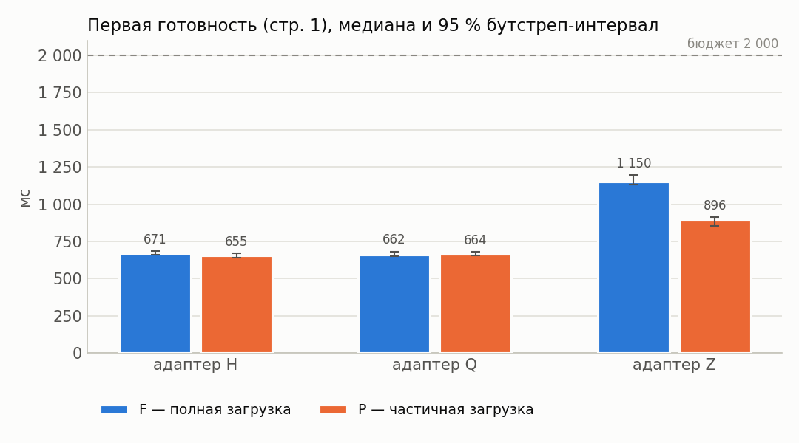

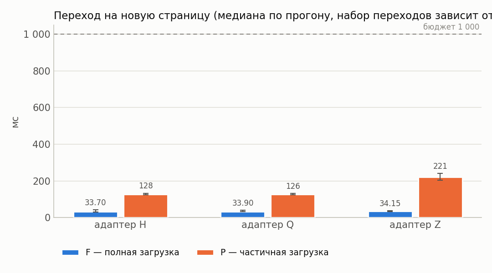

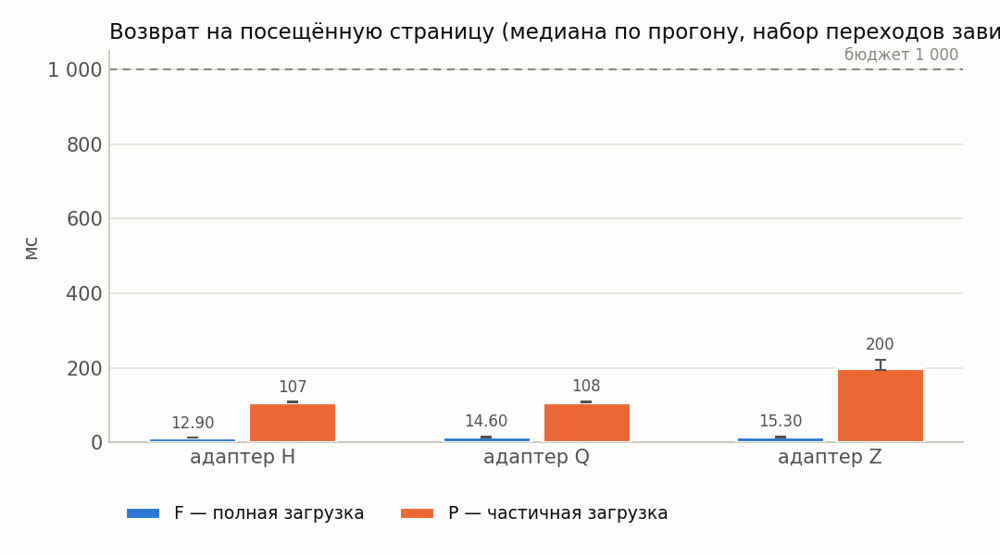

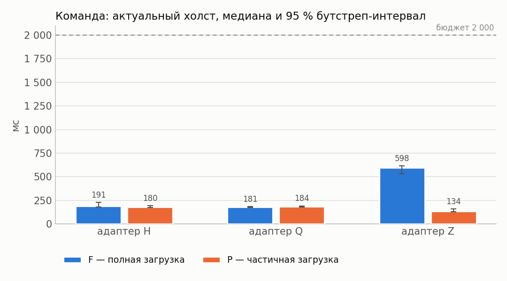

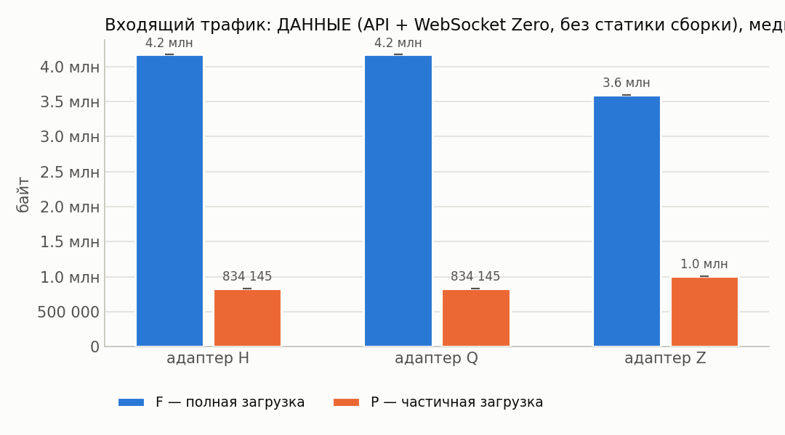

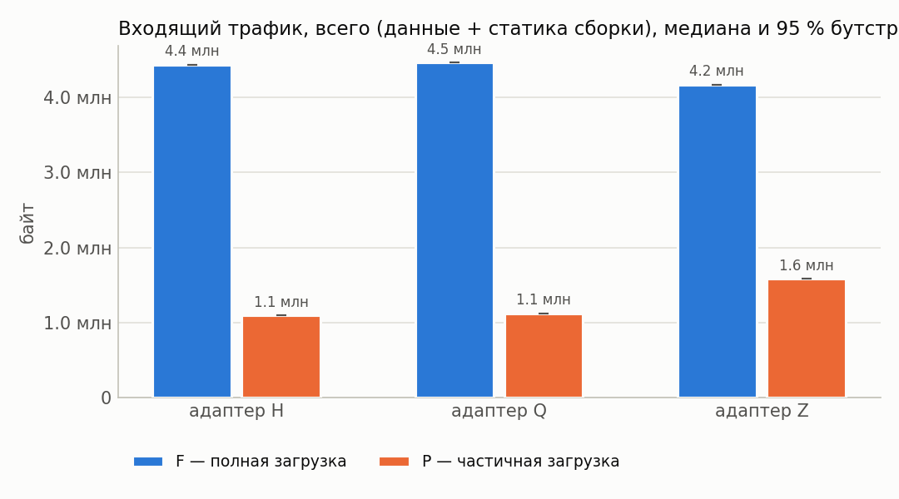

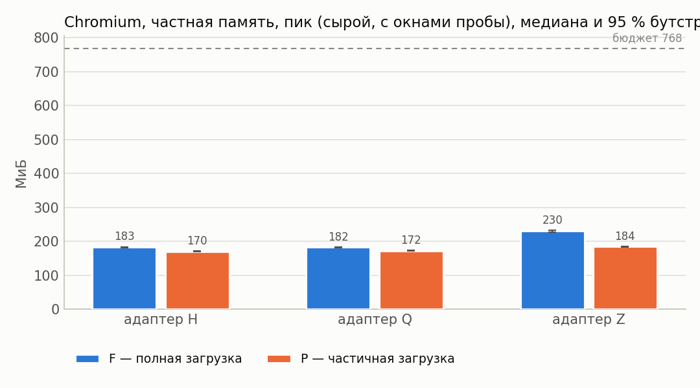

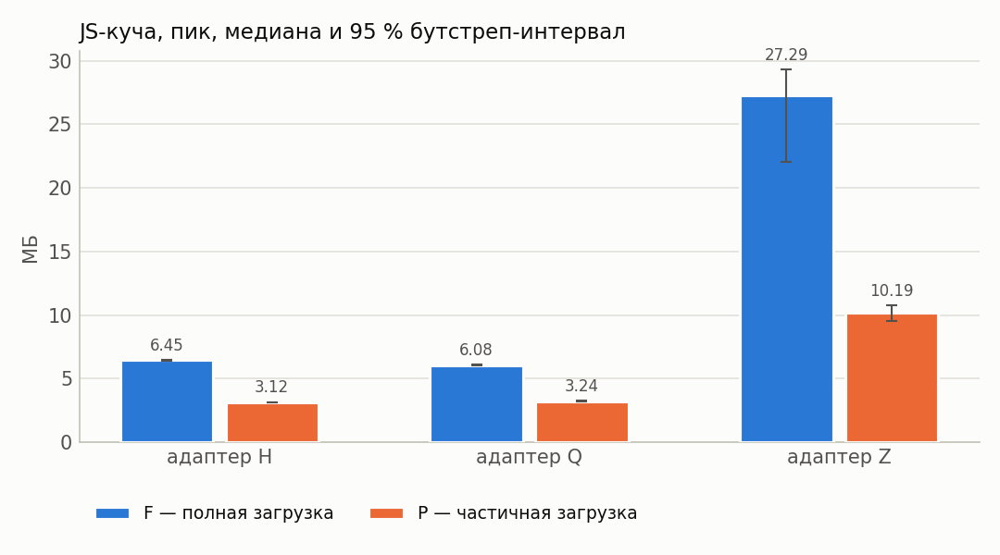

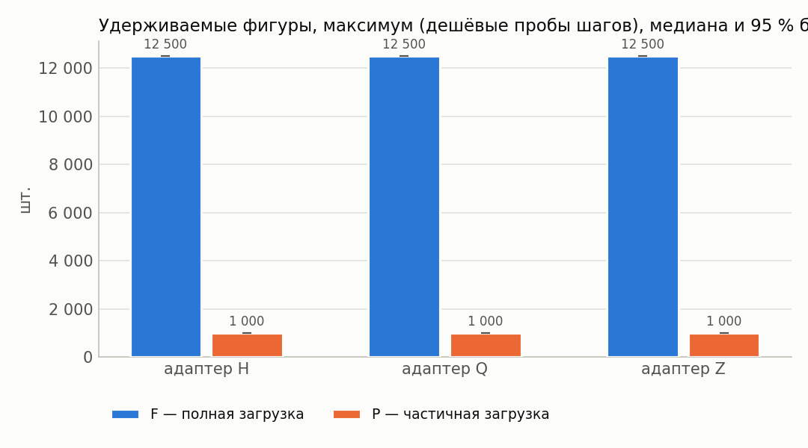

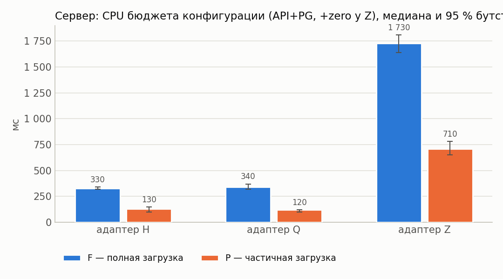

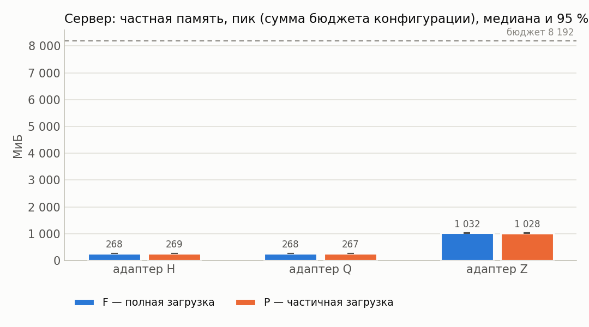

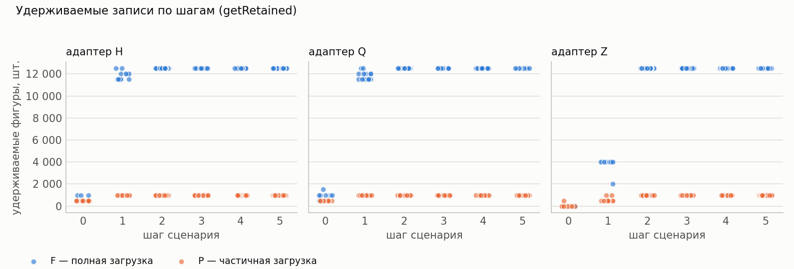

## 12. Выводы

* Оценки изменения P−F ниже — **парные** (медиана поблочных разностей, блок = повторение).
* Все бюджеты §7.4 выполнены для конфигураций: H/F, H/P (cache=1), Q/F, Q/P (cache=1), Z/F, Z/P (cache=1).
* H, cache=1: в режиме P первая готовность на 4 % меньше, чем в F (P/F = 0.96, 95 % интервал [0.95; 0.98]; интервал Δ не содержит 0).
* Q, cache=1: в режиме P первая готовность на 2 % меньше, чем в F (P/F = 0.98, 95 % интервал [0.96; 1.03]; интервал Δ содержит 0 — различие не подтверждено).
* Z, cache=1: в режиме P первая готовность на 24 % меньше, чем в F (P/F = 0.76, 95 % интервал [0.75; 0.78]; интервал Δ не содержит 0).
* H, cache=1: в режиме P пик частной памяти Chromium на 6 % меньше, чем в F (P/F = 0.94, 95 % интервал [0.93; 0.95]; интервал Δ не содержит 0).
* Q, cache=1: в режиме P пик частной памяти Chromium на 6 % меньше, чем в F (P/F = 0.94, 95 % интервал [0.94; 0.95]; интервал Δ не содержит 0).
* Z, cache=1: в режиме P пик частной памяти Chromium на 19 % меньше, чем в F (P/F = 0.81, 95 % интервал [0.79; 0.82]; интервал Δ не содержит 0).
* H, cache=1: в режиме P входящий трафик на 75 % меньше, чем в F (P/F = 0.25, 95 % интервал [0.25; 0.25]; интервал Δ не содержит 0).
* Q, cache=1: в режиме P входящий трафик на 75 % меньше, чем в F (P/F = 0.25, 95 % интервал [0.25; 0.25]; интервал Δ не содержит 0).
* Z, cache=1: в режиме P входящий трафик на 62 % меньше, чем в F (P/F = 0.38, 95 % интервал [0.38; 0.38]; интервал Δ не содержит 0).
* H, cache=1: в режиме P максимум удерживаемых фигур на 92 % меньше, чем в F (P/F = 0.08, 95 % интервал [0.08; 0.08]; интервал Δ не содержит 0).
* Q, cache=1: в режиме P максимум удерживаемых фигур на 92 % меньше, чем в F (P/F = 0.08, 95 % интервал [0.08; 0.08]; интервал Δ не содержит 0).
* Z, cache=1: в режиме P максимум удерживаемых фигур на 92 % меньше, чем в F (P/F = 0.08, 95 % интервал [0.08; 0.08]; интервал Δ не содержит 0).
* H, cache=1: в режиме P переход на новую страницу на 276 % больше, чем в F (P/F = 3.76, 95 % интервал [3.22; 4.20]; интервал Δ не содержит 0).
* Q, cache=1: в режиме P переход на новую страницу на 274 % больше, чем в F (P/F = 3.74, 95 % интервал [3.22; 4.11]; интервал Δ не содержит 0).
* Z, cache=1: в режиме P переход на новую страницу на 546 % больше, чем в F (P/F = 6.46, 95 % интервал [5.63; 7.05]; интервал Δ не содержит 0).
* Перекрёстная проверка обмена сошлась во всех конфигурациях (наибольшее расхождение шейпера и суммы CDP HTTP+WebSocket — 0.1 %).
* У конфигураций Z/F, Z/P (cache=1) холст успевает обновиться раньше подтверждения сервера — доставка синхронизацией опережает ответ по HTTP; обе величины приведены отдельно в разделе 4.
* Точечная доля успеха ≥ 95 %: H/F, H/P (cache=1), Q/F, Q/P (cache=1), Z/F, Z/P (cache=1).
* Нижняя граница интервала Уилсона ниже 95 % для: H/F, H/P (cache=1), Q/F, Q/P (cache=1), Z/F, Z/P (cache=1). При n < 73 прогонов она не достигает 95 % даже без единого отказа, поэтому здесь это ограничение объёма серии, а не свидетельство ненадёжности; при наличии отказов — см. раздел «Ошибки».
* Условия применимости частичной загрузки: режим P оправдан, когда его выигрыш по первой готовности/памяти/трафику подтверждён интервалом (не содержащим 0) и при этом переходы на новые страницы и команда до холста остаются в бюджете, а удерживаемые записи не выходят за объявленное окно.
