# Результаты серии «size-fraction-50x500»

Сформировано 2026-09-14 02:47 UTC из `../../results/size-fraction-50x500/runs.csv` (90 прогонов, 6 конфигураций). Бутстреп: 2000 ресемплов, seed=42, перцентильные 95 % интервалы. Времена и ресурсы считаются по прогонам с `outcome=ok`; доли — по всем начатым прогонам.

**Определения статистик** (одинаковы во всех таблицах): медиана — обычная выборочная; p95 — перцентиль по линейной интерполяции порядковых статистик (`numpy.percentile`, тип 7), при n = 30 это интерполяция между 29‑м и 30‑м значением, поэтому p95 не превышает максимум выборки и при малых n смещён вниз; интервалы медианы и p95 — перцентильный бутстреп по одной матрице ресемплов (согласованы между собой); доли — интервал Уилсона 95 % без поправки на непрерывность; при n < 8 интервалы помечены † как ненадёжные, при n < 2 не строятся.

Проверка схемы: OK — rows=90

## 1. Паспорт серии

| Параметр | Значение |
|---|---|
| `series` | size-fraction-50x500 |
| `startedAt` | 2026-09-13T20:53:51.452Z |
| `finishedAt` | 2026-09-13T21:20:48.954Z |
| `host` | {"hostname": "vm", "os": "Linux 6.18.44-fc-v24", "platform": "linux", "arch": "x64", "kernel": "6.18.44-fc-v24", "distro": "Ubuntu 24.04.4 LTS", "cpuModel": "Intel(R) Xeon(R) Processor @ 2.80GHz", "cp |
| `versions` | {"node": "v24.21.0", "npm": "11.19.0", "postgres": "psql (PostgreSQL) 16.13 (Ubuntu 16.13-0ubuntu0.24.04.1)", "chromium": "141.0.7390.37", "playwright": "1.56.0", "zero": "1.9.0", "reactQuery": "5.102 |
| `packages` | {"playwright": "1.56.0", "@types/node": "24.13.4", "typescript": "5.9.3", "ws": "8.21.3", "@rocicorp/zero": "1.9.0", "@tanstack/react-query": "5.102.8", "react": "19.3.0", "react-dom": "19.3.0", "@typ |
| `packagesHoistedDifferent` | {"postgres": "3.4.7", "@fastify/cors": "10.1.0"} |
| `workspacePackages` | {"packages/bench": {"playwright": "1.56.0", "@types/node": "24.13.4", "typescript": "5.9.3", "ws": "8.21.3"}, "packages/client": {"@rocicorp/zero": "1.9.0", "@tanstack/react-query": "5.102.8", "react" |
| `lockfileVersion` | 3 |
| `shaper` | {"delayMs": 25, "bandwidthMbit": 20, "handshakeRtt": true, "statsUrl": "http://127.0.0.1:8081", "effective": {"delayMs": 25, "bandwidthMbit": 20, "bucketMs": 20, "segmentBytes": 4096, "bucketBytes": 5 |
| `seed` | 20260911 |
| `repetitions` | 15 |
| `configs` | [{"adapter": "H", "mode": "F", "cache": 1}, {"adapter": "H", "mode": "P", "cache": 1}, {"adapter": "Q", "mode": "F", "cache": 1}, {"adapter": "Q", "mode": "P", "cache": 1}, {"adapter": "Z", "mode": "F |
| `seriesConfig` | {"name": "size-fraction-50x500", "doc": "doc-acc-50x500", "sourceId": "doc-acc-50x500-src-1", "fill": "#1e90ff", "docJson": "data/acceptance.json", "configs": [{"adapter": "H", "mode": "F", "cache": 1 |
| `procGroups` | [{"name": "api", "pidFile": "/home/claude/stand/results/logs/api.pid", "exclude": ["netshaper", "zero-cache"]}, {"name": "pg", "patterns": ["(^\|/)postgres .*16/main", "^postgres: 16/main"], "exclude": |
| `browser` | {"channel": "chromium", "args": ["--disable-extensions"], "headless": true, "viewport": {"width": 1280, "height": 800}} |
| `scenario` | {"route": [2, 3, 4, 5, 6, 1, 2, 3, 4, 5, 6], "pauseMs": 1000, "budgets": {"firstReadyMs": 2000, "navMs": 1000, "cmdDrawnMs": 2000, "scenarioMs": 30200}} |
| `plan` | [{"run_id": "size-fraction-50x500-0000-QP1", "order_index": 0, "repetition": 0, "adapter": "Q", "mode": "P", "cache": 1}, {"run_id": "size-fraction-50x500-0001-ZP1", "order_index": 1, "repetition": 0, |
| `client` | {"dist": [{"path": "adapter-settings.json", "bytes": 1004, "mtime": "2026-09-13T19:30:30.755Z", "sha256": "5d7d9af8420141ebb66ea6894d26792039f489306b9ba46bfea9900ef01071b1"}, {"path": "assets/h-BRsLg0 |
| `adapters` | {"available": true, "source": "packages/client/dist/adapter-settings.json", "generatedFrom": ["packages/client/src/adapters/types.ts → ADAPTER_SETTINGS", "packages/client/src/adapters/settings.ts → Z_ |
| `api` | {"url": "http://127.0.0.1:3000", "available": true, "logLevel": "warn", "health": {"status": "ok", "db": "ok", "uptimeSec": 45034, "testHooks": true, "logLevel": "warn", "now": "2026-09-13T20:53:51.73 |
| `zero` | {"config": {"pid": 1025, "env": {"ZERO_QUERY_URL": "http://127.0.0.1:3000/api/zero/query", "NODE_OPTIONS": "--max-old-space-size=8192 --import=/home/claude/stand/scripts/zero-ipv4-shim.mjs", "ZERO_ENA |
| `commit` | None |
| `code` | {"commit": null, "isGitRepo": false, "dirty": null, "codeId": "4bb9e4465904a250bc72d8338d19363855cfe7f827b12662d8600f4f90ee5917", "clientBuildId": "e8d6c0b226b1ac5d27bc8bd39b66d2b5bc2aab491b4d5f8e554c |
| `harness` | {"harnessId": "51ea97ee74e40c8daa81a7819a75c86fc45c3b5c7129779eeeed6f43ff24d153", "harnessIdShort": "51ea97ee74e40c8d", "benchId": "8e1bdf1d09f201b6d42ff58f62fccfc4be22cd53ac554a5dd2aeb14ed5a99ccf", " |
| `preSeriesChecks` | {"at": "2026-09-13T20:53:51.776Z", "samplers": {"ok": true, "groups": [{"group": "api", "needed": true, "processes": 1, "pids": [984], "verdict": "ok", "spec": "pidFile=/home/claude/stand/results/logs |
| `runsExecutedNow` | 90 |
| `runsExecutedTotal` | 90 |
| `runsOk` | 90 |
| `runsTotalPlanned` | 90 |

## 2. Состав серии и доля успеха

Успех прогона = `outcome=ok` ∧ `t_scenario ≤ 30.2 с (бюджет серии, объявлен в паспорте; §1.2 задаёт 30 с для маршрута §7.2 из 11 действий)` ∧ все проверки эталона прошли (SPEC §7.3).

Доли считаются по **всем** начатым прогонам конфигурации (ошибка и таймаут = неуспех); сводки времени и ресурсов ниже — только по прогонам `outcome=ok`.

| Конфигурация | Прогонов | ok | error | timeout | эталон ✓ | ok, но эталон ✗ | успех | Доля успеха [Уилсон 95 %] |
|---|---|---|---|---|---|---|---|---|
| H/F | 15 | 15 | 0 | 0 | 15 | 0 | 15 | 100.0 % [79.6 %; 100.0 %] |
| H/P (cache=1) | 15 | 15 | 0 | 0 | 15 | 0 | 15 | 100.0 % [79.6 %; 100.0 %] |
| Q/F | 15 | 15 | 0 | 0 | 15 | 0 | 15 | 100.0 % [79.6 %; 100.0 %] |
| Q/P (cache=1) | 15 | 15 | 0 | 0 | 15 | 0 | 15 | 100.0 % [79.6 %; 100.0 %] |
| Z/F | 15 | 15 | 0 | 0 | 15 | 0 | 15 | 100.0 % [79.6 %; 100.0 %] |
| Z/P (cache=1) | 15 | 15 | 0 | 0 | 15 | 0 | 15 | 100.0 % [79.6 %; 100.0 %] |

## 3. Сводные показатели по конфигурациям

Для каждого показателя приводятся n, медиана с 95 % перцентильным бутстреп‑интервалом, p95 (линейная интерполяция порядковых статистик) с таким же интервалом, min и max. Знак † — интервал построен по n < 8 наблюдениям и ненадёжен; «—» вместо интервала — n < 2, интервал не определён.

### 3.1 Время

**Первая готовность (стр. 1), мс**

| Конфигурация | n | Медиана | 95 % ИД медианы | p95 | 95 % ИД p95 | min | max |
|---|---|---|---|---|---|---|---|
| H/F | 15 | 677 | [666; 684] | 703 | [684; 707] | 655 | 707 |
| H/P (cache=1) | 15 | 658 | [652; 666] | 680 | [664; 703] | 637 | 703 |
| Q/F | 15 | 679 | [678; 700] | 720 | [697; 728] | 658 | 728 |
| Q/P (cache=1) | 15 | 672 | [652; 678] | 696 | [682; 703] | 642 | 703 |
| Z/F | 15 | 1 165 | [1 147; 1 208] | 1 241 | [1 214; 1 252] | 1 115 | 1 252 |
| Z/P (cache=1) | 15 | 889 | [855; 920] | 959 | [923; 992] | 832 | 992 |

**Переход на новую страницу (медиана по прогону, набор переходов зависит от маршрута серии), мс**

| Конфигурация | n | Медиана | 95 % ИД медианы | p95 | 95 % ИД p95 | min | max |
|---|---|---|---|---|---|---|---|
| H/F | 15 | 35 | [31; 38] | 41 | [36; 41] | 30 | 41 |
| H/P (cache=1) | 15 | 126 | [124; 128] | 129 | [128; 130] | 122 | 130 |
| Q/F | 15 | 38 | [33; 44] | 46 | [44; 48] | 32 | 48 |
| Q/P (cache=1) | 15 | 126 | [125; 129] | 138 | [130; 138] | 120 | 138 |
| Z/F | 15 | 38 | [33; 46] | 50 | [44; 51] | 30 | 51 |
| Z/P (cache=1) | 15 | 219 | [211; 236] | 260 | [236; 268] | 200 | 268 |

**Возврат на посещённую страницу (медиана по прогону, набор переходов зависит от маршрута серии), мс**

| Конфигурация | n | Медиана | 95 % ИД медианы | p95 | 95 % ИД p95 | min | max |
|---|---|---|---|---|---|---|---|
| H/F | 15 | 26 | [25; 27] | 28 | [27; 28] | 23 | 28 |
| H/P (cache=1) | 15 | 120 | [119; 122] | 124 | [122; 128] | 115 | 128 |
| Q/F | 15 | 28 | [26; 29] | 33 | [29; 37] | 24 | 37 |
| Q/P (cache=1) | 15 | 117 | [117; 118] | 124 | [118; 124] | 116 | 124 |
| Z/F | 15 | 27 | [26; 28] | 30 | [28; 30] | 25 | 30 |
| Z/P (cache=1) | 15 | 207 | [203; 211] | 225 | [213; 231] | 193 | 231 |

**Команда: подтверждение транспорта (Z — .server, H/Q — ответ POST), мс**

| Конфигурация | n | Медиана | 95 % ИД медианы | p95 | 95 % ИД p95 | min | max |
|---|---|---|---|---|---|---|---|
| H/F | 15 | 231 | [208; 235] | 238 | [235; 240] | 151 | 240 |
| H/P (cache=1) | 15 | 70 | [68; 72] | 86 | [73; 93] | 62 | 93 |
| Q/F | 15 | 218 | [212; 229] | 234 | [228; 234] | 152 | 234 |
| Q/P (cache=1) | 15 | 72 | [67; 78] | 86 | [78; 88] | 63 | 88 |
| Z/F | 15 | 498 | [316; 518] | 625 | [524; 692] | 164 | 692 |
| Z/P (cache=1) | 15 | 119 | [112; 131] | 154 | [130; 159] | 102 | 159 |

**Команда: подтверждение сервера (результат операции), мс**

| Конфигурация | n | Медиана | 95 % ИД медианы | p95 | 95 % ИД p95 | min | max |
|---|---|---|---|---|---|---|---|
| H/F | 15 | 232 | [208; 235] | 239 | [235; 240] | 151 | 240 |
| H/P (cache=1) | 15 | 70 | [65; 73] | 86 | [74; 93] | 62 | 93 |
| Q/F | 15 | 218 | [212; 229] | 234 | [228; 234] | 152 | 234 |
| Q/P (cache=1) | 15 | 73 | [68; 78] | 86 | [78; 88] | 63 | 88 |
| Z/F | 15 | 565 | [417; 586] | 788 | [595; 798] | 235 | 798 |
| Z/P (cache=1) | 15 | 178 | [172; 193] | 214 | [191; 221] | 165 | 221 |

**Команда: цена протокола подтверждения (ack − транспорт), мс**

| Конфигурация | n | Медиана | 95 % ИД медианы | p95 | 95 % ИД p95 | min | max |
|---|---|---|---|---|---|---|---|
| H/F | 15 | 0 | [0; 0] | 0 | [0; 0] | 0 | 0 |
| H/P (cache=1) | 15 | 0 | [0; 0] | 1 | [0; 1] | 0 | 1 |
| Q/F | 15 | 0 | [0; 0] | 0 | [0; 0] | 0 | 0 |
| Q/P (cache=1) | 15 | 0 | [0; 0] | 0 | [0; 0] | 0 | 0 |
| Z/F | 15 | 75 | [68; 105] | 201 | [102; 227] | 57 | 227 |
| Z/P (cache=1) | 15 | 60 | [59; 62] | 65 | [62; 67] | 58 | 67 |

**Команда: данные в хранилище активной страницы, мс**

| Конфигурация | n | Медиана | 95 % ИД медианы | p95 | 95 % ИД p95 | min | max |
|---|---|---|---|---|---|---|---|
| H/F | 15 | 330 | [323; 378] | 418 | [377; 490] | 289 | 490 |
| H/P (cache=1) | 15 | 171 | [166; 175] | 187 | [175; 197] | 154 | 197 |
| Q/F | 15 | 315 | [308; 325] | 334 | [325; 344] | 266 | 344 |
| Q/P (cache=1) | 15 | 172 | [168; 173] | 182 | [173; 184] | 160 | 184 |
| Z/F | 15 | 498 | [315; 518] | 625 | [523; 691] | 164 | 691 |
| Z/P (cache=1) | 15 | 119 | [111; 131] | 154 | [130; 159] | 101 | 159 |

**Команда: актуальный холст, мс**

| Конфигурация | n | Медиана | 95 % ИД медианы | p95 | 95 % ИД p95 | min | max |
|---|---|---|---|---|---|---|---|
| H/F | 15 | 347 | [333; 388] | 430 | [386; 502] | 308 | 502 |
| H/P (cache=1) | 15 | 182 | [176; 186] | 196 | [185; 205] | 162 | 205 |
| Q/F | 15 | 326 | [320; 337] | 351 | [336; 356] | 281 | 356 |
| Q/P (cache=1) | 15 | 179 | [175; 182] | 192 | [184; 198] | 168 | 198 |
| Z/F | 15 | 515 | [332; 542] | 644 | [545; 711] | 203 | 711 |
| Z/P (cache=1) | 15 | 132 | [125; 144] | 164 | [142; 168] | 115 | 168 |

**Переход, медиана всех переходов прогона (маршрут любой длины), мс**

| Конфигурация | n | Медиана | 95 % ИД медианы | p95 | 95 % ИД p95 | min | max |
|---|---|---|---|---|---|---|---|
| H/F | 15 | 29 | [28; 30] | 31 | [30; 31] | 26 | 31 |
| H/P (cache=1) | 15 | 122 | [121; 124] | 126 | [124; 126] | 119 | 126 |
| Q/F | 15 | 31 | [30; 32] | 36 | [32; 37] | 29 | 37 |
| Q/P (cache=1) | 15 | 121 | [119; 123] | 126 | [123; 128] | 117 | 128 |
| Z/F | 15 | 32 | [30; 35] | 37 | [35; 40] | 29 | 40 |
| Z/P (cache=1) | 15 | 213 | [207; 218] | 225 | [219; 231] | 195 | 231 |

**Сценарий целиком (с паузами, без проб оболочки), мс**

| Конфигурация | n | Медиана | 95 % ИД медианы | p95 | 95 % ИД p95 | min | max |
|---|---|---|---|---|---|---|---|
| H/F | 15 | 13 367 | [13 353; 13 405] | 13 472 | [13 405; 13 502] | 13 273 | 13 502 |
| H/P (cache=1) | 15 | 14 208 | [14 189; 14 216] | 14 243 | [14 218; 14 261] | 14 159 | 14 261 |
| Q/F | 15 | 13 378 | [13 364; 13 391] | 13 432 | [13 396; 13 450] | 13 341 | 13 450 |
| Q/P (cache=1) | 15 | 14 191 | [14 185; 14 236] | 14 266 | [14 234; 14 281] | 14 149 | 14 281 |
| Z/F | 15 | 14 075 | [13 955; 14 232] | 14 432 | [14 246; 14 481] | 13 750 | 14 481 |
| Z/P (cache=1) | 15 | 15 550 | [15 357; 15 580] | 15 687 | [15 589; 15 687] | 15 227 | 15 687 |

**Сценарий целиком, сырое время (с пробами оболочки), мс**

| Конфигурация | n | Медиана | 95 % ИД медианы | p95 | 95 % ИД p95 | min | max |
|---|---|---|---|---|---|---|---|
| H/F | 15 | 13 387 | [13 366; 13 422] | 13 493 | [13 430; 13 531] | 13 282 | 13 531 |
| H/P (cache=1) | 15 | 14 227 | [14 205; 14 236] | 14 267 | [14 243; 14 282] | 14 176 | 14 282 |
| Q/F | 15 | 13 405 | [13 386; 13 433] | 13 451 | [13 419; 13 468] | 13 366 | 13 468 |
| Q/P (cache=1) | 15 | 14 215 | [14 204; 14 242] | 14 283 | [14 248; 14 299] | 14 180 | 14 299 |
| Z/F | 15 | 14 692 | [14 314; 14 936] | 15 451 | [14 922; 15 777] | 13 878 | 15 777 |
| Z/P (cache=1) | 15 | 15 563 | [15 386; 15 636] | 15 713 | [15 612; 15 716] | 15 243 | 15 716 |

**Пробы оболочки сверх объявленных пауз, мс**

| Конфигурация | n | Медиана | 95 % ИД медианы | p95 | 95 % ИД p95 | min | max |
|---|---|---|---|---|---|---|---|
| H/F | 15 | 20 | [16; 28] | 29 | [28; 29] | 9 | 29 |
| H/P (cache=1) | 15 | 21 | [17; 28] | 29 | [26; 31] | 10 | 31 |
| Q/F | 15 | 23 | [17; 26] | 31 | [26; 32] | 11 | 32 |
| Q/P (cache=1) | 15 | 23 | [18; 25] | 31 | [25; 32] | 8 | 32 |
| Z/F | 15 | 480 | [278; 647] | 1 194 | [665; 1 567] | 79 | 1 567 |
| Z/P (cache=1) | 15 | 22 | [16; 25] | 33 | [26; 35] | 9 | 35 |

### 3.2 Объём обмена

**Головная величина обмена — «только данные»** (`bytes_in_data`: API + кадры синхронизации Zero). Полный `bytes_in` включает статику сборки — поадаптерную константу, одинаковую в F и в P, поэтому в отношениях P/F она искажает сравнение (`docs/DEVIATIONS.md` §3.1). Оба числа приводятся рядом, разложение — ниже.

**Входящий трафик: ДАННЫЕ (API + WebSocket Zero, без статики сборки), байт**

| Конфигурация | n | Медиана | 95 % ИД медианы | p95 | 95 % ИД p95 | min | max |
|---|---|---|---|---|---|---|---|
| H/F | 15 | 7 066 121 | [7 066 121; 7 066 121] | 7 066 121 | [7 066 121; 7 066 121] | 6 981 244 | 7 066 121 |
| H/P (cache=1) | 15 | 1 524 093 | [1 524 093; 1 524 093] | 1 524 093 | [1 524 093; 1 524 093] | 1 524 093 | 1 524 093 |
| Q/F | 15 | 7 066 121 | [7 066 121; 7 066 121] | 7 066 121 | [7 066 121; 7 066 121] | 6 948 262 | 7 066 121 |
| Q/P (cache=1) | 15 | 1 524 093 | [1 524 093; 1 524 093] | 1 524 093 | [1 524 093; 1 524 093] | 1 524 093 | 1 524 093 |
| Z/F | 15 | 7 085 749 | [7 085 749; 7 085 749] | 7 085 749 | [7 085 749; 7 085 749] | 7 083 349 | 7 085 749 |
| Z/P (cache=1) | 15 | 2 057 031 | [2 057 031; 2 057 031] | 2 057 031 | [2 057 031; 2 057 031] | 2 057 031 | 2 057 031 |

**Входящий трафик, всего (данные + статика сборки), байт**

| Конфигурация | n | Медиана | 95 % ИД медианы | p95 | 95 % ИД p95 | min | max |
|---|---|---|---|---|---|---|---|
| H/F | 15 | 7 326 515 | [7 326 515; 7 326 515] | 7 326 515 | [7 326 515; 7 326 515] | 7 241 638 | 7 326 515 |
| H/P (cache=1) | 15 | 1 784 487 | [1 784 487; 1 784 487] | 1 784 487 | [1 784 487; 1 784 487] | 1 784 487 | 1 784 487 |
| Q/F | 15 | 7 357 527 | [7 357 527; 7 357 527] | 7 357 527 | [7 357 527; 7 357 527] | 7 239 668 | 7 357 527 |
| Q/P (cache=1) | 15 | 1 815 499 | [1 815 499; 1 815 499] | 1 815 499 | [1 815 499; 1 815 499] | 1 815 499 | 1 815 499 |
| Z/F | 15 | 7 658 273 | [7 658 273; 7 658 273] | 7 658 273 | [7 658 273; 7 658 273] | 7 655 873 | 7 658 273 |
| Z/P (cache=1) | 15 | 2 629 555 | [2 629 555; 2 629 555] | 2 629 555 | [2 629 555; 2 629 555] | 2 629 555 | 2 629 555 |

**Статика сборки за прогон (поадаптерная константа), байт**

| Конфигурация | n | Медиана | 95 % ИД медианы | p95 | 95 % ИД p95 | min | max |
|---|---|---|---|---|---|---|---|
| H/F | 15 | 260 394 | [260 394; 260 394] | 260 394 | [260 394; 260 394] | 260 394 | 260 394 |
| H/P (cache=1) | 15 | 260 394 | [260 394; 260 394] | 260 394 | [260 394; 260 394] | 260 394 | 260 394 |
| Q/F | 15 | 291 406 | [291 406; 291 406] | 291 406 | [291 406; 291 406] | 291 406 | 291 406 |
| Q/P (cache=1) | 15 | 291 406 | [291 406; 291 406] | 291 406 | [291 406; 291 406] | 291 406 | 291 406 |
| Z/F | 15 | 572 524 | [572 524; 572 524] | 572 524 | [572 524; 572 524] | 572 524 | 572 524 |
| Z/P (cache=1) | 15 | 572 524 | [572 524; 572 524] | 572 524 | [572 524; 572 524] | 572 524 | 572 524 |

**Исходящий трафик: данные (без статики), байт**

| Конфигурация | n | Медиана | 95 % ИД медианы | p95 | 95 % ИД p95 | min | max |
|---|---|---|---|---|---|---|---|
| H/F | 15 | 51 285 | [51 285; 51 285] | 51 285 | [51 285; 51 285] | 51 285 | 51 285 |
| H/P (cache=1) | 15 | 13 072 | [13 072; 13 072] | 13 072 | [13 072; 13 072] | 13 072 | 13 072 |
| Q/F | 15 | 51 285 | [51 285; 51 285] | 51 285 | [51 285; 51 285] | 50 472 | 51 285 |
| Q/P (cache=1) | 15 | 13 072 | [13 072; 13 072] | 13 072 | [13 072; 13 072] | 13 072 | 13 072 |
| Z/F | 15 | 12 678 | [12 677; 12 678] | 12 678 | [12 678; 12 678] | 12 664 | 12 678 |
| Z/P (cache=1) | 15 | 7 622 | [7 621; 7 622] | 7 622 | [7 622; 7 622] | 7 607 | 7 622 |

**Исходящий трафик, всего (шейпер), байт**

| Конфигурация | n | Медиана | 95 % ИД медианы | p95 | 95 % ИД p95 | min | max |
|---|---|---|---|---|---|---|---|
| H/F | 15 | 55 370 | [55 370; 55 370] | 55 370 | [55 370; 55 370] | 55 370 | 55 370 |
| H/P (cache=1) | 15 | 17 157 | [17 157; 17 157] | 17 157 | [17 157; 17 157] | 17 157 | 17 157 |
| Q/F | 15 | 55 370 | [55 370; 55 370] | 55 370 | [55 370; 55 370] | 54 557 | 55 370 |
| Q/P (cache=1) | 15 | 17 157 | [17 157; 17 157] | 17 157 | [17 157; 17 157] | 17 157 | 17 157 |
| Z/F | 15 | 16 821 | [16 820; 16 821] | 16 821 | [16 821; 16 821] | 16 807 | 16 821 |
| Z/P (cache=1) | 15 | 11 765 | [11 764; 11 765] | 11 765 | [11 765; 11 765] | 11 750 | 11 765 |

**Входящий трафик (CDP, перекрёстная проверка), байт**

| Конфигурация | n | Медиана | 95 % ИД медианы | p95 | 95 % ИД p95 | min | max |
|---|---|---|---|---|---|---|---|
| H/F | 15 | 7 326 515 | [7 326 515; 7 326 515] | 7 326 515 | [7 326 515; 7 326 515] | 7 208 656 | 7 326 515 |
| H/P (cache=1) | 15 | 1 784 487 | [1 784 487; 1 784 487] | 1 784 487 | [1 784 487; 1 784 487] | 1 784 487 | 1 784 487 |
| Q/F | 15 | 7 357 527 | [7 357 527; 7 357 527] | 7 357 527 | [7 357 527; 7 357 527] | 7 239 668 | 7 357 527 |
| Q/P (cache=1) | 15 | 1 815 499 | [1 815 499; 1 815 499] | 1 815 499 | [1 815 499; 1 815 499] | 1 815 499 | 1 815 499 |
| Z/F | 15 | 576 646 | [576 646; 576 646] | 576 646 | [576 646; 576 646] | 576 646 | 576 646 |
| Z/P (cache=1) | 15 | 576 646 | [576 646; 576 646] | 576 646 | [576 646; 576 646] | 576 646 | 576 646 |

**Обмен данными против полного объёма**

Источник разложения: колонки оболочки `bytes_in_api` / `bytes_in_zero` / `bytes_in_static`.

Разброс статики внутри конфигурации обязан быть нулевым — это константа сборки, а не измеряемая величина; ненулевой разброс означал бы, что в статику попало что‑то ещё, и его надо разбирать.

| Конфигурация | n | **Данные (API + WS), байт** | Статика сборки, байт | Всего, байт | Доля статики | Разброс статики |
|---|---|---|---|---|---|---|
| H/F | 15‡ | 7 066 121 | 260 394 | 7 326 515 | 3.6 % | 0 |
| H/P (cache=1) | 15‡ | 1 524 093 | 260 394 | 1 784 487 | 14.6 % | 0 |
| Q/F | 15‡ | 7 066 121 | 291 406 | 7 357 527 | 4.0 % | 0 |
| Q/P (cache=1) | 15‡ | 1 524 093 | 291 406 | 1 815 499 | 16.1 % | 0 |
| Z/F | 15‡ | 7 085 749 | 572 524 | 7 658 273 | 7.5 % | 0 |
| Z/P (cache=1) | 15‡ | 2 057 031 | 572 524 | 2 629 555 | 21.8 % | 0 |

**P/F обмена: по полному трафику и по данным** (парная оценка, блок = повторение)

| Адаптер | Пар | Статика, байт | P/F полный (как публиковалось) | **P/F данные (головное)** | Изменилось |
|---|---|---|---|---|---|
| H (cache=1) | 15‡ | 260 394 | 0.244 [0.244; 0.244] | **0.216** [0.216; 0.216] | да, -0.028 |
| Q (cache=1) | 15‡ | 291 406 | 0.247 [0.247; 0.247] | **0.216** [0.216; 0.216] | да, -0.031 |
| Z (cache=1) | 15‡ | 572 524 | 0.343 [0.343; 0.343] | **0.290** [0.290; 0.290] | да, -0.053 |

Последний столбец отвечает на вопрос «какие опубликованные числа двигает вычитание статики»: величина сдвига = P/F(данные) − P/F(полный).

**Полнота разложения: сумма по маршрутам против итога**

Головное число обмена — `bytes_in_data = bytes_in_api + bytes_in_zero`. Оно осмысленно ровно настолько, насколько разложение полное, поэтому проверка идёт **по каждому прогону**, а не по медианам: столбцы «расхождение» — максимум по прогонам конфигурации от |(api + zero + статика + прочее) − итог|, столбцы «остаток» — максимум собственной контрольной колонки оболочки `bytes_*_route_residual`. Ожидаемое значение всех четырёх — ноль.

| Конфигурация | n | Расхождение вход, Б | Расхождение исход, Б | Остаток вход, Б | Остаток исход, Б | Прочее (вход), Б | Сошлось |
|---|---|---|---|---|---|---|---|
| H/F | 15‡ | 0 | 0 | 0 | 0 | 0 | ✓ |
| H/P (cache=1) | 15‡ | 0 | 0 | 0 | 0 | 0 | ✓ |
| Q/F | 15‡ | 0 | 0 | 0 | 0 | 0 | ✓ |
| Q/P (cache=1) | 15‡ | 0 | 0 | 0 | 0 | 0 | ✓ |
| Z/F | 15‡ | 0 | 0 | 0 | 0 | 0 | ✓ |
| Z/P (cache=1) | 15‡ | 0 | 0 | 0 | 0 | 0 | ✓ |

Все конфигурации сошлись побайтно: «данные + статика + прочее» исчерпывают весь наблюдаемый обмен, и головная величина `bytes_in_data` ничего не теряет.

**Перекрёстная проверка трафика (шейпер vs CDP)**

Шейпер считает байты TCP‑полезной нагрузки всех соединений клиента; CDP даёт их двумя счётчиками — `cdp_bytes_in` (`encodedDataLength` HTTP‑ответов) и `cdp_ws_bytes_in` (кадры WebSocket). У H/Q второй счётчик нулевой, у Z по WebSocket идёт почти весь обмен, поэтому сверять нужно **сумму**: сравнение только с `cdp_bytes_in` давало ложный провал у Z (в прежнем `results/smoke/report.md` — Z/F 92.5 %, Z/P 76.6 %).

| Конфигурация | bytes_in (шейпер) | CDP: HTTP | CDP: WebSocket | CDP: сумма | Расхождение | ≤ 10 % |
|---|---|---|---|---|---|---|
| H/F | 7 326 515 | 7 326 515 | 0 | 7 326 515 | 0.0 % | ✓ |
| H/P (cache=1) | 1 784 487 | 1 784 487 | 0 | 1 784 487 | 0.0 % | ✓ |
| Q/F | 7 357 527 | 7 357 527 | 0 | 7 357 527 | 0.0 % | ✓ |
| Q/P (cache=1) | 1 815 499 | 1 815 499 | 0 | 1 815 499 | 0.0 % | ✓ |
| Z/F | 7 658 273 | 576 646 | 7 078 678 | 7 655 324 | 0.0 % | ✓ |
| Z/P (cache=1) | 2 629 555 | 576 646 | 2 050 792 | 2 627 438 | 0.1 % | ✓ |

**Исходящее направление — справочно.** `cdp_bytes_out` не измеряется, а оценивается по `Network.requestWillBeSent` (стартовая строка + известные CDP заголовки + тело) и систематически занижен на заголовки, которые добавляет сетевой стек браузера, и на рукопожатие WebSocket. Расхождение 20–40 % здесь — свойство оценки, а не признак ошибки измерения; в вердикт конфигурации это направление не входит.

| Конфигурация | bytes_out (шейпер) | CDP: сумма (оценка) | Расхождение | ≤ 50 % |
|---|---|---|---|---|
| H/F | 55 370 | 42 794 | 22.7 % | ✓ |
| H/P (cache=1) | 17 157 | 12 759 | 25.6 % | ✓ |
| Q/F | 55 370 | 42 794 | 22.7 % | ✓ |
| Q/P (cache=1) | 17 157 | 12 759 | 25.6 % | ✓ |
| Z/F | 16 821 | 11 745 | 30.2 % | ✓ |
| Z/P (cache=1) | 11 765 | 7 237 | 38.5 % | ✓ |

### 3.3 Память клиента

**Chromium, частная память, пик без окон пробы, МиБ**

| Конфигурация | n | Медиана | 95 % ИД медианы | p95 | 95 % ИД p95 | min | max |
|---|---|---|---|---|---|---|---|
| H/F | 15 | 193.0 | [191.1; 194.0] | 197.3 | [194.3; 197.7] | 187.7 | 197.7 |
| H/P (cache=1) | 15 | 175.2 | [174.6; 176.2] | 177.9 | [176.3; 179.4] | 174.1 | 179.4 |
| Q/F | 15 | 194.0 | [193.2; 194.2] | 197.4 | [194.8; 197.6] | 191.9 | 197.6 |
| Q/P (cache=1) | 15 | 175.5 | [174.3; 176.7] | 179.0 | [177.0; 179.2] | 171.7 | 179.2 |
| Z/F | 15 | 232.5 | [230.8; 235.4] | 248.8 | [236.8; 254.1] | 219.7 | 254.1 |
| Z/P (cache=1) | 15 | 190.6 | [188.0; 192.4] | 193.6 | [192.4; 193.8] | 187.0 | 193.8 |

**Chromium, частная память, пик (сырой, с окнами пробы), МиБ**

| Конфигурация | n | Медиана | 95 % ИД медианы | p95 | 95 % ИД p95 | min | max |
|---|---|---|---|---|---|---|---|
| H/F | 15 | 194.2 | [192.1; 194.8] | 198.7 | [195.4; 199.5] | 188.7 | 199.5 |
| H/P (cache=1) | 15 | 175.7 | [175.0; 176.2] | 177.9 | [176.3; 179.4] | 174.6 | 179.4 |
| Q/F | 15 | 195.0 | [193.8; 195.5] | 198.2 | [195.5; 198.7] | 192.7 | 198.7 |
| Q/P (cache=1) | 15 | 175.8 | [175.0; 178.2] | 179.6 | [177.6; 179.8] | 171.8 | 179.8 |
| Z/F | 15 | 251.7 | [240.3; 253.8] | 278.8 | [253.9; 281.4] | 226.0 | 281.4 |
| Z/P (cache=1) | 15 | 190.6 | [188.0; 192.4] | 193.6 | [192.4; 193.8] | 187.0 | 193.8 |

**Chromium, частная память, конец, МиБ**

| Конфигурация | n | Медиана | 95 % ИД медианы | p95 | 95 % ИД p95 | min | max |
|---|---|---|---|---|---|---|---|
| H/F | 15 | 193.0 | [191.3; 194.3] | 197.3 | [194.3; 197.7] | 187.7 | 197.7 |
| H/P (cache=1) | 15 | 175.2 | [174.6; 176.2] | 177.9 | [176.3; 179.4] | 174.1 | 179.4 |
| Q/F | 15 | 194.0 | [193.1; 194.3] | 197.4 | [194.5; 197.6] | 191.9 | 197.6 |
| Q/P (cache=1) | 15 | 175.5 | [174.3; 177.8] | 179.0 | [177.0; 179.2] | 171.7 | 179.2 |
| Z/F | 15 | 199.0 | [197.4; 199.8] | 200.2 | [199.5; 201.0] | 196.4 | 201.0 |
| Z/P (cache=1) | 15 | 181.4 | [180.7; 182.6] | 183.8 | [182.2; 184.2] | 179.9 | 184.2 |

**JS‑куча, пик, МБ**

| Конфигурация | n | Медиана | 95 % ИД медианы | p95 | 95 % ИД p95 | min | max |
|---|---|---|---|---|---|---|---|
| H/F | 15 | 8.6 | [8.6; 8.7] | 8.7 | [8.7; 8.8] | 8.5 | 8.8 |
| H/P (cache=1) | 15 | 3.3 | [3.2; 3.3] | 3.6 | [3.3; 3.6] | 3.2 | 3.6 |
| Q/F | 15 | 8.6 | [8.6; 8.6] | 8.6 | [8.6; 8.6] | 8.4 | 8.6 |
| Q/P (cache=1) | 15 | 3.3 | [3.3; 3.3] | 3.8 | [3.3; 3.8] | 3.3 | 3.8 |
| Z/F | 15 | 32.7 | [30.3; 36.7] | 39.2 | [36.8; 39.4] | 27.7 | 39.4 |
| Z/P (cache=1) | 15 | 11.4 | [10.7; 11.7] | 12.3 | [11.6; 12.8] | 10.2 | 12.8 |

**JS‑куча, конец, МБ**

| Конфигурация | n | Медиана | 95 % ИД медианы | p95 | 95 % ИД p95 | min | max |
|---|---|---|---|---|---|---|---|
| H/F | 15 | 7.9 | [7.9; 7.9] | 7.9 | [7.9; 7.9] | 7.9 | 7.9 |
| H/P (cache=1) | 15 | 2.9 | [2.9; 2.9] | 2.9 | [2.9; 2.9] | 2.9 | 2.9 |
| Q/F | 15 | 7.7 | [7.7; 7.7] | 7.7 | [7.7; 7.7] | 7.7 | 7.7 |
| Q/P (cache=1) | 15 | 3.0 | [3.0; 3.0] | 3.0 | [3.0; 3.0] | 3.0 | 3.0 |
| Z/F | 15 | 16.2 | [16.2; 16.2] | 16.2 | [16.2; 16.2] | 16.2 | 16.2 |
| Z/P (cache=1) | 15 | 7.1 | [7.1; 7.4] | 7.8 | [7.4; 8.0] | 7.1 | 8.0 |

**JS‑куча после принудительной сборки (остановка часов), МБ**

| Конфигурация | n | Медиана | 95 % ИД медианы | p95 | 95 % ИД p95 | min | max |
|---|---|---|---|---|---|---|---|
| H/F | 15 | 7.9 | [7.9; 7.9] | 7.9 | [7.9; 7.9] | 7.9 | 7.9 |
| H/P (cache=1) | 15 | 2.9 | [2.9; 2.9] | 2.9 | [2.9; 2.9] | 2.9 | 2.9 |
| Q/F | 15 | 7.7 | [7.7; 7.7] | 7.7 | [7.7; 7.7] | 7.7 | 7.7 |
| Q/P (cache=1) | 15 | 3.0 | [3.0; 3.0] | 3.0 | [3.0; 3.0] | 3.0 | 3.0 |
| Z/F | 15 | 16.2 | [16.2; 16.2] | 16.2 | [16.2; 16.2] | 16.2 | 16.2 |
| Z/P (cache=1) | 15 | 7.4 | [7.1; 7.6] | 7.8 | [7.6; 8.2] | 7.1 | 8.2 |

**Принудительных сборок мусора за прогон, шт.**

| Конфигурация | n | Медиана | 95 % ИД медианы | p95 | 95 % ИД p95 | min | max |
|---|---|---|---|---|---|---|---|
| H/F | 15 | 28 | [28; 28] | 28 | [28; 28] | 28 | 28 |
| H/P (cache=1) | 15 | 28 | [28; 28] | 28 | [28; 28] | 28 | 28 |
| Q/F | 15 | 28 | [28; 28] | 28 | [28; 28] | 28 | 28 |
| Q/P (cache=1) | 15 | 28 | [28; 28] | 28 | [28; 28] | 28 | 28 |
| Z/F | 15 | 28 | [28; 28] | 28 | [28; 28] | 28 | 28 |
| Z/P (cache=1) | 15 | 28 | [28; 28] | 28 | [28; 28] | 28 | 28 |

**Постоянное хранилище клиента, байт**

| Конфигурация | n | Медиана | 95 % ИД медианы | p95 | 95 % ИД p95 | min | max |
|---|---|---|---|---|---|---|---|
| H/F | 15 | 0 | [0; 0] | 0 | [0; 0] | 0 | 0 |
| H/P (cache=1) | 15 | 0 | [0; 0] | 0 | [0; 0] | 0 | 0 |
| Q/F | 15 | 0 | [0; 0] | 0 | [0; 0] | 0 | 0 |
| Q/P (cache=1) | 15 | 0 | [0; 0] | 0 | [0; 0] | 0 | 0 |
| Z/F | 15 | 1 787 208 | [1 786 130; 1 788 278] | 2 343 798 | [1 788 150; 3 637 721] | 1 781 628 | 3 637 721 |
| Z/P (cache=1) | 15 | 153 333 | [151 908; 155 363] | 182 601 | [155 488; 182 776] | 98 501 | 182 776 |

**Окна измерительных проб: паритет политики и цена их исключения**

Число окон проб одинаково во всех конфигурациях серии (15) — политика проб к адаптерам не привязана, и пики памяти между ними сравнимы. Историческая колонка `chromium_private_peak_mib` во всех прогонах совпадает с `chromium_private_peak_raw_mib` — сырой пик доступен под обоими именами, и старые таблицы читаются как «пик с окнами пробы».

Длительность окон у адаптеров различается законно: это измеренное свойство адаптера (точный скан хранилища у Z/F дороже), а не нарушение паритета. «Доля выборок в окнах» показывает, какая часть наблюдений исключена из пика без пробы; «покрытие кучи» — доля времени прогона, покрытая опросом JS‑кучи (сэмплер кучи на время скана приостанавливается, поэтому пик кучи читается только вместе с ним).

| Конфигурация | n | Окон проб | Разброс окон | В окнах, мс | Пик сырой, МиБ | **Пик без проб, МиБ** | Разница, МиБ | Доля выборок в окнах | Покрытие кучи |
|---|---|---|---|---|---|---|---|---|---|
| H/F | 15‡ | 15 | 0 | 1 222 | 194.2 | 193.0 | 1.2 | 8.9 % | 1.000 |
| H/P (cache=1) | 15‡ | 15 | 0 | 767 | 175.7 | 175.2 | 0.5 | 6.8 % | 1.000 |
| Q/F | 15‡ | 15 | 0 | 1 264 | 195.0 | 194.0 | 1.0 | 8.9 % | 1.000 |
| Q/P (cache=1) | 15‡ | 15 | 0 | 804 | 175.8 | 175.5 | 0.3 | 6.8 % | 1.000 |
| Z/F | 15‡ | 15 | 0 | 3 756 | 251.7 | 232.5 | 19.2 | 22.2 % | 0.908 |
| Z/P (cache=1) | 15‡ | 15 | 0 | 1 271 | 190.6 | 190.6 | 0.0 | 7.7 % | 1.000 |

**Паритет давления сборщика мусора**

**Расписание принудительных сборок мусора одинаково у всех конфигураций: 28 вызовов `HeapProfiler.collectGarbage` на прогон.** Точки вызова заданы оболочкой и не зависят ни от адаптера, ни от режима, ни от вида пробы, поэтому `js_heap_peak_mb` и `chromium_private_peak_mib` измерены при одинаковом давлении сборщика и сравнимы между адаптерами (раньше было ≈13 у H/Q против 2–3 у Z/F — дефект N2).

`js_heap_post_gc_mb` — куча сразу после принудительной сборки в фиксированной точке «остановка часов сценария»: величина, не зависящая от момента самопроизвольной сборки, и потому более устойчивая мера удерживаемой памяти, чем пик. `js_heap_suspended_ms` — сколько опрос кучи был приостановлен (два точных скана хранилища и выгрузка снимков); у Z/F больше просто потому, что дороже сам скан.

| Конфигурация | n | `js_heap_gc_count` | `js_heap_peak_mb`, медиана | `js_heap_post_gc_mb`, медиана | `js_heap_suspended_ms`, медиана |
|---|---|---|---|---|---|
| H/F | 15 | 28 | 8.6 | 7.9 | 1 192 |
| H/P (cache=1) | 15 | 28 | 3.3 | 2.9 | 750 |
| Q/F | 15 | 28 | 8.6 | 7.7 | 1 233 |
| Q/P (cache=1) | 15 | 28 | 3.3 | 3.0 | 791 |
| Z/F | 15 | 28 | 32.7 | 16.2 | 3 269 |
| Z/P (cache=1) | 15 | 28 | 11.4 | 7.4 | 1 174 |

### 3.4 Удерживаемые записи

**Удерживаемые фигуры, максимум (дешёвые пробы шагов), шт.**

| Конфигурация | n | Медиана | 95 % ИД медианы | p95 | 95 % ИД p95 | min | max |
|---|---|---|---|---|---|---|---|
| H/F | 15 | 25 000 | [25 000; 25 000] | 25 000 | [25 000; 25 000] | 25 000 | 25 000 |
| H/P (cache=1) | 15 | 1 000 | [1 000; 1 000] | 1 000 | [1 000; 1 000] | 1 000 | 1 000 |
| Q/F | 15 | 25 000 | [25 000; 25 000] | 25 000 | [25 000; 25 000] | 25 000 | 25 000 |
| Q/P (cache=1) | 15 | 1 000 | [1 000; 1 000] | 1 000 | [1 000; 1 000] | 1 000 | 1 000 |
| Z/F | 15 | 25 000 | [25 000; 25 000] | 25 000 | [25 000; 25 000] | 25 000 | 25 000 |
| Z/P (cache=1) | 15 | 1 000 | [1 000; 1 000] | 1 000 | [1 000; 1 000] | 1 000 | 1 000 |

**Удерживаемые фигуры, конец — точный скан, шт.**

| Конфигурация | n | Медиана | 95 % ИД медианы | p95 | 95 % ИД p95 | min | max |
|---|---|---|---|---|---|---|---|
| H/F | 15 | 25 000 | [25 000; 25 000] | 25 000 | [25 000; 25 000] | 25 000 | 25 000 |
| H/P (cache=1) | 15 | 1 000 | [1 000; 1 000] | 1 000 | [1 000; 1 000] | 1 000 | 1 000 |
| Q/F | 15 | 25 000 | [25 000; 25 000] | 25 000 | [25 000; 25 000] | 25 000 | 25 000 |
| Q/P (cache=1) | 15 | 1 000 | [1 000; 1 000] | 1 000 | [1 000; 1 000] | 1 000 | 1 000 |
| Z/F | 15 | 25 000 | [25 000; 25 000] | 25 000 | [25 000; 25 000] | 25 000 | 25 000 |
| Z/P (cache=1) | 15 | 1 000 | [1 000; 1 000] | 1 000 | [1 000; 1 000] | 1 000 | 1 000 |

**Удерживаемые фигуры, конец, шт.**

| Конфигурация | n | Медиана | 95 % ИД медианы | p95 | 95 % ИД p95 | min | max |
|---|---|---|---|---|---|---|---|
| H/F | 15 | 25 000 | [25 000; 25 000] | 25 000 | [25 000; 25 000] | 25 000 | 25 000 |
| H/P (cache=1) | 15 | 1 000 | [1 000; 1 000] | 1 000 | [1 000; 1 000] | 1 000 | 1 000 |
| Q/F | 15 | 25 000 | [25 000; 25 000] | 25 000 | [25 000; 25 000] | 25 000 | 25 000 |
| Q/P (cache=1) | 15 | 1 000 | [1 000; 1 000] | 1 000 | [1 000; 1 000] | 1 000 | 1 000 |
| Z/F | 15 | 25 000 | [25 000; 25 000] | 25 000 | [25 000; 25 000] | 25 000 | 25 000 |
| Z/P (cache=1) | 15 | 1 000 | [1 000; 1 000] | 1 000 | [1 000; 1 000] | 1 000 | 1 000 |

**Удерживаемые страницы, максимум (дешёвые пробы шагов), шт.**

| Конфигурация | n | Медиана | 95 % ИД медианы | p95 | 95 % ИД p95 | min | max |
|---|---|---|---|---|---|---|---|
| H/F | 15 | 50 | [50; 50] | 50 | [50; 50] | 50 | 50 |
| H/P (cache=1) | 15 | 2 | [2; 2] | 2 | [2; 2] | 2 | 2 |
| Q/F | 15 | 50 | [50; 50] | 50 | [50; 50] | 50 | 50 |
| Q/P (cache=1) | 15 | 2 | [2; 2] | 2 | [2; 2] | 2 | 2 |
| Z/F | 15 | 50 | [50; 50] | 50 | [50; 50] | 50 | 50 |
| Z/P (cache=1) | 15 | 2 | [2; 2] | 2 | [2; 2] | 2 | 2 |

**Удерживаемые страницы, конец — точный скан, шт.**

| Конфигурация | n | Медиана | 95 % ИД медианы | p95 | 95 % ИД p95 | min | max |
|---|---|---|---|---|---|---|---|
| H/F | 15 | 50 | [50; 50] | 50 | [50; 50] | 50 | 50 |
| H/P (cache=1) | 15 | 2 | [2; 2] | 2 | [2; 2] | 2 | 2 |
| Q/F | 15 | 50 | [50; 50] | 50 | [50; 50] | 50 | 50 |
| Q/P (cache=1) | 15 | 2 | [2; 2] | 2 | [2; 2] | 2 | 2 |
| Z/F | 15 | 50 | [50; 50] | 50 | [50; 50] | 50 | 50 |
| Z/P (cache=1) | 15 | 2 | [2; 2] | 2 | [2; 2] | 2 | 2 |

**Удерживаемые страницы, конец, шт.**

| Конфигурация | n | Медиана | 95 % ИД медианы | p95 | 95 % ИД p95 | min | max |
|---|---|---|---|---|---|---|---|
| H/F | 15 | 50 | [50; 50] | 50 | [50; 50] | 50 | 50 |
| H/P (cache=1) | 15 | 2 | [2; 2] | 2 | [2; 2] | 2 | 2 |
| Q/F | 15 | 50 | [50; 50] | 50 | [50; 50] | 50 | 50 |
| Q/P (cache=1) | 15 | 2 | [2; 2] | 2 | [2; 2] | 2 | 2 |
| Z/F | 15 | 50 | [50; 50] | 50 | [50; 50] | 50 | 50 |
| Z/P (cache=1) | 15 | 2 | [2; 2] | 2 | [2; 2] | 2 | 2 |

**Загруженные страницы, конец, шт.**

| Конфигурация | n | Медиана | 95 % ИД медианы | p95 | 95 % ИД p95 | min | max |
|---|---|---|---|---|---|---|---|
| H/F | 15 | 50 | [50; 50] | 50 | [50; 50] | 50 | 50 |
| H/P (cache=1) | 15 | 2 | [2; 2] | 2 | [2; 2] | 2 | 2 |
| Q/F | 15 | 50 | [50; 50] | 50 | [50; 50] | 50 | 50 |
| Q/P (cache=1) | 15 | 2 | [2; 2] | 2 | [2; 2] | 2 | 2 |
| Z/F | 15 | 50 | [50; 50] | 50 | [50; 50] | 50 | 50 |
| Z/P (cache=1) | 15 | 2 | [2; 2] | 2 | [2; 2] | 2 | 2 |

### 3.4.1 Маршрут и повторные чтения

`nav_cache_misses` — переходы, при которых страница уже не удерживалась и её пришлось загружать; считается одинаково у H, Q и Z и потому сравним между всеми тремя адаптерами. `api_page_reads` — прямой счётчик HTTP‑чтений страниц; **у Z он равен нулю по устройству адаптера** (страницы приходят синхронизацией), и это измерение, а не пропуск.

**Переходы с промахом окна (страница требовала загрузки), шт.**

| Конфигурация | n | Медиана | 95 % ИД медианы | p95 | 95 % ИД p95 | min | max |
|---|---|---|---|---|---|---|---|
| H/F | 15 | 0 | [0; 1] | 1 | [1; 1] | 0 | 1 |
| H/P (cache=1) | 15 | 11 | [11; 11] | 11 | [11; 11] | 11 | 11 |
| Q/F | 15 | 1 | [0; 1] | 1 | [1; 1] | 0 | 1 |
| Q/P (cache=1) | 15 | 11 | [11; 11] | 11 | [11; 11] | 11 | 11 |
| Z/F | 15 | 0 | [0; 0] | 0 | [0; 0] | 0 | 0 |
| Z/P (cache=1) | 15 | 11 | [11; 11] | 11 | [11; 11] | 11 | 11 |

**Переходы с попаданием в окно (страница удерживалась), шт.**

| Конфигурация | n | Медиана | 95 % ИД медианы | p95 | 95 % ИД p95 | min | max |
|---|---|---|---|---|---|---|---|
| H/F | 15 | 11 | [10; 11] | 11 | [11; 11] | 10 | 11 |
| H/P (cache=1) | 15 | 0 | [0; 0] | 0 | [0; 0] | 0 | 0 |
| Q/F | 15 | 10 | [10; 11] | 11 | [11; 11] | 10 | 11 |
| Q/P (cache=1) | 15 | 0 | [0; 0] | 0 | [0; 0] | 0 | 0 |
| Z/F | 15 | 11 | [11; 11] | 11 | [11; 11] | 11 | 11 |
| Z/P (cache=1) | 15 | 0 | [0; 0] | 0 | [0; 0] | 0 | 0 |

**Загрузок страниц за прогон (промахи + открытие), шт.**

| Конфигурация | n | Медиана | 95 % ИД медианы | p95 | 95 % ИД p95 | min | max |
|---|---|---|---|---|---|---|---|
| H/F | 15 | 1 | [1; 2] | 2 | [2; 2] | 1 | 2 |
| H/P (cache=1) | 15 | 12 | [12; 12] | 12 | [12; 12] | 12 | 12 |
| Q/F | 15 | 2 | [1; 2] | 2 | [2; 2] | 1 | 2 |
| Q/P (cache=1) | 15 | 12 | [12; 12] | 12 | [12; 12] | 12 | 12 |
| Z/F | 15 | 1 | [1; 1] | 1 | [1; 1] | 1 | 1 |
| Z/P (cache=1) | 15 | 12 | [12; 12] | 12 | [12; 12] | 12 | 12 |

**HTTP‑чтений страниц `GET /api/…/pages/*` (у Z — 0 по устройству), шт.**

| Конфигурация | n | Медиана | 95 % ИД медианы | p95 | 95 % ИД p95 | min | max |
|---|---|---|---|---|---|---|---|
| H/F | 15 | 60 | [60; 60] | 60 | [60; 60] | 60 | 60 |
| H/P (cache=1) | 15 | 13 | [13; 13] | 13 | [13; 13] | 13 | 13 |
| Q/F | 15 | 60 | [60; 60] | 60 | [60; 60] | 59 | 60 |
| Q/P (cache=1) | 15 | 13 | [13; 13] | 13 | [13; 13] | 13 | 13 |
| Z/F | 15 | 0 | [0; 0] | 0 | [0; 0] | 0 | 0 |
| Z/P (cache=1) | 15 | 0 | [0; 0] | 0 | [0; 0] | 0 | 0 |

**Разных страниц среди HTTP‑чтений, шт.**

| Конфигурация | n | Медиана | 95 % ИД медианы | p95 | 95 % ИД p95 | min | max |
|---|---|---|---|---|---|---|---|
| H/F | 15 | 50 | [50; 50] | 50 | [50; 50] | 50 | 50 |
| H/P (cache=1) | 15 | 6 | [6; 6] | 6 | [6; 6] | 6 | 6 |
| Q/F | 15 | 50 | [50; 50] | 50 | [50; 50] | 50 | 50 |
| Q/P (cache=1) | 15 | 6 | [6; 6] | 6 | [6; 6] | 6 | 6 |
| Z/F | 15 | 0 | [0; 0] | 0 | [0; 0] | 0 | 0 |
| Z/P (cache=1) | 15 | 0 | [0; 0] | 0 | [0; 0] | 0 | 0 |

**Байт в ответах на HTTP‑чтения страниц, байт**

| Конфигурация | n | Медиана | 95 % ИД медианы | p95 | 95 % ИД p95 | min | max |
|---|---|---|---|---|---|---|---|
| H/F | 15 | 7 062 020 | [7 062 020; 7 062 020] | 7 062 020 | [7 062 020; 7 062 020] | 6 944 161 | 7 062 020 |
| H/P (cache=1) | 15 | 1 519 992 | [1 519 992; 1 519 992] | 1 519 992 | [1 519 992; 1 519 992] | 1 519 992 | 1 519 992 |
| Q/F | 15 | 7 062 020 | [7 062 020; 7 062 020] | 7 062 020 | [7 062 020; 7 062 020] | 6 944 161 | 7 062 020 |
| Q/P (cache=1) | 15 | 1 519 992 | [1 519 992; 1 519 992] | 1 519 992 | [1 519 992; 1 519 992] | 1 519 992 | 1 519 992 |
| Z/F | 15 | 0 | [0; 0] | 0 | [0; 0] | 0 | 0 |
| Z/P (cache=1) | 15 | 0 | [0; 0] | 0 | [0; 0] | 0 | 0 |

### 3.5 Сервер

**Сервер: CPU бюджета конфигурации (API+PG, +zero у Z), мс**

| Конфигурация | n | Медиана | 95 % ИД медианы | p95 | 95 % ИД p95 | min | max |
|---|---|---|---|---|---|---|---|
| H/F | 15 | 540 | [470; 610] | 646 | [596; 660] | 440 | 660 |
| H/P (cache=1) | 15 | 170 | [170; 220] | 246 | [213; 260] | 150 | 260 |
| Q/F | 15 | 580 | [530; 620] | 663 | [616; 670] | 500 | 670 |
| Q/P (cache=1) | 15 | 170 | [160; 210] | 243 | [196; 250] | 140 | 250 |
| Z/F | 15 | 3 320 | [3 260; 3 450] | 3 601 | [3 453; 3 650] | 2 980 | 3 650 |
| Z/P (cache=1) | 15 | 1 290 | [1 260; 1 350] | 1 473 | [1 322; 1 620] | 1 030 | 1 620 |

**Сервер: CPU API, мс**

| Конфигурация | n | Медиана | 95 % ИД медианы | p95 | 95 % ИД p95 | min | max |
|---|---|---|---|---|---|---|---|
| H/F | 15 | 400 | [310; 450] | 482 | [443; 510] | 290 | 510 |
| H/P (cache=1) | 15 | 120 | [120; 180] | 193 | [173; 200] | 100 | 200 |
| Q/F | 15 | 450 | [380; 480] | 516 | [473; 530] | 370 | 530 |
| Q/P (cache=1) | 15 | 130 | [120; 160] | 193 | [166; 200] | 100 | 200 |
| Z/F | 15 | 70 | [70; 80] | 90 | [80; 90] | 70 | 90 |
| Z/P (cache=1) | 15 | 70 | [70; 80] | 108 | [80; 150] | 70 | 150 |

**Сервер: CPU PostgreSQL, мс**

| Конфигурация | n | Медиана | 95 % ИД медианы | p95 | 95 % ИД p95 | min | max |
|---|---|---|---|---|---|---|---|
| H/F | 15 | 150 | [140; 160] | 170 | [160; 170] | 100 | 170 |
| H/P (cache=1) | 15 | 50 | [40; 60] | 63 | [53; 70] | 30 | 70 |
| Q/F | 15 | 140 | [130; 140] | 150 | [143; 150] | 120 | 150 |
| Q/P (cache=1) | 15 | 40 | [30; 50] | 63 | [53; 70] | 30 | 70 |
| Z/F | 15 | 1 150 | [1 140; 1 170] | 1 209 | [1 170; 1 230] | 1 080 | 1 230 |
| Z/P (cache=1) | 15 | 480 | [470; 510] | 530 | [513; 530] | 420 | 530 |

**Сервер: CPU zero‑cache (у H/Q — измеренный фон, не их бюджет), мс**

| Конфигурация | n | Медиана | 95 % ИД медианы | p95 | 95 % ИД p95 | min | max |
|---|---|---|---|---|---|---|---|
| H/F | 15 | 40 | [40; 50] | 53 | [50; 60] | 30 | 60 |
| H/P (cache=1) | 15 | 40 | [40; 50] | 56 | [50; 70] | 30 | 70 |
| Q/F | 15 | 50 | [40; 50] | 129 | [50; 150] | 20 | 150 |
| Q/P (cache=1) | 15 | 40 | [40; 50] | 53 | [50; 60] | 30 | 60 |
| Z/F | 15 | 2 070 | [2 040; 2 210] | 2 366 | [2 210; 2 380] | 1 720 | 2 380 |
| Z/P (cache=1) | 15 | 710 | [630; 750] | 907 | [759; 1 040] | 540 | 1 040 |

**Сервер: частная память, пик (сумма бюджета конфигурации), МиБ**

| Конфигурация | n | Медиана | 95 % ИД медианы | p95 | 95 % ИД p95 | min | max |
|---|---|---|---|---|---|---|---|
| H/F | 15 | 272.1 | [269.1; 273.3] | 281.9 | [274.1; 281.9] | 255.7 | 281.9 |
| H/P (cache=1) | 15 | 270.8 | [263.7; 275.7] | 281.5 | [275.5; 281.9] | 252.9 | 281.9 |
| Q/F | 15 | 272.7 | [269.0; 275.7] | 280.9 | [276.0; 283.3] | 255.7 | 283.3 |
| Q/P (cache=1) | 15 | 272.1 | [265.1; 273.3] | 278.3 | [273.9; 283.3] | 252.8 | 283.3 |
| Z/F | 15 | 1 032.3 | [1 031.6; 1 044.9] | 1 046.8 | [1 044.6; 1 047.1] | 1 028.2 | 1 047.1 |
| Z/P (cache=1) | 15 | 1 028.7 | [1 020.5; 1 029.8] | 1 037.8 | [1 029.8; 1 038.9] | 1 018.3 | 1 038.9 |

**Сервер: интеграл частной памяти (сумма бюджета конфигурации), МиБ·с**

| Конфигурация | n | Медиана | 95 % ИД медианы | p95 | 95 % ИД p95 | min | max |
|---|---|---|---|---|---|---|---|
| H/F | 15 | 3 796 | [3 681; 3 802] | 3 882 | [3 804; 3 924] | 3 561 | 3 924 |
| H/P (cache=1) | 15 | 3 885 | [3 766; 3 972] | 4 036 | [3 979; 4 103] | 3 683 | 4 103 |
| Q/F | 15 | 3 804 | [3 762; 3 857] | 3 917 | [3 859; 3 967] | 3 557 | 3 967 |
| Q/P (cache=1) | 15 | 3 961 | [3 862; 4 006] | 4 040 | [3 990; 4 105] | 3 671 | 4 105 |
| Z/F | 15 | 16 322 | [15 955; 16 526] | 16 901 | [16 537; 17 265] | 15 344 | 17 265 |
| Z/P (cache=1) | 15 | 16 402 | [16 284; 16 631] | 16 684 | [16 557; 16 694] | 16 134 | 16 694 |

**Диск реплики zero‑cache, байт**

| Конфигурация | n | Медиана | 95 % ИД медианы | p95 | 95 % ИД p95 | min | max |
|---|---|---|---|---|---|---|---|
| H/F | 15 | 89 990 136 | [89 990 136; 89 994 232] | 89 994 232 | [89 994 232; 89 994 232] | 89 981 944 | 89 994 232 |
| H/P (cache=1) | 15 | 89 990 136 | [89 990 136; 89 994 232] | 89 994 232 | [89 994 232; 89 994 232] | 89 981 944 | 89 994 232 |
| Q/F | 15 | 89 990 136 | [89 990 136; 89 994 232] | 89 994 232 | [89 994 232; 89 994 232] | 89 981 944 | 89 994 232 |
| Q/P (cache=1) | 15 | 89 990 136 | [89 990 136; 89 994 232] | 89 994 232 | [89 994 232; 89 994 232] | 89 977 848 | 89 994 232 |
| Z/F | 15 | 89 990 136 | [89 990 136; 89 994 232] | 89 994 232 | [89 994 232; 89 994 232] | 89 981 944 | 89 994 232 |
| Z/P (cache=1) | 15 | 89 990 136 | [89 990 136; 89 994 232] | 89 994 232 | [89 994 232; 89 994 232] | 89 981 944 | 89 994 232 |

**zero‑cache: бюджет профиля Z и измеренный фон у H/Q**

zero‑cache работает на стенде постоянно и с 2026-09-13 сэмплируется в **каждом** прогоне, а не только в прогонах Z (§1.2, дефект A8: раньше `server_zero_*` были нулями «по построению», и оценка фона ничем не проверялась). Поэтому у H/Q здесь не ноль, а измеренная величина — **фон простоя компонента, который нужен только профилю Z**. Прибавлять его к серверному бюджету H/Q нельзя (они этот компонент не используют), скрывать тоже нельзя (это измеренная цена того, что стенд держит zero‑cache постоянно): различие несёт колонка `server_zero_applicable`.

Суммы `server_cpu_ms_total` / `server_mem_peak_mib_total` выше и бюджеты §7.4 ниже считаются как **бюджет конфигурации**: слагаемое zero‑cache входит в них только там, где `server_zero_applicable = true`. Пустая ячейка `server_zero_*` означала бы, что сэмплер не нашёл процесса, то есть измерения не было (`sampling_incomplete`), — нуля вместо неизмеренной величины не бывает.

| Конфигурация | n | CPU zero‑cache, мс | Память zero‑cache, МиБ | Реплика, байт | `server_zero_applicable` |
|---|---|---|---|---|---|
| H/F | 15 | 40 | 755.4 | 89 990 136 | фон (не в бюджете) |
| H/P (cache=1) | 15 | 40 | 755.4 | 89 990 136 | фон (не в бюджете) |
| Q/F | 15 | 50 | 755.4 | 89 990 136 | фон (не в бюджете) |
| Q/P (cache=1) | 15 | 40 | 755.4 | 89 990 136 | фон (не в бюджете) |
| Z/F | 15 | 2 070 | 756.6 | 89 990 136 | бюджет конфигурации |
| Z/P (cache=1) | 15 | 710 | 756.5 | 89 990 136 | бюджет конфигурации |

## 4. Моменты команды: подтверждение сервера и актуальный холст

§1.8 требует отсчитывать время **до фактического обновления холста**, а подтверждение сервера регистрировать отдельно. Поэтому `t_cmd_ack` (событие `command-acked`) и `t_cmd_drawn` (`command-drawn`) приводятся как две независимые величины, а их разность считается **внутри одного прогона** (настоящая пара) и может быть любого знака: у HTTP‑адаптеров холст обновляется после ответа сервера и перечитывания страницы (разность > 0), у Z данные приходят синхронизацией и могут опередить подтверждение (разность < 0). Бюджет §1.2 «команда до актуального холста ≤ 2 с» проверяется по `t_cmd_drawn`.

> Разность, равная нулю с точностью до 0.1 мс, — не результат, а признак того, что одно событие выпускается из обработчика другого; доля таких прогонов вынесена в отдельную колонку, её ненулевое значение требует объяснения.

| Конфигурация | n | `t_cmd_ack`: медиана [95 %] / p95, мс | `t_cmd_drawn`: медиана [95 %] / p95, мс | drawn − ack: медиана [95 %], мс | Доля прогонов drawn < ack | Доля drawn = ack (±0.5 мс) |
|---|---|---|---|---|---|---|
| H/F | 15 | 231.5 [208.3; 234.8] / 238.5 | 347.0 [333.0; 388.0] / 429.9 | 115.5 [107.6; 157.7] | 0.0 % | 0.0 % |
| H/P (cache=1) | 15 | 70.2 [65.4; 72.6] / 85.8 | 182.5 [176.5; 185.6] / 195.5 | 108.6 [106.9; 114.4] | 0.0 % | 0.0 % |
| Q/F | 15 | 218.5 [211.7; 229.1] / 234.0 | 326.1 [319.7; 336.8] / 350.9 | 112.7 [106.9; 117.0] | 0.0 % | 0.0 % |
| Q/P (cache=1) | 15 | 72.7 [68.1; 77.9] / 86.4 | 179.4 [175.4; 182.4] / 192.1 | 107.3 [104.1; 109.1] | 0.0 % | 0.0 % |
| Z/F | 15 | 564.9 [416.8; 586.4] / 788.4 | 514.9 [332.1; 542.3] / 643.8 | -58.0 [-73.3; -47.3] | 100.0 % | 0.0 % |
| Z/P (cache=1) | 15 | 178.4 [172.0; 192.9] / 213.9 | 132.5 [125.4; 144.3] / 164.3 | -48.2 [-50.5; -45.4] | 100.0 % | 0.0 % |

**Разложение времени команды у Z** (колонки пишутся оболочкой, если доступны): `t_cmd_server_ms` — момент разрешения серверной части мутатора (`.server`), `t_cmd_synced_ms` — момент, когда клиент увидел синхронизированную ревизию, `t_cmd_opget_ms` — стоимость дополнительного `GET /api/operations/:opId`, который нужен только для получения `revision`/`affectedPages` (DEVIATIONS 2.2).

**Команда: подтверждение транспорта (Z — .server, H/Q — ответ POST), мс**

| Конфигурация | n | Медиана | 95 % ИД медианы | p95 | 95 % ИД p95 | min | max |
|---|---|---|---|---|---|---|---|
| H/F | 15 | 231 | [208; 235] | 238 | [235; 240] | 151 | 240 |
| H/P (cache=1) | 15 | 70 | [68; 72] | 86 | [73; 93] | 62 | 93 |
| Q/F | 15 | 218 | [212; 229] | 234 | [228; 234] | 152 | 234 |
| Q/P (cache=1) | 15 | 72 | [67; 78] | 86 | [78; 88] | 63 | 88 |
| Z/F | 15 | 498 | [316; 518] | 625 | [524; 692] | 164 | 692 |
| Z/P (cache=1) | 15 | 119 | [112; 131] | 154 | [130; 159] | 102 | 159 |

**Команда: данные в хранилище активной страницы, мс**

| Конфигурация | n | Медиана | 95 % ИД медианы | p95 | 95 % ИД p95 | min | max |
|---|---|---|---|---|---|---|---|
| H/F | 15 | 330 | [323; 378] | 418 | [377; 490] | 289 | 490 |
| H/P (cache=1) | 15 | 171 | [166; 175] | 187 | [175; 197] | 154 | 197 |
| Q/F | 15 | 315 | [308; 325] | 334 | [325; 344] | 266 | 344 |
| Q/P (cache=1) | 15 | 172 | [168; 173] | 182 | [173; 184] | 160 | 184 |
| Z/F | 15 | 498 | [315; 518] | 625 | [523; 691] | 164 | 691 |
| Z/P (cache=1) | 15 | 119 | [111; 131] | 154 | [130; 159] | 101 | 159 |

**Команда: цена протокола подтверждения (ack − транспорт), мс**

| Конфигурация | n | Медиана | 95 % ИД медианы | p95 | 95 % ИД p95 | min | max |
|---|---|---|---|---|---|---|---|
| H/F | 15 | 0 | [0; 0] | 0 | [0; 0] | 0 | 0 |
| H/P (cache=1) | 15 | 0 | [0; 0] | 1 | [0; 1] | 0 | 1 |
| Q/F | 15 | 0 | [0; 0] | 0 | [0; 0] | 0 | 0 |
| Q/P (cache=1) | 15 | 0 | [0; 0] | 0 | [0; 0] | 0 | 0 |
| Z/F | 15 | 75 | [68; 105] | 201 | [102; 227] | 57 | 227 |
| Z/P (cache=1) | 15 | 60 | [59; 62] | 65 | [62; 67] | 58 | 67 |

## 5. Бюджеты (§1.2 / SPEC §7.4)

Бюджеты §1.2: первая готовность ≤ 2 с, переход ≤ 1 с, команда до **актуального холста** ≤ 2 с (всё — медианы); сценарий с объявленными паузами ≤ 30.2 с (бюджет серии, объявлен в паспорте; §1.2 задаёт 30 с для маршрута §7.2 из 11 действий) не менее чем в 95 % **начатых** прогонов (с интервалом Уилсона); пиковая суммарная частная память выделенного Chromium ≤ 768 МиБ; серверная конфигурация целиком (API + PostgreSQL + zero‑cache) ≤ 4 vCPU, ≤ 8 ГиБ памяти, ≤ 40 ГиБ диска.

Как считается: времена — медианы по прогонам `outcome=ok`; доля сценариев ≤ 30.2 с — по всем прогонам (ошибка/таймаут = не уложился), в скобках интервал Уилсона 95 %; Chromium — медиана и максимум пика; сервер — медиана загрузки (сумма CPU‑мс групп api+pg+zero / мс сценария) и медиана пика суммарной памяти; диск — максимум по прогонам; эталон — доля прогонов с `reference_ok=true` среди проверенных.

Объём выборки и интервалы для каждой медианы этой матрицы — в разделе 3 (там же p95 и его интервал); n для медиан равен числу прогонов `ok` из раздела 2, n для долей — числу начатых прогонов. 

**Как читать отметки.** `✓`/`✗` относятся к ТОЧЕЧНОЙ оценке (медиане, доле). Рядом стоит знак вердикта по интервалу: пусто — интервал целиком по нужную сторону порога (выполнение или нарушение подтверждено), `≈` — интервал порог накрывает и данные вопрос не решают, `!` — интервал порог исключает, то есть **нарушение подтверждено**. Утверждать «бюджет §1.2 нарушен» допустимо только при `!`: медиана 2 007 мс при пороге 2 000 с интервалом [1 962; 2 058] — это «точечная оценка вне бюджета», а не нарушение. Для доли сценариев интервал — Уилсона, и выполнение подтверждено только при нижней границе не ниже 95 %.

**К какой серии §1.2 применим.** Глава 1 говорит: «Приёмочные требования проверяются на контрольном сценарии, а дополнительные нагрузки выявляют границы применимости». Формальный вердикт §1.2 поэтому относится к приёмочной серии (`main`: документ 50×500, маршрут §7.2, команда на 81 фигуру, RTT 50 мс); в сериях другого документа, маршрута, команды или канала те же пороги — **ориентир**, и превышение называется превышением ориентира при нагрузке вне приёмочного сценария, а не нарушением требования.

Столбец «Худший переход» — справочный: §1.2 задаёт бюджет перехода **медианой**, поэтому отдельный длинный переход нарушением не считается; но если в конфигурации есть прогоны, где хотя бы один переход вышел за секунду (`within_budget_nav=false`), их число печатается тут же — умолчание о них противоречило бы §1.7.

> Оговорки к бюджетам, которые нельзя опускать при чтении отметок: (1) бюджет команды проверяется по `t_cmd_drawn_ms`, поэтому он зависит от того, как оболочка определяет момент отрисовки — см. раздел о моментах команды; (2) бюджет диска проверяется по реплике zero‑cache, а полная занятость серверного диска (PostgreSQL + WAL + реплика + журналы) попадает в отметку `Диск сервера` только если оболочка пишет соответствующую колонку, иначе там «—»; (3) «сервер ≤ 4 vCPU» на машине с 2 vCPU означает загрузку не более 2 фактически доступных ядер (`docs/DEVIATIONS.md` 1.3).

| Конфигурация | Первая готовность, мс (≤ 2 000) | Переход, мс (≤ 1 000) | Команда до холста, мс (≤ 2 000) | Сценарий ≤ 30.2 с (≥ 95 %) | Худший переход, мс (справочно) | Chromium, МиБ, медиана (≤ 768) | Chromium, МиБ, максимум | Сервер, vCPU (≤ 4) | Сервер, МиБ (≤ 8 192) | Реплика, байт (≤ 40 ГиБ) | Диск сервера, байт (≤ 40 ГиБ) | Эталон (100 %) |
|---|---|---|---|---|---|---|---|---|---|---|---|---|
| H/F | 677 [671; 684] (n=15) ✓ | 29 [28; 30] (n=165) ✓ | 347 [333; 385] (n=15) ✓ | 100.0 % [79.6 %; 100.0 %] (n=15) ✓≈ | 72 (n=165) | 193.0 [191.6; 194.0] (n=15) ✓ | 197.7 (n=15) ✓ | 0.04 [0.04; 0.04] (n=15) ✓ | 272.1 [265.1; 273.2] (n=15) ✓ | 89 994 232 ✓ | 4 568 869 003 ✓ | 100.0 % (n=15) ✓ |
| H/P (cache=1) | 658 [652; 666] (n=15) ✓ | 122 [121; 124] (n=165) ✓ | 182 [175; 185] (n=15) ✓ | 100.0 % [79.6 %; 100.0 %] (n=15) ✓≈ | 164 (n=165) | 175.2 [174.6; 176.5] (n=15) ✓ | 179.4 (n=15) ✓ | 0.01 [0.01; 0.02] (n=15) ✓ | 270.8 [263.7; 275.4] (n=15) ✓ | 89 994 232 ✓ | 4 562 436 523 ✓ | 100.0 % (n=15) ✓ |
| Q/F | 679 [678; 696] (n=15) ✓ | 31 [30; 33] (n=165) ✓ | 326 [320; 337] (n=15) ✓ | 100.0 % [79.6 %; 100.0 %] (n=15) ✓≈ | 80 (n=165) | 194.0 [193.1; 195.0] (n=15) ✓ | 197.6 (n=15) ✓ | 0.04 [0.04; 0.05] (n=15) ✓ | 272.7 [269.0; 276.2] (n=15) ✓ | 89 994 232 ✓ | 4 560 374 331 ✓ | 100.0 % (n=15) ✓ |
| Q/P (cache=1) | 672 [652; 690] (n=15) ✓ | 121 [119; 123] (n=165) ✓ | 179 [175; 182] (n=15) ✓ | 100.0 % [79.6 %; 100.0 %] (n=15) ✓≈ | 164 (n=165) | 175.5 [174.3; 176.7] (n=15) ✓ | 179.2 (n=15) ✓ | 0.01 [0.01; 0.01] (n=15) ✓ | 272.1 [269.0; 275.4] (n=15) ✓ | 89 994 232 ✓ | 4 568 868 855 ✓ | 100.0 % (n=15) ✓ |
| Z/F | 1 165 [1 147; 1 229] (n=15) ✓ | 31 [30; 32] (n=165) ✓ | 515 [365; 545] (n=15) ✓ | 100.0 % [79.6 %; 100.0 %] (n=15) ✓≈ | 156 (n=165) | 232.5 [230.8; 238.8] (n=15) ✓ | 254.1 (n=15) ✓ | 0.24 [0.23; 0.25] (n=15) ✓ | 1 032.3 [1 031.6; 1 044.9] (n=15) ✓ | 89 994 232 ✓ | 4 577 151 259 ✓ | 100.0 % (n=15) ✓ |
| Z/P (cache=1) | 889 [859; 920] (n=15) ✓ | 211 [207; 214] (n=165) ✓ | 132 [127; 144] (n=15) ✓ | 100.0 % [79.6 %; 100.0 %] (n=15) ✓≈ | 354 (n=165) | 190.6 [188.4; 192.5] (n=15) ✓ | 193.8 (n=15) ✓ | 0.08 [0.08; 0.08] (n=15) ✓ | 1 028.7 [1 019.5; 1 029.8] (n=15) ✓ | 89 994 232 ✓ | 4 568 868 711 ✓ | 100.0 % (n=15) ✓ |

**Итог по конфигурациям**

| Конфигурация | Все бюджеты выполнены (точечно) | Точечная оценка вне бюджета | **Нарушение подтверждено интервалом** | Интервал накрывает порог (не решено) |
|---|---|---|---|---|
| H/F | ✓ | — | — | Сценарий в бюджете серии, доля ≥ 95 % |
| H/P (cache=1) | ✓ | — | — | Сценарий в бюджете серии, доля ≥ 95 % |
| Q/F | ✓ | — | — | Сценарий в бюджете серии, доля ≥ 95 % |
| Q/P (cache=1) | ✓ | — | — | Сценарий в бюджете серии, доля ≥ 95 % |
| Z/F | ✓ | — | — | Сценарий в бюджете серии, доля ≥ 95 % |
| Z/P (cache=1) | ✓ | — | — | Сценарий в бюджете серии, доля ≥ 95 % |

## 6. Изменение внутри адаптера: P − F и P / F

### 6.1 Парный (блочный) анализ — основной

Парность возможна: блок = `repetition` (в одном повторении по одному прогону каждой конфигурации), пар до 15. Раннер выполняет каждое повторение как блок — по одному прогону каждой конфигурации, порядок внутри блока перемешан, перед каждым прогоном сброс документа и новый процесс Chromium. Поэтому разность P − F берётся внутри блока: медленный дрейф машины между блоками (прогрев, фоновая нагрузка, рост реплики) сокращается. Точечная оценка — **медиана поблочных разностей** (и поблочных отношений), а не разность медиан; интервал — перцентильный бутстреп по блокам.

Чего парность не делает: прогоны блока разнесены во времени и идут в разном порядке, поэтому это блок, а не одновременное измерение; эффект позиции внутри блока не снимается. Пара, в которой хотя бы один прогон не `ok`, отбрасывается целиком (колонка «Отброшено прогонов»), поэтому при несимметричных отказах парная и непарная оценки считаются по разным подмножествам — расхождение между ними и есть мера этой чувствительности.

Пометки объёма выборки: `†` — n < 8, перцентильный интервал ненадёжен; `‡` — n < 30, то есть меньше, чем требует §1.8 («первоначально планируется не менее 30 повторений»); объём выборки указан при каждом числе.

Столбец «знаковый критерий» — точный двусторонний критерий знаков по поблочным разностям: он не зависит ни от формы распределения, ни от величины выбросов, и именно он держит выводы на тонких ячейках (при 6 парах одного знака p = 0.031 — меньше, чем может дать бутстреп по шести точкам).

**Первая готовность (стр. 1), мс**

| Адаптер | Пар (блоков) | Отброшено прогонов | med(P − F) [95 %] | med(P / F) [95 %] | Знаковый критерий |
|---|---|---|---|---|---|
| H (cache=1) | 15‡ | 0 | -16 [-27; -11] | 0.98 [0.96; 1.00] | 12/15 −, p = 0.035 |
| Q (cache=1) | 15‡ | 0 | -16 [-33; -9] | 0.98 [0.96; 0.99] | 11/15 −, p = 0.118 |
| Z (cache=1) | 15‡ | 0 | -262 [-335; -250] | 0.77 [0.76; 0.78] | 15/15 −, p < 0.001 |

**Переход на новую страницу (медиана по прогону, набор переходов зависит от маршрута серии), мс**

| Адаптер | Пар (блоков) | Отброшено прогонов | med(P − F) [95 %] | med(P / F) [95 %] | Знаковый критерий |
|---|---|---|---|---|---|
| H (cache=1) | 15‡ | 0 | 92 [89; 93] | 3.63 [3.39; 4.02] | 15/15 +, p < 0.001 |
| Q (cache=1) | 15‡ | 0 | 90 [84; 93] | 3.25 [3.08; 3.78] | 15/15 +, p < 0.001 |
| Z (cache=1) | 15‡ | 0 | 181 [169; 195] | 5.65 [4.95; 6.34] | 15/15 +, p < 0.001 |

**Возврат на посещённую страницу (медиана по прогону, набор переходов зависит от маршрута серии), мс**

| Адаптер | Пар (блоков) | Отброшено прогонов | med(P − F) [95 %] | med(P / F) [95 %] | Знаковый критерий |
|---|---|---|---|---|---|
| H (cache=1) | 15‡ | 0 | 94 [92; 97] | 4.66 [4.46; 4.87] | 15/15 +, p < 0.001 |
| Q (cache=1) | 15‡ | 0 | 90 [88; 92] | 4.34 [3.98; 4.45] | 15/15 +, p < 0.001 |
| Z (cache=1) | 15‡ | 0 | 181 [179; 187] | 7.72 [7.49; 7.90] | 15/15 +, p < 0.001 |

**Команда: актуальный холст, мс**

| Адаптер | Пар (блоков) | Отброшено прогонов | med(P − F) [95 %] | med(P / F) [95 %] | Знаковый критерий |
|---|---|---|---|---|---|
| H (cache=1) | 15‡ | 0 | -164 [-204; -150] | 0.53 [0.48; 0.56] | 15/15 −, p < 0.001 |
| Q (cache=1) | 15‡ | 0 | -148 [-163; -139] | 0.55 [0.52; 0.56] | 15/15 −, p < 0.001 |
| Z (cache=1) | 15‡ | 0 | -387 [-409; -214] | 0.26 [0.24; 0.48] | 15/15 −, p < 0.001 |

**Сценарий целиком (с паузами, без проб оболочки), мс**

| Адаптер | Пар (блоков) | Отброшено прогонов | med(P − F) [95 %] | med(P / F) [95 %] | Знаковый критерий |
|---|---|---|---|---|---|
| H (cache=1) | 15‡ | 0 | 824 [805; 849] | 1.06 [1.06; 1.06] | 15/15 +, p < 0.001 |
| Q (cache=1) | 15‡ | 0 | 820 [810; 832] | 1.06 [1.06; 1.06] | 15/15 +, p < 0.001 |
| Z (cache=1) | 15‡ | 0 | 1 403 [1 169; 1 495] | 1.10 [1.08; 1.11] | 15/15 +, p < 0.001 |

**Входящий трафик: ДАННЫЕ (API + WebSocket Zero, без статики сборки), байт**

| Адаптер | Пар (блоков) | Отброшено прогонов | med(P − F) [95 %] | med(P / F) [95 %] | Знаковый критерий |
|---|---|---|---|---|---|
| H (cache=1) | 15‡ | 0 | -5 542 028 [-5 542 028; -5 542 028] | 0.22 [0.22; 0.22] | 15/15 −, p < 0.001 |
| Q (cache=1) | 15‡ | 0 | -5 542 028 [-5 542 028; -5 542 028] | 0.22 [0.22; 0.22] | 15/15 −, p < 0.001 |
| Z (cache=1) | 15‡ | 0 | -5 028 718 [-5 028 718; -5 028 718] | 0.29 [0.29; 0.29] | 15/15 −, p < 0.001 |

**Входящий трафик, всего (данные + статика сборки), байт**

| Адаптер | Пар (блоков) | Отброшено прогонов | med(P − F) [95 %] | med(P / F) [95 %] | Знаковый критерий |
|---|---|---|---|---|---|
| H (cache=1) | 15‡ | 0 | -5 542 028 [-5 542 028; -5 542 028] | 0.24 [0.24; 0.24] | 15/15 −, p < 0.001 |
| Q (cache=1) | 15‡ | 0 | -5 542 028 [-5 542 028; -5 542 028] | 0.25 [0.25; 0.25] | 15/15 −, p < 0.001 |
| Z (cache=1) | 15‡ | 0 | -5 028 718 [-5 028 718; -5 028 718] | 0.34 [0.34; 0.34] | 15/15 −, p < 0.001 |

**Chromium, частная память, пик без окон пробы, МиБ**

| Адаптер | Пар (блоков) | Отброшено прогонов | med(P − F) [95 %] | med(P / F) [95 %] | Знаковый критерий |
|---|---|---|---|---|---|
| H (cache=1) | 15‡ | 0 | -18.2 [-19.4; -15.1] | 0.91 [0.90; 0.92] | 15/15 −, p < 0.001 |
| Q (cache=1) | 15‡ | 0 | -17.8 [-20.3; -17.3] | 0.91 [0.90; 0.91] | 15/15 −, p < 0.001 |
| Z (cache=1) | 15‡ | 0 | -41.8 [-50.5; -33.3] | 0.82 [0.79; 0.85] | 15/15 −, p < 0.001 |

**Chromium, частная память, пик (сырой, с окнами пробы), МиБ**

| Адаптер | Пар (блоков) | Отброшено прогонов | med(P − F) [95 %] | med(P / F) [95 %] | Знаковый критерий |
|---|---|---|---|---|---|
| H (cache=1) | 15‡ | 0 | -19.0 [-20.2; -15.8] | 0.90 [0.90; 0.92] | 15/15 −, p < 0.001 |
| Q (cache=1) | 15‡ | 0 | -18.3 [-21.0; -17.4] | 0.91 [0.89; 0.91] | 15/15 −, p < 0.001 |
| Z (cache=1) | 15‡ | 0 | -60.7 [-65.2; -50.5] | 0.76 [0.74; 0.79] | 15/15 −, p < 0.001 |

**JS‑куча, пик, МБ**

| Адаптер | Пар (блоков) | Отброшено прогонов | med(P − F) [95 %] | med(P / F) [95 %] | Знаковый критерий |
|---|---|---|---|---|---|
| H (cache=1) | 15‡ | 0 | -5.4 [-5.4; -5.2] | 0.38 [0.37; 0.38] | 15/15 −, p < 0.001 |
| Q (cache=1) | 15‡ | 0 | -5.3 [-5.3; -5.2] | 0.38 [0.38; 0.39] | 15/15 −, p < 0.001 |
| Z (cache=1) | 15‡ | 0 | -21.3 [-25.7; -18.8] | 0.34 [0.30; 0.37] | 15/15 −, p < 0.001 |

**Удерживаемые фигуры, максимум (дешёвые пробы шагов), шт.**

| Адаптер | Пар (блоков) | Отброшено прогонов | med(P − F) [95 %] | med(P / F) [95 %] | Знаковый критерий |
|---|---|---|---|---|---|
| H (cache=1) | 15‡ | 0 | -24 000 [-24 000; -24 000] | 0.04 [0.04; 0.04] | 15/15 −, p < 0.001 |
| Q (cache=1) | 15‡ | 0 | -24 000 [-24 000; -24 000] | 0.04 [0.04; 0.04] | 15/15 −, p < 0.001 |
| Z (cache=1) | 15‡ | 0 | -24 000 [-24 000; -24 000] | 0.04 [0.04; 0.04] | 15/15 −, p < 0.001 |

**Сервер: CPU бюджета конфигурации (API+PG, +zero у Z), мс**

| Адаптер | Пар (блоков) | Отброшено прогонов | med(P − F) [95 %] | med(P / F) [95 %] | Знаковый критерий |
|---|---|---|---|---|---|
| H (cache=1) | 15‡ | 0 | -340 [-440; -300] | 0.33 [0.29; 0.36] | 15/15 −, p < 0.001 |
| Q (cache=1) | 15‡ | 0 | -400 [-440; -360] | 0.30 [0.28; 0.35] | 15/15 −, p < 0.001 |
| Z (cache=1) | 15‡ | 0 | -2 040 [-2 160; -1 910] | 0.39 [0.36; 0.41] | 15/15 −, p < 0.001 |

**Сервер: частная память, пик (сумма бюджета конфигурации), МиБ**

| Адаптер | Пар (блоков) | Отброшено прогонов | med(P − F) [95 %] | med(P / F) [95 %] | Знаковый критерий |
|---|---|---|---|---|---|
| H (cache=1) | 15‡ | 0 | -0.0 [-3.6; 0.0] | 1.00 [0.99; 1.00] | 9/13 −, p = 0.267 |
| Q (cache=1) | 15‡ | 0 | 0.0 [-1.9; 0.0] | 1.00 [0.99; 1.00] | 6/10 −, p = 0.754 |
| Z (cache=1) | 15‡ | 0 | -10.2 [-14.0; -8.0] | 0.99 [0.99; 0.99] | 15/15 −, p < 0.001 |

### 6.2 Непарная оценка (независимый ресемплинг F и P)

Разность и отношение **медиан** при независимом ресемплинге двух выборок. Не использует блоки повторений, поэтому включает все прогоны `outcome=ok`, но не снимает дрейф между блоками.

**Первая готовность (стр. 1), мс**

| Адаптер | n (F/P) | Медиана F | Медиана P | P − F [95 %] | P / F [95 %] |
|---|---|---|---|---|---|
| H (cache=1) | 15/15 | 677 | 658 | -19 [-31; -8] | 0.97 [0.96; 0.99] |
| Q (cache=1) | 15/15 | 679 | 672 | -8 [-36; 5] | 0.99 [0.95; 1.01] |
| Z (cache=1) | 15/15 | 1 165 | 889 | -275 [-334; -232] | 0.76 [0.72; 0.80] |

**Переход на новую страницу (медиана по прогону, набор переходов зависит от маршрута серии), мс**

| Адаптер | n (F/P) | Медиана F | Медиана P | P − F [95 %] | P / F [95 %] |
|---|---|---|---|---|---|
| H (cache=1) | 15/15 | 35 | 126 | 91 [88; 96] | 3.60 [3.47; 4.02] |
| Q (cache=1) | 15/15 | 38 | 126 | 88 [83; 95] | 3.29 [2.89; 3.81] |
| Z (cache=1) | 15/15 | 38 | 219 | 181 [169; 195] | 5.73 [4.95; 6.34] |

**Возврат на посещённую страницу (медиана по прогону, набор переходов зависит от маршрута серии), мс**

| Адаптер | n (F/P) | Медиана F | Медиана P | P − F [95 %] | P / F [95 %] |
|---|---|---|---|---|---|
| H (cache=1) | 15/15 | 26 | 120 | 94 [92; 96] | 4.67 [4.51; 4.81] |
| Q (cache=1) | 15/15 | 28 | 117 | 90 [88; 91] | 4.23 [3.99; 4.55] |
| Z (cache=1) | 15/15 | 27 | 207 | 180 [177; 185] | 7.79 [7.49; 8.08] |

**Команда: актуальный холст, мс**

| Адаптер | n (F/P) | Медиана F | Медиана P | P − F [95 %] | P / F [95 %] |
|---|---|---|---|---|---|
| H (cache=1) | 15/15 | 347 | 182 | -164 [-206; -151] | 0.53 [0.47; 0.55] |
| Q (cache=1) | 15/15 | 326 | 179 | -147 [-157; -139] | 0.55 [0.53; 0.56] |
| Z (cache=1) | 15/15 | 515 | 132 | -382 [-413; -207] | 0.26 [0.24; 0.39] |

**Сценарий целиком (с паузами, без проб оболочки), мс**

| Адаптер | n (F/P) | Медиана F | Медиана P | P − F [95 %] | P / F [95 %] |
|---|---|---|---|---|---|
| H (cache=1) | 15/15 | 13 367 | 14 208 | 841 [789; 860] | 1.06 [1.06; 1.06] |
| Q (cache=1) | 15/15 | 13 378 | 14 191 | 812 [789; 856] | 1.06 [1.06; 1.06] |
| Z (cache=1) | 15/15 | 14 075 | 15 550 | 1 475 [1 252; 1 587] | 1.10 [1.09; 1.11] |

**Входящий трафик: ДАННЫЕ (API + WebSocket Zero, без статики сборки), байт**

| Адаптер | n (F/P) | Медиана F | Медиана P | P − F [95 %] | P / F [95 %] |
|---|---|---|---|---|---|
| H (cache=1) | 15/15 | 7 066 121 | 1 524 093 | -5 542 028 [-5 542 028; -5 542 028] | 0.22 [0.22; 0.22] |
| Q (cache=1) | 15/15 | 7 066 121 | 1 524 093 | -5 542 028 [-5 542 028; -5 542 028] | 0.22 [0.22; 0.22] |
| Z (cache=1) | 15/15 | 7 085 749 | 2 057 031 | -5 028 718 [-5 028 718; -5 028 718] | 0.29 [0.29; 0.29] |

**Входящий трафик, всего (данные + статика сборки), байт**

| Адаптер | n (F/P) | Медиана F | Медиана P | P − F [95 %] | P / F [95 %] |
|---|---|---|---|---|---|
| H (cache=1) | 15/15 | 7 326 515 | 1 784 487 | -5 542 028 [-5 542 028; -5 542 028] | 0.24 [0.24; 0.24] |
| Q (cache=1) | 15/15 | 7 357 527 | 1 815 499 | -5 542 028 [-5 542 028; -5 542 028] | 0.25 [0.25; 0.25] |
| Z (cache=1) | 15/15 | 7 658 273 | 2 629 555 | -5 028 718 [-5 028 718; -5 028 718] | 0.34 [0.34; 0.34] |

**Chromium, частная память, пик без окон пробы, МиБ**

| Адаптер | n (F/P) | Медиана F | Медиана P | P − F [95 %] | P / F [95 %] |
|---|---|---|---|---|---|
| H (cache=1) | 15/15 | 193.0 | 175.2 | -17.8 [-19.1; -15.9] | 0.91 [0.90; 0.92] |
| Q (cache=1) | 15/15 | 194.0 | 175.5 | -18.5 [-19.7; -16.4] | 0.90 [0.90; 0.92] |
| Z (cache=1) | 15/15 | 232.5 | 190.6 | -42.0 [-47.9; -33.6] | 0.82 [0.80; 0.85] |

**Chromium, частная память, пик (сырой, с окнами пробы), МиБ**

| Адаптер | n (F/P) | Медиана F | Медиана P | P − F [95 %] | P / F [95 %] |
|---|---|---|---|---|---|
| H (cache=1) | 15/15 | 194.2 | 175.7 | -18.6 [-19.7; -16.5] | 0.90 [0.90; 0.91] |
| Q (cache=1) | 15/15 | 195.0 | 175.8 | -19.2 [-20.3; -16.7] | 0.90 [0.90; 0.91] |
| Z (cache=1) | 15/15 | 251.7 | 190.6 | -61.1 [-64.3; -49.0] | 0.76 [0.75; 0.80] |

**JS‑куча, пик, МБ**

| Адаптер | n (F/P) | Медиана F | Медиана P | P − F [95 %] | P / F [95 %] |
|---|---|---|---|---|---|
| H (cache=1) | 15/15 | 8.6 | 3.3 | -5.4 [-5.4; -5.3] | 0.38 [0.37; 0.38] |
| Q (cache=1) | 15/15 | 8.6 | 3.3 | -5.3 [-5.3; -5.2] | 0.38 [0.38; 0.39] |
| Z (cache=1) | 15/15 | 32.7 | 11.4 | -21.2 [-25.7; -18.4] | 0.35 [0.30; 0.39] |

**Удерживаемые фигуры, максимум (дешёвые пробы шагов), шт.**

| Адаптер | n (F/P) | Медиана F | Медиана P | P − F [95 %] | P / F [95 %] |
|---|---|---|---|---|---|
| H (cache=1) | 15/15 | 25 000 | 1 000 | -24 000 [-24 000; -24 000] | 0.04 [0.04; 0.04] |
| Q (cache=1) | 15/15 | 25 000 | 1 000 | -24 000 [-24 000; -24 000] | 0.04 [0.04; 0.04] |
| Z (cache=1) | 15/15 | 25 000 | 1 000 | -24 000 [-24 000; -24 000] | 0.04 [0.04; 0.04] |

**Сервер: CPU бюджета конфигурации (API+PG, +zero у Z), мс**

| Адаптер | n (F/P) | Медиана F | Медиана P | P − F [95 %] | P / F [95 %] |
|---|---|---|---|---|---|
| H (cache=1) | 15/15 | 540 | 170 | -370 [-420; -300] | 0.31 [0.29; 0.41] |
| Q (cache=1) | 15/15 | 580 | 170 | -410 [-440; -350] | 0.29 [0.26; 0.36] |
| Z (cache=1) | 15/15 | 3 320 | 1 290 | -2 030 [-2 180; -1 950] | 0.39 [0.37; 0.40] |

**Сервер: частная память, пик (сумма бюджета конфигурации), МиБ**

| Адаптер | n (F/P) | Медиана F | Медиана P | P − F [95 %] | P / F [95 %] |
|---|---|---|---|---|---|
| H (cache=1) | 15/15 | 272.1 | 270.8 | -1.3 [-9.0; 6.6] | 1.00 [0.97; 1.02] |
| Q (cache=1) | 15/15 | 272.7 | 272.1 | -0.6 [-6.6; 4.2] | 1.00 [0.98; 1.02] |
| Z (cache=1) | 15/15 | 1 032.3 | 1 028.7 | -3.7 [-23.7; -2.0] | 1.00 [0.98; 1.00] |

## 7. Сопоставление изменения между адаптерами (§1.8)

### 7.1 Парное сопоставление на общих блоках — основное

Для каждого блока считаются d_A = P_A − F_A и d_B = P_B − F_B, затем сравниваются на **одних и тех же** блоках: общий для обоих адаптеров дрейф машины сокращается. Интервал, не содержащий 0 (для отношения отношений — 1), означает, что частичная загрузка влияет на адаптеры по‑разному.

**Первая готовность (стр. 1), мс**

| Пара адаптеров | Блоков | med Δ_A | med Δ_B | med(Δ_A − Δ_B) [95 %] | med((P/F)_A / (P/F)_B) [95 %] | Знаковый критерий |
|---|---|---|---|---|---|---|
| H vs Q (cache=1) | 15‡ | -16 | -16 | 6 [-25; 17] | 1.01 [0.98; 1.02] | 9/15 +, p = 0.607 |
| H vs Z (cache=1) | 15‡ | -16 | -262 | 244 [225; 275] | 1.26 [1.20; 1.42] | 15/15 +, p < 0.001 |
| Q vs Z (cache=1) | 15‡ | -16 | -262 | 259 [215; 318] | 1.28 [1.22; 1.37] | 15/15 +, p < 0.001 |

**Переход на новую страницу (медиана по прогону, набор переходов зависит от маршрута серии), мс**

| Пара адаптеров | Блоков | med Δ_A | med Δ_B | med(Δ_A − Δ_B) [95 %] | med((P/F)_A / (P/F)_B) [95 %] | Знаковый критерий |
|---|---|---|---|---|---|---|
| H vs Q (cache=1) | 15‡ | 92 | 90 | 1 [-2; 8] | 1.05 [1.01; 1.21] | 10/15 +, p = 0.302 |
| H vs Z (cache=1) | 15‡ | 92 | 181 | -92 [-112; -73] | 0.64 [0.61; 0.71] | 15/15 −, p < 0.001 |
| Q vs Z (cache=1) | 15‡ | 90 | 181 | -92 [-105; -82] | 0.62 [0.54; 0.65] | 15/15 −, p < 0.001 |

**Возврат на посещённую страницу (медиана по прогону, набор переходов зависит от маршрута серии), мс**

| Пара адаптеров | Блоков | med Δ_A | med Δ_B | med(Δ_A − Δ_B) [95 %] | med((P/F)_A / (P/F)_B) [95 %] | Знаковый критерий |
|---|---|---|---|---|---|---|
| H vs Q (cache=1) | 15‡ | 94 | 90 | 5 [0; 9] | 1.09 [1.01; 1.20] | 12/15 +, p = 0.035 |
| H vs Z (cache=1) | 15‡ | 94 | 181 | -84 [-89; -83] | 0.60 [0.57; 0.65] | 15/15 −, p < 0.001 |
| Q vs Z (cache=1) | 15‡ | 90 | 181 | -91 [-94; -87] | 0.56 [0.51; 0.58] | 15/15 −, p < 0.001 |

**Команда: актуальный холст, мс**

| Пара адаптеров | Блоков | med Δ_A | med Δ_B | med(Δ_A − Δ_B) [95 %] | med((P/F)_A / (P/F)_B) [95 %] | Знаковый критерий |
|---|---|---|---|---|---|---|
| H vs Q (cache=1) | 15‡ | -164 | -148 | -20 [-36; -4] | 0.95 [0.90; 0.99] | 14/15 −, p = 0.001 |
| H vs Z (cache=1) | 15‡ | -164 | -387 | 183 [47; 252] | 1.83 [1.18; 2.30] | 12/15 +, p = 0.035 |
| Q vs Z (cache=1) | 15‡ | -148 | -387 | 219 [60; 281] | 2.03 [1.29; 2.51] | 12/15 +, p = 0.035 |

**Сценарий целиком (с паузами, без проб оболочки), мс**

| Пара адаптеров | Блоков | med Δ_A | med Δ_B | med(Δ_A − Δ_B) [95 %] | med((P/F)_A / (P/F)_B) [95 %] | Знаковый критерий |
|---|---|---|---|---|---|---|
| H vs Q (cache=1) | 15‡ | 824 | 820 | 23 [-44; 48] | 1.00 [1.00; 1.00] | 9/15 +, p = 0.607 |
| H vs Z (cache=1) | 15‡ | 824 | 1 403 | -554 [-664; -398] | 0.97 [0.96; 0.98] | 15/15 −, p < 0.001 |
| Q vs Z (cache=1) | 15‡ | 820 | 1 403 | -556 [-756; -386] | 0.97 [0.96; 0.98] | 15/15 −, p < 0.001 |

**Входящий трафик: ДАННЫЕ (API + WebSocket Zero, без статики сборки), байт**

| Пара адаптеров | Блоков | med Δ_A | med Δ_B | med(Δ_A − Δ_B) [95 %] | med((P/F)_A / (P/F)_B) [95 %] | Знаковый критерий |
|---|---|---|---|---|---|---|
| H vs Q (cache=1) | 15‡ | -5 542 028 | -5 542 028 | 0 [0; 0] | 1.00 [1.00; 1.00] | 2/4 +, p = 1.000 |
| H vs Z (cache=1) | 15‡ | -5 542 028 | -5 028 718 | -513 310 [-513 310; -513 310] | 0.74 [0.74; 0.74] | 15/15 −, p < 0.001 |
| Q vs Z (cache=1) | 15‡ | -5 542 028 | -5 028 718 | -513 310 [-513 310; -513 310] | 0.74 [0.74; 0.74] | 15/15 −, p < 0.001 |

**Входящий трафик, всего (данные + статика сборки), байт**

| Пара адаптеров | Блоков | med Δ_A | med Δ_B | med(Δ_A − Δ_B) [95 %] | med((P/F)_A / (P/F)_B) [95 %] | Знаковый критерий |
|---|---|---|---|---|---|---|
| H vs Q (cache=1) | 15‡ | -5 542 028 | -5 542 028 | 0 [0; 0] | 0.99 [0.99; 0.99] | 2/4 +, p = 1.000 |
| H vs Z (cache=1) | 15‡ | -5 542 028 | -5 028 718 | -513 310 [-513 310; -513 310] | 0.71 [0.71; 0.71] | 15/15 −, p < 0.001 |
| Q vs Z (cache=1) | 15‡ | -5 542 028 | -5 028 718 | -513 310 [-513 310; -513 310] | 0.72 [0.72; 0.72] | 15/15 −, p < 0.001 |

**Chromium, частная память, пик без окон пробы, МиБ**

| Пара адаптеров | Блоков | med Δ_A | med Δ_B | med(Δ_A − Δ_B) [95 %] | med((P/F)_A / (P/F)_B) [95 %] | Знаковый критерий |
|---|---|---|---|---|---|---|
| H vs Q (cache=1) | 15‡ | -18.2 | -17.8 | 1.5 [-1.6; 3.8] | 1.01 [0.99; 1.02] | 10/15 +, p = 0.302 |
| H vs Z (cache=1) | 15‡ | -18.2 | -41.8 | 24.1 [19.7; 35.3] | 1.10 [1.08; 1.17] | 15/15 +, p < 0.001 |
| Q vs Z (cache=1) | 15‡ | -17.8 | -41.8 | 22.9 [15.9; 33.7] | 1.10 [1.06; 1.12] | 15/15 +, p < 0.001 |

**Chromium, частная память, пик (сырой, с окнами пробы), МиБ**

| Пара адаптеров | Блоков | med Δ_A | med Δ_B | med(Δ_A − Δ_B) [95 %] | med((P/F)_A / (P/F)_B) [95 %] | Знаковый критерий |
|---|---|---|---|---|---|---|
| H vs Q (cache=1) | 15‡ | -19.0 | -18.3 | 1.0 [-2.2; 2.7] | 1.01 [0.99; 1.02] | 8/15 +, p = 1.000 |
| H vs Z (cache=1) | 15‡ | -19.0 | -60.7 | 39.5 [28.3; 45.4] | 1.18 [1.12; 1.21] | 15/15 +, p < 0.001 |
| Q vs Z (cache=1) | 15‡ | -18.3 | -60.7 | 37.2 [33.1; 45.2] | 1.17 [1.15; 1.20] | 15/15 +, p < 0.001 |

**JS‑куча, пик, МБ**

| Пара адаптеров | Блоков | med Δ_A | med Δ_B | med(Δ_A − Δ_B) [95 %] | med((P/F)_A / (P/F)_B) [95 %] | Знаковый критерий |
|---|---|---|---|---|---|---|
| H vs Q (cache=1) | 15‡ | -5.4 | -5.3 | -0.1 [-0.2; 0.1] | 0.98 [0.94; 1.01] | 11/15 −, p = 0.118 |
| H vs Z (cache=1) | 15‡ | -5.4 | -21.3 | 16.2 [12.5; 20.6] | 1.11 [1.03; 1.23] | 15/15 +, p < 0.001 |
| Q vs Z (cache=1) | 15‡ | -5.3 | -21.3 | 15.9 [12.6; 21.2] | 1.11 [1.06; 1.28] | 15/15 +, p < 0.001 |

**Удерживаемые фигуры, максимум (дешёвые пробы шагов), шт.**

| Пара адаптеров | Блоков | med Δ_A | med Δ_B | med(Δ_A − Δ_B) [95 %] | med((P/F)_A / (P/F)_B) [95 %] | Знаковый критерий |
|---|---|---|---|---|---|---|
| H vs Q (cache=1) | 15‡ | -24 000 | -24 000 | 0 [0; 0] | 1.00 [1.00; 1.00] | — |
| H vs Z (cache=1) | 15‡ | -24 000 | -24 000 | 0 [0; 0] | 1.00 [1.00; 1.00] | — |
| Q vs Z (cache=1) | 15‡ | -24 000 | -24 000 | 0 [0; 0] | 1.00 [1.00; 1.00] | — |

**Сервер: CPU бюджета конфигурации (API+PG, +zero у Z), мс**

| Пара адаптеров | Блоков | med Δ_A | med Δ_B | med(Δ_A − Δ_B) [95 %] | med((P/F)_A / (P/F)_B) [95 %] | Знаковый критерий |
|---|---|---|---|---|---|---|
| H vs Q (cache=1) | 15‡ | -340 | -400 | 40 [-50; 140] | 1.14 [1.00; 1.40] | 8/14 +, p = 0.791 |
| H vs Z (cache=1) | 15‡ | -340 | -2 040 | 1 700 [1 600; 1 730] | 0.90 [0.75; 0.95] | 15/15 +, p < 0.001 |
| Q vs Z (cache=1) | 15‡ | -400 | -2 040 | 1 700 [1 530; 1 770] | 0.79 [0.71; 0.94] | 15/15 +, p < 0.001 |

**Сервер: частная память, пик (сумма бюджета конфигурации), МиБ**

| Пара адаптеров | Блоков | med Δ_A | med Δ_B | med(Δ_A − Δ_B) [95 %] | med((P/F)_A / (P/F)_B) [95 %] | Знаковый критерий |
|---|---|---|---|---|---|---|
| H vs Q (cache=1) | 15‡ | -0.0 | 0.0 | 0.0 [-6.6; 1.9] | 1.00 [0.98; 1.01] | 7/14 +, p = 1.000 |
| H vs Z (cache=1) | 15‡ | -0.0 | -10.2 | 7.6 [2.7; 21.1] | 1.01 [0.99; 1.02] | 12/15 +, p = 0.035 |
| Q vs Z (cache=1) | 15‡ | 0.0 | -10.2 | 10.2 [5.6; 14.2] | 1.01 [1.01; 1.02] | 13/15 +, p = 0.007 |

### 7.2 Непарное сопоставление

Δ_A − Δ_B — разность изменений P−F двух адаптеров; отношение отношений — (P/F)_A / (P/F)_B, при независимом ресемплинге четырёх групп.

**Первая готовность (стр. 1), мс**

| Пара адаптеров | Δ_A = P−F (A) | Δ_B = P−F (B) | Δ_A − Δ_B [95 %] | (P/F)_A / (P/F)_B [95 %] |
|---|---|---|---|---|
| H vs Q (cache=1) | -19 | -8 | -11 [-28; 19] | 0.98 [0.96; 1.03] |
| H vs Z (cache=1) | -19 | -275 | 257 [212; 318] | 1.27 [1.21; 1.35] |
| Q vs Z (cache=1) | -8 | -275 | 268 [216; 329] | 1.29 [1.22; 1.37] |

**Переход на новую страницу (медиана по прогону, набор переходов зависит от маршрута серии), мс**

| Пара адаптеров | Δ_A = P−F (A) | Δ_B = P−F (B) | Δ_A − Δ_B [95 %] | (P/F)_A / (P/F)_B [95 %] |
|---|---|---|---|---|
| H vs Q (cache=1) | 91 | 88 | 3 [-4; 11] | 1.09 [0.93; 1.36] |
| H vs Z (cache=1) | 91 | 181 | -90 [-104; -75] | 0.63 [0.56; 0.78] |
| Q vs Z (cache=1) | 88 | 181 | -93 [-109; -78] | 0.57 [0.48; 0.72] |

**Возврат на посещённую страницу (медиана по прогону, набор переходов зависит от маршрута серии), мс**

| Пара адаптеров | Δ_A = P−F (A) | Δ_B = P−F (B) | Δ_A − Δ_B [95 %] | (P/F)_A / (P/F)_B [95 %] |
|---|---|---|---|---|
| H vs Q (cache=1) | 94 | 90 | 5 [2; 8] | 1.11 [1.02; 1.17] |
| H vs Z (cache=1) | 94 | 180 | -86 [-92; -83] | 0.60 [0.57; 0.63] |
| Q vs Z (cache=1) | 90 | 180 | -91 [-97; -87] | 0.54 [0.51; 0.59] |

**Команда: актуальный холст, мс**

| Пара адаптеров | Δ_A = P−F (A) | Δ_B = P−F (B) | Δ_A − Δ_B [95 %] | (P/F)_A / (P/F)_B [95 %] |
|---|---|---|---|---|
| H vs Q (cache=1) | -164 | -147 | -18 [-58; 2] | 0.96 [0.85; 1.02] |
| H vs Z (cache=1) | -164 | -382 | 218 [36; 252] | 2.04 [1.33; 2.24] |
| Q vs Z (cache=1) | -147 | -382 | 236 [57; 268] | 2.14 [1.41; 2.33] |

**Сценарий целиком (с паузами, без проб оболочки), мс**

| Пара адаптеров | Δ_A = P−F (A) | Δ_B = P−F (B) | Δ_A − Δ_B [95 %] | (P/F)_A / (P/F)_B [95 %] |
|---|---|---|---|---|
| H vs Q (cache=1) | 841 | 812 | 28 [-46; 56] | 1.00 [1.00; 1.00] |
| H vs Z (cache=1) | 841 | 1 475 | -635 [-766; -404] | 0.96 [0.95; 0.98] |
| Q vs Z (cache=1) | 812 | 1 475 | -663 [-776; -436] | 0.96 [0.95; 0.98] |

**Входящий трафик: ДАННЫЕ (API + WebSocket Zero, без статики сборки), байт**

| Пара адаптеров | Δ_A = P−F (A) | Δ_B = P−F (B) | Δ_A − Δ_B [95 %] | (P/F)_A / (P/F)_B [95 %] |
|---|---|---|---|---|
| H vs Q (cache=1) | -5 542 028 | -5 542 028 | 0 [0; 0] | 1.00 [1.00; 1.00] |
| H vs Z (cache=1) | -5 542 028 | -5 028 718 | -513 310 [-513 310; -513 310] | 0.74 [0.74; 0.74] |
| Q vs Z (cache=1) | -5 542 028 | -5 028 718 | -513 310 [-513 310; -513 310] | 0.74 [0.74; 0.74] |

**Входящий трафик, всего (данные + статика сборки), байт**

| Пара адаптеров | Δ_A = P−F (A) | Δ_B = P−F (B) | Δ_A − Δ_B [95 %] | (P/F)_A / (P/F)_B [95 %] |
|---|---|---|---|---|
| H vs Q (cache=1) | -5 542 028 | -5 542 028 | 0 [0; 0] | 0.99 [0.99; 0.99] |
| H vs Z (cache=1) | -5 542 028 | -5 028 718 | -513 310 [-513 310; -513 310] | 0.71 [0.71; 0.71] |
| Q vs Z (cache=1) | -5 542 028 | -5 028 718 | -513 310 [-513 310; -513 310] | 0.72 [0.72; 0.72] |

**Chromium, частная память, пик без окон пробы, МиБ**

| Пара адаптеров | Δ_A = P−F (A) | Δ_B = P−F (B) | Δ_A − Δ_B [95 %] | (P/F)_A / (P/F)_B [95 %] |
|---|---|---|---|---|
| H vs Q (cache=1) | -17.8 | -18.5 | 0.7 [-1.8; 2.8] | 1.00 [0.99; 1.01] |
| H vs Z (cache=1) | -17.8 | -42.0 | 24.1 [14.6; 29.9] | 1.11 [1.06; 1.14] |
| Q vs Z (cache=1) | -18.5 | -42.0 | 23.4 [20.3; 29.8] | 1.10 [1.09; 1.14] |

**Chromium, частная память, пик (сырой, с окнами пробы), МиБ**

| Пара адаптеров | Δ_A = P−F (A) | Δ_B = P−F (B) | Δ_A − Δ_B [95 %] | (P/F)_A / (P/F)_B [95 %] |
|---|---|---|---|---|
| H vs Q (cache=1) | -18.6 | -19.2 | 0.6 [-2.2; 2.8] | 1.00 [0.99; 1.01] |
| H vs Z (cache=1) | -18.6 | -61.1 | 42.6 [30.2; 46.5] | 1.19 [1.14; 1.22] |
| Q vs Z (cache=1) | -19.2 | -61.1 | 41.9 [30.0; 46.1] | 1.19 [1.13; 1.22] |

**JS‑куча, пик, МБ**

| Пара адаптеров | Δ_A = P−F (A) | Δ_B = P−F (B) | Δ_A − Δ_B [95 %] | (P/F)_A / (P/F)_B [95 %] |
|---|---|---|---|---|
| H vs Q (cache=1) | -5.4 | -5.3 | -0.1 [-0.2; -0.0] | 0.99 [0.96; 0.99] |
| H vs Z (cache=1) | -5.4 | -21.2 | 15.9 [13.4; 20.5] | 1.08 [0.99; 1.27] |
| Q vs Z (cache=1) | -5.3 | -21.2 | 15.9 [13.1; 20.6] | 1.09 [1.01; 1.30] |

**Удерживаемые фигуры, максимум (дешёвые пробы шагов), шт.**

| Пара адаптеров | Δ_A = P−F (A) | Δ_B = P−F (B) | Δ_A − Δ_B [95 %] | (P/F)_A / (P/F)_B [95 %] |
|---|---|---|---|---|
| H vs Q (cache=1) | -24 000 | -24 000 | 0 [0; 0] | 1.00 [1.00; 1.00] |
| H vs Z (cache=1) | -24 000 | -24 000 | 0 [0; 0] | 1.00 [1.00; 1.00] |
| Q vs Z (cache=1) | -24 000 | -24 000 | 0 [0; 0] | 1.00 [1.00; 1.00] |

**Сервер: CPU бюджета конфигурации (API+PG, +zero у Z), мс**

| Пара адаптеров | Δ_A = P−F (A) | Δ_B = P−F (B) | Δ_A − Δ_B [95 %] | (P/F)_A / (P/F)_B [95 %] |
|---|---|---|---|---|
| H vs Q (cache=1) | -370 | -410 | 40 [-40; 120] | 1.07 [0.87; 1.39] |
| H vs Z (cache=1) | -370 | -2 030 | 1 660 [1 570; 1 840] | 0.81 [0.73; 1.06] |
| Q vs Z (cache=1) | -410 | -2 030 | 1 620 [1 530; 1 790] | 0.75 [0.69; 0.93] |

**Сервер: частная память, пик (сумма бюджета конфигурации), МиБ**

| Пара адаптеров | Δ_A = P−F (A) | Δ_B = P−F (B) | Δ_A − Δ_B [95 %] | (P/F)_A / (P/F)_B [95 %] |
|---|---|---|---|---|
| H vs Q (cache=1) | -1.3 | -0.6 | -0.7 [-9.7; 9.3] | 1.00 [0.96; 1.03] |
| H vs Z (cache=1) | -1.3 | -3.7 | 2.4 [-5.5; 24.0] | 1.00 [0.97; 1.03] |
| Q vs Z (cache=1) | -0.6 | -3.7 | 3.0 [-2.8; 23.1] | 1.00 [0.98; 1.03] |

## 8. Удерживаемые записи и объявленное окно кеша

В режиме P допустимо не более `cache + 1` страниц (активная + окно); в F ожидается удержание всех страниц документа (если `doc_pages` известно).

**Конец прогона — точный скан хранилища** (`retained_pages_end_exact` / `retained_shapes_end_exact`): один и тот же скан в одной и той же точке у всех адаптеров, поэтому именно он сравним между ними и именно по нему делается вывод об окне кеша (§3.2 `packages/bench/README.md`).

Колонки `retained_*_max` — максимум по ДЕШЁВЫМ шаговым пробам, то есть по собственному значению адаптера (у H/Q — точный размер `Map`/`queryCache`, у Z — кеш, обновляемый асинхронно после `complete`/вытеснения). Расписание проб одинаково у всех конфигураций (`retained_probe_mode = cached-steps+exact-after-cmd-and-end`), но сами величины отвечают на другой вопрос — «что адаптер сам считает удержанным», — и приводятся как диагностика.

| Конфигурация | n | Объявленное окно (страниц, вкл. активную) | Конец, страниц (точный скан) | Конец, фигур (точный скан) | Предел фигур | retained_pages_max, медиана | retained_pages_max, максимум | retained_shapes_max, медиана | Доля прогонов в окне | Соответствие |
|---|---|---|---|---|---|---|---|---|---|---|
| H/F | 15 | 50 | 50 | 25 000 | — | 50 | 50 | 25 000 | 100.0 % | ✓ |
| H/P (cache=1) | 15 | 2 | 2 | 1 000 | 1 000 | 2 | 2 | 1 000 | 100.0 % | ✓ |
| Q/F | 15 | 50 | 50 | 25 000 | — | 50 | 50 | 25 000 | 100.0 % | ✓ |
| Q/P (cache=1) | 15 | 2 | 2 | 1 000 | 1 000 | 2 | 2 | 1 000 | 100.0 % | ✓ |
| Z/F | 15 | 50 | 50 | 25 000 | — | 50 | 50 | 25 000 | 100.0 % | ✓ |
| Z/P (cache=1) | 15 | 2 | 2 | 1 000 | 1 000 | 2 | 2 | 1 000 | 100.0 % | ✓ |

## 9. Ошибки, прерывания и выбросы

Ошибок и прерываний не зафиксировано.

**Выбросы и их вклад**

Выброс — прогон за границей `Q3 + 3·IQR` (или `Q1 − 3·IQR`) внутри своей конфигурации. **Ни один такой прогон не отброшен**: он входит во все таблицы отчёта, в долю успеха и в p95. Таблица показывает обратное — насколько сдвинулись бы медиана и p95, если бы его отбросили, чтобы вклад одного прогона был виден явно (§1.7: ошибочные и аномальные прогоны не подменяются).

| Конфигурация | Показатель | Прогон | Значение | n | Медиана с ним → без него | p95 с ним → без него |
|---|---|---|---|---|---|---|
| Z/P (cache=1) | Сервер: CPU бюджета конфигурации (API+PG, +zero у Z) | size-fraction-50x500-0038-ZP1 | 1 620 | 15‡ | 1 290 → 1 285 | 1 473 → 1 384 |
| H/P (cache=1) | Первая готовность (стр. 1) | size-fraction-50x500-0089-HP1 | 703 | 15‡ | 658 → 658 | 680 → 667 |

## 10. Полнота данных: необязательные и новые колонки

Анализ рассчитан на то, что оболочка может добавлять колонки (новая семантика моментов команды, учёт накладных расходов пробы) и может какие‑то ещё не писать. Отсутствующие необязательные колонки пропускаются, присутствующие попадают в соответствующие разделы; и те и другие перечислены здесь.

| Колонка | Смысл | Есть в серии | Значений |
|---|---|---|---|
| `t_cmd_server_ms` | Команда: разрешение мутатора на сервере (Z, `.server`) | ✓ | 90 |
| `t_cmd_synced_ms` | Команда: синхронизированная ревизия у клиента (Z) | ✓ | 90 |
| `t_cmd_opget_ms` | Команда: чтение результата операции `GET /api/operations` (Z) | ✓ | 90 |
| `t_scenario_wall_ms` | Сценарий: настенное время оболочки (с пробами) | ✓ | 90 |
| `t_scenario_model_ms` | Сценарий: независимая модель по журналу событий страницы | ✓ | 90 |
| `probe_overrun_ms` | Превышение объявленной паузы измерительной пробой | ✓ | 90 |
| `probe_total_ms` | Суммарное время измерительных проб за прогон | ✓ | 90 |
| `js_heap_samples` | Число проб JS‑кучи за прогон | ✓ | 90 |
| `js_heap_sample_interval_ms` | Интервал опроса JS‑кучи | ✓ | 90 |
| `t_scenario_model_residual_ms` | Сценарий: остаток модели (`t_scenario` − модель по журналу) | ✓ | 90 |
| `retained_pages_end_exact` | Удерживаемые страницы, конец — точный скан | ✓ | 90 |
| `retained_shapes_end_exact` | Удерживаемые фигуры, конец — точный скан | ✓ | 90 |
| `js_heap_gc_count` | Принудительных сборок мусора за прогон | ✓ | 90 |
| `js_heap_post_gc_mb` | JS‑куча после принудительной сборки (остановка часов) | ✓ | 90 |
| `js_heap_suspended_ms` | Опрос JS‑кучи приостановлен (сканы + выгрузка снимков) | ✓ | 90 |
| `chromium_private_peak_raw_mib` | Chromium, пик частной памяти, сырой (все выборки) | ✓ | 90 |
| `chromium_samples` | Выборок `procfs` Chromium за прогон | ✓ | 90 |
| `chromium_probe_ticks` | Из них попавших в окна измерительных проб | ✓ | 90 |
| `probe_window_count` | Окон измерительных проб за прогон (паритет политики проб) | ✓ | 90 |
| `probe_window_ms` | Время в окнах измерительных проб | ✓ | 90 |
| `js_heap_sampler_coverage` | Покрытие сэмплера JS‑кучи (доля времени прогона) | ✓ | 90 |
| `server_api_mem_peak_excl_probe_mib` | Сервер api: пик памяти без окон проб | ✓ | 90 |
| `server_pg_mem_peak_excl_probe_mib` | Сервер postgres: пик памяти без окон проб | ✓ | 90 |
| `server_zero_mem_peak_excl_probe_mib` | Сервер zero‑cache: пик памяти без окон проб | ✓ | 90 |

Колонки, которых нет ни в обязательной, ни в необязательной части схемы (`packages/analysis/analysis/schema.py`). Анализ их не использует, но и не отбрасывает молча: если это новая метрика оболочки, её нужно описать в схеме и `COLUMNS.md`.

| Колонка | Значений |
|---|---|
| `traffic_split_source` | 90 |

## 11. Графики

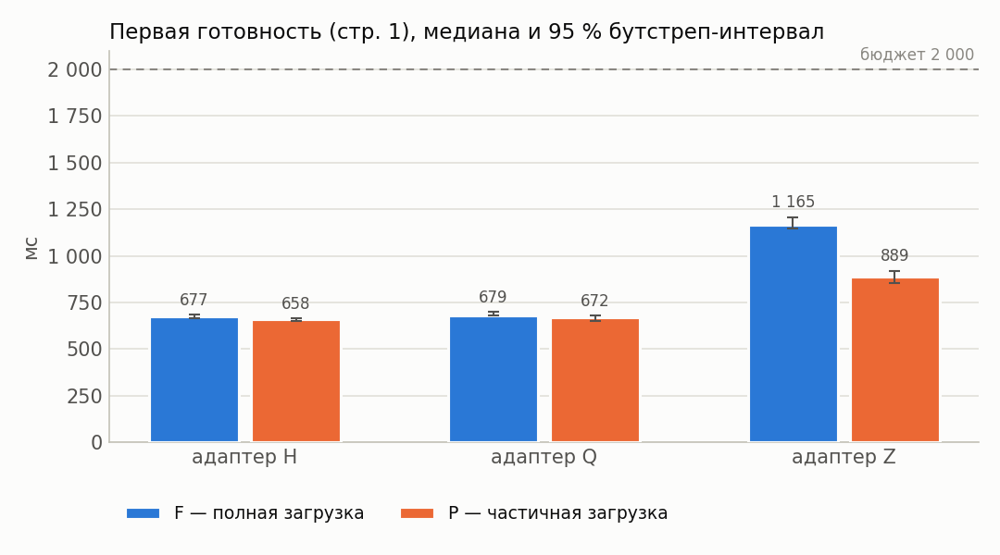

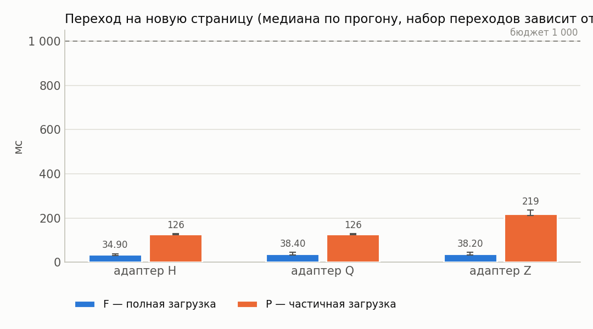

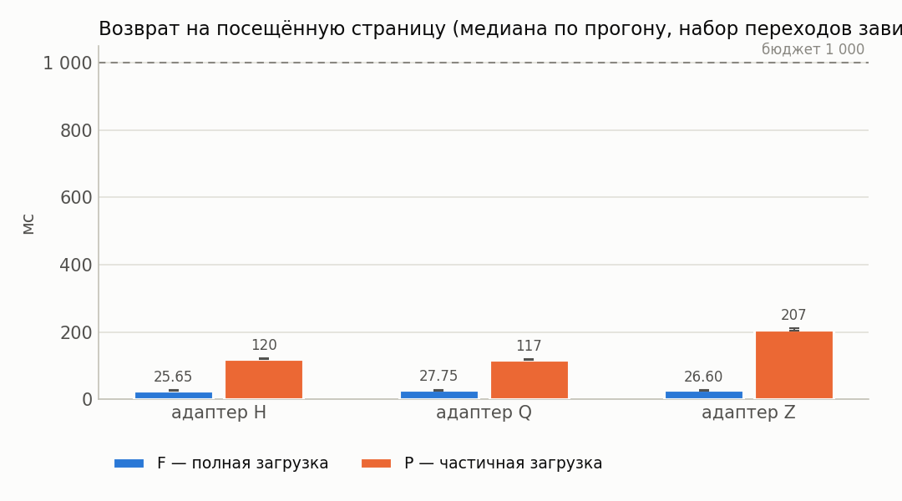

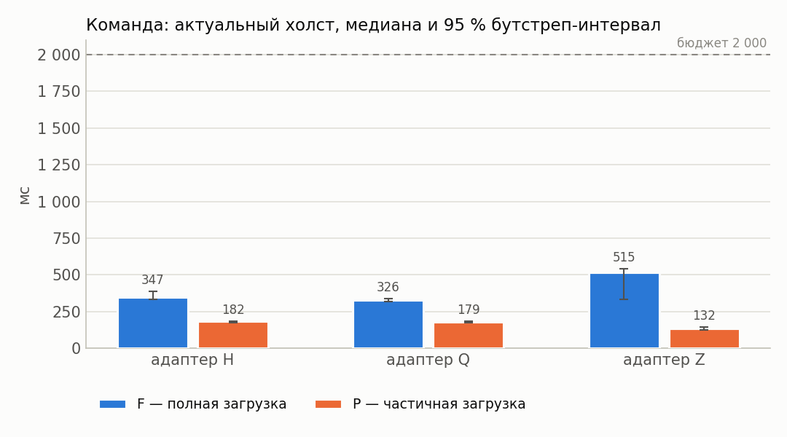

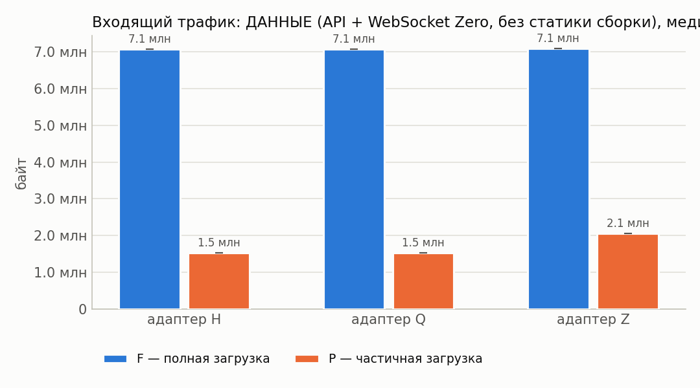

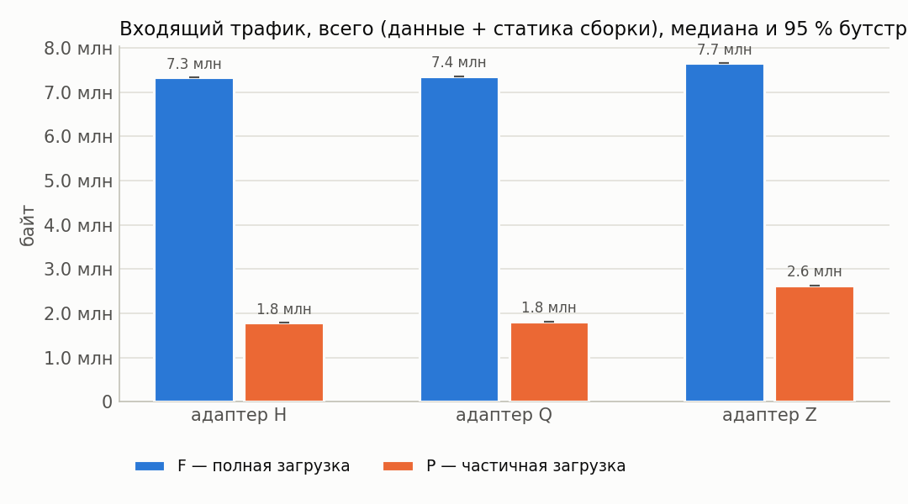

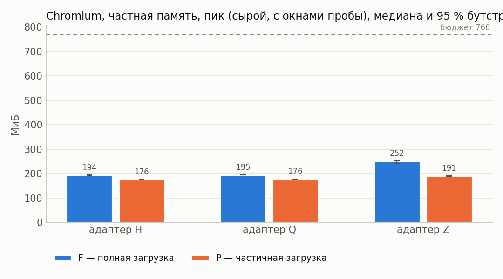

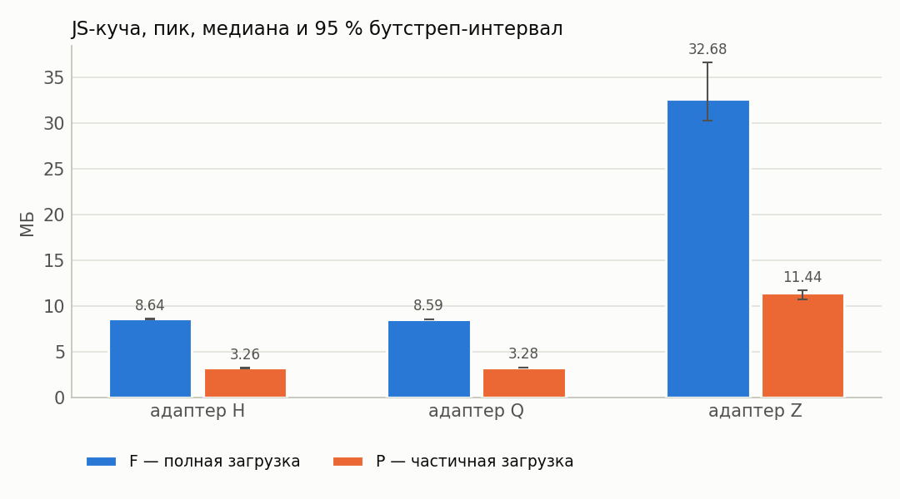

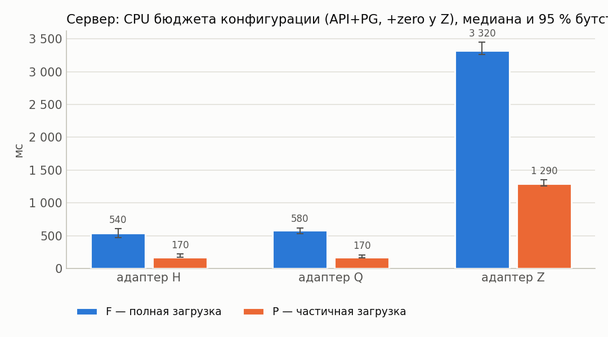

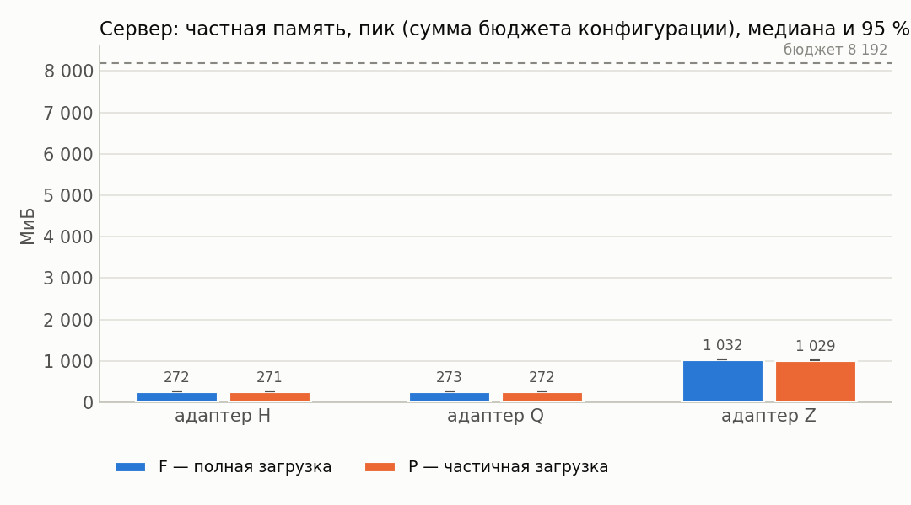

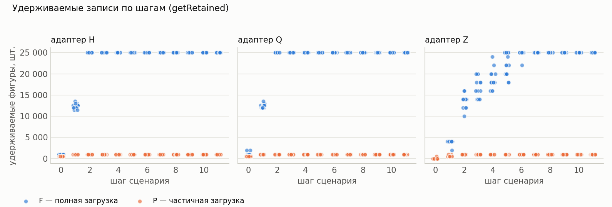

## 12. Выводы

* Оценки изменения P−F ниже — **парные** (медиана поблочных разностей, блок = повторение).
* Все бюджеты §7.4 выполнены для конфигураций: H/F, H/P (cache=1), Q/F, Q/P (cache=1), Z/F, Z/P (cache=1).
* H, cache=1: в режиме P первая готовность на 2 % меньше, чем в F (P/F = 0.98, 95 % интервал [0.96; 1.00]; интервал Δ не содержит 0).
* Q, cache=1: в режиме P первая готовность на 2 % меньше, чем в F (P/F = 0.98, 95 % интервал [0.96; 0.99]; интервал Δ не содержит 0).
* Z, cache=1: в режиме P первая готовность на 23 % меньше, чем в F (P/F = 0.77, 95 % интервал [0.76; 0.78]; интервал Δ не содержит 0).
* H, cache=1: в режиме P пик частной памяти Chromium на 10 % меньше, чем в F (P/F = 0.90, 95 % интервал [0.90; 0.92]; интервал Δ не содержит 0).
* Q, cache=1: в режиме P пик частной памяти Chromium на 9 % меньше, чем в F (P/F = 0.91, 95 % интервал [0.89; 0.91]; интервал Δ не содержит 0).
* Z, cache=1: в режиме P пик частной памяти Chromium на 24 % меньше, чем в F (P/F = 0.76, 95 % интервал [0.74; 0.79]; интервал Δ не содержит 0).
* H, cache=1: в режиме P входящий трафик на 76 % меньше, чем в F (P/F = 0.24, 95 % интервал [0.24; 0.24]; интервал Δ не содержит 0).
* Q, cache=1: в режиме P входящий трафик на 75 % меньше, чем в F (P/F = 0.25, 95 % интервал [0.25; 0.25]; интервал Δ не содержит 0).
* Z, cache=1: в режиме P входящий трафик на 66 % меньше, чем в F (P/F = 0.34, 95 % интервал [0.34; 0.34]; интервал Δ не содержит 0).
* H, cache=1: в режиме P максимум удерживаемых фигур на 96 % меньше, чем в F (P/F = 0.04, 95 % интервал [0.04; 0.04]; интервал Δ не содержит 0).
* Q, cache=1: в режиме P максимум удерживаемых фигур на 96 % меньше, чем в F (P/F = 0.04, 95 % интервал [0.04; 0.04]; интервал Δ не содержит 0).
* Z, cache=1: в режиме P максимум удерживаемых фигур на 96 % меньше, чем в F (P/F = 0.04, 95 % интервал [0.04; 0.04]; интервал Δ не содержит 0).
* H, cache=1: в режиме P переход на новую страницу на 263 % больше, чем в F (P/F = 3.63, 95 % интервал [3.39; 4.02]; интервал Δ не содержит 0).
* Q, cache=1: в режиме P переход на новую страницу на 225 % больше, чем в F (P/F = 3.25, 95 % интервал [3.08; 3.78]; интервал Δ не содержит 0).
* Z, cache=1: в режиме P переход на новую страницу на 465 % больше, чем в F (P/F = 5.65, 95 % интервал [4.95; 6.34]; интервал Δ не содержит 0).
* Перекрёстная проверка обмена сошлась во всех конфигурациях (наибольшее расхождение шейпера и суммы CDP HTTP+WebSocket — 0.1 %).
* У конфигураций Z/F, Z/P (cache=1) холст успевает обновиться раньше подтверждения сервера — доставка синхронизацией опережает ответ по HTTP; обе величины приведены отдельно в разделе 4.
* Точечная доля успеха ≥ 95 %: H/F, H/P (cache=1), Q/F, Q/P (cache=1), Z/F, Z/P (cache=1).
* Нижняя граница интервала Уилсона ниже 95 % для: H/F, H/P (cache=1), Q/F, Q/P (cache=1), Z/F, Z/P (cache=1). При n < 73 прогонов она не достигает 95 % даже без единого отказа, поэтому здесь это ограничение объёма серии, а не свидетельство ненадёжности; при наличии отказов — см. раздел «Ошибки».
* Условия применимости частичной загрузки: режим P оправдан, когда его выигрыш по первой готовности/памяти/трафику подтверждён интервалом (не содержащим 0) и при этом переходы на новые страницы и команда до холста остаются в бюджете, а удерживаемые записи не выходят за объявленное окно.
